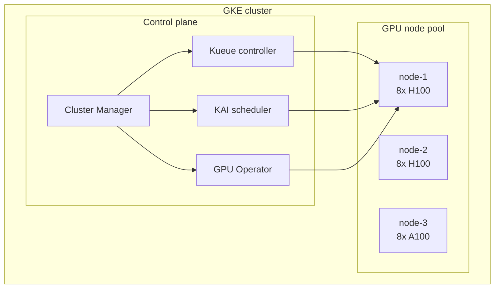

# 19.2 Capstone: a Kubernetes GPU platform with KAI and Kueue

| Field | Value |
|---|---|
| Level | Advanced |
| Priority tier | 1 |
| Lab venue | GCP / GKE |
| Part | Part 19: Capstones, design and interview readiness |
| Primary sources | NVIDIA Zero-to-Hero Volume 24 (Kubernetes GPU platform capstone); Part 11 (GPU Kubernetes); Part 14 (Distributed training); Part 16 (MLOps) |
| Cross-references | Chapter 11.16 (KAI gang scheduling); Chapter 11.18 (Kueue); Chapter 11.22 (KServe); Chapter 14 (Distributed training); Chapter 16.14 (Platform design) |
| Coverage file | `planning/coverage/chapters/19-02.md` |
| Claim & number ledger | `planning/ledgers/19-02.md` |

## Why this matters for AI infrastructure

A Kubernetes GPU platform is the production shape of a cloud-native AI factory. The capstone ties together the GKE cluster, the GPU node pool, Kueue's multi-tenant queues, KAI's gang scheduling, KServe's inference layer, Argo Workflows' pipelines, the observability stack, and the FinOps dashboard. A team that has read every chapter in Parts 11, 14, and 16 can describe each piece; a team that has run this capstone knows how the pieces fit together.

The capstone is the integrated picture. The capstone is the reference design. The capstone is the interview anchor. The capstone is the on-call reference.

```text
Why the Kubernetes GPU platform capstone matters (V24; Parts 11, 14, 16):
- A Kubernetes GPU platform is the production shape of cloud-native AI. The
  capstone is what ties Parts 11, 14, and 16 together into a deployable system.
- The capstone has three perspectives: the platform engineer's view (how
  to provision the cluster); the ML engineer's view (how to submit jobs
  and read the output); the on-call engineer's view (how to debug and
  recover).
- The capstone is the reference design. Every chapter in Parts 11, 14, and
  16 maps to a section of the capstone. The capstone is the integrated picture.
```

Three operational realities make this capstone a platform-team deliverable rather than a tutorial:

1. **The capstone is the reference design.** The platform team references the capstone when adding a new team; the platform team references the capstone when upgrading the cluster; the platform team references the capstone when debugging a job. The capstone is the canonical pattern.
2. **The capstone is the interview anchor.** The candidate is asked "how would you build a Kubernetes GPU platform?"; the candidate points at this capstone. The capstone is the platform team's answer.
3. **The capstone is the on-call reference.** The on-call engineer follows the runbook; the runbook points at the capstone; the on-call engineer fixes the cluster. The capstone is the on-call's guide.

**Before a team can claim they have built a Kubernetes GPU platform, the team must have run this capstone. A team that has not run the capstone has not integrated the pieces.**

## Prerequisites and outcomes

### Prerequisites

- Chapter 11 (GPU Kubernetes) for the cluster setup.
- Chapter 14 (Distributed training) for the workload patterns.
- Chapter 16 (MLOps) for the platform stack.

### Outcomes

After completing this capstone you will be able to:

1. Provision a GKE cluster with the GPU node pool; install the GPU Operator; install Kueue; install KAI.
2. Configure Kueue ClusterQueues and LocalQueues for multi-tenant GPU scheduling.
3. Configure KServe InferenceServices with auto-scaling and canary rollouts.
4. Configure Argo Workflows pipelines for training and batch inference.
5. Wire the observability stack (Prometheus, Grafana, Loki, Tempo) and the FinOps dashboard (Kubecost).
6. Operate the cluster with on-call runbooks, incident response, and capacity planning.

---

## 1. The cluster topology

### 1.1 The cluster

The cluster is a GKE Autopilot or Standard cluster with a GPU node pool. The cluster has the GPU Operator, Kueue, KAI, KServe, Argo Workflows, Prometheus, Grafana, Loki, Tempo, and Kubecost.



The pattern is: a single cluster with a control plane (Kueue, KAI, GPU Operator) and a GPU node pool; the cluster runs training and inference workloads.

### 1.2 The GPU node pool

The GPU node pool is provisioned with the GPU type (H100, A100, L40S); the node pool has the desired size and the autoscaling configuration.

```bash
# Create a GPU node pool
gcloud container node-pools create gpu-pool \
  --cluster ml-platform \
  --machine-type a3-highgpu-8g \
  --num-nodes 2 \
  --enable-autoscaling \
  --min-nodes 0 \
  --max-nodes 16 \
  --accelerator type=nvidia-h100-80gb,count=8
```

The pattern is: the node pool has the desired GPU type; the node pool has the desired size; the node pool has the autoscaling configuration.

---

## 2. Kueue multi-tenant queues

### 2.1 The ClusterQueue hierarchy

Kueue's ClusterQueues aggregate the GPU quota across the cluster. The LocalQueues per team submit to the ClusterQueues; the ClusterQueues enforce the quota.

```yaml
# code/part19/kueue_cluster_queue.yaml (shape only)
apiVersion: kueue.x-k8s.io/v1beta1
kind: ClusterQueue
metadata:
  name: cluster-queue-h100
spec:
  cohort: default
  flavorQuotas:
    - name: h100-sxm5-80gb
      resources:
        - name: cpu
          nominalQuota: 800
        - name: memory
          nominalQuota: 4Ti
        - name: nvidia.com/gpu
          nominalQuota: 32
---
apiVersion: kueue.x-k8s.io/v1beta1
kind: ClusterQueue
metadata:
  name: cluster-queue-a100
spec:
  cohort: default
  flavorQuotas:
    - name: a100-40gb
      resources:
        - name: cpu
          nominalQuota: 1600
        - name: memory
          nominalQuota: 8Ti
        - name: nvidia.com/gpu
          nominalQuota: 64
```

The pattern is: one ClusterQueue per GPU type; the ClusterQueue has the GPU quota; the ClusterQueue is the team's entry point.

### 2.2 The LocalQueue per team

The LocalQueue per team submits to the ClusterQueue. The LocalQueue has the namespace; the LocalQueue has the team's per-team quota.

```yaml
# code/part19/kueue_local_queue.yaml (shape only)
apiVersion: kueue.x-k8s.io/v1beta1
kind: LocalQueue
metadata:
  name: team-data-science-queue
  namespace: team-data-science
spec:
  clusterQueue: cluster-queue-h100
```

The pattern is: one LocalQueue per team; the LocalQueue submits to the appropriate ClusterQueue; the ClusterQueue enforces the quota.

### 2.3 The workload submission

The workload submission requests the team's LocalQueue. Kueue schedules the workload based on the ClusterQueue's quota.

```yaml
# code/part19/workload_with_kueue.yaml (shape only)
apiVersion: batch.volcano.sh/v1alpha1
kind: Job
metadata:
  name: training-job
  namespace: team-data-science
  labels:
    kueue.x-k8s.io/queue-name: team-data-science-queue
spec:
  minAvailable: 8
  tasks:
    - replicas: 8
      template:
        spec:
          containers:
            - name: trainer
              image: my-trainer:v1
              resources:
                limits:
                  nvidia.com/gpu: 1
```

The pattern is: the job is labeled with the queue name; Kueue schedules the job; the job runs when the ClusterQueue has capacity.

---

## 3. KAI gang scheduling

### 3.1 The KAI PodGroup

KAI's PodGroup enforces gang scheduling. The PodGroup declares the minimum number of pods; KAI holds the pods until the minimum is available.

```yaml
# code/part19/kai_podgroup.yaml (shape only)
apiVersion: scheduling.run.ai/v2
kind: PodGroup
metadata:
  name: training-job
  namespace: team-data-science
spec:
  minMember: 8
  scheduleTimeoutSeconds: 600
  resources:
    gpu:
      count: 8
```

The pattern is: the PodGroup declares the minimum members and the GPU count; KAI schedules the pods together; the workload runs when all pods are ready.

### 3.2 The workload with KAI

The workload is a Volcano Job with the KAI PodGroup. The Job specifies the replicas; the PodGroup specifies the minimum members.

```yaml
# code/part19/workload_with_kai.yaml (shape only)
apiVersion: batch.volcano.sh/v1alpha1
kind: Job
metadata:
  name: training-job
  namespace: team-data-science
spec:
  minAvailable: 8
  tasks:
    - replicas: 8
      template:
        spec:
          schedulerName: kai-scheduler
          containers:
            - name: trainer
              image: my-trainer:v1
              resources:
                limits:
                  nvidia.com/gpu: 1
```

The pattern is: the Job is annotated with the KAI scheduler; KAI holds the pods; the Job runs when all pods are scheduled.

---

## 4. KServe inference

### 4.1 The InferenceService

The InferenceService is the KServe abstraction for serving models. The InferenceService has a predictor (the model server); the InferenceService has an optional transformer (for pre/post-processing); the InferenceService has an optional explainer.

```yaml
# code/part19/kserve_inference_service.yaml (shape only)
apiVersion: serving.kserve.io/v1beta1
kind: InferenceService
metadata:
  name: churn-model
  namespace: team-data-science
spec:
  predictor:
    model:
      modelFormat:
        name: sklearn
      runtime: kserve-mlserver
      storageUri: s3://mlflow-artifacts/churn-model/production/model.pkl
      resources:
        limits:
          cpu: "4"
          memory: 8Gi
          nvidia.com/gpu: "1"
    minReplicas: 1
    maxReplicas: 10
    scaleTarget: 80
    scaleMetric: concurrency
```

The pattern is: the InferenceService declares the model format, the storage URI, the resources, and the autoscaling. KServe handles the rest.

### 4.2 The canary rollout

The canary rollout uses the canary traffic percent field. KServe routes a fraction of the traffic to the canary InferenceService; the rollout completes when the canary's SLO is met.

```yaml
# code/part19/kserve_canary.yaml (shape only)
apiVersion: serving.kserve.io/v1beta1
kind: InferenceService
metadata:
  name: churn-model
  namespace: team-data-science
spec:
  predictor:
    canaryTrafficPercent: 10
    canary:
      model:
        modelFormat: {name: sklearn}
        storageUri: s3://mlflow-artifacts/churn-model/canary/model.pkl
    model:
      modelFormat: {name: sklearn}
      storageUri: s3://mlflow-artifacts/churn-model/production/model.pkl
```

The pattern is: the canary InferenceService is declared; the traffic is split; the canary runs the SLO check; the rollout completes on success.

---

## 5. Argo Workflows pipelines

### 5.1 The training pipeline

The training pipeline runs the DAG of stages: prepare data, train, evaluate, register. The pipeline is triggered by a workflow event; the pipeline runs on the GPU node pool.

```yaml
# code/part19/argo_training_workflow.yaml (shape only)
apiVersion: argoproj.io/v1alpha1
kind: Workflow
metadata:
  generateName: training-pipeline-
spec:
  entrypoint: pipeline
  templates:
    - name: pipeline
      dag:
        tasks:
          - name: prepare
            template: prepare
          - name: train
            template: train
            dependencies: [prepare]
          - name: evaluate
            template: evaluate
            dependencies: [train]
          - name: register
            template: register
            dependencies: [evaluate]
    - name: train
      container:
        image: my-trainer:v1
        resources:
          requests:
            nvidia.com/gpu: 8
```

The pattern is: the DAG declares the stages; the stages depend on each other; the workflow runs on the GPU node pool.

---

## 6. Day-2 operations

### 6.1 The upgrade process

The upgrade process is the pattern for upgrading Kubernetes, Kueue, KAI, and KServe without downtime.

```text
Kubernetes GPU platform upgrade process:
1. Drain a node: kubectl drain node-1 --ignore-daemonsets
2. Cordon the node: kubectl cordon node-1
3. Upgrade the node's kubelet and container runtime
4. Restart kubelet: systemctl restart kubelet
5. Uncordon the node: kubectl uncordon node-1
6. Repeat for every node
7. Upgrade the control plane: gcloud container clusters upgrade
```

The pattern is: drain, upgrade, restart, uncordon. The cluster continues to serve traffic during the rolling upgrade.

### 6.2 The incident response

The incident response is the pattern for responding to a cluster failure.

```text
Kubernetes GPU platform incident response:
1. Detect: Prometheus alert (node down, pod pending, GPU OOM)
2. Triage: kubectl describe, kubectl logs, kubectl exec
3. Mitigate: drain the node, restart the pod, scale the deployment
4. Resolve: root cause analysis, runbook update, post-mortem
```

The pattern is: detect, triage, mitigate, resolve. The runbook is the on-call's guide.

---

## 7. Hands-on lab

This lab walks through the Kubernetes GPU platform capstone: the cluster, the queues, the inference, the pipelines. The lab is **untested** in this repository.

### 7.1 Prerequisites

- A GCP project with billing enabled.
- gcloud and kubectl installed.
- At least 8x H100 GPU quota.

### 7.2 Step 1: create the GKE cluster

```bash
gcloud container clusters create ml-platform \
  --region us-central1 \
  --enable-autoscaling \
  --min-nodes 1 --max-nodes 16
```

### 7.3 Step 2: create the GPU node pool

```bash
gcloud container node-pools create gpu-pool \
  --cluster ml-platform \
  --machine-type a3-highgpu-8g \
  --num-nodes 2 --enable-autoscaling --min-nodes 0 --max-nodes 16 \
  --accelerator type=nvidia-h100-80gb,count=8
```

### 7.4 Step 3: install the GPU Operator, Kueue, KAI

```bash
helm install gpu-operator nvidia/gpu-operator --namespace gpu-operator
helm install kueue kueue/kueue --namespace kueue-system
helm install kai kai/kai-scheduler --namespace kai-scheduler
```

### 7.5 Step 4: create the ClusterQueues and LocalQueues

```bash
kubectl apply -f code/part19/kueue_cluster_queue.yaml
kubectl apply -f code/part19/kueue_local_queue.yaml
```

### 7.6 Step 5: deploy an InferenceService

```bash
kubectl apply -f code/part19/kserve_inference_service.yaml
kubectl get inferenceservice churn-model -n team-data-science -w
# expected: READY=True within 60 seconds
```

### 7.7 Step 6: submit a training job

```bash
kubectl create job training-job --image=my-trainer:v1 -- /bin/sh -c "python train.py"
```

### 7.8 What to record

After the lab, you should be able to answer five questions in five seconds each:

1. What is the current cluster utilisation?
2. What is the current GPU pool utilisation per team?
3. What is the current Kueue queue depth?
4. What is the most recent InferenceService deployment?
5. What is the current cost per team per month?

If any takes more than 30 seconds, the Kubernetes GPU platform is not yet a production service. The lab is **untested** against a live GKE cluster.

---

## Exercises

1. **Add a new team's namespace.** Create a namespace with the team's LocalQueue; verify the team can submit jobs. *Solution sketch:* `kubectl create namespace`; apply the LocalQueue YAML.
2. **Add a new GPU type.** Add a new ClusterQueue for a different GPU type (e.g. L40S). *Solution sketch:* the ClusterQueue YAML with the new GPU type.
3. **Add a canary rollout to the InferenceService.** Deploy a new model version with 10% canary traffic; verify the canary runs the SLO check. *Solution sketch:* the InferenceService YAML with `canaryTrafficPercent: 10`.
4. **Add a training pipeline.** Create an Argo Workflow that runs the training DAG. *Solution sketch:* the Argo Workflow YAML.
5. **Add an HPA for the InferenceService.** Configure a Horizontal Pod Autoscaler for the InferenceService. *Solution sketch:* the HPA YAML with the scale target.
6. **Add a FinOps dashboard.** Deploy Kubecost; verify the per-team cost is displayed. *Solution sketch:* `helm install kubecost kubecost/cost-analyzer`.

---

## Checkpoint questions

<details><summary>1. What is Kueue?</summary>
The Kubernetes-native job queue manager. Kueue manages the ClusterQueues and LocalQueues; Kueue enforces the GPU quota; Kueue integrates with the scheduler. Kueue is what makes multi-tenant Kubernetes GPU clusters possible.
</details>

<details><summary>2. What is KAI?</summary>
The NVIDIA-native gang scheduler for Kubernetes. KAI enforces all-or-nothing PodGroup scheduling; KAI schedules multi-pod jobs together. KAI is the scheduler for multi-node training.
</details>

<details><summary>3. What is the difference between Kueue and KAI?</summary>
Kueue is the queue manager; KAI is the scheduler. Kueue decides which jobs can enter the queue; KAI decides when the jobs' pods can start. Together, they form the multi-tenant, multi-node scheduling chain.
</details>

<details><summary>4. What is KServe?</summary>
The Kubernetes-native model serving framework. KServe abstracts the model server (Triton, vLLM, TensorRT-LLM, NIM); KServe provides autoscaling and canary rollouts. KServe is the inference layer of the Kubernetes GPU platform.
</details>

<details><summary>5. What is the most common Kubernetes GPU platform failure?</summary>
GPU OOM. The workload requests more GPU memory than the node has; Kubernetes kills the pod. The fix is to reduce the model's memory footprint, enable gradient checkpointing, or scale up the node pool.
</details>

<details><summary>6. What is the most dangerous Kubernetes GPU platform failure?</summary>
The control plane is down. Kueue, KAI, and KServe are unavailable; new jobs cannot be scheduled; active jobs continue to run. The fix is to restart the control plane; verify the etcd; verify the API server.
</details>

<details><summary>7. What is the difference between gang scheduling and queue scheduling?</summary>
Gang scheduling (KAI) schedules all pods of a job together. Queue scheduling (Kueue) decides which jobs enter the queue. Gang scheduling is about timing; queue scheduling is about admission. Together, they form the scheduling chain.
</details>

<details><summary>8. What is the most important Kubernetes GPU platform metric?</summary>
Cluster utilisation rate. The metric tells the team what fraction of the cluster is in use. A low utilisation rate indicates over-provisioning; a high utilisation rate indicates under-provisioning.
</details>

<details><summary>9. Why is the Kubernetes GPU platform capstone a Tier 1 chapter?</summary>
Because the capstone is the reference design. The capstone is what the platform team references; the capstone is what the interview candidate points at; the capstone is what the on-call engineer follows.
</details>

<details><summary>10. What is the relationship between Kueue and Volcano?</summary>
Kueue is the queue manager; Volcano (or KAI) is the scheduler. Kueue decides admission; Volcano decides ordering. Together, they form the multi-tenant, multi-node scheduling chain.
</details>

<details><summary>11. What is the difference between KServe and Seldon Core?</summary>
KServe is the Kubernetes-native serving framework with built-in auto-scaling and canary rollouts. Seldon Core is the inference graph framework with built-in explainers and routers. Both are production-grade; the choice depends on the team's preference.
</details>

<details><summary>12. What is the most important KServe metric?</summary>
Inference latency p99. The metric tells the team whether the inference is meeting the SLO. A high p99 latency indicates the inference is too slow; the alert pages the on-call to scale the deployment.
</details>

<details><summary>13. What is the relationship between Argo Workflows and Kueue?</summary>
Argo Workflows is the pipeline orchestrator; Kueue is the queue manager. Argo Workflows submits jobs to Kueue; Kueue queues the jobs; the scheduler runs the jobs. Together, they form the pipeline chain.
</details>

<details><summary>14. What is the relationship between the GPU Operator and the NVIDIA driver?</summary>
The GPU Operator manages the NVIDIA driver installation on every GPU node; the NVIDIA driver is the kernel-level driver for the GPU. Together, they form the GPU stack chain: the GPU Operator is the management; the NVIDIA driver is the runtime.
</details>

<details><summary>15. What is the difference between an HPA and KEDA?</summary>
HPA (Horizontal Pod Autoscaler) scales based on CPU/memory. KEDA (Kubernetes Event-Driven Autoscaling) scales based on event sources (Kafka, Prometheus, etc.). HPA is for steady-state scaling; KEDA is for event-driven scaling.
</details>

<details><summary>16. What is the difference between a Deployment and a StatefulSet?</summary>
A Deployment is for stateless workloads. A StatefulSet is for stateful workloads (databases, message queues). The InferenceService is a Deployment; the MLflow backend is a StatefulSet.
</details>

<details><summary>17. What is the relationship between the FinOps dashboard and the GPU pool?</summary>
The FinOps dashboard shows the per-team, per-model, per-month GPU cost. The GPU pool provides the resources; the FinOps dashboard tracks the costs. Together, they inform the capacity planning.
</details>

<details><summary>18. What is the relationship between the Kubernetes GPU platform and the Slurm GPU cluster?</summary>
The Kubernetes GPU platform is the cloud-native shape; the Slurm GPU cluster is the HPC shape. The two can coexist: Slurm runs the HPC training workloads; Kubernetes runs the inference workloads. The two share the same GPU pool if the cluster is shared.
</details>

<details><summary>19. What is the difference between a CRD and an Operator?</summary>
A CRD (Custom Resource Definition) is the schema that defines a custom resource. An Operator is the controller that reconciles the custom resource. The CRD is the data; the Operator is the behaviour.
</details>

<details><summary>20. What five questions should the Kubernetes GPU platform capstone lab let you answer in five seconds each?</summary>
What is the current cluster utilisation. What is the current GPU pool utilisation per team. What is the current Kueue queue depth. What is the most recent InferenceService deployment. What is the current cost per team per month. If any takes more than 30 seconds, the Kubernetes GPU platform is not yet a production service.
</details>

---

## Sources and review notes

- NVIDIA Zero-to-Hero Volume 24 (Kubernetes GPU platform capstone). Source for the GKE cluster, the GPU node pool, Kueue, KAI, KServe, Argo Workflows, observability, and FinOps. The wording has been rewritten in the handbook's voice.
- Part 11 (GPU Kubernetes) for the cluster setup.
- Part 14 (Distributed training) for the workload patterns.
- Part 16 (MLOps) for the platform stack.

### Cross-references to other handbook chapters

- Chapter 11.16 for the KAI gang scheduling.
- Chapter 11.18 for the Kueue multi-tenant queues.
- Chapter 11.22 for the KServe inference.
- Chapter 14 for the distributed training.
- Chapter 16.14 for the platform design FinOps patterns.

### Migrated from `nvidia-devops`

The Kubernetes GPU platform capstone operational patterns draw on Volume 24. The wording has been rewritten in the handbook's voice.

### Explicitly labelled inferences

- The GPU node pool size (16 GPUs) is a starting point; specific sizes depend on the workload.
- The Kueue ClusterQueue quota (32 GPUs) is a starting point; specific quotas depend on the team structure.
- The InferenceService autoscaling target (80%) is a starting point; specific targets depend on the SLO.

### Not verified on live hardware

- The lab in Section 7 is **untested** against a live GKE cluster in this repository.
- The GKE commands assume a project with GPU quota; production deployments may need quota increases.
- The Kueue, KAI, and KServe versions assumed in the lab should be pinned against the current releases.
