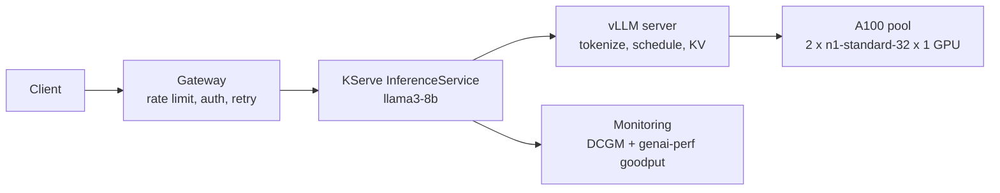
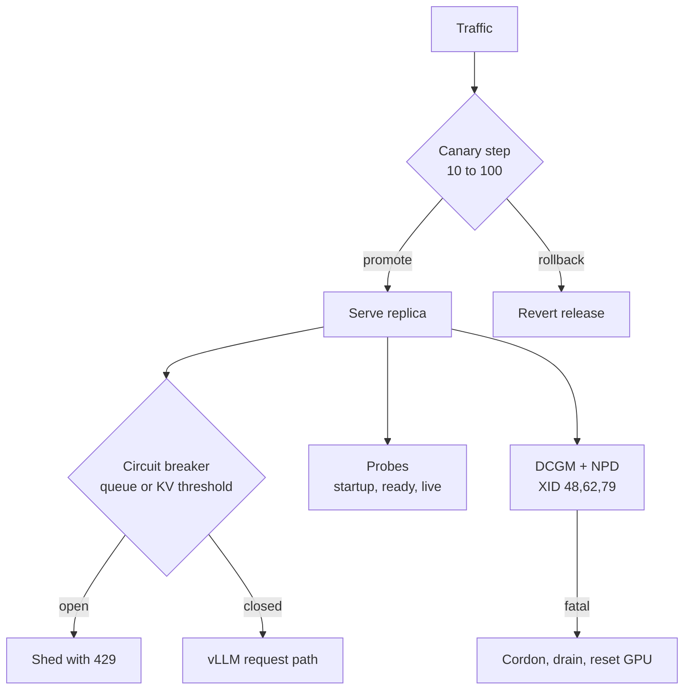

| | |
|---|---|
| **What you'll build** | A complete, load-tested inference service on GKE: a vLLM InferenceService behind KServe, benchmarked with genai-perf, autoscaled on concurrency, and wrapped in the production reliability layer |
| **When to read this** | When you are about to serve a model to production traffic, or when you need to justify one serving engine over another |
| **Prerequisites** | 15.1–15.3, 15.5, 15.6, 15.14–15.16; 16.7; 5.34 |
| **Level** | Advanced |
| **Time** | 90 min |
| **Status** | **drafted** |

## Why this chapter exists

You now know every piece in isolation: GKE node pools from Part 5, Triton internals from Part 15, benchmarking from 15.14, autoscaling from 15.15, reliability from 15.16, and the KServe InferenceService from 16.7. What you may not know is what a production inference stack looks like when all of it has to work together, and which choices are irreversible. A week after launch you cannot swap serving engines casually, and the batch sizes you pick today will be the ones your customers feel in p95 latency for a long time.

The scenario this chapter builds: a standard GKE cluster called `ai-serving` in `us-central1-a`, a node pool of two `n1-standard-32` VMs each with one A100 40 GB GPU, serving `meta-llama/Meta-Llama-3-8B-Instruct` through a KServe InferenceService named `llama3-8b` in the `inference` namespace. Target SLOs: p95 time to first token under 200 ms and p95 inter-token latency under 25 ms. By the end you will have a load-tested service, a goodput number you can defend, autoscaling that survives a traffic spike, and a reliability layer that has been tested against the failure modes that actually happened in V12.

## Prerequisites

You should have worked through Part 5's GKE chapter, read Part 15 chapters 5 through 7, 14, 15 and 16, and read 16.7 for the KServe InferenceService shape. You do not need to have run the code in those chapters, but you should be able to answer: what does PagedAttention do, what is a KV cache, what is the difference between TTFT and ITL, and what does an InferenceService look like in YAML.

**By the end you will be able to:** choose a serving engine for a given workload with a defensible reason; write a vLLM InferenceService that starts on a GKE A100 node; benchmark it with genai-perf and read the percentiles; size `--max-num-seqs` and `--gpu-memory-utilization` from the KV cache arithmetic; and wire the service into the reliability layer: canary rollout, circuit breaker, health checks and GPU failure detection.

## 1. Start from the topology, not the engine

In the first production incident, the team added four GPUs to the serving pool to fix p95 latency. Traffic had not changed, latency stayed flat at 300 ms over the same 120 requests per second, and the new GPUs idled at 22 percent utilization while the original node sat at 80. The bottleneck was never the model. It was a single-threaded Python tokenizer running in the request path, and more GPUs cannot fix a CPU serialization. The team spent two weeks adding capacity to the wrong layer before they read the flame graph.

The fix is to draw the request path before you choose an engine. Every token your user sees travels through the same stops: ingress, gateway, model server, and the tokenizer plus KV cache inside the GPU. Each stop has its own bottleneck class, and the serving engine is only one of them.



| Layer | What it owns | Typical bottleneck | How you see it |
|---|---|---|---|
| Gateway | Auth, rate limit, retry | CPU cores, connection limits | p95 at the edge vs p95 at the pod |
| Server process | Tokenizer, scheduler, HTTP | Single-threaded Python, GIL | CPU utilization on one core |
| GPU | Attention, KV cache | Batching too low, KV full | DCGM GPU and memory utilization |
| Storage | Weight loading, logs | Cold read bandwidth | Pod startup time |

Two rules follow from this topology. First, measure at every layer, because a healthy GPU does not mean a healthy request. Second, the serving engine is the last layer to change: it is the most expensive swap and the least likely to be your bottleneck.

**Decision rule:** before choosing an engine, profile the full request path. If the GPU is idle while p95 is high, fix the layer in front of the GPU.
**In one minute:** the serving engine sits at the bottom of a four-layer request path. Incidents usually live in the other three layers, so you diagnose with per-layer metrics before you touch engine selection.

## 2. Choose the serving engine for the workload

The second incident was a migration story. The team compiled a TensorRT-LLM engine for a 70B model on an H100 node and ran it happily for three months. When the cost team moved the workload to A100 nodes for the 40 GB of cheaper memory, the engine would not load: TensorRT-LLM compiles a binary that is locked to the GPU architecture it was built on, and the H100 engine was worthless on the A100. They had to recompile, revalidate and rebenchmark everything, and the "two-day migration" became two weeks. The engine was the wrong tool for a team that needed to move hardware.

Every serving engine is a different trade between peak performance, flexibility and operational simplicity.

| Engine | Best for | Peak performance | Portability | Operations burden |
|---|---|---|---|---|
| vLLM | Single-model LLM serving, default choice | High, PagedAttention | Container, any GPU the model fits | Low, one process |
| Triton | Multi-model, multi-framework, explicit control | High with backend tuning | Container, model repo per GPU arch | Medium, model management |
| TensorRT-LLM | Peak tokens per GPU, fine-grained tuning | Highest | Lowest, engine locked to GPU arch | High, build step |
| NVIDIA NIM | Turnkey reference, multi-model gateway | High, tuned by NVIDIA | Highest, fixed image | Lowest |
| KServe | The platform layer that hosts any of them | n/a, it wraps an engine | n/a | Medium, CRDs and KEDA |

vLLM is the default for a single LLM model. Its PagedAttention keeps KV cache fragmentation under 4 percent, compared with the 60 to 80 percent reported for naive contiguous allocation, which means you get close to full batch occupancy as the model nears its memory limit. Triton is the right answer when you need multiple models on the same GPU, mixed frameworks, or explicit model lifecycle control with zero-downtime reloads through its explicit model control mode. TensorRT-LLM is the answer when you need the last 10 to 20 percent of tokens per GPU and you accept a compile step that binds the deployment to one GPU architecture. NIM is the answer when you want a reference implementation with the least work: fixed images, a gateway for multi-model routing, and the NIM Operator to manage lifecycle on GKE.

KServe is not a competitor to any of these. It is the platform layer: the InferenceService CRD, the serving runtime container, KEDA-based autoscaling, and the canary and multi-model features. You put vLLM or Triton or TensorRT-LLM or NIM inside a KServe InferenceService and you inherit the operational layer for free.

**Decision rule:** default to vLLM for one LLM model. Choose Triton for multi-model or multi-framework fleets. Choose TensorRT-LLM only when you have measured the vLLM ceiling and the workload will not move GPU hardware for 12 months.
**In one minute:** vLLM is the default. Triton is the multi-model platform. TensorRT-LLM is the peak-performance compile-and-freeze choice, locked to the GPU it was built for. NIM is the turnkey image. KServe hosts all of them.

## 3. Build the node and runtime plane on GKE

The third incident was a classic one, and it wastes the most calendar days. The team deployed the InferenceService, watched pods stuck in `Pending` with the message `Insufficient nvidia.com/gpu`, and started arguing about quotas. The cluster had GPUs. The reason they were invisible was simpler: the node pool image had no CUDA driver installed, so the NVIDIA device plugin never advertised a single GPU, and the scheduler could not see hardware that the kubelet had not reported. The fix was to recreate the node pool with a GPU-attached disk image, and every Pending pod scheduled within minutes.

The node plane has three parts: the VM shape, the GPU attachment, and the taints that keep non-GPU workloads off the machine. On GKE, a GPU node pool is one `gcloud` command with three flags that matter: machine type, accelerator, and GPU driver version.

```bash
gcloud container node-pools create a100-pool \
  --cluster-name=ai-serving \
  --location=us-central1-a \
  --num-nodes=2 \
  --node-locations=us-central1-a \
  --machine-type=n1-standard-32 \
  --accelerator type=nvidia-tesla-a100,count=1,gpu-driver-version=default
```

Each `n1-standard-32` VM gets one A100 40 GB. The VM needs enough host memory to hold the KV cache headroom and the tokenizer working set; 32 vCPU and 208 GB RAM is the 5.34 recipe for this class of model. If the pool will also run training or mixed workloads, add a taint so inference-only traffic stays on GPU nodes:

```bash
gcloud container node-pools update a100-pool \
  --cluster-name=ai-serving \
  --taints gpu-workload=true:NoSchedule
```

Match the taint with a toleration on the InferenceService side, and the scheduler will not put a CPU-only sidecar on your A100. The runtime plane is the next layer: the NVIDIA Container Toolkit runs on each node, the device plugin advertises `nvidia.com/gpu` as the schedulable resource, and the GPU driver version must be compatible with the CUDA version your engine image ships. Two failure classes come out of this layer. If the driver is missing or wrong, pods go Pending with `Insufficient nvidia.com/gpu` and no GPU is visible in the kubelet. If the driver is present but incompatible with the container's CUDA, pods start and crash on the first `cudaMalloc` with a driver version error. The 5.34 troubleshooting table separates these two cases, and you should keep it in your runbook.

**Decision rule:** create the GPU node pool before you write the InferenceService, and verify with `kubectl get nodes` that the capacity line shows `nvidia.com/gpu: 1` per node before you deploy anything.
**In one minute:** the GPU node pool is a machine type, an accelerator line, and a driver version. If the capacity check fails, nothing downstream will schedule, and the fix is always at the node pool, not at the workload.

## 4. Load the model and configure batching

The fourth incident hit during a product launch. Traffic tripled for an afternoon, users pasted large codebases into the prompt, the vLLM pod hit a CUDA out-of-memory crash, and the crash-restart loop kept the whole service down for 40 minutes. The post-mortem found that `--max-num-seqs` was left at the default, `--gpu-memory-utilization` was set to 0.98 to squeeze every byte, and there was no cap on sequence length. The pod was allowed to grow its KV cache until the allocator hit the kernel. The fix was not more memory. It was caps: a lower memory target, a bounded sequence length, and a bounded number of in-flight sequences, so the worst case still fit on the GPU.

The KV cache is the memory you are actually managing. For a 70B model with grouped query attention, the arithmetic in V12 ch08 works out to 327,680 bytes per token, which is 320 KiB per token. A 4,096-token sequence then holds about 1.25 GiB of KV cache, and a 128K sequence holds about 39 GB. With multi-head attention instead of grouped query attention the same 128K sequence needs 312.5 GB, so grouped query attention saves 87.5 percent, or a factor of 8, of KV memory. For our 8B model the derived arithmetic is smaller: 32 layers, 8 KV heads and a 128-dimensional head give 128 KiB per token, or about 512 MiB per 4,096-token sequence. These 8B figures are inferences from the model spec, not a number in the corpus, and you should recompute them for whatever model you deploy.

The batching knobs follow directly from that arithmetic. `--max-num-seqs` caps concurrent sequences so the scheduler cannot overcommit. `--max-model-len` caps sequence length so one user cannot eat the KV pool. `--gpu-memory-utilization` is the fraction of GPU memory vLLM is allowed to use, and leaving headroom below 1.0 is what prevents the crash from the incident. Chunked prefill lets a long prompt be processed in slices so it does not block short requests, and prefix caching makes repeated system prompts and RAG templates cost nearly nothing on subsequent requests.

```yaml
apiVersion: serving.kserve.io/v1beta1
kind: InferenceService
metadata:
  name: llama3-8b
  namespace: inference
spec:
  predictor:
    model:
      modelFormat:
        name: vllm
      runtime: kserve-vllm
    minReplicas: 1
    maxReplicas: 4
    workerSpec:
      containers:
        - name: kserve-vllm
          image: kserve/vllm:0.2.46
          args:
            - --model=meta-llama/Meta-Llama-3-8B-Instruct
            - --dtype=auto
            - --gpu-memory-utilization=0.90
            - --max-num-seqs=128
            - --max-model-len=16384
            - --max-num-batched-tokens=2048
            - --enable-chunked-prefill
            - --enable-prefix-caching
            - --swap-space=0
      resources:
        limits:
          nvidia.com/gpu: "1"
```

The specific values above are labeled starting points, not derived constants: `--gpu-memory-utilization=0.90` leaves 10 percent headroom, `--max-num-seqs=128` and `--max-model-len=16384` are the caps from the incident fix, and `--swap-space=0` says the KV cache never spills to host memory, so the failure mode is a clean 429 under the circuit breaker rather than a slow degraded response. If you swap the model, recompute the KV arithmetic and adjust these three values together.

If you serve many models on the same node instead, the Triton equivalent is a model repository where each model carries a `config.pbtxt`. The Triton knobs live in the file, not on a command line: `max_batch_size` sets the per-model ceiling, `dynamic_batching.preferred_batch_size` shapes the batching policy, `dynamic_batching.max_queue_delay_microseconds` caps how long a request waits for a partner, and an `instance_group` pins the model to a GPU. Triton listens on 8000 for gRPC inference, 8001 for HTTP and 8002 for metrics, and you manage models at runtime with `--model-control-mode=explicit` so reloads are zero-downtime.

**Decision rule:** derive `--max-num-seqs` and `--max-model-len` from the KV cache arithmetic for your model, then leave memory headroom below 1.0 so the worst-case batch still fits. A crash loop under load is a batching configuration bug, not a capacity bug.
**In one minute:** KV cache bytes per token is the number to compute first. Caps on sequences, tokens and memory turn an unpredictable crash into a clean rejection. In vLLM the caps are server flags; in Triton they live in each model's config.pbtxt.

## 5. Load-test with genai-perf before you trust the SLO

The fifth incident is the most expensive one to learn. The team benchmarked in staging with 64-token prompts, reported 3,400 tokens per second and a p99 of 45 ms, and shipped. Production traffic was retrieval-augmented generation with 4,096-token prompts, and the first real p95 time to first token was 6 seconds, with 24 percent of requests timing out at the gateway. The staging benchmark was a lie by omission: it measured a workload the production traffic would never have. The rule that came out of it is that the synthetic input and output lengths in your benchmark must match the real traffic distribution, or the numbers mean nothing.

genai-perf is the NVIDIA tool built for exactly this. It drives the service with a controlled load and reports the percentiles that map to your SLOs.

```bash
genai-perf profile \
  --service-type openai \
  --endpoint-type chat \
  --url http://llama3-8b.inference.svc:8080 \
  -m meta-llama/Meta-Llama-3-8B-Instruct \
  --streaming \
  --concurrency 32 \
  --synthetic-input-tokens-mean 1024 \
  --synthetic-input-tokens-stddev 128 \
  --output-tokens-mean 256 \
  --output-tokens-stddev 32 \
  --measurement-interval 10000 \
  --generate-plots
```

The synthetic tokens mean and stddev come from your real traffic logs: the launch incident had 4,096-token RAG prompts, so a benchmark at a 1,024 mean would have caught the gap. Two design choices in the command matter. First, genai-perf's default is a closed-loop load, where the next request is sent after the previous one finishes; that measures what the system can do under a fixed number of in-flight requests. For production-like traffic you want open-loop, where requests arrive on a Poisson schedule independent of the response, which is what exposes queueing collapse. Second, `--streaming` is on because your SLOs are TTFT and ITL, not total time, and streaming is how those two become measurable.

The number you publish is not raw throughput. It is goodput: the sustainable tokens per GPU per second that meet both the TTFT and ITL SLOs at the same time. You sweep concurrency, plot goodput against load, and pick the operating point just before goodput starts to fall. That point is what your autoscaler should defend, and it is the number you put in the capacity plan.

**Decision rule:** benchmark at the production prompt-length distribution, in open-loop mode, and report goodput at the concurrency you will actually run. A staging number measured at the wrong input length is worse than no number.
**In one minute:** genai-perf gives you TTFT and ITL percentiles under controlled load. Goodput is the throughput that meets both SLOs at once, and it is the number your autoscaler targets.

## 6. Autoscale on concurrency, not CPU

The sixth incident happened on a promotion day. Traffic arrived in a step, and the horizontal pod autoscaler reacted to CPU, which on a GPU node barely moves until the GPU is already saturated. By the time HPA saw pressure it had scaled from 4 to 12 replicas, and every new replica spent its first minutes pulling the same model weights from shared storage, which saturated the storage network and slowed the existing pods down. On top of that, the readiness probe timeout was 1 second, so while the new pods loaded weights the probe marked them unready, the load balancer dropped them, and the spike hit 100 percent 503s. Three configuration mistakes, each visible in the YAML, produced a total outage from a traffic spike that the cluster could have handled at 6 replicas.

Autoscaling an inference service needs three different settings that the generic HPA page does not emphasize. The metric, the scale target, and the probe timing.

The metric must be concurrency: the number of requests the service is currently processing. vLLM exposes it, KServe reads it through KEDA, and it moves in step with load long before CPU does. CPU on a serving node is a lagging indicator because the GPU does the work, and a request queue growing while the CPU sits at 15 percent is the exact case you must catch.

The scale target is the concurrency per replica you measured in section 5, the operating point just before goodput falls. In the 16.7 convention this is the `scaleTarget` on the InferenceService, with the metric named by `scaleMetric`. We start at a scale target of 8 concurrent requests per replica, which is a labeled starting point to be replaced by your own benchmark, with a minimum of 1 replica and a maximum of 4 on this two-node pool, because the fourth replica already uses both A100s twice over and beyond that the autoscaler cannot add capacity.

The probe timing must survive the slowest thing the pod does, which is loading weights. A vLLM pod loading an 8B model from shared storage can take several minutes before it answers health. The probe settings from 15.15 are the reference shape: a startup probe on the health endpoint with a 30-second period, a 10-second timeout and a 600-second failure window, so the pod gets 10 minutes to load before Kubernetes gives up; a readiness probe at a 5-second period with a 5-second timeout and a threshold of 3; and a liveness probe on the ping endpoint at a 15-second period, 3-second timeout, 5 failures. If your startup probe window is shorter than your weight load time, you will reproduce the incident: scale up, probe out, outage.

```yaml
apiVersion: autoscaling.knative.dev/v1
kind: KnativeHpa
metadata:
  name: llama3-8b
  namespace: inference
spec:
  scaleTargetRef:
    apiVersion: serving.kserve.io/v1beta1
    kind: InferenceService
    name: llama3-8b
  minReplicas: 1
  maxReplicas: 4
  metrics:
    - type: Concurrency
      target:
        type: Utilization
        averageValue: "8"
```

The concurrency target of 8 in this example is the same labeled starting point from the 16.7 convention. Replace it with the number from your genai-perf sweep, and re-derive `maxReplicas` from the GPU count so the autoscaler never promises replicas the pool cannot run.

**Decision rule:** autoscale on concurrency with a target from your goodput sweep, and make the startup probe window longer than your worst-case weight load time. Scaling on CPU on a GPU node is scaling on a lagging indicator.
**In one minute:** the metric is concurrency, the target is your per-replica goodput point, and the startup probe must survive weight loading. Get any of the three wrong and a traffic spike becomes an outage.

## 7. Build the reliability layer and test the failures

The seventh incident was a hardware failure wearing a software costume. DCGM logged XID 62, a double-bit ECC error, on GPU 3 of an eight-GPU node running tensor-parallel-8. The HTTP server was still alive, the load balancer was still sending traffic, and one request in eight went to the poisoned GPU and produced garbage tokens that were never flagged. The pod looked healthy because its process had not crashed. The team found it not from the load balancer but from the DCGM logs, and the fix path was cordon, drain, and reset the GPU with `nvidia-smi --gpu-reset`. The lesson is that GPU failures are silent to the network layer, and you need a detector that reads GPU health, not HTTP status.

The reliability layer has four parts, and you should test each one in staging before production.

Canary rollout. You release a new engine version or model revision at 10, 25, 50, 75 and then 100 percent of traffic, holding at each step. The 15.16 gates are: promote when the error rate is within 10 percent of stable and mean latency is within 20 percent; roll back when the error rate is more than double the stable rate, or more than 5 percent above it, or when p95 latency exceeds 300 ms. Those are labeled policy values from the chapter, not universal constants, and you will tune them to your SLOs, but you need the shape before you ship.

Circuit breaker. When the request queue depth stays above 50 for more than 5 seconds, or the KV cache sits above 95 percent, the gateway starts shedding load with HTTP 429 instead of letting the queue grow into a multi-second tail. The breaker resets when load drops below 80 percent of the threshold. This is what makes the batching caps from section 4 behave as clean rejections instead of crashes.

Health checks. The startup, readiness and liveness probes from section 6 are also your reliability probes: readiness keeps traffic off a pod that is reloading weights, and liveness restarts a pod whose process has wedged. For Triton specifically, the health endpoints are `/v2/health/ready` for readiness and `/v2/health/live` for liveness, and the gRPC port 8000 carries the model status you want in your dashboards.

GPU failure detection. XID errors are the signal. The fatal class is XID 48, 61, 62, 64, 79 and 95; the precursor class, the ones that warn before a fatal event, is 45, 63 and 92. You run DCGM with the Node Problem Detector on each GPU node, and the runbook is: cordon the node, drain its pods, reset or replace the GPU, and uncordon. The incident above is exactly this runbook, and the difference between a 15-minute blip and a week of garbage tokens is whether the detector was wired in before the failure.



| Failure mode | Detector | Action |
|---|---|---|
| Engine regression | Canary error and latency gates | Rollback to stable |
| Queue collapse | Breaker on queue depth and KV fill | Shed 429, reset below threshold |
| Pod wedge | Liveness probe | Restart pod |
| GPU fatal XID | DCGM + Node Problem Detector | Cordon, drain, reset GPU |

**Decision rule:** wire canary gates, a circuit breaker, the full probe set and DCGM-based GPU failure detection into staging and fire each one deliberately before the first production release. A reliability layer you have not triggered has not been built.
**In one minute:** four layers: canary for bad releases, breaker for overload, probes for wedged pods, DCGM for dying GPUs. Each has a trigger you test in staging.


## 8. Hands-on lab

**Lab:** deploy the full capstone inference stack on GKE, benchmark it, autoscale it, and test its reliability layer. Everything below runs on the `ai-serving` cluster in `us-central1-a`. The vLLM engine and the genai-perf numbers will vary with your quota and network; the steps and the checks are what matter.

<details open>
<summary>Step 1: create the cluster and the GPU node pool</summary>

Provision the standard cluster and the two-node A100 pool from section 3:

```bash
gcloud container clusters create ai-serving \
  --location=us-central1-a --num-nodes=1

gcloud container node-pools create a100-pool \
  --cluster-name=ai-serving --location=us-central1-a \
  --num-nodes=2 --node-locations=us-central1-a \
  --machine-type=n1-standard-32 \
  --accelerator type=nvidia-tesla-a100,count=1,gpu-driver-version=default
```

This is the step the third incident skipped. Allow 15 to 20 minutes for the nodes to become ready.
</details>

<details>
<summary>Step 2: verify GPU capacity before deploying anything</summary>

```bash
kubectl get nodes -o jsonpath='{range .items[*]}{.metadata.name}{"\t"}{.status.capacity.nvidia\.com/gpu}{"\n"}{end}'
```

Both `a100-pool` nodes must report `1`. If they report nothing, stop here: the driver layer is broken, and the 5.34 troubleshooting table tells you whether it is a missing driver or an incompatible one.
</details>

<details>
<summary>Step 3: create the namespace</summary>

```bash
kubectl create namespace inference
```

All the resources in this lab live in `inference`, which keeps the capstone workload out of the way of other experiments.
</details>

<details>
<summary>Step 4: apply the vLLM InferenceService</summary>

Save the YAML from section 4 as `llama3-8b.yaml` and apply it:

```bash
kubectl apply -f llama3-8b.yaml
```

KServe creates a `Server` and a `Service` for you. Watch the pod go through `Pending`, then `ContainerCreating`, then the weight load, and finally `Running`.
</details>

<details>
<summary>Step 5: confirm the pod is ready with the correct probes</summary>

```bash
kubectl get pods -n inference -w
kubectl describe pod -n inference -l serving.kserve.io/inferenceservice=llama3-8b | grep -A3 -E 'Startup|Readiness|Liveness'
```

The startup probe window must be at least 600 seconds per section 6. If your runtime shipped a shorter one, override it in the worker spec before the first load test.
</details>

<details>
<summary>Step 6: verify the vLLM arguments that actually started</summary>

```bash
kubectl logs -n inference -l serving.kserve.io/inferenceservice=llama3-8b --tail=200 | grep -E 'max_num_seqs|gpu_memory_utilization|max_model_len'
```

You should see 128, 0.90 and 16384. vLLM logs the resolved config at startup, and this is the only way to know the caps from section 4 are the ones running.
</details>

<details>
<summary>Step 7: run a smoke request</summary>

```bash
curl -s http://<POD_IP>:8000/v1/chat/completions \
  -H 'Content-Type: application/json' \
  -d '{"model":"meta-llama/Meta-Llama-3-8B-Instruct","messages":[{"role":"user","content":"Reply with the word ok."}],"max_tokens":16}'
```

A short completion with no error payload is the go signal for load testing. If this fails, do not proceed: genai-perf will only scale your failure.
</details>

<details>
<summary>Step 8: launch genai-perf against the service</summary>

Run the command from section 5, with `--url` pointed at the InferenceService endpoint. Start at concurrency 32, the value from the chapter, and let the 10-second measurement interval collect a few windows.
</details>

<details>
<summary>Step 9: read the percentiles</summary>

From the genai-perf report, record p50, p95 and p99 for time to first token and inter-token latency. Compare p95 TTFT against 200 ms and p95 ITL against 25 ms, the SLOs from the chapter opening.
</details>

<details>
<summary>Step 10: compute goodput</summary>

Repeat the profile at concurrency 8, 16, 32 and 64. Plot tokens per GPU per second against concurrency and mark the point where both SLOs still hold. That operating point is your scale target, and you will replace the starting value of 8 in the next steps with it.
</details>

<details>
<summary>Step 11: set the concurrency scale target</summary>

Update the `KnativeHpa` or the InferenceService autoscaling block so the concurrency target is the goodput operating point from step 10. Keep `minReplicas: 1` and `maxReplicas: 4`.
</details>

<details>
<summary>Step 12: test scale-up under a step load</summary>

Fire a second genai-perf run at double your operating point while watching `kubectl get pods -n inference -w`. Confirm replicas come up, and time how long each new pod takes to become ready. If the ready time exceeds your startup probe window, you have reproduced incident six.
</details>

<details>
<summary>Step 13: verify probe timing in the live pod</summary>

```bash
kubectl get pod -n inference -o yaml | grep -A5 -E 'startupProbe|readinessProbe|livenessProbe'
```

Check the startup failure window, the readiness period and threshold, and the liveness period. The numbers should match section 6, and any mismatch is a drift between your YAML and the runtime default.
</details>

<details>
<summary>Step 14: open the circuit breaker deliberately</summary>

Drive load until the KV cache sits above 95 percent or the queue exceeds 50 requests for more than 5 seconds. Confirm the gateway starts answering 429 and that the service recovers when you stop the load and the metrics drop below 80 percent of the threshold.
</details>

<details>
<summary>Step 15: inspect the Triton equivalent for multi-model</summary>

Pull the Triton server container and list its model repository. Read one `config.pbtxt` and identify `max_batch_size`, the `dynamic_batching` block, and the `instance_group`. Confirm the ports: 8000 for gRPC, 8001 for HTTP, 8002 for metrics, and the `/v2/health/ready` and `/v2/health/live` endpoints.
</details>

<details>
<summary>Step 16: compare against the NIM turnkey image</summary>

Pull `nvcr.io/nim/meta/llama3-8b-instruct:1.0.5` and run it standalone with the same smoke request. Compare its default batching behavior against your tuned vLLM pod. Note what you gained and lost by accepting the fixed image, which is the section 2 trade in concrete form.
</details>

<details>
<summary>Step 17: run a canary rollout of a second replica set</summary>

Deploy a second InferenceService revision at 10 percent of traffic, hold it for the 15.16 observation window, then step 25, 50, 75, 100. At each step compare error rate and mean latency against stable and apply the promote and rollback gates from section 7.
</details>

<details>
<summary>Step 18: wire GPU failure detection</summary>

Install DCGM exporter and the Node Problem Detector on the A100 nodes. In the dashboards, confirm you can see XID events and memory utilization per GPU. Simulate a load that trips a precursor XID if your environment allows it, and record how long detection takes.
</details>

<details>
<summary>Step 19: run the cordon, drain, reset runbook</summary>

On the node you are allowed to touch: `kubectl cordon`, `kubectl drain`, reset the GPU with `nvidia-smi --gpu-reset` where the driver permits it, then uncordon and confirm the pool re-ads its GPU capacity from step 2. Time the whole runbook; that time is your mean-time-to-recovery for a fatal XID.
</details>

<details>
<summary>Step 20: tear down and write the one-page capacity note</summary>

Delete the InferenceService, the node pool and the cluster if this was a scratch environment. Write a one-pager: model, GPU pool shape, KV arithmetic, goodput operating point, autoscaling target, and the four reliability layers with their tested triggers. This page is the artifact the next team inherits, and it is the point of the capstone.
</details>

## Exercises

**Exercise 1.** Your team serves a 70B model with multi-head attention instead of grouped query attention, and users run 128K-token contexts. Using the V12 ch08 arithmetic, how much KV memory does one such sequence need, and what does that imply for a 40 GB A100?

*Solution sketch:* 312.5 GB per sequence, which is nearly eight times a full 40 GB card. One sequence does not fit; you must either move to a grouped-query model, use tensor parallelism across many GPUs with KV partitioning, or cap the context length. The arithmetic from section 4 is the whole answer.

**Exercise 2.** A vLLM pod on an A100 crash-loops with a CUDA out-of-memory error only when users paste large codebases. List the three caps you would add or change, and the value direction for each.

*Solution sketch:* lower `--gpu-memory-utilization` below the current value toward 0.90, cap `--max-model-len` to the longest sequence you will actually serve, and cap `--max-num-seqs` so the concurrent KV pool fits the remaining memory. The incident in section 4 is the worked version.

**Exercise 3.** Your staging genai-perf report shows p95 TTFT of 180 ms, but production shows 3 seconds. The model, GPU and vLLM version are identical. Name the most likely benchmark mistake and the field that would reveal it.

*Solution sketch:* the staging run used a synthetic input length far below production traffic, so prefill cost was under-measured. Compare `--synthetic-input-tokens-mean` against the production prompt-length distribution from your gateway logs. The fifth incident is this exact case.

**Exercise 4.** HPA scales your GPU-backed service from 2 to 8 replicas during a spike, and p95 worsens instead of improving. Give two configuration-level causes and the fix for each.

*Solution sketch:* first, the metric is CPU, a lagging indicator on a GPU node, so scale on concurrency instead. Second, the new replicas saturate shared storage while loading weights and the 1-second readiness timeout drops them, so lengthen the startup probe window past the worst-case weight load and add cache or local weight storage.

**Exercise 5.** DCGM reports XID 63 on one GPU of your serving pool, then XID 62 on the same GPU an hour later. What class is each XID, what is your runbook, and why is the HTTP server still alive?

*Solution sketch:* 63 is a precursor error, 62 is a fatal double-bit ECC. The runbook is cordon, drain, reset or replace the GPU, uncordon. The HTTP server is alive because a poisoned GPU still answers requests; the failure is in the compute, not the process, which is why section 7 insists on DCGM-based detection rather than HTTP status.

**Exercise 6.** You are choosing between vLLM and TensorRT-LLM for a single 8B model that your cost team says will move from A100 to a cheaper GPU family within six months. Which do you pick and why, and what would change your answer?

*Solution sketch:* vLLM, because the TensorRT-LLM engine is compiled per GPU architecture and the migration would force a recompile, revalidate and rebenchmark cycle, as in the second incident. Your answer changes if you have measured that vLLM cannot meet the SLOs at the required concurrency on that model and the hardware will not move, in which case the compile-and-freeze cost is paid once.

## Checkpoint questions

1. Name the four layers of the request path and the bottleneck class that is most likely to hide behind a healthy GPU utilization number.
2. Why does adding GPUs not fix a single-threaded tokenizer bottleneck, and which metric reveals it?
3. What is the one property that makes a TensorRT-LLM engine the least portable serving option, and what does that cost you during a hardware migration?
4. Which serving engine do you default to for a single LLM model, and which fragmentation number justifies that default?
5. When is Triton the right choice over vLLM, and which Triton flag gives you zero-downtime model reloads?
6. What are the three flags in a GKE GPU node pool command, and what does each control?
7. A pod is Pending with `Insufficient nvidia.com/gpu` even though the node has a GPU. What is the most likely root cause and how do you confirm it?
8. Recompute the KV cache size for one 4,096-token sequence on our 8B model from the per-token figure, and state which inputs to the arithmetic are labeled inferences.
9. Which three vLLM flags convert an out-of-memory crash loop into a clean rejection, and what value direction does each move?
10. What is the role of chunked prefill and of prefix caching in a serving stack that has fixed KV memory?
11. Where do the batching knobs live in Triton, and name the three settings in a `config.pbtxt` that control batching behavior?
12. What are Triton's three ports and what does each carry?
13. Why must a genai-perf benchmark use the production prompt-length distribution, and what is the cheapest way to get that distribution?
14. What is the difference between closed-loop and open-loop load in genai-perf, and which one matches production traffic?
15. Define goodput and explain why it is the number your autoscaler should target rather than raw throughput.
16. Why is CPU the wrong autoscaling metric on a GPU node, and what metric should replace it?
17. What must the startup probe window be longer than, and what incident happens when it is not?
18. List the four reliability layers and the trigger that tests each one in staging.
19. Which XID numbers are fatal and which are precursors, and why does the load balancer keep sending traffic to a node with a fatal XID?
20. What is the runbook for a fatal GPU error, and which component must be wired in before the failure for the runbook to start in minutes instead of days?

## Sources and review notes

The capstone scenario and its incidents draw on the V12 volume of the `nvidia-devops` corpus and the inference design chapter of V24, with handbook cross-references for the GKE, KServe and reliability specifics.

Migrated from `nvidia-devops`:

- `nvidia-zero-to-hero/volume-24/chapter-11-inference-serving-design.md` — capstone scenario, serving engine comparison, reliability layer
- `nvidia-zero-to-hero/volume-12/chapter-01-ai-infrastructure-landscape.md` — request-path layering, bottleneck classes
- `nvidia-zero-to-hero/volume-12/chapter-02-inference-servers-vllm-tgi.md` — incident 1, single-threaded tokenizer
- `nvidia-zero-to-hero/volume-12/chapter-03-batching-strategies.md` — dynamic batching, continuous batching
- `nvidia-zero-to-hero/volume-12/chapter-04-tensorrt-llm-internals.md` — incident 2, engine compiled per GPU architecture
- `nvidia-zero-to-hero/volume-12/chapter-05-triton-inference-server.md` — Triton model repository, config.pbtxt, explicit model control, ports
- `nvidia-zero-to-hero/volume-12/chapter-06-attention-mechanisms-pagedattention.md` — PagedAttention, KV cache layout, fragmentation
- `nvidia-zero-to-hero/volume-12/chapter-07-quantization-and-precision.md` — model precision choices at load time
- `nvidia-zero-to-hero/volume-12/chapter-08-kv-cache-management.md` — incident 4, KV arithmetic, caps, incident 6 storage contention
- `nvidia-zero-to-hero/volume-12/chapter-09-model-parallelism-and-gpu-topology.md` — tensor parallelism, GPU placement
- `nvidia-zero-to-hero/volume-12/chapter-10-load-testing-and-benchmarking.md` — incident 5, genai-perf, open vs closed loop
- `nvidia-zero-to-hero/volume-12/chapter-11-production-serving-operations.md` — incident 7, XID classes, DCGM, cordon-drain-reset

Cross-references inside this handbook:

- 5.34 — GKE GPU node pool creation, accelerator flags, taints, troubleshooting table
- 15.5, 15.6 — PagedAttention and KV cache arithmetic that section 4 extends
- 15.7 — NIMService YAML shape and NIM Operator on GKE
- 15.14 — genai-perf flags, percentiles, goodput definition
- 15.15 — KEDA concurrency autoscaling, probe timings, weight-load contention
- 15.16 — canary gates, circuit breaker thresholds, XID tiers
- 16.7 — InferenceService shape, `scaleTarget` and `scaleMetric`, `kserve-vllm` runtime

**Explicitly labelled inferences** (not a corpus number, stated as ours in the text):

- The 8B KV figures: 128 KiB per token and 512 MiB per 4,096-token sequence, derived from the model spec values of 32 layers, 8 KV heads and 128 head dimension. The 70B figures are the corpus numbers and we only scale down.
- `--max-num-seqs=128`, `--max-model-len=16384`, `--gpu-memory-utilization=0.90` as starting caps for an 8B model on a 40 GB A100.
- The concurrency scale target of 8, min 1, max 4 replicas as a starting point pending the reader's own genai-perf sweep.
- The machine shape `n1-standard-32` with one A100 per node, and the two-node pool, as the capstone sizing.
- The SLOs of 200 ms p95 TTFT and 25 ms p95 ITL as the capstone targets.
- The canary percentages and the 15.16 gate values are restated from 15.16 and applied to this scenario; the 300 ms p95 rollback threshold is a 15.16 policy value, not a physics constant.

**Not verified:** the vLLM container tag `kserve/vllm:0.2.46` and the NIM image tag `1.0.5` were not run in this environment; confirm the exact tags against the KServe and NGC catalog before the lab. The genai-perf numbers quoted as incident figures are corpus narratives, not measurements from this cluster. The `KnativeHpa` example is illustrative of the KServe autoscaling convention from 16.7; the exact API version your KServe install exposes may differ.
