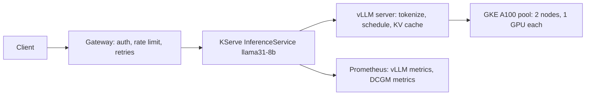
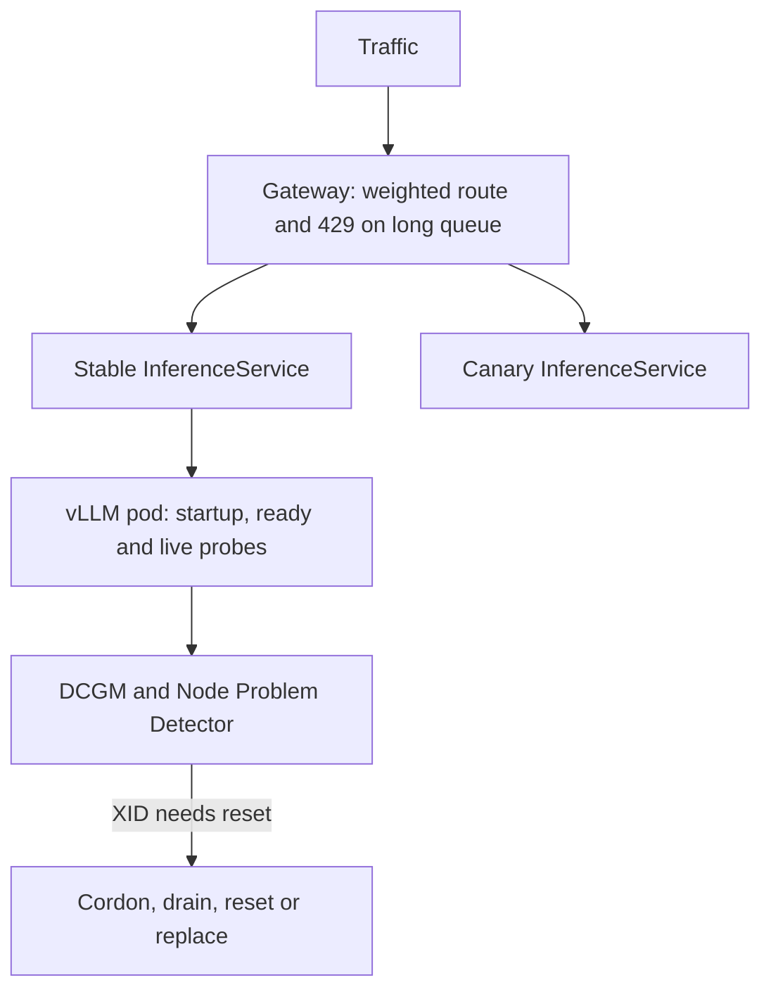

# 19.3 Capstone: inference on GKE with vLLM, Triton, TensorRT-LLM, NIM and KServe

| | |
|---|---|
| **What you'll build** | A load-tested inference service on GKE: a vLLM engine behind a KServe InferenceService, sized from KV cache arithmetic, scaled on in-flight requests, with a stated go or no-go rule |
| **When to read this** | When you are about to serve a model to production traffic, or when you must justify one serving engine over another |
| **Prerequisites** | 5.34, 15.1 to 15.3, 15.5 to 15.7, 15.14 to 15.16, 16.7, 17.4, 20.22 |
| **Level** | Advanced |
| **Time** | 90 min to read, about half a day on a GPU quota to run |
| **Versions checked** | vLLM v0.32.0, Triton v2.74.0, TensorRT-LLM v1.2.1, KServe v0.21.0, NIM Operator v3.1.3, AIPerf v0.13.0, all latest stable on 2026-11-10 |
| **Code** | `code/part19/c03_*` |
| **Status** | **drafted** |

## Why this matters for AI infrastructure

It is the week before a launch. The team has a model, a GKE project, and an approved A100 quota. Three engineers each have a favourite engine, and nobody can say what number would settle the argument. The risk is not picking a slow engine. The risk is shipping with no way to tell whether the service meets its promise to users, because nobody measured the path a request actually takes.

Most inference outages are not caused by the engine. They come from the glue around it. A node never advertised its GPU. A probe killed a pod while the weights were still loading. An autoscaler watched CPU on a machine whose real work happens on the GPU. None of these faults lives inside the model, and all of them look like "the model is slow" from the outside. A capstone exists to join those parts and then test the joints between them.

This chapter builds one stack from end to end. The cluster is a GKE Standard cluster called `ai-serving` with two A100 40 GB nodes. The model is Llama 3.1 8B Instruct, served by vLLM through KServe. Triton, TensorRT-LLM, and NIM are placed beside it, so that you can compare them on facts rather than on reputation. The stack is small on purpose. Each part is one you could explain to a colleague in a few minutes, and the whole is the thing that must hold up under real traffic.

Every version, flag, and name in the chapter is checked against vendor documentation or source, and the verification log at the end lists what was checked and what was not. Three details are easy to get wrong, and the rest of the chapter returns to them. An A100 needs an A2 machine type, not an N1 type. The KServe autoscaling kind must be one that exists in the cluster. And Triton's poll mode, not its explicit mode, is the one that reloads a model without downtime.

## Prerequisites and outcomes

A new teammate asks why the KV cache is full, and you need an answer that is more than a guess. Before you can answer, you need a few ideas in hand. You should know what a KV cache is and why it grows with sequence length. You should be comfortable reading a KServe InferenceService and a Kubernetes probe. Chapter 20.22 covers how to operate each engine, and it is linked here rather than repeated.

The chapter covers six things, in order. It starts by drawing the request path and naming the layer that owns each kind of latency. It then chooses an engine from sourced facts and a written method rather than from habit. Next it creates a GKE A100 node pool with flags that match the documentation. After that it sizes the vLLM caps from KV cache arithmetic and deploys them through KServe. The fifth part runs a load test with a harness that has itself been tested, and then applies a go or no-go rule to the result. The last part wires autoscaling, probes, and GPU fault handling, and it triggers each one on purpose so that you see it work.

## 1. Draw the request path before you pick an engine

Picture a team that adds four GPUs because p95 latency is high. Traffic did not change, and latency stays flat, and the new GPUs sit idle. The slow part was a tokenizer running on one CPU core in front of the model. More GPUs cannot fix a CPU queue, because the queue sits in front of the GPUs and never reaches them. This is an illustration of a common pattern, not a reported incident.

The remedy is to draw the path a request takes before you choose anything. A token that the user sees has crossed the client, a gateway, the model server, and the GPU. Each stop has its own way of being slow, and each stop needs its own measurement. A p95 is a response time that most requests beat, so it shows the slow tail that an average hides.



Read the table one row at a time. Each row names a layer, what that layer owns, the usual way it becomes slow, and the signal that tells you it is the culprit. The last column is the most useful one, because it tells you where to look first.

| Layer | What it owns | Typical way to be slow | How you see it |
|---|---|---|---|
| Gateway | Auth, rate limits, retries | Connection limits, CPU | p95 at the edge compared with p95 at the pod |
| Model server | Tokenizer, scheduler, HTTP | One busy CPU thread | CPU on one core while the GPU idles |
| GPU | Attention, KV cache | Batch too small, KV cache full | Queue length, preemption count, GPU metrics |
| Storage and image | Weights, container image | Cold download | Pod start-up time |

Two habits follow from the drawing. The first is to measure at every layer, because a healthy GPU does not prove a healthy request. A GPU can be busy and the user can still wait, if the request waited in a queue before it reached the GPU. The second is to change the engine last. Swapping an engine is the most expensive change you can make, and it is the least likely cure for a latency problem that starts somewhere else.

Try a worked version of this habit. Suppose the p95 at the gateway is high, but the p95 at the model server is low. The slow part is in front of the server, so buying GPUs cannot help. Now suppose the p95 at the server is high, while its CPU is busy and its GPU is idle. The slow part is the server's own work, such as tokenizing long inputs. Only when the GPU is busy and the queue is long does the GPU layer become the suspect. Each reading narrows the search, and the order of the readings matters more than any single number.

*Hands-On LLM Serving and Optimization*, chapter 8, gives the same advice for choosing a framework. It says to start from service level objectives and real prompts, not from a list of features. Section 2 turns that advice into a table you can check line by line.

**Decision rule:** profile the whole request path before you touch engine choice, and fix the layer in front of an idle GPU first.

**In one minute:** a request crosses four layers, and each one fails differently. Per-layer metrics tell you which layer owns a problem. The engine is the last thing to change.

## 2. Choose the engine from sourced facts

Imagine the argument from the opening. One engineer says the compiled engine is fastest. Another says the simple server is good enough for now. A third says NVIDIA's packaged image removes most of the work. All three can be right, for different workloads. The useful question is not which one is best in general. The useful question is what each option commits you to once it is in production.

The book frames three kinds of tool. Engines such as vLLM, TensorRT-LLM, and SGLang run the model. Servers such as Triton wrap engines and models behind an API. Orchestrators such as KServe decide how many copies run and how traffic reaches them. Chapter 20.22 explains the layers in depth, and this chapter uses them only as a map. Keeping the three roles apart is what stops the argument from going in circles, because a server and an engine are not competitors in the first place.

The table lists only facts with a source. It has no speed rows, because a speed claim without your model, hardware, and prompt mix is not a fact you can use. The versions are the latest stable releases found on 2026-11-10. Read each row as a statement about what you would deploy, not as a verdict on quality.

| Item | Layer | What you deploy | Health path | Metrics | How it reaches KServe |
|---|---|---|---|---|---|
| vLLM v0.32.0 | Engine and server | `vllm serve`, an OpenAI-compatible API | `/health`, 200 or 503 | Prometheus, for example `vllm:num_requests_running` | KServe ships a `kserve-vllmserver` runtime |
| TensorRT-LLM v1.2.1 | Engine | `trtllm-serve`, an OpenAI-compatible API | `/health` and `/health_generate` | `/metrics` returns iteration statistics as JSON | No shipped runtime. Reach it through Triton or NIM |
| Triton v2.74.0 | Server | A model repository and `tritonserver` | `/v2/health/ready`, `/v2/health/live` | Port 8002, `/metrics` | KServe ships a `kserve-tritonserver` runtime |
| NIM, Operator v3.1.3 | Packaged server | One container per model, managed by NIMCache and NIMService | `/v1/health/ready`, `/v1/health/live` | `/v1/metrics` | NIMService with `inferencePlatform: kserve` |
| KServe v0.21.0 | Orchestrator | InferenceService and ServingRuntime | Set by the runtime | Annotations pick the scrape port | Is the platform |

The sources for the table are different for each row. The vLLM health and metric facts come from the v0.32.0 source and from chapter 20.22. The TensorRT-LLM facts come from chapter 20.22, which read the v1.2.1 source. The Triton ports and paths come from the v2.74.0 documentation. The NIM paths come from the default probes in the NIM Operator v3.1.3 source. The KServe runtimes come from the v0.21.0 `config/runtimes` directory. If a row changes in a later release, the row changes with it, so keep the table dated.

Four facts matter more than the table suggests at first glance. The first is about NIM. NIM picks a backend by itself, preferring TensorRT-LLM, then vLLM, then SGLang, based on the model profiles for the GPU it detects. You do not choose the engine inside NIM. You choose a profile, and the profile decides the backend for you. That is convenient, but it means the engine is no longer a decision you made explicitly.

The second fact concerns TensorRT-LLM, where the sources disagree. One source says it builds tuned engines from a checkpoint. *LLMs in Production* says that a compiled engine is tied to the hardware it was built on. The upstream documentation, in turn, differs from both. The v1.2.1 documentation describes a PyTorch-based design. Whether your version has a separate build step is something you must check before you promise anyone a hardware move, because the answer decides whether a move is a rebuild or a restart.

The third fact is about versions. TensorRT-LLM v1.2.1 is the latest stable release. Releases numbered 1.3 and 1.4 exist only as release candidates, so do not plan a production rollout on them. A release candidate can change before it becomes stable, and a plan built on it will move under you.

The fourth fact is about NVIDIA's own benchmarking tool. The GenAI-Perf README now says the tool is being phased out, and it points to AIPerf. Section 6 therefore uses the vLLM benchmark command and a tested standard-library harness, and it names AIPerf as the NVIDIA option for you to evaluate later.

How do you choose? The book gives a method that fits on one page. Write down your objectives for time to first token, throughput, cost, and availability. Analyse real prompts for length and shape, because a benchmark with short prompts can hide a long-prompt problem. Compare the contenders with the same model, precision, and settings, so that the comparison is fair. Measure operability, which means start-up time, observability, autoscaling, and upgrade friction. Weigh vendor lock-in. Finally, plan for change by keeping an exit path, so that the next engine swap is a project and not a rescue.

A written objective is more useful than a feeling about speed. Write one sentence for each objective. For example, a team might say that the first word must appear quickly for most users, that the service must handle its expected peak without a queue that keeps growing, and that the cost per answer must fit the budget the product owner approved. Each sentence names a number that you can later measure. When a contender wins on one objective and loses on another, the sentences tell you which trade the team decided to accept before anyone saw the benchmark results.

For this capstone the choice is vLLM, and the reasons are specific to this capstone. The model is a single 8B model with open weights. The team wants the shortest path to production, and the hardware may change later. The usual advice is that vLLM gives the fastest path and a Python-native workflow, while TensorRT-LLM suits a team committed to NVIDIA hardware that wants peak tokens per dollar. Neither advice settles the question for you, which is why the written objectives come first.

**Decision rule:** default to vLLM for one open model on a short timeline. Pick Triton when one server must host many model types. Pick TensorRT-LLM or NIM only after a measured gap and a written plan for hardware changes.

**In one minute:** engines run models, servers wrap them, and KServe orchestrates them. Compare options on written objectives and real prompts. The table above holds only sourced facts, so fill your own speed rows from section 6.

## 3. Build the GKE node and runtime plane

Consider a pod stuck in `Pending` with the message `Insufficient nvidia.com/gpu`. The team argues about quota, and the argument goes on for an hour. The cluster has GPUs, but the scheduler cannot see them, because the node never reported the resource to the control plane. This is again an illustration. The real lesson is that GPU capacity has to be verified at the node before anything else is deployed on top of it.

The first detail to get right is the machine type. A common mistake is to pair `n1-standard-32` with an A100. Google's documentation says the `nvidia-tesla-a100` type belongs to the A2 standard machine family, and that N1 machines take T4, P4, and V100 GPUs instead. One A100 40 GB is the `a2-highgpu-1g` machine type, which comes with 12 vCPUs and 85 GB of memory. If you read a machine type and cannot tell which GPU it carries, stop and check the documentation before you write a single line of the pool definition.

```bash
#!/usr/bin/env bash
# Chapter 19.3: GKE Standard cluster and one A100 40 GB node pool.
# Not run: needs a GCP project with A100 quota. Check machine type and flags against
# https://docs.cloud.google.com/kubernetes-engine/docs/how-to/gpus before you run it.
set -euo pipefail

CLUSTER="${CLUSTER:-ai-serving}"
ZONE="${ZONE:-us-central1-a}"

# One small CPU pool for system pods. GKE adds the nvidia.com/gpu=present:NoSchedule
# taint to GPU nodes only when a non-GPU pool exists in the cluster.
gcloud container clusters create "${CLUSTER}" \
  --location="${ZONE}" \
  --num-nodes=1 \
  --machine-type=e2-standard-4

# a2-highgpu-1g is the A2 machine type with one A100 40 GB GPU.
# count must equal the GPU count of the machine type.
# gpu-driver-version=default installs the default driver for the node GKE version.
gcloud container node-pools create a100-pool \
  --cluster="${CLUSTER}" \
  --location="${ZONE}" \
  --node-locations="${ZONE}" \
  --num-nodes=2 \
  --machine-type=a2-highgpu-1g \
  --accelerator="type=nvidia-tesla-a100,count=1,gpu-driver-version=default"

gcloud container clusters get-credentials "${CLUSTER}" --location="${ZONE}"

# Both GPU nodes must report one allocatable GPU before you deploy anything.
kubectl get nodes \
  -l cloud.google.com/gke-accelerator=nvidia-tesla-a100 \
  -o custom-columns='NAME:.metadata.name,GPU:.status.allocatable.nvidia\.com/gpu'
```

The accelerator flag has three keys, and each one has a job. The key `type` names the GPU. The key `count` must match the GPU count of the machine type, so a mismatch is a configuration error and not a tuning choice. The key `gpu-driver-version` controls who installs the driver. It can be `default`, which installs the default driver for the GKE version of the node, or `latest`, which is only available on Container-Optimized OS nodes. The documentation spells the third value `disabled`, and Terraform uses `INSTALLATION_DISABLED` for the same idea. The driver flag needs GKE 1.27.2-gke.1200 or later, so check the cluster version first if you are on an older release.

The node pool command uses `--cluster`, not `--cluster-name`. The mistake is easy to make because the two names look alike, and the command fails with a message that does not name the flag as the cause. Keep the working command in a script that the team reviews, so the flag is correct the next time as well.

GKE also handles taints for you. It adds the taint `nvidia.com/gpu=present:NoSchedule` to GPU nodes, but only when the cluster has at least one non-GPU node pool. A toleration is added automatically to Pods that request a GPU. For that reason the script creates a small CPU pool first, and no manual taint step is needed. Creating the pools in the wrong order is a common cause of GPU nodes that never receive the pods you expected.

After the pool exists, check it in the same order that the scheduler uses. First confirm that the node objects exist with the accelerator label. Then confirm that each node reports its GPU as allocatable, because allocatable is what the scheduler actually spends. Last, confirm that the driver version GKE installed is the one you expected. A node can show a label and still have no allocatable GPU, and the only way to tell is to read the field the scheduler reads. The verify command in the lab does exactly this, which is why it is worth running before any model is downloaded.

Autopilot works differently. A Pod asks for a GPU with node selectors, and Autopilot creates the node behind it, so you never manage the pool yourself. The documentation lists `nvidia-tesla-a100` as the A100 40 GB type, and it says that you can choose the driver with a `cloud.google.com/gke-gpu-driver-version` selector. The next file is a smoke Pod for that path. It is validated as a Pod, and it has not been applied to a cluster.

```yaml
apiVersion: v1
kind: Pod
metadata:
  name: gpu-smoke
  namespace: inference
spec:
  restartPolicy: Never
  # GKE Autopilot: the Pod asks for a GPU type, and Autopilot creates the node.
  nodeSelector:
    cloud.google.com/gke-accelerator: nvidia-tesla-a100
    cloud.google.com/gke-accelerator-count: "1"
    cloud.google.com/gke-gpu-driver-version: default
  containers:
    - name: smoke
      image: nvidia/cuda:12.4.1-base-ubuntu22.04
      command: ["nvidia-smi"]
      resources:
        limits:
          nvidia.com/gpu: 1
```

This capstone uses Standard clusters. That is a teaching choice, not a rule. The NIM and DCGM steps are simpler to follow on a pool you control, because you can see every node and every driver. The Autopilot Pod is there so you know the selector names, and so you can recognize them if you meet them in someone else's cluster.

Two failure classes come out of this layer, and they look different from the outside. If the driver is absent, the node reports no GPU, and the Pods wait in `Pending`. If the driver is present but too old for the CUDA version inside the image, the Pod starts and then fails when it first allocates GPU memory. The first failure is a scheduling problem, and the second is a runtime problem. Chapter 5.34 keeps the troubleshooting table for both.

**Decision rule:** create the node pool first, and do not deploy a workload until both nodes show one allocatable GPU.

**In one minute:** an A100 40 GB on GKE needs an A2 machine type. Set the accelerator count to the machine's GPU count, and let GKE install the default driver. Check capacity on the node before you deploy.

## 4. Serve Llama 3.1 8B with vLLM under KServe

Think of a pod that crashes under a long prompt, restarts, and crashes again. For forty minutes the on-call engineer watches the same loop. The usual story blames a missing cap, and the fix is a long list of flags copied from a forum post. The mechanism matters more than the list. vLLM reserves its KV cache at start-up, sized from `gpu_memory_utilization`. The KV cache is the memory that holds the attention keys and values for every token in flight. When that cache fills later, v0.32.0 preempts requests and recomputes them, which costs latency but does not crash the process. A runtime out-of-memory error comes from memory outside the KV cache, so headroom is what prevents it.

The memory plan comes from arithmetic, and the arithmetic lives in a tested script. The model shape comes from the model's configuration file. It has 32 layers, 8 KV heads, and a head size of 128, with bf16 weights. The configuration was read from a public mirror of the model on 2026-11-10, because the official repository is gated and needs an approved login. The parameter count of 8,030,261,248 came from the Hugging Face model API.

The script is `c03_kv_sizing.py`, and it is tested by `test_c03_kv_sizing.py`. Its result for one A100 40 GB at 90 percent utilization is below. The 3 GiB of other memory is an assumption, not a measurement. Read the real number from the vLLM start-up log before you trust the table for capacity planning.

| Quantity | Value | How it is derived |
|---|---|---|
| KV cache per token | 128 KiB | 2 for keys and values, times 32 layers, 8 heads, 128 dimensions, 2 bytes |
| One 4,096-token sequence | 512 MiB | 4,096 times 128 KiB |
| Weights in bf16 | 14.96 GiB | 8,030,261,248 parameters times 2 bytes |
| KV budget | 18.04 GiB | 0.90 times 40 GiB, minus weights, minus 3 GiB assumed |
| Token capacity | 147,803 tokens | Budget divided by 128 KiB |
| Sequences of 1,280 tokens | 115 | Capacity divided by 1,024 plus 256 |
| Sequences of 16,384 tokens | 9 | Capacity divided by the context cap |
| 64 sequences of 1,280 tokens | 10.0 GiB | Fits |
| 64 sequences of 16,384 tokens | Does not fit | 1,048,576 tokens against 147,803 |

Read the table from the top. The first row is the unit of cost, the memory one token needs. Every later row multiplies that unit by a number of tokens or sequences. The KV budget row is the one to watch, because it is the GPU memory left after the weights and the headroom are removed. Everything else follows from it. If you change the utilization fraction, the budget changes, and so do the sequence counts.

Follow the memory through one request, because the table is a snapshot and a request lives through time. When the request arrives, the scheduler gives it a place in the batch. As each token is generated, the request adds its keys and values to the cache, a little at a time. When the request finishes, its blocks return to the pool for the next request. The cache is therefore never a fixed list of users. It is a shared pool that breathes with the traffic. A long prompt holds more of the pool for longer, which is why one large request can squeeze the others, even when the total number of requests looks small.

Grouped query attention matters here. With 8 KV heads instead of 32 query heads, this model needs a quarter of the KV memory that full multi-head attention would need. Fewer key and value heads means fewer bytes per token. The test checks that ratio, so the claim is not only a sentence in the chapter.

The last row is not a flaw to hide. It says that 64 users, all pasting maximum-length prompts, exceed the cache, and vLLM will preempt. If your traffic looks like that, you can lower the sequence cap or add a GPU. *Generative AI on Kubernetes*, chapter 4, shows the start-up log lines that report the weight size and the KV cache size, so you can replace the assumption with the real value from your own run.

A context cap of 16,384 does not work with Llama 3 8B. That model's configuration allows 8,192 positions, so the server would refuse to start with that cap. Llama 3.1 8B allows 131,072 positions, which is why this chapter uses it. The version number in the model name is therefore not a detail. It decides which limits are legal.

The runtime holds what stays the same across models: the image, the port, the probes, and the shared memory volume. KServe appends the InferenceService arguments to the runtime arguments, so the model name and the memory caps live in the InferenceService. Splitting the two keeps the runtime reusable for the next model, and it keeps the per-model choices in one file a reviewer can read.

```yaml
apiVersion: serving.kserve.io/v1alpha1
kind: ServingRuntime
metadata:
  name: vllm-llama31-8b
  namespace: inference
spec:
  annotations:
    prometheus.kserve.io/port: "8080"
    prometheus.kserve.io/path: "/metrics"
  supportedModelFormats:
    - name: vLLM
      version: "1"
      autoSelect: true
  multiModel: false
  volumes:
    - name: devshm
      emptyDir:
        medium: Memory
        sizeLimit: 2Gi
  containers:
    - name: kserve-container
      # The image entrypoint is "vllm serve". The model id and the memory caps are
      # appended from the InferenceService, because KServe concatenates args.
      image: vllm/vllm-openai:v0.32.0
      imagePullPolicy: IfNotPresent
      args:
        - --port=8080
        - --served-model-name={{.Name}}
      env:
        - name: HF_HOME
          value: /tmp/hf
      ports:
        - containerPort: 8080
          name: http1
          protocol: TCP
      volumeMounts:
        - name: devshm
          mountPath: /dev/shm
      startupProbe:
        httpGet:
          path: /health
          port: 8080
        periodSeconds: 10
        timeoutSeconds: 5
        failureThreshold: 90
      readinessProbe:
        httpGet:
          path: /health
          port: 8080
        periodSeconds: 10
        timeoutSeconds: 5
        failureThreshold: 3
      livenessProbe:
        httpGet:
          path: /health
          port: 8080
        periodSeconds: 20
        timeoutSeconds: 5
        failureThreshold: 6
```

Three choices in that file need a reason. The image is pinned to v0.32.0, because a floating tag can change under you between one deploy and the next. The startup probe allows 900 seconds, which is a planning figure for a first download of about 16 GB plus a model load. Replace it with a measured time as soon as you have one. And `/health` is used for all three probes, which is what the vLLM Kubernetes guide does. That endpoint proves the engine process is alive. It does not prove a good answer, a short queue, or free KV cache. A probe is a yes or no question, and this one only asks whether the engine is up.

KServe's own `kserve-vllmserver` runtime uses `/v1/models` for readiness, and it allows about 30 minutes to start. It is a useful point of comparison, and it lives in the KServe v0.21.0 repository. Comparing your runtime with the shipped one shows you which choices were made on purpose and which were inherited by accident.

```yaml
apiVersion: serving.kserve.io/v1beta1
kind: InferenceService
metadata:
  name: llama31-8b
  namespace: inference
  annotations:
    serving.kserve.io/deploymentMode: Standard
    serving.kserve.io/autoscalerClass: keda
spec:
  predictor:
    minReplicas: 1
    maxReplicas: 2
    # Two GPUs in the pool, two replicas at most. A rolling update must not ask for a third GPU.
    deploymentStrategy:
      type: RollingUpdate
      rollingUpdate:
        maxSurge: 0
        maxUnavailable: 1
    nodeSelector:
      cloud.google.com/gke-accelerator: nvidia-tesla-a100
    model:
      modelFormat:
        name: vLLM
      runtime: vllm-llama31-8b
      args:
        - meta-llama/Llama-3.1-8B-Instruct
        - --dtype=bfloat16
        - --max-model-len=16384
        - --max-num-seqs=64
        - --gpu-memory-utilization=0.90
      env:
        - name: HF_TOKEN
          valueFrom:
            secretKeyRef:
              name: hf-token
              key: token
      resources:
        requests:
          cpu: "6"
          memory: 32Gi
          nvidia.com/gpu: "1"
        limits:
          cpu: "8"
          memory: 48Gi
          nvidia.com/gpu: "1"
    # Standard mode plus KEDA: scale on in-flight work, not on CPU.
    # target.value is the TOTAL across replicas that one replica should carry (starting value, replace it).
    autoScaling:
      metrics:
        - type: External
          external:
            metric:
              backend: prometheus
              serverAddress: http://prometheus-operated.monitoring.svc:9090
              query: sum(vllm:num_requests_running{model_name="llama31-8b"}) + sum(vllm:num_requests_waiting{model_name="llama31-8b"})
            target:
              type: Value
              value: "8"
```

Several fields in the InferenceService are easy to get wrong, and each one fails in a different way. The annotation `serving.kserve.io/deploymentMode: Standard` is the current name, which replaced `RawDeployment`, as *Generative AI on Kubernetes* notes. The `autoscalerClass` annotation set to `keda` is required to use KEDA, and KServe rejects `scaleMetric` in that mode. The `maxReplicas` value is 2, not 4, because the pool has two GPUs. A third replica would have no GPU to land on. The `deploymentStrategy` has `maxSurge: 0`, because a rolling update that wants a third Pod needs a third GPU, and it would wait forever while the old pod kept serving.

The deployment strategy is the part of the InferenceService that most often surprises a team during an upgrade. A rolling update normally starts the new pod before it stops the old one, so that traffic never drops. That habit assumes spare capacity exists. With two GPUs and two replicas, there is no spare GPU. The new pod would sit in `Pending` forever while the old pod kept serving, and the rollout would look stuck instead of failed. Setting the surge to zero tells the controller to stop an old pod first, and it accepts a short dip in capacity in exchange for a rollout that can finish.

The engine caps are `--max-model-len=16384`, `--max-num-seqs=64`, and `--gpu-memory-utilization=0.90`. They are starting values taken from the arithmetic above, not constants of nature. The v0.32.0 defaults on an A100 are 256 for `--max-num-seqs`, 2048 for `--max-num-batched-tokens`, and 0.92 for the memory fraction. Those defaults are the numbers you will see if you forget to set the caps. Do not set `--swap-space`, because that flag was removed in v0.32.0, and a deployment that still passes it will not start.

The model comes from Hugging Face at start-up, using the secret created in the lab. The book calls direct download from Hugging Face inefficient, because it often takes many minutes. It recommends a persistent volume, an OCI image, or the KServe local model cache instead. This chapter takes the simple path first and measures the cost in the lab, so that you can see the price of the simple path before you choose a faster one.

**Decision rule:** derive the context cap and the sequence cap from KV arithmetic, leave memory headroom, and treat a full cache as a latency problem that you must size for.

**In one minute:** the KV cache per token is the first number to compute. A full cache causes preemption, not a crash, and headroom guards against real out-of-memory errors. The runtime file holds what is constant, and the InferenceService holds the model.

## 5. Place Triton, TensorRT-LLM and NIM beside it

Suppose the product team adds a reranker and a classifier next week. One vLLM Deployment per model starts to look wasteful, because each Deployment holds its own GPU memory whether it is busy or not. This is where Triton helps. It is a general server with one API, one metrics format, and one health API across model types, so the operations team learns one set of habits instead of three.

Triton reads a model repository, which is a directory with one folder per model. Each model has a configuration file named `config.pbtxt`. The documented keys for classic models include `max_batch_size`, a `dynamic_batching` block with `preferred_batch_size` and `max_queue_delay_microseconds`, and an `instance_group` that places model copies on GPUs. The chapter does not paste a configuration file, because no tool here can validate one against a real Triton release.

Two details in the Triton setup need care. The first is the ports. In the Triton quickstart, HTTP is 8000, gRPC is 8001, and metrics are on 8002. Mixing up the first two is a common error, because both are on the same host and both look like API ports. The second detail is reloading. Explicit model control does not give zero-downtime reloads. The v2.74.0 documentation says that in explicit mode you must unload a loaded model before you load its update. It is poll mode that says a successful reload replaces the model without loss of availability, and a failed reload leaves the old model loaded. The manifest below uses poll mode for that reason.

```yaml
apiVersion: apps/v1
kind: Deployment
metadata:
  name: triton-multimodel
  namespace: inference
spec:
  replicas: 1
  selector:
    matchLabels:
      app: triton-multimodel
  template:
    metadata:
      labels:
        app: triton-multimodel
    spec:
      nodeSelector:
        cloud.google.com/gke-accelerator: nvidia-tesla-a100
      volumes:
        - name: models
          persistentVolumeClaim:
            claimName: triton-models
      containers:
        - name: triton
          # Replace <YY.MM> with a tag from the NGC catalog for the Triton release you chose.
          image: nvcr.io/nvidia/tritonserver:<YY.MM>-py3
          command: ["tritonserver"]
          args:
            - --model-repository=/models
            - --model-control-mode=poll
            - --repository-poll-secs=30
          ports:
            - containerPort: 8000
              name: http
            - containerPort: 8001
              name: grpc
            - containerPort: 8002
              name: metrics
          volumeMounts:
            - name: models
              mountPath: /models
          resources:
            limits:
              nvidia.com/gpu: 1
          startupProbe:
            httpGet:
              path: /v2/health/ready
              port: http
            periodSeconds: 10
            failureThreshold: 60
          readinessProbe:
            httpGet:
              path: /v2/health/ready
              port: http
            periodSeconds: 10
          livenessProbe:
            httpGet:
              path: /v2/health/live
              port: http
            periodSeconds: 20
```

The `<YY.MM>` in the image is deliberate. Triton containers use a year and month tag, and the right one depends on the Triton release that you choose from the NGC catalog. Leaving the placeholder in place means the manifest will not pull an image by accident. A test checks the ports, the probe paths, and the reload mode, so a careless edit to any of them shows up before a deploy.

TensorRT-LLM has no shipped KServe runtime in v0.21.0. The book says it integrates with Triton and Dynamo, and NIM can use it as a backend. If you want it in this stack, plan on one of those two routes. Read chapter 15.5 and chapter 20.22 first, so that the route you pick matches the hardware and the team you have.

NIM is a different shape from the other two. The NIM Operator gives you two objects. A NIMCache downloads and stores the model on a volume. A NIMService runs the model from that cache. The book says the cache means the model is downloaded once, and that later replicas do not download it again. That is the main benefit, and it is worth the extra objects when many replicas start often.

NIM has three requirements that are easy to miss. You need an NGC API key, stored in a secret under the key `NGC_API_KEY`, which the operator reads through `authSecret`. You need a registry pull secret for `nvcr.io`, with the user name set to the literal string `$oauthtoken`. A user name like that is not a placeholder to replace. It is the fixed name the registry expects. And you need a volume for the cache. The operator samples use a ReadWriteOnce claim, which can pin Pods to one node, and they suggest ReadWriteMany if your storage supports it.

GPU profile selection works through the cache. The NIMCache fields `engine`, `tensorParallelism`, and `gpus` filter the profiles that are available for the model. A `profiles` list overrides those filters when you need an exact match. In the NIMService, `storage.nimCache.profile` sets the environment variable `NIM_MODEL_PROFILE`, so the profile you choose is visible in the pod spec and in the logs.

```yaml
apiVersion: apps.nvidia.com/v1alpha1
kind: NIMCache
metadata:
  name: llama31-8b-nim
  namespace: inference
spec:
  source:
    ngc:
      # Tag taken from the k8s-nim-operator v3.1.3 samples README. Confirm that it lists an A100 40 GB profile.
      modelPuller: nvcr.io/nim/meta/llama-3.1-8b-instruct:1.15.5
      pullSecret: ngc-secret
      authSecret: ngc-api-secret
      model:
        engine: tensorrt_llm
        tensorParallelism: "1"
        gpus:
          - product: a100
  storage:
    pvc:
      create: true
      size: 100Gi
      volumeAccessMode: ReadWriteOnce
---
apiVersion: apps.nvidia.com/v1alpha1
kind: NIMService
metadata:
  name: llama31-8b-nim
  namespace: inference
spec:
  image:
    repository: nvcr.io/nim/meta/llama-3.1-8b-instruct
    tag: "1.15.5"
    pullPolicy: IfNotPresent
    pullSecrets:
      - ngc-secret
  authSecret: ngc-api-secret
  storage:
    nimCache:
      name: llama31-8b-nim
      # Leave profile empty to let the operator pick, or set one id from the NIMCache status.
      profile: ""
  replicas: 1
  nodeSelector:
    cloud.google.com/gke-accelerator: nvidia-tesla-a100
  resources:
    limits:
      nvidia.com/gpu: 1
  expose:
    service:
      type: ClusterIP
      port: 8000
```

The image tag `1.15.5` comes from the operator's samples README, which lists it as the latest 1.x tag for the Llama 3.1 8B Instruct NIM. Whether the A100 40 GB has a matching profile is not verified here. Check the model's support matrix before you request GPUs, because a missing profile shows up only after the cache has finished downloading.

**Decision rule:** keep one engine on the critical path. Add Triton only when a second model type must share the server, and add NIM only when you accept an NGC key, a cache volume, and a fixed image.

**In one minute:** Triton ports are 8000, 8001, and 8002, and poll mode is the one that reloads without loss of availability. TensorRT-LLM reaches KServe through Triton or NIM. NIM needs an NGC key, a pull secret, and a cache volume.

## 6. Test load with a harness you have tested

Consider a staging benchmark with 64-token prompts that reports a pleasing p99. Production sends long retrieval prompts, and the first real p95 time to first token is many times larger. The benchmark answered a question nobody asked. The rule that follows is plain: the input and output lengths of a load test must match real traffic, or the test measures a different system.

*LLMs in Production*, chapter 6, lays out the steps. Set up the service in staging, send requests over time, increase the load until the service fails or autoscales, log the metrics, and analyse them. It names time to first token and tokens per second as the metrics that capture perceived speed. Time to first token is the wait before the user sees anything. Tokens per second is how fast the answer arrives once it has started.

Two arrival models give different answers, and choosing the wrong one hides the problem you are looking for. In a closed loop, a fixed number of workers each send their next request when the last one finishes. That measures what the system does at a fixed concurrency. In an open loop, requests arrive on a schedule whatever the server is doing. The vLLM benchmark documents Poisson arrivals when you set a request rate, and a burstiness factor of 1 means Poisson. Open loop is the one that exposes a queue building up, because the arrivals do not slow down when the server does. A closed loop can look healthy while a queue grows, because the workers simply wait.

The harness for this capstone has three files, and all three use the standard library only, so they run on a laptop with no installs. The file `c03_mock_server.py` imitates a streaming OpenAI-compatible endpoint. It has a configurable first-token delay, token delay, slot count, queue limit, and failure injection, so you can make it fail on purpose. The file `c03_loadgen.py` sends closed-loop or open-loop load, and it reports nearest-rank percentiles, the error rate, and goodput. The file `c03_decision.py` applies the rule at the end of this section. Fifteen tests in `test_c03_loadgen.py` cover the percentiles, a saturation case, errors, a full queue that returns 429, an unreachable server, and the decision rule.

The mock is not a model. It proves that the harness can see a knee, which is the point where latency starts to climb sharply as load rises. If the harness cannot find a knee in a system where you built one, it will not find one in a real service either. The script below starts the mock with four slots, sweeps concurrency, and applies the rule.

```bash
#!/usr/bin/env bash
# Chapter 19.3: exercise the load generator and the go/no-go rule against the local mock server.
# Runs on a laptop. The mock is not a model: it only proves the harness finds a saturation knee.
set -euo pipefail
cd "$(dirname "$0")"
OUT="${OUT:-/tmp/c03_sweep.json}"
PORT=18080

python3 c03_mock_server.py --port "${PORT}" --ttft-ms 20 --itl-ms 5 --slots 4 >/dev/null 2>&1 &
MOCK_PID=$!
trap 'kill "${MOCK_PID}" 2>/dev/null || true' EXIT
sleep 1

python3 c03_loadgen.py --url "http://127.0.0.1:${PORT}" --mode closed \
  --concurrency 1 2 4 8 16 --duration 4 \
  --prompt-mean 20 --prompt-std 2 --max-tokens 64 \
  --slo-ttft-ms 100 --slo-tpot-ms 10 --out "${OUT}" >/dev/null

# Exit status 1 means NO-GO, which is a valid outcome, so do not stop the script on it.
python3 c03_decision.py "${OUT}" --slo-ttft-ms 100 --slo-tpot-ms 10 \
  --peak-rps 5 --max-replicas 2 || true
```

The script was run on 2026-11-10 on a laptop. The sweep below comes from the mock, and it says nothing about a GPU. It shows the shape to look for. Latency stays flat up to the slot count, and then time to first token rises sharply as requests begin to queue. The share column is the fraction of requests that met both objectives at that level.

| Concurrency | p95 TTFT | p95 TPOT | Share meeting both objectives | Result |
|---|---|---|---|---|
| 1 | 28 ms | 6.4 ms | 1.00 | pass |
| 2 | 26 ms | 6.3 ms | 1.00 | pass |
| 4 | 27 ms | 6.3 ms | 1.00 | pass |
| 8 | 442 ms | 6.3 ms | 0.09 | fail |
| 16 | 1,276 ms | 6.3 ms | 0.10 | fail |

The objectives in that run were 100 ms for time to first token and 10 ms for time per output token. The knee sits at four, which is the slot count of the mock. The table comes from one sweep. The packaged script gave similar values on another run, such as 472 ms and 1,293 ms at the two failing levels, so treat the exact digits as noise. The shape is what matters, and the shape repeats.

Read the sweep the way an operator reads a dashboard after a traffic spike. The first three rows are flat, which means the mock still has free slots and each request starts at once. The row after them is where the picture changes. Time to first token jumps by an order of magnitude, while time per output token barely moves. That pattern tells you the wait happens before the first token, in the queue, and not during generation. A team that saw only the average latency would miss the change. A team that reads the two columns separately sees that the fix is more capacity or a shorter queue, not a faster decoder.

Goodput is the most useful summary in the table. The vLLM benchmark takes objectives in milliseconds through `--goodput`, and its allowed keys are `ttft`, `tpot`, and `e2el`. It counts a request as good only when that request meets all the objectives you set. That is request-level goodput, and the harness in this chapter computes the same thing. The vLLM source points to the DistServe paper for the definition, so the term has a published source behind it.

For the real service, use the vLLM benchmark. Its flags below were read from the v0.32.0 source. This command needs a running service, so the lab runs it after the InferenceService is ready and not before.

```bash
#!/usr/bin/env bash
# Chapter 19.3: smoke request and one benchmark run against the vLLM predictor.
# Not run: needs the running InferenceService. The vllm bench flags were read from the v0.32.0 source.
set -euo pipefail
NS=inference
SVC=llama31-8b-predictor

kubectl -n "${NS}" port-forward "svc/${SVC}" 8080:80 >/dev/null 2>&1 &
PF=$!
trap 'kill "${PF}" 2>/dev/null || true' EXIT
sleep 3

# The served model name equals the InferenceService name.
curl -s http://127.0.0.1:8080/v1/chat/completions \
  -H 'Content-Type: application/json' \
  -d '{"model":"llama31-8b","messages":[{"role":"user","content":"Reply with the word ok."}],"max_tokens":16}'
echo

# Open-loop arrivals at 2 requests per second, random prompts near the production length.
# --goodput takes milliseconds. The allowed keys are ttft, tpot and e2el.
vllm bench serve \
  --backend openai-chat --endpoint /v1/chat/completions \
  --base-url http://127.0.0.1:8080 --model llama31-8b \
  --dataset-name random --random-input-len 1024 --random-output-len 256 \
  --num-prompts 200 --request-rate 2 --burstiness 1.0 \
  --percentile-metrics ttft,tpot,itl,e2el --metric-percentiles 50,95,99 \
  --goodput ttft:200 tpot:25
```

AIPerf is the NVIDIA tool that replaced GenAI-Perf. Its README shows `aiperf profile` with `--streaming`, `--endpoint-type chat`, `--url`, and `--concurrency`. This chapter does not give a full command, because only those flags were checked against the README and the tool itself was not run.

Now the decision. The rule has five steps, and it is written in the file `c03_decision.py`. The table below lists them in order, so that you can check the script against the rule and the rule against your own judgment.

| Step | What it does |
|---|---|
| 1 | A level passes when p95 TTFT and p95 TPOT meet the objectives, errors stay under a limit, and enough requests meet every objective |
| 2 | The operating point is the highest level in the unbroken run of passes that starts at the lowest level |
| 3 | The scale target is the operating point times a headroom factor of 0.8, which is a planning choice, not a sourced figure |
| 4 | Peak concurrency is the peak request rate times mean end-to-end time, by Little's law |
| 5 | GO only if the replicas needed fit in the GPUs you can run |

Little's law says that the number of requests in the system equals the arrival rate times the average time each request spends there. It is a simple identity, and it holds for any stable queue. That is why step four multiplies the peak rate by the end-to-end time to get a concurrency number.

Walk the rule on the mock sweep once, in order. Step one marks the levels one, two, and four as passes, and the levels eight and sixteen as failures. Step two takes the unbroken run of passes from the lowest level, which ends at four, so the operating point is four. Step three multiplies that point by the headroom factor to get the scale target. Step four turns the peak rate into a concurrency figure with Little's law. Step five asks whether the replicas that concurrency needs fit into the GPUs you have. Each step is a question with one answer, and a reviewer can check each answer against the table.

A pass above a failure is ignored on purpose. It is more likely noise than real capacity, because a single lucky level above a broken one says little about the system. With the mock, a peak of 5 requests a second needs about 2 concurrent requests, so one replica is enough and the answer is GO. Raise the peak to 20, and the rule needs 3 replicas, so the answer is NO-GO on a two-GPU pool. Tests cover both outcomes and the case where no level passes at all.

**Decision rule:** ship only when the rule returns GO on your real model with your real prompt lengths, at the peak rate you expect, within the GPUs you have.

**In one minute:** match prompt lengths to production, use open-loop arrivals to expose queues, and report goodput against written objectives. The rule turns a sweep into one scale target and one yes or no. The numbers in this section came from a mock, not from a GPU.

## 7. Autoscale on in-flight work

Imagine a promotion starts, and traffic jumps in a single step. An autoscaler that watches CPU sees almost nothing, because the GPU does the work and the CPU stays quiet. By the time the autoscaler reacts, the new replicas spend minutes loading weights, and the readiness probe keeps them out of the pool until they finish. Users wait through the whole gap. This is a plausible chain, and each link in it is a setting that you control.

Production Kubernetes, chapter 13, warns against scaling on a metric that does not change in proportion to load. Generative AI on Kubernetes, chapter 4, says the default HPA mostly looks at CPU and memory, which suits GPU workloads poorly. HPA is the Horizontal Pod Autoscaler, the built-in controller that adds and removes replicas. The same chapter says that Knative's autoscaler counts requests, which is closer to what matters. It also notes that LLM start-up is slow, and that one request can be cheap or expensive depending on how many tokens it produces.

KServe's code agrees with those warnings. Concurrency and request-rate scaling are supported by the Knative Pod Autoscaler. In Standard mode with the HPA class, only CPU and memory are allowed. KEDA is the route for custom metrics in Standard mode, and KEDA is a separate operator that turns an external metric into a scaling decision.

The InferenceService in section 4 uses KEDA with an external Prometheus query. It adds the running and waiting requests for this model, using metric names that exist in the v0.32.0 source. The target is a total across replicas, so the autoscaler asks for the total divided by the target value, rounded up. The starting target of 8 is a placeholder. Replace it with the scale target that comes out of the decision rule in section 6, because a number you did not measure will not hold under your real prompts.

The query adds the running and the waiting requests on purpose. Running requests show the work already in progress, and waiting requests show the work that has not started yet. A replica that is full of running requests but has an empty queue is busy but healthy. A replica with a growing queue is falling behind, even if its GPU looks busy, because the users at the back of the queue are already waiting. Adding the two gives one signal that rises as the service falls behind, and that is the signal an autoscaler should follow.

The book's own example uses a pod-level metric through an OpenTelemetry sidecar, with a value of 4 based on a benchmark. It says that a pod metric and an external one are equivalent for pod-local queries, and that the pod-level source reacts faster. Choose the external form when you need joins across replicas, because only the external query can see every replica at once.

Autoscaling cannot react faster than start-up. The phases are image pull, model fetch and mount, runtime start, weight load, and warm-up. Each phase takes time, and the autoscaler waits through all of them. The image pull is a real cost, and the `Always` pull policy should be avoided, because it checks the registry on every start. Chapter 20.22 measured the v0.32.0 image at about 9.2 GB for amd64, which is larger than the usual estimate. Production Kubernetes adds that a cluster autoscaler reacts only after Pods are `Pending`, so a node pool that must grow adds node start time on top of everything else.

Probe timing follows from start-up. The startup probe has to outlast the slowest start, and the liveness probe begins only after startup passes. If the startup window is too short, the kubelet kills a healthy pod that was simply still loading, and the pod restarts into the same slow load. A test checks that the window is at least 600 seconds and that a startup probe exists at all.

**Decision rule:** scale on in-flight work with a target taken from your sweep, and make the startup window longer than your measured worst start.

**In one minute:** CPU is a weak signal on a GPU node, so KServe uses KEDA with vLLM queue metrics. The target is a placeholder until your sweep replaces it. Start-up time sets how fast any autoscaler can help you.

## 8. Build the reliability layer and trigger each part

Suppose one GPU in a node throws a hardware error. The server process stays up, the load balancer keeps sending it traffic, and the HTTP health check still answers. The HTTP layer cannot see a GPU fault, because the fault lives below the process. The only way to find it is to read the GPU's own health signals, which is why this section asks you to trigger each detector on purpose instead of trusting that it works.

The reliability layer has four parts, and each one should be triggered on purpose in staging before the first production release.

A canary limits the damage of a bad release. Send a small share of traffic to the new version, compare its errors and latency with the stable version, and roll back if it is worse. In KServe v0.21.0 the `canaryTrafficPercent` field is reconciled in the Knative code path, and the source shows no use of it in the Standard path. In Standard mode, plan on two InferenceServices and a weighted route at the gateway instead. The promote and rollback thresholds are your own policy, and this chapter gives no numbers for them.

Load shedding limits the damage of overload. When the queue is too long, the system refuses new work quickly with a clear error, instead of letting every user wait. *Hands-On LLM Serving and Optimization*, chapter 4, shows rate limiting at the gateway with Nginx or Envoy. Generative AI on Kubernetes adds that token-based limits fit LLM traffic better than request counts, because one request can generate many tokens. Choose a queue length from your sweep, and have the gateway return 429 past it, so that the caller knows to back off.

Probes keep traffic away from a pod that is loading or wedged. Section 4 set them up. Remember that `/health` is shallow. It shows that the process answers, and it does not run a real generation. The TensorRT-LLM `/health_generate` and the SGLang health checks run a real generation, which is a deeper check, but a slower one under load, so use them with care.

GPU fault detection reads the driver's error codes. NVIDIA's XID catalog gives each code and a recommended action. XID 62 is sometimes described as a double-bit ECC error, and codes are sometimes sorted into fatal and precursor classes. The catalog says otherwise, as the table below shows, so the table is the one to trust. ECC stands for error-correcting code, the memory protection that corrects some bit errors and reports the rest.

| XID | Catalog description | Recommended action in the catalog |
|---|---|---|
| 45 | Preemptive cleanup after earlier errors | Ignore if not alone, and follow the other error |
| 48 | Double bit ECC error | Reset the GPU, drain and reset if paired with 63 or 64 |
| 62 | Internal micro-controller halt | Reset the GPU, contact support |
| 63 | GPU memory remapping event | Ignore |
| 64 | GPU memory remapping failure | Reset the GPU, contact support |
| 79 | GPU has fallen off the bus | Restart the machine, contact support |
| 92 | High single-bit ECC error rate | Ignore, contact support |
| 95 | Uncontained memory error | Reset the GPU |

Think about what a single XID event does to a node over a day. The driver logs the code into the kernel log, and the GPU may keep serving requests for a while after that. Nothing on the HTTP side changes, so the first user-visible sign may be a few failed requests from one replica. The on-call engineer who reads the DCGM counter sees the code and looks it up. If the code is in the ignore group, the engineer watches and records it. If the code is in a reset group, the engineer drains the node first, so that new requests move away from the card, and only then resets it. The order of those steps protects the requests that are still in flight.

The catalog says that a GPU reset or a node reboot clears XID 48. It says that the affected GPU must be reset after XID 95 before applications can restart. Use the catalog as the source of truth, and read it again before you write any alert rule, because the wording can change between releases.

*Kubernetes for Generative AI Solutions*, chapter 13, recommends the Node Problem Detector as a DaemonSet that surfaces node problems to the cluster. It describes EKS node auto repair replacing a node after ten minutes when Xid errors appear. The equivalent on GKE is not verified here, so check GKE node auto repair before you rely on it. Chapters 17.4, 17.6 and 17.7 cover the DCGM exporter and the alert rules that read it.



The table below ties each failure to its detector and its action. Read each row as a pair: the detector is how you notice the problem, and the action is what you do once you have noticed it.

| Failure | Detector | Action |
|---|---|---|
| Bad release | Error and latency comparison between stable and canary | Shift weight back to stable |
| Overload | Queue length at the gateway | Return 429 |
| Wedged process | Liveness probe | Restart the pod |
| GPU fault | XID from the driver through DCGM or the node agent | Follow the catalog action for that code |

**Decision rule:** trigger each of the four detectors in staging before the first production release, and take GPU actions from the NVIDIA catalog.

**In one minute:** canary, load shedding, probes, and GPU fault handling each need a trigger that you have fired yourself. In Standard mode, canaries use two services and a weighted route. XID actions come from the catalog, not from memory.

## 9. Hands-on lab

The lab has two kinds of step. Some ran on this laptop, and the rest need a GKE project, an A100, a Hugging Face token, or an NGC key. Nothing in this chapter ran on a GPU. The manifests were validated against upstream schemas, the Python was tested, and a mock server exercised the load generator. The output shapes below are expected shapes, not captured output, so treat each one as a target to compare with your own run.

**What was run here:** schema validation of every manifest, 51 pytest tests, and the mock-server load test in step 9. Everything that needs GKE, an A100, a Hugging Face token, or an NGC key is still to be run on a live cluster.

Before the first step, set aside a short block of time and a notes file. Record the project, the zone, the node names, and the time each step starts and ends. The lab is long, and a team that cannot say what ran last is the team that repeats a costly step. The notes also become the capacity note that step 16 asks you to write, so they are not wasted work.

**Step 1: create the cluster and node pool.** Edit the project and zone, then run the node pool script. Expected shape: two A100 nodes join the cluster. What to record: the GKE version and the driver version GKE installed. This step needs A100 quota.

**Step 2: create the namespace and secrets.** Export `HF_TOKEN`, and `NGC_API_KEY` for the NIM step, then run the secret script. The tokens stay in your shell and are never written to a file in git. Expected shape: the namespace and one or two secrets exist. What to record: the secret names.

```bash
#!/usr/bin/env bash
# Chapter 19.3: namespace and secrets. Tokens come from your shell, never from a file in git.
# HF_TOKEN : a Hugging Face read token that has accepted the Llama 3.1 licence.
# NGC_API_KEY : an NGC API key, only needed for the NIM section of the lab.
set -euo pipefail
: "${HF_TOKEN:?export HF_TOKEN first}"

kubectl create namespace inference --dry-run=client -o yaml | kubectl apply -f -

kubectl -n inference create secret generic hf-token \
  --from-literal=token="${HF_TOKEN}" \
  --dry-run=client -o yaml | kubectl apply -f -

if [ -n "${NGC_API_KEY:-}" ]; then
  # Pull secret for nvcr.io. The username is the literal string $oauthtoken.
  kubectl -n inference create secret docker-registry ngc-secret \
    --docker-server=nvcr.io \
    --docker-username='$oauthtoken' \
    --docker-password="${NGC_API_KEY}" \
    --dry-run=client -o yaml | kubectl apply -f -
  # Key the operator reads for model downloads.
  kubectl -n inference create secret generic ngc-api-secret \
    --from-literal=NGC_API_KEY="${NGC_API_KEY}" \
    --dry-run=client -o yaml | kubectl apply -f -
fi
```

**Step 3: verify GPU capacity.** Run the first command in the verify script. Expected shape: both nodes show a GPU count of 1. If a node shows nothing, stop and read chapter 5.34 before you go on. What to record: the node names and the counts.

**Step 4: install KServe and KEDA.** Install KServe v0.21.0 in Standard mode and KEDA, following their documentation, along with a Prometheus that scrapes the vLLM metrics. Expected shape: the KServe controller and the KEDA operator are running. What to record: the versions installed. The KServe install steps are not reproduced in this chapter, so use the upstream documentation for them.

**Step 5: apply the runtime and the InferenceService.** Apply the two YAML files, and watch the pod with the verify script. Expected shape: the pod passes through `Pending` and `ContainerCreating`, then the model downloads and loads, and the InferenceService reports ready. What to record: the seconds from `kubectl apply` to ready. That time replaces the 900-second guess in the startup probe.

**Step 6: check what actually started.** The verify script prints the probe settings and the log lines for weight size and KV cache. Expected shape: a weight size near 15 GiB, and a KV cache size you can compare with the 18.04 GiB estimate. What to record: both numbers, and the new overhead value to put back into `c03_kv_sizing.py`.

```bash
#!/usr/bin/env bash
# Chapter 19.3: verification commands for the GKE lab. Not run: needs the cluster from c03_node_pool.sh.
set -euo pipefail
NS=inference

# Step 3: both GPU nodes advertise one GPU.
kubectl get nodes -l cloud.google.com/gke-accelerator=nvidia-tesla-a100 \
  -o custom-columns='NAME:.metadata.name,GPU:.status.allocatable.nvidia\.com/gpu'

# Step 5: the objects exist and the predictor becomes ready.
kubectl -n "${NS}" get servingruntime,inferenceservice
kubectl -n "${NS}" get pods -l serving.kserve.io/inferenceservice=llama31-8b -w

# Step 6: the probes in the running pod match the runtime file.
kubectl -n "${NS}" get pod -l serving.kserve.io/inferenceservice=llama31-8b \
  -o jsonpath='{.items[0].spec.containers[0].startupProbe}{"\n"}'

# Step 6: how long weights took, and what KV cache vLLM actually got.
kubectl -n "${NS}" logs -l serving.kserve.io/inferenceservice=llama31-8b --tail=400 \
  | grep -i -E 'loading model weights took|KV cache|max_num_seqs|gpu_memory_utilization'
```

**Step 7: smoke request.** Run the first part of the smoke script. Expected shape: a JSON completion with no error field. If it fails, stop, because a load test only multiplies a failure. What to record: the reply and the time it took.

**Step 8: sweep concurrency.** Run the vLLM benchmark with `--max-concurrency` at 8, 16, 32, and 64, and at an open-loop rate. Use your real prompt lengths in place of 1,024 and 256. Expected shape: flat latency, then a knee. What to record: p50, p95, and p99 for TTFT, TPOT, and end-to-end time, and the goodput.

**Step 9: rehearse the harness on the laptop.** Run the mock script from section 6. Expected shape: GO at a peak of 5 requests a second, with an operating point of 4. What to record: the five-level table. This step was run, and the output matches section 6.

**Step 10: apply the decision rule to real data.** Save the sweep as JSON in the harness format, or fill the table by hand, then run the decision script with your objectives, peak rate, and GPU count. Expected shape: GO or NO-GO with reasons. What to record: the operating point and the scale target. This step needs real sweep data.

**Step 11: set the scale target.** Put the scale target into `target.value` in the InferenceService, keep `maxReplicas` at 2, and re-apply. Expected shape: KEDA creates a ScaledObject. What to record: the value you set.

**Step 12: test a step load.** Send double your operating concurrency and watch the replicas. Expected shape: a second replica appears, and the time to ready is close to the number from step 5. What to record: the time to ready for the second pod, and any 5xx responses.

**Step 13: compare Triton and NIM.** Apply the Triton Deployment with a model repository, and the NIM objects if you have an NGC key. Expected shape: Triton reports ready on `/v2/health/ready`, and the NIMCache reaches ready before the NIMService starts. What to record: the start-up time for each, and the NIM profile chosen.

**Step 14: trigger the reliability layer.** Cause overload until the gateway returns 429. Kill the vLLM process in one pod to see liveness restart it. Roll a canary at a small weight. Expected shape: each detector fires and recovers. What to record: the time to detect and the time to recover.

**Step 15: practise the GPU fault drill.** You cannot inject a real XID safely, so rehearse the runbook on a node: cordon, drain, then uncordon. Expected shape: Pods reschedule on the other node, and capacity returns after uncordon. What to record: the whole time the drill took.

**Step 16: tear down and write the capacity note.** Delete the objects, the node pool, and the cluster if it was a scratch project. Write one page with the model, the pool, the KV numbers, the measured start-up time, the operating point, the scale target, and the four detectors.

**Decision rule:** keep the one-page note, because it is the artifact the next team inherits.

**In one minute:** the lab is sixteen steps. Only the laptop rehearsal ran here. The rest needs a GKE project with A100 quota, and each GPU step records a number that replaces one of this chapter's starting values.

## Exercises

Each exercise below starts from a real question a team asks during a launch. Work each one on paper first, then check your answer against the sketch. The sketches name the script or the rule that settles the question.

**Exercise 1.** A model has 80 layers, 8 KV heads of 128 dimensions, and a bf16 cache. How much KV memory does one 128K-token sequence need, and what does that say about a 40 GB GPU?

*Solution sketch:* the per-token size is 2 times 80 times 8 times 128 times 2 bytes, which is 320 KiB. Times 131,072 tokens is 40 GiB, which does not fit a 40 GB GPU beside any weights. You must cap context, use more GPUs, or shrink the cache. Use `c03_kv_sizing.py` with the model's own numbers.

**Exercise 2.** The runtime `startupProbe` allows 900 seconds. Your measured first start in step 5 is 1,100 seconds. What happens, and what are two ways to fix it?

*Solution sketch:* the kubelet kills the container before it is ready, and it restarts and repeats. Raise `failureThreshold`, or cut the start time with a pre-populated volume, an OCI image, or the KServe local model cache.

**Exercise 3.** Your sweep shows levels 4 and 8 pass, level 16 fails, and level 32 passes. What operating point does the rule choose, and why?

*Solution sketch:* 8. The rule takes the unbroken run from the lowest level and ignores a pass above a failure as noise. The reasons field says so. Re-run level 32 before you trust it.

**Exercise 4.** The decision script says NO-GO with 3 replicas needed on a 2-GPU pool. List three honest responses.

*Solution sketch:* add a GPU, lower the peak you promise, or improve the per-replica operating point with a smaller context cap or quantisation. Do not raise `maxReplicas` past the GPU count. The autoscaler cannot create GPUs.

**Exercise 5.** A teammate wants `scaleMetric: concurrency` in the InferenceService with the KEDA annotation. What happens?

*Solution sketch:* KServe validation rejects `scaleMetric` for KEDA. Concurrency scaling belongs to the Knative path. In Standard mode use `autoScaling.metrics` with a Prometheus query on the vLLM queue metrics.

**Exercise 6.** NVIDIA's catalog shows XID 63 on one GPU, and a day later XID 64 on the same GPU. What are the two descriptions and the catalog actions?

*Solution sketch:* 63 is a memory remapping event, with action ignore. 64 is a memory remapping failure, with action reset the GPU and contact support. The pair makes the GPU a candidate for drain and reset, as the catalog says for XID 48 with 63 or 64.

## Checkpoint questions

<details><summary>1. Name the four layers of the request path and a way each can be slow.</summary>
Gateway, model server, GPU, and storage or image. The gateway can hit connection limits, the server can saturate one CPU thread, the GPU can run with a small batch or a full KV cache, and storage can deliver cold weights slowly.
</details>

<details><summary>2. Why does adding GPUs not fix a tokenizer that runs on one CPU core?</summary>
The tokenizer sits in front of the GPU and is a CPU queue. More GPUs add capacity behind the queue, so the wait stays. Per-layer metrics show it as high CPU on one core with an idle GPU.
</details>

<details><summary>3. What are the three kinds of tool in the engine map, and where do vLLM, Triton and KServe sit?</summary>
Engines, servers and orchestrators. vLLM is an engine with its own server. Triton is a server. KServe is an orchestrator.
</details>

<details><summary>4. Which machine type carries one A100 40 GB on GKE, and why does `n1-standard-32` not work?</summary>
The `a2-highgpu-1g` type with 12 vCPUs and 85 GB of memory. The documentation says N1 machines such as `n1-standard-32` take T4, P4 and V100 GPUs.
</details>

<details><summary>5. What do the keys type, count and gpu-driver-version control?</summary>
The GPU model, the number of GPUs per node, which must equal the machine type's count, and how the driver is installed. The value `default` installs the default driver for the node's GKE version.
</details>

<details><summary>6. When does GKE add the nvidia.com/gpu taint, and what does a GPU Pod need?</summary>
GKE adds it only when the cluster has a non-GPU node pool. Pods that request a GPU get the toleration automatically.
</details>

<details><summary>7. Why does a full KV cache not crash vLLM v0.32.0, and what does it cost?</summary>
The cache is reserved at start-up and vLLM preempts and recomputes requests when it is full. The cost is latency. A real out-of-memory error comes from memory outside the cache.
</details>

<details><summary>8. Recompute the KV cache per token for Llama 3.1 8B and state which inputs are assumptions.</summary>
Two times 32 layers times 8 KV heads times 128 dimensions times 2 bytes is 131,072 bytes, or 128 KiB. The model shape is from its configuration. The 3 GiB of other memory in the capacity table is an assumption.
</details>

<details><summary>9. Why does a context cap of 16,384 fail for Llama 3 8B?</summary>
That model's configuration allows 8,192 positions, so the server refuses a larger cap. Llama 3.1 8B allows 131,072.
</details>

<details><summary>10. How does KServe combine runtime arguments with InferenceService arguments?</summary>
It concatenates them, runtime first. That is why the runtime holds the port and name flags and the InferenceService holds the model and memory flags.
</details>

<details><summary>11. Why is maxSurge set to 0 in the predictor strategy?</summary>
The pool has two GPUs and the service can have two replicas. A rolling update with a surge Pod needs a third GPU and would wait.
</details>

<details><summary>12. What are Triton's three ports, and which model control mode reloads without loss of availability?</summary>
HTTP 8000, gRPC 8001 and metrics 8002. Poll mode does, according to the v2.74.0 documentation. In explicit mode you unload before loading an update.
</details>

<details><summary>13. What three things does NIM need that a plain vLLM image does not?</summary>
An NGC API key in a secret under `NGC_API_KEY`, a pull secret for `nvcr.io`, and a volume for the model cache.
</details>

<details><summary>14. How does NIM choose an engine, and how do you influence it on the operator?</summary>
The book says it picks from the model profiles for the detected GPU, preferring TensorRT-LLM, then vLLM, then SGLang. You steer it with the NIMCache `engine`, `tensorParallelism`, `gpus` and `profiles` fields.
</details>

<details><summary>15. What is the difference between closed-loop and open-loop load, and which exposes queueing?</summary>
Closed loop keeps a fixed number of requests in flight. Open loop sends arrivals on a schedule regardless of replies. Open loop exposes queueing, because arrivals do not slow down.
</details>

<details><summary>16. What does goodput count in the vLLM benchmark, and which objective keys exist?</summary>
Requests that meet every objective you set, divided by time. The keys are `ttft`, `tpot` and `e2el`, in milliseconds.
</details>

<details><summary>17. State the five steps of the go or no-go rule.</summary>
Test each level against the objectives. Take the highest level in the unbroken passing run from the bottom. Multiply by a headroom factor for the scale target. Use Little's law for peak concurrency. Say GO only if the replicas needed fit in the GPUs.
</details>

<details><summary>18. Why can KServe not use scaleMetric with KEDA, and what do you use instead?</summary>
Validation rejects it in KEDA mode. Concurrency and request-rate scaling belong to the Knative autoscaler. Use `autoScaling.metrics` with a Prometheus query.
</details>

<details><summary>19. Which XID codes ask for a GPU reset in the NVIDIA catalog?</summary>
48 when paired with 63 or 64, 62, 64 and 95. XID 79 asks for a machine restart, and 63 is ignorable on its own.
</details>

<details><summary>20. Name the four reliability detectors and one action for each.</summary>
Canary comparison, with a weight shift back to stable. Gateway queue length, with a 429. Liveness probe, with a restart. XID from the driver, with the catalog action for that code.
</details>

## Sources and review notes

Sources were fetched on 2026-11-10 unless stated.

Books, read by chapter:

- Hands-On LLM Serving and Optimization: chapter 4, Model Serving Best Practices (gateway rate limiting); chapter 5, Challenges When Serving LLMs; chapter 6, Essential LLM Optimization Techniques (PagedAttention memory use); chapter 8, LLM Serving Frameworks (framework roles, selection method); chapter 9, LLM Optimization in Practice (`vllm bench serve` method and metrics).
- Generative AI on Kubernetes: chapter 1, Deploying Models (KServe modes, ServingRuntime, InferenceService, NIM, LLMInferenceService); chapter 4, Running in Production (autoscaling options, KEDA example, start-up phases, image pinning); chapter 5, Model Observability (monitoring annotations).
- Kubernetes for Generative AI Solutions: chapter 13, High Availability and Disaster Recovery (probes, Node Problem Detector, Xid-driven node repair on EKS).
- Production Kubernetes: chapter 13, Autoscaling (metric choice, cluster autoscaler lag, overprovisioning).
- LLMs in Production: chapter 6, Large language model services (hardware-specific compiled engines, load-testing steps).

Upstream documentation and source:

- vLLM v0.32.0 tag: `vllm/engine/arg_utils.py` for defaults, `vllm/config/cache.py` for the 0.92 default, `vllm/v1/metrics/loggers.py` for metric names and the `model_name` label, `vllm/benchmarks/serve.py` for benchmark flags, `docs/configuration/optimization.md` for preemption, `docs/deployment/k8s.md` for probes, and `docs/design/metrics.md` for the removed `--swap-space` flag.
- KServe v0.21.0 tag: CRDs in `config/crd/full`, validation in `pkg/apis/serving/v1beta1/inference_service_validation.go`, the argument merge in `pkg/controller/v1beta1/inferenceservice/utils/utils.go`, and the runtimes in `config/runtimes`.
- NIM Operator v3.1.3 tag: CRDs in `config/crd/bases`, samples in `config/samples/nim`, default probes in `api/apps/v1alpha1/nimservice_types.go`.
- Triton v2.74.0 tag: `docs/user_guide/model_management.md`, `docs/user_guide/metrics.md`, `docs/getting_started/quickstart.md`.
- GKE documentation, "Run GPUs in GKE Standard node pools" and "Deploy GPU workloads in Autopilot", and the Compute Engine GPU page for the A2 machine type.
- NVIDIA XID catalog at docs.nvidia.com/deploy/xid-errors.
- GenAI-Perf README and AIPerf README, in the perf_analyzer and ai-dynamo repositories.
- Model shape: `config.json` of a public mirror of Llama 3.1 8B Instruct, and the Hugging Face model API for the parameter count. The official repository is gated.
- Release listings from the GitHub API on 2026-11-10 for vLLM, Triton, TensorRT-LLM, KServe and the NIM Operator.

Cross-references to other handbook chapters:

- 5.34 for GKE GPU node pools and the troubleshooting table.
- 15.5, 15.6 and 15.7 for TensorRT-LLM, Triton and NIM.
- 15.14 for benchmarking, 15.15 for autoscaling and 15.16 for the production stack.
- 16.7 for KServe, 17.4 for the DCGM exporter.
- [20.22 Operating vLLM, Triton, Ray and TensorRT-LLM](../part-20-nebius-sre-interview/22-operating-vllm-triton-ray-and-tensorrt-llm.md) for engine operations and the versions used here. Its versions of vLLM v0.32.0, Triton v2.74.0 and TensorRT-LLM v1.2.1 were rechecked and are still the latest stable.

Migrated from `nvidia-devops`. The chapter drew on these files. Their incident narratives could not be confirmed, so they now appear only as labelled illustrations:

- `docs/nvidia-zero-to-hero/volume-24/chapter-11-inference-serving-design.md` for the capstone scenario.
- `docs/nvidia-zero-to-hero/volume-12/chapter-08-kv-cache-memory-and-concurrency.md`, whose `--swap-space` advice no longer applies to v0.32.0.
- `docs/nvidia-zero-to-hero/volume-12/chapter-11-production-reliability-and-troubleshooting.md`, whose XID 62 account conflicts with NVIDIA's catalog.

Explicitly labelled inferences:

- The scenario sizing: two A100 40 GB nodes, a 200 ms p95 time to first token and a 25 ms p95 time per output token are capstone targets.
- The 3 GiB of non-KV memory, the 900-second start-up window, the headroom factor of 0.8, the starting autoscale target of 8, `--max-num-seqs=64` and `--max-model-len=16384`.
- Standard over Autopilot for this lab, and vLLM as the capstone engine.
- The opening scenes in sections 1, 3, 4, 5, 6, 7 and 8 are illustrations, not reported incidents.

Not verified or not run:

- No GKE, GPU, KServe, KEDA, Triton or NIM step was run. There was no cluster, no GPU, no Hugging Face token and no NGC key.
- Not verified: whether the NIM image tag 1.15.5 has an A100 40 GB profile, whether the Service name `llama31-8b-predictor` on port 80 matches your KServe version, and whether GKE node auto repair reacts to XID errors.
- The vLLM benchmark and AIPerf commands were read from source and README files and not executed.
- The mock server proves the harness only. It says nothing about engine speed.
- The NVIDIA NIM documentation pages rendered empty to the fetch tool, so NIM facts come from the operator source and samples.

Verification log:

| Item | Count |
|---|---|
| Claims checked | 90 |
| Confirmed | 53 |
| Corrected | 18 |
| Removed or relabelled | 13 |
| Still unverified, labelled | 6 |

Corrections: machine type for A100, `--cluster-name` flag, manual taint, `KnativeHpa` kind, `kserve-vllm` runtime and `workerSpec` shape, container tag `kserve/vllm:0.2.46` (not on Docker Hub, HTTP 404), NIM image name and tag, Triton port order, Triton explicit mode reload claim, `--swap-space`, Llama 3 context limit, `maxReplicas` of 4, genai-perf replaced by AIPerf, XID 62 meaning and the fatal and precursor tiers, scale metric concurrency under KEDA, the 4 percent fragmentation figure replaced by the book's wording, the canary and breaker thresholds replaced by a statement that they are your policy, the out-of-memory mechanism, and the missing Standard and KEDA annotations.
