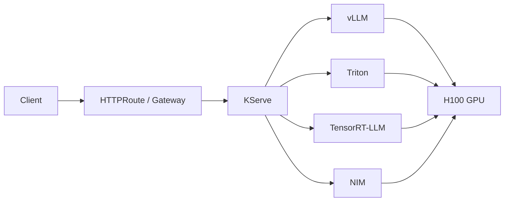

# 19.3 Capstone: inference on GKE with vLLM, Triton, TensorRT-LLM, NIM and KServe

| Field | Value |
|---|---|
| Level | Advanced |
| Priority tier | 1 |
| Lab venue | GCP / GKE |
| Part | Part 19: Capstones, design and interview readiness |
| Primary sources | NVIDIA Zero-to-Hero Volume 24 (Inference on GKE capstone); Part 11 (GPU Kubernetes); Part 15 (Inference); Part 16 (MLOps) |
| Cross-references | Chapter 11.22 (KServe); Chapter 15.3 (vLLM); Chapter 15.6 (Triton); Chapter 15.7 (NIM); Chapter 16.6 (Model registry) |
| Coverage file | `planning/coverage/chapters/19-03.md` |
| Claim & number ledger | `planning/ledgers/19-03.md` |

## Why this matters for AI infrastructure

The inference capstone is the production shape of an LLM serving platform. The capstone ties together the inference engines (vLLM, Triton, TensorRT-LLM, NIM), the serving framework (KServe), the model registry (MLflow), the routing (canary rollouts), the autoscaling, and the day-2 operations. A team that has read every chapter in Parts 15 and 16 can describe each piece; a team that has run this capstone knows how the pieces fit together.

The inference capstone is what the customer sees. The customer does not see the cluster; the customer sees the inference. The inference is the product. The capstone is what makes the inference a production service.

```text
Why the inference capstone matters (V24; Parts 15, 16):
- An inference platform is the production shape of LLM serving. The
  capstone is what ties Parts 15 and 16 together into a deployable system.
- The capstone has three perspectives: the platform engineer's view (how
  to deploy the inference engines); the ML engineer's view (how to ship a
  model); the on-call engineer's view (how to debug a slow inference).
- The capstone is the reference design. Every chapter in Parts 15 and 16
  maps to a section of the capstone. The capstone is the integrated picture.
```

Three operational realities make this capstone a platform-team deliverable rather than a tutorial:

1. **The capstone is the reference design.** The platform team references the capstone when deploying a new model; the platform team references the capstone when upgrading an inference engine; the platform team references the capstone when debugging an inference.
2. **The capstone is the interview anchor.** The candidate is asked "how would you serve an LLM at scale?"; the candidate points at this capstone. The capstone is the platform team's answer.
3. **The capstone is the on-call reference.** The on-call engineer follows the runbook; the runbook points at the capstone; the on-call engineer fixes the inference. The capstone is the on-call's guide.

**Before a team can claim they have built an inference platform, the team must have run this capstone. A team that has not run the capstone has not integrated the pieces.**

## Prerequisites and outcomes

### Prerequisites

- Chapter 15 (Inference) for the inference engines.
- Chapter 16 (MLOps) for the platform stack.

### Outcomes

After completing this capstone you will be able to:

1. Deploy KServe InferenceServices with vLLM, Triton, TensorRT-LLM, and NIM backends.
2. Configure model selection and routing: canary rollouts, A/B testing, traffic mirroring.
3. Configure autoscaling based on concurrency, latency, and token throughput.
4. Wire the inference to the model registry (MLflow) for version management.
5. Implement eval-driven promotion: the model is promoted only if it passes the eval suite.
6. Operate the inference platform with on-call runbooks, incident response, and capacity planning.

---

## 1. The inference topology

### 1.1 The inference stack

The inference stack is the layered architecture from the HTTP gateway to the GPU kernel. The stack has the routing layer, the serving framework, the inference engine, and the GPU runtime.



The pattern is: the HTTP gateway routes to KServe; KServe picks the inference engine; the inference engine runs on the GPU. The stack is modular; the stack is swappable.

### 1.2 The model registry

The model registry is the source of truth for the model artefacts. The model registry stores the model weights, the model metadata, the model version, the model signature.

```text
Model registry schema:
- model_name: e.g. "churn-model"
- version: e.g. "v7"
- stage: e.g. "production" or "staging"
- artifact_uri: e.g. "s3://mlflow-artifacts/churn-model/v7/model.pkl"
- signature: input schema, output schema
- metrics: AUC, accuracy, precision, recall
- lineage: run_id, dataset_id, code_commit
```

The pattern is: the model registry is the source of truth; the serving framework pulls from the registry; the registry tracks the version history.

---

## 2. KServe InferenceServices

### 2.1 The vLLM InferenceService

The vLLM InferenceService runs the vLLM engine. vLLM is optimised for high-throughput LLM serving; vLLM uses PagedAttention; vLLM supports continuous batching.

```yaml
# code/part19/vllm_inference_service.yaml (shape only)
apiVersion: serving.kserve.io/v1beta1
kind: InferenceService
metadata:
  name: churn-model-vllm
  namespace: inference
spec:
  predictor:
    model:
      modelFormat:
        name: vllm
      runtime: kserve-vllm
      storageUri: s3://mlflow-artifacts/churn-model/production/vllm
      resources:
        limits:
          cpu: "8"
          memory: 32Gi
          nvidia.com/gpu: "1"
    minReplicas: 1
    maxReplicas: 8
    scaleTarget: 4
    scaleMetric: concurrency
```

The pattern is: the InferenceService specifies the model format, the runtime, the storage URI, the resources, and the autoscaling.

### 2.2 The Triton InferenceService

The Triton InferenceService runs the Triton engine. Triton supports multiple frameworks (TensorRT, PyTorch, ONNX); Triton has dynamic batching.

```yaml
# code/part19/triton_inference_service.yaml (shape only)
apiVersion: serving.kserve.io/v1beta1
kind: InferenceService
metadata:
  name: churn-model-triton
  namespace: inference
spec:
  predictor:
    model:
      modelFormat:
        name: triton
      runtime: kserve-triton
      storageUri: s3://mlflow-artifacts/churn-model/production/triton
      resources:
        limits:
          cpu: "8"
          memory: 32Gi
          nvidia.com/gpu: "1"
    minReplicas: 1
    maxReplicas: 8
    scaleTarget: 80
    scaleMetric: cpu
```

The pattern is: the InferenceService specifies the Triton runtime; Triton handles the batching and the model serving.

### 2.3 The TensorRT-LLM InferenceService

The TensorRT-LLM InferenceService runs the TensorRT-LLM engine. TensorRT-LLM is optimised for NVIDIA GPUs; TensorRT-LLM uses TensorRT for inference.

```yaml
# code/part19/tensorrt_llm_inference_service.yaml (shape only)
apiVersion: serving.kserve.io/v1beta1
kind: InferenceService
metadata:
  name: churn-model-tensorrt-llm
  namespace: inference
spec:
  predictor:
    model:
      modelFormat:
        name: tensorrt-llm
      runtime: kserve-tensorrt-llm
      storageUri: s3://mlflow-artifacts/churn-model/production/tensorrt-llm
      resources:
        limits:
          cpu: "8"
          memory: 32Gi
          nvidia.com/gpu: "1"
    minReplicas: 1
    maxReplicas: 8
    scaleTarget: 4
    scaleMetric: concurrency
```

The pattern is: the InferenceService specifies the TensorRT-LLM runtime; TensorRT-LLM handles the inference.

### 2.4 The NIM InferenceService

The NIM InferenceService runs the NIM engine. NIM is NVIDIA's optimised LLM inference microservice; NIM bundles the model with the runtime.

```yaml
# code/part19/nim_inference_service.yaml (shape only)
apiVersion: serving.nvidia.com/v1alpha1
kind: NIMService
metadata:
  name: churn-model-nim
  namespace: inference
spec:
  image: nvcr.io/nim/llama3-8b-instruct:1.0.0
  imagePullSecret: ngc-pull-secret
  replicas: 1
  resources:
    gpu:
      count: 1
      type: h100-sxm5-80gb
  env:
    - name: NGC_API_KEY
      valueFrom:
        secretKeyRef:
          name: ngc-api-key
          key: api-key
```

The pattern is: the NIMService specifies the NIM image, the GPU requirements, the NGC API key.

---

## 3. Model selection and routing

### 3.1 The model router

The model router routes requests to the right InferenceService. The router uses the model name, the model version, or a header to determine the destination.

```yaml
# code/part19/model_router.yaml (shape only)
apiVersion: gateway.networking.k8s.io/v1
kind: HTTPRoute
metadata:
  name: churn-model-router
  namespace: inference
spec:
  parentRefs:
    - name: inference-gateway
  rules:
    - matches:
        - headers:
            - name: x-model-variant
              value: vllm
          path:
            type: PathPrefix
            value: /v1/chat/completions
      backendRefs:
        - name: churn-model-vllm
          port: 8080
    - matches:
        - headers:
            - name: x-model-variant
              value: triton
          path:
            type: PathPrefix
            value: /v1/chat/completions
      backendRefs:
        - name: churn-model-triton
          port: 8080
```

The pattern is: the router routes by header; the router supports canary rollouts; the router supports A/B testing.

### 3.2 The canary rollout

The canary rollout deploys a new model version alongside the production version. The router sends 10% of traffic to the canary; the canary's SLO is monitored; the rollout completes when the canary is healthy.

```yaml
# code/part19/canary_inference_service.yaml (shape only)
apiVersion: serving.kserve.io/v1beta1
kind: InferenceService
metadata:
  name: churn-model
  namespace: inference
spec:
  predictor:
    canaryTrafficPercent: 10
    canary:
      model:
        modelFormat: {name: sklearn}
        storageUri: s3://mlflow-artifacts/churn-model/canary/model.pkl
    model:
      modelFormat: {name: sklearn}
      storageUri: s3://mlflow-artifacts/churn-model/production/model.pkl
```

The pattern is: the canary is declared; the traffic is split; the canary runs the SLO check; the rollout completes on success.

---

## 4. Autoscaling

### 4.1 The autoscaling strategies

The autoscaling strategies are based on different metrics. The strategies are: concurrency-based, latency-based, token-throughput-based.

| Strategy | Metric | Use case |
|---|---|---|
| **Concurrency** | Number of in-flight requests per replica | LLM serving (vLLM, NIM) |
| **Latency** | p99 inference latency | Strict latency SLO |
| **Token throughput** | Tokens per second per replica | High-throughput batch inference |

The pattern is: pick the strategy that matches the workload; the strategy is per InferenceService.

### 4.2 The autoscaling configuration

The autoscaling is configured per InferenceService. The InferenceService declares the scale target, the scale metric, the min replicas, the max replicas.

```yaml
# code/part19/autoscaling_inference_service.yaml (shape only)
apiVersion: serving.kserve.io/v1beta1
kind: InferenceService
metadata:
  name: churn-model
  namespace: inference
spec:
  predictor:
    model:
      modelFormat: {name: vllm}
      storageUri: s3://mlflow-artifacts/churn-model/production/vllm
      resources:
        limits:
          nvidia.com/gpu: "1"
    minReplicas: 1
    maxReplicas: 16
    scaleTarget: 4
    scaleMetric: concurrency
```

The pattern is: the scale target is the trigger; the scale metric is the metric; the min and max replicas are the bounds.

---

## 5. Day-2 operations

### 5.1 The upgrade process

The upgrade process is the pattern for upgrading the inference engines without downtime.

```text
Inference upgrade process:
1. Deploy the new version as a canary: 10% traffic
2. Monitor the canary's SLO for 24 hours
3. If the canary is healthy: increase to 50% traffic
4. Monitor for 1 hour
5. If still healthy: increase to 100% traffic
6. Retire the old version
```

The pattern is: canary, monitor, expand. The cluster continues to serve traffic during the rolling upgrade.

### 5.2 The incident response

The incident response is the pattern for responding to an inference failure.

```text
Inference incident response:
1. Detect: Prometheus alert (inference latency, error rate, GPU OOM)
2. Triage: kubectl describe, kubectl logs, kubectl exec
3. Mitigate: roll back to the previous version; restart the pod; scale the deployment
4. Resolve: root cause analysis, runbook update, post-mortem
```

The pattern is: detect, triage, mitigate, resolve. The runbook is the on-call's guide.

---

## 6. Hands-on lab

This lab walks through the inference capstone: the InferenceServices, the routing, the autoscaling. The lab is **untested** in this repository.

### 6.1 Prerequisites

- A GKE Autopilot or Standard cluster with GPU node pool.
- KServe installed.
- A model artefact in object storage.

### 6.2 Step 1: deploy the vLLM InferenceService

```bash
kubectl apply -f code/part19/vllm_inference_service.yaml
kubectl get inferenceservice churn-model-vllm -n inference -w
# expected: READY=True within 60 seconds
```

### 6.3 Step 2: send a test request

```bash
URL=$(kubectl get inferenceservice churn-model-vllm -n inference -o jsonpath='{.status.url}')
curl -X POST $URL/v1/chat/completions \
  -H "Content-Type: application/json" \
  -d '{"model": "churn-model", "messages": [{"role": "user", "content": "Hello"}]}'
# expected: a JSON response with the model's prediction
```

### 6.4 Step 3: deploy the Triton InferenceService

```bash
kubectl apply -f code/part19/triton_inference_service.yaml
```

### 6.5 Step 4: deploy the canary

```bash
kubectl apply -f code/part19/canary_inference_service.yaml
```

### 6.6 Step 5: verify the autoscaling

```bash
hey -z 60s -c 100 -m POST -T "application/json" \
  -d '{"model": "churn-model", "messages": [{"role": "user", "content": "Hello"}]}' \
  $URL/v1/chat/completions

kubectl get hpa -n inference -w
# expected: the HPA scales the replicas up
```

### 6.7 What to record

After the lab, you should be able to answer five questions in five seconds each:

1. What is the current inference latency p99?
2. What is the current inference error rate?
3. What is the current replica count?
4. What is the current canary traffic percent?
5. What is the current cost per inference?

If any takes more than 30 seconds, the inference platform is not yet a production service. The lab is **untested** against a live GKE cluster.

---

## Exercises

1. **Deploy a NIM InferenceService.** Add a NIMService alongside the vLLM InferenceService. Verify the NIM is reachable. *Solution sketch:* the NIMService YAML.
2. **Configure an HPA for the InferenceService.** Add a Horizontal Pod Autoscaler with custom metrics. *Solution sketch:* the HPA YAML with the Prometheus adapter.
3. **Configure the model router with A/B testing.** Add A/B testing logic to the HTTPRoute. *Solution sketch:* the HTTPRoute with multiple backendRefs.
4. **Configure the inference logging.** Add the OpenTelemetry Collector to capture inference logs. *Solution sketch:* the OpenTelemetry Collector config.
5. **Add a TensorRT-LLM InferenceService.** Deploy a TensorRT-LLM optimised model. *Solution sketch:* the TensorRT-LLM InferenceService YAML.
6. **Add a custom metric for autoscaling.** Configure a custom metric that scales the InferenceService based on token throughput. *Solution sketch:* the Prometheus adapter with a custom metric.

---

## Checkpoint questions

<details><summary>1. What is vLLM?</summary>
A high-throughput LLM inference engine that uses PagedAttention and continuous batching. vLLM is optimised for high-throughput LLM serving; vLLM is one of the most widely used inference engines for production LLM serving.
</details>

<details><summary>2. What is Triton?</summary>
NVIDIA's multi-framework inference server. Triton supports TensorRT, PyTorch, ONNX, and other frameworks; Triton provides dynamic batching; Triton is widely used in production.
</details>

<details><summary>3. What is TensorRT-LLM?</summary>
NVIDIA's LLM inference engine optimised for NVIDIA GPUs. TensorRT-LLM uses TensorRT for inference; TensorRT-LLM provides high-throughput LLM serving on NVIDIA hardware.
</details>

<details><summary>4. What is NIM?</summary>
NVIDIA Inference Microservice: NVIDIA's LLM inference microservice. NIM bundles the model with the runtime; NIM is optimised for NVIDIA GPUs; NIM is the easiest way to deploy an LLM on NVIDIA hardware.
</details>

<details><summary>5. What is the most common inference failure?</summary>
GPU OOM. The inference workload requests more GPU memory than the node has; the inference engine crashes. The fix is to reduce the batch size, enable KV cache offloading, or scale up the GPU pool.
</details>

<details><summary>6. What is the most dangerous inference failure?</summary>
The inference engine is down. The customer cannot use the service; the SLO is breached; the revenue is impacted. The fix is to investigate the engine, restart the pod, and verify the model artefact.
</details>

<details><summary>7. What is the difference between vLLM and TensorRT-LLM?</summary>
vLLM is the open-source LLM inference engine. TensorRT-LLM is the NVIDIA-optimised LLM inference engine. vLLM has broader community support; TensorRT-LLM has better NVIDIA hardware optimisation.
</details>

<details><summary>8. What is the most important inference metric?</summary>
Inference latency p99. The metric tells the team whether the inference is meeting the SLO. A high p99 latency indicates the inference is too slow; the alert pages the on-call.
</details>

<details><summary>9. What is the relationship between the model registry and the InferenceService?</summary>
The model registry stores the model artefacts. The InferenceService references the model artefacts via the storageUri. The registry is the source of truth; the serving framework consumes the registry.
</details>

<details><summary>10. What is the difference between canary and A/B testing?</summary>
Canary testing shifts a fraction of traffic to the new version. A/B testing shifts traffic based on a header or user segment. Canary is for safe deployment; A/B is for comparison.
</details>

<details><summary>11. What is the relationship between KServe and the inference engine?</summary>
KServe is the serving framework. The inference engine (vLLM, Triton, TensorRT-LLM, NIM) is the runtime. KServe abstracts the serving; the inference engine does the work.
</details>

<details><summary>12. What is the most common inference performance failure?</summary>
The inference latency is high. The customer complains that the inference is too slow. The fix is to profile the inference; identify the bottleneck (prefill, decode, KV cache); optimise the bottleneck.
</details>

<details><summary>13. Why is the inference capstone a Tier 1 chapter?</summary>
Because the inference capstone is the reference design. The capstone is what the platform team references; the capstone is what the interview candidate points at; the capstone is what the on-call engineer follows.
</details>

<details><summary>14. What is the difference between a canary and a shadow deployment?</summary>
A canary serves real traffic to the new version. A shadow deployment mirrors real traffic to the new version but returns responses from the production version. Canary is for safe deployment; shadow is for offline comparison.
</details>

<details><summary>15. What is the difference between HPA and KServe's built-in autoscaling?</summary>
HPA scales based on CPU/memory. KServe's built-in autoscaling scales based on inference-specific metrics (concurrency, latency, token throughput). Use HPA for general scaling; use KServe's autoscaling for inference-specific scaling.
</details>

<details><summary>16. What is the relationship between KServe and Knative?</summary>
KServe builds on Knative Serving. Knative provides the serving primitives (revision, route, configuration); KServe adds the inference-specific abstractions (predictor, transformer, explainer).
</details>

<details><summary>17. What is the difference between an InferenceService and a Deployment?</summary>
An InferenceService is a serving abstraction (predictor, transformer, explainer, canary). A Deployment is a generic Kubernetes primitive. The InferenceService builds on the Deployment; the InferenceService adds the serving-specific features.
</details>

<details><summary>18. What is the relationship between the inference capstone and the Slurm capstone?</summary>
The Slurm capstone (19.1) is the HPC training shape. The inference capstone (19.3) is the cloud-native serving shape. The two can coexist: Slurm runs the training; Kubernetes runs the inference. The two share the model registry.
</details>

<details><summary>19. What is the difference between vLLM and Triton for LLM serving?</summary>
vLLM is the open-source LLM-specific inference engine (PagedAttention, continuous batching). Triton is the multi-framework inference server. For LLM-specific workloads, vLLM is typically faster; for multi-framework workloads, Triton is more flexible.
</details>

<details><summary>20. What five questions should the inference capstone lab let you answer in five seconds each?</summary>
What is the current inference latency p99. What is the current inference error rate. What is the current replica count. What is the current canary traffic percent. What is the current cost per inference. If any takes more than 30 seconds, the inference platform is not yet a production service.
</details>

---

## Sources and review notes

- NVIDIA Zero-to-Hero Volume 24 (Inference on GKE capstone). Source for the KServe InferenceServices, the routing, the autoscaling, the model selection. The wording has been rewritten in the handbook's voice.
- Part 11 (GPU Kubernetes) for the cluster setup.
- Part 15 (Inference) for the inference engines.
- Part 16 (MLOps) for the platform stack.

### Cross-references to other handbook chapters

- Chapter 11.22 for the KServe inference.
- Chapter 15.3 for the vLLM inference engine.
- Chapter 15.6 for the Triton inference server.
- Chapter 15.7 for the NIM inference microservice.
- Chapter 16.6 for the model registry.

### Migrated from `nvidia-devops`

The inference capstone operational patterns draw on Volume 24. The wording has been rewritten in the handbook's voice.

### Explicitly labelled inferences

- The InferenceService replica count (1-8) is a starting point; specific counts depend on the traffic.
- The autoscaling target (4 concurrent requests) is a starting point; specific targets depend on the workload.
- The canary traffic percent (10%) is a starting point; specific percents depend on the team's confidence.

### Not verified on live hardware

- The lab in Section 6 is **untested** against a live GKE cluster in this repository.
- The InferenceService YAML assumes a working KServe installation; production deployments may require careful staging.
- The inference engine versions assumed in the lab should be pinned against the current releases.
