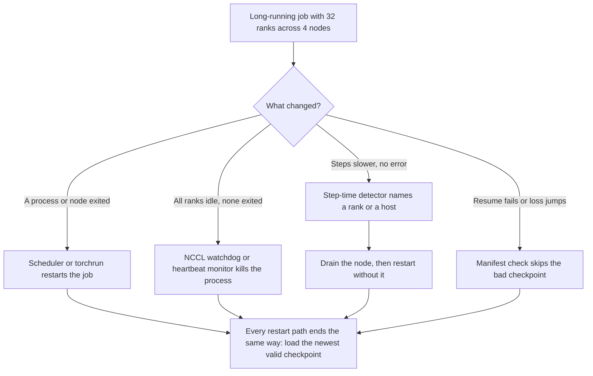

# 19.4 Capstone: multi-node training with fault tolerance

| Field | Value |
|---|---|
| Level | Advanced |
| Priority tier | 1 |
| Lab venue | GCP / GKE (the parts that run here need only Docker and a CPU) |
| Part | Part 19: Capstones, design and interview readiness |
| Pinned versions | PyTorch 2.15 documentation and 2.15.0 CPU wheel; Slurm documentation 26.05; JobSet v0.13.0 CRD; Kubeflow Training Operator v1.9.4 CRD; NCCL 2.32.3 documentation. All fetched 2026-11-10. |
| Cross-references | Chapters 14.5, 14.10, 14.11, 12.16, 12.18, 11.9, 6.12, 6.14, 13.7, 16.5, 17.7, 17.11 |
| Code | `code/part19/c04_*` and `code/part19/test_c04_*` |
| Coverage file | `planning/coverage/chapters/19-04.md` |
| Claim & number ledger | `planning/ledgers/19-04.md` |

## Read this first

A large training job can go quiet in the middle of the night while the dashboard still says it is running. The cause is usually simple to state. A synchronous training job stops when any one rank stops. A rank is one GPU process, and all the ranks must meet at every collective, which is the step where they exchange data before any of them can move on. If one rank disappears, the others wait for it forever. On a large cluster this kind of stop happens every few hours, and some of them look like nothing at all: every GPU idle, no process exited, the job still "running".

Five ideas carry the chapter, and each one answers a different kind of stop.

1. **Checkpoint cadence is maths.** The best interval grows with the square root of the checkpoint cost times the mean time between interruptions (section 2).
2. **Sharded checkpoints.** Every rank writes its own part, nobody gathers the model, and the checkpoint can be loaded at a different world size (sections 3 to 5).
3. **Elastic restart has limits.** `torchrun` restarts workers but cannot replace a dead node. Only the scheduler can (section 6).
4. **Hang detection.** The watchdog, the heartbeat monitor and the flight recorder turn an idle cluster into a dump and a kill (section 7).
5. **Straggler detection.** Total step time hides a slow rank, so record time outside collectives (section 8).

If you are short on time, pick the path that matches why you opened this page. The list below sends you to the right sections.

- **Interview preparation:** sections 1 to 3 and 6 to 8, then the checkpoint questions.
- **Building a real project:** sections 3 to 5, then section 9 for Slurm or section 10 for Kubernetes, then section 12.
- **Being on call tonight:** section 11, then section 7.

Nothing here ran on a GPU, on NCCL, on Slurm or on Kubernetes. Section 1 says exactly what did run.

## Why this matters for AI infrastructure

It is 03:10 and a training run that started nine days ago has stopped moving. The loss curve ends in a flat line, GPU utilisation reads zero on every node, and the job is still listed as running. Somebody has to decide whether to wait, restart, or page the network team. Waiting costs money every minute, and restarting without a plan can throw away the work that is still in memory. In most cases the deciding factor is the last good checkpoint, because it is the only thing that stands between the team and nine days of lost compute. A checkpoint is a saved copy of the model weights and the training state, written to storage so that a job can restart from it.

That checkpoint is a bigger risk than most teams admit. A checkpoint that was half written when a node died looks fine in a directory listing, because the folder is there and most of the files are there. A resume that loads it will either crash or, worse, continue from corrupt weights and produce a model that looks healthy until someone evaluates it. The work in this chapter is mostly about making sure that never happens. The other goal is to make the common failures cheap enough that nobody has to wake up for them.

Long jobs fail for five different reasons, and each one needs a different tool. This chapter takes each in turn and builds the piece that deals with it, using one reference job throughout. Keeping one job in view helps, because the same numbers come back in the formulas, the scripts and the runbook.

The reference job is deliberately small enough to reason about. It trains an 8-billion-parameter model on 4 nodes with 8 GPUs each, using FSDP2 and PyTorch Distributed Checkpoint. FSDP2 is the second generation of PyTorch's fully sharded data parallel, which splits the model state across the GPUs so that no single GPU holds all of it. The same pieces run on Slurm and on Kubernetes, and the chapter shows both. This is a capstone because it joins Part 14 on training, Part 12 on NCCL, Part 6 on Slurm, Part 11 on GPU Kubernetes and Part 17 on operations into one job that you can actually operate.

## Prerequisites and outcomes

### Prerequisites

- Chapter 14.5 on FSDP and parameter sharding, and 14.10 on multi-node training architecture.
- Chapter 14.11 on checkpointing, fault tolerance and elastic training. This chapter reuses its ideas and adds a tested implementation.
- Chapter 12.16 and 12.18 on NCCL environment variables and on hangs and timeouts.
- Chapter 6.12 and 6.14 on multi-node training on Slurm and on Slurm operations, and chapter 11.9 on JobSet and PyTorchJob.
- Python 3.12 with pytest. Docker is optional and is used for the CPU smoke test.

### Outcomes

Picture the first week after this job goes live. Failures will arrive, and the team needs to know which tool catches each one. The chapter walks through the five failure shapes, the checkpoint interval maths, the sharded checkpoint format, the async save path, the resume checks, the `torchrun` elastic restart limits, the hang watchdog, the straggler detector, the Slurm and Kubernetes versions of the job, and a runbook for the person on call. Each piece is small, and each one has a test or a manifest check where the environment allows it.

---

## 1. How a long training job fails

### Interruptions every three hours

Imagine a team that starts a training run on thousands of GPUs and expects it to take weeks. The run is not one machine that either works or does not. It is a crowd of machines that have to keep moving together, and any one of them can fail at any hour. Meta's report of its Llama 3 405B run, reproduced in AI Systems Performance Engineering, counted 419 unexpected interruptions over 54 days. That is one stop about every three hours. Nobody on that team could have operated the run by hand, and nobody should try.

The cause of each stop was different, so the fixes differ too. The published failure breakdown lists 148 faulty GPUs, 72 GPU memory faults, 54 software bugs, 35 network switch or cable faults, and 32 host maintenance events. It also lists 7 NCCL watchdog timeouts and 6 silent data corruption cases. Silent data corruption means a wrong value appears in a computation without any error being raised. The percentages printed in that breakdown do not equal each count divided by 419, so this chapter uses the counts only.

Most of these stops are not a single dead machine. A GPU memory fault usually kills one process on one node. Every other rank is then stuck in a collective that can never finish, because the collective needs a reply from the rank that is gone. The job does not fail. It waits. That distinction drives the whole design, because waiting needs a detector and dying needs a restart. A detector notices that nothing is moving. A restart brings the job back from its last checkpoint.

### Five failure shapes

Think of a long job as a chain of ranks that must all arrive at every collective, the way a relay team must all reach each handoff point before the next leg can start. Anything that stops one rank stops all of them. The five shapes below cover almost every incident, and each has a different first signal. Learning the shapes first keeps you from reaching for the wrong tool during an incident.

| Shape | What you see | First detector | First response |
|---|---|---|---|
| Node or process loss | One pod or task exits, others hang or exit | Scheduler event, torchrun exit report | Restart from checkpoint, replace the node |
| NCCL hang | All ranks idle, no process has exited | Watchdog timeout, heartbeat monitor | Dump traces, kill, restart, find the rank |
| Slow node | Steps take longer, no error | Per-rank step-time record | Drain the node, restart without it |
| Data stall | One rank waits for its next batch | Per-rank data wait time | Fix the storage path or the loader |
| Checkpoint damage | Resume crashes or loss jumps | Manifest checksum at resume | Fall back to the previous checkpoint |

The first two rows are loud once you notice them. A dead pod shows up in the events, and a hang shows up as a flat line on the utilisation graph. The last three rows are quiet. A slow node can cost a day of throughput before anyone sees a failed pod, because the job still makes progress, only more slowly. A damaged checkpoint stays invisible until the next restart needs it, and that restart is the worst moment to discover it.

The diagram below turns the table into a decision path. Read it from the top, and follow the branch that matches what you see on the dashboard.



Every path ends at the newest valid checkpoint, which is why section 5 exists. Draining means marking a node so that no new work lands on it, which lets you take a sick machine out of service without killing the rest of the job. Sections 9 and 10 cover it.

### What is tested and what is not

Picture a checklist that separates what you ran from what you only read. The host for this chapter has no GPU, so the checks here are narrower than a production run. The checkpoint, resume, restart and signal logic ran on a two-process CPU job with the gloo backend, which is PyTorch's CPU communication library. NCCL, GPU memory behaviour and real network faults did not run, and the chapter says so wherever it matters. Read every "expected" line as a prediction until you have seen it on your own cluster.

**Decision rule:** classify every training incident into one of the five shapes before you touch anything, because each shape has a different first check and a wrong first move wastes the restart.

**In one minute:** a synchronous job fails by stopping, not only by crashing. A dead rank leaves the others waiting, so you need a restart path for exits, a watchdog for hangs, a metric for slow nodes and a checksum for checkpoints. At large scale interruptions arrive every few hours, so recovery has to be automatic.

---

## 2. Checkpoint cadence maths

### The checkpoint nobody could afford

Two engineers sit down to set the checkpoint interval for the same job. The first picks five minutes, because losing five minutes sounds acceptable. The job then spends a growing share of every hour writing to storage, and the GPUs wait during each write. The second picks four hours, to protect throughput. A node then fails at hour three and a half, and the team loses three and a half hours of work. Both choices felt safe, and neither was calculated. The rest of this section gives a way to calculate it.

There is a real optimum, and two researchers found it long ago. John Young gave a first-order answer in 1974. John Daly refined it in a paper on restart dumps in Future Generation Computer Systems. Both treat the job as running until something interrupts it, with interruptions arriving at random at a steady average rate. The trade-off is simple to see. Checkpointing too often wastes time writing, because every write stops the GPUs. Checkpointing too rarely wastes time redoing work, because every failure throws away everything since the last save.

### The formula, with its limits

Three quantities matter, and it helps to name them before reading the formulas. The first is the mean time between interruptions of the whole job, written M. The second is the time the job is blocked while one checkpoint is written, written C. The third is the compute time between checkpoints, written tau. Young's interval and Daly's rule are below. Read them as recipes: measure M and C, then compute tau.

```text
Young (1974):       tau = sqrt(2 * C * M)
Daly rule:          tau = sqrt(2 * C * M) - C     if C < M / 2
                    tau = M                       otherwise
```

Daly's paper also gives a longer series for the exact optimum. The rule above is the practical form that Adrian Colyer's summary of the paper reports, and the paper itself was not readable here, so treat the rule as secondhand. A 2013 analysis by Aupy and coauthors uses a slightly different convention. It puts the checkpoint inside the period and writes the interval as the square root plus C. The two conventions differ by a small offset, which matters only when C is not small compared with M. Both forms agree when C is much smaller than M, and the calculator below shows they land within two percent of a numeric optimum.

The numeric check uses the waste model from that same Aupy paper. Waste is the share of wall-clock time that does not advance the job. Let T be the full period, which is tau plus C. Waste from checkpointing alone is C divided by T, because that fraction of every period is spent writing. Waste from faults is the downtime, the restart time and half a period, all divided by M. Half a period is the average work lost when a failure lands at a random moment. The two sources combine as one minus the product of what each leaves over, so the total waste is never simply the two numbers added together.

The formula assumes failures are memoryless and independent. Memoryless means that the chance of a failure in the next minute does not depend on how long the job has already run. Real clusters break that assumption. A hot aisle or a bad firmware roll fails many nodes close together, and those failures come in clumps. Chapter 14.11 makes the same point and rounds the optimum down in production. Treat the formula as a starting value and measure your own interruption rate.

### Where M comes from

M is not a vendor number. It is the mean gap between interruptions that stop your job, measured from your own logs. Count the stops over a month, divide the hours by the count, and you have a first estimate. When you have no history, you can scale a published rate. The Llama 3 figures give 54 days times 24 hours times 16,384 GPUs, divided by 419 interruptions. That is about 50,700 GPU-hours per interruption. A GPU-hour is one GPU running for one hour, so the number says how much GPU time the cluster used, on average, between stops.

Scaling that to your job assumes failures are independent and add up linearly with GPU count. Linear means that twice the GPUs see twice the failures. That is my reasoning, not a measurement, and it ignores that software bugs and maintenance events scale differently from hardware faults. Use it for a first guess and replace it with a month of your own data.

### The reference job and two larger ones

The reference job has 32 GPUs and an 8.03-billion-parameter model. Its checkpoint size sets the write cost. Chapter 14.11 counts 14 bytes per parameter for a mixed-precision checkpoint with BF16 weights, FP32 master weights and FP32 Adam state. Those terms name a half-precision copy of the weights, a full-precision copy the optimizer updates, and the optimizer's running statistics. That gives about 112 GB. A shared file system that absorbs 5 GB per second, which is my assumption for this example, writes it in about 22.5 seconds. Every one of those seconds is a pause for all 32 GPUs.

| GPUs | Job MTBF | Checkpoint cost | Daly interval | Waste at that interval |
|---|---|---|---|---|
| 32 | 1,584 hours | 22.5 s | 15,995 s | 0.29 percent |
| 1,024 | 49.5 hours | 22.5 s | 2,809 s | 1.92 percent |
| 16,384 | 3.09 hours | 22.5 s | 685 s | 11.47 percent |
| 16,384 | 3.09 hours | 2.0 s, async | 209 s | 7.22 percent |

All rows assume 600 seconds to restart the job. Read the table row by row, because each row changes one thing from the row above it. The first three rows change only the GPU count, and the last row changes only the checkpoint cost. The script that produced them is `code/part19/c04_checkpoint_interval.py`, and its tests pin every number in the table.

At 32 GPUs the interval is hours and the waste is tiny, so a checkpoint every 15 to 30 minutes is already far more careful than the maths demands. Careful is not the same as cheap, though, because a shorter interval still adds writes that nobody needed. At 16,384 GPUs the interval is about eleven minutes, and the job spends a tenth of its life on faults and checkpoints no matter what you do. That is the real lesson of the table. Large jobs do not fail rarely. They fail often enough that the cost of each checkpoint becomes the thing you can shrink.

The last row shows why async checkpointing exists. Cutting the blocking cost from 22.5 to 2 seconds takes waste from 11.5 to 7.2 percent. Section 4 shows how.

### Choosing a number you can defend

Picture a finance team setting a budget. The team does not guess a number and hope. It measures what each month costs, checks how often the bills arrive, and sets the budget from those two facts. Checkpoint cadence works the same way. You measure how often the job stops and how long one save blocks it, then you compute the interval.

**Decision rule:** compute the interval from a measured interruption rate and a measured blocking checkpoint cost, then round toward shorter, and re-run the calculation whenever the node count or the checkpoint size changes.

**In one minute:** Young's interval is the square root of twice the cost times the mean time between interruptions. Daly subtracts the cost once. For the reference 32-GPU job the answer is hours, for a 16,384-GPU job it is about eleven minutes. The formula assumes independent random failures, so measure your own and round down.

---

## 3. Sharded versus full checkpoints

### The checkpoint that ate rank zero

A team moves from 8 GPUs to 64. Their save code gathers every parameter onto rank zero and calls `torch.save`. It worked for months, because eight GPUs' worth of state fit comfortably on one machine. At 64 GPUs the save takes minutes, rank zero runs out of host memory, and the job dies in the one step that was supposed to protect it. The save code did not change. The job grew, and the design of the save could not grow with it.

A full checkpoint is a single file holding every tensor, assembled in one place. A sharded checkpoint is many files, each holding the part of the state that one rank owns. The first is easy to read and easy to share, because you copy one file and you are done. The second scales, because every rank writes in parallel and nobody gathers anything. Most training jobs need both forms at different times. The training path wants the sharded form, and the people who evaluate or export the model want the full form.

### What PyTorch gives you

FSDP2 stores each parameter as a DTensor sharded along its first dimension. A DTensor is a tensor that knows which slice of itself each rank holds, so the pieces can be put back together later. The PyTorch 2.15 documentation says FSDP2 does not support full state dicts directly, where a state dict is the dictionary of all the weights and their names. You either reshard the DTensors yourself or use the Distributed Checkpoint library, usually called DCP. DCP writes many files per checkpoint, at least one per rank, and loads in place into storage that the model has already allocated. Loading in place means the model's memory is filled from the files, so the load does not need a second full copy of the model.

DCP also handles load-time resharding. The documentation describes this as saving in one cluster topology and loading in another. Resharding means cutting the saved pieces into the new layout the resumed job needs. That matters for elastic jobs, because the world size can change between runs. The world size is the total number of processes in the job. The training script in this chapter proves it on a small job. A checkpoint written by two processes loaded cleanly into one process, and the run continued from the same step.

A DCP checkpoint is a directory. In the smoke run, a 2-process save produced two shard files named `__0_0.distcp` and `__1_0.distcp` plus a file named `.metadata`. The documentation describes the global `.metadata` file as the record of how the pieces fit together and says its write marks the checkpoint as successful. Treat a directory without it as incomplete. When you open a checkpoint folder during an incident, the metadata file is the first thing to look for.

| Property | Sharded (DCP) | Full (single file) |
|---|---|---|
| Who writes | Every rank, in parallel | One rank after a gather |
| Memory spike | None beyond the local shard | Whole model on one rank |
| Reload on a different world size | Supported by DCP resharding | Trivially, it is one file |
| Use for serving or sharing | Convert first | Direct |
| Failure surface | Many files, one missing shard breaks it | One file |

### Getting a full checkpoint when you need one

You still need a full file for evaluation, export and hand-off. A colleague who wants to load the model on a single workstation cannot use a folder of shards without help. DCP offers `dcp_to_torch_save` for converting a finished checkpoint, and `StateDictOptions` with `full_state_dict=True` and `cpu_offload=True` for gathering in memory. The documentation says that with both set, only rank zero receives the state, which avoids a host-memory spike on every other rank. Do the conversion offline, after training, so the training path never pays for it.

### Which FSDP2 sharding to choose

FSDP1 named its modes. FSDP2 expresses the same choices through the mesh and one flag. A mesh is the layout of the GPUs in a grid, so each setting says which GPUs hold which slice of the model. The mapping below is my reading of the two documentation pages, not a table from the PyTorch authors. Use it to translate an old FSDP1 script, and check the new settings against the documentation for your version.

| FSDP1 name | FSDP2 setting in `c04_fsdp_config.py` | Effect |
|---|---|---|
| FULL_SHARD | 1D mesh, `reshard_after_forward=True` | Parameters resharded after forward, gathered again in backward |
| SHARD_GRAD_OP | 1D mesh, `reshard_after_forward=False` | Parameters stay unsharded after forward, saving the backward gather |
| HYBRID_SHARD | 2D mesh with replicate and shard dimensions | All-gathers stay inside one shard group, usually a node |

The documentation adds that FSDP2 has no bucket size setting, so you do not tune how many bytes go into one communication call. Communication groups follow the modules you wrap instead. In practice that means you apply `fully_shard` to each block first and then to the root, working from the inside of the model outwards. The config file below does that, and it is short enough to read whole. Read it once against the table above, and each setting should match a row.

```python
# code/part19/c04_fsdp_config.py
"""FSDP2 (fully_shard) configuration for the capstone training job.

Sharding choices expressed with the FSDP2 API (PyTorch 2.15 documentation):
    "full"        1D mesh, reshard_after_forward=True   -> like FSDP1 FULL_SHARD
    "shard_grad"  1D mesh, reshard_after_forward=False  -> like FSDP1 SHARD_GRAD_OP
    "hybrid"      2D mesh (replicate, shard)            -> like FSDP1 HYBRID_SHARD
The mapping from FSDP1 names is my reading of the two docs pages, not a statement
from the PyTorch documentation.
"""
from dataclasses import dataclass

import torch
from torch.distributed.device_mesh import init_device_mesh
from torch.distributed.fsdp import MixedPrecisionPolicy, fully_shard


@dataclass
class ShardConfig:
    strategy: str = "full"          # full | shard_grad | hybrid
    shard_size: int = 0             # hybrid only: ranks per shard group (usually GPUs per node)
    param_dtype: str = "bfloat16"   # "float32" disables mixed precision
    reduce_dtype: str = "float32"


def build_mesh(device_type, world_size, cfg):
    if cfg.strategy == "hybrid":
        if cfg.shard_size < 2 or world_size % cfg.shard_size:
            raise ValueError("hybrid needs shard_size >= 2 that divides world_size")
        return init_device_mesh(
            device_type, (world_size // cfg.shard_size, cfg.shard_size),
            mesh_dim_names=("replicate", "shard"))
    return init_device_mesh(device_type, (world_size,), mesh_dim_names=("shard",))


def mixed_precision(cfg):
    if cfg.param_dtype == "float32":
        return MixedPrecisionPolicy()
    return MixedPrecisionPolicy(
        param_dtype=getattr(torch, cfg.param_dtype),
        reduce_dtype=getattr(torch, cfg.reduce_dtype))


def shard_model(model, mesh, cfg, blocks):
    """Apply fully_shard bottom-up: every block first, then the root.

    blocks is the list of submodules that each get their own all-gather group.
    """
    kwargs = {"mesh": mesh, "mp_policy": mixed_precision(cfg)}
    if cfg.strategy == "shard_grad":
        kwargs["reshard_after_forward"] = False
    for block in blocks:
        fully_shard(block, **kwargs)
    fully_shard(model, **kwargs)
    return model
```

Hybrid sharding changes what a checkpoint contains, and that is easy to miss. Replicas hold identical shards, so the same piece of state can sit on more than one GPU. The default save planner has a `dedup_replicated_tensors` option, and what it does for hybrid sharding is untested. The smoke test does not exercise hybrid mode, and the NCCL behaviour of a 2D mesh was not run. Treat hybrid mode as a setting you have to check yourself before you trust it.

**Decision rule:** write sharded checkpoints with DCP on the training path, convert to a full file offline when you need one, and prove that a checkpoint written at one world size loads at another before you rely on elasticity.

**In one minute:** gathering to rank zero fails as the job grows. DCP writes one file per rank plus a metadata file and reshards at load. FSDP2 does not give you full state dicts directly, so convert offline. FSDP1's named modes map to a mesh shape and `reshard_after_forward`.

---

## 4. Async checkpointing

### Two seconds that cost twenty-two

A job writes 112 GB every 15 minutes. Each write blocks the GPUs for 22 seconds. Over a day that is about 35 minutes of idle GPUs, a bill nobody sees because it is spread over ninety-six small pauses. Nobody notices a 22-second pause in a dashboard, but the GPUs notice it every time, and the cost adds up across the whole day.

Async checkpointing splits the write in two. "Async" means the second half runs without the training loop waiting for it. First the job copies state from GPU memory to a staging area, which is CPU memory by default. A staging area is a holding space where the copy waits its turn. Then a background thread writes the staged copy to storage while training continues. Only the copy blocks the GPUs, and the copy is much faster than the write, because memory-to-memory moves are quicker than writes to a shared file system.

### The PyTorch API and what it costs you

The function is `dcp.async_save`. The 2.15 documentation says it first de-stages the state dict onto staging storage, defaulting to CPU memory, and then calls the save in a separate thread. It returns a future. A future is a handle for work that is still running, so you can ask later whether it has finished. The documentation marks the feature experimental and subject to change, so pin your PyTorch version and re-run the tests on every upgrade.

Staging has a memory cost, and it is paid in the host RAM that sits next to the training process. A 112 GB checkpoint across 32 GPUs adds about 3.5 GB per GPU of host memory. Check that arithmetic against the RAM on your own nodes before you turn the feature on. The stager can use pinned and shared memory, which speeds the copy and raises the pressure on the host. Pinned memory is memory the operating system is not allowed to move, which makes device copies faster.

An async save is not committed until the background write finishes. That is the trap. If you publish the checkpoint when the call returns, you publish something that is still being written. A reader that finds it will see a folder that looks complete and is not. The training script waits on the future, then runs a barrier on a separate gloo group, and only then lets rank zero commit the manifest. A barrier is a wait point where every rank must arrive before any of them continue. If the job dies in between, the directory stays a staging directory and the resume logic ignores it.

The script also keeps checkpoint control traffic off the NCCL group. It creates a second process group with the gloo backend for barriers and for DCP coordination. A checkpoint barrier then cannot interfere with a training collective that is still in flight. Without that separation, a checkpoint wait could sit in the same queue as the training traffic and make the training hang look worse than it is.

### What was measured

An async run with two processes produced committed, verified checkpoints. Committed means the manifest was written and the checkpoint is now visible to resume. Verified means the checks in section 5 passed. The smoke tests do not measure how long the GPUs blocked, because the CPU job has no real staging cost. A CPU copy between two processes tells you nothing about a GPU-to-host copy on a loaded node. That measurement needs GPUs and is listed under not run.

**Decision rule:** use async saves once the blocking write passes a few seconds, never publish a checkpoint before its background write finishes, and size host memory for the staged copy.

**In one minute:** async checkpointing copies state to the host and writes it in a thread, so only the copy blocks the GPUs. The API is experimental in PyTorch 2.15. Commit only after the future completes and a barrier passes. Staging costs host memory.

---

## 5. Resume validation

### The checkpoint that looked fine

A node loses power during a checkpoint write. The directory exists. Most of its files are there. One shard is 40 percent short. The scheduler restarts the job, the script picks the newest directory, and the load fails with an error about tensor sizes. A second restart does the same. The job is now in a restart loop that no amount of retrying can fix, because the same broken folder is chosen every time.

Atomic publication, a manifest, and a fallback rule turn that incident into a log line. Atomic publication means the checkpoint appears all at once or not at all. A manifest is a list of the files and their checksums, which is a short fingerprint of each file's bytes. The fallback rule tells the resume code what to do when the newest checkpoint fails the check. The rest of this section builds them in plain Python so they can be tested without GPUs.

### Design in four rules

The design rests on four rules, and each one stops a different failure. Read them in order, because each rule assumes the one before it holds.

Rule one: nothing is visible until it is complete. Writers fill a staging directory ending in `.tmp`. A final rename inside one directory is atomic on a POSIX file system, so a reader sees either no checkpoint or a whole one. POSIX is the family of file system rules that Linux follows. The PyTorch documentation for its file writer also assumes file creation is atomic.

Rule two: completeness is recorded by the last file written. The manager writes `MANIFEST.json` after every payload file, with each file's size and SHA-256. A payload file is one of the data files that holds weights or state. SHA-256 is a hash function that produces a fixed-length fingerprint, and any change to the bytes changes the fingerprint. A directory without a manifest is incomplete by definition, because the manifest is the last thing the writer creates.

Rule three: verify before you trust. Resume re-reads the manifest, checks every size, and optionally checks every hash. A size check is cheap and catches truncation, which is the case where a file was cut short. A hash check catches a flipped byte and costs a full read of the checkpoint. Read cost is the reason the hash check is optional. On a large checkpoint it is slow, so many teams run it only when a size check raises a doubt.

Rule four: fall back, and keep the evidence. Resume walks from the newest checkpoint to the oldest and uses the first that verifies. It can rename failures to `.corrupt` so they are never tried again and a later save at the same step cannot collide with them. Keeping the evidence matters during an incident, because the broken folder tells you what the writer was doing when it died.

The manager also prunes. It keeps the newest N checkpoints that pass the cheap check, so a corrupt newest checkpoint cannot push the last good one out of the window. It never deletes the evidence of corrupt ones. Pruning only counts checkpoints that verify, which is the detail that keeps the policy honest.

```python
# code/part19/c04_checkpoint_manager.py
"""Checkpoint manager: atomic publish, checksum manifest, keep-N, resume-latest-valid.

Plain Python, standard library only. A checkpoint is a directory of files.
Writers put files into a staging directory, then commit() writes a manifest
(size and sha256 of every file), flushes it to disk and renames the staging
directory to its final name. A rename inside one directory is atomic on a
POSIX file system, so a reader never sees a half-written checkpoint under the
final name.

Layout under root:
    step_00000100/            committed checkpoint
        MANIFEST.json         written last; its presence marks "complete"
        <payload files>
    step_00000200.tmp/        staging directory (ignored by readers)
"""
import hashlib
import json
import os
import shutil
from dataclasses import dataclass, field

MANIFEST = "MANIFEST.json"
PREFIX = "step_"
TMP_SUFFIX = ".tmp"
CORRUPT_SUFFIX = ".corrupt"


def _sha256(path, chunk=1 << 20):
    h = hashlib.sha256()
    with open(path, "rb") as f:
        while True:
            block = f.read(chunk)
            if not block:
                break
            h.update(block)
    return h.hexdigest()


def _fsync_path(path):
    fd = os.open(path, os.O_RDONLY)
    try:
        os.fsync(fd)
    finally:
        os.close(fd)


def _step_name(step):
    return f"{PREFIX}{step:08d}"


def _parse_step(name):
    if not name.startswith(PREFIX):
        return None
    body = name[len(PREFIX):]
    return int(body) if body.isdigit() else None


@dataclass
class Verdict:
    ok: bool
    step: int
    problems: list = field(default_factory=list)


class CheckpointManager:
    def __init__(self, root, keep=3):
        if keep < 1:
            raise ValueError("keep must be at least 1")
        self.root = root
        self.keep = keep
        os.makedirs(root, exist_ok=True)

    # ---- writing -------------------------------------------------------
    def begin(self, step):
        """Create and return an empty staging directory for this step."""
        tmp = os.path.join(self.root, _step_name(step) + TMP_SUFFIX)
        if os.path.exists(tmp):
            shutil.rmtree(tmp)  # leftover from a crash of the same step
        os.makedirs(tmp)
        return tmp

    def commit(self, step, meta=None):
        """Write the manifest, flush everything, rename into place, prune."""
        tmp = os.path.join(self.root, _step_name(step) + TMP_SUFFIX)
        final = os.path.join(self.root, _step_name(step))
        if not os.path.isdir(tmp):
            raise FileNotFoundError(f"no staging directory for step {step}")
        if os.path.exists(final):
            raise FileExistsError(f"step {step} is already committed")
        files = {}
        for dirpath, _, names in os.walk(tmp):
            for n in sorted(names):
                full = os.path.join(dirpath, n)
                rel = os.path.relpath(full, tmp)
                if rel == MANIFEST:
                    continue
                _fsync_path(full)
                files[rel] = {"size": os.path.getsize(full), "sha256": _sha256(full)}
        manifest = {"step": step, "meta": meta or {}, "files": files}
        mpath = os.path.join(tmp, MANIFEST)
        with open(mpath, "w") as f:
            json.dump(manifest, f, sort_keys=True)
            f.flush()
            os.fsync(f.fileno())
        _fsync_path(tmp)
        os.rename(tmp, final)
        _fsync_path(self.root)
        self.prune()
        return final

    def save_files(self, step, files, meta=None):
        """Convenience for single-process use: files maps name -> bytes."""
        tmp = self.begin(step)
        for name, data in files.items():
            with open(os.path.join(tmp, name), "wb") as f:
                f.write(data)
        return self.commit(step, meta)

    # ---- reading -------------------------------------------------------
    def committed_steps(self):
        steps = []
        for name in os.listdir(self.root):
            s = _parse_step(name)
            if s is not None and os.path.isdir(os.path.join(self.root, name)):
                steps.append(s)
        return sorted(steps)

    def path_for(self, step):
        return os.path.join(self.root, _step_name(step))

    def verify(self, step, full=True):
        """Check one committed checkpoint. full=False skips the sha256 pass."""
        d = self.path_for(step)
        problems = []
        mpath = os.path.join(d, MANIFEST)
        if not os.path.isfile(mpath):
            return Verdict(False, step, ["manifest missing"])
        try:
            with open(mpath) as f:
                manifest = json.load(f)
        except (OSError, ValueError) as e:
            return Verdict(False, step, [f"manifest unreadable: {e}"])
        if manifest.get("step") != step:
            problems.append("manifest step does not match directory name")
        files = manifest.get("files")
        if not isinstance(files, dict) or not files:
            problems.append("manifest lists no files")
            files = {}
        for rel, info in files.items():
            p = os.path.join(d, rel)
            if not os.path.isfile(p):
                problems.append(f"missing file {rel}")
                continue
            if os.path.getsize(p) != info["size"]:
                problems.append(f"size mismatch {rel}")
                continue
            if full and _sha256(p) != info["sha256"]:
                problems.append(f"checksum mismatch {rel}")
        return Verdict(not problems, step, problems)

    def latest_valid(self, full=True, quarantine=False):
        """Return (step, path, skipped) for the newest checkpoint that verifies.

        skipped lists (step, problems) for newer checkpoints that failed.
        Returns (None, None, skipped) when nothing is usable.
        """
        skipped = []
        for step in reversed(self.committed_steps()):
            v = self.verify(step, full=full)
            if v.ok:
                return step, self.path_for(step), skipped
            skipped.append((step, v.problems))
            if quarantine:
                src = self.path_for(step)
                os.rename(src, src + CORRUPT_SUFFIX)
        return None, None, skipped

    def manifest_meta(self, step):
        with open(os.path.join(self.path_for(step), MANIFEST)) as f:
            return json.load(f).get("meta", {})

    # ---- housekeeping --------------------------------------------------
    def prune(self):
        """Keep the newest self.keep committed checkpoints that verify cheaply.

        A corrupt newest checkpoint must not push the last good one out, so
        pruning counts only checkpoints that pass the size check.
        """
        good = [s for s in self.committed_steps() if self.verify(s, full=False).ok]
        for step in good[:-self.keep]:
            shutil.rmtree(self.path_for(step))
        for name in os.listdir(self.root):
            if name.endswith(TMP_SUFFIX):
                s = _parse_step(name[: -len(TMP_SUFFIX)])
                # stale staging directories older than the newest good step
                if s is not None and good and s < good[-1]:
                    shutil.rmtree(os.path.join(self.root, name))
```

### What the tests prove

The 13 tests in `test_c04_checkpoint_manager.py` prove the four rules. Each test targets one way a checkpoint can go wrong. A writer that dies before commit leaves no visible checkpoint. A flipped byte at the same size passes the size check and fails the hash check. A truncated file fails the size check, and a missing manifest marks the checkpoint incomplete. When the newest checkpoint is corrupt, resume returns the previous one and says why. When every checkpoint is corrupt, resume returns nothing instead of guessing. Returning nothing is the safe answer, because a guess could load the wrong weights without anyone noticing.

A real bug turned up in the integration run, not in the unit tests. This is a useful lesson on its own, because the unit tests passed while the full run still failed. After a corrupt step-12 checkpoint was skipped, the job resumed at step 8 and tried to write a new step 12. The commit refused, because a directory with that name already existed, and the loop repeated until `torchrun` ran out of restarts. The fix was to quarantine corrupt checkpoints at resume time by renaming them, so the new save at step 12 has a clear path. The smoke test `test_corrupt_newest_checkpoint_is_skipped_and_quarantined` now covers that path.

### What the manager does not check

The checksums prove the bytes on disk match the bytes the writer saw. They do not prove the weights are good. A silent data corruption event on a GPU can produce a checkpoint that verifies perfectly and holds garbage, because the writer saw the bad numbers before it ever wrote them. Meta's table lists six such events in its 54 days. A hash cannot catch them. Loss spikes, NaN checks and a periodic evaluation against a held-out set can. NaN means not-a-number, the value a computation produces when it breaks down. A held-out set is a group of examples that the training never sees, so it tests the model on new data.

The training script saves only the model, the optimizer and the step. Chapter 14.11 lists five components a deterministic resume needs, which also include the scheduler state, the data loader position and the random number state. Deterministic means that the resumed run would take exactly the same steps as the run that never failed. The script's data generator is re-seeded on each run, so a resume is not bit-for-bit reproducible. Exercise 4 adds the missing pieces.

**Decision rule:** publish checkpoints by atomic rename after writing a manifest, verify on resume, fall back to the newest checkpoint that verifies, and quarantine the ones that do not.

**In one minute:** write into a staging directory, write the manifest last, rename into place, and prune only around checkpoints that still verify. Resume picks the newest valid one and skips corrupt ones with a log line. Checksums catch damage, not bad weights.

---

## 6. Elastic restarts and their limits

### The node that did not come back

A node loses its network card at 14:00. The pod on it goes away. The three remaining nodes sit in a collective that cannot finish. A configuration that says "elastic" gives the on-call engineer a false sense of safety, because elasticity only helps when something can start new workers. Someone who reads the word "elastic" may expect the job to heal itself. In this situation it does not heal, because nothing has started a replacement.

`torchrun` is a launcher that runs an elastic agent on every node. The agent starts the local workers, watches them, and takes part in a rendezvous with the other agents. A rendezvous is the meeting point where the agents agree on who is in the group and what each member's rank is. The PyTorch documentation lists the failure rules plainly. If any worker fails, all workers stop and restart, up to `--max-restarts`. If an agent fails, its local workers fail with it, and the job manager decides whether to fail the whole job or replace the node.

That last rule is the important one. The agent cannot conjure a replacement machine. Slurm or Kubernetes does that. `torchrun` only handles what happens inside the machines that are still alive. On Kubernetes the pod controller or JobSet replaces a lost node, and on Slurm you requeue the job. Requeue means the scheduler puts the job back in the queue to run again from its start.

### Rank numbers and the node range

When membership changes, every worker stops and a new group forms. Each gets a new rank and world size. Think of a seating chart that gets redrawn every time someone leaves the room. The documentation says rank is not stable between restarts, and tells you never to hard-code assumptions about it. A script that writes per-rank state under a rank number and expects the same rank to read it back will fail after a restart, because the rank that wrote the file may now belong to a different GPU.

The documentation says elasticity needs `--nnodes` as a range, for example 2:4. With min equal to max the job is fault tolerant but not elastic. It restarts at the same size. With a range it can continue at a smaller size when a node leaves, and grow back when one arrives. Choosing the range is a decision about how small the job is allowed to get before it is no longer worth running.

The module supports only a homogeneous local world size, so every node must run the same number of workers. Homogeneous means the nodes are alike. Rendezvous backends are `c10d`, `etcd-v2` and legacy `etcd`, and the documentation recommends `c10d`. It runs on a TCP store hosted on one of the nodes, so pick a node with good bandwidth, as the documentation advises. A TCP store is a small key-value service that the agents use to find each other.

A useful test of any elastic setting is to ask what the job does on the first bad night. If the answer is "it shrinks and keeps going", check that the code can handle the smaller size. If the answer is "it waits for a node", check that a scheduler is actually ready to supply one. Many teams discover that the elastic range was set but the second half of the plan was never built.

### The limits to write on the wall

Keep these three limits in view when you plan the restart budget. Each one is a place where elastic restart stops helping.

- Surviving workers are killed on every membership change. The documentation says to checkpoint your progress, and says the frequency depends on your tolerance for lost work. Every restart therefore costs the work since the last save.
- Restarts are capped. After `--max-restarts` failures the launcher exits non-zero and hands the decision back to the scheduler.
- Elastic restarts re-run the rendezvous, create new communicators and reload the checkpoint. A communicator is the NCCL object that the GPUs use to talk to each other. A restart on a large job takes minutes, so the restart time R in section 2 is real.

### What ran

The smoke test starts two workers with `--max-restarts=6`, raises an error at step 6 on the first attempt, and checks that the second attempt resumes from step 4 and finishes at step 12. It passed in a CPU-only container. Some early launches went wrong at startup. Two failed with a gloo connection refused error, apparently because one worker tried to connect before the other was listening, and a third hung. None was traced to a root cause, and the smoke helper allows extra restarts to absorb the first kind. It shows why a restart budget above zero is useful even for a clean job. The startup race is a CPU-only artifact that may not appear with NCCL, so do not assume the same behaviour on GPUs.

**Decision rule:** set `--nnodes` as a range only if you also have a scheduler that provides replacement nodes and a checkpoint format that reloads at a different world size, and otherwise use a fixed size with a restart budget and let the scheduler replace failed nodes.

**In one minute:** `torchrun` restarts workers on every failure and every membership change, killing the survivors first. Ranks change between restarts. It cannot replace a dead node, only the scheduler can. Always checkpoint, cap restarts, and read the restart count.

---

## 7. Hang detection with the NCCL watchdog

### The job that was alive and idle

All 32 ranks show zero GPU utilisation. No process has exited. The job has been "running" for 40 minutes. The scheduler considers it healthy because the pods are up. Nothing will ever happen unless something kills it, and the on-call engineer has to decide whether to wait for it to recover. Waiting in this case is a bad bet, because a collective that never completes will never complete.

PyTorch's NCCL backend has two layers that do the killing. NCCL is the library that moves data between GPUs. The watchdog is a background thread in each process that watches the collectives it launched. The monitor thread watches the watchdog, so if the watchdog itself gets stuck, something still notices. Both come from PyTorch's `ProcessGroupNCCL`, not from NCCL itself, so searching the NCCL documentation for a watchdog variable finds nothing. The NCCL environment variable documentation for version 2.32.3 has no `NCCL_TIMEOUT` variable. Look for the watchdog settings in the PyTorch documentation instead.

### The collective timeout

The first control is the timeout passed to `init_process_group`, the call that sets up the process group at start-up. The 2.15 documentation gives the default as 10 minutes for NCCL and 30 minutes for other backends. It says that when it expires, collectives are aborted asynchronously and the process crashes. The reason given is that CUDA execution is asynchronous, which means the GPU runs work behind the Python code that queued it. Continuing after a failed collective could run later kernels on corrupted data.

It helps to walk through a hang in order, because each step is a place where a setting can stop the chain. One rank stops sending. The other ranks reach the next collective and start waiting. Each process's watchdog notices that its collective has not finished. Once the timeout expires, the collective is aborted and the process crashes. When the dump option is on, the flight recorder writes its contents before the process goes away. The launcher then sees the exits and restarts the group from the last checkpoint. If the timeout is too long, the first step takes forever. If the dump option is off, the last step has no evidence to work from.

Ten minutes is long for a job that expects a collective every second. It is short for a job that checkpoints inside a collective-heavy phase or starts slowly. The training script takes the timeout from `--timeout-s`, so you can set it deliberately. The documentation also describes `dist.set_timeout`, which changes the default for future operations on a group. Use a long timeout around start-up and checkpoint code and a short one in steady state. The right value depends on how long your slowest legitimate pause lasts, and you should measure that before you choose.

### The watchdog variables

Environment variables are the knobs you set before the job starts, and they tell the watchdog how strict to be. The PyTorch 2.15 documentation has a table of `ProcessGroupNCCL` environment variables. The ones that matter for hangs are below. The values in the last column are my choices for the reference job, not documented defaults, so treat them as a starting point for your own cluster.

| Variable | What the documentation says | Value in this chapter |
|---|---|---|
| `TORCH_NCCL_ENABLE_MONITORING` | Enables a monitor that aborts the process when the watchdog gets stuck and no heartbeat arrives within the timeout | `1` |
| `TORCH_NCCL_HEARTBEAT_TIMEOUT_SEC` | The heartbeat timeout after which the monitor aborts the process | `300` |
| `TORCH_NCCL_TRACE_BUFFER_SIZE` | Maximum events kept in the flight recorder ring buffer; `0` disables it | `2000` |
| `TORCH_NCCL_DUMP_ON_TIMEOUT` | Dump debug info on a watchdog timeout; needs a trace buffer size above zero | `1` |
| `TORCH_NCCL_DEBUG_INFO_TEMP_FILE` | File the debug info is written to | a path on shared storage |
| `TORCH_NCCL_ASYNC_ERROR_HANDLING` | `0` none, `1` abort and tear down, `2` abort only, `3` tear down only; default `3` | leave at the default |
| `TORCH_NCCL_DESYNC_DEBUG` | Helps find the culprit rank of a desync | off unless debugging |

The docs describe the monitor as useful for stopping jobs that would otherwise sit tying up cluster resources, which is the 40-minute scene above. The 2.15 distributed documentation also mentions `TORCH_FR_BUFFER_SIZE` as an alternative name for the buffer size in the TorchComms path. TorchComms is a newer communications path in PyTorch. Chapter 12.18 treats the flight recorder in depth, so this chapter only sets it up.

A flight recorder dump is the artefact you want for a hang. The flight recorder is the ring buffer that keeps the recent collectives. A ring buffer holds a fixed number of recent events and overwrites the oldest one when it is full. The dump lists, for each rank, the collectives that started and finished. The rank whose last completed collective differs from the others is where to look first, because it is the one that stopped while the others kept waiting. Read the dump before you restart, because restarting removes the evidence.

`NCCL_DEBUG` has levels from `VERSION` through `WARN`, `INFO` and `TRACE`. Higher levels print more detail. Level `ATTN` exists in newer NCCL releases. Keep `WARN` in production because `INFO` is noisy and costs time. Turn the level up for one debugging run, then turn it back down. Chapter 12.16 lists the NCCL variables in full.

### A detector outside the process

If a process is truly wedged, in-process timers may not fire. A wedged process is one stuck so deep that its own code can no longer run its checks. A cheap external check helps in that case. Each rank writes a step record every step, as the straggler detector in section 8 expects. A health check that sees no new record for a few minutes can fail a liveness probe, which is a check that tells Kubernetes a container is stuck, or flag the job for a restart. The detector has a `--stale-seconds` option for this. It exits with code 2 when the newest record is older than the limit.

This is a safety net, not a replacement for the watchdog. A stale log also appears during a long checkpoint or an evaluation phase, when the training loop is busy with something other than steps. Give the limit a margin larger than your longest legitimate pause, or the check will restart healthy jobs.

**Decision rule:** set the collective timeout on purpose, enable the heartbeat monitor and the flight recorder with a dump file on shared storage, and add an external staleness check that does not depend on the training process being healthy.

**In one minute:** the watchdog and its monitor are PyTorch features. The default collective timeout is 10 minutes for NCCL. Turn on the monitor and the trace buffer so a hang produces a dump and a killed process instead of an idle cluster. There is no `NCCL_TIMEOUT` variable.

---

## 8. Straggler detection from step-time metrics

### The slow node that nobody blamed

Throughput drops 12 percent on Thursday. No alert fires. Every GPU shows busy and every pod is ready. Two days later someone notices one node has been throttling, which means its GPUs have slowed down to protect themselves from heat or power limits. It cost nearly a day of 32-GPU compute, and nothing in the logs said so.

In a synchronous job the slowest rank sets the pace. Every fast rank has to wait for the slow one at each collective, so one slow GPU slows the whole job. AI Systems Performance Engineering lists this as a pitfall, and suggests homogeneous hardware, DCGM and InfiniBand counters, and PyTorch's `monitored_barrier` for spotting it. DCGM is NVIDIA's data center GPU monitoring tool. InfiniBand is the high-speed network fabric many clusters use. The harder question is how to see the slow rank from the step times your job already records.

### Why the step time lies

Every rank leaves each collective at about the same moment. So the full step time on a slow rank looks almost the same as on a fast one. The slow rank's penalty is hidden in everyone else's waiting. Picture a relay team where one runner is slow. The whole team finishes at the same time, so the finish line shows nothing about who held everyone up. If you only record total step time, you will see the whole job slow down and no culprit.

The record needs time that lies outside collectives. Two measures work. The first is the time a rank waits for its next batch, which is the data wait. The second is the time for work that involves no collective, such as the optimizer step on local shards. The training script records both. This is my reasoning and not a vendor recommendation, and a throttled GPU may show only in the second measure, which is small. Use DCGM clock and temperature metrics alongside, so you can see the cause as well as the symptom.

### The detector

`c04_straggler_detector.py` reads records with the columns `ts`, `step`, `rank`, `host`, `data_s` and `compute_s`. Each row is one rank's record for one step. The median is the middle value when the numbers are sorted, and it is a fair reference because one outlier cannot move it much. For each of the last 20 steps it compares every rank with the median of that step. A rank is flagged when it is more than 15 percent above the median in at least 80 percent of those steps. Requiring the pattern across most steps is what keeps a single bad step from raising an alarm. These thresholds are starting points, not tuned values. Tune them against your own healthy baseline.

It then groups the findings, because one bad machine looks different from one bad GPU. If at least half of a host's ranks are flagged, it reports the host and not the individual ranks. If the median across all ranks has risen more than 30 percent over the early baseline, it reports a global slowdown and withholds all per-rank blame. A global slowdown points to storage, the network or a code change, not to one machine. Withholding blame here stops the team from draining a healthy node because the whole job got slower.

| Fixture | What it contains | Expected verdict |
|---|---|---|
| `healthy.csv` | 32 ranks, 4 hosts, 100 steps, small noise | Nothing flagged |
| `slow_gpu.csv` | Rank 19 compute 35 percent slower | Rank 19 on `trainer-2`, kind compute |
| `slow_host.csv` | Every rank on `trainer-1` waits 0.4 s for data | Host `trainer-1`, ranks 8 to 15, kind data |
| `spike.csv` | Rank 3 doubles for 3 steps | Nothing flagged |
| `global_slowdown.csv` | All ranks 1.5 times slower from step 50 | Global slowdown, no rank named |

The fixtures are synthetic and generated with a fixed seed, which means the same random numbers come out every run. A test confirms the committed files equal what the generator writes. The values were chosen to exercise each branch, not measured on hardware. Each row in the table is a small test case with a known right answer. The detector has not seen real GPU traffic.

Read the verdicts as a short list of questions, one per fixture. Did the detector stay quiet on a healthy run? Did it name the right rank or host when one was slow? Did it refuse to blame anyone when the whole job slowed down? A detector that answers yes to all three is doing its job on the fixtures. That still says nothing about real traffic, which is why the last column of the table matters.

### What the detector will miss

The detector needs enough history: with fewer than 20 steps it returns no verdict. Checkpoint and evaluation pauses inflate the data wait for every rank at once, which the global rule absorbs. A pause on one rank, such as a Python garbage collection, can create a false flag if it persists, so the detector requires persistence. A single short pause does not meet the 80 percent bar, which is why a one-off spike like the `spike.csv` fixture stays unflagged.

**Decision rule:** record data wait and a collective-free compute time per rank per step, flag only persistent outliers against the per-step median, report a host when half its ranks are flagged, and never blame a rank when the whole job slowed down together.

**In one minute:** total step time hides stragglers because collectives equalise it. Record time outside collectives per rank, compare each rank to the median of its step, and require persistence. Group by host, and treat a uniform slowdown as a global problem.

---

## 9. Running the job on Slurm

### The job that hit its time limit

A 24-hour allocation ends in the middle of a step. An allocation is the block of time and GPUs that the scheduler grants the job. When the time runs out, Slurm sends SIGKILL, the signal that stops a process at once with no chance to clean up. The last checkpoint is 14 minutes old, and the job restarts from there next time, losing the 14 minutes. Nobody asked the job to save before it died, and the job had no way to know that its time was almost gone.

Slurm can tell the job in advance, if you ask it to. Supercomputers for Linux SysAdmins (Chapter 15) lists the preemption modes, including requeue, and the job states that matter for failure such as `NODE_FAIL`. Distributed AI Systems (Chapter 8) shows the `--signal` pattern with a trap. A trap is a handler in the shell script that runs when a signal arrives. The script below puts those together for the reference job.

### The batch script

```bash
#!/bin/bash
# code/part19/c04_slurm_train.sh
# 4 nodes x 8 GPUs. The paths under /shared are placeholders for your shared file system.
#SBATCH --job-name=c04-train
#SBATCH --nodes=4
#SBATCH --ntasks-per-node=1
#SBATCH --gpus-per-node=8
#SBATCH --time=24:00:00
#SBATCH --signal=B:USR1@180
#SBATCH --requeue
#SBATCH --open-mode=append
#SBATCH --output=/shared/logs/%x-%j.out

set -u
CODE=/shared/ai-infra-handbook/code/part19
CKPT=/shared/c04/ckpt
METRICS=/shared/c04/metrics
MAX_REQUEUES=5

# Watchdog settings (names from the PyTorch 2.15 ProcessGroupNCCL table; values are my choices).
export TORCH_NCCL_ENABLE_MONITORING=1
export TORCH_NCCL_HEARTBEAT_TIMEOUT_SEC=300
export TORCH_NCCL_TRACE_BUFFER_SIZE=2000
export TORCH_NCCL_DUMP_ON_TIMEOUT=1
export TORCH_NCCL_DEBUG_INFO_TEMP_FILE=/shared/c04/fr/${SLURM_JOB_ID}_rank_
export NCCL_DEBUG=WARN

HEAD=$(scontrol show hostnames "$SLURM_JOB_NODELIST" | head -n 1)
GOT_SIGNAL=0

# The batch shell cannot run a trap while a foreground command runs, so srun goes to the
# background and the shell waits. A signal sent to srun is forwarded to the tasks (srun man page).
on_usr1() {
    GOT_SIGNAL=1
    echo "[batch] SIGUSR1: asking torchrun to checkpoint and stop"
    kill -TERM "$SRUN_PID"
}
trap on_usr1 USR1

srun --kill-on-bad-exit=1 torchrun \
    --nnodes="$SLURM_NNODES" --nproc-per-node=8 --max-restarts=2 \
    --rdzv-id="$SLURM_JOB_ID" --rdzv-backend=c10d --rdzv-endpoint="$HEAD:29400" \
    "$CODE/c04_train.py" --ckpt-dir "$CKPT" --metrics-dir "$METRICS" \
    --steps 100000 --ckpt-every 500 --async-ckpt &
SRUN_PID=$!

wait "$SRUN_PID"
RC=$?
if [ "$GOT_SIGNAL" = 1 ]; then
    wait "$SRUN_PID"   # the first wait returned because of the trap; collect the real exit code
    RC=$?
    if [ "${SLURM_RESTART_COUNT:-0}" -lt "$MAX_REQUEUES" ]; then
        echo "[batch] requeueing job $SLURM_JOB_ID (restart count ${SLURM_RESTART_COUNT:-0})"
        scontrol requeue "$SLURM_JOB_ID"
        exit 0
    fi
    echo "[batch] restart limit reached, not requeueing"
fi
exit "$RC"
```

The `#SBATCH` lines allow requeue, append to the same log across restarts, and ask Slurm to send SIGUSR1 to the batch shell 180 seconds before the time limit. The batch shell is the script's own process, the one that Slurm starts first. The environment lines set the watchdog variables from section 7. The `srun` line runs `torchrun` on every node, with the first node in the list as the rendezvous host.

A useful way to check the script is to ask what happens if each line is missing. Without the `--signal` line, Slurm never warns the job, and the job is killed at the limit. Without the background `srun`, the trap never runs in time. Without the requeue call, the job stops and stays stopped. Without the restart cap, a bad job loops. Each line answers one of those failures.

### Why the script is shaped this way

Walk through the signal path once, step by step, because each step has a reason. First Slurm sends the warning. Then the batch shell turns it into a stop for the training processes. Then the training code saves a checkpoint and exits. Last, the script asks Slurm to run the job again.

The `--signal` option takes an optional `B:` prefix. Slurm's `sbatch` page says that by default all job steps are signalled but not the batch shell, and that `B:` signals only the batch shell. It also says the signal can arrive up to 60 seconds early, and that with no time given the default is 60 seconds. The script asks for 180 seconds, so the effective warning lies between 180 and 240 seconds. Plan for the early end, not the late one.

The `scancel` page explains the hazard. Most shells cannot handle a signal while a foreground command is running. The shell waits for the command to finish before it reads the trap. That is why the script starts `srun` in the background and waits on it. The `srun` page says signals sent to `srun` are forwarded to the tasks it controls. The trap therefore sends SIGTERM to `srun`, which reaches `torchrun` on each node.

The training script treats SIGTERM and SIGUSR1 the same way. On either signal it sets a flag. At the next step boundary the ranks agree on the flag with an all-reduce, write a final checkpoint and exit. An all-reduce here means every rank shares its flag, so all ranks stop at the same step and none is left behind. In the container, a SIGTERM sent to `torchrun` was forwarded to both workers. They saved at step 99 and exited, and `torchrun` exited with status 1 and a `SignalException` trace. The script ignores that status after a signal, because it knows it asked for the stop.

After the stop, the script calls `scontrol requeue`. Slurm's `sbatch` page says a requeued batch job restarts its script from the beginning with the same job ID. The training script then finds the newest valid checkpoint on its own. `SLURM_RESTART_COUNT` carries the number of restarts, and the script stops requeueing after five. Without that cap, a job that fails right after resume would loop forever, and each loop would burn allocation time.

### What the tests cover

`test_c04_slurm_script.py` runs the real batch script with a fake `srun` and a fake `scontrol`. A fake is a stand-in program that records what it was asked to do, so the test can check the script's choices without a scheduler. The test does not touch a scheduler. It proves three things. A SIGUSR1 to the batch shell becomes SIGTERM for the step and one `scontrol requeue`. At the restart cap the script stops requeueing. And a normal failure exit code passes through without a requeue.

### Slurm behaviours to know

These are the settings that change what happens after a failure. Check each one on your own cluster, because site defaults can differ from the ones quoted here.

- A node failure ends the job by default. The `sbatch` page says `--no-kill` stops that, and then fault tolerance becomes your responsibility. The reference job leaves the default.
- `--no-requeue` prevents recovery from node failure or preemption, because the page says it stops administrators from restarting the job. Do not use it for long training.
- `JobRequeue` in `slurm.conf` sets the cluster default for requeue. Supercomputers for Linux SysAdmins notes that preempted jobs are requeued only with `--requeue` or `JobRequeue=1`.
- Use `--open-mode=append` so the log from before the requeue is not overwritten. The log is your record of the first run, and you need it during the incident.
- A failed prologue drains the node and requeues or cancels the job. A prologue is a script Slurm runs before the job starts. A good health check turns a sick GPU into a drain before the next job lands on it.

### Draining a bad node

When the straggler detector or an Xid error points at one host, take it out of service before restarting. An Xid error is an NVIDIA message in the kernel log that reports a GPU fault. The command is `scontrol update nodename=NODE state=drain reason="straggler"`. The `scontrol` page says drain stops new jobs from starting there while existing jobs run on. The reason text is what the next person reads, so write what you saw. After repair, `scontrol update nodename=NODE state=resume` returns it. To keep one job off a node without touching the node's state, use `sbatch --exclude=NODE` on the resubmit.

Chapter 6.14 covers drain reasons and health checks, chapter 6.12 the multi-node launch, and chapter 6.21 the parallel I/O patterns that decide where `/shared/c04/ckpt` should live.

**Decision rule:** on Slurm, ask for a signal ahead of the time limit, run the step in the background so the batch shell can trap it, checkpoint on signal, requeue with a cap, and drain nodes that the detectors name.

**In one minute:** `--signal=B:USR1@180` warns the batch shell. The shell forwards SIGTERM to `srun`, the training script checkpoints and exits, and `scontrol requeue` restarts the same job ID from its beginning. Cap the restart count. Drain suspect nodes before the restart.

---

## 10. Running the job on Kubernetes

### The pod that was evicted at lunch

A node drain evicts one of four trainer pods. A drain here means an operator has asked Kubernetes to empty a node, so its pods must move. Kubernetes starts a replacement, but the other three keep waiting for a peer that no longer exists. A plain Job would see one failed pod and keep waiting, while the training state on the other pods is useless without that peer. The job needs a controller that restarts all four together, so that every pod comes back at the same step.

Two controllers do that. JobSet is a Kubernetes SIG project that groups Jobs and restarts them as a unit. A SIG is a special interest group, the community team that maintains a Kubernetes project. The Kubeflow Training Operator provides `PyTorchJob`, which wraps `torchrun` semantics including an elastic policy. Chapter 11.9 introduces both. Here the focus is on the fault tolerance fields, which are the settings that decide when a restart happens and how many times it can happen.

### Verified against the upstream CRDs

A CRD is a CustomResourceDefinition, the schema that tells Kubernetes what a custom object looks like. The manifests in this section are checked against those schemas, not against a running cluster. I cloned the upstream repositories on 2026-11-10 and read the CRD schemas. The JobSet CRD at tag v0.13.0 serves `jobset.x-k8s.io/v1alpha2`. The Kubeflow Training Operator CRD at tag v1.9.4 serves `kubeflow.org/v1` for `PyTorchJob`. The validator rejects unknown fields, and a negative test with a misspelled field failed as it should. A validator that accepts everything proves nothing, so the failing test is part of the evidence.

The upstream repository at `github.com/kubeflow/training-operator` has changed. Its main branch now has a README titled Kubeflow Trainer and a `VERSION` file reading v2.4.0, and its CRD is `TrainJob` at `trainer.kubeflow.org/v1alpha1`. The `PyTorchJob` API in this chapter belongs to the v1.9 line. If you start a new platform, evaluate Trainer v2 before you copy these manifests. No `TrainJob` manifest is written or validated here.

### JobSet

The JobSet manifest below runs a fixed group of pods, and the whole group is recreated when one pod fails. The PyTorchJob manifest further down asks for a range of sizes instead, and that range is what makes the job elastic. Read the two side by side, because the choice between them is a choice about how much the job should adapt on its own.

```yaml
# code/part19/c04_jobset.yaml
# 4 pods x 8 GPUs. Image and claim names are placeholders. Validated against the JobSet v0.13.0 CRD.
apiVersion: jobset.x-k8s.io/v1alpha2
kind: JobSet
metadata:
  name: c04-train
spec:
  failurePolicy:
    maxRestarts: 5
    restartStrategy: Recreate
  network:
    enableDNSHostnames: true
  replicatedJobs:
    - name: workers
      replicas: 1
      template:
        spec:
          parallelism: 4
          completions: 4
          completionMode: Indexed
          backoffLimit: 0
          template:
            spec:
              restartPolicy: Never
              terminationGracePeriodSeconds: 180
              containers:
                - name: trainer
                  image: registry.example.com/c04-train:1.0
                  command: ["torchrun"]
                  args:
                    - --nnodes=4
                    - --nproc-per-node=8
                    - --max-restarts=2
                    - --rdzv-id=c04-train
                    - --rdzv-backend=c10d
                    - --rdzv-endpoint=c04-train-workers-0-0.c04-train:29400
                    - /app/c04_train.py
                    - --ckpt-dir=/shared/c04/ckpt
                    - --metrics-dir=/shared/c04/metrics
                    - --steps=100000
                    - --ckpt-every=500
                    - --async-ckpt
                  env:
                    - name: TORCH_NCCL_ENABLE_MONITORING
                      value: "1"
                    - name: TORCH_NCCL_HEARTBEAT_TIMEOUT_SEC
                      value: "300"
                    - name: TORCH_NCCL_TRACE_BUFFER_SIZE
                      value: "2000"
                    - name: TORCH_NCCL_DUMP_ON_TIMEOUT
                      value: "1"
                    - name: TORCH_NCCL_DEBUG_INFO_TEMP_FILE
                      value: /shared/c04/fr/rank_
                  resources:
                    limits:
                      nvidia.com/gpu: 8
                  volumeMounts:
                    - name: shared
                      mountPath: /shared
                    - name: dshm
                      mountPath: /dev/shm
              volumes:
                - name: shared
                  persistentVolumeClaim:
                    claimName: c04-shared
                - name: dshm
                  emptyDir:
                    medium: Memory
```

The fields that matter for fault tolerance are in `spec.failurePolicy`. The CRD describes `maxRestarts` as the limit on JobSet restarts. It describes `restartStrategy` as `Recreate` by default, with `BlockingRecreate` and `InPlaceRestart` as the other values. The CRD does not describe the strategies further, so exactly how `Recreate` replaces the Jobs is not verified. The intent is that every pod restarts together and rejoins the rendezvous.

The inner Job uses `backoffLimit: 0`, so one pod failure fails that Job at once and JobSet takes over the restart. The pod's `restartPolicy` is `Never` for the same reason. `network.enableDNSHostnames` gives each pod a stable name. The CRD describes the format as the JobSet name, the replicated job name, the job index and the pod index, followed by the subdomain. The torchrun endpoint in the manifest uses that name for pod 0 of job 0.

The CRD also offers `failurePolicy.rules`, with actions such as `FailJobSet`, `RestartJobSet` and `RestartJob`, selected by failure reason. That lets you fail fast on an application error and restart on a node loss. The manifest here does not use rules. Rule behaviour was not tested on a cluster.

The pod sets `terminationGracePeriodSeconds: 180`. The grace period is the time a pod gets to shut down before it is force-killed. The Kubernetes documentation says deletion sends SIGTERM to the main process of each container, and SIGKILL after the grace period. `torchrun` as the container's main process forwards SIGTERM to the workers, as the CPU test showed for the signal case. The grace period must be longer than a checkpoint takes, or the kill arrives mid-write and the manager's staging rule has to catch it. Check that the 180 seconds covers your slowest save, not your average one.

### PyTorchJob

```yaml
# code/part19/c04_pytorchjob.yaml
# Elastic PyTorchJob, 2 to 4 nodes x 8 GPUs. Image and claim names are placeholders.
# Validated against the Kubeflow Training Operator v1.9.4 CRD (kubeflow.org/v1).
apiVersion: kubeflow.org/v1
kind: PyTorchJob
metadata:
  name: c04-train
spec:
  elasticPolicy:
    rdzvBackend: c10d
    minReplicas: 2
    maxReplicas: 4
    maxRestarts: 5
  nprocPerNode: "8"
  runPolicy:
    backoffLimit: 5
    cleanPodPolicy: None
  pytorchReplicaSpecs:
    Worker:
      replicas: 4
      restartPolicy: OnFailure
      template:
        spec:
          terminationGracePeriodSeconds: 180
          containers:
            - name: pytorch
              image: registry.example.com/c04-train:1.0
              command: ["python"]
              args:
                - /app/c04_train.py
                - --ckpt-dir=/shared/c04/ckpt
                - --metrics-dir=/shared/c04/metrics
                - --steps=100000
                - --ckpt-every=500
                - --async-ckpt
              env:
                - name: TORCH_NCCL_ENABLE_MONITORING
                  value: "1"
                - name: TORCH_NCCL_HEARTBEAT_TIMEOUT_SEC
                  value: "300"
                - name: TORCH_NCCL_TRACE_BUFFER_SIZE
                  value: "2000"
              resources:
                limits:
                  nvidia.com/gpu: 8
              volumeMounts:
                - name: shared
                  mountPath: /shared
                - name: dshm
                  mountPath: /dev/shm
          volumes:
            - name: shared
              persistentVolumeClaim:
                claimName: c04-shared
            - name: dshm
              emptyDir:
                medium: Memory
```

`elasticPolicy` holds `minReplicas`, `maxReplicas`, `maxRestarts` and `rdzvBackend`. Read these as the job's safety range. The CRD describes `minReplicas` as the lower limit to which the job can scale down. It describes `runPolicy.backoffLimit` as the number of retries before the job is marked failed. The top-level `nprocPerNode` is a string. The CRD says the same field inside `elasticPolicy` is deprecated since v1.7, so this manifest does not use it.

The container runs the Python script directly, which assumes the operator launches it through `torchrun` and supplies the rendezvous settings from the elastic policy. I read only the CRD, not the operator code, so that assumption is not verified. Check the operator's behaviour on your version before relying on elastic scale-down.

### The same loop on both platforms

Both manifests give the same recovery loop, and it helps to see it as one cycle. A failure stops the pods. A controller recreates them. `torchrun` rendezvouses, so the new pods find each other again. The training script finds the newest valid checkpoint and resumes. Because the checkpoint path is on a shared claim, any pod can read what the previous pods wrote. A claim is Kubernetes' request for a storage volume. The checkpoint manager's rename assumes one shared file system with atomic rename, as with a parallel file system or a well-behaved NFS. NFS is the network file system that many clusters mount for shared storage. Object stores do not offer atomic directory rename, so the manifest-last rule needs a different commit marker there. Chapter 13.7 covers checkpoint storage options.

**Decision rule:** on Kubernetes, use a controller that restarts the whole group, set the inner Job to fail fast, give pods a grace period longer than a checkpoint, and keep checkpoints on storage every pod can read.

**In one minute:** JobSet restarts all Jobs on failure, bounded by `failurePolicy.maxRestarts`. PyTorchJob wraps an elastic policy. Both manifests validate against the upstream CRDs at the versions pinned above. The newer Trainer v2 uses `TrainJob`, which this chapter does not cover.

---

## 11. Day-2 runbook

### The page at 03:10

The phone buzzes at 03:10. The alert says the job has made no progress for 20 minutes, and the person who picked up the phone has not seen this job before. The runbook below is for that person. Every row names a first check and a first action, and each action is safe to take before you understand the cause. Start at the symptom that matches the alert, then work down only as far as you need.

| Symptom | First check | First action |
|---|---|---|
| No step records for 20 minutes | Is any pod or task still running? Does the newest record in the metrics directory have a recent timestamp? | If processes are up, collect flight recorder dumps, then kill and restart |
| Pods or tasks gone, job restarted by itself | Restart count in `TORCHELASTIC_RESTART_COUNT`, JobSet restart count or `SLURM_RESTART_COUNT` | Confirm the log says resumed from a step, then look at what failed |
| Job restarting in a loop | Did it resume and fail at the same step? | Stop auto-restarts, inspect the skipped checkpoints in the resume log |
| Resume log says skipped step N | Which problem: manifest missing, size, checksum? | Keep the `.corrupt` directory, check storage health, find the failed writer |
| Throughput down, nothing failed | Run the straggler detector on the last 20 steps | Named rank or host: drain and restart. Global: check storage and network |
| Loss spike or NaN after resume | Did the resume log list all five state components? | Roll back to an earlier checkpoint and compare the loss |
| Collective timeout in the log | NCCL variables and the flight recorder dump | Find the rank whose last collective differs, check that host |
| Checkpoint writes slower each time | Storage throughput, async future lag | Lengthen the interval or fix storage |

Read the table from left to right. Each row starts with a symptom as the alert or the log shows it. The first check is a question you can answer in a minute with a command or a glance at the log. The first action is the safest move that still keeps the evidence. No row tells you to delete data, and that is deliberate. Deleting a checkpoint to make an alert go away removes the only copy of the state that would explain the failure.

### Rules for the person on call

1. Read before you restart. A restart destroys the process state that explains a hang. Take the flight recorder dump and the last 200 log lines first, because they are the only record of what the ranks were doing.
2. Never delete a checkpoint during an incident. Rename suspicious ones. The resume code already does, and a renamed folder can still be examined later.
3. Restart from the checkpoint, not by hand-editing state. The manifest tells you which checkpoint is valid, and a hand-edited state has no such record.
4. If the job restarts and fails again at the same step, stop the loop. Auto-restart past a deterministic failure only burns restart budget. A deterministic failure is one that happens every time the same step runs.
5. Write down the cause class from section 1 in the incident record. A pattern across weeks tells you which tool to invest in, and it also tells you whether the interval maths needs new inputs.

**Decision rule:** keep one table that maps each symptom to a first check and a safe first action, and make every action read-only or reversible until the cause class is known.

**In one minute:** most pages are one of eight symptoms. Read the dump before restarting, rename suspect checkpoints instead of deleting them, stop restart loops, and log the cause class so the interval maths gets better data.

---

## 12. Hands-on lab

Picture a new engineer on the team with a laptop and no GPU. The engineer wants to know whether the checkpoint code works before a real cluster is booked. This lab is written for that person. It exercises everything that can run without GPUs. Steps 1 to 4 ran on the host for this chapter. Step 5 ran in a container. Steps 6 to 8 need a cluster and were not run. Where a step shows output, it is output I saw, and where it does not, the output is described as the expected shape.

### Prerequisites

Set aside a quiet block of time for the host steps, and a longer one for the container. Create a fresh folder for the lab output, so you can compare what you record with what this chapter expects. Keep the output of each step, because the "what to record" lines ask you to compare it later.

- Python 3.12 with pytest and PyYAML on the host.
- Docker running, for the CPU smoke test. The container downloads the PyTorch 2.15.0 CPU wheel from `download.pytorch.org`.
- Clones of the JobSet repository at tag v0.13.0 and the Training Operator repository at tag v1.9.4, for their CRD files.
- For steps 6 to 8, a Slurm cluster or a Kubernetes cluster with at least 4 nodes of 8 GPUs and a shared file system.

### Step 1: host-side checks

Start here, because this block is the cheapest check and it needs nothing but Python. The first block runs the unit tests, the interval calculation, the detector fixtures and the manifest validation. Each of the four checks covers one of the earlier sections.

```bash
#!/bin/bash
# code/part19/c04_lab.sh
# Host-side lab steps for chapter 19.4. Run from the repository root. Needs python3 with pytest.
set -eu

# Step 1: unit tests for the manager, calculator, detector and Slurm script logic
python3 -m pytest code/part19/test_c04_checkpoint_manager.py code/part19/test_c04_checkpoint_interval.py \
    code/part19/test_c04_straggler_detector.py code/part19/test_c04_slurm_script.py -q

# Step 2: checkpoint interval for the reference job (32 GPUs, 112 GB checkpoint at 5 GB/s)
python3 code/part19/c04_checkpoint_interval.py --node-mtbf-hours 6334.6 --nodes 4 \
    --checkpoint-gb 112.4 --write-gb-per-s 5 --restart-seconds 600

# Step 3: straggler detector on the fixtures (exit code 1 means a finding)
for f in healthy slow_gpu slow_host spike global_slowdown; do
    python3 code/part19/c04_straggler_detector.py code/part19/c04_fixtures/$f.csv || true
done

# Step 4: validate the manifests against the upstream CRDs cloned into $CRD_DIR
python3 -I tools/check_crd_yaml.py "$CRD_DIR/jobset.x-k8s.io_jobsets.yaml" \
    "$CRD_DIR/pytorchjobs.yaml" -- code/part19/c04_jobset.yaml code/part19/c04_pytorchjob.yaml
```

Expected result: 46 tests pass on the host. The smoke test module needs torch, so it is skipped there when you run the whole directory. Read that skip as expected, not as a failure.

The calculator prints a Daly interval close to 16,000 seconds. Its waste figure comes out under half a percent.

The detector prints nothing flagged for `healthy`, and it names rank 19 for `slow_gpu`. It names host `trainer-1` for `slow_host`, and it prints nothing for `spike`. For `global_slowdown` it reports a global slowdown.

The manifest validation prints `checked 2 resources, 0 problems`.

What to record: the interval for your own measured cost and failure rate, and which fixture exercised which branch.

What was run here: all of step 1 on a macOS arm64 host. What was not run: the detector on real GPU step times.

### Step 2: validate that the validator can fail

Picture a validator that always says yes. It would pass every manifest, including broken ones, so its green result would tell you nothing. Edit a copy of `c04_jobset.yaml` and misspell `restartStrategy`. Run the validation again. It should report an unexpected property. This step matters because a validator that cannot fail proves nothing.

What to record: the exact message, and the field you broke.

### Step 3: the CPU smoke test

Here the lab moves from checks on text to a real run. The second block creates a throwaway container, which is a disposable environment that you can delete when you are done. It installs the CPU wheel, copies the code and runs the smoke tests. It then runs one manual training job with a failure injected at step 6.

```bash
#!/bin/bash
# code/part19/c04_lab_container.sh
# CPU smoke test in a throwaway container: 2 processes, gloo backend, FSDP2 and DCP. No GPU needed.
# Run from the repository root with Docker running. Downloads PyTorch 2.15.0 (CPU wheel).
set -eu
docker run -d --name c04lab python:3.12-slim sleep 3600
docker exec c04lab pip install --no-cache-dir torch==2.15.0 --index-url https://download.pytorch.org/whl/cpu
docker exec c04lab pip install --no-cache-dir numpy pytest
docker exec c04lab mkdir /w
docker cp code/part19 c04lab:/w/part19

# Run the CPU smoke tests: failure injection, async save, corrupt checkpoint, 2-to-1 reshard, SIGTERM
docker exec c04lab sh -c "cd /w/part19 && python -m pytest test_c04_train_smoke.py -q -p no:cacheprovider"

# Or drive it by hand: train 12 steps, inject a failure at step 6, watch the resume
docker exec c04lab sh -c "cd /w/part19 && python -m torch.distributed.run --nproc-per-node=2 --max-restarts=3 \
    c04_train.py --ckpt-dir /w/ck --steps 12 --ckpt-every 4 --fail-at-step 6 2>&1 | grep -E 'resumed|done'"

docker rm -f c04lab
```

Expected result: six smoke tests pass. The manual run prints two `resumed from step 4` lines with a restart count of 1 and then `done step 12`. In the session for this chapter all 52 c04 tests passed in the container in about a minute with torch 2.15.0+cpu. One earlier run of the same script failed one smoke test on the startup race described in section 6. That is why the smoke helper allows six restarts.

What to record: which checkpoint steps exist after each run, and the content of the manifest for the last one.

What was run here: all of step 3 on Docker with an arm64 Linux container. What was not run: the NCCL backend, FSDP2 on GPUs, real storage latency.

### Step 4: corrupt a checkpoint on purpose

A checkpoint that has been damaged on disk is the case the resume code was built for. This step makes that damage on purpose, so you can watch the fallback work. After a run, flip one byte in a shard of the newest checkpoint with any editor. Then run again with a higher `--steps`. The log should show `[resume] skipped step N` with a checksum mismatch, resume from the previous step and rename the bad directory to `.corrupt`. This is the path that `test_corrupt_newest_checkpoint_is_skipped_and_quarantined` automates.

What to record: the skip line, and the directory listing before and after.

### Step 5: reshard on resume

Here the question is whether a checkpoint survives a change in world size. Run a 2-process job to write checkpoints. Then resume with `--nproc-per-node=1`. It should resume from the newest step and carry on. This shows DCP resharding on a tiny model, not on a 32-GPU FSDP2 job, so it proves the mechanism and not the scale.

What to record: the world size stored in the manifest and the world size of the resume.

### Step 6: Slurm run, not run

Imagine you have a real allocation on a Slurm cluster and a quiet hour to test the requeue path. On that cluster, copy `c04_slurm_train.sh` and adjust the paths. Submit with `sbatch`. After the job starts, send the warning by hand with `scancel --batch --signal=USR1 JOBID`. Expected shape of the output: the log shows the batch shell message, a checkpoint line from the training script, and the job appears again in the queue with the same job ID and a restart count of 1. This was not run, because no Slurm cluster was available.

What to record: the time between the signal and the committed checkpoint, which must be shorter than the signal lead time.

### Step 7: Kubernetes run, not run

Picture a test namespace with the trainer pods running. Apply `c04_jobset.yaml` after replacing the image and claim names. Delete one pod. Expected shape: all four pods restart, the new pods log `resumed from step N`, and the JobSet restart count increases by one. Repeat with the PyTorchJob manifest. This was not run, because no GPU cluster was available.

What to record: time from pod deletion to the first resumed step.

### Step 8: hang drill, not run

A hang drill tests the detectors before a real hang does. On a real cluster, make one rank stall, for example by sending SIGSTOP to one worker. SIGSTOP is the signal that freezes a process without killing it. Expected shape: after the configured timeout, the watchdog or the heartbeat monitor kills the process and a flight recorder dump appears under the configured path. This was not run, because no GPU cluster was available.

What to record: the time from stall to kill, and which rank the dump names.

**Decision rule:** do not call a training job fault tolerant until you have killed a worker, a node and a checkpoint on purpose and watched it recover each time.

**In one minute:** the checkpoint, resume, restart and signal logic is tested on CPU. The manifests validate against upstream CRDs. Everything that needs NCCL, GPUs or a scheduler is listed as not run, with the expected shape of its output.

---

## Exercises

1. **Compute your interval.** Your team runs a 256-GPU job. Its checkpoint is 400 GB, and the file system writes 10 GB per second. Interruptions arrive about every 20 hours. What Daly interval and waste should you expect with a 900-second restart? *Solution sketch:* the cost is 400 divided by 10, which gives 40 seconds. Run `c04_checkpoint_interval.py --mtbf-hours 20 --cost-seconds 40 --restart-seconds 900`. The output should show an interval of 2,360 seconds. The waste is about 4.5 percent. Round the interval down to a whole number of steps, then recompute the waste at that value.
2. **Break the cost assumption.** Suppose you keep raising the checkpoint cost. At what point does the Daly rule stop subtracting and fall back to the MTBF? *Solution sketch:* the rule switches when C reaches half of M. With M at 20 hours, the switch happens at 10 hours. At that cost, checkpointing is no longer a useful tool.
3. **Add a hash cache.** Re-hashing a large checkpoint on every resume is slow. Could a cache skip that work? Make `latest_valid` skip re-hashing a checkpoint whose manifest was verified an hour ago. *Solution sketch:* write a `VERIFIED` marker with the manifest hash and a timestamp. Check the marker first. Then add a test that tampering after the marker is still caught by the size check.
4. **Save the other three components.** Your resume is missing three pieces of state, so a resumed run may take different steps than a run that never failed. Add the scheduler, the data loader position and the random number state to `AppState`. *Solution sketch:* add `lr_scheduler.state_dict()` under its own key. Store the per-rank RNG state with `torch.get_rng_state`, and store the loader cursor in a small per-rank file inside the staging directory. Then add a smoke test. The test compares the loss after a failure injection with the loss of an uninterrupted run.
5. **Make the straggler detector stream.** A batch detector looks at a file after the run. What would it take to watch the live files instead? Change it to run continuously over the live CSV files. *Solution sketch:* tail the last 20 steps with a deque per rank. A deque is a double-ended queue that keeps only the newest items. Re-run `analyze` every N steps. Export the flagged hosts as a Prometheus gauge, so chapter 17 alerts can fire on it.
6. **Add JobSet failure rules.** A bug in your code should not restart forever, but a lost node should. How do you tell the two apart? Fail the JobSet immediately on an application error, and restart it on a node loss. *Solution sketch:* add `failurePolicy.rules` with action `FailJobSet` for the failure reason that matches your application's exit. Use `RestartJobSet` for the pod-failure reasons. Check the exact reason strings in the JobSet and Kubernetes documentation for your versions. Then validate with `check_crd_yaml.py`.

## Checkpoint questions

<details><summary>1. Why does a dead rank often leave a synchronous job hanging instead of failing?</summary>
Every other rank is blocked in a collective that can never complete, and nothing has exited. The job needs a watchdog to turn that wait into a failure.
</details>

<details><summary>2. Name the five failure shapes in this chapter.</summary>
Node or process loss, NCCL hang, slow node, data stall and checkpoint damage.
</details>

<details><summary>3. What does the Young interval depend on?</summary>
The square root of twice the checkpoint cost times the mean time between interruptions.
</details>

<details><summary>4. What does Daly's rule change, and when does it stop applying?</summary>
It subtracts the checkpoint cost once from the Young interval. When the cost is at least half the mean time between interruptions the rule says to use the mean time itself.
</details>

<details><summary>5. Why round a computed interval down in practice?</summary>
The formula assumes independent random failures. Real failures cluster, so a shorter interval is safer.
</details>

<details><summary>6. Why is gathering a full checkpoint to rank zero a poor choice at scale?</summary>
It needs the whole model in one rank's memory and serialises the write, so memory and time both grow with the job.
</details>

<details><summary>7. What does DCP write for a 2-rank FSDP2 job?</summary>
A directory with at least one file per rank and a global `.metadata` file.
</details>

<details><summary>8. What does load-time resharding allow?</summary>
Saving at one world size and loading at another, as shown by loading a 2-process checkpoint into 1 process.
</details>

<details><summary>9. What blocks the GPUs during an async save?</summary>
Only the copy from GPU memory to the staging area. The write to storage happens in a background thread.
</details>

<details><summary>10. When is an async checkpoint safe to publish?</summary>
After the future has completed and a barrier across ranks has passed. Before that it is still being written.
</details>

<details><summary>11. Why write the manifest last?</summary>
Its presence then means every payload file was written, so a directory without it is incomplete by definition.
</details>

<details><summary>12. Which damage does a size check catch and which needs a hash?</summary>
Truncation shows in the size. A flipped byte that keeps the size needs the hash.
</details>

<details><summary>13. What bug appeared when a corrupt checkpoint was skipped but left in place?</summary>
The resumed job tried to commit a new checkpoint at the same step and the commit refused, so the job looped until it ran out of restarts. Quarantining the corrupt directory fixed it.
</details>

<details><summary>14. What does `torchrun` do when one worker fails?</summary>
It stops all workers and restarts them, up to `--max-restarts`.
</details>

<details><summary>15. Why can `torchrun` not replace a dead node?</summary>
The agent only manages workers on its own machine. The scheduler, Slurm or Kubernetes, must provide the replacement.
</details>

<details><summary>16. What is the default NCCL collective timeout in PyTorch 2.15 and what happens at expiry?</summary>
It is 10 minutes. The collective is aborted asynchronously and the process crashes.
</details>

<details><summary>17. Which variables make a hang produce a dump and a kill?</summary>
`TORCH_NCCL_ENABLE_MONITORING`, `TORCH_NCCL_HEARTBEAT_TIMEOUT_SEC`, `TORCH_NCCL_TRACE_BUFFER_SIZE` and `TORCH_NCCL_DUMP_ON_TIMEOUT`.
</details>

<details><summary>18. Why does total step time hide a straggler?</summary>
Collectives equalise the leaving time of every rank, so the slow rank's delay shows up as everyone else's waiting.
</details>

<details><summary>19. Why does the batch script run `srun` in the background?</summary>
The batch shell cannot run a trap while a foreground command runs, so it waits on a background `srun` and forwards the signal.
</details>

<details><summary>20. Which JobSet fields bound and shape restarts?</summary>
`spec.failurePolicy.maxRestarts` bounds them and `restartStrategy` chooses `Recreate`, `BlockingRecreate` or `InPlaceRestart`.
</details>

## Sources and review notes

All upstream pages were fetched on 2026-11-10.

### Books

- **Distributed AI Systems**, Chapter 4 (FSDP2, DCP save and load, multi-node checkpointing) and Chapter 8 (Slurm launch, `--signal=SIGUSR1@90`, trap, checkpoint rotation).
- **AI Systems Performance Engineering**, Chapter 4 (Pitfall 5 on stragglers, Pitfall 6 on communicator hangs, Table 4-4 on Llama 3 405B interruptions).
- **Supercomputers for Linux SysAdmins**, Chapter 15 (Slurm preemption modes, requeue, drain with reason, `NODE_FAIL`, prologue failure behaviour, health check program).

- **Machine Learning Platform Engineering** (Chapters 4, 8) and **AI Factory** (Chapters 7, 9) were read. Neither covers distributed training fault tolerance, so nothing from them is cited in the text.

### Upstream documentation

- PyTorch 2.15 documentation: `torch.distributed.fsdp.fully_shard`, `torch.distributed.checkpoint`, `torchrun`, `torch.distributed.elastic` agent and rendezvous, `torch.distributed` (init timeout, `monitored_barrier`), and the ProcessGroupNCCL environment variable table (the table file is `docs/source/torch_nccl_environment_variables.md` at tag v2.15.0). The FSDP1 `ShardingStrategy` text is from the 2.15 FSDP page.
- NCCL 2.32.3 documentation, Environment Variables: `NCCL_DEBUG`, `NCCL_IB_TIMEOUT`, `NCCL_IB_RETRY_CNT`, `NCCL_SOCKET_IFNAME`.
- Slurm documentation 26.05: `sbatch` (`--signal`, `--requeue`, `--no-requeue`, `--open-mode`, `--no-kill`, `SLURM_RESTART_COUNT`), `srun` (signal forwarding, `--kill-on-bad-exit`), `scancel` (`--batch`), `scontrol` (`requeue`, node `State=DRAIN`).
- Kubernetes documentation, Pod lifecycle, termination of Pods.
- JobSet v0.13.0 CRD `jobset.x-k8s.io_jobsets.yaml`; Kubeflow Training Operator v1.9.4 CRD `kubeflow.org_pytorchjobs.yaml`; Kubeflow Trainer v2.4.0 `trainer.kubeflow.org_trainjobs.yaml` (read for the existence of `TrainJob` only).
- J. W. Young, "A first order approximation to the optimum checkpoint interval", CACM 17(9), 1974, as cited by Aupy et al.
- J. T. Daly, "A higher order estimate of the optimum checkpoint interval for restart dumps", Future Generation Computer Systems 22(3), pp. 303-312 (Aupy et al. cite the year as 2004, the volume is dated 2006). Not readable here; the rule is taken from Adrian Colyer's summary at blog.acolyer.org.
- G. Aupy, Y. Robert, F. Vivien, D. Zaidouni, "Checkpointing algorithms and fault prediction", arXiv 1302.3752. Source for the waste model.

### Cross-references to other handbook chapters

- 14.5 FSDP and parameter sharding, 14.10 Multi-node training architecture, 14.11 Checkpointing, fault tolerance and elastic training.
- 12.16 NCCL environment variables, 12.18 NCCL debugging, hangs, timeouts and errors.
- 6.12 Multi-node training on Slurm, 6.14 Slurm operations, 6.21 Parallel I/O and checkpoint patterns.
- 11.7 Multi-node jobs and gang scheduling, 11.8 Kueue, Volcano and scheduler plugins, 11.9 JobSet, LeaderWorkerSet, PyTorchJob and the MPI operator.
- 13.7 Checkpoint architecture and recovery, 16.5 Distributed compute for ML.
- 17.7 Failure modes and detection, 17.11 Incident response and game days.

### Migrated from `nvidia-devops`

- `nvidia-zero-to-hero/volume-24/chapter-03-distributed-training-fault-tolerance.md`: the capstone framing, the atomic-write advice and the failure-mode table. Its claim that the elastic launcher waits 30 seconds before restarting, and its picture of a replacement GPU being spun up, are not in the PyTorch documentation and were not carried over.

### Explicitly labelled inferences

- Scaling the Llama 3 interruption rate linearly to 32 and 1,024 GPUs.
- The 5 GB per second write bandwidth, the 600-second restart time and the 2-second async blocking time used in the interval table.
- The mapping from FSDP1 sharding names to FSDP2 mesh and `reshard_after_forward` settings.
- Why `compute_s` is measured on the optimizer step, and the straggler thresholds of 20 steps, 15 percent, 80 percent and 30 percent.
- The values of the watchdog variables in the reference job.
- The 180-second signal lead and the 180-second grace period.

### Not verified on live hardware

- Nothing in this chapter ran on a GPU, with NCCL, on a Slurm scheduler or on a Kubernetes cluster. The torch smoke tests used the gloo backend on CPU in a Linux arm64 container with torch 2.15.0+cpu.
- Async checkpoint blocking time, staging memory use and hybrid sharding on a 2D mesh.
- The watchdog and heartbeat monitor behaviour, and flight recorder dump contents.
- Slurm behaviour of `--signal=B:USR1@180` and `scontrol requeue` on a real controller. The batch script was tested only against fake `srun` and `scontrol`.
- JobSet and PyTorchJob controller behaviour. Only the schemas were validated.
- The gloo connection-refused failure and the one hang seen at startup in the container were not root-caused.
- The Daly higher-order formula and the exact equation numbers in the Aupy paper.

### Verification log

- Claims checked against a source or a run: 63.
- Confirmed: 57.
- Corrected: 4. The 30-second monitor interval, the `NCCL_TIMEOUT` variable, the claim that `torchrun` spins up a replacement GPU, and the Llama 3 percentages (reported as counts only).
- Still unverified: 7, listed above under inferences and not verified.
