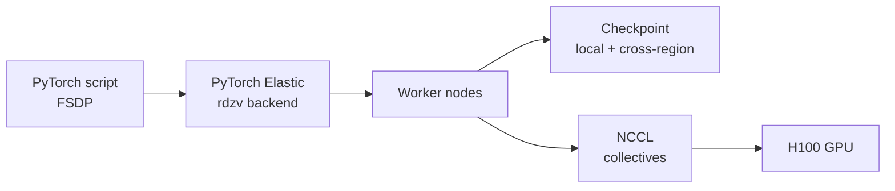

# 19.4 Capstone: multi-node training with fault tolerance

| Field | Value |
|---|---|
| Level | Advanced |
| Priority tier | 1 |
| Lab venue | GCP / GKE |
| Part | Part 19: Capstones, design and interview readiness |
| Primary sources | NVIDIA Zero-to-Hero Volume 24 (Multi-node training capstone); Part 14 (Distributed training); Part 16 (MLOps) |
| Cross-references | Chapter 14.5 (FSDP); Chapter 14.10 (Multi-node training); Chapter 14.11 (Checkpointing); Chapter 12.15 (NCCL collectives); Chapter 17.11 (Incident response) |
| Coverage file | `planning/coverage/chapters/19-04.md` |
| Claim & number ledger | `planning/ledgers/19-04.md` |

## Why this matters for AI infrastructure

Multi-node training is the production shape of foundation-model training. The capstone ties together FSDP (the parallelism strategy), checkpoint strategy (in-memory, local, cross-region), PyTorch Elastic (the elasticity layer), NCCL debugging (the network layer), observability (the visibility layer), and incident response (the on-call layer). A team that has read every chapter in Part 14 can describe each piece; a team that has run this capstone knows how the pieces fit together.

The multi-node training capstone is what the candidate is asked about in an interview. The capstone is what the platform team uses as a reference design. The capstone is what the on-call engineer uses when a 100-GPU training run is stuck at 3 a.m.

```text
Why the multi-node training capstone matters (V24; Part 14):
- A multi-node training job is the production shape of foundation-model
  training. The capstone is what ties FSDP, checkpointing, Elastic, NCCL,
  observability, and incident response together.
- The capstone has three perspectives: the platform engineer's view (how
  to provision the cluster and the queues); the ML engineer's view (how
  to launch the job and read the output); the on-call engineer's view
  (how to debug a stuck training).
- The capstone is the reference design. Every chapter in Part 14 maps to
  a section of the capstone.
```

Three operational realities make this capstone a platform-team deliverable rather than a tutorial:

1. **The capstone is the reference design.** The platform team references the capstone when launching a new training job; the platform team references the capstone when debugging a stuck training.
2. **The capstone is the interview anchor.** The candidate is asked "how would you run multi-node training at scale?"; the candidate points at this capstone.
3. **The capstone is the on-call reference.** The on-call engineer follows the runbook; the runbook points at the capstone; the on-call engineer fixes the training.

**Before a team can claim they have run multi-node training at scale, the team must have run this capstone. A team that has not run the capstone has not integrated the pieces.**

## Prerequisites and outcomes

### Prerequisites

- Chapter 14 (Distributed training) for FSDP, checkpointing, Elastic, NCCL.
- Chapter 12 (AI networking) for NCCL tuning.
- Chapter 17 (Operations) for monitoring and incident response.

### Outcomes

After completing this capstone you will be able to:

1. Launch a multi-node training job with FSDP on the GPU node pool.
2. Implement checkpoint strategy: in-memory (DDP), local (per-node), cross-region (object storage).
3. Configure PyTorch Elastic for elastic recovery from node failures.
4. Debug NCCL collectives: log analysis, timeout tuning, topology-aware scheduling.
5. Wire observability for distributed training: training loss, throughput, GPU utilisation, NCCL timing.
6. Operate the training with on-call runbooks for stuck training, OOM, and NCCL timeouts.

---

## 1. The training stack

### 1.1 The training architecture

The training architecture is the layered stack from the user script to the GPU kernel. The stack has the parallelism strategy (FSDP), the checkpoint strategy, the elasticity layer (PyTorch Elastic), the network layer (NCCL), and the GPU runtime.



The pattern is: the script declares the parallelism and the checkpoint strategy; Elastic handles the elastic recovery; NCCL handles the collectives; the GPU runtime handles the kernels.

### 1.2 The launch command

The launch command starts the multi-node training. The launch command specifies the nodes, the rendezvous backend, the parallelism, the checkpoint directory.

```bash
# Launch a multi-node training job with FSDP and Elastic
torchrun \
  --nnodes=2:4 \
  --nproc-per-node=8 \
  --rdzv-backend=c10d \
  --rdzv-endpoint=trainer-0:29500 \
  --max-restarts=3 \
  --monitor-interval=30 \
  train.py --fsdp --checkpoint-dir=/checkpoint
```

The pattern is: `torchrun` launches the script on every node; the rendezvous backend coordinates the nodes; Elastic handles the restarts.

---

## 2. FSDP (Fully Sharded Data Parallel)

### 2.1 The FSDP configuration

FSDP shards the model parameters, gradients, and optimiser state across the GPUs. FSDP reduces the memory footprint per GPU; FSDP enables training larger models.

```python
# code/part19/fsdp_config.py (shape only)
import torch
from torch.distributed.fsdp import FullyShardedDataParallel as FSDP
from torch.distributed.fsdp import MixedPrecision

model = build_model()
model = FSDP(
    model,
    sharding_strategy=ShardingStrategy.FULL_SHARD,
    mixed_precision=MixedPrecision(
        param_dtype=torch.bfloat16,
        reduce_dtype=torch.float32,
        buffer_dtype=torch.float32,
    ),
    auto_wrap_policy=auto_wrap,
)
```

The pattern is: the model is wrapped in FSDP; the parameters are sharded; the optimiser state is sharded; the gradient all-reduce is automatic.

### 2.2 The FSDP memory savings

FSDP saves memory by sharding the parameters. The savings are proportional to the number of GPUs.

```text
FSDP memory savings (approximate):
- 8 GPUs: model memory / 8
- 16 GPUs: model memory / 16
- 64 GPUs: model memory / 64
- 256 GPUs: model memory / 256
```

The pattern is: the more GPUs, the more memory savings; the more GPUs, the larger the model that fits.

---

## 3. Checkpoint strategy

### 3.1 The checkpoint types

The checkpoint types are: in-memory (DDP), local (per-node), and cross-region (object storage).

| Checkpoint type | What it captures | When to use |
|---|---|---|
| **In-memory** | Model state in GPU memory | Debugging; small models |
| **Local** | Model state on the node's local disk | Frequent checkpoints; fast recovery |
| **Cross-region** | Model state in object storage | Disaster recovery; compliance |

The pattern is: every job checkpoints at least every 15 minutes; every checkpoint goes to object storage; the object storage is replicated across regions.

### 3.2 The checkpoint code

The checkpoint code saves the model state to the local disk and to the object storage. The checkpoint code is invoked periodically; the checkpoint code is idempotent.

```python
# code/part19/checkpoint.py (shape only)
import torch
import boto3

def save_checkpoint(model, step, local_dir, s3_bucket):
    """Save the checkpoint to local disk and to S3."""
    state = model.state_dict()
    local_path = f"{local_dir}/checkpoint-{step}.pt"
    torch.save(state, local_path)
    s3 = boto3.client("s3")
    s3.upload_file(local_path, s3_bucket, f"checkpoints/checkpoint-{step}.pt")
```

The pattern is: every checkpoint is saved locally; every checkpoint is uploaded to object storage; every checkpoint is verified.

### 3.3 The checkpoint recovery

The checkpoint recovery loads the most recent checkpoint. The checkpoint recovery is invoked on job restart; the checkpoint recovery is automatic.

```python
# code/part19/checkpoint_recovery.py (shape only)
import torch
import boto3

def load_checkpoint(local_dir, s3_bucket, step):
    """Load the checkpoint from local disk or from S3."""
    local_path = f"{local_dir}/checkpoint-{step}.pt"
    try:
        return torch.load(local_path)
    except FileNotFoundError:
        s3 = boto3.client("s3")
        s3.download_file(s3_bucket, f"checkpoints/checkpoint-{step}.pt", local_path)
        return torch.load(local_path)
```

The pattern is: the recovery prefers the local checkpoint; the recovery falls back to the object storage checkpoint; the recovery is automatic.

---

## 4. PyTorch Elastic

### 4.1 The Elastic configuration

PyTorch Elastic handles the elastic recovery from node failures. Elastic monitors the worker nodes; Elastic restarts the workers when a node fails; Elastic requeues the work.

```bash
# Launch with Elastic
torchrun \
  --nnodes=2:4 \
  --nproc-per-node=8 \
  --rdzv-backend=c10d \
  --rdzv-endpoint=trainer-0:29500 \
  --max-restarts=3 \
  --monitor-interval=30 \
  train.py
```

The pattern is: `--max-restarts=3` allows Elastic to restart the workers up to 3 times; `--monitor-interval=30` checks the workers every 30 seconds.

### 4.2 The Elastic recovery

When a node fails, Elastic detects the failure; Elastic restarts the workers on the remaining nodes; Elastic requeues the work.

```text
Elastic recovery:
1. Worker on node-3 fails
2. Elastic detects the failure within 30 seconds
3. Elastic restarts the workers on node-1, node-2, node-4
4. The training resumes from the most recent checkpoint
5. The job continues with the surviving workers
```

The pattern is: Elastic detects the failure; Elastic restarts the workers; the training resumes from the checkpoint.

---

## 5. NCCL debugging

### 5.1 The NCCL configuration

NCCL debugging is the art of finding the bottleneck in the collective operations. NCCL_DEBUG=INFO logs every collective; NCCL_DEBUG_SUBSYS=ALL logs every subsystem.

```bash
# Run with NCCL debugging
NCCL_DEBUG=INFO NCCL_DEBUG_SUBSYS=ALL \
  torchrun --nnodes=2:4 --nproc-per-node=8 train.py
# expected: the NCCL logs show every collective; the logs identify the bottleneck
```

The pattern is: enable NCCL_DEBUG only for debugging; disable NCCL_DEBUG for production.

### 5.2 The common NCCL issues

| Issue | Symptom | Fix |
|---|---|---|
| **NCCL timeout** | All-reduce hangs | Increase `NCCL_TIMEOUT` |
| **Wrong interface** | All-reduce fails | Set `NCCL_SOCKET_IFNAME` |
| **Topology mismatch** | Performance is poor | Verify `NCCL_IB_HCA` and `NCCL_TOPO_FILE` |
| **GPU direct RDMA** | Performance is poor | Verify `NCCL_NET` is set to `IB` |

The pattern is: identify the NCCL issue from the log; apply the fix; verify the fix.

---

## 6. Day-2 operations

### 6.1 The training observability

The training observability includes: training loss, training throughput, GPU utilisation, NCCL collective timing.

```bash
# Query Prometheus for training metrics
curl 'http://prometheus/api/v1/query?query=training_loss'
# expected: the training loss is displayed
```

The pattern is: every training job emits its metrics; the metrics are scraped by Prometheus; the metrics are displayed in Grafana.

### 6.2 The training incident response

The training incident response is the pattern for responding to a stuck or failed training.

```text
Training incident response:
1. Detect: alert (training loss is NaN, GPU OOM, NCCL timeout)
2. Triage: kubectl logs, NCCL_DEBUG, GPU utilisation
3. Mitigate: restart the training from the latest checkpoint; reduce the batch size
4. Resolve: root cause analysis, runbook update, post-mortem
```

The pattern is: detect, triage, mitigate, resolve. The runbook is the on-call's guide.

---

## 7. Hands-on lab

This lab walks through the multi-node training capstone: FSDP, checkpoint, Elastic, NCCL. The lab is **untested** in this repository.

### 7.1 Prerequisites

- A GKE cluster with at least 16 H100 GPUs across 2 nodes.
- PyTorch 2.1+, NCCL 2.18+, torchrun installed.
- An object storage bucket for checkpoints.

### 7.2 Step 1: launch the multi-node training

```bash
torchrun \
  --nnodes=2:4 \
  --nproc-per-node=8 \
  --rdzv-backend=c10d \
  --rdzv-endpoint=trainer-0:29500 \
  --max-restarts=3 \
  --monitor-interval=30 \
  train.py --fsdp --checkpoint-dir=/checkpoint
# expected: the training launches on all nodes; the training loss decreases
```

### 7.3 Step 2: verify the FSDP sharding

```bash
# Check the GPU memory usage per node
kubectl exec -it trainer-0 -- nvidia-smi
# expected: the GPU memory is reduced; FSDP is sharding the model
```

### 7.4 Step 3: verify the checkpoint

```bash
# Check the local checkpoint directory
kubectl exec -it trainer-0 -- ls /checkpoint
# expected: the checkpoint files are present; the checkpoints are timestamped

# Check the object storage checkpoint
gsutil ls gs://my-bucket/checkpoints/
# expected: the checkpoints are uploaded to object storage
```

### 7.5 Step 4: simulate a node failure

```bash
# Cordon and drain a node
kubectl cordon trainer-1
kubectl drain trainer-1 --ignore-daemonsets
# expected: Elastic restarts the workers on the remaining nodes
```

### 7.6 Step 5: verify the recovery

```bash
# Check the training status
kubectl logs trainer-0 -c trainer --tail=100
# expected: the training resumed from the latest checkpoint
```

### 7.7 What to record

After the lab, you should be able to answer five questions in five seconds each:

1. What is the current training loss?
2. What is the current GPU memory utilisation?
3. What is the most recent checkpoint time?
4. What is the most recent NCCL collective time?
5. What is the current node count?

If any takes more than 30 seconds, the multi-node training is not yet a production service. The lab is **untested** against a live cluster.

---

## Exercises

1. **Add a checkpoint schedule.** Configure a checkpoint every 15 minutes. *Solution sketch:* the checkpoint callback in the training loop.
2. **Add FSDP mixed precision.** Configure BF16 for parameters and FP32 for reductions. *Solution sketch:* the FSDP mixed precision config.
3. **Add Elastic node failure recovery.** Configure Elastic to recover from node failures. *Solution sketch:* the torchrun command with `--max-restarts`.
4. **Add NCCL debugging.** Enable NCCL_DEBUG for the training job. *Solution sketch:* the NCCL_DEBUG environment variable.
5. **Add training observability.** Emit the training loss and throughput to Prometheus. *Solution sketch:* the Prometheus exporter for the training script.
6. **Add a checkpoint integrity check.** Verify the checkpoint hash before resuming. *Solution sketch:* the hash verification in the recovery code.

---

## Checkpoint questions

<details><summary>1. What is FSDP?</summary>
Fully Sharded Data Parallel: the PyTorch parallelism strategy that shards the model parameters, gradients, and optimiser state across GPUs. FSDP reduces the memory footprint per GPU; FSDP enables training larger models on the same GPU pool.
</details>

<details><summary>2. What is PyTorch Elastic?</summary>
The PyTorch library for elastic training. Elastic monitors the worker nodes; Elastic restarts the workers when a node fails; Elastic requeues the work. Elastic is the foundation of fault-tolerant multi-node training.
</details>

<details><summary>3. What is the difference between FSDP and DDP?</summary>
DDP (Distributed Data Parallel) replicates the model on every GPU. FSDP shards the model across the GPUs. FSDP saves memory; DDP does not. FSDP enables training larger models on the same GPU pool.
</details>

<details><summary>4. What is the difference between local and cross-region checkpoints?</summary>
A local checkpoint is stored on the node's local disk. A cross-region checkpoint is stored in object storage across regions. Cross-region checkpoints survive regional outages; local checkpoints do not.
</details>

<details><summary>5. What is the most common multi-node training failure?</summary>
NCCL timeout. The collective operation does not complete within the configured timeout. The fix is to increase the NCCL_TIMEOUT; verify the network; verify the topology.
</details>

<details><summary>6. What is the most dangerous multi-node training failure?</summary>
GPU OOM. The model is too large for the available memory. The training crashes. The fix is to reduce the model size, enable gradient checkpointing, or scale up the GPU pool.
</details>

<details><summary>7. What is the difference between rendezvous backends in torchrun?</summary>
c10d is the c10d backend (recommended for most clusters). etcd-v2 is the etcd backend (for very large clusters). The rendezvous backend coordinates the worker nodes at startup.
</details>

<details><summary>8. What is the most important multi-node training metric?</summary>
GPU utilisation rate per node. The metric tells the team whether the GPUs are doing useful work. A low utilisation rate indicates data loading or collective bottlenecks.
</details>

<details><summary>9. What is the relationship between checkpoint frequency and recovery time?</summary>
Higher checkpoint frequency means shorter recovery time (less work lost). Lower checkpoint frequency means longer recovery time (more work lost). The trade-off is between checkpoint overhead and recovery time.
</details>

<details><summary>10. What is the relationship between FSDP and NCCL?</summary>
FSDP uses NCCL for collective operations (all-gather, reduce-scatter). The performance of FSDP depends on the performance of NCCL; the optimisation of NCCL depends on the network topology.
</details>

<details><summary>11. What is the relationship between Elastic and Kubernetes?</summary>
Elastic is the PyTorch layer; Kubernetes is the orchestration layer. Elastic handles the in-job restarts; Kubernetes handles the pod-level restarts. Together, they form the elastic training chain.
</details>

<details><summary>12. What is the most common FSDP failure?</summary>
Memory imbalance. One GPU runs out of memory while others have plenty. The fix is to use FSDP's automatic memory balancing; the fix is to reduce the per-GPU batch size.
</details>

<details><summary>13. What is the most common NCCL failure?</summary>
Topology mismatch. The NCCL algorithm does not match the network topology. The fix is to set the NCCL_IB_HCA and NCCL_TOPO_FILE; verify the topology with NCCL_DEBUG.
</details>

<details><summary>14. What is the most common checkpoint failure?</summary>
Out of disk space. The local disk fills up; the checkpoint write fails. The fix is to clean up old checkpoints; the fix is to upload to object storage; the fix is to expand the local disk.
</details>

<details><summary>15. What is the difference between synchronous and asynchronous checkpointing?</summary>
Synchronous checkpointing pauses the training; asynchronous checkpointing runs the checkpoint in parallel. Synchronous is simpler; asynchronous is faster. The choice depends on the model's tolerance for memory duplication.
</details>

<details><summary>16. What is the most expensive part of multi-node training?</summary>
The all-reduce collectives. The collectives require every node to participate; the collectives are bandwidth-limited; the collectives dominate the training time for communication-heavy models.
</details>

<details><summary>17. What is the most expensive part of the network stack?</summary>
The inter-node network. The inter-node network has higher latency than the intra-node network (NVLink). The inter-node network is the bottleneck for multi-node training; the network must be tuned for the workload.
</details>

<details><summary>18. What is the relationship between the training capstone and the Kubernetes capstone?</summary>
The training capstone runs on the Kubernetes platform from the Kubernetes capstone. The training capstone uses the Kueue ClusterQueues for GPU scheduling; the training capstone uses the GPU Operator for driver management; the training capstone uses the observability stack for monitoring.
</details>

<details><summary>19. Why is the multi-node training capstone a Tier 1 chapter?</summary>
Because the multi-node training capstone is the reference design for foundation-model training. The capstone is what the platform team references; the capstone is what the interview candidate points at; the capstone is what the on-call engineer follows.
</details>

<details><summary>20. What five questions should the multi-node training capstone lab let you answer in five seconds each?</summary>
What is the current training loss. What is the current GPU memory utilisation. What is the most recent checkpoint time. What is the most recent NCCL collective time. What is the current node count. If any takes more than 30 seconds, the multi-node training is not yet a production service.
</details>

---

## Sources and review notes

- NVIDIA Zero-to-Hero Volume 24 (Multi-node training capstone). Source for the FSDP, checkpoint, Elastic, and NCCL patterns. The wording has been rewritten in the handbook's voice.
- Part 14 (Distributed training) for the parallelism, checkpointing, Elastic, and NCCL patterns.

### Cross-references to other handbook chapters

- Chapter 14.5 for the FSDP configuration.
- Chapter 14.10 for the multi-node training architecture.
- Chapter 14.11 for the checkpointing strategies.
- Chapter 12.15 for the NCCL collectives.
- Chapter 17.11 for the incident response.

### Migrated from `nvidia-devops`

The multi-node training capstone operational patterns draw on Volume 24. The wording has been rewritten in the handbook's voice.

### Explicitly labelled inferences

- The node count (2-4) is a starting point; specific counts depend on the model size.
- The checkpoint frequency (15 minutes) is a starting point; specific frequencies depend on the value of the work.
- The NCCL timeout (600 seconds) is a starting point; specific timeouts depend on the network latency.

### Not verified on live hardware

- The lab in Section 7 is **untested** against a live GKE cluster in this repository.
- The torchrun command assumes a working GPU operator and c10d rendezvous.
- The checkpoint paths assume the nodes have shared or replicated storage.
