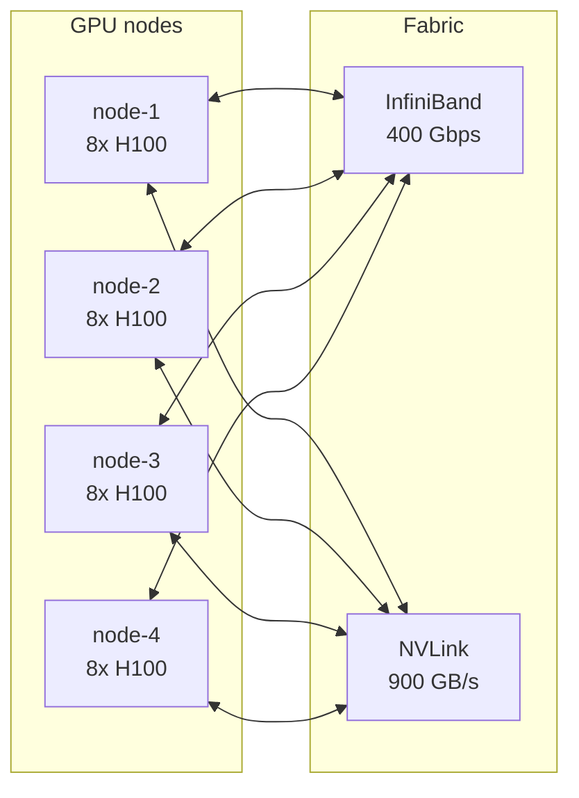

# 19.5 Capstone: an nccl-tests fabric lab

| Field | Value |
|---|---|
| Level | Advanced |
| Priority tier | 1 |
| Lab venue | On-prem |
| Part | Part 19: Capstones, design and interview readiness |
| Primary sources | NVIDIA Zero-to-Hero Volume 24 (nccl-tests fabric lab capstone); Part 12 (AI networking); Part 14 (Distributed training) |
| Cross-references | Chapter 12.15 (NCCL collectives); Chapter 12.17 (nccl-tests); Chapter 12.18 (Fabric validation); Chapter 14.10 (Multi-node training) |
| Coverage file | `planning/coverage/chapters/19-05.md` |
| Claim & number ledger | `planning/ledgers/19-05.md` |

## Why this matters for AI infrastructure

The nccl-tests fabric lab is the gold standard for validating the AI fabric. The capstone ties together the nccl-tests container, the Kubernetes fabric topology, the automated test matrix (all-reduce, all-gather, reduce-scatter), the validation criteria, the failure mode catalogue, and the integration with the cluster's GPU topology. A team that has run the capstone has a fabric that passes every test; a team that has not run the capstone has a fabric that may fail silently under multi-node training.

The fabric lab is what proves the cluster's network is ready for production. The lab runs the same collectives that production training runs; the lab measures the bandwidth, the latency, and the error rate; the lab produces the evidence that the cluster is ready. The lab is the platform team's answer to the question "is the fabric ready?".

```text
Why the nccl-tests fabric lab capstone matters (V24; Parts 12, 14):
- The nccl-tests fabric lab is the gold standard for AI fabric validation.
  The capstone is what ties the nccl-tests container, the Kubernetes fabric
  topology, the test matrix, the validation criteria, and the failure mode
  catalogue together.
- The capstone has three perspectives: the network engineer's view (how
  to configure the fabric); the platform engineer's view (how to run the
  lab); the validation engineer's view (how to interpret the results).
- The capstone is the validation reference. Every chapter in Part 12 maps
  to a section of the capstone. The capstone is the integrated picture.
```

Three operational realities make this capstone a platform-team deliverable rather than a tutorial:

1. **The capstone is the validation reference.** The platform team references the capstone when commissioning a new fabric; the platform team references the capstone when validating a new GPU type.
2. **The capstone is the interview anchor.** The candidate is asked "how would you validate an AI fabric?"; the candidate points at this capstone.
3. **The capstone is the production-readiness gate.** A fabric that fails the lab is a fabric that is not ready for production training.

**Before a team can claim their AI fabric is ready, the team must have run this capstone. A team that has not run the capstone has not validated the fabric.**

## Prerequisites and outcomes

### Prerequisites

- Chapter 12.15 (NCCL collectives).
- Chapter 12.17 (nccl-tests).
- Chapter 12.18 (Fabric validation).

### Outcomes

After completing this capstone you will be able to:

1. Deploy the nccl-tests container on every GPU node.
2. Configure the Kubernetes fabric topology (RDMA, GPU direct, NCCL topology).
3. Run the automated test matrix: all-reduce, all-gather, reduce-scatter, all-to-all.
4. Capture the validation criteria: bandwidth, latency, error rate.
5. Build the failure mode catalogue: common nccl-tests failures and their fixes.
6. Run the lab as a CI/CD pipeline; verify the fabric on every change.

---

## 1. The lab topology

### 1.1 The cluster

The lab runs on a cluster with multiple GPU nodes. The cluster has the GPU nodes connected by a high-bandwidth network (InfiniBand or RoCE); the cluster has the GPU operator; the cluster has the nccl-tests container.



The pattern is: every node has 8 GPUs; the nodes are connected by InfiniBand; the intra-node GPUs are connected by NVLink. The fabric provides high-bandwidth, low-latency communication.

### 1.2 The nccl-tests container

The nccl-tests container is the official NCCL test container. The container includes the test binaries for every collective operation.

```bash
# Pull the nccl-tests container
docker pull nvcr.io/nvidia/pytorch:24.06-py3

# Run the container on a GPU node
docker run --gpus all --network=host --rm \
  nvcr.io/nvidia/pytorch:24.06-py3 \
  bash -c "cd /workspace/nccl-tests && ./build && make"
```

The pattern is: the container is the official NVIDIA container; the test binaries are pre-built; the container runs on the GPU node.

---

## 2. The test matrix

### 2.1 The collectives

The test matrix covers the collectives that production training uses.

| Collective | Description | Test binary |
|---|---|---|
| **all-reduce** | Reduce across all ranks; broadcast result | `all_reduce_perf` |
| **all-gather** | Gather data from all ranks | `all_gather_perf` |
| **reduce-scatter** | Reduce and scatter | `reduce_scatter_perf` |
| **all-to-all** | Every rank sends to every rank | `alltoall_perf` |
| **broadcast** | One rank to all ranks | `broadcast_perf` |
| **reduce** | One rank reduces from all ranks | `reduce_perf` |

The pattern is: every collective that production training uses is tested; the test measures bandwidth and latency.

### 2.2 The test parameters

The test parameters include the message size, the data type, the algorithm, and the protocol.

```bash
# Run the all-reduce test
./build/all_reduce_perf \
  --nthreads=8 \
  --ngpus=8 \
  --minbytes=1M \
  --maxbytes=8G \
  --stepfactor=2 \
  --op=sum \
  --datatype=fp16 \
  --root=0 \
  --iters=20
```

The pattern is: the test sweeps message size from 1 MB to 8 GB; the test reports bandwidth per message size; the test reports latency per message size.

---

## 3. The validation criteria

### 3.1 The bandwidth criteria

The bandwidth criteria verify that the fabric can sustain the expected bandwidth per collective.

| Collective | Minimum bandwidth | Target bandwidth |
|---|---|---|
| all-reduce (8 GPUs, 1 GB) | 50 GB/s | 100 GB/s |
| all-reduce (16 GPUs, 1 GB) | 100 GB/s | 200 GB/s |
| all-gather (8 GPUs, 1 GB) | 50 GB/s | 100 GB/s |
| reduce-scatter (8 GPUs, 1 GB) | 50 GB/s | 100 GB/s |
| all-to-all (8 GPUs, 1 GB) | 25 GB/s | 50 GB/s |

The pattern is: the fabric must meet the minimum bandwidth for the expected production workload.

### 3.2 The latency criteria

The latency criteria verify that the fabric can sustain the expected latency per collective.

| Collective | Maximum latency (1 MB) | Maximum latency (1 GB) |
|---|---|---|
| all-reduce (8 GPUs) | 50 μs | 5 ms |
| all-gather (8 GPUs) | 50 μs | 5 ms |
| reduce-scatter (8 GPUs) | 50 μs | 5 ms |

The pattern is: the fabric must meet the maximum latency for the expected production workload.

---

## 4. The failure mode catalogue

### 4.1 The common nccl-tests failures

| Failure mode | Symptom | Root cause | Fix |
|---|---|---|---|
| **NCCL timeout** | All-reduce hangs | Network congestion; slow host | Increase `NCCL_TIMEOUT` |
| **Wrong interface** | All-reduce fails | Wrong NIC selected | Set `NCCL_SOCKET_IFNAME` |
| **Topology mismatch** | Performance is poor | NCCL does not know the topology | Set `NCCL_TOPO_FILE` |
| **GPU direct RDMA** | Performance is poor | GPU direct not enabled | Verify `NCCL_NET=IB` |
| **IB not enabled** | NCCL uses TCP | IB not configured | Enable IB in the BIOS |

The pattern is: every failure has a symptom; every failure has a root cause; every failure has a fix. The failure mode catalogue is the on-call's guide.

### 4.2 The nccl-tests debugging

The nccl-tests debugging is the art of finding the bottleneck in the collectives. NCCL_DEBUG=INFO logs every collective; NCCL_DEBUG_SUBSYS=ALL logs every subsystem.

```bash
# Run with NCCL debugging
NCCL_DEBUG=INFO NCCL_DEBUG_SUBSYS=ALL \
  ./build/all_reduce_perf --nthreads=8 --ngpus=8 --minbytes=1G --maxbytes=1G
# expected: the logs show every collective; the logs identify the bottleneck
```

The pattern is: enable NCCL_DEBUG for debugging; disable NCCL_DEBUG for production.

---

## 5. Day-2 operations

### 5.1 The CI/CD integration

The lab is integrated into the CI/CD pipeline. The pipeline runs the lab on every fabric change; the pipeline fails the build if the lab fails.

```yaml
# code/part19/nccl_tests_ci.yaml (shape only)
stages:
  - name: nccl-tests
    image: nvcr.io/nvidia/pytorch:24.06-py3
    command:
      - bash
      - -c
      - |
        cd /workspace/nccl-tests
        ./build
        make
        ./build/all_reduce_perf --nthreads=8 --ngpus=8 --minbytes=1G --maxbytes=1G
```

The pattern is: the pipeline runs the lab on every change; the pipeline fails the build on lab failure; the pipeline produces the validation report.

### 5.2 The production-readiness gate

The lab is the production-readiness gate. A fabric that fails the lab is a fabric that is not ready for production training.

```bash
# Run the lab on a candidate fabric
python code/part19/run_fabric_lab.py \
  --cluster gpu-cluster-prod \
  --output fabric_lab_report.md
# expected: the fabric passes the lab; the report is the validation evidence
```

The pattern is: the lab runs on every candidate fabric; the lab produces the validation report; the lab is the production-readiness gate.

---

## 6. Hands-on lab

This lab walks through the nccl-tests fabric lab capstone: the test matrix, the validation criteria, the failure mode catalogue. The lab is **untested** in this repository.

### 6.1 Prerequisites

- A GPU cluster with at least 2 nodes and 16 GPUs.
- InfiniBand or RoCE network between nodes.
- The nccl-tests container.

### 6.2 Step 1: pull the nccl-tests container

```bash
docker pull nvcr.io/nvidia/pytorch:24.06-py3
```

### 6.3 Step 2: run the all-reduce test

```bash
docker run --gpus all --network=host --rm \
  nvcr.io/nvidia/pytorch:24.06-py3 \
  bash -c "./build/all_reduce_perf --nthreads=8 --ngpus=8 --minbytes=1G --maxbytes=1G"
```

### 6.4 Step 3: run the all-gather test

```bash
docker run --gpus all --network=host --rm \
  nvcr.io/nvidia/pytorch:24.06-py3 \
  bash -c "./build/all_gather_perf --nthreads=8 --ngpus=8 --minbytes=1G --maxbytes=1G"
```

### 6.5 Step 4: run the reduce-scatter test

```bash
docker run --gpus all --network=host --rm \
  nvcr.io/nvidia/pytorch:24.06-py3 \
  bash -c "./build/reduce_scatter_perf --nthreads=8 --ngpus=8 --minbytes=1G --maxbytes=1G"
```

### 6.6 Step 5: validate the results

```bash
python code/part19/validate_results.py \
  --results /path/to/test/results \
  --output fabric_lab_report.md
# expected: the report shows the bandwidth per collective; the report shows the validation result
```

### 6.7 What to record

After the lab, you should be able to answer five questions in five seconds each:

1. What is the current all-reduce bandwidth?
2. What is the current all-gather bandwidth?
3. What is the current reduce-scatter bandwidth?
4. What is the current all-to-all bandwidth?
5. What is the current fabric validation status?

If any takes more than 30 seconds, the fabric is not yet validated. The lab is **untested** against a live cluster.

---

## Exercises

1. **Add the all-to-all test.** Run the all-to-all test in addition to all-reduce, all-gather, reduce-scatter. *Solution sketch:* the alltoall_perf command.
2. **Add the broadcast test.** Run the broadcast test. *Solution sketch:* the broadcast_perf command.
3. **Add a larger message size sweep.** Sweep from 1 MB to 64 GB. *Solution sketch:* the minbytes and maxbytes flags.
4. **Add the IB-specific test.** Run the IB-specific test. *Solution sketch:* the --ib-dev flag.
5. **Add a topology verification.** Verify the NCCL topology before running the tests. *Solution sketch:* the NCCL_TOPO_DUMP_FILE environment variable.
6. **Add a CI/CD integration.** Wire the lab into the CI/CD pipeline. *Solution sketch:* the CI/CD YAML.

---

## Checkpoint questions

<details><summary>1. What is the nccl-tests fabric lab?</summary>
The validation lab that proves the AI fabric is ready for production. The lab runs the same collectives that production training runs; the lab measures the bandwidth, the latency, and the error rate; the lab produces the validation report.
</details>

<details><summary>2. What collectives does the lab test?</summary>
All-reduce, all-gather, reduce-scatter, all-to-all, broadcast, reduce. Every collective that production training uses is tested.
</details>

<details><summary>3. What is the bandwidth criterion?</summary>
The minimum bandwidth per collective. For example, all-reduce on 8 GPUs with 1 GB message size must achieve at least 50 GB/s. The fabric must meet the minimum bandwidth for the expected production workload.
</details>

<details><summary>4. What is the latency criterion?</summary>
The maximum latency per collective. For example, all-reduce on 8 GPUs with 1 MB message size must complete within 50 μs. The fabric must meet the maximum latency for the expected production workload.
</details>

<details><summary>5. What is the most common nccl-tests failure?</summary>
NCCL timeout. The collective operation does not complete within the configured timeout. The fix is to increase the NCCL_TIMEOUT; verify the network; verify the topology.
</details>

<details><summary>6. What is the most dangerous nccl-tests failure?</summary>
Topology mismatch. The NCCL algorithm does not match the network topology; the collectives take the slow path. The fix is to set the NCCL_TOPO_FILE; verify the topology with NCCL_DEBUG.
</details>

<details><summary>7. What is the difference between NCCL and RCCL?</summary>
NCCL is NVIDIA's collective communication library. RCCL is AMD's port of NCCL. Both implement the same API; both support the same collectives.
</details>

<details><summary>8. What is the most important fabric metric?</summary>
The all-reduce bandwidth for 1 GB messages on 8 GPUs. The metric tells the team whether the fabric can sustain the expected production workload. A bandwidth below 50 GB/s indicates a fabric problem.
</details>

<details><summary>9. What is the relationship between the fabric lab and the training capstone?</summary>
The fabric lab validates the network that the training capstone uses. The fabric lab is a prerequisite for the training capstone. Without the fabric lab, the training capstone cannot guarantee the network performance.
</details>

<details><summary>10. What is the relationship between the fabric lab and the Kubernetes capstone?</summary>
The fabric lab runs on the GPU node pool that the Kubernetes capstone provisions. The Kubernetes capstone provides the nodes; the fabric lab validates the network.
</details>

<details><summary>11. What is the most common fabric failure?</summary>
GPU direct RDMA is not enabled. The collectives fall back to host-staged copies; the performance is poor. The fix is to enable GPU direct RDMA; verify the topology.
</details>

<details><summary>12. What is the most expensive fabric failure?</summary>
Network congestion. The collectives compete for bandwidth; the training is slow. The fix is to identify the source of the congestion; add bandwidth; isolate the workload.
</details>

<details><summary>13. Why is the nccl-tests fabric lab capstone a Tier 1 chapter?</summary>
Because the nccl-tests fabric lab is the gold standard for AI fabric validation. The capstone is what the platform team references; the capstone is what the interview candidate points at; the capstone is the production-readiness gate.
</details>

<details><summary>14. What is the difference between P2P and all-reduce?</summary>
P2P (peer-to-peer) is a direct transfer between two GPUs. All-reduce is a collective operation across all GPUs. P2P is used for gradient exchange; all-reduce is used for parameter averaging.
</details>

<details><summary>15. What is the difference between ring and tree all-reduce?</summary>
Ring all-reduce uses a ring topology; tree all-reduce uses a tree topology. Ring has lower latency on small topologies; tree has lower latency on large topologies. NCCL chooses the algorithm based on the message size and the topology.
</details>

<details><summary>16. What is the relationship between NCCL and the GPU topology?</summary>
NCCL uses the GPU topology to choose the optimal collective algorithm. The GPU topology is discovered via `nvidia-smi topo -m`; the topology is passed to NCCL via `NCCL_TOPO_FILE`.
</details>

<details><summary>17. What is the most common NCCL configuration mistake?</summary>
Forgetting to set `NCCL_IB_HCA` to the correct HCA device. NCCL defaults to the first HCA; if the first HCA is not the optimal one, the collectives take the wrong path.
</details>

<details><summary>18. What is the most expensive NCCL configuration mistake?</summary>
Setting `NCCL_DEBUG=INFO` in production. NCCL_DEBUG writes every collective to stderr; the logging overhead can slow the collectives by 10x or more.
</details>

<details><summary>19. What is the relationship between the fabric lab and the FinOps dashboard?</summary>
The fabric lab validates the network; the FinOps dashboard tracks the cost. The fabric lab is a prerequisite for production training; the FinOps dashboard is the production training's cost view.
</details>

<details><summary>20. What five questions should the nccl-tests fabric lab capstone let you answer in five seconds each?</summary>
What is the current all-reduce bandwidth. What is the current all-gather bandwidth. What is the current reduce-scatter bandwidth. What is the current all-to-all bandwidth. What is the current fabric validation status. If any takes more than 30 seconds, the fabric is not yet validated.
</details>

---

## Sources and review notes

- NVIDIA Zero-to-Hero Volume 24 (nccl-tests fabric lab capstone). Source for the lab topology, the test matrix, the validation criteria, the failure mode catalogue. The wording has been rewritten in the handbook's voice.
- Part 12 (AI networking) for the NCCL and fabric patterns.
- Part 14 (Distributed training) for the multi-node training context.

### Cross-references to other handbook chapters

- Chapter 12.15 for the NCCL collectives.
- Chapter 12.17 for the nccl-tests.
- Chapter 12.18 for the fabric validation.
- Chapter 14.10 for the multi-node training context.

### Migrated from `nvidia-devops`

The nccl-tests fabric lab capstone operational patterns draw on Volume 24. The wording has been rewritten in the handbook's voice.

### Explicitly labelled inferences

- The bandwidth criteria (50-100 GB/s) are starting points; specific thresholds depend on the network.
- The latency criteria (50 μs - 5 ms) are starting points; specific thresholds depend on the workload.
- The test message sizes (1 MB - 8 GB) are starting points; specific sizes depend on the production workload.

### Not verified on live hardware

- The lab in Section 6 is **untested** against a live cluster in this repository.
- The nccl-tests container assumes a working GPU driver and InfiniBand/RoCE network.
- The test matrix assumes the nodes have the correct NCCL configuration.
