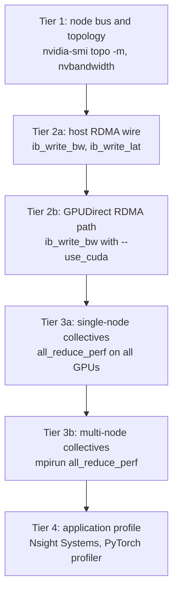
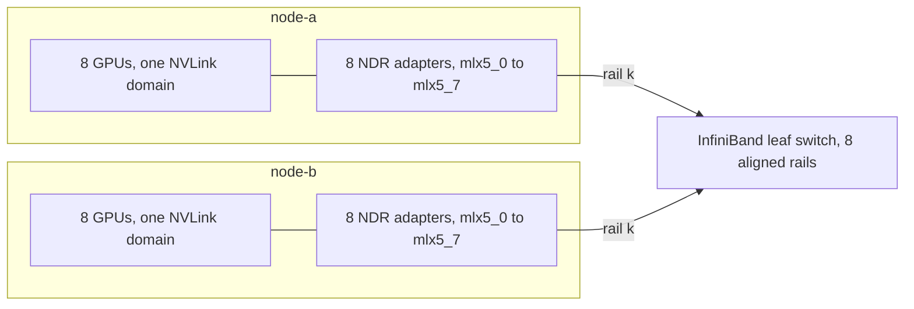

# 19.5 Capstone: an nccl-tests fabric lab

| Field | Value |
|---|---|
| Level | Advanced |
| Priority tier | 1 |
| Lab venue | On-prem |
| Part | Part 19: Capstones, design and interview readiness |
| Cross-references | [12.15](../part-12-ai-networking/15-nccl-collectives-and-algorithms.md), [12.16](../part-12-ai-networking/16-nccl-topology-channels-transports-and-environment-variables.md), [12.17](../part-12-ai-networking/17-nccl-tests-and-fabric-benchmarking.md), [12.18](../part-12-ai-networking/18-nccl-debugging-hangs-timeouts-and-errors.md), [12.19](../part-12-ai-networking/19-gpudirect-rdma-and-gpudirect-storage.md), [12.23](../part-12-ai-networking/23-fabric-validation-and-capacity-planning.md), [10.6](../part-10-gpu-cuda/06-gpu-interconnects-pcie-nvlink-nvswitch-and-nvlink-c2c.md), [10.8](../part-10-gpu-cuda/08-operating-gpu-nodes-nvidia-smi-topology-clocks-and-throttling.md), [14.10](../part-14-training-finetuning/10-multi-node-training-architecture.md) |
| Code | `code/part19/c05_*` (shell scripts, `c05_nccl_parse.py`, `test_c05_nccl_parse.py`, `c05_fixtures/`) |
| Coverage file | `planning/coverage/chapters/19-05.md` |
| Claim & number ledger | `planning/ledgers/19-05.md` |

## Why this matters for AI infrastructure

It is 2 a.m. A 64-GPU pretraining run has slowed down, and the dashboard looks healthy. Every InfiniBand port reports active and every error counter reads zero. Yet gradient synchronization takes much longer than it did three months ago. The dashboard is truthful. It describes the state of the links, not the bandwidth of the data path.

A fabric is not a state you can observe. It is a number you must measure, layer by layer, and then keep. Without a saved number, nobody can say whether the fabric changed or the workload did. The argument then runs on opinions while GPUs sit idle.

This capstone builds the measurement. It runs the same collectives that training runs, at sizes small enough to show latency and large enough to show bandwidth. It reads the two bandwidth columns that nccl-tests prints and knows which one to compare with a link rate. It ends with gates, so that "the fabric is ready" becomes a signed set of tables instead of an impression.

**The lab needs a GPU cluster. It was not run for this chapter.** What was run here is the analyser: `c05_nccl_parse.py` has 24 passing tests, including one real nccl-tests table taken from an NVIDIA manual. Every other command in the lab is untested in this repository, and the text says so at each step.

## Prerequisites and outcomes

### Prerequisites

- [12.15](../part-12-ai-networking/15-nccl-collectives-and-algorithms.md) and [12.16](../part-12-ai-networking/16-nccl-topology-channels-transports-and-environment-variables.md) for collectives, algorithms and transports.
- [12.17](../part-12-ai-networking/17-nccl-tests-and-fabric-benchmarking.md) for the benchmarking method this chapter applies end to end.
- [12.18](../part-12-ai-networking/18-nccl-debugging-hangs-timeouts-and-errors.md) for hangs and timeouts.
- RDMA basics from [12.2](../part-12-ai-networking/02-rdma-fundamentals-verbs-queue-pairs-and-memory-registration.md) and GPU topology reading from [10.8](../part-10-gpu-cuda/08-operating-gpu-nodes-nvidia-smi-topology-clocks-and-throttling.md).
- For the scheduler side of a cluster like this, see capstone 19.1 (Slurm GPU cluster). This lab launches with `mpirun` and works the same under `srun`.

### Outcomes

After this capstone you can:

1. Audit GPU-to-NIC topology, port state and error counters before any benchmark runs.
2. Run a single-node and a multi-node AllReduce sweep and verify from the log which transport NCCL used.
3. Convert algbw to busbw for each collective and check a table's arithmetic.
4. Run the analyser and name the failure signature it raises.
5. Isolate a slow node by bisection and apply the certification gates.

---

## 1. The validation ladder

The new fabric was handed over on a Tuesday after the link-state checklist passed. Three weeks later the first multi-node run took twice as long as the capacity model predicted. Nobody could say where the time went, because nobody had measured anything. The fabric had been watched and never measured.

"The cluster is slow" has several physical answers that look the same on a dashboard. A dirty connector can cause retransmissions. A NIC can train at half width. GPUDirect RDMA can be switched off, so every transfer bounces through host memory. The framework hides all three, so you test the layers one at a time with small tools.

Do not start with `iperf3`. It sends through the kernel TCP stack, and the training job does not. RDMA lets the NIC move memory without the kernel in the data path. The perftest tools such as `ib_write_bw` exercise that path, and nccl-tests exercises the collectives on top of it.

The ladder below runs from silicon up to the framework. Each tier starts only when the tier below has passed, so the first failing tier names the layer to fix.



| Tier | Tool | What a pass means | Typical failure signature |
|---|---|---|---|
| 1 | `nvidia-smi topo -m`, `nvbandwidth` | NVLink between GPUs, local GPU-NIC pairs, PCIe at full width | Host-to-device copy at about half the Gen5 x16 figure, which suggests a narrower link |
| 2a | `ib_write_bw`, `ib_write_lat` | Throughput close to the port rate, flat error counters | About half the port rate, which suggests a lane or speed downshift |
| 2b | `ib_write_bw --use_cuda` | GPU-memory number close to the host-memory number | Host healthy, GPU path collapsed: peermem module, ACS or a far GPU-NIC pair |
| 3a | `all_reduce_perf`, one node | busbw at your own commissioning baseline, `#wrong` zero | Far below baseline after a reboot, often a down NVSwitch fabric manager or disabled P2P |
| 3b | `mpirun all_reduce_perf` | busbw near the per-GPU link rate or your baseline, NET/IB in the log | Under 1 GB/s with `NET/Socket` in the log, as in the real table in Section 5 |
| 4 | `nsys`, `torch.profiler` | Collective time hidden under backward compute | Wire passes, training is slow: many small buckets |

The reference numbers in this table are deliberately loose. The only hard anchors come from sources. A 4x NDR InfiniBand link carries 400 Gbps, which is 50 GB/s (*Supercomputers for Linux SysAdmins*, Chapter 5; the division by eight is arithmetic). A PCIe Gen5 x16 slot gives roughly 64 GB/s per direction (*Distributed AI Systems*, ch. 2). Everything else is judged against a baseline that you capture on your own healthy fabric.

The lab produces three standing artifacts. The first is a baseline per tier, saved with the versions that produced it. The second is a pass or fail gate per tier. The third is an evidence pack that ties both together, so a firmware change or a cable swap becomes a diff against the pack.

**Decision rule:** never benchmark a layer until the layer below has passed, because a slow number above a broken layer says nothing.

**In one minute:** "slow" can mean a degraded wire, a narrow PCIe link or a disabled GPU path, and dashboards show none of them. Validate in tiers from the node bus up to the application. Judge each tier against a baseline from your own healthy fabric, and let the first failing tier name the layer to fix.

---

## 2. Anatomy of a test: collectives, factors and sizes

A new engineer reads the nccl-tests output and files a ticket against every NIC in the rack. The AllReduce shows 24 GB/s in the algbw column, and the rails are rated at 400 Gbps. That looks like half the line rate. The busbw column on the same row says 45 GB/s, which is the number to compare with the link. The fabric was fine and the ticket was wrong.

Each nccl-tests binary times one collective in a loop, with no framework around it. Data-parallel training ends each step with an AllReduce. Fully sharded training runs an AllGather before a layer and a ReduceScatter after it. Mixture-of-experts dispatch uses AllToAll. The binaries are `all_reduce_perf`, `reduce_scatter_perf`, `all_gather_perf`, `alltoall_perf`, `broadcast_perf` and `reduce_perf`.

### algbw and busbw

The nccl-tests Performance page defines algbw as the data size divided by the time. That number depends on the rank count, so it cannot be compared with hardware. The page therefore applies a correction factor to get busbw, "a number which reflects how optimally the hardware is used". The page states the factors below.

| Collective | busbw factor | At 8 ranks | At 16 ranks | At 64 ranks |
|---|---|---|---|---|
| AllReduce | 2(n-1)/n | 1.75 | 1.875 | 1.96875 |
| ReduceScatter | (n-1)/n | 0.875 | 0.9375 | 0.984375 |
| AllGather | (n-1)/n | 0.875 | 0.9375 | 0.984375 |
| AlltoAll | (n-1)/n | 0.875 | 0.9375 | 0.984375 |
| Broadcast | 1 | 1 | 1 | 1 |
| Reduce | 1 | 1 | 1 | 1 |

The derivation for AllReduce is short. Each element needs n-1 additions and n assignments, which is 2(n-1) transfers. With n links of bandwidth B, the best time is `t = S/B * 2(n-1)/n`. Solving for B gives `B = algbw * 2(n-1)/n`. That is where the factor comes from, and the page states that the bottleneck being compared is "NVLink, PCI, QPI, or network".

The worked rows below come from `c05_worked_example.py`. The times are constructed to practise the formulas. They are not measurements.

| Case | Size | Time | algbw | busbw |
|---|---|---|---|---|
| 8 ranks, one node | 64 MiB | 1653.1 us | 40.60 GB/s | 71.04 GB/s |
| 16 ranks, two nodes | 1 GiB | 44739.2 us | 24.00 GB/s | 45.00 GB/s |
| 64 ranks, eight nodes | 1 GiB | 46970.0 us | 22.86 GB/s | 45.01 GB/s |

The same 1 GiB takes almost the same time on 16 and 64 ranks, while algbw barely moves and busbw stays at 45. That is the point of busbw. It stays flat when the cluster grows and the fabric is healthy. In the 64-rank case the algbw is below half of the link rate, and no fault is involved. A 400 Gbps link is 50 GB/s, and 45 GB/s of busbw is 90 percent of it.

One caution applies to every comparison with a link rate. busbw is only a hard ceiling in simple cases. Algorithms that move reduction into the fabric, such as SHARP or NVLS, can change what the network carries. Treat "busbw above the NIC rate" as information, not as a measurement error, and always compare with your own baseline first.

### Algorithms, protocols and sizes

NCCL chooses among algorithms and protocols itself. The environment guide lists `NCCL_ALGO` values such as Ring and Tree, and `NCCL_PROTO` values `LL`, `LL128` and `Simple`. The guide discourages setting `NCCL_PROTO`, and warns that enabling LL128 on a platform that does not support it can corrupt data. The right use of both variables is to turn one off for an A/B test.

Sizes decide what a run exposes. Small messages are dominated by fixed latency, so the time column matters and the bandwidth columns do not. The Performance page says this directly: on small sizes the time measures constant overhead, and on large sizes it is linear in size. Large messages show sustained bandwidth. The sweep in this lab runs from 8 MiB to 1 GiB, which shows the rise and the plateau. Add small sizes when you care about latency.

### The flags the lab uses

These flags are from the nccl-tests README at the commit named above.

| Flag | Meaning and default |
|---|---|
| `-b`, `-e` | Minimum and maximum size in bytes, with K, M, G suffixes. Both default to 32M |
| `-f` | Multiplication factor between sizes, so `-f 2` doubles each row |
| `-g` | GPUs per thread. Default 1. Use 8 for one process on an 8-GPU node |
| `-w` | Untimed warmup iterations. Default 1 |
| `-n` | Timed iterations. Default 20 |
| `-c` | Iterations that check correctness. Default 1, so the check is on unless you turn it off |
| `-a` | How ranks are averaged in the report, MPI builds only: 0 rank 0, 1 average, 2 minimum, 3 maximum. Default 1 |
| `-R` | Buffer registration: 1 local, 2 symmetric. Default 0 |
| `-T` | Timeout in seconds per test. Disabled by default |
| `-J` | Write JSON output to a file |

The total rank count is processes times threads times GPUs per thread. With MPI, the process count comes from `mpirun`, and the tests need a build with `MPI=1`. The README example for 64 GPUs is `mpirun -np 64 -N 8 ./build/all_reduce_perf -b 8 -e 8G -f 2 -g 1`.

**Decision rule:** choose the size for the question you ask, latency or bandwidth, and keep it the same whenever two runs are compared.

**In one minute:** each binary times one collective. busbw equals algbw times a factor stated on the nccl-tests Performance page, and it is the number that compares with a link rate. Small sizes expose latency and large sizes expose bandwidth. The check flag `-c` defaults to 1.

---

## 3. The single-node baseline: the NVLink domain

A node came back from a firmware reboot on Monday, and its first single-node sweep ran at a fraction of the bandwidth it had before. Every GPU still reported its links. The host looked fine in every place anyone checked. The NVSwitch fabric manager had not come back after the reboot. The fix was one service restart and one re-run.

On an 8-GPU node with NVSwitch, the GPUs talk to each other over NVLink and not over PCIe. In `nvidia-smi topo -m` that shows as entries such as `NV18`. *Distributed AI Systems* (ch. 2) gives per-GPU NVLink bandwidth as 900 GB/s on Hopper, up to 1.8 TB/s on Blackwell B200, aggregate bidirectional. Those are link ratings. They are not targets for busbw.

There is no sourced busbw target for a single node in this chapter, because no source this chapter uses gives one for an H100 node. NVLS can also change the data path. The single-node gate is therefore your own commissioning baseline, plus two integrity conditions: `#wrong` is zero and the link entries show NVLink.

The PCIe side is separate. A host-to-device copy leaves the node through PCIe, and a Gen5 x16 slot gives roughly 64 GB/s per direction. If `nvbandwidth` reads about half of what the slot should give, suspect a link that trained at x8, and confirm the negotiated width with `lspci -vv`. Compare with the same node's baseline.

The run itself is one script.

File: `code/part19/c05_run_single_node.sh`

```bash
#!/usr/bin/env bash
# Single-node baseline: one process, all GPUs, AllReduce sweep with the check on.
# Usage: LAB_DIR=... [NGPUS=8] [NCCL_TESTS=$HOME/nccl-tests] c05_run_single_node.sh
# Not run in this repository (needs GPUs).
set -euo pipefail
LAB_DIR="${LAB_DIR:?set LAB_DIR}"
NGPUS="${NGPUS:-8}"
BIN="${NCCL_TESTS:-$HOME/nccl-tests}/build"
mkdir -p "$LAB_DIR"

NCCL_DEBUG=INFO "$BIN/all_reduce_perf" -b 8M -e 1G -f 2 -g "$NGPUS" -w 5 -n 50 -c 1 \
  | tee "$LAB_DIR/single-node-allreduce.txt"
```

Two environment variables turn the NVLink path off, and both are meant only for diagnosis. `NCCL_P2P_DISABLE=1` disables the peer-to-peer transport, which uses NVLink or PCIe direct access. `NCCL_SHM_DISABLE=1` disables the shared-memory transport that NCCL uses when peer-to-peer is not possible. *AI Systems Performance Engineering* (ch. 4) warns that leaving either one set can cut bandwidth from hundreds of GB/s to tens of GB/s. A single-node run far below its baseline therefore has two quick checks: is the fabric manager running, and is either variable set in the shell or the container?

**Decision rule:** do not start the multi-node baseline until every node that will join it has passed its own single-node run.

**In one minute:** the single-node run measures the NVLink domain. There is no sourced absolute target, so the gate is your own baseline with `#wrong` zero. A large drop after a reboot points at the NVSwitch fabric manager or at `NCCL_P2P_DISABLE` and `NCCL_SHM_DISABLE`. The PCIe floor is checked separately.

---

## 4. The multi-node baseline: the RDMA fabric

Two servers have the same GPUs, the same NICs and the same switch. A job runs at full speed on one and at half speed on the other. The difference was the slot population. On the slow node, the job's GPUs sat on the CPU socket that did not own the NIC, so each byte crossed the link between sockets. The multi-node baseline starts with an audit because this class of fault never shows in a link-state check.

### The lab fabric

The lab uses two nodes named `node-a` and `node-b`. Each has 8 GPUs in one NVLink domain and 8 ConnectX-7 NDR adapters, `mlx5_0` to `mlx5_7`. This is a lab assumption chosen so the arithmetic is easy. Rails are aligned: GPU k on one node meets GPU k on the other over rail k.



| Item | Lab value | Source |
|---|---|---|
| Ranks | 16, one process per GPU | lab design |
| NIC rate | 400 Gbps per rail, which is 50 GB/s | NDR 4x: *Supercomputers for Linux Sysadmins*, Chapter 5; division is arithmetic |
| Check for a healthy run | busbw plateau near 45 GB/s, at least 80 percent of 50 | 80 percent is my reasoning, see Section 7 |

### The pre-benchmark audit

No benchmark runs before three things are saved from every node. The first is `nvidia-smi topo -m`. The token that matters is the GPU-to-NIC relation. `PIX` means the two devices sit behind at most one PCIe switch. `SYS` means the path crosses the link between CPU sockets. Pair a GPU with a `PIX` NIC for the GPUDirect test, because a far pair would not show what the node can do.

The second is the port state from `ibstat`. *Supercomputers for Linux SysAdmins* (ch. 5) describes `ibstat` as showing the status of all ports, and it also covers `perfquery` for counters and `mlxlink` for deeper detail. Look for `State: Active`, `Physical state: LinkUp` and a `Rate` that matches the port, 400 for NDR. A lower rate means a speed or width downshift. Check cable reach too: the DGX B200 data-center guide gives up to 3 meters for passive copper at 400 Gb and up to 30 meters for active optical cable, so a copper cable that is too long can cause errors by itself.

The third is a snapshot of the sysfs counters. The error counters to watch are `symbol_error`, `link_error_recovery`, `port_rcv_errors` and `VL15_dropped`. Those names are the usual files under `/sys/class/infiniband/<dev>/ports/<n>/counters/`, but this chapter did not verify them on hardware, so check that your kernel exposes them. The data counters will rise under load. The error counters must not.

File: `code/part19/c05_audit_node.sh`

```bash
#!/usr/bin/env bash
# Pre-benchmark audit of one node: topology, port state, modules, error counters.
# Usage: LAB_DIR=$HOME/fabric-lab-<stamp> c05_audit_node.sh
# Run once per node. Not run in this repository (needs GPUs and InfiniBand).
set -euo pipefail
here="$(cd "$(dirname "$0")" && pwd)"
LAB_DIR="${LAB_DIR:?set LAB_DIR}"
host="$(hostname -s)"
mkdir -p "$LAB_DIR/$host"

nvidia-smi topo -m          | tee "$LAB_DIR/$host/topology.txt"
nvidia-smi nvlink --status  | tee "$LAB_DIR/$host/nvlink-status.txt"
ibstat                      | tee "$LAB_DIR/$host/ibstat.txt"
rdma link show              | tee "$LAB_DIR/$host/rdma-links.txt"
lsmod | grep -Ei 'nvidia|peermem|rdma' | tee "$LAB_DIR/$host/modules.txt" || true
"$here/c05_counters.sh" "$LAB_DIR/$host/counters-before.txt"
```

File: `code/part19/c05_counters.sh`

```bash
#!/usr/bin/env bash
# Dump every InfiniBand port counter under /sys/class/infiniband to one file.
# Usage: c05_counters.sh OUTFILE
set -euo pipefail
out="${1:?usage: c05_counters.sh OUTFILE}"
for dev in /sys/class/infiniband/*/ports/*/counters; do
  [ -d "$dev" ] || continue
  echo "### $dev"
  grep -H . "$dev"/* 2>/dev/null || true
done > "$out"
echo "wrote $(wc -l < "$out") lines to $out"
```

### The wire, then GPU memory

With the audit saved, test the wire from host memory, then from GPU memory. A NIC that works from host memory and collapses with GPU buffers has a GPUDirect problem and not a fabric problem. *AI Systems Performance Engineering* (ch. 4) gives the checks: confirm `nvidia_peermem` is loaded with `lsmod`, look at `dmesg`, then run the perftest tools with `--use_cuda`.

File: `code/part19/c05_wire_bench.sh`

```bash
#!/usr/bin/env bash
# perftest wire benchmark between two nodes, host memory or GPU memory.
# Usage on the server node:  ROLE=server c05_wire_bench.sh
#        on the client node: ROLE=client SERVER=node-a c05_wire_bench.sh
# Optional: HCA (default mlx5_0), NUMA (default 0), GPU (set to test GPU memory).
# Not run in this repository. Check the flags against `ib_write_bw -h` on your build.
set -euo pipefail
ROLE="${ROLE:?ROLE=server or client}"
HCA="${HCA:-mlx5_0}"
NUMA="${NUMA:-0}"
DUR="${DUR:-30}"

cuda=()
[ -n "${GPU:-}" ] && cuda=("--use_cuda=$GPU")

cmd=(ib_write_bw -d "$HCA" -i 1 --report_gbits --duration "$DUR" "${cuda[@]}")
case "$ROLE" in
  server) exec numactl --cpunodebind="$NUMA" --membind="$NUMA" "${cmd[@]}" ;;
  client) exec numactl --cpunodebind="$NUMA" --membind="$NUMA" "${cmd[@]}" "${SERVER:?set SERVER}" ;;
  *) echo "ROLE must be server or client" >&2; exit 2 ;;
esac
```

NCCL's own diagnostics use the same idea. The network bandwidth check in NCCL 2.31 and later runs `ib_write_bw` between nodes and reports minimum, median and maximum rates. The documentation example shows a median of 391.5 Gbit/s on a 400G link. That is the only source in this chapter for "about 390", and it is an example in the NCCL guide, not a promise. The same example flags a rank more than 30 percent off the median, which is the rule the analyser reuses for slow members.

GPUDirect RDMA depends on physical layout. NCCL's `NCCL_NET_GDR_LEVEL` variable sets the maximum distance between NIC and GPU for which GPUDirect is used. `PIX` allows it only on the same PCI switch. When no level is set, NCCL picks one from the architecture. The common causes of a collapse are the missing module, PCIe ACS settings that block peer traffic, and a far GPU-NIC pair. The ACS and BIOS causes come from NVIDIA GPUDirect material and are not re-verified here.

### The transport check

The multi-node run carries its own evidence. Set `NCCL_DEBUG=INFO` and look at the lines NCCL prints. Two lines matter: `Using network IB` and `Using network Socket`. `NCCL_NET` accepts the names `IB` and `Socket` on Linux, and its documentation says it forces NCCL to a specific network. Whether a forced `IB` makes initialization fail when no HCA is usable is my expectation and not a documented guarantee, so test it before relying on it.

| Variable | What the documentation says | Use in this lab |
|---|---|---|
| `NCCL_DEBUG` | `VERSION`, `WARN`, `INFO`, `TRACE`; `ATTN` since 2.32 | `INFO` to see transports |
| `NCCL_SOCKET_IFNAME` | Prefix list; `^` excludes; `=` matches exactly | `^docker,lo` keeps bootstrap off bridges |
| `NCCL_IB_HCA` | List of `<hca>[:<port>]` entries; `^` excludes | Pin one rail per run |
| `NCCL_IB_DISABLE` | Set to 1 to stop the IB transport; NCCL falls back, for example to sockets | Must not be set |
| `NCCL_NET` | Forces a network by name, since 2.10 | Optional |
| `NCCL_P2P_DISABLE`, `NCCL_SHM_DISABLE` | Set to 1 to disable the peer-to-peer or shared-memory transport | Must not be set |
| `NCCL_TOPO_DUMP_FILE` | Writes the detected XML topology, since 2.6 | Save with the evidence pack |
| `NCCL_ALGO`, `NCCL_PROTO` | Restrict algorithms or protocols | A/B tests only |

The run script forwards the debug variables to every rank and saves the topology file.

File: `code/part19/c05_run_multi_node.sh`

```bash
#!/usr/bin/env bash
# Multi-node baseline: one MPI process per GPU, NCCL INFO log kept with the table.
# Usage: LAB_DIR=... HOSTS=node-a:8,node-b:8 NP=16 c05_run_multi_node.sh
# Not run in this repository (needs GPUs, InfiniBand and MPI).
set -euo pipefail
LAB_DIR="${LAB_DIR:?set LAB_DIR}"
HOSTS="${HOSTS:-node-a:8,node-b:8}"
NP="${NP:-16}"
BIN="${NCCL_TESTS:-$HOME/nccl-tests}/build"
mkdir -p "$LAB_DIR"

export NCCL_DEBUG=INFO
export NCCL_DEBUG_SUBSYS=INIT,NET,GRAPH
export NCCL_TOPO_DUMP_FILE="$LAB_DIR/nccl-topo.xml"

mpirun -np "$NP" -H "$HOSTS" \
  -x NCCL_DEBUG -x NCCL_DEBUG_SUBSYS -x NCCL_TOPO_DUMP_FILE \
  "$BIN/all_reduce_perf" -b 8M -e 1G -f 2 -g 1 -w 5 -n 100 -c 1 \
  2>&1 | tee "$LAB_DIR/multi-node-allreduce.txt"
```

The reference for a healthy result is a busbw plateau near the per-rail rate and no `Socket` line. That judgment is the analyser's job, and the next section shows how it works on a real table.

**Decision rule:** read the transport from the log and never from throughput alone, because a slow number over `NET/IB` and a slow number over `NET/Socket` are different failures.

**In one minute:** audit topology, port state and counters first, then test the wire from host memory and from GPU memory, then run the collective with `NCCL_DEBUG=INFO`. The log proves the transport, and the table proves the bandwidth. `PIX` pairs are needed for the GPUDirect check, and the ratio to the 50 GB/s rail rate is the efficiency.

---

## 5. Reading results with the analyser

A sweep finishes and the team celebrates a record busbw. Nobody had turned the check on, so nobody noticed the reduced values were wrong. A collective can finish fast and still corrupt data. The model that trains on those gradients is quietly broken, and the failure appears months later as a model that will not converge. A bandwidth number is only as good as the check behind it.

The analyser `c05_nccl_parse.py` reads a saved table, so the judgments do not depend on someone's eyes at 2 a.m. It handles both column layouts: the older one with `error` and no root column, and the newer one with `root` and `#wrong`. It recognises rows by shape and not by header text, so a changed header does not break it.

The code is in `code/part19/c05_nccl_parse.py`, with tests in `test_c05_nccl_parse.py`. It uses only the standard library. The table lists the pieces you will call.

| Piece | What it does |
|---|---|
| `parse(text)` | Reads a table and the log lines around it into rows, the transports seen, and the summary lines |
| `busbw_factor(collective, n)` | The factor from the Performance page |
| `check_arithmetic(run, ranks, collective)` | Rows where algbw or busbw disagree with size, time and the factor |
| `analyse(run, ranks, link_gbps, ...)` | Returns a summary and the list of flags |
| `find_slow_members(busbw_by_member)` | Names members more than 30 percent under the median |
| command line | `c05_nccl_parse.py FILE --ranks N [--link-gbps R] [--baseline FILE] [--json]`, exit status 1 when any flag is raised |

### A real table, a real fault

The fixture `c05_fixtures/c05_fixture_bcm_socket.txt` is a table from the NVIDIA Base Command Manager 11 administrator manual (pages 370 and 371). It is a two-node, one-GPU-per-node `all_reduce_perf` run on V100 GPUs, launched with `NCCL_IB_DISABLE=1`. The manual's text extraction split every field onto its own line, so the rows were joined back together. The numbers are unchanged. The log lines `NCCL_IB_DISABLE set by environment to 1` and `Using network Socket` are in the fixture.

The analyser run on it, with 2 ranks and a 400 Gbps link, reports these facts:

| Check | Result on the real table |
|---|---|
| Rows parsed | 13 sizes, 1 MiB to 4 GiB |
| algbw equals size over time | Holds on every row, with GB as 1e9 bytes, and busbw equals algbw because the 2-rank factor is 1 |
| Plateau busbw | about 0.8 GB/s, under 2 percent of a 50 GB/s link |
| Transport | `Socket`, and `NCCL_IB_DISABLE` set by the environment |
| Flags raised | `PLATEAU_BELOW_LINK_RATE`, `SOCKET_TRANSPORT` |

This is the signature of the silent fallback. The job did not crash. It ran, and finished, at under a fiftieth of the line rate. Only the timing and the log line gave it away. Note that this fixture is a deliberate test of the Ethernet path in a manual, so it is a signature, not a fault in the manual's cluster.

### The signatures the analyser raises

The other signatures have no real fixture here. They are tested on synthetic tables, built in the test file from the same layout, with invented numbers. Those tests prove the analyser's logic, and they do not prove anything about real fabrics.

| Flag | Trigger | Usual cause | First check |
|---|---|---|---|
| `WRONG_NONZERO` | any `#wrong` above 0, or a non-zero "Out of bounds values" line | corruption: hardware fault or a protocol or algorithm problem | rerun with 2 ranks, then `NCCL_RUN_DIAGNOSTICS=1` |
| `PLATEAU_BELOW_LINK_RATE` | mean of the three largest busbw values under 80 percent of the link rate | downtrained link, `Socket` transport, GPUDirect off, far NIC | `ibstat` rate, then the log |
| `MID_CURVE_COLLAPSE` | a size falls under 60 percent of the best earlier size | congestion or an algorithm switch at one size | compare against the sweep before the change |
| `HIGH_SMALL_MESSAGE_LATENCY` | smallest-size time above a threshold you pass | slow path, sockets, host bounce | `ib_write_lat`, then the log |
| `SOCKET_TRANSPORT` | any rank prints `Using network Socket` | `NCCL_IB_DISABLE`, no `/dev/infiniband` in a container, missing HCA | env and device nodes |
| `ARITHMETIC_MISMATCH` | table disagrees with size, time or the factor | wrong `--ranks`, truncated or edited output | recheck the rank count |
| `BELOW_BASELINE` | plateau under 80 percent of a saved baseline | regression after a change | diff the evidence pack |

The 80 percent and 60 percent thresholds are my reasoning. Chapter 12.17 states an 80 percent rule for multi-node versus the baseline, and no NVIDIA document in this chapter's sources sets it. The latency flag has no default threshold because no source gives one. Calibrate each threshold on your own healthy run and record it.

The slow-rank signature needs a different tool. One nccl-tests table is an average across ranks unless you pass `-a`, and it cannot name a rank. Run the same size on each node, or on each pair, and give the busbw per member to `find_slow_members`. Members more than 30 percent under the median are returned, which mirrors the NCCL 2.31 network diagnostic. It needs at least three members.

**Decision rule:** do not report any bandwidth from a run whose `#wrong` is not zero, and judge each run by its flags before reading its numbers.

**In one minute:** the analyser parses both nccl-tests layouts, checks that algbw and busbw follow from size, time and the factor, and raises named flags. It was proven on a real table with a Socket fallback and on synthetic tables for the rest. Thresholds are mine and must be calibrated. Slow ranks come from subset runs, not from a single table.

---

## 6. Failure modes: hangs, timeouts and stragglers

At 3 a.m. the watchdog fires on most ranks, and the log makes the network look guilty. The ranks that printed the timeout are the healthy ones. They arrived on time and waited. The real fault is on the one rank that never entered the collective, or on the hardware that made it late.

*AI Systems Performance Engineering* (Chapter 4) lists root causes of unexpected interruptions during a 54-day Llama 3 405B pretraining run. As printed, faulty GPU is 30.1 percent, GPU HBM3 memory 17.2 percent, software bug 12.9 percent, network switch or cable 8.4 percent, and NIC 1.7 percent. The lesson for a fabric lab is that many incidents that look like network faults are GPU or software faults, so layered evidence matters.

| Failure | Symptom | Cause | Fix and proof |
|---|---|---|---|
| Silent TCP fallback | busbw under 1 GB/s, `Using network Socket` | `NCCL_IB_DISABLE=1`, container without InfiniBand devices | unset the variable, check for `Using network IB` |
| Host bounce buffer | host `ib_write_bw` healthy, `--use_cuda` low | peermem not loaded, ACS, far GPU-NIC pair | load `nvidia_peermem`, use `PIX` pairs |
| Disabled NVLink path | single-node busbw far under baseline | fabric manager down, `NCCL_P2P_DISABLE` or `NCCL_SHM_DISABLE` set | restart the service, unset the variables |
| Bootstrap hang | stuck at communicator init | bootstrap on an unroutable interface | `NCCL_SOCKET_IFNAME=^docker,lo` |
| Small buckets | wire and 1 GiB test pass, training slow | many small AllReduce calls | raise DDP bucket size above its default of 25 MB, then check in Nsight Systems |
| Straggler | one node or rail slower | throttle, bad rail, dataloader skew | subset runs and counters |

The first four rows are the transport and path problems this lab can reproduce. The default DDP bucket size of 25 MB is from *AI Systems Performance Engineering*. Larger buckets can help models with very large layers, but no specific speedup is verified here.

### Built-in diagnostics

NCCL 2.31 added diagnostics that name faults directly. Active diagnostics are off by default and run during communicator initialization when `NCCL_RUN_DIAGNOSTICS=1` is set. The report goes to rank 0's standard output, with lines prefixed `NCCL DIAG`. Their P2P check validates data between GPU pairs. The documentation example shows 56 peer accesses on 8 ranks, and a partial result as `only 52/56 GPU-to-GPU peer accesses passed verification`. Diagnostics are informational: a reported issue does not abort initialization.

The RAS subsystem has existed since NCCL 2.24. It listens on `localhost` port 28028 by default, and the `ncclras` client queries it. A `MISMATCH` status in the documentation example means communicator ranks have different collective operation counts, and the ranks that lag are listed by rank and node. An `INCOMPLETE` status means communicator data is missing from a rank or process, for example a rank that does not answer. Use RAS to find the rank that did not arrive.

### Finding the bad node

When the whole cluster is slow, bisect. Split the node list in half, run the same test on each half, and keep the slower half. The half that is fine becomes your known-good partner. With N nodes this takes the ceiling of log2 N split rounds, which is 3 for 8 nodes and 7 for 128. This is a counting argument and does not depend on any source. Then pin one HCA per run with `NCCL_IB_HCA=mlx5_0:1`, then `mlx5_1:1`, and so on, to find the bad rail.

One discipline finishes the section. Find the first rank that failed. Errors on other ranks are usually consequences, and chasing one is how an incident outlives its cause.

**Decision rule:** in a hung collective, the ranks that print errors are the healthy ones, so hunt the rank that never arrived with RAS or pre-collective timers.

**In one minute:** timeouts are misread because the healthy ranks report them. Many incidents in a published large-run table are GPU or software faults. The catalogue maps each symptom to a cause and a proof. NCCL 2.31 diagnostics and RAS since 2.24 name faulty links and lagging ranks, and bisection finds a bad node in log2 N rounds.

---

## 7. Certification gates

A month after commissioning, the platform team hears that training is slower than it should be. Nobody can say whether the fabric changed or the workload did. The commissioning checklist signed off on link state and kept no bandwidth baseline. The gates below turn readiness into a signed set of tables.

| Gate | Check | Pass criterion | Artifact |
|---|---|---|---|
| 1 Topology | `nvidia-smi topo -m` | NVLink between GPUs; `PIX` for every GPU-NIC pair you test | `topology.txt` |
| 2 Port state | `ibstat`, counters before and after | `Active`, `LinkUp`, rate matches the port, error counters flat | counter files |
| 3 Wire | `ib_write_bw` host and GPU memory | within your baseline; GPU number close to host number | perftest logs |
| 4 Single node | `all_reduce_perf`, all GPUs | `#wrong` zero; no flags; at least 80 percent of baseline | table |
| 5 Multi node | `mpirun all_reduce_perf` | no flags; `Using network IB`; plateau at least 80 percent of link rate | table and INFO log |
| 6 Integrity | `-c 1`, `NCCL_RUN_DIAGNOSTICS=1` | `#wrong` zero; no `[INFO]` lines from the P2P check | diagnostic lines |

The 80 percent figure appears in chapter 12.17 as a multi-node policy against the single-node or per-rail baseline. It is not found in an NVIDIA source, so it is a starting point to tune. A gate with a number you cannot defend is worse than a gate that says "equal to the baseline within recorded variance".

The evidence pack holds the artifacts plus their context. That means the topology file, counters before and after, the INFO log with the transport lines, the tables, and the pinned versions of the driver, NCCL, nccl-tests commit, NIC firmware and switch. Date it and sign it. Recertify after a firmware or driver change, a cable or transceiver swap, or a node replacement. That cadence is an operating policy, not a rule from a source.

To compare runs, repeat each size several times and keep the median and spread. One run is an anecdote.

The script `c05_certify.sh` applies the analyser to the saved tables and exits non-zero on any flag.

File: `code/part19/c05_certify.sh`

```bash
#!/usr/bin/env bash
# Run the analyser over the saved tables. Exit status is non-zero on any flag.
# Usage: LAB_DIR=... LINK_GBPS=400 SINGLE_RANKS=8 MULTI_RANKS=16 c05_certify.sh
set -uo pipefail
here="$(cd "$(dirname "$0")" && pwd)"
LAB_DIR="${LAB_DIR:?set LAB_DIR}"
LINK_GBPS="${LINK_GBPS:-400}"
SINGLE_RANKS="${SINGLE_RANKS:-8}"
MULTI_RANKS="${MULTI_RANKS:-16}"

rc=0
# The single-node run is bounded by NVLink, not the NIC, so the link-rate check is
# left out and the baseline comparison, when a baseline exists, does the work.
python3 "$here/c05_nccl_parse.py" "$LAB_DIR/single-node-allreduce.txt" \
  --ranks "$SINGLE_RANKS" ${BASELINE_SINGLE:+--baseline "$BASELINE_SINGLE"} || rc=1
python3 "$here/c05_nccl_parse.py" "$LAB_DIR/multi-node-allreduce.txt" \
  --ranks "$MULTI_RANKS" --link-gbps "$LINK_GBPS" ${BASELINE_MULTI:+--baseline "$BASELINE_MULTI"} || rc=1
exit "$rc"
```

**Decision rule:** certify on the saved evidence pack and not on link state, and treat any change that cannot reproduce the baseline as a regression until a diff says otherwise.

**In one minute:** six gates run from topology to integrity. Each has a pass criterion and an artifact. The 80 percent threshold is a tunable policy, not a source fact. A dated and signed pack with pinned versions turns a later slowdown into a diff.

---

## 8. Hands-on lab

On-call wants one fewer ticket a month, the one that says training got slower. This lab is the standing answer. Run it when the fabric is healthy, save the numbers, and every later slowdown becomes a diff.

**Status of this lab.** It needs two GPU nodes with InfiniBand and was not run for this chapter. The shell scripts pass `bash -n` and nothing more. The analyser and the counter-diff script were run here under pytest. No output below was captured from a cluster, and each "expected shape" is a description, not a recording.

### 8.1 Prerequisites

- Two nodes with 8 NVSwitch-connected GPUs each and one NDR adapter per GPU, rail-aligned. Other shapes work if you change `NGPUS`, `HOSTS`, `NP`, `MULTI_RANKS` and `LINK_GBPS`.
- A working subnet manager, rdma-core, perftest, `numactl`, CUDA, NCCL and an MPI install.
- The same paths on both nodes. Record NCCL, driver, firmware and MPI versions.

### 8.2 Step 1: build nccl-tests

File: `code/part19/c05_build_nccl_tests.sh`

```bash
#!/usr/bin/env bash
# Build nccl-tests with MPI support. Run on every node, with the same paths.
# Needs a GPU host with CUDA, NCCL and an MPI install. Not run in this repository.
set -euo pipefail

: "${MPI_HOME:?set MPI_HOME to your MPI install, for example /opt/openmpi}"
: "${CUDA_HOME:=/usr/local/cuda}"
: "${NCCL_HOME:=}"                       # leave empty to use the system NCCL
SRC="${SRC:-$HOME/nccl-tests}"

[ -d "$SRC/.git" ] || git clone https://github.com/NVIDIA/nccl-tests.git "$SRC"

args=(MPI=1 "MPI_HOME=$MPI_HOME" "CUDA_HOME=$CUDA_HOME")
[ -n "$NCCL_HOME" ] && args+=("NCCL_HOME=$NCCL_HOME")
make -C "$SRC" -j "${args[@]}"

# Record exactly what was built, for the evidence pack.
git -C "$SRC" rev-parse HEAD | tee "$SRC/build/COMMIT"
ls "$SRC/build"/*_perf
```

Expected shape: a list of `*_perf` binaries and a commit hash saved next to them. Record both.

### 8.3 Step 2: audit every node

Run `c05_audit_node.sh` on both nodes with the same `LAB_DIR` on shared storage, or collect the folders afterwards. Expected shape: NVLink between GPUs, `PIX` for local GPU-NIC pairs, `State: Active` and the expected rate on every port.

### 8.4 Step 3: wire, host memory and GPU memory

Start `ROLE=server c05_wire_bench.sh` on `node-a` and `ROLE=client SERVER=node-a c05_wire_bench.sh` on `node-b`. Repeat with `GPU=0` for GPU memory, and on at least two rails by changing `HCA`. Expected shape: throughput close to the port rate in both cases, and a GPU number near the host number on a `PIX` pair. Judge against your baseline.

### 8.5 Step 4: the single-node sweep

Run `c05_run_single_node.sh` on each node. Expected shape: a table that rises with size and flattens, `#wrong` zero on every row. Save the first healthy run as that node's baseline.

### 8.6 Step 5: the multi-node sweep

Run `c05_run_multi_node.sh` from `node-a`. Expected shape: `Using network IB` in the log, no `Socket` line, a plateau near 45 GB/s on this lab shape, and `nccl-topo.xml` written. Treat 45 as a hypothesis from the lab arithmetic, not as a promise.

### 8.7 Step 6: the other collectives

Run `c05_run_matrix.sh` on one node.

File: `code/part19/c05_run_matrix.sh`

```bash
#!/usr/bin/env bash
# One sweep per remaining collective on a single node.
# Usage: LAB_DIR=... [NGPUS=8] c05_run_matrix.sh
# Not run in this repository (needs GPUs).
set -euo pipefail
LAB_DIR="${LAB_DIR:?set LAB_DIR}"
NGPUS="${NGPUS:-8}"
BIN="${NCCL_TESTS:-$HOME/nccl-tests}/build"
mkdir -p "$LAB_DIR"

for t in reduce_scatter_perf all_gather_perf alltoall_perf broadcast_perf reduce_perf; do
  "$BIN/$t" -b 8M -e 1G -f 2 -g "$NGPUS" -w 5 -n 50 -c 1 | tee "$LAB_DIR/single-node-$t.txt"
done
```

Expected shape: one table per collective. The busbw factor differs per collective, so compare each with its own baseline.

### 8.8 Step 7: diff the counters and certify

Run `c05_counters.sh` again to a `counters-after.txt` file, then compare.

File: `code/part19/c05_diff_counters.sh`

```bash
#!/usr/bin/env bash
# Compare the counters taken before and after the sweeps and show only what moved,
# leaving out the data and packet counters that climb under any load.
# Usage: c05_diff_counters.sh BEFORE AFTER
# Exit status is 1 when a line other than data or packet counters changed.
set -euo pipefail
before="${1:?usage: c05_diff_counters.sh BEFORE AFTER}"
after="${2:?usage: c05_diff_counters.sh BEFORE AFTER}"

moved="$(diff "$before" "$after" | grep -E '^[<>]' | grep -v -E 'port_(rcv|xmit)_(data|packets)|unicast|multicast' || true)"
if [ -z "$moved" ]; then
  echo "error counters flat"
else
  echo "$moved"
  exit 1
fi
```

Then run `c05_certify.sh`. Expected shape: error counters flat, no flags, exit status 0.

### 8.9 Step 8: inject faults and watch the flags

Only on a cluster where you may do this. Set `NCCL_IB_DISABLE=1` for one multi-node run and expect `SOCKET_TRANSPORT` and a very low plateau, like the real table in Section 5. Set `NCCL_P2P_DISABLE=1` on the single-node run and expect a large drop against the baseline. Unset both afterwards.

### 8.10 What to record

1. The single-node plateau and the multi-node plateau, with the commit and NCCL version.
2. The transport lines from the INFO log.
3. Which counters moved, and by how much.
4. The flags the analyser raised, with thresholds used.
5. The first gate that failed, if any, and the first piece of evidence you read.

---

## Exercises

1. **Check the arithmetic.** A 16-rank AllReduce moves 1 GiB in 44,739.2 microseconds. Compute algbw, busbw and efficiency against a 400 Gbps link. *Solution sketch:* algbw is 1,073,741,824 bytes divided by 44,739.2 microseconds, which is 24.0 GB/s. The factor is 2 times 15 over 16, which is 1.875, so busbw is 45.0 GB/s. A 400 Gbps link is 50 GB/s, so efficiency is 0.90.

2. **Read the transport.** A run prints `NCCL INFO NCCL_IB_DISABLE set by environment to 1` and `Using network Socket`. Name the failure and the analyser flags to expect. *Solution sketch:* it is the silent fallback. Expect `SOCKET_TRANSPORT`, and `PLATEAU_BELOW_LINK_RATE` when the link rate is given. The fix is to unset the variable and look for `Using network IB`.

3. **Bisect a straggler.** A 64-node cluster runs under baseline. How many split rounds does bisection need, and what do you do at the end? *Solution sketch:* ceiling of log2 64 is 6 rounds. With one node left, pin each rail with `NCCL_IB_HCA=mlx5_k:1` and compare busbw, or run `ib_write_bw` per device. `find_slow_members` flags any member below 70 percent of the median.

4. **Pick the pair.** `nvidia-smi topo -m` shows GPU0 to `mlx5_0` as `PIX` and GPU0 to `mlx5_7` as `SYS`. Which pair do you use for a GPU-memory wire test? *Solution sketch:* use `mlx5_0`. A `SYS` pair crosses the CPU interconnect and would not show what the node can do. `NCCL_NET_GDR_LEVEL` controls the allowed GPU-NIC distance, and `PIX` means the same PCI switch.

5. **Find the failing tier.** Host `ib_write_bw` is near the port rate, `--use_cuda` is far lower, and multi-node busbw is low. Which tier fails first and what do you check? *Solution sketch:* tier 2b. Check that `nvidia_peermem` is loaded, then ACS, then the GPU-NIC pair. Fix tier 2b before touching tier 3.

6. **Extend the analyser.** Add a flag for in-place results that are much slower than out-of-place results. *Solution sketch:* the `Row` class already holds both halves. Compare plateau busbw of `oop` against `inplace`, choose a ratio, and write a synthetic table test that raises it and a healthy table test that does not. The threshold would be your own reasoning, so label it.

---

## Checkpoint questions (20)

<details><summary>1. Why can dashboards show a healthy fabric that is slow?</summary>
They show link state and error counters, not the bandwidth of the data path. Only a benchmark measures that.
</details>

<details><summary>2. Why not use iperf3 to validate an RDMA fabric?</summary>
iperf3 goes through the kernel TCP stack, which training does not use. perftest and nccl-tests exercise the RDMA and collective paths.
</details>

<details><summary>3. What does the validation ladder guarantee?</summary>
Each tier starts only after the tier below passes, so the first failing tier names the layer to fix.
</details>

<details><summary>4. Define algbw.</summary>
Data size divided by time. It is not comparable with hardware because it depends on the rank count.
</details>

<details><summary>5. Define busbw and why it exists.</summary>
It is algbw times a collective-specific factor. It reflects how well the hardware bottleneck is used and does not depend on the rank count.
</details>

<details><summary>6. What is the AllReduce busbw factor at 16 ranks?</summary>
2(n-1)/n with n of 16 gives 1.875.
</details>

<details><summary>7. Which collectives use a factor of 1?</summary>
Broadcast and Reduce, because all data passes through the root's link.
</details>

<details><summary>8. A table shows algbw 24 GB/s and busbw 45 GB/s on 16 ranks and a 400 Gbps link. Is it healthy?</summary>
Efficiency is 45 over 50, which is 0.90, so it is healthy by this chapter's gate. The low algbw is expected.
</details>

<details><summary>9. What does the default of -c tell you?</summary>
The correctness check runs once by default, so the check is on unless you change it. Always confirm the `#wrong` column is zero.
</details>

<details><summary>10. Why is there no absolute busbw target for one NVLink node here?</summary>
No source this chapter uses gives one, and algorithms such as NVLS can change the data path. The gate is your own baseline.
</details>

<details><summary>11. What do NCCL_P2P_DISABLE and NCCL_SHM_DISABLE do?</summary>
They disable the peer-to-peer and shared-memory transports. Left set, they can cut bandwidth sharply, so use them only to diagnose.
</details>

<details><summary>12. Which log line proves RDMA was used and which proves a fallback?</summary>
`Using network IB` for RDMA, and `Using network Socket` for the TCP fallback.
</details>

<details><summary>13. What does PIX mean in the topology matrix?</summary>
The two devices are behind at most one PCIe switch. It is the preferred relation for a GPU and its NIC.
</details>

<details><summary>14. Which flags does the real Base Command Manager table raise?</summary>
`PLATEAU_BELOW_LINK_RATE` and `SOCKET_TRANSPORT`, because busbw is about 0.8 GB/s over sockets.
</details>

<details><summary>15. Why can one nccl-tests table not name a slow rank?</summary>
The reported figures are averages across ranks by default. Subset runs and `find_slow_members` are needed.
</details>

<details><summary>16. What does NCCL_RUN_DIAGNOSTICS=1 do, and from which NCCL version?</summary>
It runs active checks such as P2P verification during communicator initialization, from NCCL 2.31. Results are informational.
</details>

<details><summary>17. What does the RAS MISMATCH status mean?</summary>
Ranks of a communicator have different collective operation counts. The lagging ranks are listed.
</details>

<details><summary>18. How many split rounds find one bad node among 128?</summary>
The ceiling of log2 128, which is 7.
</details>

<details><summary>19. Which thresholds in this chapter are not from a source?</summary>
The 80 percent efficiency gate and the 60 percent collapse ratio. They are my reasoning and must be calibrated on your fabric.
</details>

<details><summary>20. What goes into the evidence pack?</summary>
Topology, counters before and after, the INFO log, the tables, and pinned versions of driver, NCCL, nccl-tests commit, firmware and switch.
</details>

## Sources and review notes

### Sources

- nccl-tests `README.md` and `doc/PERFORMANCE.md`, https://github.com/NVIDIA/nccl-tests, master at commit `afd59abab774a6a4b492eb344bd0c845a0b7bb4d` dated 2026-10-05, fetched 2026-11-10. Used for the argument list and defaults, the algbw definition, the busbw derivation and the correction factors. Neither page contains an example output table or an expected-bandwidth table for any hardware.
- NCCL user guide, environment variables page, diagnostics page and RAS page, documentation set that describes features up to NCCL 2.32 and is mirrored under `tools/nvidia-ingest/data/md/nccl/` in nvidia-devops, read 2026-11-10. Version tags are quoted where the pages state them: `NCCL_NET` since 2.10, `NCCL_TOPO_DUMP_FILE` since 2.6, RAS since 2.24, diagnostics from 2.31, `NCCL_DEBUG=ATTN` since 2.32.
- NVIDIA Base Command Manager 11 Administrator Manual, Pyxis and Enroot validation example, pages 370 and 371 (mirrored as `tools/nvidia-ingest/data/md/bcm11-admin/doc.md`). Source of the real nccl-tests table used as fixture.
- *AI Systems Performance Engineering*, ch. 4 "Tuning Distributed Networking Communication": GPUDirect RDMA checks, `NCCL_DEBUG`, `NCCL_SOCKET_IFNAME`, `NCCL_P2P_DISABLE`, `NCCL_SHM_DISABLE`, DDP bucket default, Table 4-4.
- *Distributed AI Systems*, ch. 2: NVLink per-GPU figures, PCIe Gen5 x16 figure, topology matrix reading.
- *Supercomputers for Linux SysAdmins*, ch. 5 "InfiniBand": NDR data rate table, `ibstat`, `perfquery`, `mlxlink`.
- *AI Data Center Network Design and Technologies*, ch. 10 "AI Network Performance KPIs": job completion time as the headline metric, which motivates measuring and not watching.
- *Data Center Best Practices with DGX B200* (superpod-b200-dc), cabling slides: passive DAC reach of up to 3 meters at 400 Gb and up to 30 meters for active optical cables.
- *AI Networking Cookbook*: chapter list reviewed, nothing used. Its recipes are about LLM applications for network engineers, not fabric validation.

### Cross-references to other handbook chapters

Chapters 12.15, 12.16, 12.17, 12.18, 12.19, 12.23, 10.6, 10.8 and 14.10, linked in the metadata table. Capstone 19.1 covers the Slurm side.

### Migrated from `nvidia-devops`

- `nvidia-zero-to-hero/volume-24/chapter-02-allreduce-algorithm-design.md`
- `nvidia-zero-to-hero/volume-07/chapter-02-pcie-numa-and-host-data-paths.md`
- `nvidia-zero-to-hero/volume-07/chapter-03-nvlink-and-nvswitch.md`
- `nvidia-zero-to-hero/volume-07/chapter-05-gpudirect-rdma.md`
- `nvidia-zero-to-hero/volume-07/chapter-09-multi-node-collectives-and-nccl-paths.md`
- `nvidia-zero-to-hero/volume-07/chapter-10-performance-bottlenecks-and-benchmarking.md`
- `nvidia-zero-to-hero/volume-07/labs/lab-03-benchmark-rdma-and-gpudirect-paths.md`
- Mirrored vendor docs: `tools/nvidia-ingest/data/md/nccl/` and `tools/nvidia-ingest/data/md/bcm11-admin/doc.md`


### Explicitly labelled inferences

- The 80 percent efficiency gate, the 60 percent collapse ratio and the 70 percent slow-member ratio are my reasoning. The slow-member ratio copies the 30 percent rule in the NCCL 2.31 network diagnostic.
- The lab fabric of two nodes with 8 NDR adapters each is a design choice. The 45 GB/s expectation is lab arithmetic.
- Whether `NCCL_NET=IB` makes initialization fail when no HCA works is my expectation.
- The re-certification cadence is operating policy.
- The 2 a.m. and 3 a.m. stories are narrative framing, not incidents.

### Not verified or not run

- The whole lab (Section 8) is untested on hardware: no GPUs, no InfiniBand and no MPI exist on the authoring machine. Shell scripts pass `bash -n` only. There is no `shellcheck` here.
- The `ib_write_bw`, `ib_write_lat` and `nvbandwidth` flags were not checked against the tools' own help on a cluster.
- The sysfs counter names are the usual ones and were not verified on hardware.
- The ACS and BIOS causes of a GPUDirect collapse come from nvidia-devops Volume 07 and were not independently confirmed.
- The synthetic fixture `c05_fixture_synth_healthy.txt` and every synthetic table in the tests are invented. The real table is old (NCCL 2.11.4 on V100), so the exact header of current nccl-tests output with `root` and `#wrong` is not confirmed by a source. The parser relies on row shape for that reason.
- Possible problem in neighbouring chapter 12.17: it quotes a 361.36 GB/s multi-node row on 64 GPUs as a reference with per-rail 90 percent. A 361 GB/s busbw is far above one 50 GB/s NIC, so the row looks like arithmetic practice and not a measurement.

### Verification log

| Item | Count |
|---|---|
| Claims checked | 76 |
| Confirmed against a source or a test run | 46 |
| Corrected | 7 |
| Removed | 14 |
| Still unverified and labelled | 9 |
