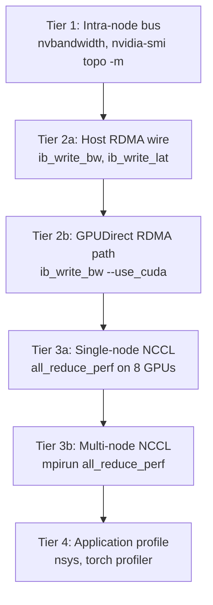
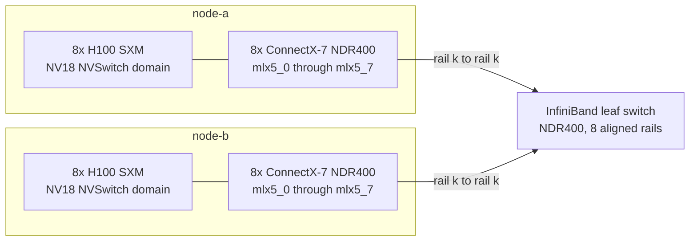

# 19.5 Capstone: an nccl-tests fabric lab

| Field | Value |
|---|---|
| Level | Advanced |
| Priority tier | 1 |
| Lab venue | On-prem |
| Part | Part 19: Capstones, design and interview readiness |
| Primary sources | nvidia-devops Zero-to-Hero Volume 24, Project 2 "AllReduce Algorithm Design"; Volume 07 "GPU networking and data paths" ch. 2, 3, 4, 5, 7, 8, 9, 10 and Lab 03; handbook Part 12 (12.15-12.18) and Part 14 (14.10) |
| Cross-references | Chapter 12.15 (NCCL collectives and algorithms); 12.16 (topology, channels, transports); 12.17 (nccl-tests and fabric benchmarking); 12.18 (NCCL debugging); 14.10 (multi-node training) |
| Coverage file | `planning/coverage/chapters/19-05.md` |
| Claim & number ledger | `planning/ledgers/19-05.md` |

## Why this matters for AI infrastructure

It is 2 a.m. A 64-GPU pretraining run has just timed out, and the on-call engineer is staring at a dashboard that looks healthy. Every InfiniBand port reports active. Every error counter reads zero. The utilization graphs show all 64 cards busy, and yet the run's gradient synchronization is 40 percent slower than the same job on the same cluster three months ago. The dashboards are telling the truth, which is the problem: they describe the state of the links, not the bandwidth of the data path. A fabric is not a state you can observe. It is a number you must measure, layer by layer, or the cluster pays for the gap in GPU-hours.

Every piece of that story has its own chapter. The NVLink and PCIe data paths live in the networking volumes, the NCCL collectives in 12.15, the topology and transports in 12.16, the test tooling in 12.17, and the debugging ladders in 12.18. The training workloads that consume all of it arrive in Part 14. A team that has read all of them can describe each piece in isolation. The capstone exists to answer the harder question: what holds the pieces together when a multi-node run times out?

The answer is the fabric lab. It runs the same collectives production training runs, at message sizes small enough to expose latency and large enough to expose bandwidth. It builds a single-node baseline over NVLink and a multi-node baseline over RDMA. It reads the two bandwidth columns that nccl-tests reports, and it knows which one is comparable to the spec sheet. Then it applies a set of pass/fail gates, so that fabric readiness becomes a signed artifact instead of a dashboard impression.

This capstone is also the interview anchor. When an interviewer asks how you would validate an AI fabric, the answer is not a list of tools; it is this layered picture, told in the order a real validation proceeds. It is the reference the platform team uses when commissioning a new fabric, and the evidence pack the on-call engineer diffs against when something gets slower.

**Before a team can claim its fabric is ready, it must have run this capstone. A team that has not run it has validated link state, which is not the same thing.**

## Prerequisites and outcomes

### Prerequisites

- Chapter 12.15: NCCL collectives and algorithms.
- Chapter 12.16: NCCL topology, channels, transports, and environment variables.
- Chapter 12.17: nccl-tests and fabric benchmarking.
- Chapter 12.18: NCCL debugging, hangs, timeouts, and errors.
- Chapter 14.10 for the multi-node training context the fabric exists to serve.
- Basic RDMA fluency: verbs, queue pairs, and GPUDirect RDMA from the earlier chapters of Part 12.

### Outcomes

After completing this capstone you will be able to:

1. Audit the GPU-to-NIC topology and the RDMA port counters before any benchmark is launched.
2. Run the single-node NVLink baseline and interpret its bus bandwidth against the interconnect rating.
3. Run the multi-node RDMA baseline and verify which transport NCCL actually selected.
4. Convert algorithmic bandwidth to bus bandwidth for every collective and verify the arithmetic of a sweep.
5. Isolate a straggler node in logarithmic time and name the degraded rail.
6. Apply the certification gates and assemble the evidence pack that certifies the fabric.

---

## 1. Why fabric labs exist: the validation ladder

### The commissioning that passed on link state

The new fabric arrived on a Tuesday, and the commissioning checklist stopped at link state. Every port trained at full speed, the switch telemetry showed no errors, and the team signed the handover that afternoon. Three weeks later, the first multi-node training run takes twice as long as the capacity model predicted, and no one can say where the time went. The fabric was never measured; it was only watched. The rest of this chapter converts that watching into numbers, in the order a senior engineer runs them.

### The ticket that has three physical answers

"The cluster is slow" is the most terrifying ticket a senior infrastructure engineer can receive. In traditional IT you check CPU, memory, and disk, and if they are fine you blame the database. In a distributed AI cluster, "slow" has three physical answers that look identical from the dashboard. A dirty optical connector can cause signal errors, link retraining, and retransmissions. A single PCIe lane out of sixteen can fail on one NIC, dropping its bandwidth from 64 to 32 GB/s. A developer can have disabled GPUDirect RDMA, and every transfer now bounces through host memory. None of these faults is visible while a PyTorch job runs, because the framework abstracts the hardware away. The senior engineer isolates the hardware layers and benchmarks them sequentially with low-level binaries.

### Why iperf3 cannot answer the question

Engineers coming from web infrastructure reach for `iperf3` first, and then are surprised when it misses the problem. `iperf3` pushes its packets through the kernel TCP/IP socket stack, with context switches, socket buffer copies, and software interrupts. That stack bottlenecks the host CPU cores long before it saturates a 400G link. RDMA is built precisely to avoid that path: the NIC posts work queue entries directly, DMA moves the memory, and the kernel on both servers is out of the data path. The perftest suite, with `ib_write_bw` and `ib_write_lat`, exercises that kernel-bypass path. So the wire test always uses perftest, and the collective test always uses nccl-tests. `iperf3` is for management-network reachability checks, nothing more.

### The ladder

The full validation runs in four tiers, from the physical silicon up to the framework. Each tier starts only after the tier below it passes, so the first failing tier names the layer to fix. A senior engineer never skips to tier three: if you run the NCCL tests first and they fail, you cannot tell whether the fault is a dirty cable, a downtrained PCIe link, or a NUMA misalignment.



The table below gives each tier's tool, its healthy reference, and the failure signature you look for when a number falls short.

| Validation tier | Primary binary | Healthy reference | Failure signature |
|---|---|---|---|
| **1: Intra-node bus** | `nvbandwidth`, `nvidia-smi topo -m`, `nvidia-smi nvlink --status` | 50-60 GB/s device-to-host on PCIe Gen5 x16; NV18 links active | 25-30 GB/s means the link downtrained from x16 to x8 |
| **2a: Host RDMA wire** | `ib_write_bw`, `ib_write_lat` | ~390 Gbps sustained on 400G NDR; 1-5 microseconds latency | ~195 Gbps means width or rate downtrain on the link |
| **2b: GPUDirect path** | `ib_write_bw --use_cuda` | Matches tier 2a on a PIX-paired GPU and NIC | Host RDMA healthy but GPU-buffer transfer collapses: peermem, ACS, or SYS pairing |
| **3a: Single-node collectives** | `all_reduce_perf` on 8 GPUs | busbw in the 750-800 GB/s range at large sizes on H100 SXM | Stuck at 20-90 GB/s: fabric manager down or P2P/SHM disabled |
| **3b: Multi-node collectives** | `mpirun` or `srun` of nccl-tests | busbw at least 80% of the local or per-rail baseline | 2.0 GB/s instead of ~100 GB/s: NET/Socket TCP fallback |
| **4: Application** | `nsys`, `torch.profiler` | Collective time hidden under backward compute | Wire passes at 1 GiB but training is 40% slow: microscopic buckets |

### What the lab produces

The lab produces three artifacts, and all three are standing services rather than one-time exercises. The first is a baseline per tier, captured on a healthy fabric and stored with the versions that produced it. The second is a gate per tier: a pass/fail criterion that turns a number into a decision. The third is the evidence pack that ties the two together, so that when a firmware rollout, a cable swap, or a node replacement lands, the team re-runs the lab and diffs the new pack against the baseline. A fabric lab is how a platform team answers the question "is the fabric ready?" with a document instead of an opinion.

**Decision rule:** never benchmark a layer until the layer below it has passed, because a slow number above a broken layer carries no information.

**In one minute:** "The cluster is slow" has three physical answers: a degraded wire, a downtrained PCIe link, or a disabled GPU-direct path. `iperf3` tests a path the training job never uses, so validation proceeds in tiers: intra-node bus, host RDMA wire, GPUDirect path, single-node collectives, multi-node collectives, and finally the application profile. Each tier starts only after the tier below passes, and the first failing tier names the layer to fix.

---

## 2. Anatomy of a test: collectives, algorithms, and message sizes

### The ticket filed against a healthy fabric

A new engineer reads the nccl-tests output and files an RMA ticket on every NIC in the rack. The AllReduce algorithmic bandwidth reads 183.55 GB/s, and the rails are rated at 400 Gbps, which is 50 GB/s per port. The fabric looks half dead, and the ticket is convincing. The bus bandwidth column, which is the number that is actually comparable to the spec sheet, reads 361.36 GB/s, about 90 percent of line rate. The fabric is fine. The ticket is not, and this section teaches you which column to read and why the other one exists.

### What each collective does

In data-parallel training, every GPU computes gradients over its own data shard, and the step ends with an AllReduce that returns the summed, averaged gradient to every GPU. Fully sharded data parallelism decomposes the step differently: it runs an AllGather before each layer's compute pass and a ReduceScatter after the backward pass. Tensor parallelism runs an AllReduce on every layer. Mixture-of-experts token dispatch runs an AllToAll. The nccl-tests suite ships one standalone binary per family, and each binary times the collective in a tight loop with no framework overhead.

| Binary | Collective | Every rank ends with | busbw factor |
|---|---|---|---|
| `all_reduce_perf` | AllReduce | the reduced tensor on every rank | 2(n-1)/n |
| `reduce_scatter_perf` | ReduceScatter | one reduced shard of S/n | (n-1)/n |
| `all_gather_perf` | AllGather | the full concatenated tensor | (n-1)/n |
| `alltoall_perf` | AllToAll | its transposed chunk set | (n-1)/n |
| `broadcast_perf` | Broadcast | the root's tensor replicated | 1.0 |
| `reduce_perf` | Reduce | the reduced tensor on the root | 1.0 |

AllReduce is mathematically identical to a ReduceScatter followed by an AllGather. That identity is what makes it pipelinable, and it is why the AllReduce factor is the largest in the table: two passes over the data instead of one.

### Which algorithm NCCL picks

NCCL does not run one algorithm for everything; it scores the physical topology at initialization and selects per message size. The **ring** arranges the GPUs in a logical circle so that every GPU sends and receives about the same amount of data, which balances link utilization beautifully. Its weakness is latency: the data takes one hop per GPU, so a 1,000-GPU ring is 1,000 hops. The **tree** organizes the GPUs hierarchically, so the hop count drops logarithmically as the cluster grows. **NVLS** moves the reduction itself into the NVSwitch ASIC on Hopper and later, cutting the data each endpoint must send by a factor of 1/(N-1). **SHARP**, or CollNet in NCCL, does the in-network reduction inside the Quantum InfiniBand switch ASIC instead. SHARP needs supported switches and the NCCL plugin, and it only helps some collectives at some message sizes, so you measure it before you rely on it.

The AllReduce algorithm design project in the source material makes the comparison concrete on an 8-GPU cluster. A naive all-to-all broadcast, where each GPU sends its tensor to every other GPU one at a time, takes N(N-1) link hops, which is 56 hops for 8 GPUs, and it serializes the network. The ring takes 2(N-1) hops, or 14, with every step pipelined, and it completes 40 percent faster. A carefully hand-tuned ring reaches about 54 percent of peak bandwidth; NCCL's auto-tuned implementation reaches 81 percent. NCCL wins because it adapts to the topology you actually have, which is exactly why the fabric lab measures NCCL behavior instead of re-deriving it.

### Message sizes decide what you measure

The sizes you sweep decide what the run exposes. Small messages from 4 KiB to 64 KiB are dominated by launch and hop latency, not by link bandwidth, so they give you the latency floor. Mid-size messages from 1 MiB to 64 MiB show the transition where bandwidth starts to dominate. Large messages from 128 MiB upward exercise sustained bandwidth, and the acceptance runs in this capstone use 1 GiB as the certification size. A sweep that only covers the small end tells you about latency and misses a congested rail; a sweep that only covers the large end tells you about bandwidth and misses a slow handshake.

### The flags

The table below lists the flags the lab uses, each with its operational meaning.

| Flag | Meaning |
|---|---|
| `-b <bytes>` | minimum message size, with K/M/G suffixes |
| `-e <bytes>` | maximum message size |
| `-f <int>` | multiplicative step factor between sizes; 2 doubles each row |
| `-g <int>` | GPUs per process; 8 for a single-process local run, 1 when one process is launched per GPU |
| `-w <int>` | untimed warmup iterations before the clock starts |
| `-n <int>` | timed iterations averaged per row |
| `-c <int>` | data-integrity checks; 1 compares the reduced output and fills the `#wrong` column |
| `-d <type>` | element datatype, such as `float`, `half`, or `bfloat16` |
| `-o <op>` | reduction operator, sum by default |
| `-R <int>` | persistent buffer registration to exercise zero-copy paths |

Warmup matters because the first iteration pays lazy initialization and handle setup costs. A production burn-in uses `-w 10 -n 100`; the lab's matrix runs use `-w 5 -n 50`.

**Decision rule:** pick the message size to match the question, latency or bandwidth, and keep the same size when you compare any two baselines.

**In one minute:** each nccl-tests binary times one collective family. AllReduce is a ReduceScatter plus an AllGather, which is why its busbw factor is 2(n-1)/n and its busbw is the number comparable to the spec sheet, not the algbw. NCCL picks ring, tree, NVLS, or SHARP per message size and topology. Small sizes expose latency, large sizes expose bandwidth, and the flags set both the sweep shape and the rigor.

---

## 3. The single-node baseline: the NVLink domain

### The node that came back from reboot

The node came back from a firmware reboot on Monday, and the first single-node sweep ran at a tenth of its expected bandwidth. Every GPU still reported its links, and the host looked fine in every place anyone thought to look. The fabric manager daemon had not survived the reboot, and the NVSwitch domain was down. The fix was one daemon restart and one re-run. The lesson is the value of the baseline: the single-node run is the cheapest probe you have, and it catches the most common silent failure in an NVSwitch fleet.

### The NVLink domain

On an 8-GPU HGX or DGX node, the GPUs are not talking over PCIe at all. Each H100 carries 18 NVLink connections, the baseboard routes them down into four NVSwitch chips, and the result is a fully non-blocking all-to-all mesh. Every GPU can talk to every other GPU at 900 GB/s, with no hops, no PCIe transfers, and no CPU involvement. In the topology matrix that shows up as `NV18`, meaning 18 bonded fourth-generation NVLinks. The NVLink generations give you the per-GPU rating for each architecture:

| Generation | GPU era | Per-GPU bandwidth |
|---|---|---|
| NVLink 1.0 | Pascal P100 | 160 GB/s |
| NVLink 2.0 | Volta V100 | 300 GB/s |
| NVLink 3.0 | Ampere A100 | 600 GB/s |
| NVLink 4.0 | Hopper H100 | 900 GB/s |
| NVLink 5.0 | Blackwell B200 | 1.8 TB/s |

### The PCIe floor

The GPU's memory runs at 3,350 GB/s on an H100, and its PCIe Gen5 x16 path out of the node is about 64 GB/s per direction. That is the straw the firehose flows through whenever data leaves the node, and it is why the single-node test separates two numbers. Intra-GPU traffic uses NVLink; NIC-bound traffic uses PCIe. You verify the PCIe side with `nvbandwidth`: a healthy device-to-host copy on Gen5 x16 lands at 50 to 60 GB/s, and a reading of 25 to 30 GB/s means the link downtrained from x16 to x8, which you confirm with `lspci -vv` and the LnkSta field.

### The run

```bash
# Tier 1: PCIe and NVLink sanity on the node
nvbandwidth -t device_to_host_memcpy_ce
nvidia-smi topo -m
nvidia-smi nvlink --status

# Tier 3a: single-node 8-GPU AllReduce sweep
./build/all_reduce_perf -b 8M -e 1G -f 2 -g 8 -w 5 -n 50 -c 1
```

On an 8-GPU H100 SXM node, the large-size bus bandwidth should land in the 750 to 800 GB/s range. The reference row from the benchmarking chapter is 1 GiB in 2,480 microseconds, which gives an algorithmic bandwidth of 432.96 GB/s and a bus bandwidth of 757.68 GB/s. On a PCIe-only node without an NVSwitch mesh, the same sweep runs an order of magnitude lower; a hybrid PCIe baseline measured 95.18 GB/s at 512 MiB. That contrast is the whole point of the tier: the number tells you which interconnect the collective actually used, and the `NV18` row in the topology matrix confirms it.

**Decision rule:** do not launch the multi-node baseline until the single-node anchor passes on every node that will join it, because one weak NVSwitch domain drags the whole ring down.

**In one minute:** the single-node baseline benchmarks the densest part of the fabric, the NVLink domain. H100 nodes run an NV18 all-to-all mesh at 900 GB/s per GPU through four NVSwitches, and `nvbandwidth` verifies the PCIe floor at 50-60 GB/s per x16 lane group. The 8-GPU `all_reduce_perf` sweep should reach 750-800 GB/s bus bandwidth at large sizes on SXM nodes, and a result a tenth of that usually means the fabric manager is down.

---

## 4. The multi-node baseline: the RDMA fabric

### Two identical servers, twice the time

Two identical servers, the same GPUs, the same NICs, the same switch. On node A the training job runs at full speed. On node B it takes twice as long. The hardware is identical; the PCIe slot population is not. The NIC is wired to CPU 0, and on node B the job's GPUs live on CPU 1, so every byte of gradient crosses the inter-socket link between the sockets. The multi-node baseline exists to make that difference a number instead of a rumor, and the first step is auditing the topology before anything is measured.

### The fabric of the lab

The lab runs on two nodes, node-a and node-b. Each carries 8 H100 80 GB SXM GPUs connected in an NV18 NVSwitch domain, and one ConnectX-7 NDR400 adapter per GPU, enumerated `mlx5_0` through `mlx5_7`. A 400 Gb/s port is 50 GB/s of line rate, and the rails are aligned: GPU k on node-a talks to GPU k on node-b over the same physical rail, so the eight rails share the load evenly.



| Item | Value |
|---|---|
| Nodes | node-a, node-b; 8x H100 80 GB SXM each |
| NICs per node | 8x ConnectX-7 NDR400, one per GPU, `mlx5_0` to `mlx5_7` |
| Line rate per rail | 400 Gb/s, which is 50 GB/s |
| Rail alignment | GPU k on node-a to GPU k on node-b over rail k |
| Intra-node fabric | NV18 NVLink domain, 900 GB/s per GPU |

Generation pairing matters as much as the fabric itself. The ConnectX line steps with the GPU generation:

| Generation | Max per port | Bus | Form factor |
|---|---|---|---|
| ConnectX-6 | 200 Gbps HDR | PCIe Gen4 x16 | QSFP56 |
| ConnectX-7 | 400 Gbps NDR | PCIe Gen5 x16 | OSFP |
| ConnectX-8 | 800 Gbps XDR | PCIe Gen6 | see product brief |

The reference design is one 400G ConnectX-7 per H100. A 400G port needs 50 GB/s of PCIe, and a Gen5 x16 slot provides about 64 GB/s per direction, so the NIC fits under the bus ceiling with little headroom. Watch for the cost-saving spec that says "dual 200G NICs per GPU for 400G total." Arithmetically it looks right and architecturally it is not: you need software bonding to combine two Gen4 ports, and a GPU that is not locally attached to both NICs loses the direct PCIe path to at least one of them. Verify pairing with the topology matrix before you accept the hardware.

### The pre-benchmark audit

No benchmark starts before three things are captured on every participating node. The first is the topology matrix from `nvidia-smi topo -m`. The token that matters for the network tests is the GPU-to-NIC relationship: `PIX` means the GPU and NIC sit behind at most one PCIe switch on the same NUMA node, which is the gold standard for GPUDirect RDMA. `SYS` means the path crosses the inter-socket link, which is the worst case on the host. On a reference 8-GPU node, GPU0 to `mlx5_0` is `PIX`, while GPU0 to `mlx5_7` is `SYS`. You use the PIX pairing for the GPU-direct test, because pairing a GPU with its remote NIC would work but would not represent the node's real capability.

The second capture is the port state from `ibstat`. You want `State: Active` together with `Physical state: LinkUp` and `Rate: 400`. The two states mean different things: the physical state is the electrical lock between transceiver and cable, while the logical state is what the subnet manager assigns. A port stuck at `LinkUp` but `Initializing` after boot means the subnet manager has not finished, not that the cable is bad. A rate below 400 on an NDR400 port means a physical lane or speed downshift.

The third capture is a snapshot of the error counters from sysfs. The fields you record are `symbol_error`, `link_error_recovery`, `port_rcv_errors`, and `VL15_dropped`. The data counters will obviously climb under load, but those four error counters must stay at their pre-test baseline through the whole sweep. A rising error counter routes you to a degraded fabric branch even when the throughput number itself looks acceptable.

### The wire, then the GPU memory path

With the audit captured, you benchmark the wire first, pinned to the local NUMA node so the CPU side of the path is also controlled.

```bash
# node-a, the server
numactl --cpunodebind=0 --membind=0 ib_write_bw -d mlx5_0 -i 1 --report_gbits --duration 30
# node-b, the client
numactl --cpunodebind=0 --membind=0 ib_write_bw -d mlx5_0 -i 1 --report_gbits --duration 30 node-a
numactl --cpunodebind=0 --membind=0 ib_write_lat -d mlx5_0 -i 1 -a node-a
```

On a 400G NDR fabric you expect roughly 390 Gbps after warm-up and a few-microsecond latency. A result of about half the expected rate points at a downtrained link width, and you confirm the negotiated width and speed with `ibstat` or `mlxlink`; a dirty connector, a damaged cable, or a configuration or PCIe limitation can all cause the train-down.

Then you test the same wire with GPU memory on both ends.

```bash
lsmod | grep -Ei 'nvidia|peermem|rdma'
ib_write_bw -d mlx5_0 --use_cuda=0 --report_gbits --duration 30
ib_write_bw -d mlx5_0 --use_cuda=0 --report_gbits --duration 30 node-a
```

GPUDirect RDMA lets the NIC read and write the GPU's HBM straight over the PCIe bus, with the host CPU and system RAM out of the data path. It is governed by physical motherboard topology, not just software flags. The GPU and NIC must share a local PCIe switch for the fast path; across a `SYS` boundary, NCCL excludes GPUDirect by default. The usual culprits when the GPU-buffer number collapses while the host number is healthy are a missing `nvidia_peermem` kernel module, PCIe ACS or IOMMU settings that block peer-to-peer traffic, and on non-DGX hardware a BIOS without large-BAR and Above-4G Decoding support, so the GPU cannot expose enough of its HBM through BAR1.

### The transport check

The multi-node NCCL run carries its own transport evidence. You launch with debug on:

```bash
export NCCL_DEBUG=INFO
export NCCL_DEBUG_SUBSYS=INIT,NET,GRAPH
```

The INFO log states which transport NCCL established on each link. `NET/IB` is the RDMA path you paid for. `NET/Socket` is the TCP/IP fallback that reads about 2.0 GB/s where the RDMA path reads about 100 GB/s, a fifty-fold collapse that still lets the job run without crashing. If NCCL has miscalculated the topology, you can force it with an explicit `NCCL_TOPO_FILE` describing the exact PCIe layout, and you keep the bootstrap traffic off docker bridge interfaces with `NCCL_SOCKET_IFNAME=^docker,lo`. On a Kubernetes deployment, the kubelet's Topology Manager in `single-numa-node` mode adds a second line of defense: it admits a pod only when its GPUs, exclusive cores, and NIC fit on one NUMA node, and it rejects the pod with a TopologyAffinityError when they do not.

### The multi-node run

```bash
mpirun -np 16 -H node-a:8,node-b:8 \
  -x NCCL_DEBUG -x NCCL_DEBUG_SUBSYS \
  ./build/all_reduce_perf -b 8M -e 1G -f 2 -g 1 -w 5 -n 100 -c 1
```

One process per GPU, 16 processes total, with the debug variables forwarded so every rank logs its transport. The reference for the fabric generation is the multi-node row from the benchmarking chapter: 1 GiB across 8 nodes of 8x400G NDR completes in 5,850 microseconds, giving a bus bandwidth of 361.36 GB/s. That is about 45.17 GB/s per rail, or 90.34 percent of the 50 GB/s line rate. Your two-node lab does not need to match that cluster number exactly; it needs to clear the gate, which compares your bus bandwidth against the single-node anchor on the same nodes and against the per-rail reference for your generation.

**Decision rule:** verify the transport from the log, never from throughput alone; a plausible bus bandwidth over NET/Socket is a different failure than a slow bus bandwidth over NET/IB.

**In one minute:** the multi-node baseline audits the GPU-to-NIC topology, the port state, and the error counters before it measures anything. It benchmarks the host RDMA wire at about 390 Gbps, then the same wire with GPU buffers to prove GPUDirect RDMA, then runs the NCCL collective with debug on so the transport choice is evidence. The gate compares bus bandwidth against the single-node anchor and the per-rail reference, and a PIX pairing is required for the GPU-direct path to be fast.

---

## 5. Reading the results: algbw, busbw, and the integrity column

### The record that corrupted the model

The sweep finishes, and the team celebrates a record bus bandwidth. Nobody had the integrity check turned on, so nobody notices that the reduced output is wrong. A collective can finish fast and still corrupt floating-point values in transit, and the model that trains on those gradients is quietly broken. The failure shows up months later as a model that does not converge, not as a benchmark. A bandwidth number is only as good as the check behind it, and the lab enables the check on every run.

### The two bandwidth columns

For a collective that works on a buffer of S bytes across n ranks and finishes in t seconds, nccl-tests reports two columns. The algorithmic bandwidth, `algbw`, is simply S divided by t: the apparent rate at which the logical tensor is processed. The bus bandwidth, `busbw`, multiplies algbw by the per-rank byte volume an optimal ring must move. That normalization makes busbw directly comparable with the hardware's rated link speed, whatever the cluster size. The factor depends on the collective:

| Collective | Per-rank bytes moved | busbw factor |
|---|---|---|
| AllReduce | 2(n-1)/n times S | 2(n-1)/n |
| ReduceScatter | (n-1)/n times S | (n-1)/n |
| AllGather | (n-1)/n times S | (n-1)/n |
| AllToAll | (n-1)/n times S | (n-1)/n |
| Broadcast | S | 1.0 |
| Reduce | S | 1.0 |

At 8 ranks the AllReduce factor is 1.75, the gather-family factor is 0.875, and Broadcast and Reduce stay at 1.0. At 64 ranks the AllReduce factor is 1.96875, and at 72 ranks it is 142/72. As the rank count grows, the AllReduce factor approaches 2, which means algorithmic bandwidth can never exceed half of the physical bottleneck link at scale. That is the arithmetic behind the RMA ticket in Section 2, and it is why you never compare algbw to the spec sheet.

### Worked rows

The table below is the reference sweep the lab reproduces, and every row's arithmetic holds.

| Run | Size | Time | algbw, GB/s | busbw, GB/s |
|---|---|---|---|---|
| 8-GPU sweep, hybrid PCIe node | 8 MiB | 412.3 us | 20.35 | 35.61 |
| 8-GPU sweep, hybrid PCIe node | 64 MiB | 1,653.1 us | 40.60 | 71.05 |
| 8-GPU sweep, hybrid PCIe node | 512 MiB | 9,871.4 us | 54.39 | 95.18 |
| 8x H100 SXM, NVLink4 | 1 GiB | 2,480.0 us | 432.96 | 757.68 |
| 64 GPUs, 8x400G NDR cluster | 1 GiB | 5,850.0 us | 183.55 | 361.36 |

Take the 64 MiB row: 67,108,864 bytes in 1,653.1 microseconds gives an algbw of 40.60 GB/s, and multiplying by the 8-rank AllReduce factor of 1.75 gives 71.05 GB/s of bus bandwidth. The multi-node row multiplies 183.55 by the 64-rank factor of 1.96875 to land on 361.36 GB/s, which is 45.17 GB/s per rail. Note the shape of the numbers: the same fabric produces a bus bandwidth of 757.68 GB/s inside one node and 361.36 GB/s across the cluster, because the inter-node rails are the bottleneck link, not the NVLink domain.

One more reading rule. In out-of-place mode the send and receive buffers are separate allocations; in in-place mode the reduced output overwrites the input buffer, which is the mode that matches PyTorch's gradient buckets. Both modes appear in the output table, and both must pass.

### The shape of the sweep

Read the sweep as a curve, not as a list of rows. The small rows sit on a low, nearly flat shelf: the time is launch and hop latency, and bandwidth barely matters. The middle rows rise as the message size amortizes that latency. The large rows plateau at the fabric's sustained bandwidth, and the height of that plateau is your baseline. A collapse in the middle of the curve is its own signature: in the mixed-fabric project runs, bandwidth jumped to the intra-node rate and then collapsed as the ring crossed the inter-node links, because the slow fabric link got congested mid-collective. The fix there is structural, minimizing inter-node messages or letting NCCL use a hierarchical algorithm, not a cable swap.

### Variance and versions

One run is an anecdote. The lab repeats each size, reports the median, and records the coefficient of variation so that a future diff can tell a regression from jitter. And no result is published without the context that produced it: the driver, the NCCL build, the NIC firmware, the switch, and the topology matrix. A bus bandwidth number detached from its stack is a rumor with units.

**Decision rule:** do not report a bandwidth number from any run whose `#wrong` column is not zero; fix the corruption first and re-measure.

**In one minute:** nccl-tests reports algbw, the logical tensor rate, and busbw, the per-link rate comparable to the spec sheet. busbw is algbw times a factor that depends on the collective and the rank count, and at scale the AllReduce factor approaches 2. The sweep shape tells you what you are measuring: flat at small sizes means latency, plateau at large sizes means bandwidth, and a mid-curve collapse means a congested inter-node link. Every reported number carries `#wrong` zero, a variance figure, and the versions that produced it.

---

## 6. Failure modes: hangs, timeouts, and stragglers

### The timeout that blamed the healthy ranks

The watchdog fires at 3 a.m. on most of the ranks, and the log makes it look like the network failed. The ranks that printed the timeout are the healthy ones. A collective is a barrier, so they arrived on time and then waited until the process-group watchdog gave up and aborted the job. The real fault sits on the one rank that never entered the collective, or on the hardware that kept that rank late. A fabric lab without a failure catalogue is a benchmark; with one, it is a diagnostic tool.

### What scale looks like

The pretraining runs that train frontier models make the stakes concrete. A 54-day run on 16,384 H100 GPUs logged 419 unexpected interruptions, which averages out to one interruption every 3.09 hours. Of those interruptions, 64 percent were GPU silicon and memory faults, while switches, cables, and NICs combined accounted for 10 percent. One faulty GPU stalls the other 16,383 inside the barrier. The lesson for the fabric lab is that most of what looks like a network failure is a GPU or software failure, and the layered evidence is what separates the two.

### The catalogue

The table below is the on-call guide. Each row gives the symptom you see, the root cause behind it, the fix, and the evidence that proves the fix worked.

| Failure mode | Symptom | Root cause | Fix and verification |
|---|---|---|---|
| **Silent TCP fallback** | AllReduce at 2.0 GB/s instead of ~100 GB/s; CPU pegged | Container lacks `/dev/infiniband`; `NCCL_IB_DISABLE=1` left set; wrong backend | `NCCL_NET=IB`; verify `Using network IB` in the log |
| **Host bounce buffer** | Host RDMA ~390 Gbps; GPU-buffer transfer a quarter of that | `nvidia_peermem` unloaded; PCIe ACS enabled; SYS pairing | Load peermem, fix ACS, use PIX pairs; re-run `--use_cuda` |
| **Dead NVLink domain** | Single-node busbw drops from ~800 to ~90 GB/s after reboot | `nvidia-fabricmanager` down; `NCCL_P2P_DISABLE=1` or `NCCL_SHM_DISABLE=1` left set | Restart fabricmanager, unset variables; confirm `NV18` in topo |
| **Bootstrap hang** | Job stuck at communicator init; connection timeout or QP failure | Unroutable bridge interface; port exhaustion; `memlock` limit | `NCCL_SOCKET_IFNAME=^docker,lo`; widen port range; raise memlock |
| **Microscopic buckets** | Wire and 1 GiB nccl-tests pass; training 40% slow | Thousands of 256 KB AllReduce calls; handshake latency dominates | Raise DDP `bucket_cap_mb` from 25 to 50 MB; verify in nsys |
| **Straggler rank** | One rank 10x late entering the collective | Dataloader imbalance; thermal throttle; degraded rail | Pre-collective timers; check clocks, ECC, counters |

The first row is the one to remember. The job runs without crashing, so nothing pages anyone; only the timings give the fallback away, and a 50x throughput collapse hides behind a job that is merely slow.

### Failure modes inside the algorithm

The AllReduce project material contributes four algorithm-level failure modes that the hardware catalogue does not cover. If your ring is no faster than a tree, the sends and receives are serialized: the ring is not being pipelined, so you check that every GPU is sending and receiving simultaneously with non-blocking calls. If bandwidth collapses mid-run, the ring crosses the slow inter-node link every round, and the fix is to restructure the ring to minimize cross-node messages. If the results diverge across ranks, rank 0 has X and rank 7 has X plus a small epsilon, that is floating-point order-of-operations, because addition is not associative; verify with two ranks first, then use a double-precision check for correctness. And if the test hangs indefinitely after a few steps, blocking sends and receives have deadlocked; the fix is pipelined non-blocking communication with buffer space that cannot fill.

### The diagnostic toolbox

Modern NCCL ships two built-in diagnostics that name the fault directly. `NCCL_RUN_DIAGNOSTICS=1`, available from NCCL 2.31 onward, runs active hardware and peer-access checks during communicator initialization, before any workload starts. An 8-GPU node verifies 56 directed peer pairs, and a result of 52 out of 56 means four GPU-to-GPU links failed verification, which is an init-time hardware fault you fix before anything else. The `ncclras` daemon, available from NCCL 2.24 onward, listens on port 28028 while a job runs. Its `MISMATCH` status lists the ranks whose collective operation counts lag, which names a straggler; its `INCOMPLETE` status names a dead or unresponsive rank, which names a hardware failure.

When the whole cluster is slow and every rank enters the collectives on time, you isolate the bad node by bisection instead of by linear search. Split the node list in half and run the test on each half; the half with the degraded bus bandwidth holds the straggler, and the other half becomes your known-good partner. Repeat until one node is left. That takes the ceiling of log2 N split runs: 3 for 8 nodes, 6 for 64, 7 for 128. Then test each rail on that node separately by pinning the HCA, one `NCCL_IB_HCA=mlx5_0:1` run per rail, or `ib_write_bw` per device alongside the switch counters. NVLink evidence lives in the same place: a link reporting `DEGRADED` at 5 GB/s against a 25 GB/s baseline, or `FAILED` at zero, is the one-line proof.

One discipline closes the section: always check the first rank to fail. The errors that follow it are usually consequences, and chasing a consequence is how an incident outlives its root cause.

**Decision rule:** in a hung collective, the ranks that report the error are the healthy ones; hunt the rank that never arrived, with pre-collective timers or `ncclras`.

**In one minute:** collective timeouts are misdiagnosed by default because the ranks that print them arrived on time and then waited. At 16,384-GPU scale, most interruptions are GPU silicon faults rather than network faults, so the evidence chain decides which class you are in. The catalogue covers the silent TCP fallback, the host bounce buffer, the dead NVLink domain, the bootstrap hang, the microscopic DDP buckets, and the straggler rank. The toolbox is init-time diagnostics, the ncclras daemon on port 28028, bisection in log2 N runs, and per-rail HCA pinning.

---

## 7. Certification gates: what "fabric ready" means

### The month with no baseline

A month after commissioning, the platform team is told that training is 40 percent slower than it should be. Nobody can answer the only question that matters: did the fabric change, or did the workload change? The commissioning checklist signed off on link state, and nobody saved a bandwidth baseline, so the argument runs for weeks on opinions. The gates below exist to turn fabric readiness into a signed artifact: a table of numbers, each with the evidence that produced it and the change window in which it is valid.

### The gate table

| Gate | Check | Pass criterion | Artifact |
|---|---|---|---|
| **1: Intra-node topology** | `nvidia-smi topo -m` | NV18 across the GPU matrix; PIX pairing for every GPU-NIC rail | `topology.txt` |
| **2: Intra-node bus** | `nvbandwidth` device-to-host; `nvidia-smi nvlink --status` | 50-60 GB/s on PCIe Gen5 x16; all NVLink links active | nvbandwidth log |
| **3: Wire** | `ibstat`; `ib_write_bw` | State Active, Rate 400; ~390 Gbps sustained; error counters flat | counter snapshots before and after |
| **4: Single-node collective** | `all_reduce_perf` on 8 GPUs at 1 GiB | busbw in the 750-800 GB/s range on H100 SXM; `#wrong` zero on every row | sweep table |
| **5: Multi-node collective** | `mpirun all_reduce_perf` at 1 GiB | busbw at least 80% of the local or per-rail baseline; transport is NET/IB; GDR active on PIX pairs | sweep table plus INFO log |
| **6: Latency budget** | `ib_write_lat`; small-message allreduce | 1-5 microseconds point-to-point; 100 MB AllReduce on 8 GPUs within 5 ms | latency rows |
| **7: Integrity and diagnostics** | `-c 1`; `NCCL_RUN_DIAGNOSTICS=1` | `#wrong` zero on every row; 56 of 56 peer pairs verified on an 8-GPU node | diagnostic lines |

Gate 5 carries the standing policy from the benchmarking chapter: a multi-node run must reach at least 80 percent of the corresponding single-node or per-rail baseline. The example that shows why the gate is strict: a node whose 512 MiB single-node bus bandwidth measured 95.18 GB/s sets the gate at 76.14 GB/s, and an observed multi-node result of 58.2 GB/s, which is 61.15 percent of the local baseline, fails. Gate 6 pairs the wire latency with the collective latency budget: the AllReduce project's success criterion for a hand-tuned ring is 100 MB on 8 GPUs within 5 ms, against roughly 8 ms for the naive algorithm, and the reference anchors for training hold intra-node AllReduce under 1 ms and inter-node under 5 ms at typical gradient sizes.

### The evidence pack

Every gate leaves an artifact, and the pack is the artifacts plus the context: the topology matrix, the counter snapshots before and after, the NCCL INFO log with the transport lines, the bus bandwidth table, and the pinned versions of the driver, the NCCL build, the NIC firmware, and the switch model. The pack is dated and signed by the engineer who ran it. Re-certification happens on a schedule defined by change, not by calendar: after a firmware rollout, a driver update, a cable or transceiver swap, or a node replacement. The re-run diffs the new pack against the baseline and reports the median and the coefficient of variation per row. A fabric that cannot reproduce its baseline inside its recorded variance is not ready, and the diff names the gate that moved.

**Decision rule:** certify the fabric on the signed evidence pack, not on link state; any change that fails to reproduce the baseline is a regression until the diff says otherwise.

**In one minute:** certification is seven gates, from the intra-node topology matrix to the multi-node bus bandwidth, each with a pass criterion and an artifact. The multi-node gate is 80 percent of the local or per-rail baseline, the integrity gate requires `#wrong` zero and a full peer-pair verification, and the latency gate bounds both wire and collective latency. The signed evidence pack with pinned versions is what makes a future slowdown a diff instead of an argument.

---

## 8. Hands-on lab

The on-call engineer wants one ticket per month, the one that says training is slower than it should be. This lab is the standing answer: run it when the fabric is healthy, save the numbers, and every future slowdown becomes a diff against a known baseline. It runs on a two-node on-prem cluster and is **untested** in this repository.

### 8.1 Prerequisites

- Two GPU nodes, 8 GPUs each; H100 80 GB SXM or equivalent NVSwitch-connected nodes.
- One 400G NDR ConnectX-7 adapter per GPU, `mlx5_0` through `mlx5_7`, rail-aligned to the leaf.
- Working InfiniBand fabric with the subnet manager; rdma-core and the perftest suite installed.
- CUDA, NCCL, and an MPI distribution on both nodes.

### 8.2 Step 1: build the test binaries

```bash
# Both nodes
git clone https://github.com/NVIDIA/nccl-tests.git
make -C nccl-tests MPI=1 MPI_HOME=/usr/mpi/gcc/openmpi-4.1.7a1 CUDA_HOME=/usr/local/cuda
```

The binaries land in `nccl-tests/build`. Pin the commit and the NCCL version in the evidence pack.

### 8.3 Step 2: audit the topology and snapshot counters

```bash
LAB_DIR="$HOME/fabric-lab-$(date +%Y%m%d-%H%M%S)"; mkdir -p "$LAB_DIR"
nvidia-smi topo -m | tee "$LAB_DIR/topology.txt"
ibstat mlx5_0 | tee "$LAB_DIR/ibstat.txt"
rdma link show | tee -a "$LAB_DIR/rdma-links.txt"
lsmod | grep -Ei 'nvidia|peermem|rdma' | tee "$LAB_DIR/modules.txt"
for dev in /sys/class/infiniband/*/ports/*/counters; do
  echo "### $dev"
  grep -H . "$dev"/* 2>/dev/null
done | tee "$LAB_DIR/counters-before.txt"
```

Expected: NV18 across the GPU matrix, PIX on every GPU-NIC local pair, State Active with Rate 400, and `nvidia_peermem` loaded.

### 8.4 Step 3: benchmark the host-memory wire

```bash
# node-a, the server
numactl --cpunodebind=0 --membind=0 ib_write_bw -d mlx5_0 -i 1 --report_gbits --duration 30
# node-b, the client
numactl --cpunodebind=0 --membind=0 ib_write_bw -d mlx5_0 -i 1 --report_gbits --duration 30 node-a
numactl --cpunodebind=0 --membind=0 ib_write_lat -d mlx5_0 -i 1 -a node-a
```

Expected: roughly 390 Gbps after warm-up and 1-5 microsecond latency. Spot-check at least two rails, for example `mlx5_0` and `mlx5_7`.

### 8.5 Step 4: benchmark the GPU-memory path

```bash
ib_write_bw -d mlx5_0 --use_cuda=0 --report_gbits --duration 30
ib_write_bw -d mlx5_0 --use_cuda=0 --report_gbits --duration 30 node-a
```

Expected: the GPU-buffer number matches the host-memory number on the PIX pair. A collapse here means peermem, ACS, or pairing, not the fabric.

### 8.6 Step 5: the single-node baseline

```bash
./build/all_reduce_perf -b 8M -e 1G -f 2 -g 8 -w 5 -n 50 -c 1 \
  | tee "$LAB_DIR/single-node-allreduce.txt"
```

Expected: `#wrong` zero on every row, and large-size bus bandwidth in the 750-800 GB/s range on an H100 SXM node.

### 8.7 Step 6: the multi-node baseline with transport evidence

```bash
export NCCL_DEBUG=INFO
export NCCL_DEBUG_SUBSYS=INIT,NET,GRAPH
mpirun -np 16 -H node-a:8,node-b:8 \
  -x NCCL_DEBUG -x NCCL_DEBUG_SUBSYS \
  ./build/all_reduce_perf -b 8M -e 1G -f 2 -g 1 -w 5 -n 100 -c 1 \
  | tee "$LAB_DIR/multi-node-allreduce.txt"
```

Expected: NET/IB on every rail and no NET/Socket line; 1 GiB bus bandwidth clearing the 80 percent gate against the single-node anchor.

### 8.8 Step 7: the full collective matrix

```bash
for t in reduce_scatter_perf all_gather_perf alltoall_perf broadcast_perf; do
  ./build/$t -b 8M -e 1G -f 2 -g 8 -w 5 -n 50 -c 1 | tee "$LAB_DIR/single-node-$t.txt"
done
```

The single-node matrix is enough for the remaining collectives, because the multi-node run already proved the wire path; the matrix confirms the per-collective factors and the integrity column.

### 8.9 Step 8: diff the counters and certify

```bash
for dev in /sys/class/infiniband/*/ports/*/counters; do
  echo "### $dev"
  grep -H . "$dev"/* 2>/dev/null
done > "$LAB_DIR/counters-after.txt"
diff "$LAB_DIR/counters-before.txt" "$LAB_DIR/counters-after.txt" \
  | grep -v -E 'port_(rcv|xmit)_(data|packets)'
```

Expected: only the data counters moved; the error counters are flat. Then fill in the Section 7 gate table, sign the pack, and archive `LAB_DIR`.

### 8.10 What to record

After the lab, you should be able to answer five questions in five seconds each:

1. What was the single-node bus bandwidth at 1 GiB, and which gate did it satisfy?
2. What was the multi-node bus bandwidth at 1 GiB, and did it clear the 80 percent gate?
3. Which transport did NCCL pick on each node, and was GPUDirect RDMA active?
4. Which error counters moved during the sweep, and by how much?
5. If one gate failed, what is the first piece of evidence you would read, and why?

If any of them takes longer, the fabric is not yet a validated service; go back to the section that owns the gap. The lab is **untested** against a live cluster in this repository.

---

## Exercises

1. **Verify the bus bandwidth math.** Given an 8-GPU run where 64 MiB AllReduce completes in 1,653.1 microseconds with an algbw of 40.60 GB/s, derive the bus bandwidth of 71.05 GB/s. Then, for a 64-GPU run where 1 GiB completes in 5,850.0 microseconds with an algbw of 183.55 GB/s, state the AllReduce factor and derive the bus bandwidth of 361.36 GB/s. *Solution sketch:* the 8-rank factor is 2(8-1)/8 = 1.75, so 40.60 times 1.75 = 71.05. The 64-rank factor is 2(63)/64 = 1.96875, so 183.55 times 1.96875 = 361.36.

2. **Read the transport from the log.** A multi-node run prints `NCCL INFO Using network Socket` instead of IB, and the bus bandwidth reads about 2 GB/s. Identify the failure class, list the two environment settings you would apply first, and state the log line you would look for after the fix. *Solution sketch:* this is the silent TCP fallback. Set `NCCL_NET=IB` so NCCL fails fast instead of falling back, and set `NCCL_SOCKET_IFNAME=^docker,lo` so the bootstrap stays off the bridge interface. After the fix, look for `Using network IB` in the INFO log.

3. **Bisect the straggler.** A 128-node cluster runs well below its baseline bus bandwidth, and you suspect one node. How many split runs does bisection take, how many total runs including the initial full-cluster test, and how does that compare with a linear search? Then write the per-rail commands that isolate the degraded rail on the suspect node. *Solution sketch:* the ceiling of log2 128 is 7 split steps, or 8 total runs, versus 128 linear runs. Then pin each rail in turn with `NCCL_IB_HCA=mlx5_0:1` through `NCCL_IB_HCA=mlx5_7:1`, one run per rail, and the rail whose bus bandwidth drops is the degraded one.

4. **Pair the GPU and the NIC.** On an 8-GPU node, the topology matrix shows GPU0 to `mlx5_0` as PIX, GPU0 to `mlx5_7` as SYS, and every GPU pair as NV18. Pick the pairing for a `--use_cuda=0` test on GPU 0, explain why the other pairing is excluded, and state what the NCCL log would show if it used it anyway. *Solution sketch:* pair GPU0 with `mlx5_0`, because PIX shares at most one PCIe switch and is the gold-standard GPUDirect path. The SYS pairing crosses the inter-socket link, and NCCL excludes GPUDirect across SYS by default. If it were used anyway, the INFO log would show host-staged transfers instead of the GPUDirect lines, and the number would not represent the node's real capability.

5. **Attribute the failing tier.** Host `ib_write_bw` reads 390 Gbps, `ib_write_bw --use_cuda=0` reads 110 Gbps, and multi-node `all_reduce_perf` reads 24 GB/s. Which tier failed, which module or setting do you check first, and what result would move the diagnosis to a different tier? *Solution sketch:* the GPUDirect tier failed, because the host wire is healthy and the GPU-buffer path collapsed. Check `nvidia_peermem` first, then PCIe ACS and the GPU-NIC locality. If `--use_cuda` recovers to the host number after the fix, the remaining fault sits in the multi-node NCCL path, not the local GPU path.

6. **Write the gate table for an older generation.** An A100 node has NVLink 3 at 600 GB/s per GPU and one ConnectX-6 200G HDR rail per GPU. List the three gates this lab would apply to that fabric, and state where each pass number comes from. *Solution sketch:* the intra-node gate expects a 1 GiB AllReduce bus bandwidth below the NVLink 3 rating of 600 GB/s with `#wrong` zero. The wire gate expects `ib_write_bw` sustained near the 200 Gbps HDR rating with flat error counters. The multi-node gate keeps the standing 80 percent rule against the local or per-rail baseline, over NET/IB. The generation figures come from the NVLink and ConnectX tables, and the 80 percent gate is the standing policy.

---

## Checkpoint questions (20)

<details><summary>1. Why is fabric validation a layered ladder instead of one big benchmark?</summary>
One symptom, a slow AllReduce, can come from many layers: a downtrained PCIe link, a dirty optical, a missing peer-memory module, a TCP fallback. If you skip the lower tiers, a failing nccl-tests number cannot tell you which layer is at fault, so the ladder starts at the intra-node bus and moves up, with the first failing tier naming the layer to fix.
</details>

<details><summary>2. What does a 25 to 30 GB/s reading from nvbandwidth device-to-host mean on a PCIe Gen5 x16 node?</summary>
A healthy link delivers 50 to 60 GB/s, against a raw ceiling of about 64 GB/s per direction. A 25 to 30 GB/s reading means the link downtrained from x16 to x8, or from Gen5 to Gen4. Confirm which one with the LnkSta field in `lspci -vv`, and reseat the card, the riser, or the retimer.
</details>

<details><summary>3. Why is iperf3 unsuitable for validating a 400G AI fabric?</summary>
It pushes data through the kernel TCP/IP stack, which brings socket buffer copies, context switches, and interrupt overhead, so the host CPU bottlenecks well below 400 Gbps. The perftest binaries post RDMA work queue entries directly to the HCA and bypass the kernel, which is the path the training job actually uses.
</details>

<details><summary>4. What are the bus bandwidth conversion factors for AllReduce, ReduceScatter, AllToAll, and Broadcast at 8 ranks?</summary>
AllReduce is 2(8-1)/8 = 1.75. ReduceScatter, AllGather, and AllToAll are (8-1)/8 = 0.875. Broadcast and Reduce stay at 1.0 whatever the rank count. AllReduce carries the largest factor because it runs two passes, reduce-scatter plus all-gather, and the factor approaches 2 as the rank count grows.
</details>

<details><summary>5. An 8-GPU run reduces 64 MiB in 1,653.1 microseconds and reports an algbw of 40.60 GB/s. What is the bus bandwidth?</summary>
Multiply the algbw by the 8-rank AllReduce factor of 1.75: 40.60 times 1.75 = 71.05 GB/s. The bus bandwidth is the column comparable to the interconnect spec sheet, and the algbw is the one that misleads.
</details>

<details><summary>6. What are the two phases of a ring AllReduce, and how many steps does each take on 8 GPUs?</summary>
Phase 1 is reduce-scatter, which leaves each rank with one reduced shard. Phase 2 is all-gather, which leaves each rank with the full sum. Each phase takes N-1 steps, so 7 steps each on 8 GPUs, for a total of 2(N-1) = 14 hop-loads per rank instead of the 56 that a naive broadcast would move.
</details>

<details><summary>7. When does NCCL prefer a tree over a ring, and what does NVLS add?</summary>
Ring latency grows linearly with hop count, so on large clusters the tree wins with its logarithmic hop count. NVLS moves the reduction into the NVSwitch ASIC, cutting the data each endpoint sends by a factor of 1/(N-1). NCCL scores the physical topology at initialization and selects per message size, and you read the choice in the INFO log.
</details>

<details><summary>8. What do the -b, -e, -f, -g, -w, -n, and -c flags control in nccl-tests?</summary>
-b is the minimum message size, -e the maximum, -f the multiplicative step factor between sizes, -g the number of GPUs per process, -w the untimed warmup iterations, -n the timed iterations averaged per row, and -c the data-integrity check that fills the `#wrong` column. Together they set the sweep shape and the rigor.
</details>

<details><summary>9. What does a non-zero value in the #wrong column mean, and what do you do with that run's bandwidth?</summary>
It means the collective completed but corrupted floating-point values in transit, possibly from faulty HBM, bad SRAM, or broken buffer registration. A fast run with errors is a failed run, so you do not report its bandwidth until the corruption is found and fixed, and you re-measure.
</details>

<details><summary>10. What are the reference bus bandwidth numbers for a single-node 8x H100 SXM AllReduce at 1 GiB, and for a multi-node 8x400G NDR cluster?</summary>
The single-node reference is 1 GiB in 2,480 microseconds, giving an algbw of 432.96 GB/s and a bus bandwidth of 757.68 GB/s. The multi-node reference across 8 nodes is 1 GiB in 5,850 microseconds, giving a bus bandwidth of 361.36 GB/s, about 45.17 GB/s per rail, or 90.34 percent of line rate.
</details>

<details><summary>11. What do PIX and SYS mean in nvidia-smi topo -m, and why does that matter for GPUDirect RDMA?</summary>
PIX means the GPU and NIC sit behind at most one PCIe switch on the same NUMA node, which is the gold-standard GPUDirect pairing. SYS means the path crosses the inter-socket link between NUMA nodes, and NCCL excludes GPUDirect across it by default. Pair each GPU with its local NIC, or the transfer is host-staged and the number understates the node.
</details>

<details><summary>12. What is the 80 percent multi-node gate, and what does the 95.18 to 58.2 example show?</summary>
A multi-node run must reach at least 80 percent of the corresponding single-node or per-rail baseline. A node whose 512 MiB single-node bus bandwidth measured 95.18 GB/s sets the gate at 76.14 GB/s. An observed multi-node result of 58.2 GB/s is 61.15 percent of the local baseline, so the fabric fails the gate and the run is not certifiable.
</details>

<details><summary>13. In a timed-out AllReduce, which ranks are at fault?</summary>
Almost never the ones that printed the timeout. A collective is a barrier, so the ranks that timed out arrived on time and waited for the slow one. The fault sits on the rank that never entered the collective, or on the hardware that kept that rank late, and you check the first rank to fail because later errors are usually consequences.
</details>

<details><summary>14. What are NCCL_RUN_DIAGNOSTICS and ncclras, and in which NCCL versions do they appear?</summary>
NCCL_RUN_DIAGNOSTICS=1 runs active hardware and peer-access checks during communicator initialization, introduced in NCCL 2.31. ncclras is a background reliability daemon on port 28028, introduced in NCCL 2.24. Its MISMATCH status names lagging ranks, and its INCOMPLETE status names dead or unresponsive ranks.
</details>

<details><summary>15. How many benchmark runs does bisection take to isolate one slow node among 128, and why is that better than testing one by one?</summary>
Split the suspect set in half, and the half with the degraded bus bandwidth contains the straggler. That takes 7 split steps, or 8 total runs including the initial full-cluster test, instead of 128 linear runs. The savings grow with cluster size, and the final step is per-rail isolation on the suspect node.
</details>

<details><summary>16. Why does timing each rank immediately after dist.all_reduce fail to find a straggler?</summary>
The all_reduce is a barrier, so fast ranks block inside the collective until the slow rank arrives, and every rank then reports the same total time. The straggler disappears from the data. Record each timestamp before entering the collective, after synchronizing the GPU, and the slow rank shows up in its own number.
</details>

<details><summary>17. What does a 52/56 peer-access result from the init diagnostics mean on an 8-GPU node?</summary>
An 8-GPU node has 8 times 7 = 56 directed peer pairs to verify, and 52 passing means 4 GPU-to-GPU links failed verification, likely a degraded NVLink or a broken peer path. It is an init-time hardware fault that you fix before any workload starts, because every collective on those links would inherit the damage.
</details>

<details><summary>18. Which error counters must stay flat during a benchmark, and why?</summary>
symbol_error, link_error_recovery, port_rcv_errors, and VL15_dropped must show no delta between the before and after snapshots. A rising error counter means the fabric is retraining or dropping traffic, and the throughput number from that run is not a baseline, whatever it reads, so it routes you to the degraded-fabric branch.
</details>

<details><summary>19. Why must the evidence pack pin the software and hardware versions?</summary>
A bus bandwidth number is reproducible only with the stack that produced it: the driver, the NCCL build, the NIC firmware, and the switch. Without the versions, a future diff cannot separate a fabric regression from a driver change, and the baseline stops being a gate. The versions are what make the pack an artifact instead of a memo.
</details>

<details><summary>20. What are the five questions the lab's What to record checklist answers?</summary>
The single-node bus bandwidth at 1 GiB and its gate. The multi-node bus bandwidth at 1 GiB and the 80 percent gate. The transport NCCL picked on each node, and whether GPUDirect RDMA was active. Which error counters moved during the sweep, and by how much. And, if a gate failed, the first piece of evidence to read and why. If any takes more than five seconds, the fabric is not yet a validated service.
</details>

---

## Sources and review notes

- nvidia-devops Zero-to-Hero Volume 24, Project 2 "AllReduce Algorithm Design": the naive, tree, and ring AllReduce comparison; the 2(N-1) hop math and the 40 percent speedup over naive; NCCL auto-tuning at 81 percent of peak versus a hand-coded ring at 54 percent; the 100 MB tensor scenario; the ResNet-50 step-time arithmetic; and the production troubleshooting table covering serialized sends, mixed-fabric collapse, floating-point divergence, and MPI deadlock hangs.
- nvidia-devops Zero-to-Hero Volume 07, "GPU networking and data paths": ch. 2 PCIe, NUMA, and host data paths, including the H100 3,350 GB/s memory figure, the PCIe Gen5 x16 ceiling, and the cross-NUMA performance scenario; ch. 3 NVLink and NVSwitch, the generational bandwidth table, the 18-link HGX mesh, and NV18; ch. 4 DMA, RDMA, and peer-to-peer, the kernel-bypass data path; ch. 5 GPUDirect RDMA, including `nvidia_peermem`, PCIe ACS, the same-switch requirement, and the BAR1/BIOS prerequisites; ch. 7 ConnectX generations, the 400 Gbps to 50 GB/s conversion, and the dual-200G cost-cutting scenario; ch. 8 topology-aware placement, the `single-numa-node` policy; ch. 9 multi-node collectives and NCCL paths, ring versus tree, SHARP, `NCCL_TOPO_FILE`, and NET/IB versus NET/Socket; ch. 10 performance bottlenecks and benchmarking, the nvbandwidth-to-perftest-to-nccl-tests ladder, the 390 Gbps NDR reference, and the DDP bucket size fix.
- nvidia-devops Zero-to-Hero Volume 07, Lab 03 "Benchmark RDMA and GPUDirect paths": the `ibstat` State/Physical state/Rate reading, the sysfs counter snapshot fields, the PIX versus SYS reference topology matrix, the message-size reporting bands, the counter-diff discipline, and the mpirun sweep command.
- Handbook Part 12: ch. 12.15 for the collective math, the algorithm trade-offs, and the latency anchors; ch. 12.16 for the topology distance levels, the SYS path penalty, and transport selection; ch. 12.17 for the nccl-tests flag table, the algbw-to-busbw factors, the single-node and multi-node reference rows, the 80 percent gate, the failure matrix, the binary-search bisection, and the NCCL diagnostics; ch. 12.18 for the watchdog semantics and the Llama 3 405B interruption statistics.
- Handbook Part 14: ch. 14.10 for the multi-node training architecture this fabric exists to serve.

### Cross-references to other handbook chapters

- Chapter 12.15 for the NCCL collectives, algorithms, and the ring/tree/NVLS trade-offs.
- Chapter 12.16 for topology discovery, the PIX-to-SYS distance levels, transports, and environment variables.
- Chapter 12.17 for the nccl-tests tooling, the algbw/busbw math, and the straggler isolation.
- Chapter 12.18 for the debugging ladder, the watchdog, and the RAS diagnostics.
- Chapter 14.10 for the multi-node training context.

### Migrated from `nvidia-devops`

- `nvidia-zero-to-hero/volume-24/chapter-02-allreduce-algorithm-design.md`
- `nvidia-zero-to-hero/volume-07/chapter-02-pcie-numa-and-host-data-paths.md`
- `nvidia-zero-to-hero/volume-07/chapter-03-nvlink-and-nvswitch.md`
- `nvidia-zero-to-hero/volume-07/chapter-04-dma-rdma-and-peer-to-peer.md`
- `nvidia-zero-to-hero/volume-07/chapter-05-gpudirect-rdma.md`
- `nvidia-zero-to-hero/volume-07/chapter-07-connectx-and-gpu-network-adapters.md`
- `nvidia-zero-to-hero/volume-07/chapter-08-topology-aware-placement.md`
- `nvidia-zero-to-hero/volume-07/chapter-09-multi-node-collectives-and-nccl-paths.md`
- `nvidia-zero-to-hero/volume-07/chapter-10-performance-bottlenecks-and-benchmarking.md`
- `nvidia-zero-to-hero/volume-07/labs/lab-03-benchmark-rdma-and-gpudirect-paths.md`

The wording has been rewritten in the handbook's voice; no verbatim passages were carried over.

### Explicitly labelled inferences

- The five-question "What to record" checklist is an author synthesis of the operating skills this chapter covers.
- The two-node, 16-GPU lab scale is a starting point; the gates scale to any node count, and the per-rail references are for 400G NDR, to be re-derived for other generations.
- The re-certification cadence, tied to firmware rollouts, cable swaps, and node replacements, is operational policy, not a source-mandated value.
- The "three weeks later" and "2 a.m." incident framing is narrative color, not a sourced incident.

### Not verified on live hardware

- The hands-on lab in Section 8 is **untested** against a live cluster in this repository; it assumes a working InfiniBand fabric, current drivers, and an MPI distribution on both nodes.
- All command output quoted as "expected" is illustrative, drawn from the source material; production runs must record their own values.
- The 1 GiB reference rows of 757.68 GB/s and 361.36 GB/s are taken from the handbook's Part 12 benchmarking chapter and were not reproduced on live hardware in this repository.
