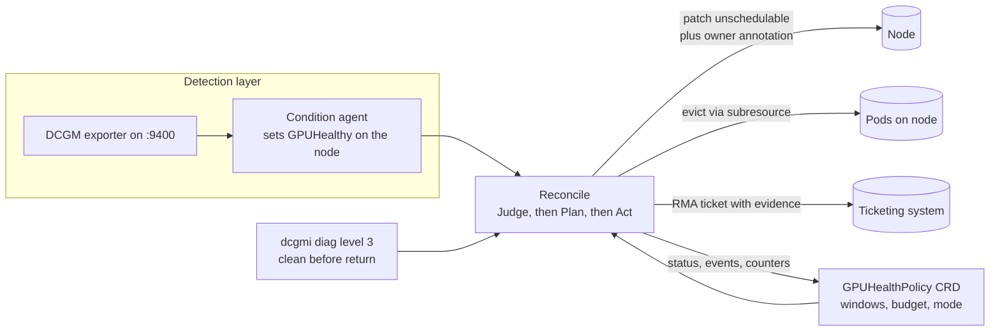
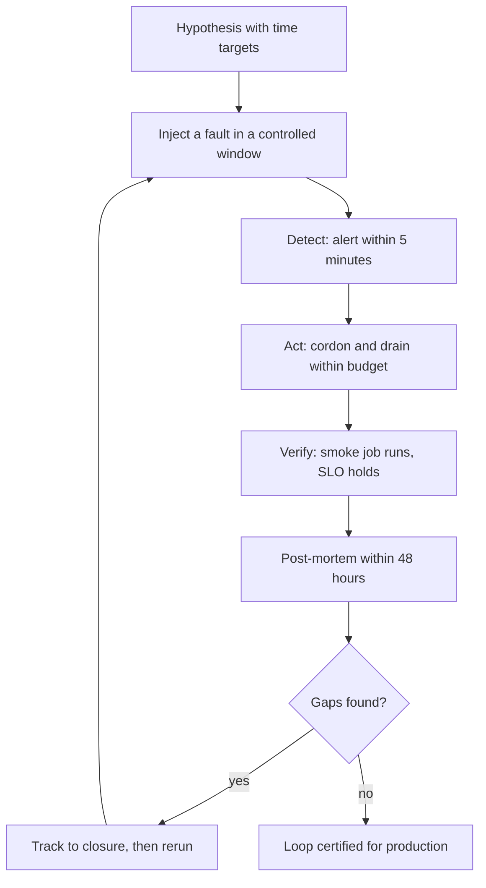

# 19.6 Capstone: node-health automation with DCGM and an operator

| Field | Value |
|---|---|
| Level | Advanced |
| Priority tier | 1 |
| Lab venue | GCP / GKE |
| Part | Part 19: Capstones, design and interview readiness |
| Primary sources | nvidia-devops Zero-to-Hero Volume 24 Project 5 (troubleshooting incident response); Volume 16 (GPU observability: signals, DCGM, Prometheus and Grafana, failure modes, SLOs, incident response); Volume 20 (troubleshooting encyclopedia: Xid, NVLink, ECC, thermal, PCIe, power, clocks, stragglers); handbook Chapters 5.32, 10.21, 17.4, 17.6, 17.7, 19.1 |
| Cross-references | Chapter 5.32 (GPU node health operator); Chapter 10.21 (GPU health: DCGM, ECC, row remapping, Xid); Chapter 17.4 (DCGM exporter); Chapter 17.6 (alerting, SLOs, health checks); Chapter 17.7 (failure modes); Chapter 17.11 (incident response); Chapter 19.1 (Slurm health-check loop) |
| Coverage file | `planning/coverage/chapters/19-06.md` |
| Claim & number ledger | `planning/ledgers/19-06.md` |

## Why this matters for AI infrastructure

It is 3 a.m. A training job on a 32-GPU pool keeps dying and relaunching, and the on-call engineer finally notices that the pod keeps landing on the same node, `gpu-node-03`. That node's GPU 2 has been raising Xid 92 for two days, and its single-bit ECC count climbs a little every night. Nothing drained the node. Nothing paged anyone. The scheduler kept sending work to a degrading GPU, and the failure was attributed to the workload team instead of the hardware. Every individual check in the stack was green: the exporter was up, Prometheus was scraping, the dashboard looked healthy. What was missing was the loop between the signal and the action.

Every piece of that loop has its own chapter. The DCGM exporter and its metrics are in 17.4, the interpretation of GPU health signals is in 10.21, the alert routing and the SLOs are in 17.6, the failure-mode catalogue is in 17.7, and the incident-response roles are in 17.11. A team that has read all of them can describe each piece in isolation. The capstone exists to answer the harder question, which is what holds the loop together when the hardware fails at 3 a.m. and nobody is watching.

The answer is five integration surfaces. One is the signal set: the DCGM fields that have to reach Prometheus at a cadence where a trend is visible before a failure. The second is the alert design: thresholds and tiers that separate a page-worthy Xid 79 from a track-worthy Xid 63, and that refuse to page on noise. The third is the safety model, the explicit decision about which events a machine is allowed to remediate by itself and which it must hand to a human, including the budget that caps how much damage an automated decision can do. The fourth is the operator: a controller that turns a node condition into a cordon, a drain, and an RMA ticket, and only uncordons what it cordoned itself. The fifth is the game day: a fault injected on purpose, in a controlled window, that proves the loop works before the first real 3 a.m. arrives.

The capstone is also the interview anchor. When an interviewer asks how you would automate node health on a GPU cluster, the answer is not a list of tools. It is this integrated picture, told in the order a real build proceeds, with the safety rules stated out loud, because the safety rules are where the senior and junior answers diverge.

## Prerequisites and outcomes

### Prerequisites

- Chapter 10.21 for GPU health: the DCGM fields, ECC, row remapping, and the Xid catalogue.
- Chapter 17.4 for the DCGM exporter build and for reading the metrics it exposes.
- Chapter 17.6 for alerting, SLOs, error budgets, and the health-check loop.
- Chapter 5.32 for the GPU node health operator: the condition, the policy, the budget.
- Chapter 19.1 for the Slurm-side health-check loop, if the fleet runs Slurm instead of Kubernetes.

### Outcomes

After completing this capstone you will be able to:

1. Deploy and verify the DCGM signal set: the exporter, the collector, the GPU-count check, and the monitor-the-monitor alerts.
2. Write tiered alert rules with real thresholds for Xid events, ECC, row remapping, NVLink, thermal, power, clocks, and stragglers.
3. State the auto-remediation safety model: which events may be drained automatically, which need a human, and why the boundary sits where it does.
4. Operate the node-health operator: the policy CRD, cordon and drain within a budget, RMA ticketing, and the return-to-service gate.
5. Work the Xid runbooks for the codes that actually fire: the tiers, the evidence bundle, and the verification before anything returns to the pool.
6. Run a game day that injects a fault and proves the loop end to end, and write the postmortem that the game day produces.

---

## 1. The signal set: what the exporter must expose

### The GPU that looked healthy for two weeks

A GPU in a 32-GPU pool looked healthy for two weeks, and the snapshots agreed. `nvidia-smi` on the node showed a stable temperature, a full memory map, and no errors that day. Then a training job produced corrupt output overnight, and the post-mortem found that the single-bit ECC count had roughly tripled each day for ten straight days. Nobody saw it, because the team checked GPUs in snapshots and watched them in nothing. A snapshot tells you what a GPU did last night. A stream tells you what it is becoming, and node-health automation lives or dies on that difference.

### DCGM is the sensor layer

DCGM, the Data Center GPU Manager, is the bridge between the GPU hardware and the monitoring stack. It is a library plus an optional daemon that reads GPU state through the driver: temperature, power, clocks, memory, ECC counters, link state, and the profiling fields that a bare `nvidia-smi` never shows. On a single node you can read DCGM from the `dcgmi` command line, but a cluster does not get 1,000 engineers SSHing in every ten seconds. The production path is the DCGM exporter, a small process that watches a set of DCGM fields and serves them in Prometheus text format on port 9400. On Kubernetes the GPU operator deploys the exporter for you as a DaemonSet on every GPU node, and the exporter maps each metric to the GPU and, with the Kubernetes flag, to the pod that owns it.

Two design facts about DCGM matter for the signal set. First, a field has a collection cadence, and the cadence is a cost knob: more fields, shorter intervals, and longer retention all raise the load on the host engine, so the interval should be chosen by how quickly an operator can act on the value, not by the fastest number the driver accepts. The exporter default is a 30-second collection interval. Second, Xid and clock-event fields report counts over a configurable window, which defaults to 300,000 milliseconds, or five minutes. A short event between scrapes is not lost, but it is only visible inside that window, so the window is part of the alert design, not a detail.

### The signal groups

The capstone signal set is organised into six groups, because the groups map to the questions the on-call engineer asks. The table below is the complete set this capstone ships, with the alert policy for each group. Chapter 10.21 covers how to read each field in isolation; here the question is which fields have to be present for the loop to work at all.

| Group | Field | What it tells you | Alert policy in this capstone |
|---|---|---|---|
| Execution | `DCGM_FI_DEV_GPU_UTIL` | Fraction of time at least one SM is busy | Trend only; never alert on a level |
| Execution | `DCGM_FI_DEV_CLOCK_THROTTLE_REASONS` | Why the clocks are being reduced | Sustained throttling is a warning page |
| Memory | `DCGM_FI_DEV_FB_USED` / `DCGM_FI_DEV_FB_FREE` | HBM in use and free | Pressure alert above 95 percent for 10 minutes |
| Memory | `DCGM_FI_PROF_DRAM_ACTIVE` | Fraction of peak memory bandwidth | Interpret with utilisation; no standalone alert |
| Thermal | `DCGM_FI_DEV_GPU_TEMP` | Die temperature | Alert above 82 °C for 5 minutes; the throttle threshold is model-specific, about 85 °C |
| Thermal | `DCGM_FI_DEV_THERMAL_VIOLATION` | Thermal throttle events | Any increase within the hour is a warning |
| Power | `DCGM_FI_DEV_POWER_USAGE` | Instantaneous draw in watts | Compare against the power limit; a dropped cap is a power event |
| Reliability | `DCGM_FI_DEV_ECC_SBE_VOL_TOTAL` | Corrected single-bit errors | Track the rate; alert above 100 per hour |
| Reliability | `DCGM_FI_DEV_ECC_DBE_VOL_TOTAL` | Uncorrectable double-bit errors | Any value above zero pages immediately |
| Reliability | `DCGM_FI_DEV_ROW_REMAP_FAILURE` | The row remapper failed | Equals 1 pages immediately |
| Events | `DCGM_FI_DEV_XID_ERRORS` | Most recent Xid code per GPU | Tiers drive severity; Section 2 |
| Interconnect | `DCGM_FI_DEV_NVLINK_CRC_FLIT_ERROR_COUNT_TOTAL` | NVLink CRC error count | Alert above 1000 in 6 hours |
| Interconnect | Per-link NVLink status | Each link up or down | A down link pages |

One caution before you copy these names into a rules file: the DCGM field identifiers have been re-named with explicit units in recent releases, and the exporter keeps legacy names in its default collector file while the canonical fields move underneath. Verify the metric names, units, and ranges on your exporter version before you write a threshold, and prefer the canonical names in any collector file you maintain.

### Monitoring the monitor

The signal set is not finished until it includes the exporter itself. If the exporter or its host engine stops, you lose GPU visibility with no GPU symptom at all, and the fleet looks healthy precisely because it is silent. Three alerts cover this. The first is the standard Prometheus liveness check on the exporter target, using the `up` metric. The second is sample freshness: a series that stops updating while the target still answers is a stream that died, and it deserves its own alert. The third is the GPU-count check, and it is the one people miss. When a GPU detaches from the PCIe bus, DCGM removes it from its groups and drops its watches, so a missing GPU produces no data instead of an error, and the node looks like a quiet, healthy one. Counting the utilisation series per node against the expected fleet size, 8 in this capstone, catches the missing GPU the same minute the exporter would have stayed silent about it.

**Decision rule:** the signal set is complete only when it exposes execution, memory, thermal, power, reliability, and interconnect, plus the exporter's own liveness and the GPU count, because a blind spot in any one of the seven is a node that fails without a page.

**In one minute:** DCGM reads fields from the driver, and the exporter serves them at port 9400 every 30 seconds by default. The capstone signal set is the table above: six groups plus the monitor-the-monitor alerts, including the GPU-count check that catches a detached GPU. Xid and clock-event counts use a five-minute reporting window, so short events stay visible for that long. The field names move between DCGM releases, so verify units on your exporter before you set a threshold.

---

## 2. Alert design: tiers, thresholds, and the SLO tie

### The pager that learned to ignore everything

An early cluster paged on every Xid, and the on-call engineer learned within a week exactly which page to ignore: the Xid 45 cleanups, the Xid 63 row-remap events, the Xid 92 blips. The same cluster then missed the one page that mattered, because the Xid 79 rule carried a half-hour `for:` clause and the engineer who finally got paged had already lost the trust that the week of noise bought. Threshold tuning is not the act of choosing better numbers. It is the act of deciding which failures the machine may handle alone and which it must escalate, and that decision is a tier model, not a threshold list.

### The three tiers decide the severity

The Xid catalogue classifies driver errors into three tiers, and the alert rules inherit the classification directly. Tier 1 codes are informational or self-healing, the set 45, 63, and 92: the GPU keeps running, a single occurrence gets logged, and nobody pages at 3 a.m. for one. Tier 2 codes are process-recoverable, the set 13, 31, 32, 43, and 94: likely an application bug, and the escalation trigger is the same GPU repeating the same code across different, unrelated applications. Tier 3 codes are GPU-level failures, the set 48, 61, 62, 64, 79, and 95: these do not self-heal, and the cost of a missed one is far higher than the cost of a false-positive drain. The rule that follows is the reason for tiers at all: a Tier 3 alert fires with `for: 0m`, with no waiting for a second occurrence, because waiting is how a dead GPU keeps taking work.

The alert rule file for the capstone looks like this. The thresholds are the ones the sources use, and each one is either a tier boundary, a rate, or a liveness check.

```yaml
# code/part19/node_health_alerts.yaml
groups:
  - name: gpu_xid_tier3
    rules:
      - alert: XidTier3
        expr: DCGM_FI_DEV_XID_ERRORS == 48 or DCGM_FI_DEV_XID_ERRORS == 61
              or DCGM_FI_DEV_XID_ERRORS == 62 or DCGM_FI_DEV_XID_ERRORS == 64
              or DCGM_FI_DEV_XID_ERRORS == 79 or DCGM_FI_DEV_XID_ERRORS == 95
        for: 0m
        labels:
          severity: critical
        annotations:
          summary: "GPU {{ $labels.gpu }} on {{ $labels.node }} raised a Tier 3 Xid"
          runbook: "https://runbooks.example.com/xid-tier3"

  - name: gpu_reliability
    rules:
      - alert: GpuDoubleBitEcc
        expr: DCGM_FI_DEV_ECC_DBE_VOL_TOTAL > 0
        for: 0m
        labels:
          severity: critical
        annotations:
          summary: "Uncorrectable ECC on GPU {{ $labels.gpu }}; flag the affected job output"
          runbook: "https://runbooks.example.com/xid-tier3"

      - alert: RowRemapperFailure
        expr: DCGM_FI_DEV_ROW_REMAP_FAILURE == 1
        for: 0m
        labels:
          severity: critical
        annotations:
          summary: "Row remapper failed on GPU {{ $labels.gpu }}; the self-heal mechanism is gone"
          runbook: "https://runbooks.example.com/xid-tier3"

      - alert: EccSingleBitRate
        expr: increase(DCGM_FI_DEV_ECC_SBE_VOL_TOTAL[1h]) > 100
        for: 10m
        labels:
          severity: warning
        annotations:
          summary: "Correctable ECC rate above 100/hour on GPU {{ $labels.gpu }}"

      - alert: NvlinkErrorRateRising
        expr: increase(DCGM_FI_DEV_NVLINK_CRC_FLIT_ERROR_COUNT_TOTAL[6h]) > 1000
        for: 30m
        labels:
          severity: warning
        annotations:
          summary: "NVLink CRC errors rising on GPU {{ $labels.gpu }}; check the topology and Xid 74"

      - alert: ThermalThrottling
        expr: increase(DCGM_FI_DEV_THERMAL_VIOLATION[1h]) > 0
        for: 5m
        labels:
          severity: warning
        annotations:
          summary: "GPU {{ $labels.gpu }} is thermally throttled; check cooling before the next hour"

  - name: gpu_availability
    rules:
      - alert: GpuExporterDown
        expr: up{job="dcgm-exporter"} == 0
        for: 5m
        labels:
          severity: critical
        annotations:
          summary: "DCGM exporter on {{ $labels.instance }} is not answering; no signal is not a fault"

      - alert: GpuCountMismatch
        expr: count by (node) (DCGM_FI_DEV_GPU_UTIL) < 8
        for: 10m
        labels:
          severity: critical
        annotations:
          summary: "Node {{ $labels.node }} reports fewer than 8 GPUs; a detached GPU looks quiet"

      - alert: GpuMemoryPressure
        expr: DCGM_FI_DEV_FB_USED / DCGM_FI_DEV_FB_TOTAL > 0.95
        for: 10m
        labels:
          severity: warning
        annotations:
          summary: "GPU {{ $labels.gpu }} above 95 percent memory; allocation stall or OOM risk"
```

Two design notes belong to this file. First, the Tier 1 codes are not in the rules at all, on purpose: the exporter's Xid field holds only the most recent code per GPU, so per-code counting comes from the kernel log or an event stream, and the Tier 1 discipline is a rate trend reviewed weekly, not a real-time alert. Second, the `runbook` annotation is load-bearing: the page in the on-call's phone should link to the exact runbook that owns the alert, so the 3 a.m. engineer reads steps instead of recalling them.

### What not to alert on

The alert set is defined as much by its absences as by its rules. Do not alert on utilisation below 50 percent, because a GPU at 40 percent may be in a communication phase or deliberately load-balanced, and the alert would fire on healthy clusters daily. Do not alert on absolute temperature alone, because data-center GPUs are spec'd to run at 80 to 85 degrees continuously; the signal is the throttle event, or a temperature rising faster than 2 degrees per minute, which is the leading indicator of a cooling failure before the absolute threshold is reached. Do not alert on clocks below the model maximum, because clocks vary naturally between idle, load, and throttle states, and the alert fires constantly. The rule is to alert on events, rates, and combinations, never on a single level that healthy hardware crosses all day.

### Tying the alerts to the SLO

An alert without an SLO behind it is a vote on which failure matters. The SLOs for this capstone come from the health-check and SLO material: 99 percent node availability, which is about 43 minutes of downtime per month; 98 percent GPU health, which means up to 2 of 100 GPUs may be failing at any time; and 99.5 percent job completion, which is one failure in 200 jobs. The error budget is the arithmetic: at 99 percent availability over 730 hours a month, the budget is 7.3 hours, and when the budget is spent, changes pause and reliability work takes the queue. The alert levels map onto SLO impact, not onto metric severity: advisory means watch it, warning means prepare to act, critical means the SLO is at risk and the runbook activates, and catastrophic means the SLO is already violated and the incident escalates. A cluster with more than 10 percent of its GPUs down is a critical incident by that mapping, whatever the individual metrics say.

The routing config is short, and it is the only place severity becomes a destination.

```yaml
# code/part19/alertmanager.yaml (routing excerpt; receivers hold real credentials
# in a Kubernetes Secret, never in this file)
route:
  receiver: node-health-default
  group_by: [alertname, node]
  routes:
    - matchers:
        - severity="critical"
      receiver: pagerduty-node-health
      repeat_interval: 1h
    - matchers:
        - severity="warning"
      receiver: slack-node-health
receivers:
  - name: pagerduty-node-health
    pagerduty_configs:
      - routing_key: <pagerduty-routing-key-from-secret>
  - name: slack-node-health
    slack_configs:
      - api_url: <slack-webhook-from-secret>
        channel: "#node-health"
```

**Decision rule:** classify the event into a tier before you write the rule; the tier decides the severity, the page, and the follow-up action, and the threshold only tunes the timing.

**In one minute:** Tier 3 Xids, double-bit ECC, and row-remap failure page with `for: 0m`, because waiting is how a dead GPU keeps taking work. Tier 1 codes are never real-time alerts; they are a weekly rate review. Non-Xid alerts cover the ECC rate, NVLink CRC errors, thermal throttle events, memory pressure, and the exporter's own liveness and GPU count. Alerts fire on events, rates, and SLO impact, never on utilisation levels or absolute temperature.

---

## 3. The safety model: what automation may do, and what needs a human

### The remediator that cordoned the fleet

A first-generation remediator watched an exporter health metric, and when a scrape backlog made the metric look stale, it concluded the fleet was unhealthy and cordoned every node it could reach. Nothing was running, because nothing could be scheduled. The fix was not a better threshold. It was a rule: a missing signal is not evidence of a fault, so the absence of a condition is treated as healthy, and a detector outage must never cordon the fleet. A second incident taught the other rule. A human had cordoned a node for maintenance and forgotten to uncordon it, and the quiet half-capacity pool survived for two weeks until a capacity review noticed. Cordon without an owner is a leak. Both incidents are why the safety model is a first-class design surface in this capstone, not a feature the operator happens to have.

### Separating detection from action

The model draws a hard line between the two halves of the loop. Something else publishes the node condition, a `GPUHealthy` status flag set by the exporter plus a small condition agent, by node-problem-detector, or by a vendor health agent. The operator never detects anything; it only reacts to the condition. That separation is what makes either side replaceable, and it is what keeps a bad detector from becoming a bad actor: the detector can be wrong, but it is the operator's rules, not the detector's, that decide how much the wrongness can cost.

The second half of the model classifies every event into an action class, because the question "may the machine act on this?" has a different answer for each class. The table below is the full classification for the capstone.

| Event class | Example | What the machine does | What the human owns |
|---|---|---|---|
| Unrecoverable hardware | Xid 79, 48, 95, 64 | Cordon and drain the node, file the RMA ticket | The RMA itself, and the review of any job output from the affected window |
| Self-healing signal | Xid 63, 92, 45 | Nothing; track the rate | Preventive maintenance if the rate grows 3x week over week |
| Process-recoverable | Xid 13, 31, 32, 43, 94 | Nothing; the pod restart policy already handles it | Escalate to hardware if the same GPU repeats the code across different applications |
| Thermal or power degradation | Sustained throttling, a dropped power cap | Optional load reduction, never a drain | The facilities ticket, the cooling check, the power analysis |
| Interconnect degradation | NVLink CRC rising, a link down | Label the node and keep mesh-critical jobs off it | The hardware ticket, with the asymmetric link evidence |
| Workload symptom | Straggler GPU, data starvation | Nothing | The workload team investigates the code and the data path |
| Detection blind spot | Exporter down, condition missing | Page the on-call; do not cordon anything | Restore detection before the fleet is trusted again |

The logic behind the boundary is asymmetric, and it is the whole model in one sentence. Draining a node is strictly safe in both directions: a healthy node loses only capacity, and a bad node loses the work it would have corrupted, so an automatic drain has no downside except cost. Uncordoning a node is not strictly safe: the action can send work back onto a dying GPU, and the machine that makes that mistake at scale poisons every subsequent job. So the return-to-service path carries a gate, the diagnostic from Section 4, instead of a timer.

### The windows and the budget

Three parameters keep the safe actions from becoming a thrash or a meltdown. The stabilisation window, `unhealthyFor`, defaults to 2 minutes: a condition must stay false that long before any action, so a blip does not drain a node. The recovery window, `healthyFor`, defaults to 5 minutes: a condition must stay true that long before the node returns, so a flapping condition does not flap the workloads with it. The budget, `maxUnavailableNodes`, caps the damage at an integer or a percentage of the matched nodes, 10 percent in this capstone, which on the 32-GPU pool is 3 nodes. Modes control how far the operator reaches: `Ignore` observes and reports, `Cordon` is the default, and `CordonAndDrain` requires a budget, a rule the CRD itself enforces so an unlimited drain cannot be expressed. A `dryRun` flag sits on top of all three modes, and it is where every rollout starts. Two ownership rules close the model. The operator records on each node it cordons, in an annotation, the policy name, the reason, and the time. And it uncordons only nodes it cordoned itself: a human's cordon is the human's to release, and an operator that releases foreign cordons has failed the incident, not the node.

**Decision rule:** an event is safe to remediate automatically only when the action is strictly safe, meaning the machine cannot harm a healthy node, and only when a missing signal is never read as evidence of a fault.

**In one minute:** the safety model separates detection from action and assigns every event class a machine action and a human owner. Unrecoverable hardware gets an automatic cordon, drain, and RMA ticket inside a budget; everything else is observed, tracked, or handed to a person. The three parameters that keep it honest are the 2-minute stabilisation window, the 5-minute recovery window, and the node budget, and the two ownership rules are that the operator records why it cordoned and releases only its own cordons.

---

## 4. The operator: condition, policy, cordon and drain, ticket

### The cordon nobody remembered

A node sat in `SchedulingDisabled` for two weeks, and the only record of why was a Slack message from a previous on-call shift. Every pod that should have landed there went to a costlier pool instead, and the capacity review was quietly wrong for a month. The cordon was a manual `kubectl cordon`, which is a one-shot command with no owner, no reason, and no release path, so someone had to remember it. The operator exists to make cordon a state with an owner, a reason, and a budget slot, and to make the drain, the ticket, and the return to service steps in the same reconcile loop instead of rituals in a runbook that nobody reads.

### The architecture



Detection sits outside the operator on purpose, and the condition on the node object is the only wire between the two halves. The policy is the declaration of intent: which nodes, which condition, which windows, which budget, which mode. The reconcile loop does the rest. The table under the diagram maps each element to what it is for.

| Element | What it is | What it gives the loop |
|---|---|---|
| Condition agent | Sets `GPUHealthy` from DCGM evidence | The signal the operator is allowed to trust |
| `GPUHealthPolicy` | Cluster-scoped CRD with selector, windows, budget, mode | The declared policy, validated at admission |
| Reconcile | Judge, Plan, Act on nodes the policy selects | Deterministic, testable decisions |
| Owner annotation | Policy name, reason, and time on each cordoned node | The ownership the safety model requires |
| Status and events | Matched, unhealthy, and cordoned counts; a `BudgetExhausted` condition | The visibility that replaces the Slack message |
| Diagnostic gate | `dcgmi diag -r 3` before any return to service | The proof a Tier 3 node earned its slot back |

The policy object for the training pool in this capstone is small enough to read in one screen, and every field maps to a rule from Section 3.

```yaml
# code/part19/gpu_health_policy.yaml
apiVersion: platform.example.com/v1alpha1
kind: GPUHealthPolicy
metadata:
  name: h100-training-pool
spec:
  nodeSelector:
    nvidia.com/gpu.present: "true"
  conditionType: GPUHealthy
  unhealthyFor: 2m
  healthyFor: 5m
  action: CordonAndDrain
  maxUnavailableNodes: 10%
  dryRun: false
```

A schema rule rejects a `CordonAndDrain` policy that carries no budget, so the unlimited-drain configuration is not just discouraged; it cannot be stored. The status subresource reports `matchedNodes`, `unhealthyNodes`, and `cordonedNodes`, and the `BudgetExhausted` condition tells you in one field that the operator wanted to act but was not allowed to.

### Cordon plus drain, versus taint plus evict

The operator has two ways to remove work from a node, and the choice is part of the design. The first is cordon plus drain: cordon sets the node `unschedulable`, which stops new scheduling but touches no running pod, and then the operator drains by evicting pods through the eviction subresource, which honours pod disruption budgets and gives each workload its grace period. That pair is the default path, because it is the one Kubernetes expects a node operator to use, and the PDB is what keeps a four-replica inference service above its replica floor while the node is emptied. The second is the taint path: attach a taint with the `NoExecute` effect and let the kubelet do the eviction itself. The taint is the right choice when the node is being replaced or retired rather than repaired, when the operator lacks eviction permissions, or when you want the reason to surface in every pod event for the life of the node. A `NoSchedule` taint is the cordon alternative: it survives node-object recreation in ways a bare cordon does not, and it carries a human-readable reason. The Slurm side of the fleet makes the same decision in its own vocabulary, and Chapter 19.1 shows the health script turning the node into `State=DRAIN` with a reason of its own, which is the same discipline, the decision made in one place and the actuation left to the scheduler.

### RMA ticketing: the drain without the paper trail is not a remediation

When the condition is caused by a Tier 3 event, the operator files the RMA ticket as part of the same reconcile pass, not as a follow-up someone schedules. The ticket carries the node name, the GPU UUID, the Xid code, and the evidence bundle: the output of `nvidia-bug-report.sh`, the 30-day Xid history from the kernel journal, the ECC and row-remap counters, and the result of a level-3 diagnostic run. The ticket number is written back onto the node annotation and into the policy status, so the cordon, the ticket, and the node are one record instead of three artefacts in three systems. The return-to-service gate reads that record: a node with an open ticket does not uncordon, no matter how green the condition looks, because the ticket is the statement that hardware has not been ruled out. A level-3 `dcgmi diag` takes about 15 minutes and stresses the memory, the tensor cores, the PCIe path, the power delivery, and the cooling; a `Hardware` stage failure at that level is a hard stop that sends the GPU straight to replacement instead of back to the pool.

**Decision rule:** give every cordon an owner annotation, a reason, and a budget slot, and gate the uncordon behind the diagnostic result and a closed ticket rather than a timer.

**In one minute:** the operator watches the `GPUHealthy` condition and the policy, judges the condition against the windows, plans within the budget, and acts with a cordon plus a drain through the eviction subresource, or with a `NoExecute` taint when the node is being replaced. Tier 3 events file an RMA ticket with the full evidence bundle in the same pass. A node returns only after its recovery window, a closed ticket, and a clean level-3 diagnostic.

---

## 5. The Xid runbooks: the codes that actually fire

### Three lines in six seconds

`dmesg` on one node shows three lines in six seconds: Xid 92, then Xid 45, then Xid 79. The engineer who got paged that morning for the 92 had treated it as noise and gone home. In hindsight the 92 and the 45 were early warning, not noise: the rising single-bit ECC rate was the precursor to the bus failure, and the 45 was the driver cleaning up after the errors that came before it. The runbook exists so that the next engineer, at the next 3 a.m., knows that a Tier 1 code is a trend rather than an event, and that the Tier 3 code gets a drain and an evidence bundle instead of a guess and a reboot that destroys the logs.

### The reference table

Every Xid diagnosis in this chapter starts at the same table. The code is what matters for triage, because the free-text message varies by driver version and should never be pattern-matched on its own. The rows below are the codes the capstone's alerts and runbooks handle, grouped by the tier that decides the severity.

| Xid | Meaning | Tier | First action |
|---|---|---|---|
| 13 | Graphics engine exception | 2 | Restart the process; check the application code |
| 31 | GPU memory page fault | 2 | Restart the process; suspect hardware only if it recurs |
| 32 | Invalid or corrupted push buffer stream | 2 | Restart; escalate if paired with PCIe errors |
| 43 | GPU stopped processing | 2 | Reset and look for the Xid that preceded it |
| 45 | Preemptive cleanup after earlier errors | 1 | Read what came before it in `dmesg`; it is a symptom |
| 48 | Double-bit ECC error, uncorrectable | 3 | Drain immediately; flag the affected job output |
| 61 | Internal micro-controller breakpoint | 3 | Drain; treat as a hardware issue |
| 62 | Internal micro-controller halt | 3 | Drain; treat as a hardware issue |
| 63 | Page retirement or row-remap recording event | 1 | Log it; track the frequency |
| 64 | Page retirement or row-remap failure | 3 | Drain; the self-healing mechanism failed |
| 74 | NVLink error | special | The NVLink path below, not the generic tiers |
| 79 | GPU fallen off the bus | 3 | Drain; attempt a PCIe rescan; RMA if it does not come back |
| 92 | High single-bit ECC error rate | 1 | Track the trend; it is a precursor signal |
| 94 | Contained ECC error, one application | 2 | Restart the affected application; track recurrence |
| 95 | Uncontained ECC error | 3 | Drain immediately; flag the affected job output |

Reading the log under pressure follows one habit: classify the code into a tier before doing anything else, then read the sequence oldest-first, because the Xid that looks like the root cause is usually the one after the real one.

### The Tier 3 runbook

The Tier 3 runbook is the one the automation executes, and the one the human reads when the automation is not allowed to act.

1. Confirm the tier and stop scheduling on the node. In Kubernetes that is `kubectl cordon` followed by `kubectl drain --ignore-daemonsets` with a grace period; in Slurm it is `scontrol update NodeName=<node> State=DRAIN Reason="Xid <code>"`. The operator does both steps when the policy allows it.
2. Capture the evidence before touching the hardware: the Xid history from `dmesg -T`, the PCIe enumeration from `lspci`, the ECC and row-remap counters from `nvidia-smi -q`, and the full `nvidia-bug-report.sh` bundle. A reset before the capture is the classic way to lose the diagnosis.
3. For Xid 79 only, attempt a PCIe rescan: remove the device from the bus, wait a few seconds, rescan, and reload the driver if the GPU re-enumerates. If the GPU comes back, it still does not return to service; it goes through the level-3 diagnostic first. If it does not re-enumerate, the path is the hardware replacement and there is no further software step.
4. For Xid 48 or 95, do not treat a reset as a fix. An uncorrectable or uncontained memory error means data integrity was not guaranteed for whatever was in that memory region, and the jobs that ran in the affected window produced output that may be silently corrupt. Those outputs get flagged for review or re-run, and the post-mortem records which jobs were in scope.
5. No Tier 3 GPU returns to the pool without a clean `dcgmi diag -r 3`, which is the 15-minute stress run over memory, compute, PCIe, power, and thermals. A `Hardware` stage failure is a hard stop to replacement, regardless of how healthy the node looks now.

### The Tier 2 and Tier 1 runbooks

The Tier 2 runbook is short because the failure is usually the application. Restart the affected process; on Kubernetes the pod restart policy usually does this for you. Watch the restart count: one restart and then stability is an application bug, while repeated restarts on the same GPU is the hardware signature. The escalation trigger is the pattern, not the count: the same GPU raising the same code across different, unrelated applications overrides the default classification and moves the GPU to the Tier 3 path with a proactive diagnostic.

The Tier 1 runbook has no immediate action, and that is the discipline. Pull the rate trend over the trailing week, grouped by GPU and code. A single occurrence is logged and closed. A rate that grows 3x week over week, with no corresponding workload change, escalates to the preventive-maintenance track: schedule the replacement before the Tier 3 event forces an unplanned outage. The three-line `dmesg` sequence from the opening of this section is what that discipline exists for: the 92 that was tracked would have scheduled the maintenance two days before the 79.

### The Xid 74 path: NVLink faults

Xid 74 is the driver's confirmation of a fatal NVLink error, and it is outside the GPU-internal tiers because the diagnostic path is different. The first step is the topology matrix, `nvidia-smi topo -m`: a pair that should show `NV#` links but shows `PIX` instead is communicating over PCIe, an order of magnitude slower, and that finding explains a job that is ten times slower without crashing. The second step is to rule out the configuration explanation, because MIG mode deliberately disables peer-to-peer NVLink between instances on the same physical GPU, and the same matrix looks like a missing link when nothing has failed. The third step is the per-link error counters, `dcgmi nvlink -e`: a link that accumulated a large count of CRC and replay errors before going down tells a different story than one that simply disappeared, and comparing both GPUs on a shared link isolates the fault. One GPU with 184,000 CRC errors on a link while its neighbour's corresponding link shows zero is a ticket that says exactly which transceiver to replace, instead of a ticket that says a link is down. The resolution order is a GPU reset first, then the drain, then the hardware escalation with the asymmetric evidence, and until the hardware is fixed the node carries a label that keeps mesh-critical jobs off it.

### The scenarios that are not Xids

The runbook set covers the failure catalogue from the troubleshooting encyclopedia, because several of the failures that reach this loop never produce a Xid at all. Thermal: temperature at the slowdown threshold, a fan at zero percent, or a rise faster than 2 degrees per minute, and the post-mortem rule is to alert on the rate of rise rather than the absolute value, because cooling failures show up as rapid temperature increase before the threshold. Power and clocks: draw oscillating or a power cap that dropped, clocks oscillating or stuck low with thermal headroom to spare, and the first check is the throttle-reasons field before any hardware suspicion. The straggler: one GPU at half the utilisation of its peers, and the test is to move the workload to another GPU and watch whether the problem moves with the workload or stays with the code. Memory fragmentation: allocation latency in seconds with reserved memory far above allocated, which a restart clears and a smaller batch size prevents. Each of these flows into the same loop: the alert names the class, the class names the runbook, and the runbook names the owner.

**Decision rule:** the runbook starts from the tier, not the symptom, and no Tier 3 GPU returns to the pool without a clean level-3 diagnostic, no matter how healthy it appears.

**In one minute:** classify the Xid, then run the tier's runbook. Tier 3 drains first, captures evidence before any reset, and returns only after `dcgmi diag -r 3`, with affected job output flagged for 48 and 95. Tier 2 restarts the process and watches for the same code repeating across different applications. Tier 1 tracks the rate, and a 3x week-over-week growth becomes preventive maintenance. Xid 74 goes through the topology matrix, the MIG check, and the per-link counters before hardware escalation.

---

## 6. The game day: proving the loop end to end

### The automation that met a real failure for the first time

A team spent a quarter building the node-health automation and never ran it against a real fault. The first real incident was also the first time the PagerDuty routing key had been rotated, the first time a drain hit a pod disruption budget it had never met, and the first time the runbook link pointed at a retired channel. The incident took four hours instead of twenty minutes, not because the design was wrong, but because the loop had never been exercised. The game day is the fix: inject the fault on a Tuesday, in a controlled window, and find the gaps before the 3 a.m. does.

### The hypothesis, with time targets

A game day is a hypothesis with a clock, taken from the success criteria of the incident-response capstone. The capstone's hypothesis is: a fault on one GPU of the training pool is detected within 5 minutes, the operator begins the cordon within 2 minutes of the condition, the node is drained within the budget with no job lost beyond its checkpoint interval, a smoke job completes on healthy nodes while the SLO holds, and a written post-mortem exists within 48 hours. Each clause is a checkable statement, and the game day records the actual number next to each target.



### The injection plan, safest first

The game day runs the loop at increasing levels of realism, and the safe paths come before the dangerous ones. First, the exporter-down path: stop the exporter on one node and confirm that the liveness alert and the GPU-count alert fire, and that the operator does not cordon anything, because this path tests the rule that a missing signal is not evidence of a fault. Second, the condition path: set `GPUHealthy` to false with the test condition agent and confirm the cordon and the drain within the windows, the ownership annotation on the node, and the eviction respecting the disruption budget. Third, the ownership path: cordon a node by hand and confirm that the operator never uncordons it, because releasing a foreign cordon is the failure the annotation exists to prevent. Fourth, the budget path: set `maxUnavailableNodes` to 1 and make three nodes unhealthy; exactly one should be cordoned and the other two should surface as the `BudgetExhausted` condition instead of acting. Fifth, the real Xid path, which runs on bare metal only, on a spare node: unload the driver or remove the GPU, capture the full `dmesg`, and walk the Tier 3 runbook by hand. This step is never performed on a production node, and the chapter marks it as the one injection this repository has not executed.

### What to record, and how gaps get named

The record for each injected fault is a table with one row per hypothesis clause: the time from fault to alert, the time from alert to cordon, which pods were evicted, which ticket was filed, and what the runbook said versus what actually happened. The gaps get a fixed vocabulary so the post-mortem stays honest. A detection gap means no alert fired at all. A routing gap means the alert fired but nobody was paged. An action gap means the operator did not act, or acted beyond its budget. A recovery gap means the node did not return when it should have. A runbook gap means the steps were wrong, stale, or missing an expected output. Each gap is the next quarter's runbook work, found on a Tuesday afternoon instead of at 3 a.m., and each one gets an owner and a deadline in the post-mortem, which follows the template from the incident-response material: timeline, root cause, contributing factors, what went well, what did not, and the action items with owners.

The same structure is the interview framing. An interviewer presents a wall of `dmesg` output, `nvidia-smi` snapshots, and NCCL logs and asks why the cluster is ten times slower, with 15 minutes on the clock. The answer that passes is not a guess; it is the structured path: start broad and identify the domain, compute versus memory versus network, narrow to the component, and drill to the specific failure, with each step naming the command that would confirm it. The game day is the rehearsal for exactly that question, with the difference that in the rehearsal the clock is measured instead of assumed.

**Decision rule:** the automation is not production-ready until a game day has proven detection, action, budget, and recovery on injected faults, and every gap it found is tracked to closure with an owner.

**In one minute:** a game day is a hypothesis with time targets, and the capstone's targets are 5 minutes to detect, 2 minutes to begin the cordon, a drain inside the budget, a smoke job on healthy nodes, and a post-mortem within 48 hours. The injection plan runs the exporter-down, condition, ownership, and budget paths before the real Xid, which is bare-metal only. Gaps use a fixed vocabulary, detection, routing, action, recovery, runbook, and each becomes an owned action item.

---

## 7. Hands-on lab: the smallest game day on GKE

### The loop that was never pressed

This lab is the smallest version of the game day, and it exists because a loop that has never been pressed is a loop that has not been built. You will verify the signal set, deploy the alerts, install the operator in the safest modes, inject the safe faults, exercise the budget, and watch the recovery, all on a GKE cluster with a GPU node pool. The lab is **untested** in this repository, and the expected outputs below are what the loop should show, not what any particular run produced.

### 7.1 Prerequisites

- A GKE cluster with a GPU node pool of 4 nodes, 8 GPUs each, 32 GPUs in total.
- The GPU Operator with the DCGM exporter deployed on the node pool.
- Prometheus and Alertmanager in the `monitoring` namespace, scraping the exporter.
- The `GPUHealthPolicy` CRD and the operator from Chapter 5.32, plus the test condition agent from that chapter's lab code.
- `kubectl` with cluster-admin for the lab, because the operator itself runs on a least-privilege role.

### 7.2 Step 1: verify the signal set

```bash
# Find one exporter pod and pull its metrics
kubectl -n gpu-operator get pods -l app=dcgm-exporter
kubectl -n gpu-operator port-forward pod/dcgm-exporter-<node> 9400:9400 &
curl -s localhost:9400/metrics | grep -c DCGM_FI_DEV
# expected: hundreds of DCGM_FI_DEV_* series, one set per GPU

# Confirm the GPU count from Prometheus
# count by (node) (DCGM_FI_DEV_GPU_UTIL)
# expected: every node reports 8
```

### 7.3 Step 2: deploy the alert rules

```bash
kubectl -n monitoring create configmap node-health-alerts \
    --from-file=node_health_alerts.yaml
# add the configmap to Prometheus rule_files, then reload
curl -X POST http://prometheus.monitoring:9090/-/reload
# expected: the rules API lists the gpu_xid_tier3, gpu_reliability,
# and gpu_availability groups
```

### 7.4 Step 3: install the operator in the safe modes

```bash
kubectl apply -f gpu_health_policy.yaml   # start with dryRun: true, action: Cordon
kubectl get gpuhealthpolicy h100-training-pool -o yaml
# expected: status.matchedNodes is 4, cordonedNodes is empty,
# condition Ready is True
```

### 7.5 Step 4: inject the exporter-down fault

```bash
# Stop the exporter on one node, for example via its owning pod
kubectl -n gpu-operator delete pod dcgm-exporter-<node-03>
# expected within 5 minutes: GpuExporterDown and GpuCountMismatch fire
# for node-03, and the PagerDuty receiver receives the page
# expected: the operator cordons nothing, per the missing-signal rule
```

### 7.6 Step 5: exercise the condition path

```bash
# Set the condition false on one node with the test agent
kubectl -n gpu-operator apply -f condition_agent_false_node01.yaml
# expected within unhealthyFor: node01 is cordoned with the owner
# annotation, pods are evicted through the eviction subresource,
# and the policy status lists node01 in cordonedNodes
```

### 7.7 Step 6: exercise the budget

```bash
# Set maxUnavailableNodes to 1 and make two more nodes unhealthy
kubectl patch gpuhealthpolicy h100-training-pool \
    --type merge -p '{"spec":{"maxUnavailableNodes":1}}'
# expected: at most one additional node is cordoned; the other
# surfaces as the BudgetExhausted condition with a Warning event
```

### 7.8 Step 7: recover and verify ownership

```bash
# Set the condition true on the unhealthy nodes and wait healthyFor
kubectl -n gpu-operator apply -f condition_agent_true.yaml
kubectl cordon gpu-node-02   # a human cordon the operator must never release
# expected after the recovery window: operator-cordoned nodes are
# uncordoned; gpu-node-02 stays cordoned
```

### 7.9 What to record

After the lab, you should be able to answer five questions in five seconds each:

1. Which alerts fired during the game day, and how long did each take from fault to page?
2. Which nodes did the operator cordon, and which budget bound it?
3. Which node did the operator refuse to uncordon, and which rule made it refuse?
4. What was in the RMA evidence bundle for the injected Tier 3 path?
5. What gap did the runbook have, and what is the tracked action item?

If any of them takes longer than 30 seconds, the loop is not yet an operating service, and the section that owns the gap is where you start. The lab is **untested** against a live GKE cluster in this repository.

---

## Exercises

1. **Add the GPU-count alert to the exporter-down runbook.** Wire the `GpuCountMismatch` alert into the same runbook as `GpuExporterDown`, and state in the runbook why the two alerts must not trigger a cordon. *Solution sketch:* one runbook page, two alert entries, and a first step that says "restore detection first; a missing signal is not a fault," with the `up{job="dcgm-exporter"} == 0` and `count by (node) (DCGM_FI_DEV_GPU_UTIL) < 8` expressions in the header for identification.
2. **Express the Tier 2 watch as an operator policy.** Write a `GPUHealthPolicy` in `Ignore` mode that surfaces Tier 2 Xids as events on the node, and sketch the event message format that carries the GPU, the code, and the occurrence count. *Solution sketch:* policy with `action: Ignore` and `nodeSelector` matching the training pool, plus a condition-agent event of the form `Xid 94 on GPU 2, 2nd occurrence this week`, with the escalation rule stated in the event detail.
3. **Alert on a straggler and keep mesh-critical jobs off the node.** Add a rule that fires when the spread between the fastest and slowest GPU on a node exceeds 30 percent for 10 minutes, and the node label that the scheduler policy reads. *Solution sketch:* `max by (node) (DCGM_FI_DEV_GPU_UTIL) - min by (node) (DCGM_FI_DEV_GPU_UTIL) > 30` with `for: 10m`, severity warning, and the label `straggler-suspect="true"` applied by the operator's `Ignore` mode.
4. **Make the budget a CI check.** Write a test that fails the build when a policy with `action: CordonAndDrain` and no `maxUnavailableNodes` is accepted, and one that fails when the operator cordons more nodes than the budget allows. *Solution sketch:* the first is a `kubectl apply --dry-run=client` expecting the admission error about the missing budget; the second is an envtest-style scenario with three unhealthy nodes, budget 1, and an assertion on `status.cordonedNodes` length plus the `BudgetExhausted` condition.
5. **Extend the post-mortem template with a loop-gap section.** Add a section that maps each observed gap to a game-day hypothesis clause and to the component that owns it, with columns for gap type, evidence, owner, and deadline. *Solution sketch:* a table with one row per gap type from the fixed vocabulary, each row citing the time-target it missed, for example "action gap: cordon began 9 minutes after the condition, target 2, owner platform team."
6. **Bundle the RMA evidence into one script.** Write a script that runs on a cordoned node and collects the `nvidia-bug-report.sh` output, the 30-day Xid history, the ECC and row-remap counters, and the level-3 diagnostic result into a single archive for the ticket. *Solution sketch:* a bash script chaining `nvidia-bug-report.sh`, `journalctl -k --since "-30 days" | grep -i xid`, `nvidia-smi -i 0 -q -d ECC,PAGE_RETIREMENT,ROW_REMAPPER`, and `dcgmi diag -r 3 -i 0`, with each step appending to one log and the archive named by node and GPU UUID.

---
