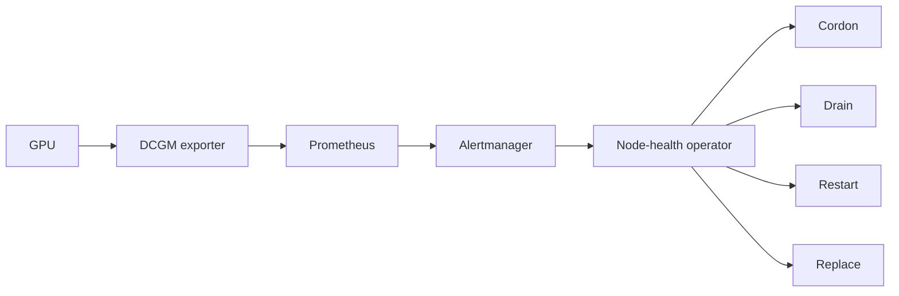

# 19.6 Capstone: node-health automation with DCGM and an operator

| Field | Value |
|---|---|
| Level | Advanced |
| Priority tier | 1 |
| Lab venue | GCP / GKE |
| Part | Part 19: Capstones, design and interview readiness |
| Primary sources | NVIDIA Zero-to-Hero Volume 24 (Node-health automation capstone); Part 10 (GPU and CUDA); Part 11 (GPU Kubernetes); Part 17 (Operations) |
| Cross-references | Chapter 10.21 (GPU health: DCGM); Chapter 11.16 (KAI gang scheduling); Chapter 17.11 (Incident response); Chapter 17.7 (Failure modes) |
| Coverage file | `planning/coverage/chapters/19-06.md` |
| Claim & number ledger | `planning/ledgers/19-06.md` |

## Why this matters for AI infrastructure

Node health is the foundation of cluster reliability. The capstone ties together DCGM metrics, GPU node-level health checks, automated remediation (drain, restart, replace), a Kubernetes operator that watches the metrics, and the incident response. A team that has run this capstone has a cluster that heals itself; a team that has not has a cluster that requires manual intervention.

The capstone is what makes the cluster production-ready. A cluster that requires manual intervention at 3 a.m. is a cluster that is not ready for production. A cluster that heals itself is a cluster that the on-call can trust.

```text
Why the node-health automation capstone matters (V24; Parts 10, 11, 17):
- A node-health automation capstone ties the DCGM exporter, the
  Prometheus alerts, the Kubernetes operator, and the remediation actions
  together. The capstone is what makes the cluster production-ready.
- The capstone has three perspectives: the platform engineer's view (how
  to deploy the DCGM exporter and the operator); the SRE's view (how to
  configure the alerts and the remediation); the on-call's view (how to
  debug the remediation).
- The capstone is the reference design. Every chapter in Parts 10, 11, and
  17 maps to a section of the capstone.
```

Three operational realities make this capstone a platform-team deliverable rather than a tutorial:

1. **The capstone is the reference design.** The platform team references the capstone when commissioning a new node pool; the platform team references the capstone when configuring the alerts.
2. **The capstone is the interview anchor.** The candidate is asked "how would you automate node health?"; the candidate points at this capstone.
3. **The capstone is the production-readiness gate.** A node that cannot heal itself is a node that is not ready for production.

**Before a team can claim their cluster is production-ready, the team must have run this capstone. A team that has not run the capstone has not automated the node health.**

## Prerequisites and outcomes

### Prerequisites

- Chapter 10.21 (GPU health: DCGM, ECC, Xid).
- Chapter 11 (GPU Kubernetes) for the GPU node setup.
- Chapter 17 (Operations) for monitoring and incident response.

### Outcomes

After completing this capstone you will be able to:

1. Deploy the DCGM exporter on every GPU node; verify the metrics are scraped.
2. Configure the node-health alerts: GPU down, ECC error spike, thermal throttling, clock throttling.
3. Deploy the node-health operator that watches the metrics and triggers remediation.
4. Configure the remediation actions: cordon, drain, restart, replace.
5. Build the incident response runbook for unhealthy nodes.
6. Operate the node-health automation with on-call runbooks and incident response.

---

## 1. The node-health stack

### 1.1 The architecture

The node-health stack is the layered architecture from the GPU node to the remediation. The stack has the DCGM exporter, the Prometheus alerts, the Kubernetes operator, and the remediation actions.



The pattern is: the DCGM exporter exposes the metrics; Prometheus evaluates the alerts; Alertmanager routes the alerts; the operator triggers the remediation; the remediation restores the cluster.

### 1.2 The DCGM exporter

The DCGM exporter runs as a DaemonSet on every GPU node. The exporter exposes the GPU metrics in the Prometheus exposition format.

```yaml
# code/part19/dcgm_exporter_daemonset.yaml (shape only)
apiVersion: apps/v1
kind: DaemonSet
metadata:
  name: dcgm-exporter
  namespace: monitoring
spec:
  selector:
    matchLabels:
      app: dcgm-exporter
  template:
    metadata:
      labels:
        app: dcgm-exporter
    spec:
      nodeSelector:
        nvidia.com/gpu: present
      tolerations:
        - key: nvidia.com/gpu
          operator: Exists
          effect: NoSchedule
      containers:
        - name: dcgm-exporter
          image: nvcr.io/nvidia/k8s/dcgm-exporter:3.3.5-3.1.5
          ports:
            - containerPort: 9400
          env:
            - name: DCGM_EXPORTER_LISTEN
              value: ":9400"
            - name: DCGM_EXPORTER_KUBERNETES
              value: "true"
```

The pattern is: the exporter is a DaemonSet; the exporter runs on every GPU node; the exporter exposes the metrics on port 9400.

---

## 2. The node-health alerts

### 2.1 The alert rules

The alert rules define what is unhealthy. The alert rules cover: GPU down, ECC error spike, thermal throttling, clock throttling, Xid errors.

```yaml
# code/part19/node_health_alerts.yaml (shape only)
groups:
  - name: gpu_health
    rules:
      - alert: GPUDown
        expr: DCGM_FI_DEV_GPU_UTIL == 0
        for: 5m
        labels:
          severity: critical
        annotations:
          summary: "GPU {{ $labels.gpu }} on {{ $labels.node }} is not responding"

      - alert: GPUSingleBitECCErrors
        expr: sum by (gpu, node) (rate(DCGM_FI_DEV_ECC_SBE_VOL_DEDUP[1h])) > 100
        for: 10m
        labels:
          severity: warning

      - alert: GPUDoubleBitECCErrors
        expr: sum by (gpu, node) (increase(DCGM_FI_DEV_ECC_DBE_VOL_DEDUP[1h])) > 0
        labels:
          severity: critical

      - alert: GPUXidError
        expr: DCGM_FI_DEV_XID_ERRORS > 0
        labels:
          severity: critical

      - alert: GPUThermalThrottle
        expr: DCGM_FI_DEV_GPU_TEMP > 85
        for: 10m
        labels:
          severity: warning
```

The pattern is: every alert has a detection signal; every alert has a severity; every alert pages the right team.

### 2.2 The alert routing

The alert routing is the Alertmanager configuration that routes the alerts to the right team.

```yaml
# code/part19/alert_routing.yaml (shape only)
route:
  receiver: 'node-health-oncall'
  group_by: ['alertname', 'gpu']
  routes:
    - matchers:
        - severity="critical"
      receiver: 'pagerduty-critical'
    - matchers:
        - severity="warning"
      receiver: 'slack-warnings'

receivers:
  - name: 'pagerduty-critical'
    pagerduty_configs:
      - service_key: '<pagerduty-key>'
  - name: 'slack-warnings'
    slack_configs:
      - api_url: '<slack-webhook>'
        channel: '#node-health'
```

The pattern is: critical alerts go to PagerDuty; warning alerts go to Slack.

---

## 3. The node-health operator

### 3.1 The operator pattern

The node-health operator watches the Prometheus alerts and triggers the remediation. The operator uses the controller-runtime pattern; the operator is deployed as a Kubernetes Deployment.

```python
# code/part19/node_health_operator.py (shape only)
from kubernetes import client, config, watch
import requests

def reconcile_node_health(alert: dict):
    """Reconcile the node-health alert by triggering remediation."""
    node = alert["labels"]["node"]
    gpu = alert["labels"]["gpu"]
    severity = alert["labels"]["severity"]
    
    if severity == "critical":
        if alert["labels"]["alertname"] == "GPUDown":
            remediate_gpu_down(node, gpu)
        elif alert["labels"]["alertname"] == "GPUDoubleBitECCErrors":
            remediate_gpu_ecc_errors(node, gpu)
        elif alert["labels"]["alertname"] == "GPUXidError":
            remediate_gpu_xid_error(node, gpu)

def remediate_gpu_down(node, gpu):
    """Cordon and drain the node; restart the GPU driver."""
    k8s = client.CoreV1Api()
    k8s.patch_node(node, {"spec": {"unschedulable": True}})
    # ... drain, restart GPU driver, verify ...

def remediate_gpu_ecc_errors(node, gpu):
    """Drain the node and replace the GPU."""
    # ... drain, request hardware replacement ...

def remediate_gpu_xid_error(node, gpu):
    """Restart the workload; if Xid persists, drain the node."""
    # ... restart, verify ...
```

The pattern is: the operator watches the alerts; the operator triggers the remediation; the remediation restores the cluster.

### 3.2 The remediation actions

The remediation actions are: cordon, drain, restart, replace.

| Action | What it does | When to use |
|---|---|---|
| **Cordon** | Marks the node as unschedulable | First response to an unhealthy GPU |
| **Drain** | Evicts all pods from the node | After cordon; before restart |
| **Restart** | Restarts the GPU driver or the workload | If the issue is transient |
| **Replace** | Removes the GPU from the pool | If the issue is hardware |

The pattern is: cordon first, then drain, then restart, then replace. The cluster continues to serve traffic during the remediation.

---

## 4. Day-2 operations

### 4.1 The on-call runbook

The on-call runbook is the guide for the on-call engineer when the node-health alerts fire.

```markdown
## Runbook: GPU Down

### Symptoms
- The GPU is not responding; the workloads are failing
- The Prometheus alert `GPUDown` is firing

### Diagnostic steps
1. Verify the GPU is visible: `kubectl exec -it <pod> -- nvidia-smi`
2. Check the GPU driver logs: `kubectl logs <pod> -c nvidia-driver`
3. Check the kernel logs: `kubectl exec -it <node> -- dmesg | grep -i nvidia`

### Mitigation steps
1. Cordon the node: `kubectl cordon <node>`
2. Drain the node: `kubectl drain <node> --ignore-daemonsets`
3. Restart the GPU driver: `kubectl exec -it <node> -- systemctl restart nvidia-driver`
4. Verify the GPU: `kubectl exec -it <node> -- nvidia-smi`
5. Uncordon the node: `kubectl uncordon <node>`

### Escalation path
If the GPU is still down after the mitigation, page the ML platform team.

### Post-mortem template
- What was the alert?
- What was the root cause?
- What was the impact?
- What was the mitigation?
- What is the prevention?
```

The pattern is: the runbook has the symptoms, the diagnostic steps, the mitigation steps, the escalation path, and the post-mortem template.

### 4.2 The post-mortem

The post-mortem is the learning document after the incident. The post-mortem is written within 5 business days; the post-mortem is reviewed by the platform team.

```markdown
## Post-Mortem: GPU Down on node-1

### Summary
The GPU on node-1 stopped responding; the workloads were evicted; the cluster lost 30 minutes of training time.

### Impact
- 4 training jobs were affected; estimated 30 minutes of lost work
- No customer-facing impact; the inference workloads continued on other nodes

### Timeline
- 14:00: GPU on node-1 stopped responding
- 14:05: Prometheus alert `GPUDown` fired
- 14:10: On-call acknowledged; investigated the GPU driver logs
- 14:15: Cordoned and drained node-1; restarted the GPU driver
- 14:25: GPU recovered; uncordoned node-1; workloads rescheduled
- 14:35: Incident closed

### Root cause
The GPU driver had a known bug that triggered on a specific workload; the bug was fixed in a later driver version.

### What worked
- The alert fired within 5 minutes
- The on-call acknowledged within 5 minutes
- The mitigation restored the GPU within 25 minutes

### What did not work
- The training jobs were not checkpointing frequently enough; some work was lost

### Action items
- Update the runbook with the driver bug fix
- Increase the checkpoint frequency to every 10 minutes
- Upgrade the GPU driver to the latest version
```

The pattern is: the post-mortem has a summary, an impact, a timeline, a root cause, what worked, what did not work, and action items.

---

## 5. Hands-on lab

This lab walks through the node-health automation capstone: the DCGM exporter, the alerts, the operator, the remediation. The lab is **untested** in this repository.

### 5.1 Prerequisites

- A GKE Autopilot or Standard cluster with at least 2 GPU nodes.
- The DCGM exporter DaemonSet.
- Prometheus and Alertmanager.

### 5.2 Step 1: deploy the DCGM exporter

```bash
helm install dcgm-exporter nvidia/dcgm-exporter \
  --namespace monitoring
# expected: the DCGM exporter DaemonSet is running on every GPU node
```

### 5.3 Step 2: configure the alert rules

```bash
kubectl -n monitoring create configmap gpu-alerts \
  --from-file=configs/node_health_alerts.yaml
# Reload Prometheus
curl -X POST http://prometheus.monitoring:9090/-/reload
```

### 5.4 Step 3: deploy the node-health operator

```bash
helm install node-health-operator my-charts/node-health-operator \
  --namespace monitoring
# expected: the node-health operator is running
```

### 5.5 Step 4: simulate a GPU failure

```bash
# Stop the GPU driver on a node
kubectl exec -it gpu-node-1 -- systemctl stop nvidia-driver
# expected: the alert `GPUDown` fires; the operator triggers remediation
```

### 5.6 Step 5: verify the remediation

```bash
# Check the node status
kubectl get node gpu-node-1
# expected: the node was cordoned; the node was drained; the GPU was restarted

# Check the alert status
kubectl -n monitoring logs alertmanager-operated --tail=20
# expected: the alert was sent to PagerDuty
```

### 5.7 What to record

After the lab, you should be able to answer five questions in five seconds each:

1. What is the current GPU utilisation per node?
2. What is the most recent GPU alert?
3. What is the most recent remediation action?
4. What is the current node-health operator status?
5. What is the most recent post-mortem?

If any takes more than 30 seconds, the node-health automation is not yet a production service. The lab is **untested** against a live GKE cluster.

---

## Exercises

1. **Add a new alert for memory pressure.** Configure an alert that fires when GPU memory pressure is high. *Solution sketch:* the alert rule YAML with the GPU memory pressure metric.
2. **Add a new remediation action.** Add a remediation action for the Xid error case. *Solution sketch:* the remediation function in the operator.
3. **Add a custom metric exporter.** Add a custom metric exporter for the workload's GPU memory usage. *Solution sketch:* the Prometheus exporter for the workload.
4. **Add a runbook freshness check.** Configure a CI step that fails when the runbook is older than 90 days. *Solution sketch:* the CI step that checks the runbook's git log.
5. **Add a post-mortem template.** Build a template for the post-mortem document. *Solution sketch:* the Markdown template.
6. **Add a FinOps dashboard for the unhealthy nodes.** Add a panel that shows the cost of the unhealthy nodes. *Solution sketch:* the Kubecost dashboard panel.

---

## Checkpoint questions

<details><summary>1. What is the node-health automation capstone?</summary>
The capstone that ties the DCGM exporter, the Prometheus alerts, the Kubernetes operator, and the remediation actions together. The capstone makes the cluster production-ready by automating the node-health response.
</details>

<details><summary>2. What are the remediation actions?</summary>
Cordon (marks the node as unschedulable), Drain (evicts all pods from the node), Restart (restarts the GPU driver or the workload), Replace (removes the GPU from the pool). The order is: cordon first, then drain, then restart, then replace.
</details>

<details><summary>3. What is the most common node-health failure?</summary>
GPU driver crash. The GPU stops responding; the workloads are evicted; the cluster loses compute capacity. The fix is to restart the GPU driver; verify the GPU; undrain the node.
</details>

<details><summary>4. What is the most dangerous node-health failure?</summary>
ECC double-bit error. The GPU is corrupting data; the workloads are running on a faulty GPU. The fix is to drain the node immediately; replace the GPU; investigate data corruption.
</details>

<details><summary>5. What is the relationship between the node-health operator and the Kueue scheduler?</summary>
The node-health operator drains the unhealthy nodes; the Kueue scheduler avoids the unhealthy nodes. Together, they form the node-health chain: the operator removes the unhealthy nodes from the pool; the Kueue scheduler keeps new workloads off the unhealthy nodes.
</details>

<details><summary>6. What is the most important node-health metric?</summary>
DCGM_FI_DEV_ECC_DBE_VOL_DEDUP (the double-bit error count). The metric tells the team whether the GPU is corrupting data. A non-zero value triggers an immediate page.
</details>

<details><summary>7. What is the most expensive remediation action?</summary>
Replace the GPU. The remediation takes days; the cost is the GPU replacement plus the lost compute capacity. The fix is to have spare GPUs in the pool; the platform team's FinOps dashboard tracks the spare GPU count.
</details>

<details><summary>8. What is the most expensive post-mortem item?</summary>
The action items that are not implemented. A post-mortem without action items is a post-mortem without learning. The platform team's pattern is to track every action item in the team's quarterly OKRs.
</details>

<details><summary>9. Why is the node-health automation capstone a Tier 1 chapter?</summary>
Because the node-health automation capstone is the foundation of cluster reliability. The capstone is what the platform team references; the capstone is what the interview candidate points at; the capstone is the production-readiness gate.
</details>

<details><summary>10. What is the relationship between DCGM and the GPU driver?</summary>
DCGM is the management library; the NVIDIA driver is the kernel driver. DCGM reads from the driver; DCGM exposes the metrics to Prometheus. The driver is the runtime; DCGM is the management.
</details>

<details><summary>11. What is the relationship between DCGM and nvidia-smi?</summary>
DCGM and nvidia-smi both read from the NVIDIA driver. nvidia-smi is a CLI; DCGM is a library. Use nvidia-smi for ad-hoc inspection; use DCGM for continuous monitoring.
</details>

<details><summary>12. What is the relationship between the node-health operator and the Kubernetes operator pattern?</summary>
The node-health operator follows the Kubernetes operator pattern: a custom resource (NodeHealth) plus a controller that reconciles the resource. The operator is built with controller-runtime; the operator is deployed as a Kubernetes Deployment.
</details>

<details><summary>13. What is the difference between the node-health operator and the GPU device plugin?</summary>
The GPU device plugin schedules GPUs to pods. The node-health operator drains unhealthy nodes. The GPU device plugin is for scheduling; the node-health operator is for remediation.
</details>

<details><summary>14. What is the difference between DCGM exporter and node exporter?</summary>
DCGM exporter exposes GPU metrics. Node exporter exposes host metrics (CPU, memory, disk, network). Both are needed for complete node monitoring.
</details>

<details><summary>15. What is the relationship between the node-health automation and the FinOps dashboard?</summary>
The node-health automation reduces the cost of unhealthy nodes (faster remediation). The FinOps dashboard tracks the cost of unhealthy nodes. Together, they inform the right-sizing decisions.
</details>

<details><summary>16. What is the relationship between the node-health automation and the incident response?</summary>
The node-health automation is the proactive incident response. The incident response is the reactive incident response. The node-health automation prevents the incident from escalating; the incident response handles the escalated incident.
</details>

<details><summary>17. What is the most expensive post-mortem mistake?</summary>
Blaming an individual. The post-mortem focuses on the system; the post-mortem does not focus on individuals. The platform team's pattern is to follow the blameless post-mortem template from Chapter 17.11.
</details>

<details><summary>18. What is the most common runbook mistake?</summary>
Out of date. The runbook is not updated after the last incident; the runbook references deprecated commands; the on-call cannot follow the runbook. The fix is to update the runbook after every incident; the freshness check fires after 90 days.
</details>

<details><summary>19. What is the relationship between the node-health automation and the Kubernetes capstone?</summary>
The node-health automation runs on the Kubernetes platform from the Kubernetes capstone. The Kubernetes capstone provides the GPU node pool; the node-health automation monitors the GPU nodes.
</details>

<details><summary>20. What five questions should the node-health automation capstone lab let you answer in five seconds each?</summary>
What is the current GPU utilisation per node. What is the most recent GPU alert. What is the most recent remediation action. What is the current node-health operator status. What is the most recent post-mortem. If any takes more than 30 seconds, the node-health automation is not yet a production service.
</details>

---

## Sources and review notes

- NVIDIA Zero-to-Hero Volume 24 (Node-health automation capstone). Source for the DCGM exporter, the alert rules, the operator, and the remediation actions. The wording has been rewritten in the handbook's voice.
- Part 10 (GPU and CUDA) for the GPU health concepts.
- Part 11 (GPU Kubernetes) for the GPU node setup.
- Part 17 (Operations) for the monitoring and incident response.

### Cross-references to other handbook chapters

- Chapter 10.21 for the GPU health.
- Chapter 11.16 for the KAI gang scheduling.
- Chapter 17.11 for the incident response.
- Chapter 17.7 for the failure modes.

### Migrated from `nvidia-devops`

The node-health automation capstone operational patterns draw on Volume 24. The wording has been rewritten in the handbook's voice.

### Explicitly labelled inferences

- The alert thresholds (90 seconds, 100 errors/hour, 85°C) are starting points; specific thresholds depend on the workload.
- The remediation actions (cordon, drain, restart, replace) are starting points; specific actions depend on the failure mode.
- The cooldown period (5 minutes) is a starting point; specific periods depend on the workload.

### Not verified on live hardware

- The lab in Section 5 is **untested** against a live GKE cluster in this repository.
- The DCGM exporter assumes a working GPU operator.
- The node-health operator assumes a working Kubernetes API server.
