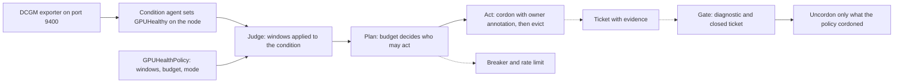
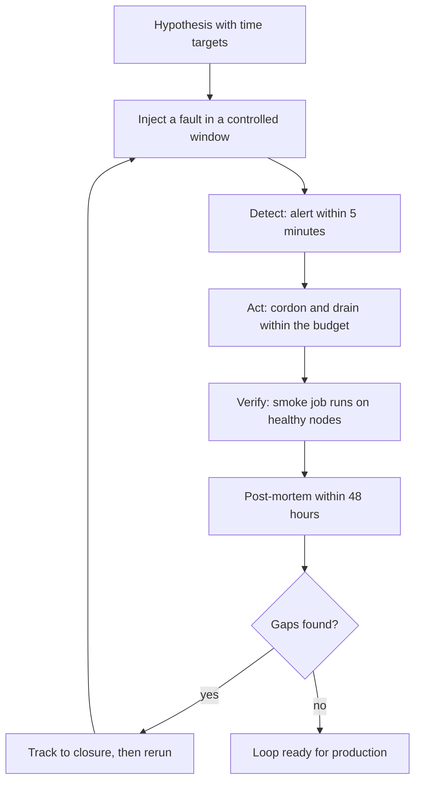

# 19.6 Capstone: node-health automation with DCGM and an operator

| Field | Value |
|---|---|
| Level | Advanced |
| Priority tier | 1 |
| Lab venue | GCP / GKE (cluster steps not run here; rules, routing, policy model and operator tests were run on a Mac) |
| Part | Part 19: Capstones, design and interview readiness |
| Cross-references | Chapters 5.32, 10.21, 11.3, 11.4, 17.4, 17.6, 17.7, 17.11, 19.1 and 20.16 |
| Code | `code/part19/c06_*` and `code/gpuhealth/` |
| Claim and number ledger | `planning/ledgers/19-06.md` |

## Why this matters for AI infrastructure

It is 3 a.m. A training job on a pool of four GPU nodes keeps dying and restarting. The on-call engineer finally notices that the pod always lands on the same node. One GPU on that node has been reporting Xid errors for two days. Nothing drained the node and nothing paged anyone, so the scheduler kept sending work to failing hardware.

Every check in that story was green. The exporter was up, Prometheus was scraping and the dashboard looked healthy. What was missing was the loop between the signal and the action. That loop is this capstone.

The loop has five surfaces. The first is the signal set, meaning the DCGM fields that must reach Prometheus. The second is the alert design, which separates a GPU that fell off the bus from a harmless remap event. The third is the safety model, which decides what a machine may do alone and caps the damage it can cause. The fourth is the operator, which turns a node condition into a cordon and a drain. The fifth is the game day, which proves the loop before the first real failure.

This chapter is also an interview anchor. The same topic appears from the design side in [Chapter 20.16](../part-20-nebius-sre-interview/16-design-gpu-fleet-health-and-capacity.md). That chapter owns the fleet-level reasoning, the spare-pool arithmetic and the drain order for inference traffic. This one builds the pieces and runs what can be run on a laptop. I reuse its checked facts by link and do not repeat them.

A word on what was run. The host for this chapter is a Mac with no GPU and no cluster. The alert rules, the Alertmanager routing, the policy model, the arithmetic and the Go operator tests were all run here. Every step that needs a GPU, DCGM or a GKE cluster is marked as not run, and no output is invented.

## Prerequisites and outcomes

### Prerequisites

- [Chapter 10.21](../part-10-gpu-cuda/21-gpu-health-dcgm-ecc-row-remapping-and-xid.md) for reading ECC, row remapping and Xid signals.
- [Chapter 17.4](../part-17-operations/04-dcgm-exporter-and-interpreting-gpu-metrics.md) for the exporter and its metrics. This chapter corrects some metric names used there.
- [Chapter 17.6](../part-17-operations/06-alerting-slos-and-health-checks-for-gpu-clusters.md) for alerting and SLOs.
- [Chapter 5.32](../part-05-kubernetes/32-project-a-gpu-node-health-operator.md) for the Go operator in `code/gpuhealth`.
- [Chapter 19.1](01-capstone-a-slurm-gpu-cluster.md) if the fleet runs Slurm instead of Kubernetes.

### Outcomes

After this capstone you will be able to:

1. Enable the DCGM counters that are off by default and check each metric name against the exporter's own file.
2. Write and unit-test alert rules that page on hardware faults and stay quiet on noise.
3. State which events a machine may remediate alone and which it must hand to a person.
4. Explain what the Go operator does, what it does not do, and what the reference model adds.
5. Work the Xid runbooks from the NVIDIA catalog and collect the evidence before any reset.
6. Run a game day with time targets that are derived from the loop's own settings.

---

## 1. The signal set: what the exporter must expose

A GPU in a four-node pool looked healthy for two weeks. Snapshots from `nvidia-smi` showed a stable temperature and no errors. Then a training job produced corrupt output overnight. The post-mortem found that the corrected-error counter had been climbing for days. Nobody saw it, because the team looked at snapshots and watched nothing over time.

DCGM, the Data Center GPU Manager, reads GPU state through the driver. The DCGM exporter turns that state into Prometheus metrics. On Kubernetes the GPU Operator deploys the exporter for you. The exporter pods carry the label `app=nvidia-dcgm-exporter`, and the exporter serves metrics on port 9400. Its default collection interval is 30000 milliseconds, which is 30 seconds.

The exporter does not export every field. It reads a collector file with three columns: the DCGM field, the Prometheus type and a help text. The default file in release 4.9.0 turns on a short list of fields. It lists many others as comments. Release 4.9.0 was published on 2026-11-06, and I read its `etc/default-counters.csv` on 2026-11-10.

This matters because the names changed. Older material, including some of this handbook, uses names such as `DCGM_FI_DEV_GPU_UTIL`, `DCGM_FI_DEV_XID_ERRORS` and `DCGM_FI_DEV_FB_USED`. None of them appear in the 4.9.0 default file. The same file uses `DCGM_FI_DEV_GPU_UTIL_RATIO`, `DCGM_FI_DEV_XID_ERROR` and `DCGM_FI_DEV_FB_USED_BYTES`. This chapter uses only names that the file contains, and a test checks that.

The table lists the signals this capstone alerts on. The last column says whether the field is on in the default file. A field marked "off" must be enabled in your own collector file before the alert can ever fire.

| Group | Metric in 4.9.0 | Type | Default file | What it tells you |
|---|---|---|---|---|
| Events | `DCGM_FI_DEV_XID_ERROR` | gauge | on | Value of the last Xid seen |
| Thermal | `DCGM_FI_DEV_GPU_TEMP_CELSIUS` | gauge | on | Die temperature |
| Thermal | `DCGM_FI_DEV_GPU_THERMAL_THROTTLE_SECONDS_TOTAL` | counter | off | Seconds below application clocks because of heat |
| Power | `DCGM_FI_DEV_GPU_POWER_THROTTLE_SECONDS_TOTAL` | counter | off | Seconds below application clocks because of power policy |
| Memory | `DCGM_FI_DEV_ECC_SBE_VOL_TOTAL` | counter | off | Single-bit volatile ECC errors |
| Memory | `DCGM_FI_DEV_ECC_DBE_VOL_TOTAL` | counter | off | Double-bit volatile ECC errors |
| Memory | `DCGM_FI_DEV_ROW_REMAP_FAILED` | gauge | on | Whether row remapping has failed |
| Interconnect | `DCGM_FI_DEV_PCIE_REPLAY_TOTAL` | counter | on | PCIe retries |
| Interconnect | `DCGM_FI_DEV_NVLINK_CRC_ERROR_TOTAL` | counter | off | Data-link CRC errors, the Hopper counter |

The Hopper counter in the last row has older siblings for earlier GPUs. They carry different names, such as `DCGM_FI_DEV_NVLINK_CRC_FLIT_ERROR_TOTAL`. Check which one your GPU generation reports before you write the rule. The default file marks that split with its own comments.

Because the GPU Operator replaces the shipped file when you supply a custom one, your file must list every field your alerts use. The file below does that for this chapter. The ConfigMap key must be `dcgm-metrics.csv`.

```csv
# Custom collector file for the node-health capstone (chapter 19.6).
# Three columns: DCGM field, Prometheus metric type, help message.
# Names and help text are copied from dcgm-exporter 4.9.0 etc/default-counters.csv.
# In the GPU Operator this file replaces the shipped CSV, so it lists every field the alerts use.
DCGM_FI_DEV_GPU_TEMP_CELSIUS, gauge, GPU temperature (in C).
DCGM_FI_DEV_XID_ERROR, gauge, Value of the last XID error encountered.
DCGM_FI_DEV_PCIE_REPLAY_TOTAL, counter, Total number of PCIe retries.
DCGM_FI_DEV_ROW_REMAP_FAILED, gauge, Whether remapping of rows has failed
DCGM_FI_DEV_ECC_SBE_VOL_TOTAL, counter, Total number of single-bit volatile ECC errors.
DCGM_FI_DEV_ECC_DBE_VOL_TOTAL, counter, Total number of double-bit volatile ECC errors.
DCGM_FI_DEV_GPU_THERMAL_THROTTLE_SECONDS_TOTAL, counter, Time below application clocks due to thermal policy in seconds.
DCGM_FI_DEV_GPU_POWER_THROTTLE_SECONDS_TOTAL, counter, Time below application clocks due to power policy in seconds.
DCGM_FI_DEV_NVLINK_CRC_ERROR_TOTAL, counter, Total number of NVLink data-link CRC errors.
```

Two commands point the operator at that file. They follow the DCGM exporter installation page. The namespace `gpu-operator` and the ClusterPolicy name `cluster-policy` come from the GPU Operator getting-started page. The script was syntax-checked here and not run, because it needs a cluster.

```bash
#!/usr/bin/env bash
# Point the GPU Operator's DCGM exporter at the capstone counters file (chapter 19.6).
# Not run here: needs a cluster with the GPU Operator. The two commands follow the
# "Install DCGM Exporter" page; the operator namespace and ClusterPolicy name are the
# ones its getting-started page shows (gpu-operator, cluster-policy).
# The ConfigMap key must be dcgm-metrics.csv. The file replaces the shipped counters,
# so c06_dcgm_counters.csv lists every field the alert rules use.
set -euo pipefail

NAMESPACE="${NAMESPACE:-gpu-operator}"
POLICY="${POLICY:-cluster-policy}"

kubectl create configmap custom-dcgm-metrics \
    --namespace "${NAMESPACE}" \
    --from-file=dcgm-metrics.csv=c06_dcgm_counters.csv

kubectl patch clusterpolicy "${POLICY}" --type merge \
    --patch '{"spec":{"dcgmExporter":{"config":{"name":"custom-dcgm-metrics"}}}}'

# The exporter pods carry the label app=nvidia-dcgm-exporter.
kubectl get pods --all-namespaces --selector app=nvidia-dcgm-exporter
```

One metric deserves its own warning. `DCGM_FI_DEV_XID_ERROR` holds the value of the last Xid. It stays at that value until another Xid replaces it or the exporter restarts. A rule that says "equals 79" keeps firing after the repair unless the node reboots. Chapter 20.16 makes the same point, and the rule file below handles it by leaving the cleanup to the operator and the restart.

The default file also lists exporter-owned metrics as comments. They include `DCGM_EXP_GPU_HEALTH_STATUS`, which carries the DCGM-reported health status, and `DCGM_EXP_XID_ERRORS_TOTAL`, a counter of Xid errors. Both are off by default. They are worth enabling once you have checked their semantics on your build. The rules do not use them, because their value ranges could not be read in the sources consulted.

### Watching the watcher

If the exporter dies, you lose GPU visibility with no GPU symptom at all. The fleet looks healthy because it is silent. Two rules cover this. The first uses the standard `up` metric for the exporter job. The second counts GPU series per node and fires when the count drops below the expected eight. A GPU that falls off the bus is removed from DCGM's groups, so it produces no series. A count check catches that. Both rules appear in Section 2.

There is no freshness alert for series that stop updating while the target still answers. Prometheus stamps each sample with the scrape time, so the timestamp cannot show that the exporter served a cached value. I have no tested rule that detects that failure, and I will not ship one I cannot test.

The `health` side of DCGM is a second source worth knowing. The DCGM documentation describes background health checks that you set with `dcgmi health` and read with `dcgmi health -c`. The watch flags are p for PCIe, m for memory, i for InfoROM, t for thermal and power, n for NVLink, d for driver, x for ConnectX and a for all. These checks run while jobs run and, per the documentation, have no effect on application behaviour. A warning means the work can finish but the issue needs a look. An error means the work is likely compromised.

**Decision rule:** a signal set is ready only when every metric name in your rules exists in your exporter's own file, the off-by-default counters are enabled, and the exporter's liveness and GPU count are watched.

**In one minute:** the exporter serves what its collector file lists, every 30 seconds by default. Release 4.9.0 keeps ECC, throttle and NVLink error counters off, and it renamed several older metrics. Supply your own file, check names with a test, and watch the exporter itself.

---

## 2. Alert design: classes, thresholds and routing

An early cluster paged on every Xid. Within a week the on-call engineer knew exactly which pages to ignore. Then the page that mattered arrived during a night when that engineer had already muted the channel. The lesson is not better thresholds. The lesson is to decide which events deserve a page at all.

The NVIDIA Xid catalog gives each code an immediate action. This chapter groups codes by that action. The grouping is the chapter's policy, not NVIDIA's, and the catalog does not define the groups. The table shows the rows this chapter handles. I fetched the catalog on 2026-11-10, and its footer says it was last updated on 2026-11-04.

| Xid | Catalog description | Catalog immediate action | Class in this policy |
|---|---|---|---|
| 13 | Graphics Engine Exception | RESTART_APP | application |
| 31 | GPU memory page fault | RESTART_APP | application |
| 32 | Invalid or corrupted push buffer stream | RESTART_APP | application |
| 43 | GPU stopped processing | IGNORE | self healing |
| 45 | Preemptive cleanup due to previous errors | WORKFLOW_XID_45, solo RESTART_FM | symptom |
| 48 | Double Bit ECC Error | WORKFLOW_XID_48, solo RESET_GPU | unrecoverable |
| 61 | Unused in the catalog | N/A | unknown |
| 62 | Internal micro-controller halt | RESET_GPU | unrecoverable |
| 63 | GPU memory remapping event | IGNORE | self healing |
| 64 | GPU memory remapping failure | RESET_GPU | unrecoverable |
| 74 | NVLINK Error | WORKFLOW_NVLINK_ERR | interconnect |
| 79 | GPU has fallen off the bus | RESTART_BM | unrecoverable |
| 92 | High single-bit ECC error rate | IGNORE | self healing |
| 94 | Contained memory error | RESTART_APP | application |
| 95 | Uncontained memory error | RESET_GPU | unrecoverable |
| 119 | GSP RPC Timeout | RESET_GPU | unrecoverable |
| 120 | GSP Error | RESET_GPU | unrecoverable |

Three points come from this table. Xid 61 is listed as unused, so it has no alert rule. Xid 62 is the micro-controller halt. And Xid 92 has an immediate action of IGNORE, which is why it is a trend to review and never a real-time page. The investigatory column for 92 says to contact support, so a rising rate still deserves a ticket.

Xid 94 needs a note. The catalog says to restart the application, and it also recommends a GPU reset when convenient. I class it as an application event and keep it out of the page rules. Treat a repeat on the same GPU as a reason to look at hardware. That escalation is my reasoning, not catalog text.

The class table lives in code, so the policy and the alert rules cannot drift apart without a failing test. This module holds it. A test compares its table to a snapshot file of the catalog rows.

```python
"""Map an Xid to the action class this chapter's policy uses (chapter 19.6).

The classes follow the immediate action in the NVIDIA Xid catalog. The class names
and the choice to leave application and self-healing codes alone are this chapter's
policy, not NVIDIA's. An unknown code is never ignored.
"""

# Xid -> catalog "immediate action" (fetched 2026-11-10, see c06_xid_catalog_snapshot.csv).
CATALOG_IMMEDIATE = {
    13: "RESTART_APP", 31: "RESTART_APP", 32: "RESTART_APP", 43: "IGNORE",
    45: "WORKFLOW_XID_45", 48: "WORKFLOW_XID_48", 62: "RESET_GPU", 63: "IGNORE",
    64: "RESET_GPU", 74: "WORKFLOW_NVLINK_ERR", 79: "RESTART_BM", 92: "IGNORE",
    94: "RESTART_APP", 95: "RESET_GPU", 119: "RESET_GPU", 120: "RESET_GPU",
}

UNRECOVERABLE = "unrecoverable"    # GPU reset or node restart needed: cordon, drain, ticket
INTERCONNECT = "interconnect"      # NVLink: label the node, keep mesh-critical jobs off it
APPLICATION = "application"        # restart the process; escalate only on a pattern
SELF_HEALING = "self_healing"      # track the rate, take no action
SYMPTOM = "symptom"                # Xid 45: read the Xid that came before it
UNKNOWN = "unknown"                # not in the table: a human looks, nothing is ignored

CLASS_OF = {
    13: APPLICATION, 31: APPLICATION, 32: APPLICATION, 94: APPLICATION,
    43: SELF_HEALING, 63: SELF_HEALING, 92: SELF_HEALING,
    45: SYMPTOM, 74: INTERCONNECT,
    48: UNRECOVERABLE, 62: UNRECOVERABLE, 64: UNRECOVERABLE, 79: UNRECOVERABLE,
    95: UNRECOVERABLE, 119: UNRECOVERABLE, 120: UNRECOVERABLE,
}


def classify_xid(xid):
    """Return the action class for an Xid code."""
    return CLASS_OF.get(xid, UNKNOWN)
```

The rules follow the classes. Reset-class Xids page at once with `for: 0m`. Waiting is how a failed GPU keeps taking work. Xid 74 gets a warning, since its workflow is its own. Counters use `increase()` over a window instead of raw values, so an old double-bit error does not alert forever.

```yaml
# Node-health alert rules for the capstone (chapter 19.6).
# Metric names: dcgm-exporter 4.9.0 etc/default-counters.csv; every name used here is
# listed in c06_dcgm_counters.csv, which turns on the counters that are off by default.
# Thresholds marked "start value" are this chapter's choices, not vendor figures.
# Xid classes come from the NVIDIA Xid catalog "immediate action" column.
groups:
  - name: gpu-xid
    rules:
      # Catalog immediate action RESET_GPU or RESTART_BM: 48, 62, 64, 79, 95, 119, 120.
      # DCGM_FI_DEV_XID_ERROR holds the LAST Xid seen, so it stays at the same value
      # until another Xid replaces it or the exporter restarts.
      - alert: GpuXidNeedsReset
        expr: |
          DCGM_FI_DEV_XID_ERROR == 48 or DCGM_FI_DEV_XID_ERROR == 62
          or DCGM_FI_DEV_XID_ERROR == 64 or DCGM_FI_DEV_XID_ERROR == 79
          or DCGM_FI_DEV_XID_ERROR == 95 or DCGM_FI_DEV_XID_ERROR == 119
          or DCGM_FI_DEV_XID_ERROR == 120
        for: 0m
        labels:
          severity: critical
          event_class: unrecoverable
        annotations:
          summary: "GPU {{ $labels.gpu }} on {{ $labels.instance }} reports Xid {{ $value }}, which the catalog resolves with a GPU reset or node restart"
          runbook: "https://runbooks.example.com/xid-reset-class"

      # Xid 74 is an NVLink error; the catalog sends it down its own workflow.
      - alert: GpuXidNvlink
        expr: DCGM_FI_DEV_XID_ERROR == 74
        for: 0m
        labels:
          severity: warning
          event_class: interconnect
        annotations:
          summary: "GPU {{ $labels.gpu }} on {{ $labels.instance }} reports Xid 74, an NVLink error"
          runbook: "https://runbooks.example.com/xid-74-nvlink"

      # Several GPUs in the reset class at once points at a shared cause, not hardware.
      - alert: FleetWideXid
        expr: |
          count(
            DCGM_FI_DEV_XID_ERROR == 48 or DCGM_FI_DEV_XID_ERROR == 62
            or DCGM_FI_DEV_XID_ERROR == 64 or DCGM_FI_DEV_XID_ERROR == 79
            or DCGM_FI_DEV_XID_ERROR == 95 or DCGM_FI_DEV_XID_ERROR == 119
            or DCGM_FI_DEV_XID_ERROR == 120
          ) >= 3
        for: 0m
        labels:
          severity: critical
          event_class: fleet
        annotations:
          summary: "Three or more GPUs report reset-class Xids together; freeze automation and look for a shared cause"
          runbook: "https://runbooks.example.com/fleet-wide-fault"

  - name: gpu-reliability
    rules:
      - alert: GpuDoubleBitEcc
        expr: increase(DCGM_FI_DEV_ECC_DBE_VOL_TOTAL[1h]) > 0
        for: 0m
        labels:
          severity: critical
          event_class: unrecoverable
        annotations:
          summary: "Uncorrectable ECC error on GPU {{ $labels.gpu }} of {{ $labels.instance }}; review the jobs that ran there"
          runbook: "https://runbooks.example.com/xid-reset-class"

      - alert: GpuRowRemapFailed
        expr: DCGM_FI_DEV_ROW_REMAP_FAILED == 1
        for: 0m
        labels:
          severity: critical
          event_class: unrecoverable
        annotations:
          summary: "Row remapping failed on GPU {{ $labels.gpu }} of {{ $labels.instance }}"
          runbook: "https://runbooks.example.com/xid-reset-class"

      # Start value: 100 corrected errors per hour.
      - alert: GpuSingleBitEccRate
        expr: increase(DCGM_FI_DEV_ECC_SBE_VOL_TOTAL[1h]) > 100
        for: 10m
        labels:
          severity: warning
          event_class: self_healing
        annotations:
          summary: "Corrected ECC errors above 100 per hour on GPU {{ $labels.gpu }} of {{ $labels.instance }}"

      - alert: GpuPcieReplays
        expr: increase(DCGM_FI_DEV_PCIE_REPLAY_TOTAL[1h]) > 10
        for: 10m
        labels:
          severity: warning
          event_class: interconnect
        annotations:
          summary: "PCIe retries climbing on GPU {{ $labels.gpu }} of {{ $labels.instance }}"

      # Start value: 1000 CRC errors in 6 hours. Hopper counter; older GPUs use other names.
      - alert: GpuNvlinkCrcRising
        expr: increase(DCGM_FI_DEV_NVLINK_CRC_ERROR_TOTAL[6h]) > 1000
        for: 30m
        labels:
          severity: warning
          event_class: interconnect
        annotations:
          summary: "NVLink CRC errors rising on GPU {{ $labels.gpu }} of {{ $labels.instance }}"
          runbook: "https://runbooks.example.com/xid-74-nvlink"

  - name: gpu-thermal-power
    rules:
      # Start value: more than 60 seconds below application clocks in 15 minutes.
      - alert: GpuThermalThrottle
        expr: increase(DCGM_FI_DEV_GPU_THERMAL_THROTTLE_SECONDS_TOTAL[15m]) > 60
        for: 5m
        labels:
          severity: warning
          event_class: thermal_power
        annotations:
          summary: "GPU {{ $labels.gpu }} of {{ $labels.instance }} is throttled by heat; check cooling"

      - alert: GpuPowerThrottle
        expr: increase(DCGM_FI_DEV_GPU_POWER_THROTTLE_SECONDS_TOTAL[15m]) > 60
        for: 5m
        labels:
          severity: warning
          event_class: thermal_power
        annotations:
          summary: "GPU {{ $labels.gpu }} of {{ $labels.instance }} is throttled by the power policy"

      # Rate of rise, not a level: the nvidia-devops fan-failure chapter lists
      # 2 to 3 degrees per minute under load as a symptom. Start value: 2 per minute.
      - alert: GpuTemperatureRisingFast
        expr: deriv(DCGM_FI_DEV_GPU_TEMP_CELSIUS[5m]) * 60 > 2
        for: 5m
        labels:
          severity: warning
          event_class: thermal_power
        annotations:
          summary: "GPU {{ $labels.gpu }} of {{ $labels.instance }} is heating faster than 2 degrees per minute"

  - name: gpu-detection
    rules:
      - alert: GpuExporterDown
        expr: up{job="dcgm-exporter"} == 0
        for: 5m
        labels:
          severity: critical
          event_class: detection_blind_spot
        annotations:
          summary: "No GPU telemetry from {{ $labels.instance }}; silence is not health, and automation must not cordon on it"
          runbook: "https://runbooks.example.com/exporter-down"

      # The 8 is the GPU count of this chapter's node type. Change it per pool.
      - alert: GpuCountMismatch
        expr: count by (instance) (DCGM_FI_DEV_GPU_TEMP_CELSIUS) < 8
        for: 10m
        labels:
          severity: critical
          event_class: detection_blind_spot
        annotations:
          summary: "{{ $labels.instance }} reports fewer than 8 GPUs; a detached GPU produces no series"
          runbook: "https://runbooks.example.com/exporter-down"

  - name: node-capacity
    rules:
      # kube-state-metrics node metric; the same name is used in chapter 20.16.
      - alert: NodeCordonedTooLong
        expr: kube_node_spec_unschedulable == 1
        for: 24h
        labels:
          severity: warning
          event_class: silent_capacity_loss
        annotations:
          summary: "{{ $labels.node }} has been cordoned for 24 hours; find its owner"
          runbook: "https://runbooks.example.com/cordon-owner"
```

Four design points sit inside that file.

First, the thresholds marked "start value" are mine. They are 100 corrected ECC errors per hour, 10 PCIe replays per hour, 1000 NVLink CRC errors in six hours, 60 throttled seconds in 15 minutes and a temperature rise of 2 degrees per minute. No vendor document gives them. The nvidia-devops fan-failure chapter lists a rise of 2 to 3 degrees per minute under load as a symptom of a failing fan, which is where I took the idea. Tune them on your own fleet.

Second, the temperature rule watches the rate of rise and not a level. Data-centre GPUs run warm by design. A level alert fires on healthy clusters every day. A fast rise means something changed.

Third, there is no memory-pressure alert. A training process that reserves nearly all GPU memory is normal, so the alert would fire constantly and say nothing about the node's health. That is a workload signal and belongs on a workload dashboard.

Fourth, `FleetWideXid` pages when three or more GPUs report reset-class Xids at once. Three simultaneous hardware failures are rarer than one shared cause, such as a driver rollout or a power event. Section 4 shows the circuit breaker that matches this alert.

Every alert has a `severity` and an `event_class` label. Alertmanager routes on them. The routing file reads its two secrets from files. A Kubernetes Secret should mount those files with mode 0400, owned by the Alertmanager user. Nothing secret appears in the file.

```yaml
# Alertmanager routing for node health (chapter 19.6).
# Secrets are read from files that a Kubernetes Secret mounts, never written here.
# Mount them at /etc/alertmanager/secrets with mode 0400, owned by the Alertmanager user.
route:
  receiver: node-health-default
  group_by: [alertname, instance]
  routes:
    # A fleet-wide event pages first and is never grouped away.
    - matchers:
        - event_class="fleet"
      receiver: pagerduty-node-health
      repeat_interval: 30m
    - matchers:
        - severity="critical"
      receiver: pagerduty-node-health
      repeat_interval: 1h
    - matchers:
        - severity="warning"
      receiver: slack-node-health
receivers:
  - name: node-health-default
  - name: pagerduty-node-health
    pagerduty_configs:
      - routing_key_file: /etc/alertmanager/secrets/pagerduty-routing-key
  - name: slack-node-health
    slack_configs:
      - api_url_file: /etc/alertmanager/secrets/slack-webhook-url
        channel: "#node-health"
```

All of this was run here. `promtool check rules` found 14 rules. `promtool test rules` passed 11 test groups, including the failure cases: Xid 63 and Xid 13 do not fire the reset rule, two nodes with Xid 79 do not fire the fleet rule, and a node with eight GPUs does not fire the count rule. `amtool check-config` passed, and `amtool config routes test` sent a fleet-class alert and a critical alert to PagerDuty, a thermal warning to Slack and an unlabelled alert to the default receiver.

An alert needs an objective behind it. The arithmetic below is computed by a tested script. Three results matter. A 99 percent availability target allows 438 minutes, which is 7.3 hours a month. A 99.9 percent target allows 43.8 minutes. And a 98 percent GPU-health target allows 2 failing GPUs out of 100, but allows none out of 32.

```python
"""Worked arithmetic for chapter 19.6: error budgets, pool fractions and loop latency.

Every input is an assumption stated in the chapter. Nothing here is measured.
"""
import math

HOURS_PER_MONTH = 730          # 8760 hours divided by 12


def downtime_budget_minutes(availability, hours=HOURS_PER_MONTH):
    """Minutes of allowed downtime for an availability target."""
    return (1 - availability) * hours * 60


def gpus_allowed_failing(health_target, gpus):
    """Whole GPUs that may be unhealthy at once under a GPU-health target."""
    return math.floor((1 - health_target) * gpus + 1e-9)


def pool_fraction_lost(nodes_out, nodes, gpus_per_node=8):
    """Share of the pool's GPUs that leave service when whole nodes are cordoned."""
    return nodes_out * gpus_per_node / (nodes * gpus_per_node)


def worst_case_detection_seconds(collect_interval=30, scrape_interval=30, eval_interval=60):
    """Slowest path from a fault to a firing alert when the rule has no for: clause.

    The exporter refreshes at its collect interval, Prometheus scrapes at its own
    interval, and the rule is evaluated at the evaluation interval. In the worst case
    the three waits add up.
    """
    return collect_interval + scrape_interval + eval_interval


def worst_case_cordon_seconds(unhealthy_for=120, requeue_slack=1):
    """Time from the condition turning False to the cordon: the window plus the requeue."""
    return unhealthy_for + requeue_slack


if __name__ == "__main__":
    for target in (0.99, 0.999, 0.995):
        print(f"availability {target:.3%}: {downtime_budget_minutes(target):7.1f} minutes a month")
    for gpus in (32, 100):
        print(f"98% GPU health on {gpus} GPUs: {gpus_allowed_failing(0.98, gpus)} may be failing")
    print(f"one node of four is {pool_fraction_lost(1, 4):.0%} of the pool")
    print(f"worst-case detection {worst_case_detection_seconds()} s, "
          f"worst-case cordon after the condition {worst_case_cordon_seconds()} s")
```

On this chapter's pool one node is 8 of 32 GPUs, which is 25 percent. A single drain therefore already costs more than the 2 percent a 98 percent GPU-health target allows at that size. That is not a flaw in the loop. It is the reason a small pool needs a spare node, which Chapter 20.16 sizes.

**Decision rule:** classify the event from the catalog's immediate action before you write the rule, page only on classes that need a person now, and unit-test every rule with a case that must fire and a case that must not.

**In one minute:** reset-class Xids, double-bit ECC and a failed row remap page immediately. Application and self-healing codes never page in real time. Routing sends fleet and critical alerts to PagerDuty and warnings to Slack. Thresholds marked start value are mine and need tuning.

---

## 3. The safety model: what automation may do alone

A first-generation remediator watched a health metric. A scrape backlog made the metric look stale, so the remediator decided the fleet was sick and cordoned every node it could reach. Nothing could be scheduled afterwards. A second incident taught the other half. A person cordoned a node for maintenance and forgot it, and the half-empty pool survived two weeks before a capacity review noticed. These two stories are composites. I wrote them to make two rules concrete: silence is not a fault, and a cordon needs an owner.

The first rule is to separate detection from action. A condition agent publishes a node condition named `GPUHealthy`. The operator reads only that condition. It never detects anything. A bad detector can be wrong, but the operator's budget and windows decide how much that wrongness can cost. The same split appears in Chapter 20.16 as three separate components.

The second rule is to classify every event by what the machine may do. The table is this chapter's policy. The last column names the human owner, because every automated action needs a person who can take it back.

| Event class | Example | What the machine does | What the human owns |
|---|---|---|---|
| Unrecoverable | Xid 79, 48, 95, 64 | Cordon, drain, open a ticket with evidence | The repair, the vendor case, the review of job output from the affected window |
| Self healing | Xid 63, 92, 43 | Nothing. Track the rate | Preventive maintenance if the rate keeps rising |
| Application | Xid 13, 31, 32, 94 | Nothing. The pod restart policy handles it | Look at hardware if one GPU repeats the code across unrelated applications |
| Interconnect | Xid 74, rising NVLink CRC | Label the node, keep mesh-critical jobs off it | The hardware ticket |
| Thermal or power | Sustained throttling | Nothing, or reduce load. Never drain | The cooling and power checks |
| Detection blind spot | Exporter down, condition missing | Page. Cordon nothing | Restore detection |

Why does the line sit there? A drain is cheap to undo. A healthy node that is drained loses only capacity. A bad node that is drained stops corrupting work. An uncordon is different. It can send work back to a dying GPU. So the return path carries a gate and not a timer. This is my reasoning, and Chapter 20.16 draws the same asymmetry.

The AI Factory book offers a useful frame in its chapter on data-driven decision making. It notes that recommended maintenance actions carry uncertainty, and that a person can ignore an unsuitable recommendation while a machine may apply it blindly. That is why the policy gives the machine only the actions whose cost is bounded.

Four limits keep safe actions from becoming a meltdown. They match the fields of the `GPUHealthPolicy` in Section 4.

- A stabilisation window, `unhealthyFor`, defaults to 2 minutes. The condition must stay false that long before any action.
- A recovery window, `healthyFor`, defaults to 5 minutes. The condition must stay true that long before a node returns.
- A budget, `maxUnavailableNodes`, caps how many matched nodes may be unschedulable. A percentage rounds up.
- A dry-run flag reports what would happen and changes nothing.

The budget needs an example. On this chapter's pool of four nodes, 10 percent rounds up to 1 node. On a pool of 32 nodes it is 4. The operator's own `Budget` function returns both numbers.

The Go operator enforces the rule that an unlimited drain cannot exist. Its custom resource definition carries a validation rule. I created a policy with `action: CordonAndDrain` and no budget against a real kube-apiserver, version 1.31.0, started by the operator's envtest suite. The server answered with this text.

```text
GPUHealthPolicy.platform.example.com "tmp-nobudget" is invalid: spec: Invalid value: "object": maxUnavailableNodes is required when action is CordonAndDrain
```

**Decision rule:** let a machine act alone only when the action is cheap to undo, when a missing signal is read as healthy for cordoning, and when a person owns every cordon the machine creates.

**In one minute:** detection and action are separate components. Unrecoverable hardware gets a cordon, a drain and a ticket inside a budget. Everything else is tracked or handed to a person. A drain is cheap to undo and an uncordon is not, so return needs a gate.

---

## 4. The operator and the policy model

A node sat in `SchedulingDisabled` for two weeks. The only record of why was a chat message from a previous shift. Pods that should have landed there went to a costlier pool, and the capacity review was wrong for a month. A manual cordon has no owner, no reason and no release. An operator can make a cordon a state with all three.

[Chapter 5.32](../part-05-kubernetes/32-project-a-gpu-node-health-operator.md) builds that operator in Go with controller-runtime. This chapter does not copy its code. It runs it, reads it against the safety model, and adds what it lacks. The diagram shows the whole loop. The solid boxes are in the Go operator. The dashed boxes are in the reference model.



| Element | In the Go operator | In the reference model |
|---|---|---|
| Windows | `unhealthyFor` and `healthyFor` on the policy | Same fields, same defaults |
| Budget | `maxUnavailableNodes`, rounded up, counts every unschedulable node | Same rule |
| Ownership | Owner annotation. Uncordons only owned nodes | Same rule |
| Drain | Evicts through the eviction subresource and respects disruption budgets | Same, with a taint option |
| Rate limit | Not present | Cordons per hour |
| Circuit breaker | Not present | Freeze when several nodes flag together |
| Ticket and diagnostic gate | Not present | Required before an owned node returns |

On the Go side, `go build ./...` and `go vet ./...` in `code/gpuhealth` completed without output. The test suite passes, and it needs the envtest binaries, which start a real kube-apiserver and etcd. Without them the tests stop in `TestMain`. With them, the tests ran against Kubernetes 1.31.0 and seven tests passed: `TestJudge`, `TestBudgetAndPlan`, `TestCordonThenUncordon`, `TestBudgetLimitsCordons`, `TestDryRunDoesNothing`, `TestPendingWindowWaits` and `TestFinalizerReleasesOwnCordonsOnly`. The Kubebuilder and controller-runtime material describes this structure. The Reconcile function makes the system match the resource, and other controllers act on the objects it changes.

Reading the code against the safety model turned up a gap. In `Judge`, a node with no `GPUHealthy` condition counts as healthy. For cordoning that is right, because a missing signal must never cordon. For uncordoning it is risky. The reconciler releases any owned, unschedulable node that `Judge` calls healthy. If the condition vanished after a cordon, the node would be released with no proof. Calling `Judge` on a node with no condition returns healthy, which confirms the first half. The second half follows from reading the controller loop. No scenario that deletes a condition was run, so treat the release path as read and not run. The reference model closes the gap by requiring an explicit true condition before any return.

Next, the policy objects. They are validated against the operator's CRD with `tools/check_crd_yaml.py`, which rejects unknown fields. The first is the production policy for the training pool.

```yaml
# GPUHealthPolicy for the 4-node, 32-GPU training pool (chapter 19.6).
# CRD: code/gpuhealth/config/crd/platform.example.com_gpuhealthpolicies.yaml
apiVersion: platform.example.com/v1alpha1
kind: GPUHealthPolicy
metadata:
  name: training-pool
spec:
  nodeSelector:
    nvidia.com/gpu.present: "true"
  conditionType: GPUHealthy
  unhealthyFor: 2m
  healthyFor: 5m
  action: CordonAndDrain
  maxUnavailableNodes: 10%
  dryRun: false
```

Every rollout starts in dry-run mode, with the budget set to one node. The operator then emits events saying what it would do.

```yaml
# First rollout of the policy: report what would happen, change nothing.
apiVersion: platform.example.com/v1alpha1
kind: GPUHealthPolicy
metadata:
  name: training-pool
spec:
  nodeSelector:
    nvidia.com/gpu.present: "true"
  conditionType: GPUHealthy
  unhealthyFor: 2m
  healthyFor: 5m
  action: Cordon
  maxUnavailableNodes: 1
  dryRun: true
```

The detector side needs a stand-in for the lab. This script sets the `GPUHealthy` condition by hand with a strategic merge patch on the node status. `kubectl` was not run here. The same patch shape was run against the envtest apiserver. Two patches in a row, true and then false, left one `GPUHealthy` condition set to false and the `Ready` condition untouched.

```bash
#!/usr/bin/env bash
# Set the GPUHealthy node condition by hand, standing in for the condition agent in the lab
# (chapter 19.6). Usage: c06_set_condition.sh <node> True|False
# Not run here: needs a cluster. The same condition shape is exercised against a real
# kube-apiserver by the envtest suite in code/gpuhealth.
set -euo pipefail

NODE="$1"
STATUS="$2"
NOW="$(date -u +%Y-%m-%dT%H:%M:%SZ)"

kubectl patch node "${NODE}" --subresource=status --type=strategic --patch "$(cat <<JSON
{"status":{"conditions":[{"type":"GPUHealthy","status":"${STATUS}","reason":"LabInjection","message":"set by c06_set_condition.sh","lastTransitionTime":"${NOW}","lastHeartbeatTime":"${NOW}"}]}}
JSON
)"
```

### The reference model

The file `c06_node_policy.py` is a pure-Python model of the policy. Time is a number of seconds, so the tests need no clock. It has 57 tests, and several are failure cases. A short summary follows. I do not paste the file, because the tests are the specification.

The `ConditionAgent` turns events into conditions. Only unrecoverable Xids flip the condition to false. An Xid 74 puts a label on the node and changes nothing else. Application, self-healing and unknown codes leave the condition alone.

The `NodeHealthController.reconcile` call works in a fixed order.

1. Judge each node. A false condition inside the window is pending. A false condition past the window is unhealthy. A missing condition is no signal.
2. Page once if half the nodes or more have no signal. Cordon nothing because of it.
3. Record each newly unhealthy node in the breaker's window. When the count reaches the breaker threshold, freeze and page.
4. Plan new cordons in name order. A frozen controller, a spent budget or a spent hourly rate each produce a hold with a reason.
5. Cordon with an owner annotation. If the event was unrecoverable, open a ticket in the same pass.
6. Drain by eviction, leaving pods that a disruption budget protects. Or taint with NoExecute if the policy chooses the taint method.
7. Return an owned node only after its condition has been true for `healthyFor`, and only when its ticket is closed and its diagnostic passed.

The circuit breaker is the piece the Go operator lacks. It trips when three distinct nodes flag within ten minutes, and the defaults are mine. Three flags in ten minutes is a pattern, not a coincidence. The test with 40 nodes shows it. Six nodes report Xid 79 together, the controller freezes, pages once and cordons nothing. A second test shows slow failures, one node every 20 minutes, never trip it. A third shows that when a person releases the breaker, only the nodes they acknowledge proceed. The others stay held.

That last behaviour matters. Without it, the breaker would release, the next tick would see the same unhealthy nodes, and the controller would act on all of them. The model keeps held nodes held until a person acknowledges them.

Other tests cover the rules this chapter states. A human's cordon is never released. A cordon placed by the policy is released only after the recovery window. A node with an Xid 79 opens a ticket and stays cordoned for an hour of healthy signal. It returns only after a passed diagnostic and a closed ticket. A failed diagnostic sends it back to repair. A node in the wrong state cannot receive a diagnostic result, and an illegal move raises an error. Running the same input twice gives the same actions, and a second reconcile with no change cordons nothing.

### Cordon and drain, or taint

Cordon sets the node unschedulable. It stops new pods and leaves running ones alone. The drain then evicts pods through the eviction API. The Kubernetes documentation says an eviction that a disruption budget forbids returns HTTP 429, and one blocked by misconfiguration returns 500. Production Kubernetes, in its chapter on application considerations, notes that platform teams drain and cordon nodes during lifecycle work, and that the kubelet sends SIGTERM and then waits out the grace period.

A taint with the NoExecute effect works differently. The Kubernetes documentation says pods that do not tolerate it are evicted immediately, and pods that tolerate it with `tolerationSeconds` stay for that time. The control plane does the eviction, not your operator. That fits a node that is being replaced and not repaired, or an operator that lacks eviction permissions. The eviction page says API-initiated evictions respect disruption budgets. The taint page does not say the same for NoExecute, so I treat budget protection on the taint path as unverified. The model supports both paths, and the Go operator supports only eviction.

Here is a disruption budget for a four-replica inference service. A drain that would leave fewer than three replicas ready is refused and retried.

```yaml
# A disruption budget for a four-replica inference service. A drain that would
# leave fewer than three replicas ready is refused with HTTP 429 and retried.
apiVersion: policy/v1
kind: PodDisruptionBudget
metadata:
  name: llm-serving
  namespace: inference
spec:
  minAvailable: 3
  selector:
    matchLabels:
      app: llm-serving
```

**Decision rule:** keep a cordon owned, reasoned and counted against a budget, and let a node return only on proof of health, never on silence and never on a timer alone.

**In one minute:** the Go operator in `code/gpuhealth` judges windows, plans within a budget, cordons with an owner annotation, evicts and releases only its own cordons. It has no rate limit, no breaker, no ticket and no diagnostic gate. The Python reference model adds them and is tested, including a 40-node fleet-wide fault that cordons nothing. The Go code treats a missing condition as healthy on the return path, which I flag as a risk.

---

## 5. The Xid runbooks

Three lines appear in `dmesg` within six seconds. Xid 92, then Xid 45, then Xid 79. The engineer paged for the 92 earlier that week treated it as noise. In hindsight the 92 was early warning, and the 45 was the driver cleaning up after a failure. This story is a composite I wrote to show why the order matters.

Every diagnosis starts from the code, not the free-text message. The text changes with driver versions. Classify the code first. Then read the sequence oldest first, because the Xid that looks like the cause is often one that came after the real one. The catalog supports the second habit. It says Xid 45 is logged when the kernel tears down an application, and that in many cases it is not a bug but a user or system action.

### The runbook for unrecoverable Xids

This is the runbook the operator automates and the human follows when it may not act.

1. Confirm the class from the table in Section 2 and stop scheduling. On Kubernetes that is a cordon and a drain. On Slurm it is `scontrol update NodeName=<node> State=DRAIN Reason="Xid <code>"`, the same decision that Chapter 19.1 shows in its health script.
2. Capture evidence before any reset. A reset can erase the state you want to show a vendor. The script below does it.
3. Follow the catalog's immediate action. For Xid 79 it says restart the bare-metal node. For Xid 48, 64, 95, 62, 119 and 120 it says reset the GPU. For Xid 48 together with 63 or 64 it says drain and reset.
4. For Xid 48 and 95, review the jobs that ran in the affected window. An uncorrectable or uncontained memory error means data integrity was not guaranteed. Flag those outputs for review or re-run.
5. Do not return the node without a passed diagnostic and a closed ticket.

The catalog's investigatory column adds that for Xid 48 a solo event should run the field diagnostic, and an SRAM error that exceeds its threshold follows the RMA flow. This chapter does not restate that flow. Read the catalog entry for your driver.

The catalog does not give a PCIe rescan procedure for Xid 79, and the nvidia-devops DCGM chapter says to collect a bug report and hand it to the hardware owner. So this chapter keeps only the catalog's action.

This script collects the bundle. It was syntax-checked here and not run, because it needs an NVIDIA driver and DCGM. It runs the diagnostic last, since that test is invasive and must only run on a drained node.

```bash
#!/usr/bin/env bash
# Collect the evidence bundle for a hardware ticket on a cordoned node (chapter 19.6).
# Not run here: needs an NVIDIA driver and DCGM. Run it before any GPU reset or reboot,
# because a reset can erase the state you want to show the vendor.
# Usage: sudo ./c06_collect_evidence.sh <node-name> <gpu-index>
set -uo pipefail

NODE="$1"
GPU="$2"
OUT="evidence-${NODE}-gpu${GPU}-$(date -u +%Y%m%dT%H%M%SZ)"
mkdir -p "${OUT}"

# Kernel log lines that carry an Xid, oldest first.
journalctl -k --since "-30 days" --no-pager | grep "NVRM: Xid" > "${OUT}/xid-history.log" || true
dmesg -T > "${OUT}/dmesg.log" || true
lspci -nn > "${OUT}/lspci.log" || true
nvidia-smi -q -i "${GPU}" > "${OUT}/nvidia-smi-q.log" || true
dcgmi health -c > "${OUT}/dcgmi-health.log" || true
# The diagnostic is invasive: only run it on a node that is already drained.
dcgmi diag -r 3 -j > "${OUT}/dcgmi-diag-r3.json" || echo "dcgmi diag exit code $?" > "${OUT}/dcgmi-diag-exit.txt"
# NVIDIA's bug-report script writes nvidia-bug-report.log.gz in the current directory.
nvidia-bug-report.sh > "${OUT}/bug-report-stdout.log" 2>&1 || true
mv nvidia-bug-report.log.gz "${OUT}/" 2>/dev/null || true

tar czf "${OUT}.tar.gz" "${OUT}"
echo "wrote ${OUT}.tar.gz"
```

### The diagnostic gate

The DCGM diagnostic has four run levels. The table gives the durations from the DCGM documentation. A level 3 run on an 8-GPU system is documented as under 35 minutes.

| Level | Command | Duration in the documentation |
|---|---|---|
| 1 | `dcgmi diag -r 1` | Under 2.5 seconds |
| 2 | `dcgmi diag -r 2` | Under 2.5 minutes on 4 GPUs, under 10.5 on 8 |
| 3 | `dcgmi diag -r 3` | Under 10 minutes on 4 GPUs, under 35 on 8 |
| 4 | `dcgmi diag -r 4` | Under 45 minutes on 4 GPUs, under 2.25 hours on 8 |

Add `-j` for JSON output. An exit code of 0 means success, and 226 means the diagnostic ran and reported an error. The documentation also warns that these are online diagnostics. They run in the current environment, and full offline diagnostics from a different NVIDIA tool are required for an RMA. So a passed level 3 run is my gate for returning a node to the pool. It is not proof that the part is good enough to skip the vendor's own process.

### Application and self-healing codes

For application codes such as 13, 31 and 32, restart the process and watch the count. One restart followed by stability points at the application. Repeats on one GPU across unrelated applications point at hardware, and that is my escalation rule, not catalog text. For self-healing codes such as 63 and 92, take no action in real time. Review the rate weekly. A threshold such as a 3x week-over-week rise is a starting idea, not a sourced rule.

### Xid 74, NVLink

The catalog says Xid 74 means the GPU detected a problem on a connection to another GPU or an NVSwitch. It also says that a GPU reset or node reboot is needed to clear it, and that the fault may be in the link or in the device at the other end. A failed GPU can cause a neighbour to report Xid 74 only because the link went down. So look at both ends. The catalog mentions `nvidia-smi nvlink` for more detail and gives a decoding procedure for the error registers. The path is my reading of it. Look at both ends of the link, then reset, then drain, then open a ticket, and keep mesh-critical jobs off the node until it is fixed.


### Failures that are not Xids

Several failures never produce an Xid. The nvidia-devops fan-failure chapter lists symptoms of a failing fan: speed stuck at 0 RPM with a high temperature, a rise of 2 to 3 degrees per minute under load, and throttling within minutes of starting work. Those map to the rate-of-rise and throttle rules in Section 2. The Systems Performance book gives the general method. For every resource, check utilization, saturation and errors. The Xid and ECC counters are the errors, and the throttle counters are a form of saturation.

**Decision rule:** start from the code and its class, capture evidence before any reset, and return a node only after a passed diagnostic and a closed ticket.

**In one minute:** classify the Xid, then run the class's runbook. Unrecoverable codes drain, capture evidence and follow the catalog's reset or restart action. Application codes restart the process. Self-healing codes are a weekly rate review. Xid 74 looks at both ends of the link. A level 3 diagnostic gates return, and it is not a substitute for the vendor's offline diagnostics.

---

## 6. The game day

A team spent a quarter building node-health automation and never ran it against a fault. The first real incident was also the first time the paging key had been rotated, the first time a drain met a disruption budget, and the first time the runbook link pointed to a retired channel. This story is a composite that I wrote. The fix it argues for is real: break something on purpose, on a quiet afternoon, and find the gaps before 3 a.m. does.

A game day is a hypothesis with a clock. The targets here are this chapter's own, derived from the loop's settings so each one is checkable. The incident-response project in the source material has success criteria about finding an NVLink fault within 15 minutes, and they say nothing about 5 minutes to detect or 48 hours to a post-mortem.

| Clause | Target | Why this number |
|---|---|---|
| Detect | An alert fires within 5 minutes of the fault | The worst-case path is 120 seconds: 30 for the exporter, 30 for the scrape and 60 for rule evaluation. The rest is margin. The scrape and evaluation intervals are assumptions |
| Begin the cordon | Within 3 minutes of the condition turning false | The window is 120 seconds, and the Go operator requeues one second after it, so the worst case is 121 seconds |
| Drain | Finished inside the budget, with no job lost beyond its checkpoint | Checkpoint interval is a property of the job |
| Verify | A smoke job completes on the healthy nodes | The pool still has three of four nodes |
| Review | A written post-mortem within 48 hours | My choice |

The target is a cordon within 3 minutes of the condition. A 2-minute target cannot be met when `unhealthyFor` is 2 minutes.



### The injection plan, safest first

Run the safe injections before the dangerous ones.

1. Exporter down. Delete the exporter pod on one node. The exporter and GPU-count alerts must fire and the operator must cordon nothing. This tests the missing-signal rule.
2. Condition false. Set `GPUHealthy` to false on one node with the stand-in script. Check the cordon, the owner annotation and the eviction.
3. Ownership. Cordon a node by hand and confirm that the operator never releases it.
4. Budget. Make two nodes unhealthy with a budget of one. One cordon should happen, and the other should surface as a blocked node with a warning event.
5. Fleet-wide. Make three of the four nodes unhealthy at once. In the reference model this freezes automation. The Go operator has no breaker, so with a budget of one it still cordons one node. That difference is the point of the exercise.
6. A real Xid, on a spare bare-metal node only. This chapter has not run it and never should be run on production.

### The record

For each injection, write one row per clause: seconds from fault to alert, seconds from alert to cordon, pods evicted, the ticket opened and the difference between the runbook and what happened. Name each gap with a fixed vocabulary so the post-mortem stays honest. A detection gap means no alert fired. A routing gap means the alert fired and nobody was paged. An action gap means the operator did not act or acted past its budget. A recovery gap means the node did not return when it should. A runbook gap means the steps were wrong, stale or incomplete. Each gap gets an owner and a deadline.

**Decision rule:** the automation is not ready until a game day has proven detection, action, budget and recovery on injected faults, and every gap it found has an owner.

**In one minute:** a game day is a hypothesis with a clock. The targets here are 5 minutes to detect, 3 to begin the cordon and a post-mortem inside 48 hours, and each follows from the loop's settings or is labelled as my choice. Run the safe injections first, record one row per clause and name each gap.

---

## 7. Hands-on lab

This lab splits cleanly. Steps 1 to 5 run on a laptop and were run there. Steps 6 to 10 need a GKE cluster with a GPU node pool and were not run. These cluster steps are untested, and the expected shape of the output is labeled as such.

### 7.1 Prerequisites

- Python 3 with `pytest` and `pyyaml`. Go 1.23 or later. `promtool` and `amtool` in `~/go/bin`.
- For the cluster steps, a GKE cluster with a GPU pool of 4 nodes with 8 GPUs each, the GPU Operator, Prometheus and Alertmanager, and `kubectl` with cluster-admin.

### 7.2 Step 1: run the rules and the routing

```bash
cd code/part19
promtool check rules c06_node_health_alerts.yml
promtool test rules c06_node_health_alerts_test.yml
amtool check-config c06_alertmanager.yml
amtool config routes test --config.file=c06_alertmanager.yml severity=critical event_class=fleet
```

Observed here: 14 rules found, the test file passes, the config is valid with 3 receivers, and the routing test prints `pagerduty-node-health`.

What to record: the count of rules and the receiver for each severity.

### 7.3 Step 2: run the policy model and the cross-checks

```bash
cd code/part19
python3 -m pytest test_c06_node_policy.py test_c06_budget_math.py test_c06_validation.py -q
python3 c06_budget_math.py
```

Observed here: 78 passed in 1.13s. The script prints 438.0 minutes at 99 percent, 43.8 at 99.9 percent, 0 GPUs allowed failing at 98 percent on a pool of 32, and 121 seconds for the worst-case cordon.

What to record: which test covers each safety rule. The fleet-wide fault, the held nodes and the human cordon are the three to read.

### 7.4 Step 3: validate the policy against the CRD

```bash
python3 -I tools/check_crd_yaml.py code/gpuhealth/config/crd/platform.example.com_gpuhealthpolicies.yaml -- docs/part-19-capstone/06-capstone-node-health-automation-with-dcgm-and-an-operator.md
```

Observed here: the check reads both policy blocks in this chapter and reports no problems.

### 7.5 Step 4: build and test the Go operator

```bash
cd code/gpuhealth
go build ./... && go vet ./...
KUBEBUILDER_ASSETS="<path to envtest 1.31.0 binaries>" go test ./... -count=1
```

Observed here: build and vet printed nothing, and the test package passed with seven tests against Kubernetes 1.31.0. Without the envtest binaries the package stops in `TestMain`. Install them with `setup-envtest`.

### 7.6 Step 5: confirm the missing-condition behaviour

I called `Judge` on a node with no condition from a throwaway test, and it reported healthy. Repeat this if you change `evaluate.go`. Then decide whether your release path should demand an explicit true condition.

### 7.7 Step 6: verify the signal set (not run)

```bash
kubectl get pods --all-namespaces --selector app=nvidia-dcgm-exporter
kubectl -n gpu-operator port-forward pod/<exporter-pod> 9400:9400
curl -s localhost:9400/metrics | grep DCGM_FI_DEV_XID_ERROR
```

Expected shape, not run: one `DCGM_FI_DEV_XID_ERROR` series per GPU, with labels that include `gpu`. After you apply `c06_enable_counters.sh`, the ECC, throttle and NVLink counters should appear. Check label names on your build before you rely on them. The rules select only on `instance` and `gpu`.

### 7.8 Step 7: deploy the alerts and the dry-run policy (not run)

Load `c06_node_health_alerts.yml` into Prometheus and `c06_alertmanager.yml` into Alertmanager with real secrets in the mounted files. Apply `c06_gpu_health_policy_dryrun.yaml`. Expected shape, not run: the policy reports 4 matched nodes, none cordoned, and a Ready condition set to true.

### 7.9 Step 8: inject the safe faults (not run)

Delete the exporter pod on one node and watch the two detection alerts. Then run `./c06_set_condition.sh <node> False` and wait past `unhealthyFor`. Expected shape, not run: with the dry-run policy you see a would-cordon event and nothing else. After you switch to the production policy, the node is cordoned with the owner annotation, and pods leave through the eviction API.

### 7.10 Step 9: exercise the budget and the human cordon (not run)

Make two nodes unhealthy with a budget of one. Cordon a third node by hand with `kubectl cordon`. Restore the conditions. Expected shape, not run: one operator cordon, one blocked-node warning, and after the recovery window the operator releases only its own node while the hand-cordoned node stays cordoned.

### 7.11 Step 10: write the game-day record

Fill one row per clause from Section 6 and name each gap. Chase the oldest open gap first.

What to record: the five answers you should be able to give in five seconds each. Which alerts fired and how long each took? Which nodes did the operator cordon and which limit bound it? Which node did it refuse to release and why? What was in the evidence bundle? What gap did the runbook have?

---

## Exercises

1. **Add the GPU-count alert to the exporter-down runbook.** Put `GpuCountMismatch` and `GpuExporterDown` on one runbook page and state why neither may cordon a node. *Solution sketch:* the first step says restore detection first. A missing signal is not a fault. The header lists `up{job="dcgm-exporter"} == 0` and `count by (instance) (DCGM_FI_DEV_GPU_TEMP_CELSIUS) < 8`. The test `test_missing_signal_never_cordons_and_pages_once` is the evidence.
2. **Add a rule for Xid 94 repeating on one GPU.** The catalog treats Xid 94 as an application error that needs a restart, so a plain value check would page too early. *Solution sketch:* the exporter gauge holds only the last code, so a repeat count needs the counter `DCGM_EXP_XID_ERRORS_TOTAL` enabled after you check its semantics, or the kernel log. Write the rule against the counter, set a severity of warning, and add a promtool case that must fire and one that must not.
3. **Tune the breaker for a fleet of 200 nodes.** The default trips at 3 nodes in 10 minutes, which suits four nodes and is far too tight for 200. *Solution sketch:* pick the threshold from the largest shared-cause event you expect, say 5 percent of the fleet, which is 10 nodes. Then rerun `test_fleet_wide_fault_trips_the_breaker_and_cordons_nothing` with `breaker_nodes=10` and 15 simultaneous failures, and add a test where 9 failures do not trip it.
4. **Close the release gap in the Go operator.** The reconciler releases an owned node when `Judge` says healthy, and `Judge` treats a missing condition as healthy. *Solution sketch:* add a `ConditionPresent` field to the verdict. Release only when it is true and the condition is true. Add an envtest case that cordons a node, deletes its condition and expects the node to stay cordoned. The Python test `test_signal_loss_after_a_cordon_does_not_return_the_node` is the model.
5. **Add a new class to the policy.** Suppose the catalog adds an Xid whose immediate action is RESET_GPU. *Solution sketch:* add the row to `c06_xid_catalog_snapshot.csv`, add the code to `CATALOG_IMMEDIATE` and `CLASS_OF`, add it to the `GpuXidNeedsReset` expression, and add a promtool case. The test that compares the module to the snapshot fails until both agree, and that failure is the point.
6. **Add the ticket to the node record.** Make the operator write the ticket number to a node annotation so the cordon, the ticket and the owner are one record. *Solution sketch:* add an annotation key beside the owner key, set it in the same patch as the cordon, and have the return gate read it. Test that a node with the annotation and an open ticket stays cordoned, and that clearing both releases it.

---

## Checkpoint questions

<details><summary>1. Why must a custom DCGM collector file list every field the alerts use?</summary>

The Install DCGM Exporter page says that in Helm a custom metrics file replaces the shipped collector CSV and does not extend it. A field missing from your file will not be exported, so any rule on it can never fire.
</details>

<details><summary>2. Which counters are off in the 4.9.0 default file that this chapter needs?</summary>

The single-bit and double-bit volatile ECC counters, the thermal and power throttle counters and the NVLink CRC error counter. The Xid gauge, temperature, PCIe replay and row-remap-failed fields are on.
</details>

<details><summary>3. Why does an alert on the Xid gauge equal to 79 keep firing after a repair?</summary>

`DCGM_FI_DEV_XID_ERROR` holds the value of the last Xid. It stays until another Xid replaces it or the exporter restarts, so a restart of the node clears it.
</details>

<details><summary>4. Why does the GPU-count rule exist?</summary>

A GPU that falls off the bus is removed from DCGM's groups and produces no series. Counting series per node against the expected eight catches the missing GPU, where a check on values would see nothing.
</details>

<details><summary>5. What are the classes in this policy, and who defines them?</summary>

Unrecoverable, interconnect, application, self healing, symptom and unknown. This chapter defines them from the catalog's immediate action column. The catalog itself does not define tiers.
</details>

<details><summary>6. What does the catalog list as the immediate action for Xid 79, and for Xid 92?</summary>

RESTART_BM for Xid 79, which means restart the bare-metal node. IGNORE for Xid 92, with contact support in the investigatory column.
</details>

<details><summary>7. Why is Xid 61 not in the alert rules?</summary>

The catalog lists Xid 61 as unused, so there is nothing to alert on.
</details>

<details><summary>8. Why should a reset-class Xid alert use for: 0m?</summary>

The catalog's action for these codes is a reset or restart. Waiting lets a failed GPU keep taking work. The cost of one false drain is a node's capacity for a while.
</details>

<details><summary>9. What does the stabilisation window protect against, and what is its default here?</summary>

It prevents a short blip from triggering a cordon. `unhealthyFor` defaults to 2 minutes in the CRD and in the model.
</details>

<details><summary>10. On a four-node pool, how many nodes does a 10 percent budget allow?</summary>

One, because percentages round up. The operator's `Budget` function confirms it. On a 32-node pool the same budget allows four.
</details>

<details><summary>11. How does the CRD stop an unlimited drain?</summary>

A validation rule requires `maxUnavailableNodes` when the action is CordonAndDrain. A real apiserver rejected a policy without it with the message "maxUnavailableNodes is required when action is CordonAndDrain".
</details>

<details><summary>12. What does the Go operator lack that the reference model adds?</summary>

A cordon rate limit, a fleet-wide circuit breaker, a ticket and a diagnostic gate before return. The model also requires an explicit true condition before releasing a node.
</details>

<details><summary>13. What risk did reading the Go reconciler reveal?</summary>

A node with no condition counts as healthy, and the reconciler releases owned nodes that `Judge` calls healthy. A vanished condition could release a node with no proof. I confirmed the `Judge` half by running it and the release half by reading.
</details>

<details><summary>14. Why does the breaker keep unacknowledged nodes held after a human releases it?</summary>

Otherwise the next tick would see the same unhealthy nodes and act on all of them. Only nodes the person acknowledges proceed, and the rest stay held.
</details>

<details><summary>15. What does NoExecute do, and when would you use it instead of a drain?</summary>

Per the Kubernetes documentation it evicts pods that do not tolerate the taint, and pods with `tolerationSeconds` stay for that time. It suits a node being replaced, or an operator without eviction permission. The sources I read do not say whether disruption budgets apply on this path.
</details>

<details><summary>16. What HTTP codes does an eviction return when it is blocked?</summary>

429 when a disruption budget forbids it right now, and 500 when it is blocked by a configuration problem such as overlapping budgets.
</details>

<details><summary>17. Why is a passed level 3 diagnostic not enough to skip the vendor process?</summary>

The DCGM documentation says these are online diagnostics and that full offline diagnostics from another NVIDIA tool are required for an RMA. A passed run gates return to the pool and nothing more.
</details>

<details><summary>18. How long is a level 3 run on an 8-GPU system?</summary>

The documentation gives under 35 minutes for 8 GPUs and under 10 minutes for 4.
</details>

<details><summary>19. Why is the worst-case cordon latency 121 seconds and not 120?</summary>

The window is 120 seconds, and the Go operator requeues one second after it. That is why a target of a cordon within 2 minutes cannot be met with a 2-minute window.
</details>

<details><summary>20. Why does 99 percent availability allow 7.3 hours a month and not 43 minutes?</summary>

One percent of 730 hours is 7.3 hours, which is 438 minutes. The 43.8 minute figure belongs to 99.9 percent.
</details>

---

## Sources and review notes

### Sources

- NVIDIA dcgm-exporter, tag 4.9.0, published 2026-11-06. File `etc/default-counters.csv`, fetched 2026-11-10 from `https://raw.githubusercontent.com/NVIDIA/dcgm-exporter/4.9.0/etc/default-counters.csv`.
- NVIDIA DCGM documentation, "Install DCGM Exporter", fetched 2026-11-10 from `https://docs.nvidia.com/datacenter/dcgm/latest/installation/install-dcgm-exporter.html`. Port 9400, 30-second default interval, collector file format, ConfigMap key, label selector.
- NVIDIA DCGM documentation, diagnostics page (`dcgm-diagnostics.html`) and feature overview (`feature-overview.html`), fetched 2026-11-10 under `https://docs.nvidia.com/datacenter/dcgm/latest/user-guide/`. Run levels, durations, exit code 226, online versus offline diagnostics, health watch flags.
- NVIDIA Xid Errors, "Analyzing Xid Errors with the Xid Catalog", fetched 2026-11-10 from `https://docs.nvidia.com/deploy/xid-errors/analyzing-xid-catalog.html`. Footer: last updated Nov 04, 2026.
- NVIDIA GPU Operator documentation, overview and getting-started pages, fetched 2026-11-10 from `https://docs.nvidia.com/datacenter/cloud-native/gpu-operator/latest/`.
- Kubernetes documentation: taints and tolerations, API-initiated eviction, and safely draining a node, fetched 2026-11-10 from `https://kubernetes.io/docs/`.
- Kubebuilder book, CronJob tutorial controller implementation, fetched 2026-11-10 from `https://book.kubebuilder.io/cronjob-tutorial/controller-implementation`.
- Production Kubernetes, chapter 14 "Application Considerations". Disruptions from drained and cordoned nodes, pre-stop hooks, SIGTERM and the grace period.
- Kubernetes Programming with Go, chapter 11 "Writing the Reconcile Loop". The purpose of the Reconcile function.
- Supercomputers for Linux SysAdmins, chapter 3 "How to Build and Start It?". The list of node checks, and the advice to use local timers and a service node instead of cron jobs that ssh into every node.
- Systems Performance, 2nd edition, chapter 2 "Methodologies", section 2.5.9 "The USE Method".
- AI Factory, chapter 5 "Data-Driven Decision-Making". The uncertainty of recommended maintenance actions and the place of a human.

### Cross-references to other handbook chapters

- [Chapter 20.16](../part-20-nebius-sre-interview/16-design-gpu-fleet-health-and-capacity.md): fleet-level design, spare pool sizing, the drain order for inference, and its own rule file. Its Xid catalog table and its counter caveat are reused here by link.
- [Chapter 5.32](../part-05-kubernetes/32-project-a-gpu-node-health-operator.md) for the Go operator, [Chapter 10.21](../part-10-gpu-cuda/21-gpu-health-dcgm-ecc-row-remapping-and-xid.md), [Chapter 11.3](../part-11-gpu-kubernetes/03-node-feature-discovery-and-gpu-feature-discovery.md) for the `nvidia.com/gpu.present` label, [Chapter 11.4](../part-11-gpu-kubernetes/04-gpu-operator-architecture-and-operands.md), [Chapter 17.4](../part-17-operations/04-dcgm-exporter-and-interpreting-gpu-metrics.md), [Chapter 17.6](../part-17-operations/06-alerting-slos-and-health-checks-for-gpu-clusters.md), [Chapter 19.1](01-capstone-a-slurm-gpu-cluster.md).

### Migrated from `nvidia-devops`

- `docs/nvidia-zero-to-hero/volume-24/chapter-05-troubleshooting-incident-response.md`: the incident-response project and its success criteria, which are different from this chapter's game-day targets.
- `docs/nvidia-zero-to-hero/volume-16/chapter-04-dcgm-the-gpu-metrics-foundation.md`: the advice to collect `nvidia-bug-report.sh` output for Xid 79 and to read the kernel log for Xid lines.
- `docs/nvidia-zero-to-hero/volume-20/chapter-08-fan-failure-and-cooling-system-degradation.md`: fan-failure symptoms, including a rise of 2 to 3 degrees per minute.

### Explicitly labelled inferences

- The class names, and the choice to give the machine only cheap-to-undo actions, are this chapter's policy.
- All thresholds marked "start value" in the rule file, and the breaker, rate and window defaults in the model.
- The detection and cordon targets are derived from assumed scrape and evaluation intervals of 30 and 60 seconds. The 5-minute, 3-minute and 48-hour targets are my choices.
- The escalation of a repeated application Xid to a hardware look.
- The three composite stories in Sections 3, 5 and 6 are written to illustrate rules and are not reports of real incidents.

### Not verified or not run

- Everything that needs GPUs, DCGM or a cluster is untested here: the exporter output, the enable script, the condition script, the evidence script, all `dcgmi` commands, the Alertmanager delivery to real receivers and the whole GKE lab.
- I did not read the value ranges of `DCGM_EXP_GPU_HEALTH_STATUS` and `DCGM_EXP_XID_ERRORS_TOTAL`, so no rule uses them.
- I did not verify exporter label names on a live build. The rules select only on `instance` and `gpu`.
- The release path in the Go operator for a vanished condition was read and not run.
- The Kubernetes node problem detector page was not re-read for this chapter. Chapter 20.16 covers it.
- Neighbouring chapter 17.4 still uses older metric names. I did not edit it.

### Verification log

Claims checked: 68. Confirmed: 40. Corrected: 14. Removed: 8. Still unverified: 6. The itemised list, with the evidence for each, is in `planning/ledgers/19-06.md`.
