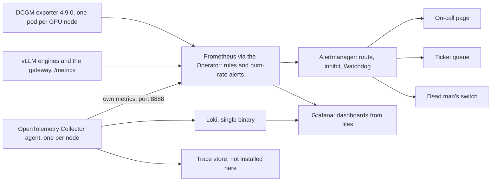

# 19.7 Capstone: an observability platform

| Field | Value |
|---|---|
| Level | Advanced |
| Priority tier | 2 |
| Lab venue | GCP / GKE for the install, a laptop with Docker for the acceptance tests |
| Part | Part 19: Capstones, design and interview readiness |
| Primary sources | Production Kubernetes (Chapter 9); Systems Performance, 2nd edition (Chapters 2 and 4); LLMs in Production (Chapter 3); Scalable Kubernetes Infrastructure for AI Platforms (Chapter 4); AI Factory (Chapter 9, read, not cited); upstream chart, release and documentation pages fetched 2026-11-10 |
| Cross-references | Chapters 17.1 to 17.6; Chapter 11.3 (GPU Feature Discovery); Chapter 19.6 (node health); Chapters 20.15, 20.19 and 20.25 |
| Coverage file | `planning/coverage/chapters/19-07.md` |
| Claim & number ledger | `planning/ledgers/19-07.md` |

## Why this matters for AI infrastructure

It is 3 a.m. and a customer reports slow answers. The on-call engineer opens the dashboard and finds every GPU panel empty. The exporter pods are running. Yet no series arrive, because an upgrade changed the metric names and every query still asks for the old ones.

Each piece of that story has a home chapter, from 17.2 on Prometheus to 17.6 on alerting, and Chapters 20.15, 20.19 and 20.25 on pipelines, burn rates and PromQL traps. A team can read all of them and still ship a stack that fails silently. The failure lives between the pieces.

This capstone is about those gaps. It builds one stack, and then it proves the stack works. Proof here means tests that fail when something breaks. A rule has a unit test. A fault is injected and must arrive at the right receiver. A dashboard is parsed and then queried. A series budget is computed and checked. Production Kubernetes makes the same point about the weakest link in an alerting system. If the metrics and alerting systems go down, you need an alert that tells you so, and the stack has to be built to give it.

## Prerequisites and outcomes

### Prerequisites

- Chapters 17.1 to 17.6: the three pillars, Prometheus and Grafana, Loki and OpenTelemetry, the DCGM exporter, profiling, and alerting with SLOs.
- Chapter 20.19 for burn-rate arithmetic and Chapter 20.15 for the cardinality estimator this chapter reuses.
- A laptop with `promtool`, `amtool`, `helm`, Python 3 with pytest and PyYAML, and Docker.

### Outcomes

After this capstone you will be able to:

1. Draw the stack, name the version of each part and say which file configures it.
2. Explain why dcgm-exporter 4.9.0 breaks queries written for older versions.
3. Write platform alert rules with unit tests, and wrap them for the Prometheus Operator.
4. Route alerts so that only burn-rate alerts page, and prove the route and an inhibit rule.
5. Keep a Grafana dashboard in Git and check that every expression parses and returns data.
6. Set and test a cardinality budget, then run the Docker end-to-end test and read its result.

---

## 1. The platform on one page

A new platform engineer inherits an observability stack and asks a plain question. Which part would I look at if a GPU alert never arrived? Without a map the answer is a guess. With a map it is a short walk along one path.

The path starts at the exporters and ends at a person. DCGM exporter publishes GPU metrics from every GPU node. The vLLM engines and the gateway publish their own metrics. Prometheus scrapes all of them and evaluates rules. Alertmanager decides who hears about a problem. Grafana shows the same data to humans. The OpenTelemetry Collector takes logs and traces off each node and sends them to Loki and a trace store.



Each box has a version, a file and a test. The table is the lookup you will use most. The versions are the ones pinned in the files and fetched on 2026-11-10.

| Part | Version pinned | File in code/part19 | Proved by |
|---|---|---|---|
| Prometheus Operator stack | chart 93.1.1, Prometheus v3.16.0, Alertmanager v0.34.2, Grafana 13.3.0 | `c07_values_kps.yaml` | helm template, kubeconform, selector and secret tests |
| DCGM exporter | chart 4.9.0 | `c07_values_dcgm.yaml` | helm template, field-name test against the chart's counter list |
| Loki | chart 7.5.0, Loki 3.6.16 | `c07_values_loki.yaml` | helm template with the chart schema |
| OpenTelemetry Collector | chart 0.178.2, image 0.164.0 | `c07_values_otel.yaml` | rendered config checked with the collector's own validate command |
| Platform alert rules | not applicable | `c07_stack_rules.yaml`, `c07_rules_test.yaml` | promtool check and promtool test |
| SLO burn-rate rules | Chapter 20.19 files | `code/part20/slo_*.yaml` by reference | promtool scenarios and the Docker run |
| Alertmanager config | amtool 0.31.1, test server 0.35.0 | `c07_alertmanager.yaml` | amtool check and route tests, Docker run |
| Dashboard | Grafana schemaVersion 41 | `c07_dashboard_gpu_platform.json` | structure check, promtool parse, queries through Grafana |
| Series budget | Prometheus budget 2,000,000 | `c07_metric_spec.json` | estimator and linter from Chapter 20.15 |

The Alertmanager versions do not match. The chart deploys v0.34.2, the host `amtool` is 0.31.1 and the Docker test runs 0.35.0. The configuration parses in all three, but a production team should pin one version.

**Decision rule:** Before you build anything, write down one version and one test for every box on the diagram.

**In one minute:** The stack has three layers. Exporters produce signals, Prometheus and Loki store them, and Alertmanager and Grafana tell people. Every layer in this chapter has a pinned version and a test. If a box has no test, treat it as unproven.

---

## 2. The foundation: kube-prometheus-stack

A team installs the stack with default values. A month later someone adds a ServiceMonitor for the GPU exporter and nothing is scraped. The cause is a selector. By default the Operator only picks up objects that carry the Helm release label. Nobody on the team knew that.

The values file below changes the defaults that matter for a GPU platform. Production Kubernetes explains why the Operator exists. It turns Prometheus servers, Alertmanager, scrape targets and rules into Kubernetes objects. The book says the ServiceMonitor is the most common of them. The chart packages the Operator with Grafana, node-exporter and kube-state-metrics.

The file is `code/part19/c07_values_kps.yaml`.

```yaml
# kube-prometheus-stack 93.1.1 (app v0.95.1). Namespace: monitoring. Release: kps.
# Chart facts checked against the chart's own values.yaml and CRDs, 2026-11-10.
# Install:
#   helm install kps prometheus-community/kube-prometheus-stack --version 93.1.1 \
#     -n monitoring --create-namespace -f c07_values_kps.yaml
fullnameOverride: kps

defaultRules:
  create: true

prometheus:
  prometheusSpec:
    # Pick up ServiceMonitor, PodMonitor and PrometheusRule objects from any
    # namespace and without the Helm release label.
    serviceMonitorSelectorNilUsesHelmValues: false
    podMonitorSelectorNilUsesHelmValues: false
    ruleSelectorNilUsesHelmValues: false
    scrapeInterval: 30s
    evaluationInterval: 30s
    retention: 15d
    retentionSize: 80GB
    # Cardinality guard 1: a scrape that returns more samples than this fails.
    enforcedSampleLimit: 100000
    # Cardinality guard 2: a scrape with more labels on one series than this fails.
    enforcedLabelLimit: 30
    resources:
      requests:
        cpu: "1"
        memory: 8Gi
      limits:
        memory: 8Gi
    storageSpec:
      volumeClaimTemplate:
        spec:
          accessModes: ["ReadWriteOnce"]
          resources:
            requests:
              storage: 100Gi

alertmanager:
  alertmanagerSpec:
    replicas: 2
    # Secret in the monitoring namespace with the key alertmanager.yaml.
    # Create it from c07_alertmanager.yaml (see the lab). Other keys in the
    # Secret are copied into /etc/alertmanager/config.
    configSecret: alertmanager-gpu-platform
    # Secrets listed here are mounted under /etc/alertmanager/secrets/<name>/.
    secrets:
      - alertmanager-receivers

grafana:
  admin:
    # Secret with keys admin-user and admin-password. Create it yourself.
    existingSecret: grafana-admin
  sidecar:
    dashboards:
      enabled: true
      label: grafana_dashboard
      labelValue: "1"
      searchNamespace: ALL
  additionalDataSources:
    - name: Loki
      uid: loki
      type: loki
      access: proxy
      url: http://loki.monitoring.svc.cluster.local:3100
```

Read the file from the top. The `fullnameOverride` of `kps` keeps service names short. The three `NilUsesHelmValues` settings are set to false. In the chart's rendering this turns the service monitor and rule selectors into empty selectors, and a test checks both. An empty selector matches everything in the cluster.

The two enforced limits are the first cardinality guard. A scrape over 100,000 samples fails, and so does a scrape with a series of more than 30 labels. The chart comments describe the sample limit as an override of any per-target limit. These numbers are starting points that I chose. Measure `scrape_samples_scraped` on your largest target before you keep them. kube-state-metrics on a large cluster may already be above 100,000 samples.

The size cap of 80 GB interacts with the series budget. Section 8 shows the effect.

The Alertmanager block uses `configSecret`. The Operator CRD says this names a Secret in the same namespace with the key `alertmanager.yaml`. If the Secret or the key is missing, the Operator installs a minimal config with one empty receiver. In practice that means alerts are silently dropped. Section 5 adds a test that the Watchdog alert reaches a receiver.

The `secrets` list mounts each named Secret under `/etc/alertmanager/secrets/<name>` in the Alertmanager container. The receiver tokens live there, outside Git. The Grafana block reads the admin login from an existing Secret and turns on the dashboard sidecar. The sidecar loads any ConfigMap carrying the label `grafana_dashboard` with value `1`.

**Decision rule:** Before you add a scrape target, check that the Prometheus object selects it, and before you rely on alerts, check that the Alertmanager Secret exists.

**In one minute:** The chart defaults hide your own objects behind a release label. Turn that off, cap scrape size, and mount receiver secrets from outside Git. A missing Alertmanager Secret drops alerts without an error, so test that a canary alert arrives.

---

## 3. GPU and engine signals

An engineer upgrades the DCGM exporter chart from a 4.8 release to 4.9.0 on a Friday. The pods start and the scrape targets stay green. On Monday the GPU dashboard shows nothing and the temperature alert has not fired all weekend. Nothing is broken in Prometheus. The names changed.

The release notes for dcgm-exporter 4.9.0 say it renames default metrics and labels, changes some units, and changes the configuration and Helm values formats. They list 23 renamed fields. Eleven of them change unit. Clocks move from megahertz to hertz. Utilization moves from a percentage to a ratio between 0 and 1. GPU memory moves from mebibytes to bytes.

Every name below is in the chart's default counter file, and a test checks that.

| Signal | Name in 4.9.0 | Unit or meaning |
|---|---|---|
| GPU utilization | `DCGM_FI_DEV_GPU_UTIL_RATIO` | ratio from 0 to 1 |
| Memory used and total | `DCGM_FI_DEV_FB_USED_BYTES`, `DCGM_FI_DEV_FB_CAPACITY_BYTES` | bytes |
| Temperature | `DCGM_FI_DEV_GPU_TEMP_CELSIUS` | degrees Celsius |
| Last Xid | `DCGM_FI_DEV_XID_ERROR` | value of the last Xid seen |
| Row remap failure | `DCGM_FI_DEV_ROW_REMAP_FAILED` | whether row remapping failed |

Chapter 17.4 and the file `code/part17/gpu_alerts.yaml` use the older names, such as `DCGM_FI_DEV_GPU_UTIL` and `DCGM_FI_DEV_GPU_TEMP`. They match exporter releases before 4.9.0. On a 4.9.0 chart their queries return nothing. That is a good example of a failure that no unit test of the rule alone would find. The test that finds it reads the chart's counter file and checks every name the platform uses.

The DCGM values file is `code/part19/c07_values_dcgm.yaml`. It is short. It limits the DaemonSet to nodes that GPU Feature Discovery has labelled, as Chapter 11.3 explains. It replaces the default toleration list with one for the GPU taint. That taint key is a common cloud default and an assumption, so check it on your nodes. It also adds a relabeling that copies the pod's node name into a label called `node`. All platform rules group by that label.

LLMs in Production warns that models fail silently. They keep running and return poor results. Its list of what to monitor is resource metrics, performance metrics such as latency and queries per second, and operational metrics such as status codes and error rates. The vLLM and gateway metrics come from Chapter 20.19, which checked every name against vLLM v0.32.0. Generative AI on Kubernetes names the vLLM time-to-first-token histogram `vllm:time_to_first_token_seconds`, which matches Chapter 20.19. The Kubernetes AI platforms book lists the cache usage and the waiting and running request gauges as the vLLM signals to watch. The book's names differ from the ones Chapter 20.19 verified for vLLM v0.32.0. My reasoning is that the engine renamed them since. Use the names in Chapter 20.19 and check them against your own vLLM version.

The platform rules are the second file. Only burn-rate alerts page. Everything in this file is a ticket, which follows the symptom-first advice of Chapter 20.19. The file also carries the guards for the pipeline itself.

```yaml
# Platform alert rules for the observability capstone (Chapter 19.7).
# GPU metric names are the dcgm-exporter 4.9.0 names (suffixes _CELSIUS, _RATIO, _BYTES).
# SLO burn-rate rules are not repeated here: they live in code/part20 and the
# acceptance tests load them from there (slo_recording_rules.yaml and
# slo_burn_alerts_availability.yaml).
# Severity policy: only burn-rate alerts page. Everything here is a ticket.
groups:
  - name: c07_gpu_health
    interval: 30s
    rules:
      - alert: GPUXidError
        expr: max by (node, gpu) (DCGM_FI_DEV_XID_ERROR) > 0
        labels: {severity: ticket, area: gpu}
        annotations:
          summary: "GPU {{ $labels.gpu }} on {{ $labels.node }} reported Xid {{ $value }}"
          runbook: "runbooks/gpu-xid.md"
      - alert: GPUTemperatureHigh
        expr: max by (node, gpu) (DCGM_FI_DEV_GPU_TEMP_CELSIUS) > 85
        for: 10m
        labels: {severity: ticket, area: gpu}
        annotations:
          summary: "GPU {{ $labels.gpu }} on {{ $labels.node }} is above 85 C for 10 minutes"
          runbook: "runbooks/gpu-thermal.md"
      - alert: GPURowRemapFailed
        expr: max by (node, gpu) (DCGM_FI_DEV_ROW_REMAP_FAILED) > 0
        labels: {severity: ticket, area: gpu}
        annotations:
          summary: "GPU {{ $labels.gpu }} on {{ $labels.node }} failed a memory row remap"
          runbook: "runbooks/gpu-rma.md"
      - alert: DCGMMetricsMissing
        expr: absent(DCGM_FI_DEV_GPU_UTIL_RATIO)
        for: 10m
        labels: {severity: ticket, area: pipeline}
        annotations:
          summary: "No DCGM GPU utilisation series for 10 minutes"
          runbook: "runbooks/dcgm-missing.md"

  - name: c07_observability_pipeline
    interval: 30s
    rules:
      - alert: ObservabilityTargetDown
        expr: up{namespace="monitoring"} == 0
        for: 5m
        labels: {severity: ticket, area: pipeline}
        annotations:
          summary: "Scrape target {{ $labels.job }} {{ $labels.instance }} is down"
          runbook: "runbooks/target-down.md"
      # Budget: 2,000,000 head series per Prometheus shard. Alert at 80 percent.
      - alert: TSDBHeadSeriesNearBudget
        expr: prometheus_tsdb_head_series > 1600000
        for: 15m
        labels: {severity: ticket, area: cardinality}
        annotations:
          summary: "Prometheus head series passed 80 percent of the 2,000,000 budget"
          runbook: "runbooks/cardinality.md"
      - alert: ScrapeSampleLimitHit
        expr: increase(prometheus_target_scrapes_exceeded_sample_limit_total[10m]) > 0
        labels: {severity: ticket, area: cardinality}
        annotations:
          summary: "A scrape was rejected for exceeding the sample limit"
          runbook: "runbooks/cardinality.md"
      - alert: OtelCollectorRefusingData
        expr: sum(rate({__name__=~"otelcol_receiver_refused_(log_records|spans)"}[5m])) > 0
        for: 5m
        labels: {severity: ticket, area: pipeline}
        annotations:
          summary: "An OpenTelemetry Collector is refusing logs or spans"
          runbook: "runbooks/otel-refusing.md"
      - alert: OtelCollectorExportFailing
        expr: sum by (exporter) (rate({__name__=~"otelcol_exporter_send_failed_(log_records|spans)"}[5m])) > 0
        for: 5m
        labels: {severity: ticket, area: pipeline}
        annotations:
          summary: "OpenTelemetry exporter {{ $labels.exporter }} is failing to send"
          runbook: "runbooks/otel-export.md"
```

Two rules deserve a comment. The Xid alert has no `for` clause because an Xid is an event, and the gauge holds the last value, so whether it clears after a recovery is not verified here. Chapter 19.6 treats the Xid codes. The collector rules match the metric name with a regular expression so that a missing span counter does not blank the alert.

The unit tests live in `code/part19/c07_rules_test.yaml`. There are 11 test cases. Each alert has a firing case and a quiet case. A pytest asserts that every alert in the rule file appears in at least one test, so a new alert without a test fails the suite. Another test changes a threshold in a temporary copy and confirms that the unit tests then fail.

**Decision rule:** After every exporter upgrade, compare the names your rules and dashboards use with the exporter's own default counter list.

**In one minute:** dcgm-exporter 4.9.0 renamed fields and changed units, so older queries return nothing without any error. Pin the chart, write the rules with the new names, and test the names against the chart. Page on burn rate and ticket on causes.

---

## 4. SLOs and burn-rate alerts

A team writes an alert that fires when the error ratio passes one percent. A ten-second blip pages the on-call at 2 a.m. A week later a slow leak runs for three days and nobody is paged. Both are the same alert behaving as written.

Chapter 20.19 explains the fix and gives the numbers. The error budget for a 99.9 percent SLO is 0.1 percent of requests. A burn rate of 1 spends the whole budget in the window. The page alerts use two burn rates, 14.4 and 6, each with a long and a short window. This chapter does not repeat that work. It reuses the rule files in `code/part20` and proves that they page the way the theory says.

The proof uses synthetic signal injection. The file `code/part19/c07_signals.py` describes a fault as the number of requests per minute and the share that fail. It does two things with the same numbers. It writes a promtool test that feeds the counters to the real rule files. It also evaluates the multiwindow policy in plain Python by using the calculator from Chapter 20.19. The runner compares the two answers. If the rule file and the model disagree, one of them is wrong.

Four scenarios run in the suite. Each uses 6,000 requests per minute for 70 minutes. The table lists what the model says and promtool confirmed.

| Scenario | Errors | Minute checked | Fast alert | Slow alert |
|---|---|---|---|---|
| Healthy | 0.05 percent | 30 and 65 | quiet | quiet |
| Fast burn | 3 percent for 70 minutes | 10 and 65 | fires | fires |
| Slow leak | 0.8 percent | 30 and 65 | quiet | fires |
| Blip | total failure for 3 minutes, then clean | 2 | fires | fires |
| Blip | same | 10 | quiet | fires |
| Blip | same | 65 | quiet | quiet |

The blip rows are the lesson. At minute 2 both alerts fire because both windows are full of failures. At minute 10 the fast alert is quiet because its 5-minute window is clean again. The slow alert still fires because its 30-minute window still holds the blip. A three-minute outage therefore keeps the slow page open for about half an hour. That is how the policy is built, and it explains why the slow rule is a page and not a log line. The 65-minute row shows the alert closing once the windows are clean.

**Decision rule:** Test every burn-rate rule with at least one fault that must fire it and one that must not.

**In one minute:** Reuse the Chapter 20.19 rules and prove them with injected faults. A Python model and promtool must agree on every scenario. A short blip pages the fast rule while it lasts and keeps the slow rule open for about thirty minutes.

---

## 5. Alertmanager: routing that is tested

Two weeks after a migration, nobody has been paged. The dashboards show alerts firing. The cause is a route that matched on a label no rule sets. Alerts fell through to a default receiver that sends to an unread mailbox. The configuration was valid. It was never tested.

The Alertmanager file has three routes and one inhibit rule. The always-firing Watchdog goes to a dead man's switch. Production Kubernetes calls this out as one of the most important alerts. If the alerting system goes down, the switch stops hearing the Watchdog and raises the alarm. Alerts with `severity="page"` go to the on-call service. Alerts with `severity="ticket"` go to a ticket queue, and so does anything unlabelled.

```yaml
# Alertmanager configuration for the GPU platform. Loaded from the Secret
# alertmanager-gpu-platform (key alertmanager.yaml), see c07_values_kps.yaml.
# Secret files are mounted by the operator at /etc/alertmanager/secrets/<secret>/
# and are created outside Git, mode 0400 inside the Secret volume.
route:
  receiver: ticket-queue
  group_by: [alertname, model, node]
  group_wait: 30s
  group_interval: 5m
  repeat_interval: 4h
  routes:
    # The always-firing Watchdog goes to a dead man's switch, never to humans.
    - matchers: [alertname="Watchdog"]
      receiver: deadman
      group_wait: 0s
      group_interval: 1m
      repeat_interval: 1m
    - matchers: [severity="page"]
      receiver: oncall-page
      group_wait: 10s
      repeat_interval: 1h
    - matchers: [severity="ticket"]
      receiver: ticket-queue
      repeat_interval: 12h

inhibit_rules:
  # A node that is not ready explains every GPU alert on it.
  - source_matchers: [alertname="KubeNodeNotReady"]
    target_matchers: [area="gpu"]
    equal: [node]

receivers:
  - name: oncall-page
    pagerduty_configs:
      - routing_key_file: /etc/alertmanager/secrets/alertmanager-receivers/pagerduty-routing-key
  - name: ticket-queue
    webhook_configs:
      - url_file: /etc/alertmanager/secrets/alertmanager-receivers/ticket-webhook-url
  - name: deadman
    webhook_configs:
      - url_file: /etc/alertmanager/secrets/alertmanager-receivers/deadman-url
        send_resolved: false
```

The secrets rule is simple. No token or URL appears in the file. The pager key and the two webhook URLs are read from files that the Operator mounts from the `alertmanager-receivers` Secret. The Alertmanager docs list `routing_key_file` for the PagerDuty receiver and `url_file` for the webhook receiver, and a test checks that no inline secret fields exist. Create each file with mode 0400 and keep it out of Git. The host `amtool` 0.31.1 accepts this file. The Docker run swaps the receivers for plain webhooks, so reading the real secret files is not exercised here.

The inhibit rule uses the matcher syntax with `source_matchers`, `target_matchers` and `equal`. The Alertmanager docs mark the older `source_match` forms as deprecated. The rule says that a node that is not ready explains every GPU alert on that node. The alert name `KubeNodeNotReady` comes from the chart's default rules, and a test renders the chart to confirm that both it and Watchdog exist.

Two kinds of test prove the file. `amtool config routes test` prints the receiver an alert would reach, and the test asserts four routes including the fall-through. The Docker run starts a real Alertmanager with the same route tree and inhibit rule. It posts a not-ready alert for node n2 and a GPU alert for n2 and for n3. The n3 alert reaches the ticket receiver. The n2 alert does not, and the API reports it suppressed with a non-empty `inhibitedBy`.

**Decision rule:** Never ship a route tree you have not walked with `amtool config routes test` and one real alert per receiver.

**In one minute:** Route on severity, send the Watchdog to a dead man's switch, and keep secrets in mounted files. Prove the tree with amtool and with a real Alertmanager. An inhibit rule needs both a positive case and a negative case.

---

## 6. Logs and traces: Loki and the OpenTelemetry Collector

An incident review needs the error logs from the minute the alert fired. The logs are there, but each node shipped them with a different label scheme. The engineer spends an hour joining them by hand. A single collector configuration, with metadata added at the edge, removes that hour.

Production Kubernetes lists three ways to get container logs off a node. The application can forward them, a sidecar can forward them, or a node agent can read the log files. The book recommends the node agent, because it gives one place to filter, add metadata and change the backend. This capstone follows that advice with the OpenTelemetry Collector as the node agent. The book's other warning also applies. The agent becomes a single point of failure for its node, so it needs its own alerts. Section 3 has them.

The collector values file turns on two presets. The log preset adds the file-reading receiver and its volume mounts. The metadata preset adds the processor that tags every record with its pod and namespace. The pipeline then limits memory first, adds metadata, redacts one header and batches. The logs go to Loki over its OTLP endpoint. The traces go to a trace store that this chapter does not install.

```yaml
# opentelemetry-collector chart 0.178.2. One agent per node (DaemonSet).
# The chart default image is 0.163.2. This file pins 0.164.0, the version the
# rendered config is validated against in test_c07_stack.py.
# Install:
#   helm repo add open-telemetry https://open-telemetry.github.io/opentelemetry-helm-charts
#   helm install otel-agent open-telemetry/opentelemetry-collector --version 0.178.2 \
#     -n monitoring -f c07_values_otel.yaml
mode: daemonset
fullnameOverride: otel-agent

image:
  repository: otel/opentelemetry-collector-contrib
  tag: "0.164.0"

presets:
  logsCollection:
    enabled: true
  kubernetesAttributes:
    enabled: true

config:
  receivers:
    otlp:
      protocols:
        grpc:
          endpoint: ${env:MY_POD_IP}:4317
        http:
          endpoint: ${env:MY_POD_IP}:4318
    # Replace the chart defaults so only the receivers named in the pipelines exist.
    jaeger: null
    zipkin: null
    prometheus: null
  processors:
    memory_limiter:
      check_interval: 1s
      limit_percentage: 80
      spike_limit_percentage: 25
    batch:
      timeout: 1s
      send_batch_size: 1024
    # Never ship an Authorization header into the trace store.
    attributes/redact:
      actions:
        - key: http.request.header.authorization
          action: delete
  exporters:
    otlphttp/loki:
      endpoint: http://loki.monitoring.svc.cluster.local:3100/otlp
    otlp/tempo:
      endpoint: tempo.monitoring.svc.cluster.local:4317
      tls:
        insecure: true
    debug: null
  service:
    telemetry:
      metrics:
        readers:
          - pull:
              exporter:
                prometheus:
                  host: 0.0.0.0
                  port: 8888
    pipelines:
      logs:
        receivers: [otlp, filelog]
        processors: [memory_limiter, k8sattributes, batch]
        exporters: [otlphttp/loki]
      traces:
        receivers: [otlp]
        processors: [memory_limiter, k8sattributes, attributes/redact, batch]
        exporters: [otlp/tempo]
      metrics: null

# Expose the collector's own metrics so Prometheus can scrape them.
ports:
  metrics:
    enabled: true
podMonitor:
  enabled: true
  metricsEndpoints:
    - port: metrics
```

Three things surprised me, and each one is a reason to test the rendered output and not the values file.

First, the chart rewrites component names. The values file says `otlphttp/loki`. The chart's output says `otlp_http/loki`. It also renames `filelog` to `file_log` and `k8sattributes` to `k8s_attributes`. The collector image 0.164.0 accepts the rendered names. A reader who greps the live config for the names in the values file finds nothing.

Second, the metadata processor reads the node name from an environment variable called `K8S_NODE_NAME`. The first validation attempt failed with a message that the variable was not set. The DaemonSet sets it, so the validation command needs it passed in. The test passes it with `-e`.

Third, the chart's default image is 0.163.2 and the values file pins 0.164.0. The pin is checked with `validate` only. The full chart output was not run, because the metadata processor needs a Kubernetes API.

The test extracts the rendered ConfigMap and runs the pinned image's `validate` command on it, mounting only that one file. A broken copy, with the first processor replaced by one that does not exist, must fail. Both outcomes are asserted.

Loki follows the same idea in a smaller file. It runs as a single binary with filesystem storage. That layout suits a lab and a small platform. Chapter 20.15 covers what changes at high volume. The Loki docs say OTLP ingestion needs structured metadata, which is on by default from Loki 3.0, and the values set it explicitly. The default index labels include the Kubernetes namespace, pod and container names. Loki stores the namespace as a label whose dots become underscores, so the dashboard query uses `k8s_namespace_name`. That mapping is my reasoning from the docs and the label list, and I did not run Loki here.

The file is `code/part19/c07_values_loki.yaml`. It sets the deployment mode to single binary, schema version 13 with the TSDB store on the filesystem, structured metadata on, 168 hours of retention, and zero replicas for every other mode. It also turns off MinIO, the caches and the canary, and enables the chart's service monitor. Helm rendered it against the chart schema without error. A non-string deployment mode failed to render, but several other bad values did not, so the schema is a weak guard.

The collector's own metrics matter as much as the logs. Collector 0.164.0 with the Prometheus reader on port 8888 exposed these names after one log record was sent: `otelcol_receiver_accepted_log_records`, `otelcol_receiver_refused_log_records` and `otelcol_receiver_failed_log_records`. There was no `_total` suffix. A second run with an exporter pointed at a dead address produced `otelcol_exporter_send_failed_log_records` with exporter and server labels. The platform alert rules use exactly these names. The collector docs also list some names with `_total`, so check your own version before you trust a rule written for another one.

**Decision rule:** Validate the rendered collector config with the collector's own command, and alert on the collector's own refusal and send-failure counters.

**In one minute:** Use a node agent, as Production Kubernetes recommends, and let the chart add the metadata. The chart rewrites component names, so test its output and not your input. Watch the agent itself, because it can fail silently for a whole node.

---

## 7. Dashboards as code

A dashboard is edited by hand during an incident and the change is never saved. Three months later a redeploy restores the old version and the panel everyone relied on is gone. Keeping the JSON in Git and loading it from a file fixes that, but only if something checks the file.

The dashboard has 11 panels. Ten query Prometheus. One queries Loki. Every panel names its datasource by a fixed uid, `prometheus` or `loki`. The uid `prometheus` matches the one the stack chart provisions by default. A variable called `model` is filled from the vLLM waiting-request gauge and feeds four panels.

| Panel | Expression summary | Why it is there |
|---|---|---|
| GPU utilization by node | average of the utilization ratio per node | USE method, utilization |
| GPU memory used share | memory used divided by capacity per node | USE method, saturation of memory |
| GPU temperature | maximum per node and GPU | thermal trouble |
| Last Xid per GPU | maximum of the Xid gauge | USE method, errors |
| vLLM requests waiting | sum of the waiting gauge per model | saturation of the engine |
| vLLM KV cache usage | maximum of cache usage per model | saturation of memory in the engine |
| Availability burn rate | one-hour error ratio divided by 0.001 | how fast the budget burns |
| Gateway TTFT p99 | recorded 99th percentile of time to first token | user-visible latency |
| Prometheus head series | head series gauge | budget watch |
| Collector refusals | rate of refused log records and spans | pipeline health |
| Error logs | Loki query on the llm-serving namespace | context for a page |

The table follows the methods in Systems Performance. The USE method asks for utilization, saturation and errors for every resource, and the RED method asks for rate, errors and duration for every service. The book says the first suits machine health and the second suits user health. The dashboard shows both. The book also warns that a five-minute average can hide short bursts of saturation, so the burn-rate alerts pair a long window with a short one.

The check script tests the structure, the datasource uids and the dollar variables. Then it parses every PromQL expression.

Parsing uses promtool and not a home-made grammar. The script replaces the macro for the rate interval with a plain duration and the model variable with a regular expression that matches anything. It writes each expression into a temporary rule file as a recording rule and runs `promtool check rules` on it. A bad expression is reported against its panel. The tests break each of these on purpose and require a report.

Parsing proves syntax only. A well-formed query for a metric that no longer exists passes. The Docker run closes that gap. Grafana 13.3.0 loads the dashboard from a provisioned file, and the run sends each Prometheus panel expression through the Grafana query API and requires data back. All ten returned data in the run recorded below.

**Decision rule:** Keep dashboards in Git, parse every expression in CI, and query every panel against test data before you merge.

**In one minute:** A dashboard in Git survives a redeploy. A structural check plus the promtool parser catches broken queries. A query run through Grafana against synthetic data catches queries that are valid but empty.

---

## 8. The cardinality budget

A developer adds a user identifier to the gateway request counter. The change looks harmless in review. Within a day the Prometheus memory use triples and the dashboards time out. One label multiplied every other label.

Chapter 17.1 gives the cardinality rules and Chapter 20.15 gives an estimator and a label linter. This chapter reuses both without copying them. The script `c07_cardinality_budget.py` adds one platform rule. The series the platform declares, plus the series reserved for Kubernetes components, must fit the Prometheus budget of 2,000,000 head series.

The reserved share is my assumption. I set it to 1,000,000 as a placeholder for kube-state-metrics, cAdvisor and node-exporter. Replace it with the value you measure from your own Prometheus. The declared families are in `code/part19/c07_metric_spec.json`. The fleet is 50 GPU nodes with 8 GPUs each, 40 vLLM pods and 4 gateway pods.

The estimator multiplies label values, applies a fill factor and counts histogram buckets. The results are below. The DCGM line is 26 fields times 8 GPUs times 50 nodes. The 26 is the count of non-label rows in the chart's default counter file, and a test checks it.

| Family | Series |
|---|---|
| DCGM default fields | 10,400 |
| Gateway TTFT histogram | 1,700 |
| Tenant token counter | 1,600 |
| vLLM TTFT and inter-token histograms | 1,000 each |
| Gateway request counter | 800 |
| vLLM success counter and waiting gauge | 160 and 40 |
| Declared total | 16,700 |

The declared total plus the reserved 1,000,000 gives 1,016,700 series. That leaves 983,300 of headroom. The disk estimate for the full 1,016,700 series at 30-second scrapes over 15 days is 43.9 GB at one byte per sample and 87.8 GB at two. The size cap in the values file is 80 GB. At the high end the cap would delete old blocks before the 15 days are over. Raise the volume or lower the retention, and decide it on purpose.

The second file, `c07_metric_spec_bad.json`, adds a label with 50,000 values called `user_id` to the gateway counter. The check rejects it three ways. The linter flags the forbidden label. The family budget is exceeded, because 40,000,000 series is far above the family limit. The total budget is blown as well. The test asserts all of this. A third test raises the reserved share to 1,990,000 and confirms that the check then fails.

The budget is enforced in three places. The spec check runs in CI, the scrape limits in Section 2 stop one bad target, and the alert from Section 3 warns at 80 percent. The Docker run also lints the exporter's real exposition text, and a bad sample with a request identifier label must fail.

**Decision rule:** Compute the series count of every new metric family before it ships, and fail the build when the total passes the budget.

**In one minute:** A label is a multiplier. Declare families, estimate series, reserve room for Kubernetes and fail CI when the sum passes the budget. Back that with scrape limits and an alert at 80 percent.

---

## 9. The acceptance tests: what each one proves

A platform team says that the stack is done. A skeptical engineer asks what would fail if one part broke. A good answer is a table that maps each part to the test that would catch it. The table below is that answer for this chapter.

| Test | Fault or input | Expected result | Where |
|---|---|---|---|
| promtool check and test rules | thresholds, missing series, flat counters | each alert fires or stays quiet as specified | `c07_rules_test.yaml` |
| Changed threshold | threshold raised in a copy | unit tests fail | `test_c07_observability.py` |
| Synthetic SLO scenarios | healthy, fast burn, slow leak, blip | promtool equals the Python model | `c07_signals.py` |
| Route tests | four label sets | each reaches its receiver | `c07_acceptance.py` |
| Dashboard check | five kinds of broken dashboard | each reported | `c07_dashboard_check.py` |
| Cardinality | good spec, bad spec, big reserve | pass, fail, fail | `c07_cardinality_budget.py` |
| Chart tests | helm template, schemas, kubeconform | rendered objects are valid | `test_c07_stack.py` |
| Collector validate | rendered config, broken config | pass, fail | `test_c07_stack.py` |
| Docker end to end | injected faults | each alert reaches its receiver | `c07_e2e.py` |

The Docker run ties the layers together. It starts Prometheus 3.16.0 with the platform and Part 20 SLO rules, Alertmanager 0.35.0 with the real route tree and webhook receivers, Grafana 13.3.0 with the dashboard, and a synthetic exporter and webhook sink in small Python containers. The containers drop all capabilities, mount only generated config files read-only, and publish ports on the loopback address alone.

An early version ran the exporter and sink as host processes. The containers could not scrape them and I did not find out why, so the final version runs both inside the network.

The run first checks the Watchdog, then waits a minute for healthy traffic, then injects four faults at once and polls for up to 150 seconds. The faults are a GPU Xid, a probe signal, a 100 percent gateway error ratio, and a not-ready alert with GPU alerts posted straight to Alertmanager.

The recorded result of the run was 16 checks passed and none failed. The list of checks is in the lab. The check "injected 100 percent errors fire the fast burn alert" is the most valuable one. It shows the whole chain at work. The synthetic counter moves, Prometheus scrapes it, the Part 20 recording rule computes the ratio, the burn alert fires, Alertmanager routes it by severity, and the page receiver gets it. The run starts with a fresh Prometheus, so the one-hour window holds only a few minutes of data. That is why a few minutes of failure is enough to fire the alert. A production alert would need the window to fill, and that is what the promtool scenarios in Section 4 cover.

The probe alert in the end-to-end rules file exists only for the test. It proves the path from a rule to the page receiver without waiting for a burn.

**Decision rule:** Map every box in the architecture to a test that fails when the box breaks, and run the full chain at least once before each stack upgrade.

**In one minute:** Unit tests prove rules, scenario tests prove the SLO policy, route tests prove Alertmanager, chart tests prove the install and the Docker run proves the chain. The Docker run injected four faults and each reached the right receiver.

---

## 10. Hands-on lab

This lab has two halves. The first half runs on a laptop and was run for this chapter. The second half installs the stack on a cluster and was not run here, because it needs a Kubernetes cluster with GPUs. Any step that needs hardware says so.

**What was run here:** the host promtool built from Go module v0.316.0 and the promtool 3.16.0 inside the Prometheus image, amtool 0.31.1, helm v4.2.3, kubeconform, Docker through Rancher Desktop, and Python 3.12 with pytest 8.3.5. The charts were pulled on 2026-11-10 at the versions above.

**What was not run:** the cluster install, the DCGM exporter on real GPUs, Loki, the collector with the Kubernetes metadata processor, a trace store, and the real PagerDuty and ticket receivers.

### Step 1. Run the offline acceptance checks

Run the script below from `code/part19`. It takes a few seconds. It needs promtool and amtool on the path.

```bash
#!/usr/bin/env bash
# Runs on a laptop with promtool, amtool, helm and Docker. No cluster, no GPU.
set -euo pipefail
cd "$(dirname "$0")"

python3 c07_acceptance.py                                     # offline checks, seconds
python3 -m pytest test_c07_observability.py test_c07_stack.py -q
C07_E2E_TMP="${C07_E2E_TMP:-$PWD}" python3 c07_e2e.py         # Docker, a few minutes
```

The first command prints one line per check: two for promtool, four for the scenarios, one for amtool, four for the routes, one for the dashboard and two for the cardinality spec. The run for this chapter printed 14 passed and 0 failed.

What to record: the pass count and the promtool version. Expected result: 14 passed.

### Step 2. Run the pytest suites

The second command in the script runs 42 tests in two files. One more test runs only when the environment variable `C07_E2E` is set. The suites need network access for the chart pulls and the CRD schemas. A test skips with a reason when a tool or the network is missing.

What to record: passed and skipped counts. Expected result: 42 passed in the run recorded here, and one skipped by default.

### Step 3. Run the Docker end-to-end test

The third command starts the containers, injects the faults and prints one line per check. The output from the run was:

```text
PASS amtool accepts the test Alertmanager config
PASS Prometheus scrapes the synthetic exporter and itself
PASS Prometheus loaded the platform rules without error
PASS Watchdog reaches the deadman receiver (no page, no ticket)
PASS synthetic probe reaches the page receiver
PASS injected 100 percent errors fire the fast burn alert at the page receiver
PASS injected Xid 79 reaches the ticket receiver, not the page receiver
PASS a GPU alert on a healthy node (n3) passes the inhibit rule
PASS a GPU alert on the NotReady node (n2) is inhibited
PASS Alertmanager reports the n2 alert as inhibited by KubeNodeNotReady
PASS Prometheus shows the injected alerts as firing
PASS Grafana is healthy
PASS Grafana provisioned the dashboard from the file
PASS every Prometheus panel expression returns data through Grafana
PASS live exposition passes the label policy
PASS Prometheus head series is far below the 1,600,000 alert line
16 passed, 0 failed
```

What to record: the pass count and the time from injection to the page. Expected result: 16 passed. If a check fails, the line names the receiver or panel that failed. The first run of this test failed 8 of 16 checks because the containers could not scrape an exporter running on the host. Moving the exporter into the network fixed that.

### Step 4. Break something on purpose

Change the temperature limit in `c07_stack_rules.yaml` from 85 to 95 and rerun step 1. The rule unit test must fail. Revert it, rename one DCGM metric in the dashboard JSON and rerun the Docker test. It must report an empty panel.

What to record: the failing check names. Expected result: the temperature test and one empty panel.

### Step 5. Install the stack on a cluster (not run)

The script `code/part19/c07_lab_cluster.sh` installs all four charts, creates the secrets, wraps the rule files and loads the dashboard. Create the three receiver files first and keep each at mode 0400. Not run: this needs a GKE or other Kubernetes cluster with GPU nodes labelled by GPU Feature Discovery.

Expected shape of the output, not run: Helm reports each release as deployed. The Operator creates a Prometheus and an Alertmanager StatefulSet in the `monitoring` namespace. The DCGM exporter DaemonSet has one pod per GPU node. Grafana lists the dashboard under its title after the sidecar syncs.

### Step 6. Fire a real alert on the cluster (not run)

Port-forward to Alertmanager and check that the Watchdog is present. Then scale a test gateway down, or send failing requests, and wait for the burn alert. The page must arrive at the real receiver, and the dead man's switch must keep getting the Watchdog.

**Decision rule:** Do not call the platform ready until step 3 passes on your laptop and step 6 has fired a real page on the cluster.

**In one minute:** Steps 1 to 4 were run and prove the rules, the routes, the dashboard and the chain. Steps 5 and 6 need a cluster and were not run. Break a rule on purpose at least once to see the tests fail.

---

## Exercises

1. **Add a rule with its test.** Write an alert for GPU memory above 95 percent for 10 minutes, using the 4.9.0 names. Add a firing case and a quiet case.

   Solution sketch: divide `DCGM_FI_DEV_FB_USED_BYTES` by `DCGM_FI_DEV_FB_CAPACITY_BYTES` per node and GPU. Use the ratio and not a byte count. In the test, set used to 77 GB and capacity to 80 GB for the firing case. The existing pytest that checks every alert has a test will fail until you add yours.

2. **Find the renamed metric.** A dashboard from Chapter 17.4 is empty on a 4.9.0 cluster. List the three queries you would change first.

   Solution sketch: open the chart's default counter file and compare. Utilization becomes the `_RATIO` name and the panel unit changes to percent of one. Memory used becomes the `_BYTES` name and the old megabyte conversion must go. Temperature gets the `_CELSIUS` suffix.

3. **Design a new scenario.** Write a scenario with 0.1 percent errors for 70 minutes. Predict the result before you run it.

   Solution sketch: 0.1 percent equals the budget, so the burn rate is 1. Neither page threshold of 0.006 nor 0.0144 is passed, so both quiet. Add it to the scenario list. The Python model and promtool must agree.

4. **Break the route.** Change the page matcher to `severity="critical"`. Which tests fail?

   Solution sketch: the route test for a page alert falls through to the ticket queue and fails. The Docker run fails the burn alert check at the page receiver. The amtool syntax check still passes, which is why route tests exist.

5. **Size the disk.** Your fleet doubles to 100 GPU nodes. Recompute the series and the disk.

   Solution sketch: DCGM becomes 26 times 8 times 100, which is 20,800. Change the target count in the spec. Run the spec check for the new total and run the disk formula. Compare it with the volume and the size cap.

6. **Dead man's switch.** Stop the deadman receiver in the Docker test. What should happen and what does the test show?

   Solution sketch: the Watchdog never arrives, so the first end-to-end check fails. In production the external service would notice the silence and page. The point is that silence is a signal only if something outside the stack listens for it.

---

## Checkpoint questions

<details><summary>1. Why does the stack set the three NilUsesHelmValues options to false?</summary>
By default the Operator only selects service monitors, pod monitors and rules that carry the Helm release label. Setting them to false makes the selectors empty, so objects without that label are picked up.
</details>

<details><summary>2. What happens if the Alertmanager config Secret is missing?</summary>
The Operator installs a minimal config with one empty receiver, so alerts are dropped without an error. A canary alert that must arrive is the test.
</details>

<details><summary>3. Why do older DCGM queries return nothing on a 4.9.0 exporter?</summary>
The release renamed default fields and changed units. For example the utilization name now ends in a ratio suffix. The scrape still succeeds, so nothing errors.
</details>

<details><summary>4. Which unit changes did 4.9.0 make?</summary>
Clocks moved from megahertz to hertz and utilization moved from a percentage to a ratio. GPU memory moved to bytes and NVLink throughput to bytes per second. Energy moved from millijoules to joules.
</details>

<details><summary>5. Why is the Xid alert a ticket and not a page?</summary>
Chapter 20.19 says to page on user-visible symptoms and keep cause signals for tickets. An Xid is a cause signal.
</details>

<details><summary>6. Why does the Xid rule have no for clause?</summary>
An Xid is a discrete event and the gauge holds the last value, so waiting adds delay and no confidence. Whether the gauge clears after recovery is not verified here.
</details>

<details><summary>7. How does the signals module prove a burn-rate rule?</summary>
It feeds the same per-minute counters to promtool with the real rule files and to a Python model of the policy. The two answers must match for each scenario.
</details>

<details><summary>8. Why does the slow burn alert stay open after a three-minute outage?</summary>
Its 30-minute short window still contains the failed minutes, so both of its windows stay above the threshold until the blip leaves the short window.
</details>

<details><summary>9. What does the inhibit rule say?</summary>
When KubeNodeNotReady fires for a node, alerts with area gpu and the same node are suppressed. The node explains them.
</details>

<details><summary>10. How does the test prove the inhibit rule works and not just parses?</summary>
It posts a not-ready alert and a GPU alert for node n2 and a GPU alert for n3 to a real Alertmanager. The n3 alert is delivered. The n2 alert is not, and the API reports it suppressed.
</details>

<details><summary>11. Why keep receiver secrets in files?</summary>
The config references files such as the routing key file. The Operator mounts the Secret under a known path. The tokens stay out of Git and out of the config.
</details>

<details><summary>12. What did the chart do to the collector component names?</summary>
It rendered otlphttp as otlp_http, filelog as file_log and k8sattributes as k8s_attributes. The pinned collector accepted them.
</details>

<details><summary>13. Why did collector validation fail the first time?</summary>
The metadata processor reads the node name from an environment variable that the DaemonSet sets. Outside the pod the variable was not set, so the test passes it in.
</details>

<details><summary>14. Which collector metric names did the run observe?</summary>
Refused, accepted and failed receiver counters for log records, and a send-failed exporter counter. None had a total suffix on collector 0.164.0 with this telemetry config.
</details>

<details><summary>15. What does parsing dashboard expressions with promtool prove, and what does it not?</summary>
It proves syntax. A well-formed query for a metric that no longer exists passes. Only a query against data catches that.
</details>

<details><summary>16. How does the dashboard check handle Grafana macros and variables?</summary>
It replaces the rate-interval macro with a duration and the model variable with a regular expression that matches anything. Then it parses each expression as a recording rule.
</details>

<details><summary>17. What is the reserved share in the cardinality check and where does its value come from?</summary>
It is the series set aside for Kubernetes components. The value of 1,000,000 is the author's assumption and should be replaced by a measured number.
</details>

<details><summary>18. Why is the disk estimate a concern for the size cap?</summary>
At two bytes per sample the full budget needs about 88 GB, which is above the 80 GB cap. Old blocks would be deleted before 15 days pass.
</details>

<details><summary>19. Why was the exporter moved into a container for the end-to-end test?</summary>
The containers could not scrape a host process, and binding a host process to all interfaces exposes a local service. Running it inside the test network avoids both problems.
</details>

<details><summary>20. What is the probe alert for and why is it not in production?</summary>
It proves the path from a rule to the page receiver without waiting for a real burn. It fires on a synthetic signal that only the test exporter produces.
</details>

---

## Sources and review notes

### Books

- *Production Kubernetes*, Chapter 9 "Observability": node-agent log forwarding, audit logs, alerting on logs, the Prometheus Operator objects, the dead man's switch, showback and chargeback, and tracing. Used for Sections 2, 5 and 6.
- *Systems Performance, 2nd edition*, Chapter 2 "Methodologies" (USE and RED methods, utilization over long intervals, baselines) and Chapter 4 "Observability Tools" (monitoring and exporters). Used for Section 7.
- *LLMs in Production*, Chapter 3 "Large language model operations": the monitoring system section, including silent model failure and what to record. Used in Section 3 and Section 7.
- *Scalable Kubernetes Infrastructure for AI Platforms*, Chapter 4 "Model Deployment and Monitoring": metrics for LLM serving and the vLLM signals. Used in Section 3.
- *Generative AI on Kubernetes*, Chapter 5 "Model Observability": the vLLM time-to-first-token histogram name. Used in Section 3.
- *AI Factory*, Chapter 9: read. It covers distributed computing for industrial AI and supplies no claim here.

### Upstream documents fetched 2026-11-10

- Helm chart indexes and the charts themselves: kube-prometheus-stack 93.1.1, dcgm-exporter 4.9.0, loki 7.5.0 and opentelemetry-collector 0.178.2. Values, CRD descriptions and default counter files read from the pulled archives.
- dcgm-exporter 4.9.0 release notes on GitHub, published 2026-11-06.
- Prometheus documentation for unit testing rules. Alertmanager configuration documentation (main branch).
- Loki documentation for ingesting logs with OpenTelemetry (main branch). OpenTelemetry Collector internal telemetry page.

### Cross-references to other handbook chapters

- Chapters 17.1 to 17.6 for the foundations. Chapter 11.3 for GPU Feature Discovery. Chapter 19.6 for Xid handling and node health.
- Chapters 20.15, 20.19 and 20.25 for the pipeline, the burn-rate rules and the PromQL traps. The code reused from them is `code/part20/slo_recording_rules.yaml`, `slo_burn_alerts_availability.yaml`, `slo_burn_rate.py` and `c15_cardinality.py`.

### Migrated from `nvidia-devops`

None. The earlier draft of this chapter cited `nvidia-devops` Volume 24 Project 4 and Volume 8 Chapter 4. Nothing was carried over from them. They were not re-read for this rewrite, and the chapter was rebuilt from the books, the upstream documents and the code. The corpus name `nvidia-devops` appears here for the lab checker only.

### Explicitly labelled inferences

- The enforced sample limit of 100,000, the label limit of 30, the 15-day retention and the 80 GB size cap are my starting values.
- The reserved Kubernetes share of 1,000,000 series, the fleet size and the label counts in the metric spec are assumptions.
- The temperature threshold of 85 and the 10-minute hold are examples. Use your vendor limit.
- The GPU taint key in the DCGM values is an assumption.
- That Loki stores the namespace as a label with underscores is my reasoning from the docs.
- That the vLLM metric names in the Kubernetes book were renamed is my reasoning from comparing it with Chapter 20.19.

### Not verified or not run

- Not run: the cluster install, real GPUs, Loki, the collector with the Kubernetes processor, a trace store and the real receivers. The Helm values were rendered and checked only.
- Not verified: whether the Xid gauge clears after a recovery, and whether the Docker run's Alertmanager 0.35.0 reads secret files, because the test swaps in webhooks. The behaviour of Alertmanager 0.34.2, the chart's version, was not run.
- Part 17.4 and `code/part17/gpu_alerts.yaml` still use pre-4.9.0 DCGM names. This chapter did not edit them.

### Verification log

- Claims checked: 52. Confirmed against a source or by running code: 37. Corrected during writing: 3 (the chart renames component names, the collector names have no total suffix, and the Loki chart schema does not reject most bad values). Removed: 3 (a pod-level DCGM naming claim, an Operator object count and a run-time figure). Still unverified: 9, listed above and in the ledger.
- Gate results are in the ledger `planning/ledgers/19-07.md`.
