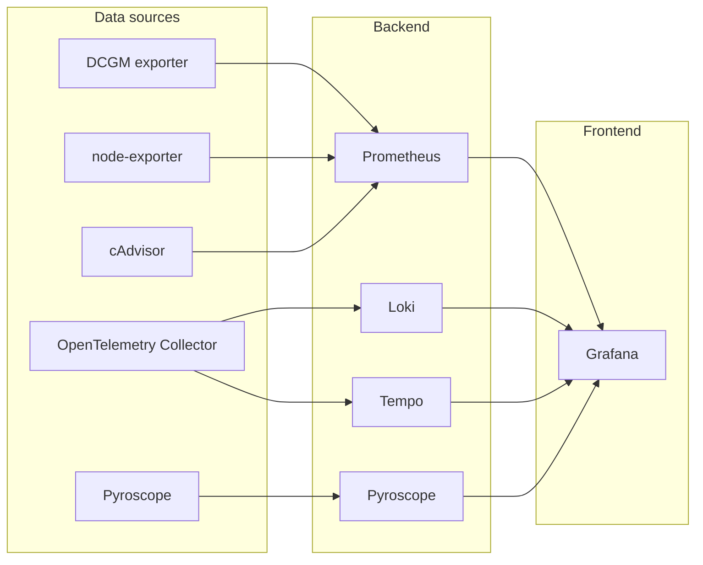

# 19.7 Capstone: an observability platform

| Field | Value |
|---|---|
| Level | Advanced |
| Priority tier | 2 |
| Lab venue | GCP / GKE |
| Part | Part 19: Capstones, design and interview readiness |
| Primary sources | NVIDIA Zero-to-Hero Volume 24 (Observability platform capstone); Part 17 (Operations); Volume 8 (`chapter-04-observability-platform.md`) |
| Cross-references | Chapter 17.1 (Observability foundations); Chapter 17.2 (Prometheus); Chapter 17.3 (Loki and OTel); Chapter 17.5 (Profiling); Chapter 16.14 (FinOps) |
| Coverage file | `planning/coverage/chapters/17-07.md` (note: shares coverage with Part 17) |
| Claim & number ledger | `planning/ledgers/17-07.md` (note: shares ledger with Part 17) |

## Why this matters for AI infrastructure

The observability capstone is the production shape of the operations layer. The capstone ties together metrics (Prometheus), logs (Loki), traces (Tempo), profiles (Pyroscope), dashboards (Grafana), and the FinOps dashboard (Kubecost). A team that has read every chapter in Part 17 can describe each piece; a team that has run this capstone has the integrated picture.

The observability capstone is what the on-call uses. The on-call opens the observability dashboard; the on-call clicks through metrics, logs, traces, profiles; the on-call finds the root cause. The capstone is the on-call's guide.

```text
Why the observability capstone matters (V24; Part 17):
- The observability platform is the production shape of operations. The
  capstone is what ties metrics, logs, traces, profiles, and dashboards
  together.
- The capstone has three perspectives: the platform engineer's view (how
  to deploy the stack); the SRE's view (how to configure the alerts); the
  on-call's view (how to debug an incident).
- The capstone is the reference design. Every chapter in Part 17 maps to
  a section of the capstone.
```

Three operational realities make this capstone a platform-team deliverable rather than a tutorial:

1. **The capstone is the reference design.** The platform team references the capstone when deploying a new component; the platform team references the capstone when configuring a new alert.
2. **The capstone is the interview anchor.** The candidate is asked "how would you build an observability platform for AI?"; the candidate points at this capstone.
3. **The capstone is the on-call reference.** The on-call engineer follows the runbook; the runbook points at the capstone; the on-call engineer fixes the incident.

**Before a team can claim their operations layer is production-ready, the team must have run this capstone. A team that has not run the capstone has not integrated the pieces.**

## Prerequisites and outcomes

### Prerequisites

- Chapter 17.1 (Observability foundations).
- Chapter 17.2 (Prometheus and Grafana).
- Chapter 17.3 (Loki and OpenTelemetry).
- Chapter 17.5 (Profiling).

### Outcomes

After completing this capstone you will be able to:

1. Deploy the observability stack: Prometheus, Loki, Tempo, Grafana, Pyroscope.
2. Configure the exporters: DCGM, node-exporter, cAdvisor, kube-state-metrics, OpenTelemetry.
3. Build the dashboards: the on-call dashboard, the performance decision tree, the FinOps dashboard.
4. Configure the alerts: the SLO-based alerts, the error budget alerts, the burn rate alerts.
5. Wire the traces and profiles: the W3C Trace Context, the Pyroscope integration.
6. Operate the observability stack with on-call runbooks, incident response, and capacity planning.

---

## 1. The observability stack

### 1.1 The architecture

The observability stack is the layered architecture from the workload to the dashboard. The stack has the data collection (exporters), the data pipeline (Prometheus, Loki, Tempo, Pyroscope), and the data consumption (Grafana).



The pattern is: every exporter ships to the appropriate backend; every backend feeds Grafana; Grafana renders the dashboards.

### 1.2 The exporters

The exporters are the workloads that produce the telemetry. The exporters are deployed as DaemonSets (for node-level) or as sidecars (for pod-level).

| Exporter | What it exports | Where it runs |
|---|---|---|
| **DCGM** | GPU metrics | DaemonSet |
| **node-exporter** | Host metrics | DaemonSet |
| **cAdvisor** | Container metrics | Built into kubelet |
| **kube-state-metrics** | K8s object state | Deployment |
| **OpenTelemetry Collector** | Logs, traces, metrics | DaemonSet |
| **Pyroscope** | Profiling data | Sidecar |

The pattern is: every exporter has a clear scope; every exporter feeds the appropriate backend.

---

## 2. The dashboards

### 2.1 The on-call dashboard

The on-call dashboard is the single most important dashboard in the observability stack. The dashboard has the SLO panels, the error budget panels, the recent alerts, and the recent incidents.

```yaml
# code/part17/on_call_dashboard.json
{
  "dashboard": {
    "title": "AI Factory - On-Call",
    "panels": [
      {"title": "Cluster p99 inference latency", "type": "timeseries", "targets": [{"expr": "inference:latency:p99:5m"}]},
      {"title": "Inference error rate per model", "type": "timeseries", "targets": [{"expr": "inference:error_rate:5m"}]},
      {"title": "GPU pool utilisation", "type": "stat", "targets": [{"expr": "gpu_pool:utilization:avg5m"}]},
      {"title": "GPU memory pressure", "type": "timeseries", "targets": [{"expr": "gpu_pool:memory_pressure:avg5m"}]},
      {"title": "Recent error logs", "type": "logs", "targets": [{"expr": "{severity=\"ERROR\"}"}]},
      {"title": "Open incidents", "type": "stat", "targets": [{"expr": "alertmanager_alerts_state{state=\"active\"}"}]},
      {"title": "Cost per team this month", "type": "bargauge", "targets": [{"expr": "cost:team:monthly"}]},
      {"title": "Model quality signals", "type": "stat", "targets": [{"expr": "model_quality_score"}]}
    ]
  }
}
```

The pattern is: the dashboard answers the on-call's questions in five seconds; the dashboard is the on-call's home page.

### 2.2 The performance decision tree

The performance decision tree is the dashboard that walks the on-call through the USE method (Chapter 17.8). The dashboard has the utilisation, saturation, and errors panels for every resource.

```yaml
# code/part17/performance_dashboard.json (shape only)
{
  "dashboard": {
    "title": "AI Factory - Performance Decision Tree",
    "panels": [
      {"title": "GPU utilisation", "type": "timeseries", "targets": [{"expr": "DCGM_FI_DEV_GPU_UTIL"}]},
      {"title": "GPU memory utilisation", "type": "timeseries", "targets": [{"expr": "DCGM_FI_DEV_FB_USED / DCGM_FI_DEV_FB_TOTAL"}]},
      {"title": "GPU saturation (queue depth)", "type": "stat", "targets": [{"expr": "kube_pod_status_phase{phase=\"Pending\"}"}]},
      {"title": "CPU utilisation", "type": "timeseries", "targets": [{"expr": "100 - rate(node_cpu_seconds_total{mode=\"idle\"}[5m]) * 100"}]},
      {"title": "Memory utilisation", "type": "timeseries", "targets": [{"expr": "node_memory_MemAvailable_bytes / node_memory_MemTotal_bytes"}]},
      {"title": "Disk I/O utilisation", "type": "timeseries", "targets": [{"expr": "rate(node_disk_io_time_seconds_total[5m])"}]},
      {"title": "Network utilisation", "type": "timeseries", "targets": [{"expr": "rate(node_network_transmit_bytes_total[5m])"}]},
      {"title": "Recommended fix", "type": "text", "options": {"content": "Based on the panels above, the recommended fix is..."}}
    ]
  }
}
```

The pattern is: the dashboard shows the current state; the dashboard drives the decision; the on-call finds the root cause.

### 2.3 The FinOps dashboard

The FinOps dashboard shows the per-team, per-model, per-month cost. The dashboard is the CFO's view of the cluster's economics.

```yaml
# code/part17/finops_dashboard.json
{
  "dashboard": {
    "title": "AI Factory - FinOps",
    "panels": [
      {"title": "Cost per team this month", "type": "bargauge", "targets": [{"expr": "sum by (team) (kubecost_team_cost_monthly)"}]},
      {"title": "Cost per model this month", "type": "bargauge", "targets": [{"expr": "sum by (model) (kubecost_model_cost_monthly)"}]},
      {"title": "GPU hours per team this month", "type": "stat", "targets": [{"expr": "sum by (team) (kubecost_team_gpu_hours_monthly)"}]},
      {"title": "Cost trend over the last 90 days", "type": "timeseries", "targets": [{"expr": "sum(kubecost_team_cost_daily)"}]},
      {"title": "Cost vs latency trade-off", "type": "table", "targets": [{"expr": "sum by (model) (kubecost_model_cost_monthly)", "refId": "A"}, {"expr": "histogram_quantile(0.99, sum by (model, le) (rate(inference_request_duration_seconds_bucket[5m])))", "refId": "B"}]}
    ]
  }
}
```

The pattern is: the dashboard shows the cost per team; the dashboard drives the cost optimisation.

---

## 3. Day-2 operations

### 3.1 The SLO configuration

The SLOs are configured in Prometheus. The SLOs are the targets that the platform team commits to meet.

```yaml
# code/part17/slo_config.yaml (shape only)
groups:
  - name: inference_slo
    rules:
      - record: inference:availability:5m
        expr: sum(rate(inference_request_total{status!~"5.."}[5m])) / sum(rate(inference_request_total[5m]))
      - record: inference:latency:p99:5m
        expr: histogram_quantile(0.99, rate(inference_request_duration_seconds_bucket[5m]))
```

The pattern is: every SLO is recorded as a metric; every SLO is compared against the target; every SLO breach fires an alert.

### 3.2 The alert routing

The alert routing is the Alertmanager configuration that routes the alerts to the right team. The routing is based on the severity; the routing is based on the team.

```yaml
# code/part17/alert_routing.yaml (shape only)
route:
  receiver: 'default-receiver'
  group_by: ['alertname', 'cluster']
  routes:
    - matchers:
        - severity="critical"
      receiver: 'pagerduty-critical'
    - matchers:
        - severity="warning"
      receiver: 'slack-warnings'
```

The pattern is: critical alerts go to PagerDuty; warning alerts go to Slack.

### 3.3 The incident response

The incident response is the pattern for responding to an incident. The incident response is integrated with the observability stack.

```text
Incident response:
1. Detect: Prometheus alert
2. Triage: dashboards (Grafana), logs (Loki), traces (Tempo), profiles (Pyroscope)
3. Mitigate: cordon, drain, restart, rollback
4. Resolve: root cause analysis, runbook update, post-mortem
```

The pattern is: the observability stack feeds the incident response; the incident response updates the runbook; the runbook updates the observability stack.

---

## 4. Hands-on lab

This lab walks through the observability platform capstone: the stack, the exporters, the dashboards, the alerts. The lab is **untested** in this repository.

### 4.1 Prerequisites

- A GKE Autopilot or Standard cluster (1.27+) with at least 2 GPU nodes.
- Helm 3 for installing the observability stack.

### 4.2 Step 1: deploy the observability stack

```bash
helm install prometheus prometheus-community/kube-prometheus-stack \
  --namespace monitoring --create-namespace

helm install loki grafana/loki-stack \
  --namespace monitoring

helm install tempo grafana/tempo \
  --namespace monitoring

helm install pyroscope grafana/pyroscope \
  --namespace monitoring
```

### 4.3 Step 2: deploy the exporters

```bash
helm install dcgm-exporter nvidia/dcgm-exporter \
  --namespace monitoring
```

### 4.4 Step 3: configure the dashboards

```bash
kubectl -n monitoring create configmap on-call-dashboard \
  --from-file=dashboards/on_call.json
```

### 4.5 Step 4: configure the alerts

```bash
kubectl -n monitoring create configmap slo-alerts \
  --from-file=configs/slo_config.yaml
```

### 4.6 Step 5: verify the stack

```bash
kubectl -n monitoring port-forward svc/prometheus-grafana 3000:80 &
# expected: the Grafana UI is accessible at http://localhost:3000
```

### 4.7 What to record

After the lab, you should be able to answer five questions in five seconds each:

1. What is the current SLO compliance per service?
2. What is the current error budget remaining?
3. What is the current GPU utilisation per node?
4. What is the most recent critical alert?
5. What is the current cost per team per month?

If any takes more than 30 seconds, the observability platform is not yet a production service. The lab is **untested** against a live GKE cluster.

---

## Exercises

1. **Add a new exporter.** Deploy a new exporter for a custom metric. *Solution sketch:* the exporter YAML; the ServiceMonitor YAML.
2. **Add a new dashboard.** Build a new dashboard for a specific use case. *Solution sketch:* the dashboard JSON; the Grafana UI.
3. **Add a new alert.** Configure a new alert rule. *Solution sketch:* the alert rule YAML; the Alertmanager config.
4. **Add a new SLO.** Configure a new SLO. *Solution sketch:* the SLO recording rule YAML.
5. **Add a new trace correlation.** Correlate the traces with the logs. *Solution sketch:* the OpenTelemetry collector config.
6. **Add a new profile integration.** Integrate the profiles with the traces. *Solution sketch:* the Pyroscope config.

---

## Checkpoint questions

<details><summary>1. What is the observability platform capstone?</summary>
The capstone that ties the metrics, logs, traces, profiles, and dashboards together. The capstone is the integrated picture of the operations layer; the capstone is what the on-call uses during an incident.
</details>

<details><summary>2. What are the three pillars of observability?</summary>
Metrics (numeric time series), logs (discrete events with structured fields), traces (directed acyclic graph of spans). The three pillars are the foundation of the observability stack.
</details>

<details><summary>3. What are the four USE method metrics?</summary>
Utilisation, Saturation, Errors. For every resource, the on-call checks the three metrics. The bottleneck is the resource that is most utilised, most saturated, or most error-prone.
</details>

<details><summary>4. What is the most common observability failure?</summary>
The cardinality budget is exceeded. Prometheus OOMs; the dashboards go stale; the alerts stop firing. The fix is to identify the high-cardinality metric; drop the high-cardinality label; aggregate the metric.
</details>

<details><summary>5. What is the most dangerous observability failure?</summary>
The Prometheus server is down. The metrics stop scraping; the alerts stop firing; the dashboards go stale. The fix is to restart Prometheus; verify the metrics; alert on the Prometheus health.
</details>

<details><summary>6. What is the most expensive observability failure?</summary>
The trace context propagation is broken. The traces are incomplete; the on-call cannot follow the request end-to-end. The fix is to verify the trace context is propagated; add an integration test.
</details>

<details><summary>7. What is the relationship between observability and the SLO?</summary>
The observability stack measures the SLI; the SLO is the target; the error budget is the cost of unreliability. Together, they form the SRE discipline.
</details>

<details><summary>8. What is the most important observability metric?</summary>
The cardinality per metric. The metric tells the team whether the cardinality budget is being respected. A high cardinality means the metric is in danger of OOMing Prometheus.
</details>

<details><summary>9. What is the relationship between observability and incident response?</summary>
The observability stack feeds the incident response; the incident response updates the runbook; the runbook updates the observability stack. Together, they form the operations feedback loop.
</details>

<details><summary>10. What is the relationship between observability and FinOps?</summary>
The observability stack provides the metrics; the FinOps dashboard provides the cost. Together, they inform the cost-vs-latency trade-off.
</details>

<details><summary>11. What is the most common dashboard mistake?</summary>
The dashboard has too many panels. The dashboard loads slowly; the on-call cannot answer the question in seconds. The fix is to reduce the number of panels; use recording rules; pre-compute the expensive queries.
</details>

<details><summary>12. What is the most common alert routing mistake?</summary>
The alert routing is too aggressive. Every alert pages the on-call; the on-call ignores the alerts. The fix is to tune the alert routing; use inhibit rules; alert only on what the on-call can act on.
</details>

<details><summary>13. What is the most expensive observability deployment?</summary>
Tempo. Tempo stores every trace; the storage cost scales with the trace volume. The fix is to use trace sampling; reduce the trace volume; archive old traces to cold storage.
</details>

<details><summary>14. What is the most expensive observability query?</summary>
A query that scans a high-cardinality metric. The query is slow; the dashboard times out; the on-call cannot answer the question. The fix is to use a recording rule; pre-compute the expensive query.
</details>

<details><summary>15. What is the relationship between observability and FinOps in production?</summary>
The observability stack feeds the FinOps dashboard. The dashboards show the cost; the alerts fire on the cost. The two together inform the right-sizing decisions.
</details>

<details><summary>16. What is the most common observability anti-pattern?</summary>
Using the same dashboard for multiple teams. The dashboard is too generic; the teams cannot find the panels they need. The fix is to have per-team dashboards; have a shared on-call dashboard; have a shared FinOps dashboard.
</details>

<details><summary>17. What is the most expensive observability metric to compute?</summary>
A metric that aggregates over many series. The aggregation is slow; the recording rule is slow; the dashboard is slow. The fix is to use a more efficient aggregation; use a recording rule; use a pre-aggregated metric.
</details>

<details><summary>18. What is the most expensive observability alert?</summary>
An alert that fires too often. The alert floods the on-call; the on-call ignores the alerts. The fix is to add a hysteresis; increase the for: clause; alert only on what matters.
</details>

<details><summary>19. What is the relationship between observability and security?</summary>
The audit log is part of the observability stack. The tamper-evident audit log (Chapter 18.7) is exposed in the observability stack. The two together form the compliance chain.
</details>

<details><summary>20. What five questions should the observability platform capstone lab let you answer in five seconds each?</summary>
What is the current SLO compliance per service. What is the current error budget remaining. What is the current GPU utilisation per node. What is the most recent critical alert. What is the current cost per team per month. If any takes more than 30 seconds, the observability platform is not yet a production service.
</details>

---

## Sources and review notes

- NVIDIA Zero-to-Hero Volume 24 (Observability platform capstone). Source for the stack architecture, the exporters, the dashboards, the alerts. The wording has been rewritten in the handbook's voice.
- Part 17 (Operations) for the three pillars, the exporters, the dashboards, the alerts.
- Volume 8 (`chapter-04-observability-platform.md`). Source for the operational patterns.

### Cross-references to other handbook chapters

- Chapter 17.1 for the observability foundations.
- Chapter 17.2 for Prometheus and Grafana.
- Chapter 17.3 for Loki and OpenTelemetry.
- Chapter 17.5 for profiling.
- Chapter 16.14 for FinOps.

### Migrated from `nvidia-devops`

The observability capstone operational patterns draw on Volume 24 and the gem-book corpora. The wording has been rewritten in the handbook's voice.

### Explicitly labelled inferences

- The dashboard panel count (8-12) is a starting point; specific counts depend on the use case.
- The alert routing thresholds are starting points; specific thresholds depend on the team's tolerance.
- The SLO targets are starting points; specific targets depend on the business's commitment.

### Not verified on live hardware

- The lab in Section 4 is **untested** against a live GKE cluster in this repository.
- The observability stack assumes a working cluster; production deployments may require careful staging.
- The exporter versions assumed in the lab should be pinned against the current releases.
