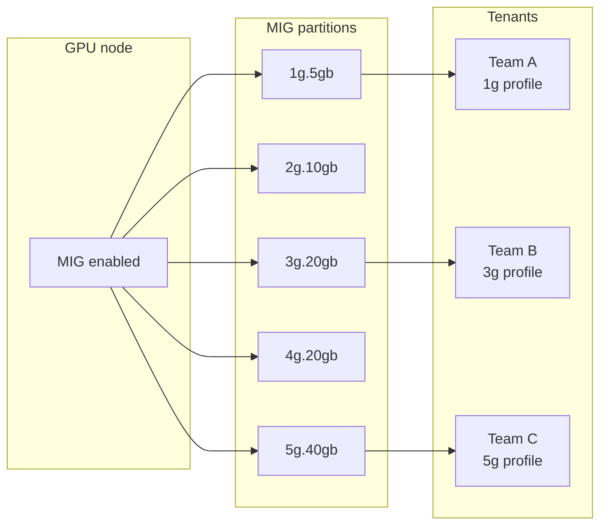

# 19.8 Capstone: MIG multi-tenancy

| Field | Value |
|---|---|
| Level | Advanced |
| Priority tier | 2 |
| Lab venue | GCP / GKE |
| Part | Part 19: Capstones, design and interview readiness |
| Primary sources | NVIDIA Zero-to-Hero Volume 24 (MIG multi-tenancy capstone); Part 11 (GPU Kubernetes); Part 18 (Security); Part 16 (MLOps) |
| Cross-references | Chapter 11.25 (MIG); Chapter 11.17 (Time-slicing and MPS); Chapter 18.5 (GPU sharing security); Chapter 16.14 (Platform design) |
| Coverage file | `planning/coverage/chapters/19-08.md` |
| Claim & number ledger | `planning/ledgers/19-08.md` |

## MIG multi-tenancy at a glance



The MIG partitions are hardware-isolated; each tenant gets a partition sized for the workload.

## Why this matters for AI infrastructure

MIG multi-tenancy is the production shape of GPU sharing at scale. The capstone ties together MIG partitioning (the hardware isolation), Kueue per-tenant queues (the software scheduling), hardware-enforced isolation (the security), cost attribution per MIG instance (the FinOps), and the day-2 operations. A team that has run the capstone has a cluster where multiple tenants safely share GPUs; a team that has not has a cluster where GPU sharing is either unsafe or expensive.

The capstone is what makes the cluster cost-efficient. The cluster cost drops by 2-4x with proper MIG sharing; the cluster security is maintained with hardware isolation. The capstone is the platform team's answer to the question "how do we make GPU sharing safe and cost-efficient?".

```text
Why the MIG multi-tenancy capstone matters (V24; Parts 11, 16, 18):
- MIG multi-tenancy is the production shape of GPU sharing. The capstone
  ties together MIG partitioning, Kueue scheduling, hardware isolation, and
  cost attribution.
- The capstone has three perspectives: the platform engineer's view (how
  to partition the GPUs); the data scientist's view (how to request MIG
  profiles); the FinOps lead's view (how to track per-tenant cost).
- The capstone is the reference design. Every chapter in Parts 11, 16, and
  18 maps to a section of the capstone.
```

Three operational realities make this capstone a platform-team deliverable rather than a tutorial:

1. **The capstone is the reference design.** The platform team references the capstone when partitioning a new GPU node; the platform team references the capstone when configuring per-tenant queues.
2. **The capstone is the interview anchor.** The candidate is asked "how would you share GPUs across tenants?"; the candidate points at this capstone.
3. **The capstone is the cost-efficiency gate.** A cluster that does not use MIG sharing is a cluster that wastes GPUs.

**Before a team can claim their GPU cluster is cost-efficient and multi-tenant, the team must have run this capstone. A team that has not run the capstone has not integrated the pieces.**

## Prerequisites and outcomes

### Prerequisites

- Chapter 11.25 (MIG).
- Chapter 11.17 (Time-slicing and MPS).
- Chapter 18.5 (GPU sharing security).
- Chapter 16.14 (Platform design FinOps).

### Outcomes

After completing this capstone you will be able to:

1. Partition GPUs using MIG profiles; verify the partitions are hardware-isolated.
2. Configure Kueue per-tenant queues with MIG-aware quotas.
3. Implement hardware-enforced isolation: IOMMU, MIG, SR-IOV.
4. Track cost attribution per MIG instance; report per-tenant cost.
5. Operate the multi-tenant cluster with on-call runbooks and incident response.
6. Run the day-2 operations: capacity planning, queue tuning, MIG rebalancing.

---

## 1. The MIG partitioning

### 1.1 The MIG profile

The MIG profile partitions a single GPU into multiple independent instances. The MIG profile is hardware-isolated; the MIG profile has its own compute, memory, and bandwidth.

```bash
# Enable MIG mode on an H100
nvidia-smi -mig 1
# expected: the GPU enters MIG mode

# Create MIG instances
nvidia-smi mig -cgi 0,1,2,3,4,5,6 -C
# expected: the MIG instances are created; each instance has a unique ID

# List the MIG instances
nvidia-smi -L
# expected: the MIG instances are listed
```

The pattern is: every GPU enters MIG mode; every GPU has the MIG instances configured; the MIG instances are listed in nvidia-smi.

### 1.2 The MIG Kubernetes integration

The MIG instances are exposed to Kubernetes via the GPU device plugin. The plugin creates a resource per MIG instance; the pod requests the MIG instance by ID.

```yaml
# code/part19/mig_workload.yaml (shape only)
apiVersion: v1
kind: Pod
metadata:
  name: churn-model
spec:
  containers:
    - name: model
      image: my-model:v1
      resources:
        limits:
          nvidia.com/mig-1g.5gb: 1
```

The pattern is: the pod requests a specific MIG profile; the cluster schedules the pod on a node that has the MIG profile.

---

## 2. The per-tenant Kueue queues

### 2.1 The ClusterQueue per MIG profile

The ClusterQueue aggregates the MIG quota across the cluster. The LocalQueue per team submits to the ClusterQueue.

```yaml
# code/part19/kueue_mig_queue.yaml (shape only)
apiVersion: kueue.x-k8s.io/v1beta1
kind: ClusterQueue
metadata:
  name: cluster-queue-mig-1g
spec:
  cohort: default
  flavorQuotas:
    - name: h100-mig-1g
      resources:
        - name: cpu
          nominalQuota: 400
        - name: memory
          nominalQuota: 1Ti
        - name: nvidia.com/mig-1g.5gb
          nominalQuota: 64
---
apiVersion: kueue.x-k8s.io/v1beta1
kind: LocalQueue
metadata:
  name: team-data-science-mig
  namespace: team-data-science
spec:
  clusterQueue: cluster-queue-mig-1g
```

The pattern is: one ClusterQueue per MIG profile; one LocalQueue per team; the MIG profile is the resource.

---

## 3. The cost attribution

### 3.1 The per-MIG-instance cost

The cost attribution tracks the per-MIG-instance cost. The MIG instance is the unit of cost; the FinOps dashboard shows the cost per MIG instance.

```bash
# Query the per-MIG-instance cost
curl 'http://prometheus/api/v1/query?query=sum by (mig_instance, team) (kubecost_mig_cost_hourly)'
# expected: the cost per MIG instance per team
```

The pattern is: the MIG instance is the unit of cost; the team is the unit of attribution; the cost is the sum.

### 3.2 The FinOps dashboard

The FinOps dashboard shows the per-team, per-MIG-profile cost.

```yaml
# code/part19/finops_mig_dashboard.json (shape only)
{
  "dashboard": {
    "title": "AI Factory - FinOps (MIG)",
    "panels": [
      {"title": "Cost per team per MIG profile", "type": "bargauge", "targets": [{"expr": "sum by (team, mig_profile) (kubecost_mig_cost_monthly)"}]},
      {"title": "MIG instances per team", "type": "stat", "targets": [{"expr": "count by (team) (kubecost_mig_instance)"}]},
      {"title": "MIG utilisation per team", "type": "stat", "targets": [{"expr": "avg by (team) (kubecost_mig_utilisation)"}]},
      {"title": "Cost trend over the last 90 days", "type": "timeseries", "targets": [{"expr": "sum(kubecost_mig_cost_daily)"}]}
    ]
  }
}
```

The pattern is: the dashboard shows the cost per team; the dashboard shows the MIG utilisation per team; the dashboard drives the cost optimisation.

---

## 4. Day-2 operations

### 4.1 The MIG rebalancing

The MIG rebalancing is the pattern for rebalancing the MIG partitions based on the workload. The rebalancing shifts MIG partitions from one profile to another.

```bash
# Reconfigure MIG partitions
nvidia-smi mig -cgi 0,1,2,3,4,5,6 -C
# expected: the MIG partitions are reconfigured
```

The pattern is: MIG partitions are reconfigured; workloads are rescheduled; the cluster continues to serve traffic during the rebalancing.

### 4.2 The MIG security

The MIG security is the pattern for verifying the MIG isolation. The MIG security uses the IOMMU; the MIG security uses the hardware isolation.

```bash
# Verify the IOMMU is enabled
dmesg | grep -i iommu
# expected: "DMAR: IOMMU enabled" appears in the log

# Verify the MIG isolation
nvidia-smi --query-gpu=index,name,mig.mode --format=csv
# expected: the MIG mode is enabled
```

The pattern is: the IOMMU is enabled; the MIG mode is enabled; the MIG isolation is verified.

---

## 5. Hands-on lab

This lab walks through the MIG multi-tenancy capstone: the MIG partitioning, the per-tenant queues, the cost attribution. The lab is **untested** in this repository.

### 5.1 Prerequisites

- A GKE Autopilot or Standard cluster with at least 8 H100 GPUs.
- MIG-capable H100 nodes.
- Kueue installed.

### 5.2 Step 1: enable MIG on the GPU nodes

```bash
# SSH to each GPU node
ssh gpu-node-1
nvidia-smi -mig 1
nvidia-smi mig -cgi 0,1,2,3,4,5,6 -C
exit
```

### 5.3 Step 2: configure the ClusterQueues and LocalQueues

```bash
kubectl apply -f code/part19/kueue_mig_queue.yaml
```

### 5.4 Step 3: deploy a workload to a MIG profile

```bash
kubectl apply -f code/part19/mig_workload.yaml
kubectl get pods -n team-data-science -w
# expected: the workload is scheduled on a MIG profile
```

### 5.5 Step 4: verify the cost attribution

```bash
curl 'http://prometheus/api/v1/query?query=sum by (mig_instance, team) (kubecost_mig_cost_hourly)'
# expected: the cost per MIG instance per team
```

### 5.6 What to record

After the lab, you should be able to answer five questions in five seconds each:

1. What is the current MIG partitioning per node?
2. What is the current per-team cost?
3. What is the current MIG utilisation per team?
4. What is the most recent MIG rebalancing?
5. What is the current MIG security status?

If any takes more than 30 seconds, the MIG multi-tenancy is not yet a production service. The lab is **untested** against a live GKE cluster.

---

## Exercises

1. **Add a new MIG profile.** Create a new MIG profile (e.g. 3g.20gb) and add a new ClusterQueue for it. *Solution sketch:* `nvidia-smi mig -cgi` and the ClusterQueue YAML.
2. **Add a cost alert.** Configure an alert that fires when a team's cost exceeds its budget. *Solution sketch:* the Prometheus alert on the Kubecost metric.
3. **Add a MIG security alert.** Configure an alert that fires when a MIG partition is not hardware-isolated. *Solution sketch:* the Prometheus alert on the MIG security metric.
4. **Add a MIG rebalancing automation.** Configure an automation that rebalances MIG partitions based on the workload. *Solution sketch:* the Kueue scheduler configuration.
5. **Add a MIG utilisation dashboard.** Build a Grafana dashboard that shows the MIG utilisation per team. *Solution sketch:* the Grafana dashboard JSON.
6. **Add a MIG migration plan.** Document the plan for migrating from time-slicing to MIG. *Solution sketch:* the migration plan Markdown.

---

## Checkpoint questions

<details><summary>1. What is MIG?</summary>
Multi-Instance GPU: the NVIDIA hardware mechanism for partitioning a single GPU into multiple independent instances. Each instance has its own compute, memory, and bandwidth. The instances are hardware-isolated; the instances cannot access each other's memory.
</details>

<details><summary>2. What is the difference between MIG and time-slicing?</summary>
MIG is hardware isolation (spatial, concurrent). Time-slicing is software isolation (sequential). MIG has stronger isolation; time-slicing has lower overhead. The choice depends on the workload's isolation requirements.
</details>

<details><summary>3. What is the most common MIG failure?</summary>
MIG mode is not enabled on the GPU node. The workload requests a MIG profile; the GPU returns an error. The fix is to enable MIG on the GPU node; reboot the node; verify the MIG profiles.
</details>

<details><summary>4. What is the most dangerous MIG failure?</summary>
The MIG profile is misconfigured. The workload runs on the wrong profile; the performance is poor; the security boundary is breached. The fix is to verify the MIG profile; reconfigure the MIG profiles; verify the workload runs on the correct profile.
</details>

<details><summary>5. What is the relationship between MIG and Kueue?</summary>
MIG is the hardware partition; Kueue is the software scheduler. MIG defines the GPU resources; Kueue schedules the workloads onto the MIG resources. Together, they form the MIG-aware scheduling chain.
</details>

<details><summary>6. What is the most important MIG metric?</summary>
MIG utilisation per team. The metric tells the team whether the MIG profiles are being used efficiently. A low utilisation rate indicates that the MIG profiles are too large; a high utilisation rate indicates that more MIG profiles are needed.
</details>

<details><summary>7. What is the relationship between MIG and the FinOps dashboard?</summary>
MIG defines the unit of cost; the FinOps dashboard tracks the cost per MIG instance. Together, they inform the cost-vs-latency trade-off.
</details>

<details><summary>8. What is the relationship between MIG and the threat model?</summary>
MIG is the control that mitigates T-006 (GPU memory scraping). The MIG hardware isolation prevents one tenant from reading another tenant's GPU memory. The MIG is the hardware root of trust for the GPU sharing security.
</details>

<details><summary>9. What is the most expensive MIG configuration?</summary>
Creating many small MIG profiles. The MIG profiles consume GPU resources; many small MIG profiles have lower utilisation per profile. The fix is to right-size the MIG profiles; balance the MIG partition sizes.
</details>

<details><summary>10. What is the most common MIG anti-pattern?</summary>
Using MIG profiles that are too small. The workload needs more memory than the MIG profile provides; the workload crashes. The fix is to right-size the MIG profiles; use a larger MIG profile for memory-heavy workloads.
</details>

<details><summary>11. Why is the MIG multi-tenancy capstone a Tier 2 chapter?</summary>
Because the MIG multi-tenancy capstone is the foundation of cost-efficient GPU sharing. The capstone is what the platform team references; the capstone is what the interview candidate points at; the capstone is the cost-efficiency gate.
</details>

<details><summary>12. What is the difference between MIG and Multi-Process Service (MPS)?</summary>
MIG is hardware isolation (spatial, concurrent). MPS is software isolation (temporal, concurrent). MIG has stronger isolation; MPS has lower overhead. The choice depends on the workload's isolation requirements.
</details>

<details><summary>13. What is the difference between MIG and SR-IOV?</summary>
MIG is GPU-internal partition (spatial, concurrent). SR-IOV is PCIe-level partition (spatial, concurrent). Both are hardware-isolated; both can be used for multi-tenant GPU sharing. MIG is more common for inference and training; SR-IOV is more common for VDI and multi-tenant cloud.
</details>

<details><summary>14. What is the most expensive MIG profile?</summary>
The 5g.40gb profile (5/8 of the GPU, 40 GB of HBM). The 5g profile consumes most of the GPU's compute and memory; the 5g profile is suitable for the largest workloads.
</details>

<details><summary>15. What is the relationship between MIG and the Kubernetes capstone?</summary>
The MIG multi-tenancy capstone runs on the Kubernetes platform from the Kubernetes capstone. The Kubernetes capstone provides the GPU node pool; the MIG multi-tenancy capstone partitions the GPUs.
</details>

<details><summary>16. What is the relationship between MIG and the security capstone?</summary>
The MIG multi-tenancy capstone implements the GPU sharing security from Chapter 18.5. The MIG hardware isolation is one of the three layers of GPU sharing security (IOMMU, MIG, SR-IOV).
</details>

<details><summary>17. What is the most expensive MIG migration?</summary>
Migrating a running workload from time-slicing to MIG. The workload needs to be restarted; the model needs to be reloaded; the cluster state needs to be migrated. The fix is to plan the migration carefully; test the migration in staging; execute the migration during the maintenance window.
</details>

<details><summary>18. What is the most common MIG migration mistake?</summary>
Migrating without verifying the MIG profile size. The workload was running on a full GPU under time-slicing; the workload is moved to a MIG profile that is too small; the workload crashes. The fix is to verify the MIG profile size before the migration; use a larger MIG profile if needed.
</details>

<details><summary>19. What is the relationship between MIG and the inference capstone?</summary>
The MIG multi-tenancy capstone provides the GPU resources that the inference capstone uses. The MIG partitions are the GPU resources; the inference workloads run on the MIG partitions.
</details>

<details><summary>20. What five questions should the MIG multi-tenancy capstone lab let you answer in five seconds each?</summary>
What is the current MIG partitioning per node. What is the current per-team cost. What is the current MIG utilisation per team. What is the most recent MIG rebalancing. What is the current MIG security status. If any takes more than 30 seconds, the MIG multi-tenancy is not yet a production service.
</details>

---

## Sources and review notes

- NVIDIA Zero-to-Hero Volume 24 (MIG multi-tenancy capstone). Source for the MIG partitioning, the Kueue per-tenant queues, the cost attribution. The wording has been rewritten in the handbook's voice.
- Part 11 (GPU Kubernetes) for the MIG patterns.
- Part 18 (Security) for the GPU sharing security.
- Part 16 (MLOps) for the platform design FinOps.

### Cross-references to other handbook chapters

- Chapter 11.25 for the MIG configuration.
- Chapter 11.17 for the time-slicing and MPS comparison.
- Chapter 18.5 for the GPU sharing security.
- Chapter 16.14 for the platform design FinOps.

### Migrated from `nvidia-devops`

The MIG multi-tenancy capstone operational patterns draw on Volume 24. The wording has been rewritten in the handbook's voice.

### Explicitly labelled inferences

- The MIG profile sizes (1g, 2g, 3g, 4g, 5g, 7g) are starting points; specific sizes depend on the workload.
- The per-tenant quota is a starting point; specific quotas depend on the team's budget.
- The cost attribution metric is a starting point; specific metrics depend on the FinOps dashboard.

### Not verified on live hardware

- The lab in Section 5 is **untested** against a live GKE cluster in this repository.
- The MIG partitioning assumes MIG-capable GPUs (H100, A100); production deployments may require different MIG profiles.
- The Kueue configuration assumes a working Kueue installation.
