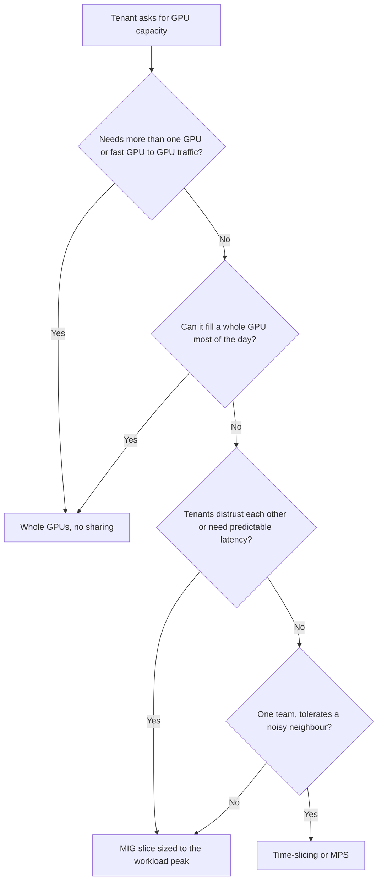
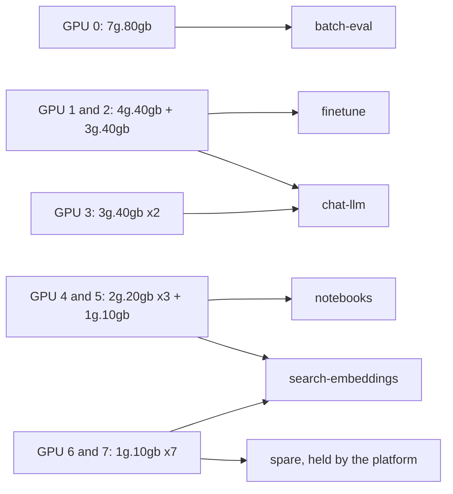

# 19.8 Capstone: MIG multi-tenancy

| Field | Value |
|---|---|
| Level | Advanced |
| Priority tier | 2 |
| Lab venue | GCP / GKE for the cloud notes, GPU Operator for the manifests. No GPU was available while writing. |
| Part | Part 19: Capstones, design and interview readiness |
| Primary sources | NVIDIA MIG User Guide (pages last updated 2026-11-04, fetched 2026-11-10); GPU Operator "GPU Operator with MIG" and "Time-Slicing GPUs"; mig-parted v0.15.1; dcgm-exporter 4.9.0; Kueue v0.20.5; GKE multi-instance GPU page; AI Systems Performance Engineering ch. 3; Kubernetes for Generative AI Solutions ch. 10; Production Kubernetes ch. 12; Supercomputers for Linux SysAdmins ch. 15 |
| Cross-references | 11.4, 11.5, 11.8, 11.24, 11.25, 11.26, 11.29, 16.14, 17.4, 18.5, 19.1, 19.2, 19.7, 19.9 |
| Coverage file | `planning/coverage/chapters/19-08.md` |
| Claim & number ledger | `planning/ledgers/19-08.md` |

## Why this matters for AI infrastructure

It is Monday morning and the chat team posts in the platform channel. Their new model server has been Pending for two hours, waiting for one slice of 3g.40gb. The dashboard shows twelve idle slices of 1g.10gb on the very same nodes. Nothing is broken. The platform simply holds the right amount of GPU in the wrong shapes.

That gap between free capacity and usable capacity is the whole subject of this capstone. A whole GPU is easy to schedule and easy to bill, but a small service wastes most of it. Splitting the GPU fixes the waste and creates new problems: shapes that do not fit, slices that nobody can use, reconfigurations that need a drained node, and a bill that must be divided by slice.

Multi-Instance GPU, called MIG here, is NVIDIA's hardware method for cutting one GPU into separate instances. This chapter builds a small multi-tenant platform on top of it. You will choose profiles for a tenant mix, check the layout with a tested planner, load it with mig-parted, give each tenant a Kueue quota in slices, and price the slices. You will also set up per-instance monitoring and learn which questions MIG answers and which it does not.

The host had no GPU, so no MIG command was run and no pod was scheduled. The lab says what was run here and what was not. Output shown for the unrun steps is an expected shape from NVIDIA documentation.

## Prerequisites and outcomes

### Prerequisites

- Chapter 11.24 for the MIG hardware model and the six-layer validation chain.
- Chapter 11.25 and 11.26 for time-slicing, MPS and the sharing decision tree.
- Chapter 11.4 and 11.5 for the GPU Operator, and 11.8 for Kueue.
- Chapter 17.4 for the DCGM exporter and 18.5 for the security view of GPU sharing.
- Chapter 16.14 for the chargeback model that this chapter fills in for MIG slices.

### Outcomes

After this capstone you will be able to:

1. Choose between MIG, time-slicing, MPS and whole GPUs for a given tenant.
2. Design a MIG layout for a tenant mix and prove with a tool that the hardware can create it.
3. Write the mig-parted configuration and the GPU Operator steps that apply it.
4. Give each tenant a Kueue quota counted in slices and a native ResourceQuota as a second guard.
5. Compute the cost of a slice, and separate idle cost from cost lost to geometry.
6. Name the failure modes of a sliced fleet and monitor each instance with DCGM.

---

## 1. Choosing the isolation tool

A research team asks for "a quarter of a GPU" for a notebook service. The platform engineer has four ways to say yes, and the team will quietly notice which one was chosen the first time a neighbour's job slows them down. The choice is about what each tenant is allowed to do to the others.

NVIDIA's MIG guide compares three concurrency mechanisms in one table. CUDA streams live inside a single process and share everything. The Multi-Process Service, MPS, lets cooperating processes share the SMs, but it offers no error isolation and the memory bandwidth, caches and capacity are shared. MIG is a physical partition. It gives each instance its own SM slices, memory slices and engines, and it isolates errors.

Time-slicing is a fourth option and it comes from the GPU Operator rather than from the CUDA guide. The device plugin advertises each GPU as several replicas and hands them to different pods. The GPU Operator documentation says plainly that, unlike MIG, there is no memory or fault isolation between the replicas. Pods take turns on the same GPU.

The table below sets the four options side by side. The MIG, MPS and streams rows come from the MIG guide, and the time-slicing row comes from the GPU Operator guide.

| Mechanism | Partition type | SM isolation | Memory protection and bandwidth QoS | Error isolation |
|---|---|---|---|---|
| CUDA streams | Single process | No | No | No |
| MPS | Logical, up to 48 clients | By percentage, not partitioning | Memory protection yes, bandwidth QoS no | No |
| MIG | Physical, up to 7 instances | Yes | Yes | Yes |
| Time-slicing | Replicas of one GPU | No, pods take turns | No | No |

Whole GPUs have no slicing loss, no reconfiguration and no fragmentation. Anything that spans GPUs belongs on them. The MIG guide lists no peer-to-peer between instances on different GPUs, no CUDA IPC across GPU instances, and only experimental NCCL support.

The book *AI Systems Performance Engineering* reaches the same conclusion from the performance side. Its chapter 3 says MIG suits multi-tenant, small-model inference and is usually the wrong tool for large distributed training. It also states the price. An idle instance cannot lend its resources to another, because the partition is hard.

The rule that follows: whole GPUs for training that spans GPUs and for tenants that fill a GPU, MIG for small tenants that distrust each other or need a predictable share, and time-slicing or MPS only inside one trust domain.



Size the slice for the concurrent peak and not for the weight file, because a model that loads in 7 GB can need much more once its cache fills.

Two combinations are documented. MPS runs on top of MIG with a lower client limit, and time-slicing can let several processes share one MIG partition. Both give back some of the isolation that made MIG attractive.

**Decision rule:** Give whole GPUs to anything that spans GPUs or fills one, give MIG slices to small tenants that need isolation, and keep time-slicing and MPS inside a single trust domain.

**In one minute:** MIG is the only option in the table that isolates SMs, memory bandwidth and errors at once. It costs flexibility, because idle slices cannot be lent. Whole GPUs stay the answer for large jobs.

---

## 2. What NVIDIA documents about MIG profiles

A planner on the platform team writes "split every H100 into two halves" in a design document. A reviewer asks which profile that is, and nobody can say whether it is 3g.40gb or 4g.40gb. The two profiles differ in compute, and the hardware allows different combinations of each. The names carry the answer, so it pays to read them properly.

A MIG-capable GPU is described by two kinds of slice. The MIG User Guide says a GPU memory slice is roughly one eighth of the memory resources, including capacity and bandwidth. A GPU SM slice is roughly one seventh of the SMs when the GPU is in MIG mode. A GPU instance combines some memory slices with some SM slices. The profile name `Ng.Mgb` means N SM slices and about M gigabytes of memory.

A GPU instance can be divided into compute instances that share its memory but have their own SMs. This chapter uses one compute instance per GPU instance, which is what `-C` and mig-parted create.

The MIG User Guide's "Supported MIG Profiles" page has one table per product. The H100 80 GB table is the one this chapter uses. Its columns for hardware units and copy engines are in the data file, and the first columns are shown here.

| Profile | Fraction of memory | Fraction of SMs | Instances per GPU |
|---|---|---|---|
| 1g.10gb | 1/8 | 1/7 | 7 |
| 1g.10gb+me | 1/8 | 1/7 | 1 |
| 1g.20gb | 1/4 | 1/7 | 4 |
| 2g.20gb | 2/8 | 2/7 | 3 |
| 3g.40gb | 4/8 | 3/7 | 2 |
| 4g.40gb | 4/8 | 4/7 | 1 |
| 7g.80gb | Full | 7/7 | 1 |

The profile names follow the memory, so they change between products. The MIG User Guide says the A100 80 GB names are 1g.10gb, 1g.20gb, 2g.20gb, 3g.40gb, 4g.40gb and 7g.80gb, which are the same names as the H100. The 40 GB A100 uses 1g.5gb, 1g.10gb, 2g.10gb, 3g.20gb, 4g.20gb and 7g.40gb. The H200 uses 1g.18gb, 1g.35gb, 2g.35gb, 3g.71gb, 4g.71gb and 7g.141gb. The B200 uses 1g.23gb, 1g.45gb, 2g.45gb, 3g.90gb, 4g.90gb and 7g.180gb. All of them share the same fractions, so a layout designed in slices carries across products even though the gigabyte labels change.

The `+me` profile adds media engines, and only one such 1g instance fits per GPU. The A30, the RTX PRO cards and the Thor iGPU have four or two slices, so the planner refuses them.

The MIG User Guide gives SM counts only for the A100 40 GB listing: 14 for a 1g slice, 42 for 3g, 56 for 4g and 98 for 7g. The GPU Operator guide prints H100 labels of 16, 32 and 60 multiprocessors for 1g.10gb, 2g.20gb and 3g.40gb. This chapter does not extrapolate SM counts, because the MIG User Guide does not publish them.

The MIG User Guide lists minimum drivers: R450 for the A100, R525 for the H100, R550 for the H200 and R570 for the B200. From Hopper on, enabling MIG mode needs no GPU reset, and the mode does not persist across a driver reload. Created instances never survive a reboot, so MIG Manager or mig-parted must recreate them.

The full table is data: `code/part19/c08_mig_profiles.json` holds all 99 rows from 14 tables with source page and dates, and a test counts them. Two oddities are kept as printed: the H100 1g.20gb row shows memory 1/4 but L2 1/8, and copy engines are 7 for the A100 7g.40gb and 8 for the H100 7g.80gb.

**Decision rule:** Design layouts in slices of one eighth memory and one seventh SM, then translate to profile names per product, and take every number from the MIG User Guide's table for that exact GPU.

**In one minute:** A profile name is a pair of slice counts plus a rounded memory size. The slice fractions are the same on every seven-slice GPU, and the names change with memory. The data file holds the whole NVIDIA table.

---

## 3. Designing a layout for a tenant mix

The chat team needs four copies of a model with a peak of about 30 GB. Search needs ten small embedding servers, notebooks need six medium slices, fine-tuning needs two large ones and a nightly batch job wants a whole GPU. An engineer counts 49 of the 56 slices on an eight-GPU node and declares that it fits. It does not, and the reason is geometry.

A GPU instance cannot start just anywhere. The MIG User Guide shows the legal start positions with `nvidia-smi mig -lgipp` for the A100 40 GB. A start position is counted in memory slices from 0 to 7. The 1g.5gb profile can start at any of positions 0 to 6. The 1g.10gb profile can start at 0, 2, 4 or 6. The 2g.10gb profile can start at 0, 2 or 4. The 3g.20gb profile can start at 0 or 4, the 4g.20gb profile only at 0, and the 7g.40gb profile only at 0.

Three consequences follow from those positions, and each one explains a failure that surprises new operators.

1. Only one 4g instance fits on a GPU, because it can only start at 0. A second 4g request is refused even if memory is free.
2. Two 3g instances fill all eight memory slices, so nothing else fits beside them. They use 6 of the 7 SM slices, so one SM slice is stranded.
3. Seven 1g instances use all seven SM slices but only seven of the eight memory slices. One memory slice is stranded, which is why seven 1g.10gb slices give 70 GB of an 80 GB card.

The MIG User Guide also shows that creation order matters. Asking for 3g.20gb last fails with "Insufficient Resources" and asking first succeeds, so the planner prints the largest profile first. mig-parted retries orderings itself.

Does the same table hold for the H100 and later GPUs? The MIG User Guide prints the listing only for the A100 40 GB and draws other products as figures. The planner reuses the A100 positions for every seven-slice GPU, and a test checks that against the H100 figure of 19 valid configurations: every figure row is feasible and every maximal mix the planner finds is in the figure. It is still an inference, so confirm with `nvidia-smi mig -lgipp` on the real GPU.

The planner packs the largest profiles first, putting each instance on the first GPU where an exact search over start positions still succeeds, and it reports anything that fits nowhere. Here is the tenant mix from the story on H100 80 GB, produced by `python3 code/part19/c08_mig_planner.py`.

| Tenant | Profile | Instances | SM slices |
|---|---|---|---|
| search-embeddings | 1g.10gb | 10 | 10 |
| chat-llm | 3g.40gb | 4 | 12 |
| notebooks | 2g.20gb | 6 | 12 |
| finetune | 4g.40gb | 2 | 8 |
| batch-eval | 7g.80gb | 1 | 7 |

The SM slices sum to 49, which is 7 GPUs with perfect packing, and the memory slices sum to 54, also 7 GPUs. The planner needs 8, and with 7 one search instance has no home. The nvidia-devops capstone says a layout is valid when slices sum to at most 7 and memory fits. The planner shows that rule is necessary and not sufficient.

The planner is a first-fit-decreasing heuristic. It found 8 GPUs and the lower bound is 7, and this chapter does not prove 8 optimal.



| GPUs | Layout | Slices offered | Stranded on each GPU |
|---|---|---|---|
| 0 | 7g.80gb | 1 whole GPU | none |
| 1 and 2 | 4g.40gb + 3g.40gb | 2 of 4g, 2 of 3g | none |
| 3 | 3g.40gb x 2 | 2 of 3g | 1 SM slice |
| 4 and 5 | 2g.20gb x 3 + 1g.10gb | 6 of 2g, 2 of 1g | 1 memory slice |
| 6 and 7 | 1g.10gb x 7 | 14 of 1g | 1 memory slice |

The totals offered by the node are one 7g.80gb, two 4g.40gb, four 3g.40gb, six 2g.20gb and sixteen 1g.10gb. Search needs ten of the sixteen small slices. The other six are headroom, and the Kueue design in section 5 holds them in a shared queue.

The same layout as a mig-parted config is generated by the planner function `mig_parted_yaml`, compared by a test, and accepted by the upstream parser of mig-parted v0.15.1. The format follows the GPU Operator guide. The `all-disabled` entry lets a node return to whole GPUs with one label change.

```yaml
version: v1
mig-configs:
  all-disabled:
    - devices: all
      mig-enabled: false

  tenant-mix-v1:
    - devices: [0]
      mig-enabled: true
      mig-devices:
        "7g.80gb": 1
    - devices: [1,2]
      mig-enabled: true
      mig-devices:
        "3g.40gb": 1
        "4g.40gb": 1
    - devices: [3]
      mig-enabled: true
      mig-devices:
        "3g.40gb": 2
    - devices: [4,5]
      mig-enabled: true
      mig-devices:
        "2g.20gb": 3
        "1g.10gb": 1
    - devices: [6,7]
      mig-enabled: true
      mig-devices:
        "1g.10gb": 7
```

In the GPU Operator the text lives inside a ConfigMap, and NVIDIA says the key must be named `config.yaml`. A test checks that it equals the standalone file.

```yaml
apiVersion: v1
kind: ConfigMap
metadata:
  name: c08-custom-mig-config
  namespace: gpu-operator
data:
  config.yaml: |
    version: v1
    mig-configs:
      all-disabled:
        - devices: all
          mig-enabled: false

      tenant-mix-v1:
        - devices: [0]
          mig-enabled: true
          mig-devices:
            "7g.80gb": 1
        - devices: [1,2]
          mig-enabled: true
          mig-devices:
            "3g.40gb": 1
            "4g.40gb": 1
        - devices: [3]
          mig-enabled: true
          mig-devices:
            "3g.40gb": 2
        - devices: [4,5]
          mig-enabled: true
          mig-devices:
            "2g.20gb": 3
            "1g.10gb": 1
        - devices: [6,7]
          mig-enabled: true
          mig-devices:
            "1g.10gb": 7
```

From GPU Operator v26.3.0 MIG Manager can also generate per-node configs such as `all-1g.10gb` and `all-balanced` itself. Custom entries are for layouts like this one.

The node advertises different resources by strategy. With `single`, every MIG device appears as `nvidia.com/gpu` and all GPUs must use MIG with one profile, otherwise GPU Feature Discovery labels the product `-MIG-INVALID`. With `mixed`, each profile is its own resource, and this five-profile node needs it.

GKE differs. It partitions per node pool with `gpu-partition-size`, every GPU in the pool gets the same size, and nodes carry the label `cloud.google.com/gke-gpu-partition-size`. GKE's H100 80 GB list omits 4g.40gb, so this layout cannot be built there as written. GKE also says splitting H100 and newer GPUs rules out GPUDirect, and that it is not recommended for untrusted workloads.

**Decision rule:** Plan layouts with a tool that knows start positions, keep one or two layouts per node pool, and confirm the placements with `nvidia-smi mig -lgipp` on the real hardware.

**In one minute:** Slice arithmetic gives a lower bound, and geometry adds loss. The tenant mix needs 8 H100s, one more than the SM slices suggest. The mig-parted config is generated from the plan and parsed by the upstream code.

---

## 4. Running the layout: reconfiguration, pending pods and fragmentation

On Thursday the platform team relabels node 3 from "balanced" to "all-3g.40gb" for a new tenant. MIG Manager starts and the pods on the node stop. The batch team's run dies at hour nine. The change was correct, and the damage came from treating a layout change as a label edit.

Applying a layout is disruptive. The GPU Operator guide says MIG Manager sets `nvidia.com/mig.config.state`, terminates all GPU pods on the node, and moves the state from `pending` to `success`, or to `rebooting` with the reboot option. A daemon holding a driver handle, such as DCGM or NVSM, can also block enabling MIG with "In use by another client", and the MIG User Guide's remedy is to stop it first. The BCM administration manual adds that only one MIG management tool may configure a node at a time, whether that is BCM, the DGX service or the GPU Operator's MIG Manager.

Six failure modes of a sliced fleet are worth knowing. The table lists the symptom, the cause and the first check.

| Symptom | Cause | First check |
|---|---|---|
| Pod Pending, node has free slices of another profile | Slice shape mismatch, the free slices are the wrong size | Compare `kubectl describe node` allocatable for each `nvidia.com/mig-*` resource with the request |
| Pod Pending, no `nvidia.com/mig-*` resource on the node | Strategy is `single`, or the layout is still `pending` | Read `nvidia.com/mig.strategy` and `nvidia.com/mig.config.state` labels |
| Node product label ends in `-MIG-INVALID` | Single strategy with mixed profiles or GPUs without MIG | Check that every GPU has the same profile, or switch to `mixed` |
| Free memory but a large profile will not start | Running instances sit at starts that block it | `nvidia-smi mig -lgi` shows each instance's start and size |
| Layout lost after reboot | MIG devices are not persistent, and on Hopper the mode is not either | Confirm MIG Manager reapplied the config and the state label is `success` |
| Workload admitted by Kueue but Pending in the scheduler | Quota is larger than what the node really offers | Compare ClusterQueue quota with node allocatable |

Stranded slices come in two kinds. The first is built into the layout: two 3g profiles always strand one SM slice and seven 1g profiles always strand one memory slice. The second comes from history, because the MIG User Guide says that fragmentation occurs as instances are created and destroyed.

The planner shows the second kind with instances that cannot move. With two 1g.10gb instances at starts 0 and 4, six memory slices are free, but 4g.40gb needs start 0 and 3g.40gb needs 0 or 4. Only a 2g.20gb still starts, so fragmentation is 0.667. A planner that may move instances finds room for the 3g.40gb. That gap is the difference between paper and a live node, and tests cover both.

One process sees little. CUDA enumerates one compute instance per GPU instance and at most 64 MIG instances across all GPUs, so a script expecting eight MIG devices will not get them. A pod needing two slices also stays Pending if no single node supplies both.

A reconfiguration window needs a procedure. This one is derived from the documented behaviour, and NVIDIA does not publish it as a procedure.

1. Cordon the node and let its Kueue workloads finish or be preempted.
2. Lower the ClusterQueue quotas for the affected profiles, so Kueue stops admitting to slices about to disappear.
3. Label the node with the new `nvidia.com/mig.config` and wait for `success`.
4. Check allocatable with `kubectl`, restore the quotas to match, and uncordon.

**Decision rule:** Treat every layout change as a drained-node maintenance task, move the quota first and the layout second, and keep the number of live layouts small.

**In one minute:** Applying a MIG config stops the GPU pods on the node, and monitoring agents can block it. Slices are lost in two ways: by layout, which is fixed by design, and by history, which is fixed by discipline. Most Pending pods trace back to shape, strategy or quota disagreeing with the node.

---

## 5. Quotas and chargeback per slice

At quarter end the finance partner asks which team used how much GPU, and why two teams with the same pod count have very different invoices. The platform has pod counts and no way to price a 1g slice against a 3g slice. A slice becomes money only after someone defines a price.

Quotas first. Kueue counts extended resources like any other. A ClusterQueue sets `nominalQuota`, `borrowingLimit` and `lendingLimit` per resource and per ResourceFlavor, and a flavor maps to nodes through `nodeLabels`. The label `nvidia.com/mig.config` is a good key, because it names the layout the node has.

The Kueue source refuses a pod that requests a resource the ClusterQueue does not cover, with the reason "resource unavailable in ClusterQueue". A tenant queue must therefore list `cpu` and `memory` as well as its MIG resource. Listing only one MIG resource also pins a tenant to that profile.

The design has one ClusterQueue per tenant plus a queue holding the six spare 1g.10gb slices, all in one cohort. Each tenant holds its own profile and lends nothing. The spare queue lends its slices and search may borrow up to six, so no tenant's reserved slices can be taken.

The file is validated against the Kueue v0.20.5 CRDs with `check_crd_yaml.py`, which rejects unknown fields. The current API is `v1beta2`. It names the cohort field `cohortName`, and the checker rejects the older field names `flavorQuotas` and `cohort`.

```yaml
# Kueue objects for the MIG tenant mix (Chapter 19.8).
# Validated against the Kueue v0.20.5 CRDs (kueue.x-k8s.io/v1beta2) by tools/check_crd_yaml.py.
# cpu and memory quotas are placeholders: size them from your node pool.
apiVersion: kueue.x-k8s.io/v1beta2
kind: ResourceFlavor
metadata:
  name: h100-mig-tenant-mix
spec:
  nodeLabels:
    nvidia.com/mig.config: tenant-mix-v1
---
apiVersion: kueue.x-k8s.io/v1beta2
kind: ClusterQueue
metadata:
  name: cq-search
spec:
  cohortName: gpu-mig-pool
  namespaceSelector:
    matchLabels:
      kubernetes.io/metadata.name: team-search
  resourceGroups:
    - coveredResources: ["cpu", "memory", "nvidia.com/mig-1g.10gb"]
      flavors:
        - name: h100-mig-tenant-mix
          resources:
            - name: cpu
              nominalQuota: 32
            - name: memory
              nominalQuota: 128Gi
            - name: nvidia.com/mig-1g.10gb
              nominalQuota: 10
              borrowingLimit: 6
---
apiVersion: kueue.x-k8s.io/v1beta2
kind: ClusterQueue
metadata:
  name: cq-chat
spec:
  cohortName: gpu-mig-pool
  namespaceSelector:
    matchLabels:
      kubernetes.io/metadata.name: team-chat
  resourceGroups:
    - coveredResources: ["cpu", "memory", "nvidia.com/mig-3g.40gb"]
      flavors:
        - name: h100-mig-tenant-mix
          resources:
            - name: cpu
              nominalQuota: 64
            - name: memory
              nominalQuota: 256Gi
            - name: nvidia.com/mig-3g.40gb
              nominalQuota: 4
---
apiVersion: kueue.x-k8s.io/v1beta2
kind: ClusterQueue
metadata:
  name: cq-notebooks
spec:
  cohortName: gpu-mig-pool
  namespaceSelector:
    matchLabels:
      kubernetes.io/metadata.name: team-notebooks
  resourceGroups:
    - coveredResources: ["cpu", "memory", "nvidia.com/mig-2g.20gb"]
      flavors:
        - name: h100-mig-tenant-mix
          resources:
            - name: cpu
              nominalQuota: 48
            - name: memory
              nominalQuota: 192Gi
            - name: nvidia.com/mig-2g.20gb
              nominalQuota: 6
---
apiVersion: kueue.x-k8s.io/v1beta2
kind: ClusterQueue
metadata:
  name: cq-finetune
spec:
  cohortName: gpu-mig-pool
  namespaceSelector:
    matchLabels:
      kubernetes.io/metadata.name: team-finetune
  resourceGroups:
    - coveredResources: ["cpu", "memory", "nvidia.com/mig-4g.40gb"]
      flavors:
        - name: h100-mig-tenant-mix
          resources:
            - name: cpu
              nominalQuota: 64
            - name: memory
              nominalQuota: 256Gi
            - name: nvidia.com/mig-4g.40gb
              nominalQuota: 2
---
apiVersion: kueue.x-k8s.io/v1beta2
kind: ClusterQueue
metadata:
  name: cq-batch
spec:
  cohortName: gpu-mig-pool
  namespaceSelector:
    matchLabels:
      kubernetes.io/metadata.name: team-batch
  resourceGroups:
    - coveredResources: ["cpu", "memory", "nvidia.com/mig-7g.80gb"]
      flavors:
        - name: h100-mig-tenant-mix
          resources:
            - name: cpu
              nominalQuota: 32
            - name: memory
              nominalQuota: 128Gi
            - name: nvidia.com/mig-7g.80gb
              nominalQuota: 1
---
# Holds the spare 1g.10gb slices and lends them to the cohort. No workload uses it directly.
apiVersion: kueue.x-k8s.io/v1beta2
kind: ClusterQueue
metadata:
  name: cq-platform-spare
spec:
  cohortName: gpu-mig-pool
  namespaceSelector:
    matchLabels:
      kubernetes.io/metadata.name: gpu-platform
  resourceGroups:
    - coveredResources: ["nvidia.com/mig-1g.10gb"]
      flavors:
        - name: h100-mig-tenant-mix
          resources:
            - name: nvidia.com/mig-1g.10gb
              nominalQuota: 6
              lendingLimit: 6
---
apiVersion: kueue.x-k8s.io/v1beta2
kind: LocalQueue
metadata:
  name: main
  namespace: team-search
spec:
  clusterQueue: cq-search
---
apiVersion: kueue.x-k8s.io/v1beta2
kind: LocalQueue
metadata:
  name: main
  namespace: team-chat
spec:
  clusterQueue: cq-chat
---
apiVersion: kueue.x-k8s.io/v1beta2
kind: LocalQueue
metadata:
  name: main
  namespace: team-notebooks
spec:
  clusterQueue: cq-notebooks
---
apiVersion: kueue.x-k8s.io/v1beta2
kind: LocalQueue
metadata:
  name: main
  namespace: team-finetune
spec:
  clusterQueue: cq-finetune
---
apiVersion: kueue.x-k8s.io/v1beta2
kind: LocalQueue
metadata:
  name: main
  namespace: team-batch
spec:
  clusterQueue: cq-batch
```

A native ResourceQuota is a second fence, enforced by the API server at pod creation. Kubernetes accepts only the `requests.` prefix for extended resources. The file gives each namespace its ClusterQueue count, plus the six borrowable slices for search, and a test checks the agreement.

```yaml
# Namespaces and native ResourceQuota guard for the MIG tenants (Chapter 19.8).
# Extended resources accept only the requests. prefix in a ResourceQuota.
---
apiVersion: v1
kind: Namespace
metadata:
  name: team-search
  labels:
    c08/tenant: search
---
apiVersion: v1
kind: ResourceQuota
metadata:
  name: mig-slices
  namespace: team-search
spec:
  hard:
    requests.nvidia.com/mig-1g.10gb: "16"
---
apiVersion: v1
kind: Namespace
metadata:
  name: team-chat
  labels:
    c08/tenant: chat
---
apiVersion: v1
kind: ResourceQuota
metadata:
  name: mig-slices
  namespace: team-chat
spec:
  hard:
    requests.nvidia.com/mig-3g.40gb: "4"
---
apiVersion: v1
kind: Namespace
metadata:
  name: team-notebooks
  labels:
    c08/tenant: notebooks
---
apiVersion: v1
kind: ResourceQuota
metadata:
  name: mig-slices
  namespace: team-notebooks
spec:
  hard:
    requests.nvidia.com/mig-2g.20gb: "6"
---
apiVersion: v1
kind: Namespace
metadata:
  name: team-finetune
  labels:
    c08/tenant: finetune
---
apiVersion: v1
kind: ResourceQuota
metadata:
  name: mig-slices
  namespace: team-finetune
spec:
  hard:
    requests.nvidia.com/mig-4g.40gb: "2"
---
apiVersion: v1
kind: Namespace
metadata:
  name: team-batch
  labels:
    c08/tenant: batch
---
apiVersion: v1
kind: ResourceQuota
metadata:
  name: mig-slices
  namespace: team-batch
spec:
  hard:
    requests.nvidia.com/mig-7g.80gb: "1"
---
apiVersion: v1
kind: Namespace
metadata:
  name: gpu-platform
```

A workload asks for a slice by name, and a queue label hands admission to Kueue. The Job below asks for one 3g.40gb slice for the chat tenant.

```yaml
# A Kueue-managed Job that asks for one 3g.40gb slice (Chapter 19.8).
# The queue label hands admission to Kueue. The image is the vectorAdd sample used in NVIDIA's GPU Operator MIG guide.
apiVersion: batch/v1
kind: Job
metadata:
  name: chat-llm-smoke
  namespace: team-chat
  labels:
    kueue.x-k8s.io/queue-name: main
spec:
  parallelism: 1
  completions: 1
  backoffLimit: 0
  template:
    spec:
      restartPolicy: Never
      containers:
        - name: vectoradd
          image: nvidia/samples:vectoradd-cuda11.2.1
          resources:
            requests:
              cpu: "2"
              memory: 4Gi
            limits:
              nvidia.com/mig-3g.40gb: 1
```

Now the price. The rule must be additive, so shares on one GPU never exceed the GPU. This is a design choice, not NVIDIA's: a slice's weight is the average of its memory share and SM share. A 7g.80gb slice weighs 1, a 3g.40gb slice weighs 0.4643 and a 4g.40gb slice weighs 0.5357, so those two together make one GPU.

Memory alone would charge a 3g.40gb and a 4g.40gb the same, although the 4g tenant gets a third more SMs. SM alone would undercharge the 1g.20gb slice. Teams with strong views can change one function.

Each GPU's cost then splits three ways. Tenants pay for reserved slices. Idle cost is slices nobody holds. Layout loss is the share no profile can use, such as the SM slice left beside two 3g instances. The parts add up to the node cost, and a test checks that.

The worked example uses a placeholder price of 4.00 USD per GPU-hour, which is illustrative and not a quote, over 730 hours. The 8-GPU node costs 23,360 USD per month. The values come from `python3 code/part19/c08_finops.py`.

| Line | Monthly cost in USD | How it arises |
|---|---|---|
| search-embeddings | 3,910.71 | 10 slices of 1g.10gb at 0.536 USD per hour |
| chat-llm | 5,422.86 | 4 slices of 3g.40gb at 1.857 USD per hour |
| notebooks | 4,692.86 | 6 slices of 2g.20gb at 1.071 USD per hour |
| finetune | 3,128.57 | 2 slices of 4g.40gb at 2.143 USD per hour |
| batch-eval | 2,920.00 | 1 whole GPU at 4.000 USD per hour |
| Idle slices | 2,346.43 | the 6 spare slices of 1g.10gb |
| Layout loss | 938.57 | one SM slice on GPU 3, one memory slice on GPUs 4 to 7 |

Under allocated chargeback the platform absorbs the idle line. Under fully loaded chargeback idle cost is spread in proportion to what tenants pay, and the calculator offers both. Layout loss stays with the platform, because no tenant chose it. Production Kubernetes chapter 12 makes the point that quotas are what let tenants share a cluster safely.

A reservation is not use. A slice at 1.857 USD per hour that is busy a quarter of the time costs 7.43 USD per busy hour, and the calculator computes that from the utilisation of section 7. Chapter 19.1 shows the Slurm view, where accounting tracks GRES and fairshare falls as an account consumes it.

**Decision rule:** Count quota in slices per tenant with Kueue, mirror it in a native ResourceQuota, charge by a published weight per profile, and show idle cost and layout loss as separate lines.

**In one minute:** A slice becomes billable once a weight per profile exists. The tenant mix on one node costs 23,360 USD per month at the placeholder price, of which 3,285 USD is idle or lost to geometry. Fully loaded chargeback is a policy on top of the same numbers.

---

## 6. What MIG isolates and what it does not

A security reviewer asks whether tenant A can read tenant B's memory on the same H100. The honest answer depends on which sentence of the vendor documentation you rely on, and on what else the stack shares.

NVIDIA's guide says each instance has separate and isolated paths through the memory system. Crossbar ports, L2 cache banks, memory controllers and DRAM buses are assigned uniquely, giving predictable throughput even when other instances thrash their caches. It also describes fault isolation and says one client cannot impact the work of others. Its concurrency table marks memory protection, bandwidth QoS and error isolation as yes for MIG.

Documented limits and controls:

- Toggling MIG mode needs `CAP_SYS_ADMIN`, and creating instances needs the `mig-config` capability, which root holds and which can be delegated.
- Peer-to-peer between instances on different GPUs and CUDA IPC across GPU instances are unsupported. The concurrency table lists cross-partition interop as "Limited IPC".
- GPUDirect RDMA works from GPU instances. Graphics APIs work only on `+gfx` profiles of some Blackwell cards.
- Profiling of shared GPU resources is unsupported.

What stays shared is inferred, since the MIG User Guide is silent. One driver serves all instances, so a bad driver update is node-wide. The board has one power budget and one firmware, and a GPU reset affects the whole GPU. Chapter 11.24 lists the same shared items.

Kubernetes isolation is outside MIG. Namespaces, RBAC, network policies and storage credentials keep tenant A from tenant B's secrets. Production Kubernetes chapter 12 separates soft multitenancy, where tenants share some trust, from hard multitenancy, where they are treated as adversaries, and notes that requests and limits are weaker than a hypervisor.

GKE's page says multi-instance GPUs are not recommended for untrusted workloads. For adversarial tenants, MIG is one layer, to combine with Chapter 18.5 and separate node pools. Older book advice that NCCL does not work with MIG is superseded by the MIG User Guide, which now gives experimental support from NCCL 2.31 with conditions.

**Decision rule:** Tell reviewers that MIG isolates the SMs, memory paths and errors of each instance, and that the driver, board, host and Kubernetes layers are separate controls that you must provide.

**In one minute:** NVIDIA documents separate memory paths, fault isolation and quality of service per instance. It does not document MIG as a replacement for tenant controls elsewhere. Providers such as GKE add their own warning for untrusted workloads.

---

## 7. Monitoring each instance

On Friday the notebooks tenant reports slow cells. The node dashboard shows the GPU 40 percent busy and the memory looks fine. The engineer needs to know whether that tenant's slice is the busy one, and the GPU-level view cannot say.

On Ampere, NVML and `nvidia-smi` do not attribute utilisation to MIG devices and show N/A. The MIG User Guide recommends DCGM, v3 or later. GKE says GPU utilisation metrics such as `duty_cycle` are not available for multi-instance GPUs.

The DCGM exporter 4.9.0 repository documents what is reported per instance. On a MIG GPU, fields DCGM declares at GPU level are read once per GPU without `GPU_I_ID`, `GPU_I_PROFILE` or `GPU_CI_ID` labels. Fields declared at instance level carry the MIG labels. In the default metric file they are:

| Metric | What it tells you | Level on a MIG GPU |
|---|---|---|
| `DCGM_FI_DEV_FB_USED_BYTES` | Framebuffer memory in use | Per instance |
| `DCGM_FI_DEV_FB_FREE_BYTES` | Framebuffer memory free | Per instance |
| `DCGM_FI_PROF_GR_ENGINE_UTIL_RATIO` | Ratio of time the graphics engine is active | Per instance |
| `DCGM_FI_PROF_TENSOR_UTIL_RATIO` | Ratio of cycles the tensor pipe is active | Per instance |
| `DCGM_FI_PROF_DRAM_UTIL_RATIO` | Ratio of cycles the memory interface moves data | Per instance |
| `DCGM_FI_DEV_BOARD_POWER_WATTS` | Board power draw | Per physical GPU |
| `DCGM_FI_DEV_GPU_TEMP_CELSIUS` | GPU temperature | Per physical GPU |

Two warnings. Version 4.9.0 names metrics with units, and its repository tells users to update dashboards to the new names, so a panel that goes blank after an upgrade is likely a rename. Power and temperature are per physical GPU, so you cannot bill or alert on power for one tenant, and this chapter invents no per-instance energy figure.

Per-instance series carry `gpu`, `GPU_I_ID` and `GPU_I_PROFILE`, and with Kubernetes enrichment `namespace`, `pod` and `container`. The HPC job mapping uses the GPU instance ID, not the `Device N` ordinal that `nvidia-smi -L` prints.

The platform adds a second family. kube-state-metrics exports allocatable and requests per resource and sanitises the name, so `nvidia.com/mig-1g.10gb` appears as `nvidia_com_mig_1g_10gb`. Kueue exports reservation, nominal quota and pending workloads per queue, and the per-resource ones need `metrics.enableClusterQueueResources`.

The dashboard has ten panels. Every expression was parsed with `promtool`, which is the only check run on them.

| Panel | Question it answers | Source metrics |
|---|---|---|
| Cost per tenant | What does each queue's reservation cost per hour | Kueue reservation times the price rule |
| Reserved slices | Who holds which profile | Kueue reservation |
| Quota minus reservation | Quota nobody holds | Kueue nominal quota and reservation |
| Free slices per profile | Slices on nodes nobody requested | Kube-state-metrics allocatable minus requests |
| SM activity per instance | Is the tenant using its slice | DCGM graphics engine ratio |
| Memory used per instance | How much of the slice is filled | DCGM framebuffer used |
| Memory pressure | Is the slice near out-of-memory | Framebuffer used over used plus free |
| Pending workloads | Which queues are waiting | Kueue pending workloads |
| Weighted share | Who is borrowing | Kueue weighted share |
| Idle slice cost | Monthly price of unreserved quota | Kueue plus price rule |

The price rule is a Prometheus rules file with one constant series per profile, labelled by `resource`, so cost panels join reservations to price. The file holds three alerts: an instance under 5 percent graphics activity for six hours, an instance above 90 percent of its memory for ten minutes, and workloads pending while MIG slices are free. The third is crude on purpose, because no metric says which profile a pending workload needs.

**Decision rule:** Monitor GPU-level health per physical GPU and activity and memory per instance, read the exporter version's metric names from its own file, and price slices in a rules file that a test regenerates.

**In one minute:** `nvidia-smi` cannot show per-instance utilisation on Ampere, and GKE hides it too. DCGM exporter 4.9.0 reports memory, graphics, tensor and memory-interface activity per instance, and power and temperature per GPU. Kueue and kube-state-metrics add the quota and allocation views.

---

## 8. Hands-on lab

The first half of the lab runs on any laptop and was run here. The second half needs a MIG-capable node and was not run. Both use the same files.

### What was run here and what was not

Run here, on macOS arm64 with no GPU: the tests, the planner, the cost calculator, the upstream mig-parted parser, kubeconform, the Kueue CRD check and promtool. Not run: MIG mode, instance creation, the GPU Operator, Kueue admission and DCGM scraping. Expected shapes below come from NVIDIA documentation, not from a real node.

### Step 1: set up the validators (run here)

Clone Kueue at v0.20.5 and mig-parted at v0.15.1. Copy `code/part19/c08_validate_mig_parted.go.txt` to `cmd/c08validate/main.go` in the mig-parted checkout and build it with `GOFLAGS=-mod=vendor go build -o c08validate ./cmd/c08validate`. It calls the upstream `Spec` parser. Set `KUEUE_CRDS` to `config/components/crd/bases` in the Kueue checkout and `MIGPARTED_VALIDATOR` to the binary.

What to record: the two tags, and the commit hashes. Here they were `v0.20.5` at `7e71578` and `v0.15.1` at `a24171d`.

### Step 2: run the local checks (run here)

The script below runs all six local checks in order. It exits at the first failure.

```bash
#!/usr/bin/env bash
# Chapter 19.8 local checks. Needs no GPU and no cluster.
# Run from the repository root. KUEUE_CRDS points at config/components/crd/bases of a Kueue v0.20.5 checkout.
# MIGPARTED_VALIDATOR is the binary built from c08_validate_mig_parted.go.txt inside a mig-parted v0.15.1 checkout.
set -euo pipefail

: "${KUEUE_CRDS:?set KUEUE_CRDS to the Kueue CRD directory}"
: "${MIGPARTED_VALIDATOR:?set MIGPARTED_VALIDATOR to the built validator}"

cd code/part19

# 1. Planner, cost calculator and file-consistency tests
C08_MIGPARTED_VALIDATOR="$MIGPARTED_VALIDATOR" python3 -m pytest test_c08_mig_planner.py test_c08_finops_and_configs.py -q

# 2. Print the planner and cost worked examples quoted in the chapter
python3 c08_mig_planner.py
python3 c08_finops.py

# 3. mig-parted config against the upstream parser
"$MIGPARTED_VALIDATOR" c08_mig_parted_config.yaml

# 4. Core Kubernetes objects against the Kubernetes schemas
kubeconform -strict -ignore-missing-schemas -summary \
  c08_namespaces_quota.yaml c08_mig_workload.yaml c08_mig_config_configmap.yaml

# 5. Kueue objects against the upstream CRDs
python3 -I ../../tools/check_crd_yaml.py \
  "$KUEUE_CRDS/kueue.x-k8s.io_clusterqueues.yaml" \
  "$KUEUE_CRDS/kueue.x-k8s.io_localqueues.yaml" \
  "$KUEUE_CRDS/kueue.x-k8s.io_resourceflavors.yaml" \
  -- c08_kueue_mig.yaml

# 6. Prometheus rules
promtool check rules c08_mig_rules.yml
```

Expected result: 68 tests pass, the planner prints 8 GPUs for the tenant mix and shows the shortfall with 7, the cost table matches section 5, the mig-parted file is accepted, and kubeconform, the CRD check and promtool report no problems. In the run for this chapter, kubeconform reported 13 resources valid, the CRD check reported 12 resources and 0 problems, and promtool found 9 rules.

What to record: the test count and the three validator summaries.

### Step 3: break something on purpose (run here)

Rename the first `cohortName` in `c08_kueue_mig.yaml` to `cohort`. The CRD check reports "Additional properties are not allowed ('cohort' was unexpected)". Restore it. Then add `"4g.40gb": 2` to the GPU 0 entry of `c08_mig_parted_config.yaml`. The upstream parser still prints OK, because it checks structure and name format and not geometry, but three tests fail: the generator comparison, the ConfigMap comparison and the per-GPU feasibility check. Restore the file.

What to record: the CRD message, the three failing test names, and the fact that the upstream parser accepted the impossible layout. This step proves that the checks can fail, and it shows why the planner is needed on top of the parser.

### Step 4: apply the layout (not run: needs a MIG-capable node)

Install the GPU Operator with `--set mig.strategy=mixed`, as the NVIDIA guide shows. Install Kueue v0.20.5 and turn on `metrics.enableClusterQueueResources`. Then run the cluster script. Set `NODE` to an 8-GPU H100 node that you can drain.

```bash
#!/usr/bin/env bash
# Chapter 19.8 cluster steps. NOT RUN in the handbook: they need MIG-capable GPUs.
# Assumes the GPU Operator is installed with --set mig.strategy=mixed and Kueue v0.20.5 is installed.
# NODE is one 8-GPU H100 node that you are willing to drain.
set -euo pipefail

: "${NODE:?set NODE to the node name}"

# 1. Give MIG Manager the custom layout and point the ClusterPolicy at it
kubectl apply -f c08_mig_config_configmap.yaml
kubectl patch clusterpolicies.nvidia.com/cluster-policy --type='json' \
  -p='[{"op":"replace","path":"/spec/migManager/config/name","value":"c08-custom-mig-config"}]'

# 2. Apply the layout. MIG Manager terminates the GPU pods on the node first.
kubectl label nodes "$NODE" nvidia.com/mig.config=tenant-mix-v1 --overwrite
kubectl get node "$NODE" -L nvidia.com/mig.config,nvidia.com/mig.config.state

# 3. Check what the node now advertises
kubectl get node "$NODE" -o json | jq '.status.allocatable | with_entries(select(.key | startswith("nvidia.com/")))'
kubectl exec -n gpu-operator ds/nvidia-driver-daemonset -- nvidia-smi -L

# 4. Tenants, quotas and queues
kubectl apply -f c08_namespaces_quota.yaml
kubectl apply -f c08_kueue_mig.yaml

# 5. Submit one workload and watch Kueue admit it
kubectl apply -f c08_mig_workload.yaml
kubectl get workloads -n team-chat
kubectl get pods -n team-chat -o wide
```

Expected shape of the output, taken from the GPU Operator guide and not produced here: right after the label step, the state label reads `pending`, and after MIG Manager finishes it reads `success`. The node then advertises `nvidia.com/mig-1g.10gb`, `nvidia.com/mig-2g.20gb`, `nvidia.com/mig-3g.40gb`, `nvidia.com/mig-4g.40gb` and `nvidia.com/mig-7g.80gb` as allocatable, with the counts 16, 6, 4, 2 and 1. `nvidia-smi -L` lists each GPU followed by its MIG devices.

What to record: the final value of `nvidia.com/mig.config.state`, the allocatable counts, and how long the node was unschedulable.

### Step 5: check that quota matches the node (not run)

Compare the allocatable counts with the sum of nominal quotas. A test proves the files agree with the plan, so any difference means the hardware gave another layout. Run `nvidia-smi mig -lgi`, compare starts with the plan, and fix the layout before the quota.

What to record: the two number lists and any difference.

### Step 6: admit a workload and read the metrics (not run)

After the Job in step 4 is admitted, `kubectl get workloads -n team-chat` should show it admitted by `cq-chat`. In Prometheus, `kueue_cluster_queue_resource_reservation` for `nvidia.com/mig-3g.40gb` should read 1 for that queue. The per-instance DCGM series for that pod should carry `GPU_I_PROFILE="3g.40gb"`. Import `c08_finops_mig_dashboard.json` into Grafana and load `c08_mig_rules.yml` into Prometheus.

What to record: the reservation value, the DCGM labels you actually saw, and any panel that returned no data. A panel with no data is most often a metric rename or a missing Kueue option.

### Step 7: GKE variant (not run)

On GKE the layout is per node pool: one pool per profile with `gpu-partition-size`, selected by the label `cloud.google.com/gke-gpu-partition-size`. The GKE page shows pods requesting `nvidia.com/gpu` for a partition, so Kueue flavors would key off that label. No manifest was written because it could not be tested.

What to record: the partition sizes available for your GPU type, since GKE's list for the H100 omits 4g.40gb.

---

## Exercises

1. **Add a profile to the demand.** A tenant needs three `1g.20gb` slices. Predict the GPU count, then run the planner. *Solution sketch:* Add the line to `TENANT_MIX`. Each slice takes 2 memory slices and 1 SM slice, so memory grows by 6 and SM by 3. The planner treats `1g.20gb` as its own profile with starts 0, 2, 4 and 6.
2. **Waste less.** Two GPUs hold seven `1g.10gb` and strand a memory slice each. Replace one with three `2g.20gb` and one `1g.10gb`. *Solution sketch:* Check `layout_stats`. SM slices become full, but search loses spare capacity, so the right answer depends on demand.
3. **Change the cost rule.** Charge by memory share only. *Solution sketch:* Make `blended_weight` return `Fraction(mem_slices, 8)`. The 4g.40gb and 3g.40gb now cost the same. The invariant test still passes, which shows the rule is policy and not physics.
4. **Alert on stranded geometry.** Fire when slices of one profile are free while another profile is short. *Solution sketch:* Use allocatable minus requests per `resource` and compare with Kueue pending workloads. Check with `promtool check rules`. No metric says which profile a pending workload needs, so add a label yourself.
5. **Plan a reconfiguration.** Move node 3 to `all-3g.40gb`. *Solution sketch:* Follow the four steps in section 4. The config gives 2 slices per GPU, so quotas must say 16 for the node.
6. **Argue for whole GPUs.** The batch tenant runs 7g.80gb two hours a night. *Solution sketch:* The weight is 1, so allocated cost equals a whole GPU. The difference is the other 22 hours, which a dedicated slice cannot lend. Use `cost_per_busy_hour` to show the gap.

---

## Checkpoint questions

<details><summary>1. What does the 3g.40gb profile name tell you?</summary>
It has 3 of 7 SM slices and about 40 GB of memory, which is 4 of the 8 memory slices on an H100 80 GB. The name follows the memory, so other GPUs use other names for the same fractions.
</details>

<details><summary>2. Why can an H100 hold only one 4g.40gb instance?</summary>
The profile has one legal start position, 0, in the A100 listing the MIG User Guide prints. A second instance would need the same start.
</details>

<details><summary>3. Why do two 3g.40gb instances leave one SM slice unused?</summary>
Each uses 3 of the 7 SM slices, and together they fill all 8 memory slices, so the seventh SM slice has no memory left to pair with.
</details>

<details><summary>4. Why do seven 1g.10gb instances give only 70 GB on an 80 GB GPU?</summary>
They use all 7 SM slices but only 7 of 8 memory slices, because 1g.10gb can start only at positions 0 to 6.
</details>

<details><summary>5. When is time-slicing better than MIG?</summary>
When all tenants share one trust domain or the GPU has no MIG support. The GPU Operator guide says time-slicing has no memory or fault isolation between replicas.
</details>

<details><summary>6. Why should multi-node training not use MIG?</summary>
The MIG User Guide lists no peer-to-peer between instances on different GPUs, no CUDA IPC across GPU instances, and only experimental NCCL support. Training also wants whole GPUs and their interconnects.
</details>

<details><summary>7. What is the difference between the single and mixed strategies?</summary>
With single, every MIG device appears as `nvidia.com/gpu` and all GPUs use MIG with one profile. With mixed, each profile is its own resource such as `nvidia.com/mig-1g.10gb`.
</details>

<details><summary>8. What happens to running pods when you label a node with a new `nvidia.com/mig.config`?</summary>
MIG Manager sets the state label, terminates the GPU pods on the node and then applies the layout. Plan a drained-node window.
</details>

<details><summary>9. Why can a DCGM agent block enabling MIG mode?</summary>
A process holding a driver handle can stop the GPU reset. The MIG User Guide reports "In use by another client" and says to stop services such as DCGM first.
</details>

<details><summary>10. Do MIG instances survive a reboot?</summary>
No. The MIG User Guide says created instances are not persistent, and on Hopper and later the mode itself does not persist across a driver reload. MIG Manager or mig-parted recreates the layout.
</details>

<details><summary>11. Why does the ClusterQueue list cpu and memory beside the MIG resource?</summary>
Kueue refuses a pod that requests a resource the queue does not cover. Listing only one MIG resource also pins a tenant to that profile.
</details>

<details><summary>12. Why add a ResourceQuota when Kueue has quota?</summary>
The API server enforces it at pod creation and another team can own it. Extended resources accept only the `requests.` prefix, for example `requests.nvidia.com/mig-3g.40gb`.
</details>

<details><summary>13. What is a slice's weight in the cost model?</summary>
The average of its memory share and SM share. A 3g.40gb slice is 0.4643 and a 4g.40gb slice is 0.5357. It is a design choice, not an NVIDIA rule.
</details>

<details><summary>14. What is layout loss and who pays for it?</summary>
It is the GPU share no profile in the layout can use, such as one SM slice beside two 3g instances. No tenant chose it, so the platform carries it.
</details>

<details><summary>15. How do idle cost and layout loss differ?</summary>
Idle cost is slices nobody reserved, and quota or scheduling changes reduce it. Layout loss is built into the geometry and only a different layout reduces it.
</details>

<details><summary>16. What does the MIG guide say MIG isolates?</summary>
Separate paths through the memory system, including crossbar ports, L2 banks, memory controllers and DRAM buses, plus fault isolation and defined quality of service. It does not present MIG as a replacement for other tenant controls.
</details>

<details><summary>17. Why is a node-level GPU busy graph not enough for a tenant complaint?</summary>
Power and temperature are per physical GPU, and `nvidia-smi` shows N/A for utilisation on Ampere. You need per-instance DCGM series labelled with `GPU_I_ID` and `GPU_I_PROFILE`.
</details>

<details><summary>18. Why might a panel go blank after a DCGM exporter upgrade?</summary>
Version 4.9.0 names metrics with units such as `DCGM_FI_DEV_FB_USED_BYTES` and tells users to update dashboards from the 1.x names.
</details>

<details><summary>19. How does kube-state-metrics spell `nvidia.com/mig-1g.10gb`?</summary>
As `nvidia_com_mig_1g_10gb`. It replaces invalid characters in the resource name with underscores.
</details>

<details><summary>20. What did the capstone run here and what did it not run?</summary>
It ran the planner and cost tests, the upstream mig-parted parser, kubeconform, the Kueue CRD check and promtool. It did not run MIG, the GPU Operator, Kueue admission or DCGM scraping, because the host has no GPU.
</details>

---

## Sources and review notes

### Sources

- NVIDIA MIG User Guide: Introduction, Supported GPUs, Concepts, Deployment Considerations, MIG Device Names, Supported MIG Profiles, Getting Started with MIG. All pages show "last updated Nov 04, 2026" and were fetched 2026-11-10 from `docs.nvidia.com/datacenter/tesla/mig-user-guide/`.
- NVIDIA GPU Operator documentation "GPU Operator with MIG" (v26.7.2 examples) and "Time-Slicing GPUs", and the k8s-device-plugin README, fetched 2026-11-10.
- mig-parted v0.15.1 (commit `a24171d`), dcgm-exporter 4.9.0 (commit `4e663a5`), Kueue v0.20.5 (commit `7e71578`) with its documentation and CRDs, kube-state-metrics v2.20.0, Kubernetes "Resource Quotas", and GKE "Running multi-instance GPUs", all fetched or cloned 2026-11-10.
- *AI Systems Performance Engineering*, chapter 3, "OS, Docker, and Kubernetes Tuning for GPU-Based Environments".
- *Kubernetes for Generative AI Solutions*, chapter 10, "Optimizing GPU Resources for GenAI Applications in Kubernetes".
- *Production Kubernetes*, chapter 12, "Multitenancy".
- *NVIDIA Base Command Manager 11 Administrator Manual*, section 3.17.3 "MIG Configuration": one MIG management tool per node.
- *Supercomputers for Linux SysAdmins*, chapter 15, "Slurm".
- *AI Factory* was read and has no MIG or GPU-sharing content, so no claim here draws on it.

### Cross-references to other handbook chapters

Chapters 11.4, 11.5, 11.8, 11.24, 11.25, 11.26, 11.29, 16.14, 17.4, 18.5, 19.1, 19.2, 19.7 and 19.9, as named in the metadata table.

### Migrated from `nvidia-devops`

- `docs/nvidia-zero-to-hero/volume-24/chapter-06-mig-configuration-multi-tenant.md`: the H100 profile names and the "slices sum to at most 7" rule, which section 3 shows is necessary and not sufficient. Numbers were re-derived from the NVIDIA guide, and its TFLOPS estimates were not reused.

### Explicitly labelled inferences

- The planner reuses the A100 40 GB start positions for every seven-slice GPU. A test checks it against the H100 figure.
- The blended weight, the idle and layout-loss split, and the fully loaded policy are this chapter's design.
- The price of 4.00 USD per GPU-hour, the cpu and memory quotas, and the alert thresholds are placeholders.
- That the driver, board power and firmware stay shared, and the reconfiguration procedure, are inferred, not documented.

### Not verified or not run, and why

- No MIG command, GPU Operator step, Kueue admission or DCGM scrape was run, because the host has no GPU.
- The PromQL was only parsed with `promtool`, so label joins such as the price multiplication are unverified against live data.
- The `resource` label value of `kueue_cluster_queue_resource_reservation` comes from the metrics documentation and was not seen in a real scrape.
- Whether MIG Manager builds the five-profile mix in one pass is untested. mig-parted retries orderings, which is visible in its source.
- The GKE variant is documentation only, with no manifest.
- The `nvidia-smi` output formats in the MIG User Guide come from older drivers.

### Verification log

| Item | Count |
|---|---|
| Claims checked against a source or a tool | 56 |
| Confirmed | 49 |
| Labelled as inference | 7 |
| Still unverified, listed above | 6 |

The corrections were these. The Kueue YAML uses `cohortName` and only fields the CRD defines, and the CRD checker confirms that. MIG and time-slicing are in chapters 11.24 and 11.25. NVIDIA publishes no 5g.40gb profile, and the H100 resource name is `nvidia.com/mig-1g.10gb`. Profile IDs passed to `-cgi` are GPU-specific. A layout change needs the drain in section 4, so serving does not continue through it. The chapter makes no claim about a hardware root of trust or a cost drop with no source. The removed groups are in the ledger.
