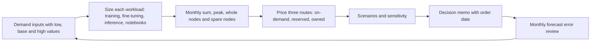

# 19.9 Capstone: capacity planning

| Field | Value |
|---|---|
| Level | Advanced |
| Priority tier | 2 |
| Lab venue | Local laptop, standard-library Python and pytest. No GPU needed. |
| Part | Part 19: Capstones, design and interview readiness |
| Primary sources | *Distributed AI Systems* (ch. 2); *AI Systems Performance Engineering* (ch. 1, 16); *Systems Performance, 2nd Edition* (ch. 2, 11); *Hands-On LLM Serving and Optimization* (ch. 5); *LLMs in Production* (ch. 3); *Machine Learning Platform Engineering* (ch. 13); *AI Factory* (ch. 9) |
| Cross-references | Chapter 17.12 (capacity planning and cost); 20.12 (inference estimation); 20.16 (spare pools); 19.4 (multi-node training); 16.14 (platform design) |
| Code | `code/part19/c09_*` and `test_c09_capacity.py` |
| Coverage file | `planning/coverage/chapters/19-09.md` |
| Claim and number ledger | `planning/ledgers/19-09.md` |

## Why this matters for AI infrastructure

On a Monday the finance lead asks one question: how many GPUs do we need next year, and should we buy them or rent them? The platform team has three answers in three spreadsheets. Training says 100 GPUs for six weeks every quarter. Inference says its traffic doubled since spring. The research group says "as many as you can give us." Nobody can say what the sum is, how sure they are, or what happens if one of the numbers is wrong.

Chapter 17.12 taught the first version of this skill with a simple rule: current count, times growth, times a buffer. That rule is a good start for a single pool. A real estate has four kinds of work with different shapes. Training is a large burst with a deadline. Fine-tuning is a steady trickle. Inference follows customer traffic and needs spare replicas. Notebooks follow the working day and are mostly idle.

This capstone plans all four together, from the demand inputs to the memo that someone signs. It reuses the inference maths from chapter 20.12 and the spare-pool maths from chapter 20.16 by importing the tested code, so the numbers agree across the handbook. Everything new is in `code/part19/c09_*`, and every number in this chapter is copied from the output of that code.

One warning applies to the whole chapter. Every price, failure rate and lead time in the worked example is a **placeholder** that I chose to make the arithmetic readable. None of them is a quote, a measurement or a recommendation. The model is the product. The inputs are yours to replace.

## Prerequisites and outcomes

### Prerequisites

- Chapter 17.12, for the single-pool forecast and the FinOps view.
- Chapter 20.12, for per-GPU inference ceilings and the headroom plus N+1 formula.
- Chapter 20.16, for sizing a spare pool from failure rate times repair time.
- Chapter 19.4, for what a multi-node training run costs in checkpoints and restarts.
- Python 3.12 and pytest. Nothing else.

### Outcomes

After this capstone you will be able to:

1. List the demand inputs for a mixed estate and attach a low, base and high value to each.
2. Size a training run from tokens to GPU-hours, wall-clock time, cluster size and checkpoint overhead.
3. Combine training, fine-tuning, inference and notebooks into one pool, with headroom and spares.
4. Compare on-demand, reserved and owned capacity with a cost model whose prices are explicit inputs.
5. Forecast demand with a confidence band and place the order early enough for its lead time.
6. Run scenarios and a sensitivity table, and write the decision memo.

---

## 1. Demand inputs and their uncertainty

An inference lead says traffic will grow "about 5 percent a month." The history shows 8.8 percent. A researcher says the next model needs "about 2 trillion tokens." Last year's run needed 40 percent more than its first estimate. Every plan starts with numbers like these, and the plan is only as good as the least certain one.

The first job is to list the inputs and give each a range. Not every input matters equally, so a range for each one tells you where to spend measurement effort. The table lists the inputs this chapter uses.

| Workload | Inputs | Where the number comes from |
|---|---|---|
| Training | Parameters, tokens, deadline, MFU, checkpoint size, write speed | Research plan, past runs, storage tests |
| Fine-tuning | Runs per month, tokens per run | Product roadmap, past job logs |
| Inference | Peak requests per second, prompt and output length, growth | Gateway metrics, product forecast |
| Notebooks | Users, peak concurrency, sessions per GPU | Identity system, scheduler logs |
| Estate | Failure rate, repair time, batch utilisation target | Fleet health data from chapter 20.16 |
| Money | Prices, discounts, hardware cost, lead times | Contracts and quotes, with dates |

The map below shows how the pieces of this chapter connect.



| Node | What it produces | Section |
|---|---|---|
| Demand inputs | A table of ranges with owners | 1 |
| Size each workload | GPUs per workload from 6ND, 20.12 and notebooks maths | 2 and 3 |
| Monthly sum and spares | Peak, pool size, spare nodes | 3 |
| Price three routes | Annual cost per commit level | 4 |
| Scenarios and sensitivity | Where the decision flips and what matters | 6 |
| Decision memo | The ask, the order date, the unverified list | 7 |
| Review | Forecast error against the band | 5 |

The diagram is a loop on purpose. The review feeds the next set of inputs, so the plan improves each quarter.

The book *Systems Performance* gives the method behind this table. Its section on resource limits asks you to measure the request rate, measure the resource use, express each request in terms of resources, and extrapolate to the limit. Its worked example has a server doing 1,000 requests per second on 16 CPUs at 40 percent. That works out to 0.64 percent of CPU per request, so the limit is 2,500 requests per second. The book calls this a rough best case, because another limit may be hit first. GPU planning follows the same four steps.

The same book warns that the result is only useful if you know the peak. A web server with 100,000 hits per day averages one request per second. If most hits arrive in the seconds after new content goes up, the peak is very different. Plan for the peak, not the average.

The model in this chapter handles uncertainty in two ways. For the inference traffic it fits a trend to history and reads a band from it, which section 5 covers. For the other inputs it takes three values, low, mode and high, samples them from a triangular distribution, and reruns the whole plan a thousand times. The result is a spread of pool sizes, not one number.

**Decision rule:** Write down every input with a low, a base and a high value before you size anything, and mark which ones are measured and which are guessed.

**In one minute:** A capacity plan is a function of its inputs. The inputs come from different teams and have different quality. Ranges tell you which inputs deserve measurement, and the plan should show a spread instead of a single figure.

---

## 2. Training and fine-tuning sizing

A research lead asks whether a 13 billion parameter model can be trained on 2 trillion tokens within 45 days. The platform team answers "probably" and then discovers the cluster has 64 free GPUs. Nobody did the arithmetic. It takes five lines.

### 2.1 From tokens to GPU-hours

For a dense transformer, the compute of a training run is about six floating-point operations per parameter per token. The book *Distributed AI Systems*, chapter 2, gives this rule for forward and backward together and cites the PaLM paper, appendix B. This is the 6ND rule: N parameters, D tokens.

Model FLOPS utilisation, or MFU, says what share of the datasheet peak the run really achieves. The same chapter defines it as model FLOPs per iteration divided by iteration time, divided by peak FLOPS. It says a well-optimised cluster might reach 40 to 60 percent for large models. Its worked example has a 70 billion parameter model at 860 teraFLOP per iteration and 2.0 seconds, on a 989 TFLOPS peak. That gives 430 TFLOPS and an MFU of about 43 percent.

The peak must be the one for the precision you train in. The book says BF16 or FP16 on an H100, not the FP8 figure from a marketing slide. The dense BF16 peak of 989.5 TFLOPS is taken from the chapter 20.12 estimator, which fact-checked it against the NVIDIA H100 page. I did not look it up again.

```text
FLOPs       = 6 x N x D
GPU-hours   = FLOPs / (peak FLOPS x MFU) / 3600
GPUs needed = GPU-hours / deadline hours
```

For this estate N is 13 billion and D is 2 trillion. MFU is an assumed 0.40, which is inside the book's range but is my choice for planning. The code prints the result.

```text
6ND FLOPs            1.560e+23
ideal GPU-hours      109,483
checkpoint write     3.9 s
inflation            1.0037
effective GPU-hours  109,886
GPUs for deadline    104 (13 nodes), wall clock 1057 h
cluster MTBF         288 h; Young interval 2846 s
  interval 1 h    inflation 1.0037
  interval Young  inflation 1.0036
  interval 6 h    inflation 1.0114
slow storage 0.5 GB/s: checkpoint 156 s, inflation 1.0461, GPUs 112
```

Read the result in order. The run needs 1.56e23 floating-point operations, which is 109,483 GPU-hours at the assumed MFU. Spread over a 45-day deadline that is about 101 GPUs. Nodes come in eights, so the plan rounds up to 104 GPUs on 13 nodes.

### 2.2 Checkpoints and failures

A run that takes 44 days will see failures. The same book says a 10,000 GPU cluster might see a failure every few hours. A failure costs the work since the last checkpoint, plus the time to restart. A checkpoint costs the time the run spends writing it.

The model uses two inputs and one first-order rule. The checkpoint size is the parameter count times bytes per parameter. The book says Adam state is about twice the model size. With bf16 weights that gives 2 plus 4, or 6 bytes per parameter, so 78 GB for 13 billion parameters. Real checkpoint contents differ by framework, so treat 6 as an input. At an assumed 20 GB per second the write takes 3.9 seconds.

The wall-clock multiplier is my own first-order model, not a published formula. It is one, plus the write time divided by the interval, plus the expected lost work per failure divided by the time between failures. Lost work per failure is half an interval plus the restart. The cluster failure interval is the per-GPU interval divided by the GPU count, because failures are assumed independent.

Because the GPU count changes the failure interval, and the failure interval changes the multiplier, and the multiplier changes the GPU count, the code iterates until the answer stops moving. With the placeholder inputs the multiplier is 1.0037. That is small, and it should be. A checkpoint that takes 4 seconds once an hour costs almost nothing.

Slow storage changes the story. The worked example repeats the sizing at 0.5 GB per second. The checkpoint takes 156 seconds, the multiplier rises to 1.0461, and the plan needs 112 GPUs instead of 104. That is one more node, bought because of the storage, not the GPUs.

The checkpoint interval has a best value. A standard first-order result, Young's formula, says it is the square root of twice the write time times the cluster failure interval. This formula is not in the gem books, so treat it as unverified. The test suite checks that it lands at the minimum of the multiplier on a grid. For this estate it gives 2,846 seconds, about 47 minutes. Checkpointing every hour is nearly as good, at 1.0037 against 1.0036. Checkpointing every six hours is worse, at 1.0114.

The book *AI Systems Performance Engineering*, chapter 1, adds a warning about how far a headline number can mislead. It describes Meta's "Revisiting Reliability" paper, where a cluster that looked fully used lost 70 to 75 percent of its compute to overheads such as communication, data delays and failure recovery. The model above counts only checkpoints and failures. It does not count data stalls or communication. If your measured MFU already includes them, as it should, the model is consistent. If you borrow MFU from a paper, you are borrowing their overheads too.

### 2.3 Fine-tuning

Fine-tuning is the same arithmetic on a smaller scale and with no deadline pressure. The estate runs ten fine-tunes a month, each on 10 billion tokens. The model turns the monthly GPU-hours into an average GPU count and divides by the batch utilisation target, which section 3 explains. The result is 8.8 GPUs on average. The model treats every fine-tune as full-parameter training with the 6ND rule. If you use adapters, the real cost is lower, and I did not find a source in the gem books for how much lower.

**Decision rule:** Size training from 6ND and a measured MFU, round up to whole nodes, add the checkpoint and failure multiplier, and check the storage write speed before you blame the GPUs.

**In one minute:** Training is 6ND divided by what the hardware actually delivers. For the example run that is about 109,000 GPU-hours and 104 GPUs for a 45-day deadline. Checkpoints cost almost nothing on fast storage and one extra node on slow storage.

---

## 3. Inference, notebooks and the pool

It is the third day of a new product launch. Traffic is above forecast, one replica has crashed, and the autoscaler is waiting for a node that has not arrived. The service has capacity for the average and nothing for this moment. Headroom and spare replicas exist for this moment.

### 3.1 Inference

Chapter 20.12 derived the per-GPU ceiling for Qwen3-8B on one H100 at batch 64 with 2,000 prompt tokens and 500 output tokens. The model imports that code and does not redo it. The ceiling is 5.68 requests per second, with a mean time per output token of 22.4 milliseconds.

Headroom and spares come from the same chapter. The book *AI Systems Performance Engineering*, chapter 16, advises targeting about 90 percent of peak throughput and keeping extra replicas that sit mostly idle, and it warns that autoscaling takes time to provision resources. The formula is replicas equals ceil of QPS over rate times target, plus spares. At 40 requests per second that gives 9 GPUs, which the tests check against chapter 20.12.

Inference demand is a forecast, so the model needs a QPS for each month. It fits a trend to nine months of gateway history, takes the P90 value at month 12, and spreads growth geometrically from today's 40 requests per second. The P90 is a planning choice, and section 5 explains it. At month 12 the plan is 116.2 requests per second and 24 GPUs.

```text
per-GPU ceiling      5.68 req/s, latency 11.3 s, TPOT 22.4 ms
QPS in 12 months     P10 100.7  P50 108.2  P90 116.2; trend 8.8% per month
planned QPS (P90)    116.2; GPUs at month 12: 24
```

### 3.2 Notebooks

Notebook demand follows people. 60 users, with 30 percent active at the peak, share GPUs two to a GPU. That is 18 concurrent sessions and 9 GPUs. Both the 30 percent and the sharing ratio are placeholders. Measure them from your scheduler. If you share GPUs with MIG slices, chapter 19.8 explains the limits.

### 3.3 Utilisation targets

Not every workload deserves the same target. Inference runs at 90 percent of its throughput ceiling because a burst or a slow batch otherwise breaks the latency target. Batch work such as training and fine-tuning gets a target of 0.85 in the example. The target pays for the gaps between runs, the queue wait, and the nodes that are down. It is an input, and the sensitivity table in section 6 shows it moves the cost more than any other input.

*Systems Performance*, chapter 2, gives a cautionary view of high utilisation. It says utilisation beyond 60 percent can hide short bursts of 100 percent use, and that queueing delays grow as utilisation rises. That advice comes from CPUs and disks, not from GPUs, and I did not find a book source for a GPU-specific number. For interactive notebooks, where a person waits, the lower end of the range is safer. For batch work that can queue, 0.85 is a placeholder you must check against your own queue times.

### 3.4 Putting the estate together

Training runs for 45 days in each quarter in this example, so it is active one month, half a month, then off. The monthly demand is the sum of the four workloads. The peak of the sum is what the pool must cover. It is not the sum of the four peaks, because training and inference peak in different months.

Spare nodes come from chapter 20.16. The model imports that code and asks for the number of spares that keeps 99.9 percent of repair states covered, given a 10 percent annual failure rate and a 72-hour repair. For a fleet of 21 nodes the answer is one node. With a 336-hour repair, the pool grows by one more node, to 184 GPUs. The fleet in this example is small, so the spare pool is small. The chapter 20.16 example with 512 nodes needs 3 to 7.

```text
fine-tune average GPUs 8.8; notebook GPUs 9
month  inference training finetune notebooks   total
    1         10    122.4      8.8         9   150.2
    2         11     61.2      8.8         9    90.0
    3         12      0.0      8.8         9    29.8
    4         13    122.4      8.8         9   153.2
    5         14     61.2      8.8         9    93.0
    6         15      0.0      8.8         9    32.8
    7         16    122.4      8.8         9   156.2
    8         17     61.2      8.8         9    96.0
    9         19      0.0      8.8         9    36.8
   10         21    122.4      8.8         9   161.2
   11         22     61.2      8.8         9   101.0
   12         24      0.0      8.8         9    41.8
peak 161.2 GPUs, spare nodes 1, pool 176 GPUs
```

The peak is 161.2 GPUs in month 10. The pool is 21 nodes for the peak plus one spare node, which is 22 nodes and 176 GPUs. In month 3 the estate needs only 29.8 GPUs. That gap is the most important fact in the table. A pool sized for the peak sits mostly idle in the troughs, and section 4 shows what that means for cost.

**Decision rule:** Size each workload with its own rule, add the four demands month by month, take the peak of the sum, round to whole nodes, and add spares from failure rate times repair time.

**In one minute:** Inference gets a 90 percent target and an extra replica. Batch work gets a lower target to pay for gaps. The pool is the peak of the monthly sum. For the example that is 176 GPUs, with a trough near 30.

---

## 4. Buy versus rent, reserved versus on-demand

The pool is sized. Finance asks how to pay for it. A cloud sales rep offers a discount for a one-year commitment. A hardware vendor offers a quote that arrives in four months. Someone in the room says that renting is always cheaper at our size, and someone else says owning is always cheaper. Both are making a claim about utilisation without saying so.

### 4.1 Three ways to get a GPU-hour

On-demand capacity costs the most per hour and charges only for hours used. Reserved capacity costs less per hour and charges for every hour of the commitment. Owned capacity has a fixed cost for every hour of its life, plus running cost. It is cheaper per hour still, if you can keep it busy. Spot capacity is cheaper but can be taken away. The model covers spot with one formula, and the tests check it. Spot is best for work that checkpoints well.

All prices are inputs. The worked example uses on-demand at 5.00 dollars per GPU-hour, a reserved discount of 35 percent, a hardware cost of 40,000 dollars per GPU amortised over four years, and 1.50 dollars per GPU-hour of running cost. I invented these numbers. They are not prices. Chapter 20.12 cites public list prices fetched on 2026-11-09, and the book *Hands-On LLM Serving and Optimization*, chapter 5, prints a table of GPU costs that it says were current in spring 2026 and may change. Use quotes from your own vendors, with dates.

### 4.2 The break-even rule

Owned capacity is paid for every hour. On-demand capacity is paid only for used hours. Owning wins when the share of owned hours that you actually use is above owned cost per hour divided by on-demand price per hour.

```text
owned $/hour    = hardware cost / (life years x 8760) + running cost per hour
break-even use  = owned $/hour / on-demand $/hour
```

With the placeholders, owned capacity costs 2.64 dollars per GPU-hour and break-even is 52.8 percent. The same rule applies to a reserved commitment, which is just a smaller version of owning.

### 4.3 The commit level

The break-even rule tells you whether to own. It does not tell you how much. A commit of 161 GPUs, the peak, would leave most of them idle in the troughs. A commit of zero gives up the discount. The right level is in between, and the model finds it by trying every whole-number commit from 0 to the peak and keeping the cheapest.

The cost of a commit level is easy to state. The commit is paid every hour. Demand above the commit is bought on demand. The model charges owned spares as well, since a spare node is paid for every hour.

```text
on-demand 5.00, reserved 3.25, owned 2.64 USD per GPU-hour; owning beats on-demand above 52.8% utilisation
all on-demand           4,168,240 USD/yr
reserved, commit  90    3,586,841 USD/yr
owned, commit  93       3,285,036 USD/yr
average demand 95.2 GPUs; owned base of 93 is busy 79.1% of the time
base hours per month 730
```

All on-demand costs about 4.17 million dollars a year. A reserved commitment of 90 GPUs, with the rest on demand, costs about 3.59 million. An owned base of 93 GPUs with the rest on demand costs about 3.29 million. The owned base is busy 79.1 percent of the time, well above the 52.8 percent break-even. These figures follow from placeholder prices, so the ranking is only an example. The next section shows how easily it flips.

Notice what the best commit is not. It is not the peak and not the average, which is 95.2 GPUs. It sits near the level that the estate needs for most of the year. Capacity above it is the burst tier, and the sensible burst tier is on-demand capacity or spot capacity for the training run.

The book *LLMs in Production*, chapter 3, adds two practical points for the decision. GPUs are rare and limited, and they can be extremely difficult to provision for companies that stay on-premise. Even in the cloud, teams still chase provisioning errors when they ask for a new GPU workspace. A purchase decision is therefore also a supply decision, and section 5 puts a number on it. For inference served through a vendor API, the book *Machine Learning Platform Engineering*, chapter 13, notes that LLM services charge by token consumption. That is the opposite of renting a fixed GPU, and it favours spiky or small workloads.

**Decision rule:** Commit only to the level of demand you expect to keep busy for most of the year, compare it with the break-even use, and cover the rest with on-demand or spot capacity.

**In one minute:** Owning and reserving are bets that utilisation stays high. The break-even rule is owned cost per hour divided by on-demand price. The best commit sits near the base load, not at the peak. All prices here are placeholders, so rerun the model with real quotes.

---

## 5. Forecasting with confidence bands and lead times

The inference lead says traffic doubled in nine months. Procurement says new GPUs take four months to arrive. If you order on the current number, the order lands four months late, in a world where demand has grown 40 percent. Lead time turns a forecast into a deadline.

### 5.1 The band

The model fits a straight line to the logarithm of monthly peak QPS, which assumes constant percentage growth. It reads the central value at the forecast month and a band from the standard prediction interval for a regression. The band widens with the scatter in the history and with the distance from the data.

For nine months of placeholder history the trend is 8.8 percent a month. Twelve months after the last point, the central estimate is 108.2 requests per second. The 80 percent band runs from 100.7 to 116.2. The model uses a normal quantile of 1.2816 for that band. With only nine points the correct t value is larger, about 1.415 for 7 degrees of freedom, so the real band is roughly 10 percent wider than printed. These two quantiles come from standard statistical tables, not from the gem books, so treat them as unverified. The code uses the normal value and the chapter says so.

The band is for one series and one assumption of steady exponential growth. A product launch or a lost customer breaks that assumption. A band says how noisy the history was. It does not say how wrong the model of the future is. That is what scenarios are for.

### 5.2 Choosing the percentile

Planning to the central estimate means you are short about half the time. Planning to the top of the band means you are rarely short and often long. The right percentile depends on the cost of each error. A shortage in inference breaks a customer promise. A surplus costs money for GPUs that sit idle. This estate plans inference to P90, and plans the rest to their modes. Chapter 17.12 uses a flat 30 percent buffer, which is one number standing in for this choice.

### 5.3 Lead times

Every purchasing route has a lead time, and the lead time sets how far ahead you must forecast. A route that delivers in a day needs a one-month forecast. A route that delivers in 120 days needs one four months out. The model rounds up to whole 30-day months.

```text
on_demand     1 days -> forecast 1 months ahead, P90 QPS 44.2
reserved     14 days -> forecast 1 months ahead, P90 QPS 44.2
buy         120 days -> forecast 4 months ahead, P90 QPS 57.5
```

The same history gives a P90 of 44.2 requests per second one month ahead and 57.5 four months ahead. The longer the lead time, the larger the number you must plan to, and the wider the band around it. This is the real cost of buying hardware. It is not just the price. It is the commitment to a forecast that is four months more uncertain.

*Systems Performance*, chapter 11, makes the same point about on-premise servers. It says they can take months to reach production because of approvals, parts, shipping and testing, and that capacity planning matters because too small means failure and too large means cost. In the cloud, it says, you can create instances almost instantly and react to real load. It also warns that a capacity study can take weeks and be out of date when it finishes, which is why the model here is a script you rerun and not a document you file.

### 5.4 The uncertainty in the pool

Section 1 promised a spread. The model samples four inputs from triangular distributions with a low, a mode and a high, and reruns the plan a thousand times with a fixed seed.

```text
pool GPUs P10/P50/P90 168 / 192 / 224
on-demand USD/yr P10/P50/P90 4,016,872 / 4,586,057 / 5,297,378
```

The pool is 168 GPUs at P10, 192 at P50 and 224 at P90. The base plan of 176 sits below the median. That is not a bug. In three of the four ranges the high value is further from the mode than the low value, so the distribution leans toward larger pools. A single-point plan built from modes will usually be too small. The spread is the better answer to give the finance lead.

**Decision rule:** Plan each workload to a stated percentile, forecast as far ahead as the purchase route's lead time, and show the band, not just the centre.

**In one minute:** A forecast is a centre and a band. The band comes from the scatter in the history and widens with distance. Longer lead times need larger numbers and wider bands. The sampled pool for this estate runs from 168 to 224 GPUs.

---

## 6. Scenarios and sensitivity

A customer signs a large contract. A research lead moves the training run up by a month. A vendor raises the price. None of these is in the forecast, and each one is a conversation you should have had before it happened. Scenarios turn those conversations into runs.

### 6.1 Scenarios

A scenario is a short list of overrides to the base assumptions. The runner reads the JSON file, applies each scenario, and prints one row each. The tests check that every scenario moves the plan in the expected direction.

```text
scenario                peak  pool  train  infer  best strategy   cost USD/yr
base                   161.2   176    104     24  owned mix         3,285,036
demand_surge           176.2   192    104     38  owned mix         3,550,456
bigger_training_run    227.1   240    160     24  owned mix         4,528,309
poor_mfu               201.8   216    136     24  owned mix         4,063,777
slow_repair            161.2   184    104     24  owned mix         3,470,156
price_shock            161.2   176    104     24  owned mix         3,708,695
pricey_hardware        161.2   176    104     24  reserved mix      3,586,841
```

Three results are worth reading. A larger training run raises the training cluster from 104 to 160 GPUs and the annual cost by about 1.2 million. A poor MFU of 0.30 instead of 0.40 pushes the training cluster to 136 GPUs. A slow repair of 336 hours adds one spare node and about 185,000 dollars a year, because the spare nodes are owned.

The last row shows a flip. If the hardware costs 80,000 dollars and the running cost is 2.5 dollars an hour, owning costs 4.78 dollars per GPU-hour, close to the on-demand 5.00 and well above the reserved 3.25. The reserved mix wins at about 3.59 million. A decision that holds for one set of prices and flips for another needs the price as a named line in the memo.

### 6.2 Sensitivity

A scenario changes several inputs at once. A sensitivity table changes one at a time, by plus and minus 20 percent, and ranks the inputs by how much the best annual cost moves.

```text
base: pool 176 GPUs, best cost 3,285,036 USD/yr, each parameter moved -20% and +20%
parameter                       pool -  pool +       cost -       cost +       swing
batch_util                         208     152    3,913,893    2,867,011   1,046,882
training.token_multiplier          152     200    2,930,347    3,818,115     887,768
training.mfu                       200     152    3,818,115    2,930,347     887,768
training.deadline_h                200     152    3,818,115    2,930,347     887,768
prices.on_demand_per_gpu_hour      176     176    2,869,473    3,465,202     595,729
prices.own_capex_per_gpu           176     176    3,080,761    3,487,036     406,275
inference.target_util              176     168    3,369,056    3,231,456     137,600
inference.qps_multiplier           168     176    3,236,346    3,330,076      93,730
prices.reserved_discount           176     176    3,285,036    3,285,036           0
spares.mttr_hours                  176     176    3,285,036    3,285,036           0
```

Three things stand out. The batch utilisation target moves the cost more than any price. It is a policy, and it is cheap to change. Training tokens, MFU and the deadline sit next to each other. The last two have identical effects because shortening the deadline by 20 percent and cutting MFU by 20 percent both raise the GPU count by the same factor. That is a useful sanity check on the model.

Two rows show zero swing. The reserved discount does not move the best cost because owned capacity is the winner in the base case. The repair time does not move the cost within this range because the spare count does not change. A parameter that does not move the decision tells you not to spend time refining it.

**Decision rule:** Run the named scenarios for events you can imagine and the sensitivity table for inputs you can measure, and spend measurement effort on the top of the table.

**In one minute:** Scenarios change several inputs together and show where the decision flips. Sensitivity changes one at a time and ranks what matters. For this estate the utilisation target, tokens, MFU and the on-demand price dominate. The discount and the repair time do not.

---

## 7. The decision memo

The plan is done, and the review meeting starts in ten minutes. Someone will ask what happens if inference doubles, when the order must be placed, and which numbers are guesses. A memo that answers those three questions in advance ends the meeting in fifteen minutes. A memo that does not will start a second one.

The template is a file in `code/part19/`. It has eight sections. The ask, the demand with its ranges, the sizing, the options compared, the scenarios, the recommendation with the latest order date, the review plan, and the list of what is not verified. Fill each section from the output of the model. Do not type numbers in by hand.

```markdown
# Capacity decision memo: <estate name>, <planning period>

Author: <name>    Date: <date>    Decision needed by: <date>    Decision owner: <name>

## 1. The ask
One sentence: buy, rent or commit to N GPUs of type T, for these months, at about this annual cost.

## 2. Demand and what we do not know
| Workload | Base demand | Low | High | Source of the number | Owner |
|---|---|---|---|---|---|

## 3. Sizing
| Workload | Method | GPUs at peak | Headroom or spare policy |
|---|---|---|---|
Pool size, spare nodes and the month the peak lands.

## 4. Options compared
| Option | Commit (GPUs) | Annual cost | Lead time | What breaks if demand is wrong |
|---|---|---|---|---|
All prices are inputs. Name the date and the source of each one.

## 5. Scenarios
| Scenario | Pool GPUs | Best option | Annual cost | Trigger that tells us it is happening |
|---|---|---|---|---|

## 6. Recommendation and the order date
The option, the commit, the latest date the order can be placed given its lead time, and the plan for demand above the commit.

## 7. Review plan
The forecast error we will report each month, the threshold that reopens this memo, and the date of the next review.

## 8. Not verified
Every input that is a placeholder or an estimate, and who will replace it with a measurement.
```

Two parts of the memo carry the most weight. The recommendation names the latest order date, which is the need date minus the lead time minus a slack. That date is the real deadline, and the section on lead times gave you its number. The review plan names the forecast error you will report each month and the threshold that reopens the memo. Chapter 17.12 already tracks forecast accuracy as a metric. Use the same metric here. If the error exceeds the band, the plan is wrong, and you want to know in month two instead of month ten.

The estate in this chapter would write the following recommendation, with all of the caveats above. Place an order for an owned base of about 93 GPUs, which is 12 nodes after rounding up, keep one spare node, and cover the rest with on-demand capacity. Review at month three. The hardware route has a 120-day lead time, so the order is placed four months before the need date. If the prices in your quote differ, rerun the model before you sign. The numbers above would then be replaced by yours.

**Decision rule:** Write the memo from the model output, include the latest order date and the list of unverified inputs, and set the review threshold before you sign.

**In one minute:** The memo answers three questions in advance. What do we do, when must we order, and what do we not know. Numbers come from the code. The review plan makes the next version cheaper to write.

---


---

## 8. Hands-on lab

This lab runs the model on a laptop. It needs no GPU and no cloud account. All of it was run here, on macOS with Python 3.12.7 and pytest 8.3.5. What was not run, and why, is listed at the end.

### Step 1: read the model

The model file holds every formula. Each function has a docstring that names its source. Training formulas cite *Distributed AI Systems*, chapter 2. The checkpoint multiplier and Young's formula are marked as my model and as unverified. The inference and spare-pool functions are imported from `code/part20/`.

```python
"""Capacity model for a mixed GPU estate (chapter 19.9). Standard library only.

Every function is one formula with its source named in the docstring.
All prices, failure rates and lead times are PLACEHOLDER inputs that the caller
supplies. Nothing here is a vendor quote or a measurement.
Inference maths is imported from code/part20/capacity_estimator.py (chapter 20.12)
and spare-pool maths from code/part20/c16_spare_pool.py (chapter 20.16).
"""
import copy
import math
import pathlib
import random
import sys

_PART20 = pathlib.Path(__file__).resolve().parents[1] / "part20"
if str(_PART20) not in sys.path:
    sys.path.insert(0, str(_PART20))
import capacity_estimator as ce  # noqa: E402  (20.12: per-GPU capacity, replicas)
import c16_spare_pool as sp  # noqa: E402  (20.16: spares from failure rate x repair time)

HOURS_PER_MONTH = 730.0  # 8760 / 12, the convention used for monthly billing maths
Z80 = 1.2816  # normal quantile for a two-sided 80 percent band (P10 to P90); see chapter caveat


# ---------------------------------------------------------------- training and fine-tuning
def train_flops(params, tokens):
    """About 6 FLOPs per parameter per token, forward plus backward, for a dense
    transformer. Source: Distributed AI Systems, ch. 2 (cites PaLM, Appendix B)."""
    return 6.0 * params * tokens


def gpu_hours_ideal(flops, peak_tflops, mfu):
    """MFU = (model FLOPs / time) / peak FLOPS, so time = FLOPs / (peak x MFU).
    Source: Distributed AI Systems, ch. 2 (MFU definition)."""
    return flops / (peak_tflops * 1e12 * mfu) / 3600.0


def checkpoint_seconds(params, bytes_per_param, write_gb_per_s):
    """Time to write one checkpoint: bytes / bandwidth. bytes_per_param is an input:
    Distributed AI Systems ch. 2 says Adam state is about 2x the model size, so
    bf16 weights plus Adam state is 2 + 4 = 6 bytes per parameter by that book's count."""
    return params * bytes_per_param / (write_gb_per_s * 1e9)


def young_interval_seconds(ckpt_s, cluster_mtbf_s):
    """Young's first-order optimal checkpoint interval sqrt(2 x C x MTBF).
    Standard result, NOT from the gem books; labelled unverified in the chapter."""
    return math.sqrt(2.0 * ckpt_s * cluster_mtbf_s)


def inflation(ckpt_s, interval_s, restart_s, cluster_mtbf_s):
    """Wall-clock multiplier from checkpointing and failures (my first-order model).
    1 + checkpoint write share + expected lost work per failure / time between failures.
    Lost work per failure is half an interval plus the restart time."""
    write_share = ckpt_s / interval_s
    failure_share = (interval_s / 2.0 + restart_s) / cluster_mtbf_s
    return 1.0 + write_share + failure_share


def size_training(params, tokens, deadline_h, peak_tflops, mfu, ckpt_bytes_per_param,
                  write_gb_per_s, interval_s, restart_s, gpu_mtbf_h, gpus_per_node=8):
    """GPUs needed to finish by the deadline. GPU count changes cluster MTBF
    (MTBF_cluster = MTBF_gpu / GPUs, independent failures) and MTBF changes the
    inflation, so iterate to a fixed point."""
    flops = train_flops(params, tokens)
    ideal_h = gpu_hours_ideal(flops, peak_tflops, mfu)
    ckpt_s = checkpoint_seconds(params, ckpt_bytes_per_param, write_gb_per_s)
    gpus = math.ceil(ideal_h / deadline_h / gpus_per_node) * gpus_per_node
    infl = 1.0
    for _ in range(50):
        mtbf_s = gpu_mtbf_h * 3600.0 / gpus
        infl = inflation(ckpt_s, interval_s, restart_s, mtbf_s)
        need = math.ceil(ideal_h * infl / deadline_h / gpus_per_node) * gpus_per_node
        if need == gpus:
            break
        gpus = need
    effective_h = ideal_h * infl
    return {"flops": flops, "ideal_gpu_hours": ideal_h, "ckpt_seconds": ckpt_s,
            "inflation": infl, "effective_gpu_hours": effective_h, "gpus": gpus,
            "wall_clock_h": effective_h / gpus, "nodes": gpus // gpus_per_node}


# ---------------------------------------------------------------- inference and notebooks
def inference_replica_rate(cfg, gpu):
    """Per-GPU request ceiling, using the 20.12 functions unchanged."""
    params, layers, kvh, hd = ce.MODELS[cfg["model"]]
    mem, bw, tflops, _price = ce.GPUS[gpu]
    w = ce.weights_gb(params, cfg.get("bytes_per_param", 2))
    bpt = ce.kv_bytes_per_token(layers, kvh, hd)
    ctx = cfg["in_tokens"] + cfg["out_tokens"]
    d_tps = ce.decode_tps(cfg["batch"], ctx, w, bpt, bw)
    p_tps = ce.prefill_tps(tflops, cfg["mfu"], params)
    rate, latency, tpot = ce.per_gpu_capacity(cfg["in_tokens"], cfg["out_tokens"],
                                               cfg["batch"], p_tps, d_tps)
    return rate, latency, tpot


def inference_gpus(qps, rate, target_util, spares):
    """20.12 section 8: ceil(QPS / (rate x target)) + spare replicas (one GPU each here)."""
    return ce.replicas_needed(qps, rate, target_util, spares)


def notebook_gpus(users, peak_concurrency, sessions_per_gpu):
    """Concurrent sessions at the peak, shared several to a GPU. My arithmetic."""
    return math.ceil(users * peak_concurrency / sessions_per_gpu)


def finetune_avg_gpus(runs_per_month, params, tokens, peak_tflops, mfu, batch_util):
    """Monthly GPU-hours from 6ND and MFU, spread over the month, divided by the
    utilisation target the platform can actually reach for batch work."""
    h = runs_per_month * gpu_hours_ideal(train_flops(params, tokens), peak_tflops, mfu)
    return h / HOURS_PER_MONTH / batch_util


# ---------------------------------------------------------------- forecasting
def fit_log_linear(history):
    """Ordinary least squares on ln(y) against month index. Returns (a, b, s, n)."""
    n = len(history)
    ys = [math.log(v) for v in history]
    xbar = (n - 1) / 2.0
    ybar = sum(ys) / n
    sxx = sum((i - xbar) ** 2 for i in range(n))
    b = sum((i - xbar) * (y - ybar) for i, y in enumerate(ys)) / sxx
    a = ybar - b * xbar
    sse = sum((y - (a + b * i)) ** 2 for i, y in enumerate(ys))
    s = math.sqrt(sse / (n - 2)) if n > 2 else 0.0
    return a, b, s, n


def forecast_band(history, months_ahead, z=Z80):
    """Prediction band for a log-linear trend: ln y0 +/- z x s x sqrt(1 + 1/n + (x0-xbar)^2/Sxx).
    Standard OLS prediction interval; normal z is an approximation for small n."""
    a, b, s, n = fit_log_linear(history)
    xbar = (n - 1) / 2.0
    sxx = sum((i - xbar) ** 2 for i in range(n))
    x0 = n - 1 + months_ahead
    centre = a + b * x0
    se = s * math.sqrt(1.0 + 1.0 / n + (x0 - xbar) ** 2 / sxx)
    return {"p10": math.exp(centre - z * se), "p50": math.exp(centre),
            "p90": math.exp(centre + z * se), "monthly_growth": math.exp(b) - 1.0}


def horizon_months(lead_days):
    """Months you must forecast ahead for an option with this lead time (30-day months)."""
    return math.ceil(lead_days / 30.0)


# ---------------------------------------------------------------- cost
def reserved_price(on_demand, discount):
    return on_demand * (1.0 - discount)


def owned_cost_per_gpu_hour(capex, life_years, opex_per_gpu_hour):
    """Straight-line amortisation of capex over the life, plus running cost.
    Charged for every hour, used or not."""
    return capex / (life_years * 8760.0) + opex_per_gpu_hour


def breakeven_utilisation(owned_hourly, rent_hourly):
    """Owning is cheaper than renting on demand when used hours / owned hours
    exceeds owned_hourly / rent_hourly."""
    return owned_hourly / rent_hourly


def spot_effective_price(spot, rework_fraction):
    """Spot price divided by the share of paid time that is useful work."""
    return spot / (1.0 - rework_fraction)


def annual_cost_with_commit(demand_by_month, commit, od, res):
    """Reserved or owned-like base of `commit` GPUs paid every hour at `res`,
    demand above it bought on demand at `od`. Demand is average GPUs per month."""
    cost = 0.0
    for d in demand_by_month:
        cost += commit * res * HOURS_PER_MONTH + max(0.0, d - commit) * od * HOURS_PER_MONTH
    return cost


def best_commit(demand_by_month, od, res):
    """Search whole-GPU commits from 0 to the peak; return (commit, cost)."""
    top = math.ceil(max(demand_by_month))
    best = min(range(top + 1), key=lambda c: annual_cost_with_commit(demand_by_month, c, od, res))
    return best, annual_cost_with_commit(demand_by_month, best, od, res)


# ---------------------------------------------------------------- the whole plan
def monthly_inference_qps(q0, q_end, months):
    g = (q_end / q0) ** (1.0 / months) - 1.0
    return [q0 * (1.0 + g) ** m for m in range(1, months + 1)], g


def run_plan(a):
    """One deterministic plan from an assumptions dict (see c09_assumptions.json)."""
    gpu = a["gpu"]
    peak_tflops = ce.GPUS[gpu][2]
    gpn = a.get("gpus_per_node", 8)
    months = a["horizon_months"]
    bu = a["batch_util"]

    inf = a["inference"]
    rate, latency, tpot = inference_replica_rate(inf, gpu)
    band = forecast_band(inf["qps_history"], months)
    qps_end = band[inf["planning_percentile"]] * inf["qps_multiplier"]
    q0 = inf["qps_history"][-1]
    qps_m, g = monthly_inference_qps(q0, qps_end, months)
    inf_m = [inference_gpus(q, rate, inf["target_util"], inf["spares"]) for q in qps_m]

    t = a["training"]
    tr = size_training(t["params"], t["tokens"] * t.get("token_multiplier", 1.0), t["deadline_h"],
                       peak_tflops, t["mfu"], t["ckpt_bytes_per_param"], t["write_gb_per_s"],
                       t["ckpt_interval_s"], t["restart_s"], t["gpu_mtbf_h"], gpn)
    tr_m = [tr["gpus"] * f / bu for f in t["active_fraction_by_month"][:months]]

    f = a["finetune"]
    ft_avg = finetune_avg_gpus(f["runs_per_month"], f["params"], f["tokens"], peak_tflops,
                               f["mfu"], bu)
    ft_m = [ft_avg] * months

    n = a["notebooks"]
    nb = notebook_gpus(n["users"], n["peak_concurrency"], n["sessions_per_gpu"])
    nb_m = [float(nb)] * months

    total_m = [i + x + y + z for i, x, y, z in zip(inf_m, tr_m, ft_m, nb_m)]
    peak = max(total_m)
    fleet_nodes = math.ceil(peak / gpn)
    sr = a["spares"]
    spare_nodes = sp.spares_needed(fleet_nodes, sr["annual_failure_rate"], sr["mttr_hours"],
                                   sr["coverage"])
    pool = math.ceil(peak / gpn) * gpn + spare_nodes * gpn

    pr = a["prices"]
    od = pr["on_demand_per_gpu_hour"]
    res = reserved_price(od, pr["reserved_discount"])
    own = owned_cost_per_gpu_hour(pr["own_capex_per_gpu"], pr["own_life_years"],
                                  pr["own_opex_per_gpu_hour"])
    all_od = sum(total_m) * HOURS_PER_MONTH * od
    c_res, cost_res = best_commit(total_m, od, res)
    c_own, cost_own = best_commit(total_m, od, own)
    cost_own += spare_nodes * gpn * own * 8760.0  # owned spares are paid for every hour
    return {
        "inference": {"rate": rate, "latency": latency, "tpot": tpot, "band": band,
                      "monthly_growth": g, "qps_end": qps_end, "gpus_end": inf_m[-1]},
        "training": tr, "finetune_avg_gpus": ft_avg, "notebook_gpus": nb,
        "monthly": {"inference": inf_m, "training": tr_m, "finetune": ft_m, "notebooks": nb_m,
                    "total": total_m},
        "peak_gpus": peak, "spare_nodes": spare_nodes, "pool_gpus": pool,
        "prices": {"on_demand": od, "reserved": res, "owned": own,
                   "breakeven_util": breakeven_utilisation(own, od)},
        "cost": {"all_on_demand": all_od, "reserved_commit": (c_res, cost_res),
                 "owned_commit": (c_own, cost_own)},
        "lead": {k: {"days": v, "months_ahead": horizon_months(v)}
                 for k, v in a["lead_days"].items()},
    }


# ---------------------------------------------------------------- uncertainty
def set_path(d, path, value):
    keys = path.split(".")
    for k in keys[:-1]:
        d = d[k]
    d[keys[-1]] = value


def get_path(d, path):
    for k in path.split("."):
        d = d[k]
    return d


def percentile(sorted_vals, q):
    """Linear-interpolated percentile of an ascending list, q in 0..1."""
    pos = q * (len(sorted_vals) - 1)
    lo = int(math.floor(pos))
    hi = min(lo + 1, len(sorted_vals) - 1)
    return sorted_vals[lo] + (sorted_vals[hi] - sorted_vals[lo]) * (pos - lo)


def monte_carlo(a, n=1000, seed=19):
    """Sample each a['uncertainty'] entry [low, mode, high] from a triangular
    distribution, re-run the plan, return P10, P50, P90 of pool size and annual
    on-demand cost. Seeded, so the output is repeatable."""
    rng = random.Random(seed)
    pools, costs = [], []
    for _ in range(n):
        b = copy.deepcopy(a)
        for path, (lo, mode, hi) in a["uncertainty"].items():
            set_path(b, path, rng.triangular(lo, hi, mode))
        r = run_plan(b)
        pools.append(r["pool_gpus"])
        costs.append(r["cost"]["all_on_demand"])
    pools.sort()
    costs.sort()
    return {"pool": [percentile(pools, q) for q in (0.1, 0.5, 0.9)],
            "cost": [percentile(costs, q) for q in (0.1, 0.5, 0.9)]}
```

**What to record:** which functions carry a source, and which carry the words "my" or "unverified."

### Step 2: read the assumptions

The JSON file holds the base case, the scenarios, the sensitivity list and the ranges. Its first field says every price is a placeholder.

```json
{
  "note": "Every price, failure rate, lead time and demand figure below is a PLACEHOLDER chosen for the worked example. Replace them with your own contracts and measurements.",
  "base": {
    "gpu": "h100",
    "gpus_per_node": 8,
    "horizon_months": 12,
    "batch_util": 0.85,
    "inference": {
      "model": "qwen3-8b",
      "in_tokens": 2000,
      "out_tokens": 500,
      "batch": 64,
      "mfu": 0.4,
      "target_util": 0.9,
      "spares": 1,
      "qps_history": [20, 22, 23, 26, 27, 31, 32, 36, 40],
      "planning_percentile": "p90",
      "qps_multiplier": 1.0
    },
    "training": {
      "params": 13e9,
      "tokens": 2e12,
      "token_multiplier": 1.0,
      "deadline_h": 1080,
      "mfu": 0.4,
      "ckpt_bytes_per_param": 6,
      "write_gb_per_s": 20,
      "ckpt_interval_s": 3600,
      "restart_s": 900,
      "gpu_mtbf_h": 30000,
      "active_fraction_by_month": [1, 0.5, 0, 1, 0.5, 0, 1, 0.5, 0, 1, 0.5, 0]
    },
    "finetune": {"runs_per_month": 10, "params": 13e9, "tokens": 1e10, "mfu": 0.4},
    "notebooks": {"users": 60, "peak_concurrency": 0.3, "sessions_per_gpu": 2},
    "spares": {"annual_failure_rate": 0.1, "mttr_hours": 72, "coverage": 0.999},
    "prices": {
      "on_demand_per_gpu_hour": 5.0,
      "reserved_discount": 0.35,
      "own_capex_per_gpu": 40000,
      "own_life_years": 4,
      "own_opex_per_gpu_hour": 1.5
    },
    "lead_days": {"on_demand": 1, "reserved": 14, "buy": 120},
    "uncertainty": {
      "inference.qps_multiplier": [0.8, 1.0, 1.6],
      "training.token_multiplier": [0.8, 1.0, 1.5],
      "training.mfu": [0.3, 0.4, 0.5],
      "notebooks.users": [40, 60, 100]
    }
  },
  "scenarios": {
    "base": {},
    "demand_surge": {"inference.qps_multiplier": 1.6, "notebooks.users": 100},
    "bigger_training_run": {"training.token_multiplier": 1.5},
    "poor_mfu": {"training.mfu": 0.3, "finetune.mfu": 0.3},
    "slow_repair": {"spares.mttr_hours": 336},
    "price_shock": {"prices.on_demand_per_gpu_hour": 7.5},
    "pricey_hardware": {"prices.own_capex_per_gpu": 80000, "prices.own_opex_per_gpu_hour": 2.5}
  },
  "sensitivity": {
    "swing": 0.2,
    "params": [
      "inference.qps_multiplier",
      "training.token_multiplier",
      "training.mfu",
      "training.deadline_h",
      "batch_util",
      "inference.target_util",
      "prices.on_demand_per_gpu_hour",
      "prices.reserved_discount",
      "prices.own_capex_per_gpu",
      "spares.mttr_hours"
    ]
  }
}
```

**What to record:** every input that you would replace with a measurement or a quote, and the owner who can give it to you.

### Step 3: the scenario runner and sensitivity table

```python
"""Scenario runner (chapter 19.9). Reads c09_assumptions.json, applies each
scenario's overrides to the base assumptions, and prints one comparable row each."""
import copy
import json
import pathlib
import sys

from c09_capacity_model import run_plan, set_path

DEFAULT = pathlib.Path(__file__).with_name("c09_assumptions.json")


def load(path=DEFAULT):
    return json.loads(pathlib.Path(path).read_text())


def apply_overrides(base, overrides):
    b = copy.deepcopy(base)
    for path, value in overrides.items():
        set_path(b, path, value)
    return b


def summarise(plan):
    c = plan["cost"]
    best = min(("all on-demand", c["all_on_demand"]),
               ("reserved mix", c["reserved_commit"][1]),
               ("owned mix", c["owned_commit"][1]), key=lambda kv: kv[1])
    return {"peak_gpus": plan["peak_gpus"], "pool_gpus": plan["pool_gpus"],
            "training_gpus": plan["training"]["gpus"],
            "inference_gpus_end": plan["inference"]["gpus_end"],
            "best_strategy": best[0], "best_cost": best[1]}


def run_all(doc):
    return {name: summarise(run_plan(apply_overrides(doc["base"], ov)))
            for name, ov in doc["scenarios"].items()}


def format_table(rows):
    head = f"{'scenario':<22}{'peak':>6}{'pool':>6}{'train':>7}{'infer':>7}  {'best strategy':<14}{'cost USD/yr':>13}"
    lines = [head]
    for name, r in rows.items():
        lines.append(f"{name:<22}{r['peak_gpus']:>6.1f}{r['pool_gpus']:>6}{r['training_gpus']:>7}"
                     f"{r['inference_gpus_end']:>7}  {r['best_strategy']:<14}{r['best_cost']:>13,.0f}")
    return "\n".join(lines)


if __name__ == "__main__":
    print(format_table(run_all(load(sys.argv[1] if len(sys.argv) > 1 else DEFAULT))))
```

```python
"""One-at-a-time sensitivity table (chapter 19.9): move each parameter by plus and
minus the swing in c09_assumptions.json, record the pool size and best annual cost."""
import sys

from c09_capacity_model import get_path, set_path
from c09_scenario_runner import DEFAULT, apply_overrides, load, summarise
from c09_capacity_model import run_plan


def sensitivity(doc):
    base = doc["base"]
    swing = doc["sensitivity"]["swing"]
    b0 = summarise(run_plan(base))
    rows = []
    for path in doc["sensitivity"]["params"]:
        v = get_path(base, path)
        lo = summarise(run_plan(apply_overrides(base, {path: v * (1 - swing)})))
        hi = summarise(run_plan(apply_overrides(base, {path: v * (1 + swing)})))
        rows.append({"param": path, "pool_lo": lo["pool_gpus"], "pool_hi": hi["pool_gpus"],
                     "cost_lo": lo["best_cost"], "cost_hi": hi["best_cost"],
                     "cost_swing": abs(hi["best_cost"] - lo["best_cost"])})
    rows.sort(key=lambda r: r["cost_swing"], reverse=True)
    return b0, rows


def format_table(b0, rows, swing):
    out = [f"base: pool {b0['pool_gpus']} GPUs, best cost {b0['best_cost']:,.0f} USD/yr, "
           f"each parameter moved -{swing:.0%} and +{swing:.0%}",
           f"{'parameter':<30}{'pool -':>8}{'pool +':>8}{'cost -':>13}{'cost +':>13}{'swing':>12}"]
    for r in rows:
        out.append(f"{r['param']:<30}{r['pool_lo']:>8}{r['pool_hi']:>8}{r['cost_lo']:>13,.0f}"
                   f"{r['cost_hi']:>13,.0f}{r['cost_swing']:>12,.0f}")
    return "\n".join(out)


if __name__ == "__main__":
    d = load(sys.argv[1] if len(sys.argv) > 1 else DEFAULT)
    b, r = sensitivity(d)
    print(format_table(b, r, d["sensitivity"]["swing"]))
```

Run them from `code/part19`.

```bash
cd code/part19
python3 c09_scenario_runner.py
python3 c09_sensitivity.py
```

The expected result is the tables in sections 6.1 and 6.2, character for character. If your numbers differ, the cause is a changed input or a different Python version. Report the version.

**What to record:** the best strategy in each scenario and the top three inputs in the sensitivity table.

### Step 4: the worked example

The worked example prints every number this chapter quotes. Run it and compare.

```python
"""Worked example for chapter 19.9. Prints every number the chapter quotes.
All prices, failure rates and lead times come from c09_assumptions.json and are placeholders."""
from c09_capacity_model import (HOURS_PER_MONTH, forecast_band, horizon_months, monte_carlo,
                                run_plan, size_training, young_interval_seconds, inflation)
from c09_scenario_runner import format_table, load, run_all
from c09_sensitivity import format_table as sens_table, sensitivity


def main():
    doc = load()
    a = doc["base"]
    r = run_plan(a)
    t = r["training"]
    print("== training")
    print(f"6ND FLOPs            {t['flops']:.3e}")
    print(f"ideal GPU-hours      {t['ideal_gpu_hours']:,.0f}")
    print(f"checkpoint write     {t['ckpt_seconds']:.1f} s")
    print(f"inflation            {t['inflation']:.4f}")
    print(f"effective GPU-hours  {t['effective_gpu_hours']:,.0f}")
    print(f"GPUs for deadline    {t['gpus']} ({t['nodes']} nodes), wall clock {t['wall_clock_h']:.0f} h")
    tr = a["training"]
    mtbf_s = tr["gpu_mtbf_h"] * 3600.0 / t["gpus"]
    best = young_interval_seconds(t["ckpt_seconds"], mtbf_s)
    print(f"cluster MTBF         {mtbf_s / 3600:.0f} h; Young interval {best:.0f} s")
    for label, interval in (("1 h", 3600), ("Young", best), ("6 h", 21600)):
        print(f"  interval {label:<6} inflation {inflation(t['ckpt_seconds'], interval, tr['restart_s'], mtbf_s):.4f}")
    slow = size_training(tr["params"], tr["tokens"], tr["deadline_h"], 989.5, tr["mfu"],
                         tr["ckpt_bytes_per_param"], 0.5, tr["ckpt_interval_s"], tr["restart_s"],
                         tr["gpu_mtbf_h"])
    print(f"slow storage 0.5 GB/s: checkpoint {slow['ckpt_seconds']:.0f} s, inflation {slow['inflation']:.4f}, "
          f"GPUs {slow['gpus']}")
    print("== inference")
    i = r["inference"]
    print(f"per-GPU ceiling      {i['rate']:.2f} req/s, latency {i['latency']:.1f} s, TPOT {i['tpot'] * 1000:.1f} ms")
    b = i["band"]
    print(f"QPS in 12 months     P10 {b['p10']:.1f}  P50 {b['p50']:.1f}  P90 {b['p90']:.1f}; trend {b['monthly_growth']:.1%} per month")
    print(f"planned QPS (P90)    {i['qps_end']:.1f}; GPUs at month 12: {i['gpus_end']}")
    print("== estate")
    print(f"fine-tune average GPUs {r['finetune_avg_gpus']:.1f}; notebook GPUs {r['notebook_gpus']}")
    m = r["monthly"]
    print("month  inference training finetune notebooks   total")
    for k in range(a["horizon_months"]):
        print(f"{k + 1:>5}  {m['inference'][k]:>9.0f} {m['training'][k]:>8.1f} {m['finetune'][k]:>8.1f} "
              f"{m['notebooks'][k]:>9.0f} {m['total'][k]:>7.1f}")
    print(f"peak {r['peak_gpus']:.1f} GPUs, spare nodes {r['spare_nodes']}, pool {r['pool_gpus']} GPUs")
    print("== cost (placeholder prices)")
    p = r["prices"]
    print(f"on-demand {p['on_demand']:.2f}, reserved {p['reserved']:.2f}, owned {p['owned']:.2f} USD per GPU-hour; "
          f"owning beats on-demand above {p['breakeven_util']:.1%} utilisation")
    c = r["cost"]
    print(f"all on-demand        {c['all_on_demand']:>12,.0f} USD/yr")
    print(f"reserved, commit {c['reserved_commit'][0]:>3} {c['reserved_commit'][1]:>12,.0f} USD/yr")
    print(f"owned, commit {c['owned_commit'][0]:>3}    {c['owned_commit'][1]:>12,.0f} USD/yr")
    tot = m["total"]
    k = c["owned_commit"][0]
    used = sum(min(x, k) for x in tot) / (k * len(tot))
    print(f"average demand {sum(tot) / len(tot):.1f} GPUs; owned base of {k} is busy {used:.1%} of the time")
    print(f"base hours per month {HOURS_PER_MONTH:.0f}")
    print("== lead times (placeholder days)")
    for k, v in r["lead"].items():
        h = horizon_months(v["days"])
        fb = forecast_band(a["inference"]["qps_history"], h)
        print(f"{k:<10} {v['days']:>4} days -> forecast {h} months ahead, P90 QPS {fb['p90']:.1f}")
    print("== uncertainty (1000 samples, seed 19)")
    mc = monte_carlo(a, 1000, 19)
    print("pool GPUs P10/P50/P90 " + " / ".join(f"{x:.0f}" for x in mc["pool"]))
    print("on-demand USD/yr P10/P50/P90 " + " / ".join(f"{x:,.0f}" for x in mc["cost"]))
    print("== scenarios")
    print(format_table(run_all(doc)))
    print("== sensitivity")
    b0, rows = sensitivity(doc)
    print(sens_table(b0, rows, doc["sensitivity"]["swing"]))


if __name__ == "__main__":
    main()
```

```bash
python3 c09_worked_example.py
```

The full output is split across sections 2 to 6 of this chapter. The test `test_worked_example_prints_the_chapter_numbers` fails if the key figures drift.

**What to record:** the pool size, the best strategy and its cost, and the P10, P50 and P90 pool sizes.

### Step 5: run the tests

```bash
python3 -m pytest code/part19/test_c09_capacity.py -q
```

Result: 20 passed. The tests cover 6ND and MFU against the book example, the checkpoint arithmetic, Young's interval at the minimum of a grid, the fixed point in the sizing, the forecast band on an exact exponential and on noisy data, agreement with chapters 20.12 and 20.16, hand-computed cost formulas, the commit level on flat and spiky demand, seeded Monte Carlo, scenario directions, a failure case where an unknown override path raises `KeyError`, and a check that the base assumptions are never changed by a run.

**What to record:** the number of tests that passed.

### Step 6: put in your own numbers

Copy `c09_assumptions.json`, replace every placeholder, and run `python3 c09_scenario_runner.py your_file.json`. Add one scenario for the event you fear most.

**What to record:** the pool size, the best strategy, and which input you were least sure about.

### What was run and what was not

Run here: every command above and the full test suite. Not run: anything on a real cluster or against a real price list. No GPU, no NCCL run, no checkpoint was written, no quote was requested. The model is arithmetic, and its ceilings are not measurements. Validate MFU, checkpoint write speed and per-GPU inference rate on your own hardware before you rely on any of them.

---

## Exercises

1. **Add a spot tier for training.** Change the cost model so the burst demand from training is bought at a spot price with a rework fraction. *Solution sketch:* use `spot_effective_price` for the training share of demand above the commit, keep on-demand for inference, and add a test where a high rework fraction makes spot lose to on-demand.
2. **Fit the trend to your own history.** Replace the placeholder QPS with 12 months from your gateway and check the band. *Solution sketch:* run `forecast_band`, compare the width to the 8.8 percent trend here, and note if the log-linear assumption fails because the history curves.
3. **Find the commit crossover.** At what on-demand price does the reserved mix beat the owned mix in the base case? *Solution sketch:* loop over prices in a script, call `run_plan`, and print the first price at which the cheapest strategy changes. The answer depends on your inputs, so report it with the date and the source of each price.
4. **Add a latency-driven batch.** Lower the inference batch from 64 to 16 and rerun. *Solution sketch:* change `inference.batch` in the JSON, rerun the scenario runner, and note the per-GPU ceiling and the inference GPU count. Chapter 20.12 explains why the ceiling falls.
5. **Price an outage.** Add a scenario where a region is lost and half the pool disappears for a week. *Solution sketch:* add a month with doubled on-demand demand, record the cost of the burst, and compare it with the cost of a permanent spare pool from chapter 20.16.
6. **Write the memo.** Fill in the template with your own numbers and give it to a colleague who did not read the chapter. *Solution sketch:* the test is whether they can find the order date and the list of unverified inputs in under a minute.

---

## Checkpoint questions

<details><summary>1. Why is a capacity plan a function of its inputs?</summary>
Every output follows from the inputs, so a wrong input gives a wrong plan however good the model. That is why each input needs a range, an owner and a note on whether it is measured or guessed.
</details>

<details><summary>2. What is the 6ND rule?</summary>
A dense transformer needs about six floating-point operations per parameter per token, forward and backward together. It comes from *Distributed AI Systems*, chapter 2, which cites the PaLM paper.
</details>

<details><summary>3. How do you turn FLOPs into GPU-hours?</summary>
Divide the FLOPs by peak FLOPS times MFU, then by 3,600. For 1.56e23 FLOPs at 989.5 TFLOPS and an MFU of 0.40, the result is 109,483 GPU-hours.
</details>

<details><summary>4. What does MFU measure and what range does the book give?</summary>
It is the share of datasheet peak FLOPS the run achieves. *Distributed AI Systems* says a well-optimised cluster might reach 40 to 60 percent for large models.
</details>

<details><summary>5. Why must the peak FLOPS match the training precision?</summary>
The peak differs by precision. Using the FP8 figure for a BF16 run overstates the hardware and understates the GPU-hours.
</details>

<details><summary>6. Why does cluster size appear on both sides of the checkpoint calculation?</summary>
More GPUs means a shorter time between failures, which raises the cost of failures. The code iterates until the GPU count stops changing.
</details>

<details><summary>7. When do checkpoints change the GPU count?</summary>
When storage is slow. At 20 GB per second the multiplier is 1.0037 and the plan needs 104 GPUs. At 0.5 GB per second it is 1.0461 and the plan needs 112.
</details>

<details><summary>8. What is Young's formula and how sure are we of it?</summary>
It gives the best checkpoint interval as the square root of twice the write time times the failure interval. It is a standard first-order result, not from the gem books, so it is labelled unverified.
</details>

<details><summary>9. How is the inference GPU count computed?</summary>
Replicas equal ceil of QPS divided by rate times target utilisation, plus spares. At 116.2 requests per second, a ceiling of 5.68 and a target of 0.9, that gives 23 plus 1, which is 24.
</details>

<details><summary>10. Why is the pool the peak of the monthly sum and not the sum of the peaks?</summary>
Training and inference peak in different months. Adding the peaks would buy GPUs that are never needed at the same time.
</details>

<details><summary>11. Why are utilisation targets different for different workloads?</summary>
Inference needs headroom for bursts, so it runs at 90 percent of its ceiling. Batch work pays for queue gaps and downtime, so the example uses 0.85. Both are inputs to check against your own data.
</details>

<details><summary>12. How do you size spare nodes?</summary>
From failure rate times repair time, using the Poisson model in chapter 20.16. Repair time matters as much as failure rate.
</details>

<details><summary>13. What is the break-even rule for owning?</summary>
Owning beats on-demand when the share of owned hours you use exceeds owned cost per hour divided by on-demand price. With the placeholders that is 52.8 percent.
</details>

<details><summary>14. Why is the best commit not the peak?</summary>
A commit is paid every hour. Committing to the peak leaves GPUs idle in the troughs, where demand falls to about 30 GPUs. The best commit sits near the load that stays busy.
</details>

<details><summary>15. Why does the base-case pool sit below the median of the sampled pools?</summary>
The high ends of the input ranges are further from the mode than the low ends. The distribution leans toward larger pools, so a plan built from modes tends to be small.
</details>

<details><summary>16. What does lead time do to the forecast?</summary>
It sets the horizon. A 120-day route needs a forecast four months ahead. In the example the P90 rises from 44.2 to 57.5 requests per second between one and four months.
</details>

<details><summary>17. What is the difference between a scenario and a sensitivity table?</summary>
A scenario changes several inputs together to model an event. A sensitivity table changes one input at a time and ranks which ones move the cost.
</details>

<details><summary>18. Why do MFU and deadline have the same sensitivity?</summary>
Both change the GPU count by the same factor. A 20 percent shorter deadline and a 20 percent lower MFU each need 25 percent more GPU-time per hour of the deadline.
</details>

<details><summary>19. What must the decision memo contain that a spreadsheet does not?</summary>
The latest order date, the scenarios and the list of unverified inputs. Those three answer the questions a reviewer asks first.
</details>

<details><summary>20. Which numbers in this chapter are real prices?</summary>
None. Every price, discount, failure rate and lead time in the worked example is a placeholder. Only the model and the cited formulas are meant for reuse.
</details>

---

## Sources and review notes

Books, read in the local library, chapter by chapter:

- *Distributed AI Systems*, chapter 2 "GPU Hardware, Networking, and Parallelism Strategies": MFU definition and the 40 to 60 percent range, the 70B worked example, the six-times-parameters rule per token with its PaLM citation, Adam state at twice the model size, and the remark that a 10,000 GPU cluster might see failures every few hours.
- *AI Systems Performance Engineering*, chapter 1 "Introduction and AI System Overview": goodput and the Meta "Revisiting Reliability" example with 70 to 75 percent lost. Chapter 16 "Profiling, Debugging, and Tuning Inference at Scale": the 90 percent headroom target, idle spare replicas and slow autoscaling, as already used in chapter 20.12.
- *Systems Performance, 2nd Edition*, chapter 2 "Methodologies", sections on capacity planning and resource limits, and the utilisation caution about 60 percent. Chapter 11 "Cloud Computing", section on capacity planning.
- *Hands-On LLM Serving and Optimization*, chapter 5: Table 5-4 on GPU specs and costs, marked by the book as current in spring 2026. Used only to say that prices move.
- *LLMs in Production*, chapter 3 "Large language model operations": GPUs are rare, hard to provision on-premise, and still cause provisioning problems in the cloud.
- *Machine Learning Platform Engineering*, chapter 13, section 13.4 "Cost optimization strategies": LLM services charge by token consumption.
- *AI Factory*, chapter 9 "Distributed Computing": the argument that capacity should follow load. Used through chapter 20.12.

Handbook sources, reused by import or link and not recomputed:

- `code/part20/capacity_estimator.py` from chapter 20.12, for per-GPU capacity, the 989.5 TFLOPS dense BF16 figure, model shapes and `replicas_needed`. The datasheet figure was fact-checked there on 2026-11-09 against the NVIDIA H100 page. I did not fetch it again.
- `code/part20/c16_spare_pool.py` from chapter 20.16, for spare nodes from failure rate and repair time.
- Chapter 17.12 and `code/part17/capacity_plan.py`, for the single-pool rule that this chapter extends. That rule is `ceil(current x (1 + growth) x (1 + buffer))`.

No web page was fetched for this chapter. No upstream version-specific fact is used.

### Cross-references to other handbook chapters

- Chapter 17.12 for the single-pool forecast and FinOps.
- Chapter 20.12 for inference estimation and headroom.
- Chapter 20.16 for spare-pool sizing.
- Chapter 19.4 for multi-node training and checkpoints.
- Chapter 19.8 for MIG sharing of notebook GPUs.
- Chapter 16.14 for platform design and FinOps.

### Migrated from `nvidia-devops`

The earlier draft cited NVIDIA Zero-to-Hero Volume 24 (capacity planning capstone). I did not re-read that corpus for this rewrite, and no passage from it survives in the text. The earlier draft named Volume 24 without a file path, so I cannot give an exact `nvidia-devops` path and I claim none.

### Explicitly labelled inferences

- The checkpoint and failure multiplier is my first-order model, not a published formula.
- Six bytes per parameter for a checkpoint follows from the book's two-bytes weights and Adam at twice the model size. Real checkpoint contents vary.
- Young's formula and the t value of 1.415 for 7 degrees of freedom are standard results from memory of statistical references. They are unverified here.
- The 0.85 batch utilisation target, the 0.30 notebook concurrency and the two sessions per GPU are placeholders.
- Every price, discount, hardware cost, running cost, failure rate, repair time and lead time is a placeholder.
- Planning inference to P90 is a policy choice, not a rule from a source.
- Applying the 6ND rule to full-parameter fine-tuning is my simplification.

### Not verified or not run

- No GPU, cluster, storage system or price list was available. Nothing was benchmarked.
- The model assumes independent failures and constant percentage growth. Neither was tested against real data.
- I did not find a gem-book source for how much cheaper adapter fine-tuning is than full fine-tuning, so that is left out.
- The reserved and owned prices are not vendor figures. The cost ranking is an example and will change with real quotes.

### Verification log

Claims checked: 22. Confirmed: 20, of which 14 were re-read in the book chapters named above and 6 were checked by tests against the chapter 20.12 and 20.16 code. Corrected: 2 errors from the earlier draft. It divided a daily GPU-hours figure by utilisation and called the result a GPU count, and it ran `capacity_plan.py` with flags that the script does not accept. Removed: 7 items that could not be sourced or run here, namely the multi-region failover section, the discount table, the reservation command, the Kubecost and Prometheus queries, the 80 percent accuracy alert, the `quarterly_review.py` command that does not exist, and the 300 thousand dollar waste figure. Still unverified: 6, listed under the inferences above. The code was run: 20 tests passed, and the worked example and both tables were regenerated from the files shown in the chapter.
