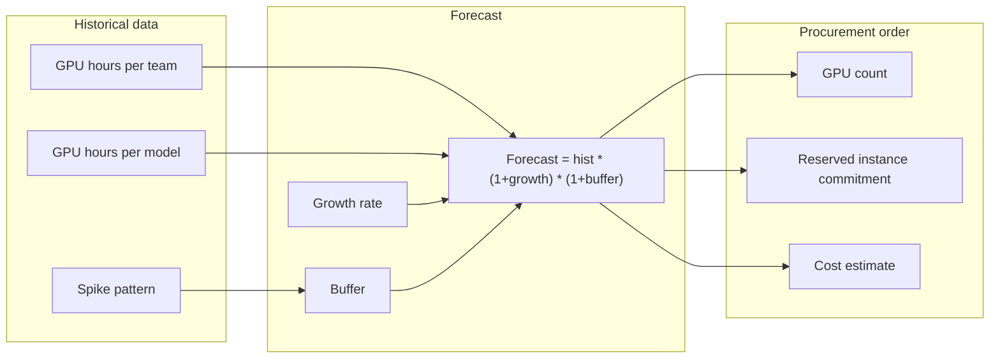

# 19.9 Capstone: capacity planning

| Field | Value |
|---|---|
| Level | Advanced |
| Priority tier | 2 |
| Lab venue | GCP / GKE |
| Part | Part 19: Capstones, design and interview readiness |
| Primary sources | NVIDIA Zero-to-Hero Volume 24 (Capacity planning capstone); Part 11 (GPU Kubernetes); Part 16 (MLOps); Part 17 (Operations) |
| Cross-references | Chapter 17.12 (Capacity planning); Chapter 16.14 (Platform design); Chapter 17.8 (Performance engineering) |
| Coverage file | `planning/coverage/chapters/19-09.md` |
| Claim & number ledger | `planning/ledgers/19-09.md` |

## Capacity planning at a glance



The forecast drives the procurement order; the procurement order is the CFO's signature.

## Why this matters for AI infrastructure

Capacity planning is the discipline that turns the current usage into the future GPU order. The capstone ties together the forecasting model, the buffer calculation, the right-sizing exercise, the reserved-instance strategy, the multi-region failover, and the quarterly review. A team that has read every chapter in Part 17 Section 17.12 can describe each piece; a team that has run this capstone knows how the pieces fit together.

The capstone is what keeps the GPU bill predictable. The CFO sees the procurement order; the procurement order is the output of the capstone. The capstone is the platform team's answer to the question "how many GPUs do we need next quarter?".

```text
Why the capacity planning capstone matters (V24; Parts 11, 16, 17):
- Capacity planning is the production shape of FinOps for AI infrastructure.
  The capstone is what ties the forecasting, the sizing, the reserved
  instances, and the multi-region failover together.
- The capstone has three perspectives: the platform engineer's view (how
  to size the GPU pool); the FinOps lead's view (how to track the cost);
  the procurement team's view (how to order the GPUs).
- The capstone is the reference design. Every chapter in Part 17 maps to
  a section of the capstone.
```

Three operational realities make this capstone a platform-team deliverable rather than a tutorial:

1. **The capstone is the reference design.** The platform team references the capstone when forecasting demand; the platform team references the capstone when ordering GPUs.
2. **The capstone is the interview anchor.** The candidate is asked "how would you plan capacity for an AI factory?"; the candidate points at this capstone.
3. **The capstone is the procurement gate.** A capacity plan that fails the review is a capacity plan that does not lead to a procurement order.

**Before a team can claim their AI factory is cost-efficient, the team must have run this capstone. A team that has not run the capstone has not integrated the planning.**

## Prerequisites and outcomes

### Prerequisites

- Chapter 17.12 (Capacity planning and cost optimisation).
- Chapter 16.14 (Platform design FinOps).

### Outcomes

After completing this capstone you will be able to:

1. Forecast the GPU demand for the next quarter using historical data and growth rates.
2. Size the GPU pool based on the forecast, the buffer, and the reserved-instance strategy.
3. Evaluate reserved vs spot instances for cost optimisation.
4. Plan the multi-region failover for disaster recovery.
5. Run the quarterly capacity review with the platform team and the procurement team.
6. Track the capacity plan in the FinOps dashboard; alert on capacity exhaustion.

---

## 1. The forecasting model

### 1.1 The historical data

The forecasting model uses the historical GPU usage data from Prometheus. The data is the per-team, per-model GPU hours over the last 90 days.

```bash
# Query the historical GPU usage
curl 'http://prometheus/api/v1/query?query=sum by (team) (kubecost_team_gpu_hours_daily[90d])'
# expected: the GPU hours per team per day for the last 90 days
```

The pattern is: the historical data is per-team; the historical data is per-day; the historical data covers at least 90 days.

### 1.2 The forecast

The forecast uses the historical data to predict the next quarter's usage. The forecast uses a simple growth model; the forecast adds a buffer for spikes.

```text
Forecast model:
- Historical usage: 100 GPU-hours per day
- Growth rate: 20% per quarter
- Buffer: 30% for spikes
- Forecast: 100 * 1.20 * 1.30 = 156 GPU-hours per day
- Quarterly forecast: 156 * 90 = 14,040 GPU-hours
```

The pattern is: the forecast is based on historical usage; the forecast includes a growth rate; the forecast includes a buffer.

---

## 2. The sizing

### 2.1 The GPU pool size

The GPU pool size is the number of GPUs needed to meet the forecast. The pool size is the forecast divided by the average utilisation.

```text
GPU pool size:
- Forecast: 156 GPU-hours per day
- Average utilisation: 80%
- Pool size: 156 / 0.80 = 195 GPUs
- Round up: 200 GPUs
```

The pattern is: the pool size is the forecast divided by the utilisation; the pool size is rounded up to the next multiple of 8.

### 2.2 The reserved-instance strategy

The reserved-instance strategy commits to a certain number of GPUs for a certain period in exchange for a discount.

| Commitment | Discount | Use case |
|---|---|---|
| On-demand | 0% | Spike capacity |
| 1-year reserved | 30-40% | Steady-state capacity |
| 3-year reserved | 50-60% | Long-term capacity |
| Spot | 50-70% | Preemptible workloads |

The pattern is: 1-year reserved for steady-state workloads; 3-year reserved for long-term workloads; spot for training jobs; on-demand for spikes.

---

## 3. The multi-region failover

### 3.1 The multi-region plan

The multi-region failover plan is the pattern for surviving a regional outage. The plan includes: the primary region, the secondary region, the data replication, the workload failover.

```text
Multi-region failover plan:
- Primary region: us-central1
- Secondary region: europe-west1
- Data replication: object storage cross-region replication
- Workload failover: InferenceService replicated in both regions
- Failover trigger: regional health check failure
```

The pattern is: the primary region serves traffic; the secondary region is pre-warmed; the failover is automatic.

---

## 4. Day-2 operations

### 4.1 The quarterly review

The quarterly review is the pattern for reviewing the forecast and the procurement order. The review includes: the forecast accuracy, the current utilisation, the buffer consumption, the next quarter's order.

```bash
# Run the quarterly review
python code/part17/quarterly_review.py \
  --quarter Q+1 \
  --output capacity_plan_q+1.md
# expected: the forecast accuracy is reported; the procurement order is generated
```

The pattern is: the quarterly review is automated; the quarterly review's output is the procurement order; the procurement order is reviewed by the platform team.

### 4.2 The FinOps dashboard

The FinOps dashboard shows the per-team, per-model, per-month cost. The dashboard tracks the forecast accuracy.

```bash
# Query the FinOps dashboard
curl 'http://prometheus/api/v1/query?query=capacity_plan_forecast_accuracy'
# expected: the forecast accuracy is reported
```

The pattern is: the FinOps dashboard tracks the forecast accuracy; the dashboard alerts when the accuracy drops below 80%.

---

## 5. Hands-on lab

This lab walks through the capacity planning capstone: the forecasting, the sizing, the reserved instances. The lab is **untested** in this repository.

### 5.1 Prerequisites

- A GKE Autopilot or Standard cluster with at least 100 GPU-hours of usage per day.
- Kubecost installed for cost attribution.

### 5.2 Step 1: collect the historical data

```bash
curl 'http://prometheus/api/v1/query?query=sum by (team) (kubecost_team_gpu_hours_daily[90d])'
```

### 5.3 Step 2: forecast the next quarter

```bash
python code/part17/capacity_plan.py \
  --cluster gke-prod-us-central1 \
  --growth-rate 0.20 \
  --buffer 0.30 \
  --output capacity_plan_q+1.md
```

### 5.4 Step 3: order the GPUs

```bash
# Order 200 GPUs (1-year reserved)
gcloud compute reservations create ai-factory-q+1 \
  --machine-type=a3-highgpu-8g \
  --vm-count=25 \
  --zone=us-central1-a
```

### 5.5 What to record

After the lab, you should be able to answer five questions in five seconds each:

1. What is the current GPU usage per team?
2. What is the Q+1 forecast?
3. What is the Q+1 GPU order?
4. What is the forecast accuracy?
5. What is the current reserved-instance commitment?

If any takes more than 30 seconds, the capacity planning is not yet a production service. The lab is **untested** against a live GKE cluster.

---

## Exercises

1. **Add a per-team forecast.** Forecast the GPU usage per team, not just for the cluster as a whole. *Solution sketch:* the per-team forecast script.
2. **Add a per-model forecast.** Forecast the GPU usage per model. *Solution sketch:* the per-model forecast script.
3. **Add a reserved-instance tracker.** Track the current reserved-instance commitment and the discount. *Solution sketch:* the Kubecost dashboard panel.
4. **Add a multi-region failover drill.** Schedule a quarterly drill that tests the multi-region failover. *Solution sketch:* the Chaos Mesh experiment.
5. **Add a capacity exhaustion alert.** Configure an alert that fires when the cluster is at 90% capacity. *Solution sketch:* the Prometheus alert on the GPU utilisation metric.
6. **Add a capacity review runbook.** Document the process for reviewing the capacity plan. *Solution sketch:* the Markdown runbook.

---

## Checkpoint questions

<details><summary>1. What is capacity planning?</summary>
The discipline that turns the current usage into the future GPU order. Capacity planning includes the forecasting model, the buffer calculation, the reserved-instance strategy, the multi-region failover, and the quarterly review.
</details>

<details><summary>2. What is the forecasting model?</summary>
The model that uses the historical GPU usage data to predict the next quarter's usage. The model is: historical usage * (1 + growth rate) * (1 + buffer). The forecast drives the GPU order.
</details>

<details><summary>3. What is the buffer calculation?</summary>
The safety margin between the forecast and the actual need. The default buffer is 30%. The buffer can be tuned based on the workload's spike pattern; the buffer is the trade-off between over-provisioning and under-provisioning.
</details>

<details><summary>4. What is the reserved-instance strategy?</summary>
The strategy that commits to a certain number of GPUs for a certain period in exchange for a discount. 1-year reserved saves 30-40%; 3-year reserved saves 50-60%; spot saves 50-70%.
</details>

<details><summary>5. What is the most common capacity planning failure?</summary>
The forecast is wrong. The forecast says 200 GPUs; the actual usage is 100 GPUs; the team over-provisioned by 100 GPUs. The fix is to tune the forecast model; track the forecast accuracy; review the forecast quarterly.
</details>

<details><summary>6. What is the most dangerous capacity planning failure?</summary>
The forecast is too low. The forecast says 100 GPUs; the actual usage is 200 GPUs; the team is under-provisioned. The fix is to tune the forecast model; add a buffer; add on-demand capacity.
</details>

<details><summary>7. What is the relationship between capacity planning and FinOps?</summary>
Capacity planning is the forward-looking view; FinOps is the backward-looking view. Capacity planning uses historical data from FinOps; FinOps tracks the actual cost against the capacity plan.
</details>

<details><summary>8. What is the most important capacity planning metric?</summary>
Forecast accuracy. The metric tells the team how accurate the forecast is. A low accuracy means the team should tune the forecast model; a high accuracy means the team can trust the forecast.
</details>

<details><summary>9. What is the relationship between capacity planning and reserved instances?</summary>
Capacity planning determines the reserved-instance commitment. The forecast drives the commitment; the commitment determines the discount. The trade-off is between commitment flexibility and cost savings.
</details>

<details><summary>10. What is the relationship between capacity planning and multi-region failover?</summary>
Capacity planning includes the multi-region failover. The plan covers the GPU order in both regions; the plan covers the data replication; the plan covers the failover trigger.
</details>

<details><summary>11. What is the most expensive capacity planning mistake?</summary>
Ordering too many GPUs. The team over-provisions by 100 GPUs; the team wastes $300k per year. The fix is to tune the forecast; track the utilisation; right-size the order.
</details>

<details><summary>12. What is the most common capacity planning mistake?</summary>
Not updating the forecast quarterly. The forecast is based on stale data; the forecast is wrong; the GPU order is wrong. The fix is to schedule the quarterly review; automate the forecast update.
</details>

<details><summary>13. What is the relationship between capacity planning and the Kubernetes capstone?</summary>
Capacity planning determines the GPU node pool size. The Kubernetes capstone provisions the GPU node pool; the capacity planning capstone sizes the GPU node pool.
</details>

<details><summary>14. What is the relationship between capacity planning and the Slurm capstone?</summary>
Capacity planning covers both Slurm and Kubernetes. The Slurm GPU cluster is one shape; the Kubernetes GPU platform is another shape. The capacity plan covers both shapes.
</details>

<details><summary>15. What is the most expensive reserved-instance mistake?</summary>
Ordering reserved instances that the team cannot use. The team commits to 100 GPUs for 1 year; the team only uses 50 GPUs; the team wastes the discount. The fix is to right-size the commitment; use on-demand for the unused capacity.
</details>

<details><summary>16. What is the most common buffer mistake?</summary>
A buffer that is too low. The buffer is 10%; the team is surprised by spikes; the team is under-provisioned. The fix is to increase the buffer to 30%; track the spike pattern; adjust the buffer.
</details>

<details><summary>17. Why is the capacity planning capstone a Tier 2 chapter?</summary>
Because the capacity planning capstone is the foundation of cost-efficient AI infrastructure. The capstone is what the platform team references; the capstone is what the CFO sees; the capstone is the procurement gate.
</details>

<details><summary>18. What is the relationship between capacity planning and FinOps dashboards?</summary>
Capacity planning is the source of the FinOps dashboard's forecast. The dashboard shows the cost; the forecast shows the future. Together, they inform the cost-vs-latency trade-off.
</details>

<details><summary>19. What is the relationship between capacity planning and the incident response?</summary>
Capacity planning prevents the incident from escalating. If the team has spare GPUs, the team can drain an unhealthy node; if the team does not have spare GPUs, the team must rebuild the unhealthy node. Spare GPUs are the safety margin for incident response.
</details>

<details><summary>20. What five questions should the capacity planning capstone lab let you answer in five seconds each?</summary>
What is the current GPU usage per team. What is the Q+1 forecast. What is the Q+1 GPU order. What is the forecast accuracy. What is the current reserved-instance commitment. If any takes more than 30 seconds, the capacity planning is not yet a production service.
</details>

---

## Sources and review notes

- NVIDIA Zero-to-Hero Volume 24 (Capacity planning capstone). Source for the forecasting model, the sizing, the reserved instances. The wording has been rewritten in the handbook's voice.
- Part 11 (GPU Kubernetes) for the GPU pool patterns.
- Part 16 (MLOps) for the platform design FinOps.
- Part 17 (Operations) for the monitoring and incident response.

### Cross-references to other handbook chapters

- Chapter 17.12 for the capacity planning and cost optimisation.
- Chapter 16.14 for the platform design FinOps.
- Chapter 17.8 for the performance engineering methodology.

### Migrated from `nvidia-devops`

The capacity planning capstone operational patterns draw on Volume 24. The wording has been rewritten in the handbook's voice.

### Explicitly labelled inferences

- The growth rate (20%) is a starting point; specific rates depend on the workload.
- The buffer (30%) is a starting point; specific buffers depend on the spike pattern.
- The reserved-instance discount (30-60%) is a starting point; specific discounts depend on the commitment.

### Not verified on live hardware

- The lab in Section 5 is **untested** against a live GKE cluster in this repository.
- The forecasting model assumes historical data is available; production deployments may require data engineering.
- The capacity plan assumes the team's budget is known; production deployments may require CFO approval.
