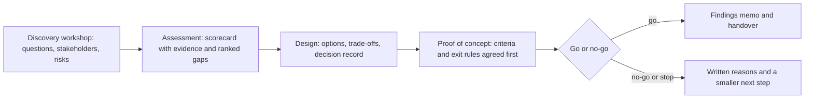

# 19.10 Customer workshops and the consulting method

| Field | Value |
|---|---|
| Level | Intermediate |
| Priority tier | 3 |
| Lab venue | Local laptop, standard-library Python and pytest. No GPU needed. |
| Part | Part 19: Capstones, design and interview readiness |
| Primary sources | *Engineering AI Systems* (ch. 12, 13, 14); *Production Kubernetes* (ch. 1); *Machine Learning Platform Engineering* (ch. 1); *AI Engineering* (ch. 10); *AI Factory* (ch. 11) |
| Cross-references | Chapter 19.9 (capacity planning); 19.11 to 19.13 (system design); 20.27 (post-mortems); 20.28 (project deep dive) |
| Code | `code/part19/c10_*` and `test_c10_consulting.py` |
| Coverage file | `planning/coverage/chapters/19-10.md` |
| Claim and number ledger | `planning/ledgers/19-10.md` |

## Why this matters for AI infrastructure

A customer tells you on a call that they want "an AI platform by spring." Nobody on the call can say what the platform will run, who will operate it, how it will be judged, or who signs the cheque. Two months later the team has built a cluster that is technically sound and that the customer does not want. The failure was not in the cluster. It was in the first week.

This capstone teaches the part of the job that happens before and around the technical build. You will learn what to ask, how to turn the answers into a short list of risks, how to score the customer's current state, how to turn requirements into a design with the costs written down, how to run a proof of concept that can fail honestly, and how to hand the result over. The method is a sequence of small artefacts, each of which another person can check.

An honest word about sourcing. The gem books describe customer projects and platform choices, and this chapter uses them for what they say. They do not contain a consulting playbook. The workshop agenda, the questionnaire weights, the scorecard scale and the verdict rules here are this chapter's own recommended practice, and the text says so each time. This chapter does not describe how NVIDIA, Nebius or any named company runs its engagements, because there is no source for that.

Everything runnable is in `code/part19/c10_*`. The customer in the worked example, Larkfield Mutual, is fictional. Every number about it is invented to make the arithmetic readable, and none of it was measured on a system.

## Prerequisites and outcomes

### Prerequisites

- Chapter 19.9 for how sizing and uncertainty are written down.
- Chapters 19.11 to 19.13 for the designs you will propose.
- Chapter 20.28 for how to talk about a project afterwards.
- Python 3 and pytest on a laptop for the lab.

### Outcomes

After this capstone you will be able to:

1. Run a discovery conversation with a question list that covers eight areas, and score how complete it is.
2. Turn the answers into named risk flags with a severity.
3. Score a customer's current state with evidence for every score, and rank the gaps.
4. Write an architecture decision record that shows the rejected options and their costs.
5. Define a proof of concept with success criteria, minimum run counts and exit criteria before it starts.
6. Say "go", "no-go", "inconclusive" or "stop" from results, and defend the choice.
7. Answer the interview question "walk me through how you would run a discovery workshop."

## 1. The shape of an engagement

A customer asks for a quote after one meeting. The sales note says "GPU cluster, 64 GPUs." Three weeks later the engineers learn that the data cannot leave the building and the team has never run a GPU. The quote is now wrong in two ways. An engagement needs a shape that surfaces these facts early and cheaply.

The only gem-book description of a whole customer engagement is the Fraunhofer case in *Engineering AI Systems*, chapter 12. It splits the project into three phases. A proof of concept proves the approach is feasible. A main project integrates the application on the customer side. Maintenance and operation follow after deployment. The proof of concept ran three months with a break at the halfway point where either partner could stop the project if progress was not significant.

My engagement shape adds the steps that come before and after those phases. It is the author's recommended practice, not a published standard.



| Step | Artefact | Tool in this chapter | Who must sign |
|---|---|---|---|
| Discovery | Answers file and risk flags | `c10_discovery.py` | Customer decision maker confirms facts |
| Assessment | Scorecard with evidence | `c10_scorecard.py` | Customer technical lead confirms evidence |
| Design | Decision record | `c10_adr.py` | Customer sponsor and your lead |
| Proof of concept | Criteria, results, verdict | `c10_poc_tracker.py` | Both sides, before it starts |
| Handover | Memo, runbooks, owner list | Template in section 7 | Named operator on the customer side |

Notice that each artefact is small and can be read in five minutes. That is deliberate. A long report is read once. A short file with a score and a reason is argued over, corrected and reused.

**Decision rule:** Do not start the next step until the artefact of the current step exists and the customer has seen it.

**In one minute:** An engagement is five steps that each leave behind a small, checkable file. The Fraunhofer case gives the proof of concept, implementation and operation phases. The steps before and after are this chapter's own practice.

## 2. Discovery: what to ask and why

On the first call the customer says the use case is "document search." After twenty minutes you learn there are two languages, a scanned archive, an angry compliance officer, and a failed attempt last year. None of this was in the brief. Discovery is the work of finding these facts while they are cheap to find.

The Fraunhofer client had already had an unsuccessful proof of concept with another company. The book says the major challenges were mostly language hurdles, and that the client had failed to reach a mutual understanding of the business goals and the data. That sentence is the best argument for a structured discovery. Both sides must say, in plain words, what the goal is and what the data looks like.

### 2.1 The eight areas

The questionnaire in `c10_questionnaire.json` has 29 questions in eight areas. Seven are the areas you would expect: workload, data, scale, team skills, compliance, budget and timeline. The eighth is stakeholders. The Fraunhofer chapter lists five kinds of client stakeholder: a decision maker, a business unit lead, a project lead, the employees who are the end users, and IT professionals. It calls the involvement of these people a key success factor, so I ask about them first.

| Area | Example question | Why it matters | Source or status |
|---|---|---|---|
| Stakeholders | Is one named person able to approve budget and the go decision? | A workshop without one produces a document nobody acts on | Roles from *Engineering AI Systems* ch. 12; the question is mine |
| Workload | Do people wait for the answer, or does it run in the background? | Interactive work needs latency targets and headroom | My practice |
| Workload | Will the model run on your hardware or through a hosted API? | The Fraunhofer client ruled out cloud-hosted models and that shaped the design | *Engineering AI Systems* ch. 12 |
| Data | Has anyone measured the quality of the data? | Most of the Fraunhofer proof of concept went into parsing and preprocessing | *Engineering AI Systems* ch. 12 |
| Data | Do correct answers exist to score against? | Without them a proof of concept cannot show success | My practice |
| Scale | How many times higher is the peak than the average? | Sizing follows the peak | Links to chapter 19.9 |
| Team | Has the team run GPU workloads in production? | GPU failure modes differ from CPU ones | My practice |
| Compliance | Must the data stay on premises or in a country? | Can rule out hosted APIs | *Engineering AI Systems* ch. 14 names GDPR and PCI DSS in a bank |
| Budget | A fixed number, a range, or nothing yet? | An unknown budget means options cannot be ranked by cost | My practice |
| Timeline | How many weeks can the proof of concept run? | It must be long enough for repeated measurements | My practice |

### 2.2 Why the questions are data

The questionnaire is a JSON file and not a document. Each question has an area, a type, a "critical" flag and a one-line reason. Because it is data, a script can count what has been answered and a second engineer can see exactly what you asked. The reason field is there for the facilitator. When a customer asks "why do you need this," you read the line aloud.

Two kinds of answer count as unanswered: an empty one, and the word "unknown." Customers often say "I think so," and that is a gap.

### 2.3 Scoring completeness and risk flags

The scorer in `c10_discovery.py` does two jobs. It computes a weighted completeness, where a critical question counts twice. It also evaluates 14 risk rules. Each rule is a list of conditions over answers. A rule can compare an answer to a constant, or to another answer. For example, rule R10 fires when the weeks of security approval exceed the weeks until the pilot, which is a date the customer cannot meet as stated.

Two behaviours are worth knowing. A rule never fires on an unanswered question, because guessing would create false alarms. Instead every unanswered critical question produces its own high-severity flag. And the scorer refuses bad input. An unknown question id, a number given as text, or a choice outside the list raises an error. The tests prove this, because a scorer that silently accepts typos is worse than no scorer.

The completeness threshold of 80 percent weighted, with no critical question unanswered, is my heuristic. I have no source for the number. Treat it as a default to argue with.

**Decision rule:** Move to assessment only when every critical question has a real answer, and write down every flag with the person who will own it.

**In one minute:** Discovery asks 29 questions in eight areas, drawn from what the Fraunhofer case shows mattered. Storing the questions as data lets a script score completeness and fire named risk flags. Unknown answers count as gaps, not as answers.

## 3. Running the workshop

At 10:15 the customer's architect and the security lead start arguing about whether production data may be used in the proof of concept. The facilitator has a flip chart and forty minutes of agenda left. What the facilitator does in the next two minutes decides whether the day produces a decision or a stalemate.

In the Fraunhofer project a workshop was held to jointly determine the goals of the proof of concept and the approach. It included the employees who would actually use the application. That is the model I use: the people who do the work are in the room when the goals are set.

### 3.1 An agenda I recommend

This agenda is my practice. The times are a starting point for a half day and not a rule from any source.

| Time | Block | Output |
|---|---|---|
| 0:00 to 0:20 | Goals, ground rules, who decides | One-sentence goal the room agrees to |
| 0:20 to 1:20 | Use case walk-through with the end users | Workload questions answered |
| 1:20 to 2:00 | Data and constraints | Data, compliance and residency answers |
| 2:00 to 2:15 | Break | Side conversations happen here, and are useful |
| 2:15 to 2:50 | Team, budget, timeline | Remaining questions answered |
| 2:50 to 3:30 | Read back risks, agree owners and next steps | Flag list with an owner and a date each |

Prepare before the day. Send the questionnaire two days ahead, ask for the decision maker by name, and raise any failed earlier attempt. Fraunhofer's client wanted to see what differed from the last try.

### 3.2 Facilitation habits and disagreement

Five habits do most of the work, and all are my practice. Write the goal sentence on the wall. Ask for an example before accepting an adjective, so that "fast" becomes "an adjuster waits no more than eight seconds." Ask who would be unhappy if this went wrong. Record every claim with its owner. Read the flags back aloud at the end.

Disagreement in the room is information. Three kinds appear again and again.

The first is a disagreement about a fact, such as whether the data is clean. Do not debate it. Turn it into a measurement with an owner and a date. The proof of concept exists partly to settle facts like this.

The second is a disagreement about a priority, such as speed against cost. Put both on the wall, ask the decision maker to rank them, and write the ranking into the design record as a driver. If the decision maker is absent, the flag from the questionnaire (R01) has just become real.

The third is a disagreement between two senior people who each own part of the answer, such as security and the architect. Do not pick a side. Write each position as an option in the decision record with its cost, and ask what evidence would change each person's mind. That evidence often becomes a proof of concept criterion.

The Fraunhofer chapter points at the same lesson from the other side. It says that this was not a turnkey solution handed over, and that sophisticated, engaged clients are required. If the client will not engage, the method cannot work, and saying so early is part of the job.

**Decision rule:** When people disagree, convert the disagreement into a measurement, a ranked driver or an option with a cost, and never into a winner.

**In one minute:** Run the workshop with the end users and the decision maker present. Use a fixed agenda, ask for examples, record owners, and read the flags back. Turn each disagreement into evidence rather than a vote.

## 4. Assessing the current state

Midway through the workshop the customer's lead says "we have solid MLOps." The following week you ask for the model registry URL. It turns out to be a shared folder with dated file names. The lead was not lying. They were describing the practice they hoped to have. An assessment replaces hope with evidence.

### 4.1 The scorecard

`c10_scorecard.json` lists 16 criteria in five categories: infrastructure, security, MLOps, team and governance. Each criterion has a weight from 1 to 3 and a plain-English sentence. The scale is this chapter's own and has four levels.

| Score | Meaning |
|---|---|
| 0 | Absent |
| 1 | Ad hoc, depends on one person |
| 2 | Defined and repeatable |
| 3 | Measured and automated |

The five categories are this chapter's own grouping of the topics those books cover: the infrastructure, the access and secrets, the pipelines and monitoring, and the people who run them. The weights and the default target of 2 are heuristics.

### 4.2 Evidence is mandatory

The tool rejects any score without evidence. A score of 2 with the text "they said so" is evidence of a kind, and I would write exactly that, because it tells the next reader how much to trust it. The point is that a score without a reason cannot be challenged and cannot be checked.

The evaluator also reports coverage. If you assessed three of four team criteria, the team category is flagged incomplete. A maturity number built from half the facts is a trap.

### 4.3 Gaps and targets

A gap is the target minus the score, multiplied by the weight. The default target is 2 for everything. You override it where the requirements demand more. In the worked example the evaluation criterion has a target of 3 because the customer must prove quality before release.

A gap is not automatically a thing to build. *Production Kubernetes* advises understanding existing workflows and deciding which requirements belong at the platform level and which at the application level. Some gaps belong to a purchased service, and some to training.

**Decision rule:** Score only what you saw or were shown, write the evidence next to the score, and set the targets from requirements rather than from a template.

**In one minute:** The scorecard scores 16 criteria from 0 to 3, requires evidence for each, and ranks gaps by weight times distance to target. Incomplete categories are flagged, not averaged away.

## 5. From requirements to an architecture with trade-offs

The assessment is finished and a colleague says "just put everything on Kubernetes with the open-source stack." The customer has three engineers and no GPU history. The colleague's design is not wrong in general. It is wrong for this team. A good design names the alternatives and what each one costs this particular customer.

### 5.1 What the books say about choosing

*Production Kubernetes* chapter 1 describes a spectrum of approaches to an application platform. At one end are managed platforms that hide the infrastructure, such as Heroku. At the other is building a platform on Kubernetes, which the authors say requires the most engineering effort but can line up most closely with your needs. They warn that a prebuilt platform asks you to conform to its view of the world and can carry lock-in. They also say you must understand your engineering maturity, appetite for building and available resources before deciding to build.

The same chapter describes an abstraction spectrum. At one end every team gets its own cluster and carries the responsibility for Kubernetes knowledge. At the other end Kubernetes is entirely hidden behind a platform as a service. Neither end is right in general. The right point depends on whether the application teams can operate Kubernetes.

*Machine Learning Platform Engineering* chapter 1 says there is no one-size-fits-all platform architecture and recommends growing a platform incrementally. It also recommends trying a tool for a few days with a proof of concept to find deal-breaking limits early. On build versus buy it acknowledges that organisations may already have a vendor platform, and argues that building one from scratch once is valuable for learning.

*AI Engineering* chapter 10 shows the same incremental stance, adding context, guardrails, a router, caches and agents one step at a time. *Engineering AI Systems* chapter 13 describes a consulting organisation serving small manufacturers with no IT team. It chose cloud-agnostic tools so clients keep flexibility, offered ongoing support, and avoided financial lock-in contracts. It names data ingestion as a major problem. Chapter 14 adds that in banking, privacy rules such as GDPR and PCI DSS apply and decisions must be traceable.

### 5.2 Turning gaps into options

My procedure is the author's practice. List the hard constraints such as residency, deadline and team size. List the drivers that can be traded, such as cost, speed and control. Write at least two options, including the one the customer prefers and one deliberately different. State what each option costs this customer. Choose, say why in one sentence, and write when you would change your mind.

### 5.3 The decision record

`c10_adr.py` turns a small JSON decision into a numbered markdown record. It refuses a record with fewer than two options, an option with no cons, an option with no pros, a decision that is not one of the options, or no revisit trigger. These checks exist because the most common failure of a design document is a one-sided case.

The record format, with context, options, decision and consequences, is a widely used convention. It is described from common practice and is not verified against a source, so it is not called a standard.

The record for the Larkfield example ends like this, produced by the script:

```text
## Decision

We will use: Self-hosted on customer-owned hardware.

## Consequences

- Order lead time starts the clock before the PoC ends, so the PoC must run on rented capacity first
- A GPU operations training and runbook workstream is added to the plan
- Peak handling needs a queue or degraded mode, to be agreed with the business
```

Notice that the consequences are not all good news. A decision record that lists only benefits will be distrusted, and rightly.

**Decision rule:** Never present one option. Write at least two, state what each costs this customer, and add the condition that would reverse your choice.

**In one minute:** The books agree that platform choices sit on spectra and have no universal answer. Turn each gap into options with explicit costs and record the choice in a decision record that refuses one-sided cases.

## 6. The proof of concept

Three weeks into a proof of concept the customer asks "so is it working?" The team shows a demo. It looks impressive, and nobody can say whether it passed, because nobody wrote down what passing means. The proof of concept now has no ending except exhaustion.

The Fraunhofer proof of concept had a defined window, a halfway decision point and a goal. The client emphasised precision over recall, so the model had to be certain in its recommendations even if it covered fewer products. The evaluation combined numbers from a held-out test set with a qualitative review by the employees, who also sorted recommendations into incorrect, correct and functionally correct. The bulk of the work went into parsing the input. A simple embedding-based model was enough to convince the client to proceed, and a heavier model came later in the main project.

### 6.1 Success criteria and exit criteria

I recommend two lists, written and agreed before the proof of concept starts. The first is success criteria. Each has a metric, a threshold, a priority and a minimum number of runs. The second is exit criteria. These are conditions that stop or pause the work no matter how the success criteria look.

Here is the criteria file for the fictional Larkfield proof of concept. It is exactly the file `code/part19/c10_poc_criteria.json`.

```json
{
  "_note": "FICTIONAL customer Larkfield Mutual. Criteria are agreed in writing before the PoC starts. Thresholds are invented for the chapter.",
  "poc": "Larkfield claims summariser PoC",
  "success": [
    {"id": "S1", "metric": "acceptable_answer_rate", "op": ">=", "threshold": 0.80, "priority": "must", "min_runs": 3,
     "why": "Share of 200 scored claim questions that adjusters mark acceptable, three scoring runs."},
    {"id": "S2", "metric": "p95_latency_s", "op": "<=", "threshold": 8, "priority": "must", "min_runs": 5,
     "why": "95th percentile response time at 40 concurrent requests, five load runs."},
    {"id": "S3", "metric": "unsupported_claim_rate", "op": "<=", "threshold": 0.05, "priority": "must", "min_runs": 3,
     "why": "Share of summaries that state a fact not in the claim file."},
    {"id": "S4", "metric": "cost_per_1000_requests", "op": "<=", "threshold": 2.0, "priority": "should", "min_runs": 3,
     "why": "Placeholder cost unit agreed with finance."},
    {"id": "S5", "metric": "adjuster_minutes_saved", "op": ">=", "threshold": 10, "priority": "should", "min_runs": 1,
     "why": "Minutes saved per claim file, from a timed adjuster session."}
  ],
  "exit": [
    {"id": "X1", "metric": "weeks_elapsed", "op": ">", "threshold": 6, "action": "Stop and decide. The agreed window is over."},
    {"id": "X2", "metric": "gpu_hours_used", "op": ">", "threshold": 1200, "action": "Stop. The agreed compute budget is spent."},
    {"id": "X3", "metric": "security_blockers_open", "op": ">=", "threshold": 1, "action": "Pause. Real data cannot be used until the blocker is closed."}
  ]
}
```

Three details deserve attention. The priority "must" separates what decides the verdict from what only shapes conditions. The minimum run count prevents a single lucky run from passing a criterion. And the exit criteria cover three different stops: time, compute budget and an open security blocker.

### 6.2 Results and the verdict

Results are a small JSON file of measured values with the number of runs behind each. This is the fictional results file.

```json
{
  "_note": "FICTIONAL results for the fictional Larkfield PoC. Invented for the chapter. Not measured on any system.",
  "metrics": {
    "acceptable_answer_rate": {"value": 0.84, "runs": 3},
    "p95_latency_s": {"value": 7.2, "runs": 5},
    "unsupported_claim_rate": {"value": 0.04, "runs": 3},
    "cost_per_1000_requests": {"value": 2.4, "runs": 3},
    "adjuster_minutes_saved": {"value": 12, "runs": 1},
    "weeks_elapsed": {"value": 5, "runs": 1},
    "gpu_hours_used": {"value": 900, "runs": 1},
    "security_blockers_open": {"value": 0, "runs": 1}
  }
}
```

The tracker applies rules in a fixed order, first match wins.

| Verdict | Condition | Exit code |
|---|---|---|
| STOP | Any exit criterion is true | 3 |
| NO-GO | A must criterion was measured enough times and failed | 1 |
| INCONCLUSIVE | A must criterion is missing or has too few runs | 2 |
| GO WITH CONDITIONS | All musts pass, a should fails or is missing | 0 |
| GO | Everything passes | 0 |

The order has consequences. STOP beats NO-GO, because a spent budget ends the work whatever the numbers say. A failed measurement with too few runs does not count as a failure. It is inconclusive, because three runs is the agreement and two runs is not evidence. This is my policy, and the tests prove the tool follows it.

Run on the fictional results, the tracker prints the following.

```text
  S1 must   acceptable_answer_rate   0.84 >= 0.8  runs 3/3  PASS
  S2 must   p95_latency_s            7.2 <= 8  runs 5/5  PASS
  S3 must   unsupported_claim_rate   0.04 <= 0.05  runs 3/3  PASS
  S4 should cost_per_1000_requests   2.4 <= 2.0  runs 3/3  FAIL
  S5 should adjuster_minutes_saved   12 >= 10  runs 1/1  PASS
VERDICT: GO WITH CONDITIONS
```

The cost criterion failed, but it is a should. The verdict is go with conditions, and the condition is a cost conversation. Now see what happens if the latency run comes back at 9.4 seconds.

```text
  S1 must   acceptable_answer_rate   0.84 >= 0.8  runs 3/3  PASS
  S2 must   p95_latency_s            9.4 <= 8  runs 5/5  FAIL
  S3 must   unsupported_claim_rate   0.04 <= 0.05  runs 3/3  PASS
  S4 should cost_per_1000_requests   2.4 <= 2.0  runs 3/3  FAIL
  S5 should adjuster_minutes_saved   12 >= 10  runs 1/1  PASS
VERDICT: NO-GO
```

The same file with one changed number is a no-go. Because the threshold was agreed in advance, nobody argues about whether 9.4 is "close enough."

### 6.3 Keeping it honest

The Fraunhofer team used containers from the start so the demo was repeatable on different platforms. Its employees reviewed outputs and found that the model recommended products even when none fitted, so it was retrained to suggest nothing in that case. A metric can look good while a behaviour is wrong. Fraunhofer also built a halfway decision point, and my exit criteria turn that into a rule rather than a meeting.

**Decision rule:** Agree success criteria, minimum run counts and exit criteria in writing before the first run, and let a script produce the verdict.

**In one minute:** A proof of concept that cannot fail proves nothing. Write must and should criteria with minimum runs, add exit criteria for time, money and blockers, and let the tracker output STOP, NO-GO, INCONCLUSIVE or GO.

## 7. Findings, recommendation and handover

The proof of concept passed. The customer's team is delighted and asks when the platform goes live. You realise that the only people who understand how it works are the two engineers who built it, and they are leaving the engagement on Friday. Delivering a result is not the same as delivering a platform someone can run.

### 7.1 The findings memo

Write one memo of about three pages. This structure is my recommendation.

1. The ask, in the customer's words, and the goal sentence agreed in the workshop.
2. What we learned, with the discovery flags and what happened to each.
3. Current state, as the scorecard table with the top gaps.
4. Options and the recommendation, linked to the decision record.
5. Proof of concept results, with the verdict and the raw results file attached.
6. Risks and conditions, including the failed should criteria.
7. What we did not verify, stated plainly.
8. Next steps with owners and dates.

### 7.2 Handover

*Engineering AI Systems* chapter 12 offers a useful picture. The Fraunhofer team ran development and CI/CD at its own site, and operation took place on the client side. Organisational challenges included the timing of data handover and the handover of the machine learning component into the client's processes. Deployment into production was done manually, as the client preferred, even though automation was feasible. The lesson is that handover has its own design.

My handover checklist is the author's practice.

| Item | Test that it is done |
|---|---|
| A named operator on the customer side | They have answered a page in a drill |
| Runbooks for the top failures | A customer engineer followed one without help |
| Access and secrets transferred | Your accounts are removed |
| Monitoring and alerts owned by the customer | They changed an alert threshold |
| The criteria file and results archived | They can rerun the evaluation |
| A review date for the revisit triggers | It is in a calendar |

For monitoring, *AI Engineering* chapter 10 offers three measures from the DevOps community: mean time to detection, mean time to response and change failure rate. It says that if you do not know your change failure rate it is time to redesign the platform to be more observable. These are good measures to agree with the customer for the first quarter after handover.

### 7.3 After go-live

The Fraunhofer production phase added communication as a seventh MLOps area, because real-world drift needs continuous coordination. The *AI Factory* chapter says early pilots should aim to succeed rather than chase fast return, and names an internal leader and clear business goals as conditions. For incidents after handover see chapter 20.27.

**Decision rule:** The engagement is not finished until a named customer operator has run the system without you and the memo says what you did not verify.

**In one minute:** Write a short findings memo with the scorecard, the decision record, the verdict and what was not verified. Hand over with a named operator and tested runbooks, and agree three operating measures for the first quarter.

## 8. A worked scenario: Larkfield Mutual (fictional)

Everything in this section is invented. Larkfield Mutual is not a real insurer. No data was measured. The scenario exists so the tools produce output you can read.

The customer. Larkfield wants adjusters to get summaries of 40-page claim files and to ask questions of them. About forty adjusters may use it at the same time at peak. The claim data contains personal information and must stay on premises. The platform team has three engineers, basic Kubernetes experience, no GPUs and no GPU history. The pilot is due in 16 weeks. Security and legal approval take 10 weeks. A previous attempt failed, and nobody wrote down why.

### 8.1 Discovery

The answers are in `code/part19/c10_answers_larkfield.json`. The tool prints:

```text
Completeness (weighted): 95.6%
  stakeholders  3/3
  workload      5/5
  data          5/5
  scale         3/3
  team          4/4
  compliance    3/3
  budget        2/3
  timeline      2/3
Ready for assessment: yes
Risk flags:
  [high  ] R05: No ground truth. The PoC cannot prove success. Create a scored sample first.
  [high  ] R07: No GPU operations experience and no GPUs today. Plan training or a managed service.
  [medium] R09: Peak is more than 5 times the average. Size for the peak and ask what can be queued.
  [info  ] R03: A previous attempt failed. Ask what was different about the goals and the data.
```

Read the flags as the agenda for the next conversation. R05 says no ground truth exists. Before any proof of concept can succeed, someone must create a scored sample. R07 says no GPU experience and no GPUs. R09 says peak is six times average, so ask what can queue. R03 reminds us to ask what the failed attempt got wrong.

Two non-critical questions stayed unknown, namely existing vendor commitments and the reason for the deadline. Completeness of 95.6% is enough to proceed, but both go on the action list.

### 8.2 Assessment

The scores and their fictional evidence are in `c10_scores_larkfield.json`.

```text
Category maturity (0 to 3, weighted):
  infrastructure  1.00
  security        2.38
  mlops           0.70
  team            1.14
  governance      1.60
Gaps by priority (weight x distance to target):
   9  ml.evaluation        score 0 target 3
   6  tm.gpu_ops           score 0 target 2
   4  inf.gpu_inventory    score 0 target 2
   3  ml.monitoring        score 1 target 2
   3  sec.isolation        score 2 target 3
   2  gov.data_lineage     score 1 target 2
   2  inf.network_storage  score 1 target 2
   2  ml.data_versioning   score 1 target 2
   2  ml.deploy_pipeline   score 1 target 2
```

Security is the strongest category. MLOps is the weakest. The top gap by far is evaluation, which has weight 3 and a target of 3 and a score of 0. This agrees with flag R05. The two sources of evidence reinforce each other, which is a good sign that the picture is right.

### 8.3 Design

The decision record has three options. A hosted API conflicts with residency. A managed GPU Kubernetes service might satisfy residency only if a suitable region exists. Customer-owned hardware satisfies residency and has predictable cost but a long lead time and a fixed capacity against a peak six times the average. The record chooses owned hardware and lists the consequences. One of them is that the proof of concept must run on rented capacity first, because the hardware order must start before the proof of concept ends.

### 8.4 Proof of concept

The criteria and results in section 6 belong to this scenario. The verdict was go with conditions, and the condition is that cost per thousand requests was 2.4 against a target of 2.0. In the findings memo the recommended action is to review the cost model with finance before ordering hardware, and to keep the decision record open until that is done.

**Decision rule:** Use the worked example to practise reading flags into actions, and never quote its numbers as evidence about any real system.

**In one minute:** Larkfield is fictional. Its discovery flags, scorecard gaps and proof of concept verdict flow into a decision record and a findings memo. The cost condition on the go is the kind of thing a real memo should carry.

## 9. Hands-on lab

All steps run on a laptop with Python 3 and pytest. No GPU, no cluster and no customer data are involved. Steps 1 to 5 were run on 2026-11-11 on macOS arm64, and the outputs quoted are from that run.

### Step 1: score the discovery answers

```bash
cd code/part19
python3 c10_discovery.py c10_answers_larkfield.json
```

Expected result: the output in section 8.1, with exit code 0. Try deleting a critical answer from a copy of the file and rerun. The exit code becomes 1 and an `UNKNOWN:` flag appears.

What to record: the flag ids, the completeness number and the owner you would give each flag.

### Step 2: score the assessment

```bash
python3 c10_scorecard.py c10_scores_larkfield.json
```

Expected result: the output in section 8.2. Then delete the `evidence` text from one entry in a copy. The tool refuses it. What to record: the three highest-priority gaps.

### Step 3: evaluate the proof of concept

```bash
python3 c10_poc_tracker.py c10_poc_criteria.json c10_poc_results_larkfield.json
echo $?
```

Expected result: GO WITH CONDITIONS and exit code 0. Copy the results file, set the p95 latency value to 9.4 and rerun. You get NO-GO and exit code 1. Set the runs for that metric to 2 instead and you get INCONCLUSIVE and exit code 2. Set gpu_hours_used to 1300 and you get STOP and exit code 3. What to record: the verdict for each of the four changes.

### Step 4: generate the decision record

```bash
python3 c10_adr.py c10_adr_input_larkfield.json /tmp/adr_out
```

Expected result: a path such as `/tmp/adr_out/0001-serve-the-claims-summariser-...md`. Run it twice and the second file is numbered 0002. Remove all the cons from one option and the generator refuses. What to record: the three consequences, and whether you agree they are complete.

### Step 5: run the tests

```bash
python3 -m pytest test_c10_consulting.py -q
```

Result: 37 passed. The tests cover the scoring arithmetic, every verdict path, input validation and the refusal cases.

### What was run and what was not

Run here: steps 1 to 5 and the demo script `c10_engagement_demo.py`. Not run: nothing here touched a GPU, a cluster or a real customer. The questionnaire, scorecard and thresholds were not validated on a real engagement. The tests prove that the code does what this chapter says. They do not prove the method is right.

## How to answer out loud

The question is "walk me through how you would run a discovery workshop." The interviewer wants to hear a structure, an awareness of risk and some humility about what you do not know. This chapter's method is built from the gem books and the chapter's own practice. It is not how any particular company works, and you should not claim it is.

### Speaking order

1. State the goal of discovery in one sentence: find the facts that would make the design wrong, while that is cheap.
2. Say who is in the room: a decision maker, the end users, the technical lead, security or compliance.
3. Describe preparation: a question list sent in advance, and data to bring.
4. Walk the agenda: goals, use case with end users, data and constraints, team and budget and timeline, read back risks.
5. Name the areas you ask about: workload, data, scale, team skills, compliance, budget, timeline.
6. Say what you produce: answers, a short risk list with owners, and next steps.
7. Say what happens next: an assessment with evidence, then options with costs, then a proof of concept with criteria.

### Numbers and facts to be ready to state

- The Fraunhofer proof of concept lasted three months with a halfway break.
- The client there had a failed earlier attempt and had trouble reaching a shared understanding of goals and data.
- Five stakeholder types: decision maker, business unit lead, project lead, end users and IT.
- Everything else, such as a half-day agenda or 80 percent completeness, is a convention you choose, so call it that.

### Trade-offs to mention

A longer workshop finds more facts and costs the customer more time. A strict questionnaire gives comparability but can feel like an interrogation, so ask for examples. Early scores give structure but can anchor the customer, so show the evidence with each one.

### Follow-ups to expect

| Follow-up | Short answer |
|---|---|
| What if the decision maker does not show up? | Raise it as the first risk, reschedule the decisions, and keep only fact-finding that day |
| What if the customer does not know their data? | Make data inspection the first proof of concept task and say how long it takes |
| What if two leads disagree? | Record both as options with costs and ask what evidence would change each mind |
| How do you know the proof of concept passed? | Criteria and exit rules agreed before it started, with minimum runs |
| What did you get wrong once? | Use a real story, and link it to chapter 20.28 for how to tell it |

For a spoken example of telling a project story after the fact, see chapter 20.28. For incident stories use chapter 20.27.

## Exercises

1. **Add a question.** The questionnaire does not ask about model update frequency. Add a question with a reason and a risk rule that fires when updates are weekly and no deployment pipeline exists. *Solution sketch:* add the question to `c10_questionnaire.json` in the workload area. Add a rule that tests the update answer together with a scorecard-derived answer, or add a second question about pipelines. Add a test that the rule fires and one that it does not.
2. **Find the missing flag.** Change the Larkfield answers so residency is required and the model source is a hosted API. Which flag fires and what do you say to the customer? *Solution sketch:* R04 fires. Say that the two requirements conflict and ask which one gives way, or whether a regional hosted option satisfies the residency rule.
3. **Rescore with a new target.** Set the target for `tm.gpu_ops` to 3 in the Larkfield scores. How does the top-gap list change? *Solution sketch:* the priority becomes 3 times 3, which is 9, and ties with `ml.evaluation`. Ties sort by id, so `ml.evaluation` stays first. Explain why you might raise the target.
4. **Break the proof of concept.** Produce a results file that gives each of the four verdicts using only edits to the Larkfield file. *Solution sketch:* use the four edits in lab step 4. Check each with the tracker and its exit code.
5. **Write a decision record.** Write the JSON for a different decision: managed API versus self-hosted for a customer with no residency rule and a team of ten. Include a revisit trigger. *Solution sketch:* the options change and the decision may flip. Verify the generator accepts it and that each option has a real con.
6. **Handle a disagreement.** The security lead refuses production data in the proof of concept and the architect says synthetic data will not prove anything. Write what you do. *Solution sketch:* write two options with costs, a masked-copy option and a synthetic option. Add an exit criterion that pauses work while the security blocker is open. Ask what evidence would convince each person. Add the answer as a success criterion.

## Checkpoint questions

<details><summary>1. Why is a discovery questionnaire stored as data rather than a document?</summary>
A script can count what was answered, fire risk rules and be reviewed line by line. A second engineer can see exactly what was asked.
</details>

<details><summary>2. What are the eight areas in the questionnaire?</summary>
Stakeholders, workload, data, scale, team, compliance, budget and timeline.
</details>

<details><summary>3. Why does the scorer treat the answer "unknown" as unanswered?</summary>
Because "I think so" or "we will check" is not a fact. An unknown critical answer raises its own high-severity flag.
</details>

<details><summary>4. Why can a risk rule never fire on an unanswered question?</summary>
Firing on a guess would create false alarms. The gap is reported separately as an unanswered critical question.
</details>

<details><summary>5. What did the Fraunhofer client's earlier failed proof of concept teach about discovery?</summary>
The book says the client had failed to reach a mutual understanding of the business goals and the data. A structured discovery forces both sides to state them.
</details>

<details><summary>6. Who were the five client stakeholders in the Fraunhofer case?</summary>
A decision maker, a business unit lead, a project lead, the employees who were end users, and IT professionals.
</details>

<details><summary>7. How should you handle a disagreement about a fact in the workshop?</summary>
Do not debate it. Turn it into a measurement with an owner and a date, often a proof of concept task.
</details>

<details><summary>8. Why must every score on the scorecard have evidence?</summary>
Without evidence a score cannot be challenged or rechecked. The tool rejects a score with no evidence text.
</details>

<details><summary>9. What does the scorecard do when a category is only partly assessed?</summary>
It flags the category as incomplete instead of presenting a maturity number built from half the facts.
</details>

<details><summary>10. How is a gap priority computed?</summary>
The target minus the score, multiplied by the criterion weight. Only positive gaps are listed.
</details>

<details><summary>11. What does Production Kubernetes say about the trade-off of a prebuilt application platform?</summary>
It asks you to conform to the platform's view of the world and can carry lock-in, while it removes operational weight.
</details>

<details><summary>12. What should you understand before deciding to build a platform on Kubernetes?</summary>
Your engineering maturity, appetite for building and available resources, according to Production Kubernetes chapter 1.
</details>

<details><summary>13. Why must a decision record show rejected options with their costs?</summary>
A one-sided record is distrusted and hides the trade-off. The generator refuses an option without cons.
</details>

<details><summary>14. Why do success criteria carry a minimum number of runs?</summary>
To prevent one lucky or unlucky measurement from deciding the verdict. Too few runs gives INCONCLUSIVE, not pass or fail.
</details>

<details><summary>15. Why does STOP beat NO-GO in the verdict order?</summary>
An exhausted budget or window ends the work whatever the numbers say, and the customer must decide what to do next.
</details>

<details><summary>16. What is the difference between a must and a should criterion?</summary>
A failed must gives NO-GO. A failed should gives GO WITH CONDITIONS and goes into the memo as a condition.
</details>

<details><summary>17. What did the Fraunhofer employees find in production that the metrics had hidden?</summary>
The model recommended products even when none fitted, so it was retrained to learn when to suggest nothing.
</details>

<details><summary>18. Name three measures AI Engineering chapter 10 suggests for observability quality.</summary>
Mean time to detection, mean time to response and change failure rate.
</details>

<details><summary>19. What makes handover finished, according to this chapter's rule?</summary>
A named customer operator has run the system without you, and the memo states what was not verified.
</details>

<details><summary>20. Which parts of this chapter are the author's own practice and not sourced?</summary>
The workshop agenda, the question weights, the 80 percent threshold, the 0 to 3 scale, the verdict rules and the decision record format.
</details>

## Sources and review notes

Books, read in the local library:

- *Engineering AI Systems*, chapter 12 "The Fraunhofer Case Study: Using a Pretrained Language Model for Tendering": the failed earlier proof of concept, the three phases, the three-month proof of concept with a halfway break, the stakeholder list, precision over recall, parsing as the bulk of proof of concept work, the joint workshop with end users, containers from the start, manual deployment at the client's request, the production-phase retraining and the takeaways on engaged clients.
- *Engineering AI Systems*, chapter 13 "The ARM Hub Case Study": SMEs without IT teams, ongoing support, no financial lock-in, cloud-agnostic tooling and data ingestion as a major problem. Chapter 14 "The Banking Case Study": GDPR and PCI DSS, traceability of decisions.
- *Production Kubernetes*, chapter 1 "A Path to Production": the application platform definition, the spectrum of approaches, lock-in trade-off, the maturity question, understanding existing workflows, and the abstraction spectrum.
- *Machine Learning Platform Engineering*, chapter 1 "Getting started with MLOps and ML engineering": no one-size-fits-all architecture, incremental growth, build versus buy and trying tools with a short proof of concept.
- *AI Engineering*, chapter 10 "AI Engineering Architecture and User Feedback": incremental architecture, observability as part of design, and the MTTD, MTTR and CFR measures.
- *AI Factory*, chapter 11 "AI Factory: A Roadmap for AI Transformation": pilots over speedy return, an internal leader and clear business goals, and the difficulty of scaling beyond a proof of concept.

No web page was fetched. No upstream version-specific fact is used.

### Cross-references to other handbook chapters

- Chapter 19.9 for sizing under uncertainty and the decision memo habit.
- Chapters 19.11 to 19.13 for the designs you propose.
- [Chapter 20.27, post-mortems, on-call and incident leadership](../part-20-nebius-sre-interview/27-post-mortems-on-call-and-incident-leadership.md).
- [Chapter 20.28, the project deep dive and the final round](../part-20-nebius-sre-interview/28-the-project-deep-dive-and-the-final-round.md).
- [Chapter 19.9, capacity planning](./09-capstone-capacity-planning.md).

### Migrated from `nvidia-devops`

This chapter takes no passage from NVIDIA Zero-to-Hero Volumes 8, 10 and 22, and I claim no exact `nvidia-devops` path.

### Explicitly labelled inferences

- The engagement steps, the half-day agenda, facilitation habits and handover checklist are my recommended practice.
- The 29 questions, their critical flags, the 14 risk rules, the 80 percent completeness threshold and the weights are my heuristics.
- The scorecard scale, weights and default target are my heuristics.
- The verdict order and the minimum run rule are my policy.
- The decision record format is from memory of common practice and is unverified.
- Every number about Larkfield Mutual is invented.

### Not verified or not run

- No real customer engagement was run with these tools. The method has not been tested in the field.
- No model, GPU or cluster was used. The proof of concept results are fictional.
- The tests prove the code matches the chapter, not that the thresholds are right.
- I did not find a gem-book source for the questionnaire design, a scoring scale or workshop agendas, so those are labelled above.

### Verification log

Claims checked: 41. Confirmed in the book chapters named above: 24. Corrected: 3, namely the half-day agenda is an example and not a fact, the 1 to 5 maturity score is an example and not a standard, and the "three perspectives" story is removed. Removed: 9 statements with no source, including the claims that a field engineering team runs this method as its playbook and the unsupported statements about sales and customer engineer roles. Still unverified and labelled: 5, listed under inferences above. Code: 37 tests pass in `test_c10_consulting.py`.
