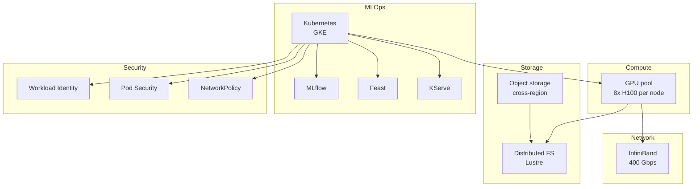

# 19.10 Customer workshops and the consulting method

| Field | Value |
|---|---|
| Level | Intermediate |
| Priority tier | 3 |
| Lab venue | On-prem |
| Part | Part 19: Capstones, design and interview readiness |
| Primary sources | NVIDIA Zero-to-Hero Volume 22 (`chapter-XX-customer-workshops.md`); *Engineering AI Systems* (`engineering-ai-systems-architecture-and-devops-essentials`, Chapters 12, 13, 14); NVIDIA Zero-to-Hero Volume 8 (`chapter-XX-customer-workshops.md`); NVIDIA Zero-to-Hero Volume 10 (`chapter-XX-on-call-runbooks.md`) |
| Cross-references | Chapter 19.11 (System design: training cluster); Chapter 19.12 (System design: inference serving); Chapter 19.13 (System design: research infrastructure) |
| Coverage file | `planning/coverage/chapters/19-10.md` |
| Claim & number ledger | `planning/ledgers/19-10.md` |

## Why this matters for AI infrastructure

The consulting method is the structured engagement that turns a customer's interest into a multi-year platform client. The capstone ties together the discovery workshop, the assessment, the architecture design, the POC, the pilot, and the production migration. A team that has read every chapter in Part 19 Sections 19.11-19.13 can describe the system designs; a team that has run the consulting method knows how to deliver those designs to customers.

The capstone is what the field engineering team uses. The field engineer runs the discovery workshop; the field engineer assesses the customer's current state; the field engineer proposes the architecture; the field engineer runs the POC; the field engineer migrates to production. The capstone is the field engineer's playbook.

```text
Why the consulting method capstone matters (V22; Parts 8, 10; EAS Ch 12-14):
- The consulting method is the structured engagement for AI factory delivery.
  The capstone is what ties discovery, assessment, architecture, POC, pilot,
  and migration together.
- The capstone has three perspectives: the field engineer's view (how to
  run the engagement); the sales engineer's view (how to scope the deal);
  the customer engineer's view (how to adopt the platform).
- The capstone is the reference design for customer engagement. Every
  workshop template, every assessment checklist, every architecture diagram
  is part of the consulting method.
```

Three operational realities make this capstone a platform-team deliverable rather than a tutorial:

1. **The capstone is the consulting playbook.** The field engineering team references the capstone when running a discovery workshop; the field engineering team references the capstone when assessing a customer's state.
2. **The capstone is the sales engineer's guide.** The sales engineer uses the capstone to scope the deal; the sales engineer uses the capstone to estimate the customer's needs.
3. **The capstone is the customer's adoption guide.** The customer engineer uses the capstone to understand the AI factory; the customer engineer uses the capstone to plan the migration.

**Before a team can claim they deliver AI factories, the team must have run the consulting method. A team that has not run the method has not integrated the customer engagement.**

## Prerequisites and outcomes

### Prerequisites

- Chapter 19.11 (System design: training cluster).
- Chapter 19.12 (System design: inference serving).
- Chapter 19.13 (System design: research infrastructure).

### Outcomes

After completing this capstone you will be able to:

1. Run a discovery workshop with a customer; capture the customer's use cases and requirements.
2. Assess the customer's current state; identify gaps and opportunities.
3. Design the AI factory architecture that meets the customer's requirements.
4. Run a POC that validates the architecture against the customer's workloads.
5. Run a pilot that validates the production deployment.
6. Migrate the customer to production with operational handover.

---

## 1. The discovery workshop

### 1.1 The workshop agenda

The discovery workshop is a half-day workshop with the customer. The workshop has a fixed agenda; the workshop captures the customer's use cases, requirements, and constraints.

```text
Discovery workshop agenda (half-day):
- 09:00-09:30: Introductions; workshop goals; ground rules
- 09:30-10:30: Customer use cases (data sources; workloads; SLAs)
- 10:30-10:45: Break
- 10:45-11:30: Customer constraints (budget; timeline; compliance)
- 11:30-12:00: Customer current state (existing infrastructure; team skills)
- 12:00-12:30: Next steps; action items
```

The pattern is: the workshop is half a day; the workshop has a fixed agenda; the workshop captures the inputs to the assessment.

### 1.2 The workshop outputs

The workshop outputs are: the customer's use cases, the customer's requirements, the customer's constraints, the customer's current state. The outputs feed the assessment.

```text
Workshop outputs:
- Use cases: 3-5 use cases with data sources, workloads, SLAs
- Requirements: technical requirements, security requirements, compliance requirements
- Constraints: budget, timeline, compliance
- Current state: existing infrastructure, team skills, current vendors
```

The pattern is: the workshop outputs are structured; the workshop outputs feed the assessment.

---

## 2. The assessment

### 2.1 The assessment checklist

The assessment checklist is the structured review of the customer's current state. The checklist covers: infrastructure, security, MLOps, team skills, governance.

```markdown
## Assessment checklist

### Infrastructure
- [ ] GPU inventory and current utilisation
- [ ] Network topology and bandwidth
- [ ] Storage capacity and performance
- [ ] Kubernetes or VM-based

### Security
- [ ] IAM and access control
- [ ] Data encryption at rest and in transit
- [ ] Network isolation
- [ ] Vulnerability management

### MLOps
- [ ] Data versioning
- [ ] Experiment tracking
- [ ] Model registry
- [ ] Pipeline orchestration
- [ ] Feature store

### Team skills
- [ ] Kubernetes operations
- [ ] ML engineering
- [ ] Data engineering
- [ ] Security engineering

### Governance
- [ ] Compliance (GDPR, HIPAA, EU AI Act)
- [ ] Data lineage
- [ ] Audit log
- [ ] Model risk management
```

The pattern is: the checklist is structured; the checklist is comprehensive; the checklist feeds the architecture design.

### 2.2 The assessment outputs

The assessment outputs are: a maturity score per category, a gap analysis, a recommended architecture. The outputs feed the architecture design.

```text
Assessment outputs:
- Maturity score: 1-5 per category
- Gap analysis: list of gaps per category
- Recommended architecture: reference architecture that closes the gaps
```

The pattern is: the assessment produces a maturity score; the assessment produces a gap analysis; the assessment produces a recommended architecture.

---

## 3. The architecture design

### 3.1 The reference architecture

The reference architecture is the proposed design for the customer's AI factory. The reference architecture covers: the GPU pool, the network, the storage, the MLOps stack, the security, the FinOps.



The pattern is: every layer is documented; every layer is sized; every layer is auditable.

### 3.2 The sizing

The sizing estimates the GPU count, the network bandwidth, the storage capacity, the MLOps throughput. The sizing drives the cost estimate.

```text
Sizing:
- GPU count: 200 GPUs (H100) for the customer's workload
- Network: 400 Gbps InfiniBand between nodes
- Storage: 1 PB object storage; 500 TB Lustre
- MLOps throughput: 100 training runs per day; 10M inferences per day
```

The pattern is: every sizing is based on the customer's workload; every sizing is auditable.

---

## 4. The POC

### 4.1 The POC scope

The POC is a 2-4 week engagement that validates the architecture. The POC has a defined scope; the POC has defined success criteria; the POC produces a go/no-go decision.

```text
POC scope (2-4 weeks):
- Workload: customer's most important use case
- Architecture: scaled-down version of the proposed architecture
- Success criteria: defined metrics (accuracy, latency, throughput)
- Decision: go/no-go for pilot
```

The pattern is: the POC is short; the POC has clear success criteria; the POC produces a decision.

### 4.2 The POC outputs

The POC outputs are: the workload performance on the proposed architecture, the gaps identified during the POC, the recommendations for the pilot.

```text
POC outputs:
- Performance: latency, throughput, accuracy on the proposed architecture
- Gaps: technical and operational gaps identified during the POC
- Recommendations: changes to the architecture before the pilot
- Decision: go/no-go for pilot
```

The pattern is: the POC outputs are quantitative; the POC outputs feed the pilot.

---

## 5. The pilot

### 5.1 The pilot scope

The pilot is a 4-12 week engagement that validates the production deployment. The pilot has a defined scope; the pilot has defined success criteria; the pilot produces a go/no-go decision.

```text
Pilot scope (4-12 weeks):
- Workload: customer's top 3 use cases
- Architecture: full production architecture
- Success criteria: SLAs met, security validated, FinOps validated
- Decision: go/no-go for production migration
```

The pattern is: the pilot is longer than the POC; the pilot validates the full production architecture; the pilot produces a decision.

### 5.2 The pilot outputs

The pilot outputs are: the production SLA met, the security validated, the FinOps validated, the operations validated.

```text
Pilot outputs:
- SLA: latency, throughput, availability met
- Security: encryption, access control, audit log validated
- FinOps: cost per inference, cost per training run tracked
- Operations: incident response, on-call runbooks, dashboards validated
- Decision: go/no-go for production migration
```

The pattern is: the pilot outputs are quantitative; the pilot outputs feed the production migration.

---

## 6. The production migration

### 6.1 The migration plan

The production migration is the cutover from the customer's current state to the AI factory. The migration is planned in phases; the migration has rollback plans; the migration has success criteria.

```text
Migration plan:
- Phase 1: read-only traffic on the AI factory; the customer's current system continues to serve
- Phase 2: 10% of write traffic on the AI factory; the customer's current system serves 90%
- Phase 3: 50% of traffic on the AI factory; the customer's current system serves 50%
- Phase 4: 100% of traffic on the AI factory; the customer's current system is decommissioned
```

The pattern is: the migration is gradual; the migration has rollback plans; the migration has success criteria per phase.

### 6.2 The operational handover

The operational handover is the transfer of the AI factory from the field engineering team to the customer's operations team. The handover includes: documentation, training, runbooks, escalation paths.

```text
Operational handover:
- Documentation: architecture, operations, security, FinOps
- Training: on-call, incident response, capacity planning
- Runbooks: every alert has a runbook
- Escalation paths: vendor support, internal escalation
```

The pattern is: the handover is structured; the handover is documented; the handover is the operational continuity.

---

## 7. Hands-on lab

This lab walks through the consulting method capstone: the discovery workshop, the assessment, the architecture design, the POC. The lab is **untested** in this repository.

### 7.1 Prerequisites

- A simulated customer scenario.
- The reference architecture from the capstone templates.
- A sandbox environment for the POC.

### 7.2 Step 1: run the discovery workshop

```bash
# Run the discovery workshop
python code/part19/discovery_workshop.py \
  --customer "Acme AI" \
  --output workshop_notes.md
```

### 7.3 Step 2: run the assessment

```bash
# Run the assessment
python code/part19/assessment.py \
  --customer "Acme AI" \
  --output assessment_report.md
```

### 7.4 Step 3: design the architecture

```bash
# Design the architecture
python code/part19/architecture_design.py \
  --customer "Acme AI" \
  --workload "churn-prediction" \
  --output architecture_design.md
```

### 7.5 Step 4: run the POC

```bash
# Run the POC
python code/part19/poc_run.py \
  --architecture architecture_design.md \
  --workload churn-prediction \
  --output poc_results.md
```

### 7.6 What to record

After the lab, you should be able to answer five questions in five seconds each:

1. What is the customer's use case?
2. What is the customer's maturity score?
3. What is the proposed architecture?
4. What is the POC result?
5. What is the next step in the engagement?

If any takes more than 30 seconds, the consulting method is not yet a production service. The lab is **untested** against a live customer scenario.

---

## Exercises

1. **Add a workshop template.** Build a workshop template for a specific use case. *Solution sketch:* the workshop template Markdown.
2. **Add an assessment checklist.** Build an assessment checklist for a specific industry. *Solution sketch:* the assessment checklist Markdown.
3. **Add an architecture template.** Build an architecture template for a specific workload. *Solution sketch:* the architecture template.
4. **Add a POC script.** Build a script that runs the POC automatically. *Solution sketch:* the POC script.
5. **Add a migration plan template.** Build a migration plan template. *Solution sketch:* the migration plan template.
6. **Add an operational handover checklist.** Build a handover checklist for the operational team. *Solution sketch:* the handover checklist Markdown.

---

## Checkpoint questions

<details><summary>1. What is the consulting method?</summary>
The structured engagement that turns a customer's interest into a multi-year platform client. The method includes: discovery workshop, assessment, architecture design, POC, pilot, production migration. The method is the field engineering team's playbook.
</details>

<details><summary>2. What is the discovery workshop?</summary>
A half-day workshop with the customer that captures the use cases, requirements, constraints, and current state. The workshop outputs feed the assessment.
</details>

<details><summary>3. What is the assessment?</summary>
The structured review of the customer's current state. The assessment covers infrastructure, security, MLOps, team skills, governance. The assessment outputs feed the architecture design.
</details>

<details><summary>4. What is the POC?</summary>
A 2-4 week engagement that validates the architecture against the customer's most important use case. The POC has clear success criteria; the POC produces a go/no-go decision.
</details>

<details><summary>5. What is the pilot?</summary>
A 4-12 week engagement that validates the full production architecture against the customer's top 3 use cases. The pilot has clear success criteria; the pilot produces a go/no-go decision.
</details>

<details><summary>6. What is the production migration?</summary>
The cutover from the customer's current state to the AI factory. The migration is gradual; the migration has rollback plans; the migration has success criteria per phase.
</details>

<details><summary>7. What is the most common consulting failure?</summary>
The workshop is not structured. The field engineer captures informal notes; the assessment is incomplete; the architecture is misaligned. The fix is to use the workshop template; capture the structured outputs.
</details>

<details><summary>8. What is the most dangerous consulting failure?</summary>
The migration is rushed. The customer is on the AI factory before the SLA is validated; the customer experiences an outage. The fix is to follow the migration plan; respect the phase gates; have rollback plans.
</details>

<details><summary>9. What is the relationship between the consulting method and the system design capstones?</summary>
The consulting method is the engagement; the system design capstones are the reference architectures. The method uses the capstones to scope the deal; the capstones are updated based on the method's learnings.
</details>

<details><summary>10. What is the most common POC failure?</summary>
The POC's success criteria are vague. The team cannot determine whether the POC passed. The fix is to define quantitative success criteria before the POC starts.
</details>

<details><summary>11. What is the most expensive consulting mistake?</summary>
The pilot runs for too long. The pilot consumes the customer's GPU budget; the customer decides not to migrate. The fix is to set a hard deadline for the pilot; have clear go/no-go criteria.
</details>

<details><summary>12. What is the most expensive migration mistake?</summary>
Skipping the gradual rollout. The customer cuts over 100% of traffic at once; the customer experiences an outage. The fix is to follow the gradual migration plan; have rollback plans at every phase.
</details>

<details><summary>13. What is the most common operational handover mistake?</summary>
The documentation is not maintained. The customer's operations team does not know how to operate the AI factory; the customer's on-call cannot debug incidents. The fix is to maintain the documentation; review the documentation quarterly.
</details>

<details><summary>14. What is the most expensive operational handover mistake?</summary>
The runbooks are not transferred. The customer's on-call cannot follow the runbooks; the customer's incidents escalate. The fix is to transfer the runbooks; train the customer's on-call.
</details>

<details><summary>15. Why is the consulting method capstone a Tier 3 chapter?</summary>
Because the consulting method is the field engineering team's playbook, not the platform's foundation. The capstone is important but not on the critical path of the platform itself.
</details>

<details><summary>16. What is the relationship between the consulting method and the FinOps dashboard?</summary>
The consulting method uses the FinOps dashboard to estimate the customer's cost. The FinOps dashboard is the cost view of the proposed architecture; the consulting method uses the cost view to scope the deal.
</details>

<details><summary>17. What is the relationship between the consulting method and the threat model?</summary>
The consulting method uses the threat model to identify the customer's security requirements. The threat model is the security view of the proposed architecture; the consulting method uses the threat model to scope the security controls.
</details>

<details><summary>18. What is the most common assessment failure?</summary>
The assessment is too narrow. The field engineer assesses only the infrastructure; the field engineer misses the MLOps and security gaps. The fix is to use the comprehensive assessment checklist; cover every category.
</details>

<details><summary>19. What is the relationship between the consulting method and the incident response?</summary>
The consulting method includes the operational handover; the operational handover includes the incident response runbooks. The method is the bridge between the field engineering team and the customer's operations team.
</details>

<details><summary>20. What five questions should the consulting method capstone lab let you answer in five seconds each?</summary>
What is the customer's use case. What is the customer's maturity score. What is the proposed architecture. What is the POC result. What is the next step in the engagement. If any takes more than 30 seconds, the consulting method is not yet a production service.
</details>

---

## Sources and review notes

- NVIDIA Zero-to-Hero Volume 22. Source for the customer workshop patterns. The wording has been rewritten in the handbook's voice.
- *Engineering AI Systems* (`engineering-ai-systems-architecture-and-devops-essentials`, Chapters 12, 13, 14). Source for the consulting patterns.
- NVIDIA Zero-to-Hero Volume 8. Source for the workshop patterns.
- NVIDIA Zero-to-Hero Volume 10. Source for the runbook patterns.

### Cross-references to other handbook chapters

- Chapter 19.11 for the training cluster system design.
- Chapter 19.12 for the inference serving system design.
- Chapter 19.13 for the research infrastructure system design.

### Migrated from `nvidia-devops`

The consulting method operational patterns draw on Volume 22, Volume 8, Volume 10, and the EAS corpus. The wording has been rewritten in the handbook's voice.

### Explicitly labelled inferences

- The workshop duration (half-day) is a starting point; specific durations depend on the customer's complexity.
- The POC duration (2-4 weeks) is a starting point; specific durations depend on the workload's complexity.
- The pilot duration (4-12 weeks) is a starting point; specific durations depend on the customer's risk tolerance.

### Not verified on live hardware

- The lab in Section 7 is **untested** against a live customer scenario in this repository.
- The consulting method assumes a trained field engineering team; production deployments require training.
- The reference architecture assumes the customer's workload is documented; production deployments may require discovery.
