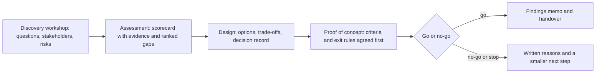

# 19.10 Customer workshops and the consulting method

| Field | Value |
|---|---|
| Level | Intermediate |
| Priority tier | 3 |
| Lab venue | Local laptop, standard-library Python and pytest. No GPU needed. |
| Part | Part 19: Capstones, design and interview readiness |
| Primary sources | *Engineering AI Systems* (ch. 12, 13, 14); *Production Kubernetes* (ch. 1); *Machine Learning Platform Engineering* (ch. 1); *AI Engineering* (ch. 10); *AI Factory* (ch. 11) |
| Cross-references | Chapter 19.9 (capacity planning); 19.11 to 19.13 (system design); 20.27 (post-mortems); 20.28 (project deep dive) |
| Code | `code/part19/c10_*` and `test_c10_consulting.py` |
| Coverage file | `planning/coverage/chapters/19-10.md` |
| Claim and number ledger | `planning/ledgers/19-10.md` |

## Why this matters for AI infrastructure

A customer tells you on a call that they want "an AI platform by spring." It sounds like a clear request, and everyone on the call nods. Then you try to answer the simple questions. What will the platform run? Who will operate it once it exists? How will anyone judge whether it worked? Who signs the cheque? Nobody on the call can answer those yet. Two months later the team has built a cluster that is technically sound, and the customer does not want it. The cluster was not the failure. The failure happened in the first week, when nobody asked the questions that the cluster depended on.

This capstone is about the part of the job that happens before and around the technical build. Think of it as the work a good engineer does in the first weeks, before any rack is ordered. In those weeks you learn what to ask, turn the answers into a short list of risks, score the customer's current state, turn requirements into a design with the costs written down, run a proof of concept that is allowed to fail, and hand the result to people who can run it. The method is a sequence of small artefacts. Each one is a file that another person can check, argue with and reuse.

Before going further, I want to be honest about where the material comes from. Several gem books describe real customer projects and platform choices, and this chapter uses them only for what they actually say. None of them contains a consulting playbook. So the workshop agenda, the questionnaire weights, the scorecard scale and the verdict rules are this chapter's own recommended practice, and the text labels them each time they appear. This chapter also does not describe how NVIDIA, Nebius or any other named company runs its engagements. There is no source for that, so I do not guess.

Everything you can run is in `code/part19/c10_*`, so you can check the arithmetic yourself instead of trusting the prose. The customer in the worked example, Larkfield Mutual, is fictional. I made up every number about it so that the arithmetic stays easy to follow. None of those numbers was measured on a real system, and you should not carry them into a real conversation as evidence.

## Prerequisites and outcomes

### Prerequisites

Your first customer call goes better when the tools and the earlier chapters are already familiar. Before the call, check that each item below is in place.

- Chapter 19.9 explains how to write sizing and uncertainty down, which you need before you argue about any number with a customer.
- Chapters 19.11 to 19.13 cover the designs you will propose once discovery and assessment are done.
- Chapter 20.28 shows how to talk about a project afterwards, which matters when someone asks what you learned.
- Python 3 and pytest on a laptop are enough for the lab, with no GPU and no cluster.

### Outcomes

Picture the first meeting with a customer who wants a platform in a hurry, and you have a laptop and an afternoon to prepare. This chapter walks through the path a platform engagement takes from that first discovery call to a proof of concept verdict and a handover. It covers the question list and how it is scored, the risk flags, the scorecard with its evidence, the decision record with its rejected options, the success and exit criteria, and the verdict rules. It ends with the interview question about how you would run a discovery workshop.

## 1. The shape of an engagement

A customer asks for a quote after one meeting. The sales note says "GPU cluster, 64 GPUs." Three weeks later the engineers learn that the data cannot leave the building and the team has never run a GPU. The quote is now wrong in two ways. Nobody lied in that first meeting. The sales note was a fair summary of what the customer said, and the missing facts were simply not on the table yet. An engagement needs a shape that brings those facts out early, while changing course still costs little. Think of the shape as a set of gates. Each gate produces a small artefact, and the next gate opens only when that artefact exists.

The only gem-book description of a whole customer engagement is the Fraunhofer case in *Engineering AI Systems*, chapter 12. It splits the project into three phases, and each phase answers a different question. The proof of concept asks whether the approach is feasible at all. The main project asks how to integrate the application on the customer side. Maintenance and operation begin after deployment and ask whether the system keeps working. The proof of concept ran three months, with a break at the halfway point where either partner could stop the project if progress was not significant. That break is a useful model. It is a planned place to stop, written into the schedule before anyone is tired of the work.

The shape in this chapter adds steps before and after those phases. Discovery and assessment come before the proof of concept, and handover comes after it. This is my recommended practice, not a published standard, so treat it as a starting point you can adapt to your own customers.



| Step | Artefact | Tool in this chapter | Who must sign |
|---|---|---|---|
| Discovery | Answers file and risk flags | `c10_discovery.py` | Customer decision maker confirms facts |
| Assessment | Scorecard with evidence | `c10_scorecard.py` | Customer technical lead confirms evidence |
| Design | Decision record | `c10_adr.py` | Customer sponsor and your lead |
| Proof of concept | Criteria, results, verdict | `c10_poc_tracker.py` | Both sides, before it starts |
| Handover | Memo, runbooks, owner list | Template in section 7 | Named operator on the customer side |

Notice that each artefact is small and can be read in five minutes. That is deliberate. A long report is read once and then filed away. A short file with a score and a reason gets argued over, corrected and reused, and that argument is how the customer comes to trust the result.

The same test works for every artefact in the table above. Ask whether a colleague could read it in a few minutes, understand it without a phone call, and find the one line they would challenge. If the answer is no, the artefact is too big or too vague, and the next step should wait until it is fixed.

**Decision rule:** Do not start the next step until the artefact of the current step exists and the customer has seen it.

**In one minute:** An engagement is five steps that each leave behind a small, checkable file. The Fraunhofer case gives the proof of concept, implementation and operation phases. The steps before and after are this chapter's own practice.

## 2. Discovery: what to ask and why

On the first call the customer says the use case is "document search." It sounds simple. Then, twenty minutes in, you learn that the documents are in two languages, that many of them are scanned images, that the compliance officer is angry, and that a failed attempt happened last year. None of this was in the brief. Discovery is the work of finding these facts while they are still cheap to find, before a design or a budget has been built on a wrong guess.

The Fraunhofer client had already run an unsuccessful proof of concept with another company. *Engineering AI Systems*, chapter 12, reports that the main challenges were mostly language hurdles, and that the client had failed to reach a mutual understanding of the business goals and the data. That is why I put a structured discovery first. Both sides must say, in plain words, what the goal is and what the data looks like, before anyone builds anything.

### 2.1 The eight areas

The questionnaire in `c10_questionnaire.json` has 29 questions in eight areas. Most of the areas are the ones you would expect from any technical project. They are workload, data, scale, team skills, compliance, budget and timeline, which makes seven of the eight. The eighth area is stakeholders, and I put it first on purpose. The Fraunhofer chapter lists five kinds of client stakeholder: a decision maker, a business unit lead, a project lead, the employees who are the end users, and IT professionals. It treats the involvement of these people as a key success factor. If the right people are missing, the rest of the answers are hard to trust, so I ask about them first.

| Area | Example question | Why it matters | Source or status |
|---|---|---|---|
| Stakeholders | Is one named person able to approve budget and the go decision? | A workshop without one produces a document nobody acts on | Roles from *Engineering AI Systems* ch. 12; the question is mine |
| Workload | Do people wait for the answer, or does it run in the background? | Interactive work needs latency targets and headroom | My practice |
| Workload | Will the model run on your hardware or through a hosted API? | The Fraunhofer client ruled out cloud-hosted models and that shaped the design | *Engineering AI Systems* ch. 12 |
| Data | Has anyone measured the quality of the data? | Most of the Fraunhofer proof of concept went into parsing and preprocessing | *Engineering AI Systems* ch. 12 |
| Data | Do correct answers exist to score against? | Without them a proof of concept cannot show success | My practice |
| Scale | How many times higher is the peak than the average? | Sizing follows the peak | Links to chapter 19.9 |
| Team | Has the team run GPU workloads in production? | GPU failure modes differ from CPU ones | My practice |
| Compliance | Must the data stay on premises or in a country? | Can rule out hosted APIs | *Engineering AI Systems* ch. 14 names GDPR and PCI DSS in a bank |
| Budget | A fixed number, a range, or nothing yet? | An unknown budget means options cannot be ranked by cost | My practice |
| Timeline | How many weeks can the proof of concept run? | It must be long enough for repeated measurements | My practice |

Use the table as a guide to the meeting, not as a script to read aloud. Some questions get a one-word answer, and some open a long discussion. When an answer is vague, ask for the example behind it. "Fast" becomes a latency target, and "secure" becomes a named rule. Each of those can be checked later, which is the whole reason for asking.

### 2.2 Why the questions are data

Your colleague edits the question list late on a Tuesday and asks whether the change broke anything. A question stored as data can be tested. A question buried in a document cannot.

The questionnaire is a JSON file and not a document. A document can be skimmed and forgotten. A data file has a fixed shape, so every question carries an area, a type, a "critical" flag and a one-line reason. Because it is data, a script can count what has been answered, and a second engineer can open the file and see exactly what you asked. The reason field is written for the facilitator. When a customer asks "why do you need this," you read the line aloud, and the answer is already on the page.

Two kinds of answer count as unanswered. One is an empty answer. The other is the word "unknown." Customers often say "I think so" in the meeting, and the scorer treats that as a gap too, because a hope is not a fact you can plan on.

In practice your notes should show the difference. A line that says "they think it is fine" goes into the file as unknown, with the name of the person who will confirm it. The gap is visible, and nobody has to pretend that the fact is settled when it is not.

### 2.3 Scoring completeness and risk flags

The scorer prints a risk flag, and the customer asks why the flag fired. The answer should be in the code and in the rule, not in the memory of whoever wrote it.

The scorer in `c10_discovery.py` does two jobs, and it helps to keep them apart in your head. The first job is a weighted completeness score, where a critical question counts twice. The second job is to evaluate 14 risk rules. Each rule is a list of conditions over the answers. A rule can compare an answer with a constant, or compare one answer with another. For example, rule R10 fires when the weeks of security approval are longer than the weeks left until the pilot. In that case the customer's date cannot be met as stated, and the flag says so before the date appears in a proposal.

Two behaviours are worth knowing before you rely on the tool. First, a rule never fires on an unanswered question, because a guess would create false alarms and waste a meeting. Instead, every unanswered critical question produces its own high-severity flag, so the gap is visible on its own line. Second, the scorer refuses bad input. An unknown question id, a number typed as text, or a choice outside the list raises an error. The tests check this, because a scorer that quietly accepts a typo is worse than having no scorer at all. It gives you a false sense of safety.

The completeness threshold of 80 percent weighted, with no critical question unanswered, is my heuristic. I have no source for that number. I chose it because it felt like a reasonable bar for moving on. Treat it as a default to argue with, and change it if your customers need a stricter or looser bar.

**Decision rule:** Move to assessment only when every critical question has a real answer, and write down every flag with the person who will own it.

**In one minute:** Discovery asks 29 questions in eight areas, drawn from what the Fraunhofer case shows mattered. Storing the questions as data lets a script score completeness and fire named risk flags. Unknown answers count as gaps, not as answers.

## 3. Running the workshop

At 10:15 the customer's architect and the security lead start arguing about whether production data may be used in the proof of concept. The facilitator has a flip chart, a printed agenda and forty minutes of agenda left. The room is watching. What the facilitator does in the next two minutes decides whether the day produces a decision or a stalemate. A good facilitator does not pick a side. They turn the argument into a question that can be written on the chart and answered later.

In the Fraunhofer project a workshop was held to decide together the goals of the proof of concept and the approach. It included the employees who would actually use the application. That is the model I use. The people who do the work are in the room when the goals are set, so the goals describe real work and not a slide written by someone who has never seen the documents.

### 3.1 An agenda I recommend

The facilitator arrives at nine with a blank wall, a list of attendees and no plan for the first hour. A fixed agenda gives the room something to follow.

The agenda below is my practice, not a rule from any source. A customer who has never run a workshop before needs a firm structure, and a fixed agenda makes it easier to steer away from tangents. Treat the times as a starting point for a half day. You will change them the first time the room runs out of patience or energy.

| Time | Block | Output |
|---|---|---|
| 0:00 to 0:20 | Goals, ground rules, who decides | One-sentence goal the room agrees to |
| 0:20 to 1:20 | Use case walk-through with the end users | Workload questions answered |
| 1:20 to 2:00 | Data and constraints | Data, compliance and residency answers |
| 2:00 to 2:15 | Break | Side conversations happen here, and are useful |
| 2:15 to 2:50 | Team, budget, timeline | Remaining questions answered |
| 2:50 to 3:30 | Read back risks, agree owners and next steps | Flag list with an owner and a date each |

Prepare before the day, because most of the work happens before anyone enters the room. Send the questionnaire two days ahead, so people can look up the answers they do not know off the top of their heads. Ask for the decision maker by name, and check that person's diary. Raise any failed earlier attempt too, since people often do not mention it unless asked. Fraunhofer's client wanted to see what differed from the last try, and your customer will probably want the same.

### 3.2 Facilitation habits and disagreement

Two senior people start talking over each other, and the room goes quiet. The facilitator needs habits that keep the discussion moving without choosing a winner.

Five habits do most of the work, and all five are my practice rather than a published method. Write the goal sentence on the wall where everyone can see it. Ask for an example before you accept an adjective, so that "fast" becomes "an adjuster waits no more than eight seconds." Ask who would be unhappy if this went wrong, because the answer often names a stakeholder you missed. Record every claim with the name of the person who owns it. Read the flags back aloud at the end, so nobody can say later that they did not hear them.

A small example helps. Suppose someone says the data is "mostly clean." Ask what share of the sample they checked, who checked it and when. Each question turns a comfortable phrase into something that can be verified in the next week. The room usually relaxes once it sees that the question is about evidence and not about blame.

Disagreement in the room is information, not a failure of the workshop. Three kinds appear again and again, and each one needs a different response.

The first is a disagreement about a fact, such as whether the data is clean. Two people can argue about it for an hour and still not know the answer. Do not debate it. Turn it into a measurement with an owner and a date. The proof of concept exists partly to settle facts like this one, so the argument becomes a task rather than a stalemate.

The second is a disagreement about a priority, such as speed against cost. Both sides may be right about their own goal. Put both on the wall, ask the decision maker to rank them, and write the ranking into the design record as a driver. If the decision maker is absent, the flag from the questionnaire (R01) has just become real, because the customer has not yet said which priority wins.

The third is a disagreement between two senior people who each own part of the answer, such as security and the architect. Picking a side here makes an enemy and hides the trade-off. Instead, write each position as an option in the decision record with its cost. Then ask what evidence would change each person's mind. That evidence often becomes a proof of concept criterion, so the disagreement turns into a test that both people agreed to in advance.

The Fraunhofer chapter points at the same lesson from the other side. It says that the project was not a turnkey solution handed over to the client, and that sophisticated, engaged clients are required. If the client will not engage, the method cannot work. Saying so early, and politely, is part of the job. It is kinder to everyone than a long project that quietly fails.

**Decision rule:** When people disagree, convert the disagreement into a measurement, a ranked driver or an option with a cost, and never into a winner.

**In one minute:** Run the workshop with the end users and the decision maker present. Use a fixed agenda, ask for examples, record owners, and read the flags back. Turn each disagreement into evidence rather than a vote.

## 4. Assessing the current state

Midway through the workshop the customer's lead says "we have solid MLOps." It is a confident statement, and the room nods. The following week you ask for the model registry URL. It turns out to be a shared folder with dated file names. The lead was not lying. They were describing the practice they hoped to have, which is a common and understandable thing to do. An assessment replaces hope with evidence, and it does so without blaming anyone.

### 4.1 The scorecard

A new engineer opens the scorecard file and asks what a 2 means, and whether a 3 is always better.

`c10_scorecard.json` lists 16 criteria in five categories: infrastructure, security, MLOps, team and governance. Each criterion has a weight from 1 to 3 and a plain-English sentence that says what the criterion means. Plain English matters, because the person scoring a criterion may not be the person who reads the result. The scale is this chapter's own and has four levels, shown below.

| Score | Meaning |
|---|---|
| 0 | Absent |
| 1 | Ad hoc, depends on one person |
| 2 | Defined and repeatable |
| 3 | Measured and automated |

The five categories are this chapter's own grouping of the topics that the books cover. They are the infrastructure, the access and secrets, the pipelines and monitoring, and the people who run them. You may group them differently for your customer. The weights and the default target of 2 are heuristics, so argue with them in the open rather than hide them.

### 4.2 Evidence is mandatory

The customer's lead says the team has a runbook, and you ask where it is. The answer decides the score, and the answer should be written next to the score.

The tool rejects any score without evidence. A score of 2 with the text "they said so" is evidence of a kind. I would write exactly that, because it tells the next reader how much to trust the score. The point is that a score without a reason cannot be challenged and cannot be checked. Someone reading the report later needs to see where each number came from, even when the answer is weak.

Good evidence is specific and short. "Two architects reviewed the cluster runbook and found it current" says far more than "they have a runbook." A reader can check the first sentence by asking for the document, while the second leaves nothing to check.

The evaluator also reports coverage. Suppose you assessed three of the four team criteria. The team category is then flagged as incomplete, so nobody reads it as a finished score. A maturity number built from half the facts looks precise, and that is exactly why it is a trap.

### 4.3 Gaps and targets

The scorecard prints its top gaps, and a manager asks why the first one matters most. The answer is the product of the weight and the distance to target.

A gap is the target minus the score, multiplied by the weight. The default target is 2 for everything, which means a criterion counts as a gap until it is at least defined and repeatable. You override the target where the requirements demand more. In the worked example the evaluation criterion has a target of 3, because the customer must prove quality before release. A higher target makes that gap count for more in the ranking, and the ranking is what the customer reads first.

A gap is not automatically a thing to build. Before you plan any work, ask whether the gap should be filled at all. *Production Kubernetes* advises understanding the existing workflows first, and then deciding which requirements belong at the platform level and which at the application level. Some gaps belong to a purchased service, and some belong to training, so the cheapest fix is not always new engineering.

**Decision rule:** Score only what you saw or were shown, write the evidence next to the score, and set the targets from requirements rather than from a template.

**In one minute:** The scorecard scores 16 criteria from 0 to 3, requires evidence for each, and ranks gaps by weight times distance to target. Incomplete categories are flagged, not averaged away.

## 5. From requirements to an architecture with trade-offs

The assessment is finished, and a colleague says "just put everything on Kubernetes with the open-source stack." It sounds tidy, and it may be the right answer for some teams. The customer has three engineers and no GPU history, though. The colleague's design is not wrong in general. It is wrong for this team, at this time. A good design names the alternatives and says what each one costs this particular customer.

### 5.1 What the books say about choosing

A platform team is about to choose between buying a managed platform and building its own, and the team wants to know what the books say. *Production Kubernetes* chapter 1 describes a spectrum of approaches to an application platform. At one end are managed platforms that hide the infrastructure, such as Heroku. At the other end is building a platform on Kubernetes. The authors say that building takes the most engineering effort, but it can line up most closely with your needs. They warn that a prebuilt platform asks you to conform to its view of the world, and that it can carry lock-in. They also say you must understand your engineering maturity, your appetite for building and the resources you have before you decide to build.

The same chapter describes an abstraction spectrum, which is a separate question from who builds the platform. At one end, every team gets its own cluster and carries the responsibility for Kubernetes knowledge. At the other end, Kubernetes is hidden completely behind a platform as a service, and the application teams never see it. Neither end is right in general. The right point depends on whether the application teams can operate Kubernetes at all.

*Machine Learning Platform Engineering* chapter 1 says there is no one-size-fits-all platform architecture. It recommends growing a platform in small steps rather than designing the whole thing at once. It also recommends trying a tool for a few days, as a short proof of concept, so that deal-breaking limits show up early and cheaply. On build versus buy, it acknowledges that an organisation may already have a vendor platform. It argues that building one from scratch once is valuable for learning.

*AI Engineering* chapter 10 shows the same incremental stance. It adds context, guardrails, a router, caches and agents one step at a time, rather than all at once. *Engineering AI Systems* chapter 13 describes a consulting organisation that serves small manufacturers with no IT team. It chose cloud-agnostic tools so that clients keep their flexibility. It offered ongoing support and avoided financial lock-in contracts. The chapter names data ingestion as a major problem, which is the same problem you will meet in discovery. Chapter 14 adds that in banking, privacy rules such as GDPR and PCI DSS apply, and decisions must be traceable.

### 5.2 Turning gaps into options

Imagine a whiteboard covered with requirements and a team that wants to start building on Monday. The procedure below turns that mess into options you can compare. It is my practice, not a published standard. Start by listing the hard constraints, such as residency, deadline and team size. Then list the drivers that can be traded, such as cost, speed and control. Write at least two options, including the one the customer prefers and one that is deliberately different. For each option, state what it costs this customer. Choose one, say why in a single sentence, and write down when you would change your mind.

### 5.3 The decision record

A design decision is easy to forget, and the reason for it fades faster. `c10_adr.py` turns a small JSON decision into a numbered markdown record. It refuses a record with fewer than two options, an option with no cons, an option with no pros, a decision that is not one of the options, or no revisit trigger. These checks exist because the most common failure of a design document is the one-sided case, where the chosen option looks perfect and the others are not described honestly.

The record format, with context, options, decision and consequences, is a widely used convention. I describe it from common practice. I have not verified it against a source, so this chapter does not call it a standard, and your team may use a different template.

Here is how the record for the Larkfield example ends. The script produces this text, so you can compare it with your own output line by line:

```text
## Decision

We will use: Self-hosted on customer-owned hardware.

## Consequences

- Order lead time starts the clock before the PoC ends, so the PoC must run on rented capacity first
- A GPU operations training and runbook workstream is added to the plan
- Peak handling needs a queue or degraded mode, to be agreed with the business
```

Notice that the consequences are not all good news. Lead time, a new training workstream and a need for a queue are all costs. A decision record that lists only benefits will be distrusted, and rightly so, because the reader can see that the costs are missing.

**Decision rule:** Never present one option. Write at least two, state what each costs this customer, and add the condition that would reverse your choice.

**In one minute:** The books agree that platform choices sit on spectra and have no universal answer. Turn each gap into options with explicit costs and record the choice in a decision record that refuses one-sided cases.

## 6. The proof of concept

Three weeks into a proof of concept, the customer asks "so is it working?" The team shows a demo. It looks impressive, and the room is pleased. Still, nobody can say whether it passed, because nobody wrote down what passing means. The proof of concept now has no ending except exhaustion, and the team is tired before anyone has decided anything.

The Fraunhofer proof of concept had a defined window, a halfway decision point and a clear goal. The client cared more about precision than recall, which means the model had to be right when it made a recommendation, even if it covered fewer products. The evaluation combined numbers from a held-out test set with a qualitative review by the employees. The employees sorted each recommendation into incorrect, correct or functionally correct. Most of the work went into parsing the input documents, which is a reminder that the model is rarely the only hard part. A simple embedding-based model was enough to convince the client to proceed. A heavier model came later, in the main project.

### 6.1 Success criteria and exit criteria

The sponsor wants to start the proof of concept on Monday, and nobody has agreed what passing means. That is the moment to write the criteria down.

Before the proof of concept starts, I recommend writing down two lists and getting both sides to sign them. The first list is the success criteria. Each one has a metric, a threshold, a priority and a minimum number of runs. The second list is the exit criteria. These are conditions that stop or pause the work, no matter how well the success criteria look. A team that agrees on both lists in advance has a much easier time saying no later.

Here is the criteria file for the fictional Larkfield proof of concept. It is exactly the file `code/part19/c10_poc_criteria.json`, so the text and the file cannot drift apart. Read the file once, slowly, before you look at any results.

```json
{
  "_note": "FICTIONAL customer Larkfield Mutual. Criteria are agreed in writing before the PoC starts. Thresholds are invented for the chapter.",
  "poc": "Larkfield claims summariser PoC",
  "success": [
    {"id": "S1", "metric": "acceptable_answer_rate", "op": ">=", "threshold": 0.80, "priority": "must", "min_runs": 3,
     "why": "Share of 200 scored claim questions that adjusters mark acceptable, three scoring runs."},
    {"id": "S2", "metric": "p95_latency_s", "op": "<=", "threshold": 8, "priority": "must", "min_runs": 5,
     "why": "95th percentile response time at 40 concurrent requests, five load runs."},
    {"id": "S3", "metric": "unsupported_claim_rate", "op": "<=", "threshold": 0.05, "priority": "must", "min_runs": 3,
     "why": "Share of summaries that state a fact not in the claim file."},
    {"id": "S4", "metric": "cost_per_1000_requests", "op": "<=", "threshold": 2.0, "priority": "should", "min_runs": 3,
     "why": "Placeholder cost unit agreed with finance."},
    {"id": "S5", "metric": "adjuster_minutes_saved", "op": ">=", "threshold": 10, "priority": "should", "min_runs": 1,
     "why": "Minutes saved per claim file, from a timed adjuster session."}
  ],
  "exit": [
    {"id": "X1", "metric": "weeks_elapsed", "op": ">", "threshold": 6, "action": "Stop and decide. The agreed window is over."},
    {"id": "X2", "metric": "gpu_hours_used", "op": ">", "threshold": 1200, "action": "Stop. The agreed compute budget is spent."},
    {"id": "X3", "metric": "security_blockers_open", "op": ">=", "threshold": 1, "action": "Pause. Real data cannot be used until the blocker is closed."}
  ]
}
```

Three details deserve attention. The priority "must" separates what decides the verdict from what only shapes the conditions of a go. The minimum run count stops a single lucky run from passing a criterion. The exit criteria cover three different stops, which are time, compute budget and an open security blocker. Each one stops the work for a different reason, and the customer needs to hear which one applied.

### 6.2 Results and the verdict

The results file arrives on Friday afternoon, and the tracker has to say what happened. The verdict should follow from the rules alone, with nobody adjusting it to fit the mood of the room.

The results come in a small JSON file. For each metric it records the measured value and the number of runs behind that value. This is the fictional results file, and the tracker reads it together with the criteria file to produce the verdict.

```json
{
  "_note": "FICTIONAL results for the fictional Larkfield PoC. Invented for the chapter. Not measured on any system.",
  "metrics": {
    "acceptable_answer_rate": {"value": 0.84, "runs": 3},
    "p95_latency_s": {"value": 7.2, "runs": 5},
    "unsupported_claim_rate": {"value": 0.04, "runs": 3},
    "cost_per_1000_requests": {"value": 2.4, "runs": 3},
    "adjuster_minutes_saved": {"value": 12, "runs": 1},
    "weeks_elapsed": {"value": 5, "runs": 1},
    "gpu_hours_used": {"value": 900, "runs": 1},
    "security_blockers_open": {"value": 0, "runs": 1}
  }
}
```

The tracker applies its rules in a fixed order, and the first rule that matches wins. The order matters more than it first appears, as the next paragraphs show.

| Verdict | Condition | Exit code |
|---|---|---|
| STOP | Any exit criterion is true | 3 |
| NO-GO | A must criterion was measured enough times and failed | 1 |
| INCONCLUSIVE | A must criterion is missing or has too few runs | 2 |
| GO WITH CONDITIONS | All musts pass, a should fails or is missing | 0 |
| GO | Everything passes | 0 |

The order has consequences. STOP beats NO-GO, because a spent budget ends the work whatever the numbers say, and the customer must decide what happens next. A failed measurement with too few runs does not count as a failure. It is inconclusive, because the agreement said three runs and two runs is not enough evidence to fail anything. This is my policy, and the tests check that the tool follows it.

Think of the verdict as a set of rules with a fixed precedence. A stop beats a go, even when the numbers look good. The customer can see that order in the file before the first run, so nobody is surprised when the tracker reports a stop after a week of encouraging results.

When the tracker runs on the fictional results, it prints the following.

```text
  S1 must   acceptable_answer_rate   0.84 >= 0.8  runs 3/3  PASS
  S2 must   p95_latency_s            7.2 <= 8  runs 5/5  PASS
  S3 must   unsupported_claim_rate   0.04 <= 0.05  runs 3/3  PASS
  S4 should cost_per_1000_requests   2.4 <= 2.0  runs 3/3  FAIL
  S5 should adjuster_minutes_saved   12 >= 10  runs 1/1  PASS
VERDICT: GO WITH CONDITIONS
```

The cost criterion failed, but it is only a should. The verdict is go with conditions, and the condition becomes a cost conversation with finance. Now see what happens if the latency run comes back at 9.4 seconds instead of the passing value in the file.

```text
  S1 must   acceptable_answer_rate   0.84 >= 0.8  runs 3/3  PASS
  S2 must   p95_latency_s            9.4 <= 8  runs 5/5  FAIL
  S3 must   unsupported_claim_rate   0.04 <= 0.05  runs 3/3  PASS
  S4 should cost_per_1000_requests   2.4 <= 2.0  runs 3/3  FAIL
  S5 should adjuster_minutes_saved   12 >= 10  runs 1/1  PASS
VERDICT: NO-GO
```

The same file with one changed number is a no-go. Because the threshold was agreed in advance, nobody can argue that 9.4 is "close enough." The argument was settled before the test began, and that is the whole point of writing it down first.

### 6.3 Keeping it honest

A demo that looks good on Friday can still hide a wrong behaviour that users notice on Monday. The Fraunhofer team used containers from the start, so the demo could be repeated on different platforms. Its employees reviewed the outputs. They found that the model recommended products even when none fitted, so it was retrained to suggest nothing in that case. A metric can look good while a behaviour is wrong. Fraunhofer also built a halfway decision point, and my exit criteria turn that idea into a rule rather than a meeting that someone has to call.

**Decision rule:** Agree success criteria, minimum run counts and exit criteria in writing before the first run, and let a script produce the verdict.

**In one minute:** A proof of concept that cannot fail proves nothing. Write must and should criteria with minimum runs, add exit criteria for time, money and blockers, and let the tracker output STOP, NO-GO, INCONCLUSIVE or GO.

## 7. Findings, recommendation and handover

The proof of concept passed. The customer's team is delighted and asks when the platform goes live. Then you realise that the only people who understand how it works are the two engineers who built it, and they leave the engagement on Friday. Delivering a result is not the same as delivering a platform that someone else can run. The handover is where that difference shows up.

### 7.1 The findings memo

The customer's director forwards your memo to a few people who were not in any of the meetings. They read the first page and skip the rest, so the memo has to work for both kinds of reader.

The memo is the document the customer will forward to people who were not in the room. Write one memo of about three pages. This structure is my recommendation, and each heading answers a question those readers will ask.

1. The ask, in the customer's own words, followed by the goal sentence agreed in the workshop.
2. What we learned, listing each discovery flag and what happened to it.
3. Current state, as the scorecard table with the top gaps.
4. Options and the recommendation, linked to the decision record.
5. Proof of concept results, with the verdict and the raw results file attached.
6. Risks and conditions, including any failed should criteria.
7. What we did not verify, stated plainly and without apology.
8. Next steps, each with an owner and a date.

A reader in a hurry reads the first paragraph and the verdict. Put the decision and the condition there, in plain words, before any detail. The rest of the memo is for the person who will check your work, and that person will read every line.

### 7.2 Handover

The engineers who built the platform are about to leave, and nobody has written down how to restart it after a power cut. Handover is the work of making sure the platform outlives the people who built it.

Handover has its own design, and the Fraunhofer case shows why. *Engineering AI Systems* chapter 12 offers a useful picture. The Fraunhofer team ran development and CI/CD at its own site, while operation took place on the client side. The organisational challenges included the timing of the data handover and the handover of the machine learning component into the client's processes. Deployment into production was done manually, as the client preferred, even though automation was feasible. The lesson is that handover needs planning of its own, and that the customer's preferences count, even when they are not the most automated option.

The handover checklist below is my practice. Each row is a test you can run. The question is not whether the item exists on paper, but whether it works when someone who did not build it tries it.

| Item | Test that it is done |
|---|---|
| A named operator on the customer side | They have answered a page in a drill |
| Runbooks for the top failures | A customer engineer followed one without help |
| Access and secrets transferred | Your accounts are removed |
| Monitoring and alerts owned by the customer | They changed an alert threshold |
| The criteria file and results archived | They can rerun the evaluation |
| A review date for the revisit triggers | It is in a calendar |

For monitoring, *AI Engineering* chapter 10 offers three measures from the DevOps community: mean time to detection, mean time to response and change failure rate. Each one tells you something different. Detection shows how long a problem hides, response shows how long it lasts once it is seen, and the change failure rate shows how often a change breaks something. The chapter says that if you do not know your change failure rate, it is time to redesign the platform to be more observable. These are good measures to agree with the customer for the first quarter after handover, because they give both sides the same scoreboard.

### 7.3 After go-live

A few weeks after go-live, the model starts giving slightly worse answers, and nobody on the customer side knows whom to tell. This is the stage where many projects quietly die. The Fraunhofer production phase added communication as a seventh MLOps area, because real-world drift needs continuous coordination between the people who see the drift and the people who can fix it. The *AI Factory* chapter says early pilots should aim to succeed rather than chase a fast return. It names an internal leader and clear business goals as conditions for that. For incidents after handover, see chapter 20.27.

**Decision rule:** The engagement is not finished until a named customer operator has run the system without you and the memo says what you did not verify.

**In one minute:** Write a short findings memo with the scorecard, the decision record, the verdict and what was not verified. Hand over with a named operator and tested runbooks, and agree three operating measures for the first quarter.

## 8. A worked scenario: Larkfield Mutual (fictional)

Picture an insurer's platform lead on a Monday morning, with a claims team that wants help reading long files. That is the situation this scenario imitates, and the name Larkfield Mutual is made up. Everything in this section is invented. Larkfield Mutual is not a real insurer, and no data was measured. The scenario exists so that the tools produce output you can read and discuss.

The customer. Larkfield wants adjusters to get summaries of 40-page claim files and to ask questions of them. Adjusters are the people who assess claims, and a summary saves them from reading every page first. About forty adjusters may use it at the same time at peak. The claim data contains personal information and must stay on premises, which rules out a hosted API. The platform team has three engineers, basic Kubernetes experience, no GPUs and no GPU history. The pilot is due in 16 weeks. Security and legal approval take 10 weeks of that time, so the build window is shorter than it first looks. A previous attempt failed, and nobody wrote down why, which is the first thing to find out.

### 8.1 Discovery

The discovery answers arrive as a file, and the first question is whether the workshop was complete enough to score.

The answers are in `code/part19/c10_answers_larkfield.json`, and the tool prints the summary below. Read it the way a facilitator would, looking for what is missing as well as what is present.

```text
Completeness (weighted): 95.6%
  stakeholders  3/3
  workload      5/5
  data          5/5
  scale         3/3
  team          4/4
  compliance    3/3
  budget        2/3
  timeline      2/3
Ready for assessment: yes
Risk flags:
  [high  ] R05: No ground truth. The PoC cannot prove success. Create a scored sample first.
  [high  ] R07: No GPU operations experience and no GPUs today. Plan training or a managed service.
  [medium] R09: Peak is more than 5 times the average. Size for the peak and ask what can be queued.
  [info  ] R03: A previous attempt failed. Ask what was different about the goals and the data.
```

Read the flags as the agenda for your next conversation. R05 says that no ground truth exists, so before any proof of concept can succeed, someone must create a scored sample. R07 says the team has no GPU experience and no GPUs, so training or a managed service has to enter the plan. R09 says the peak is six times the average, so ask what can wait in a queue. R03 reminds you to ask what the failed attempt got wrong, so that you do not repeat it.

When you read the flags aloud, watch the faces in the room. A flag that surprises the customer is often the one that matters most. The next question should ask where the assumption came from, and who would notice first if it were wrong.

Two non-critical questions stayed unknown. They are the existing vendor commitments and the reason for the deadline. A completeness of 95.6% is enough to proceed, so the scorer does not block the work. Both unknowns still go on the action list, because a quiet gap has a way of becoming a surprise later.

### 8.2 Assessment

The team lead wants the scores on one page before the next steering meeting, and wants to know where to spend the money first.

The scores and their fictional evidence are in `c10_scores_larkfield.json`. Each score comes with a sentence of evidence, which is what lets the tool print the summary below.

```text
Category maturity (0 to 3, weighted):
  infrastructure  1.00
  security        2.38
  mlops           0.70
  team            1.14
  governance      1.60
Gaps by priority (weight x distance to target):
   9  ml.evaluation        score 0 target 3
   6  tm.gpu_ops           score 0 target 2
   4  inf.gpu_inventory    score 0 target 2
   3  ml.monitoring        score 1 target 2
   3  sec.isolation        score 2 target 3
   2  gov.data_lineage     score 1 target 2
   2  inf.network_storage  score 1 target 2
   2  ml.data_versioning   score 1 target 2
   2  ml.deploy_pipeline   score 1 target 2
```

Security is the strongest category, and MLOps is the weakest. The top gap by far is evaluation. It has weight 3, a target of 3 and a score of 0. This agrees with flag R05 from discovery, which said there was no ground truth. Two separate sources of evidence point at the same problem, and that is a good sign the picture is right.

### 8.3 Design

The customer asks which option is cheapest, and the honest answer depends on residency. The record has to show why the cheapest option is not automatically the right one.

The decision record has three options, and each one is tested against the residency rule first. A hosted API conflicts with residency, so it is out. A managed GPU Kubernetes service might satisfy residency, but only if a suitable region exists, and nobody has confirmed that yet. Customer-owned hardware satisfies residency and has a predictable cost. Its downsides are a long lead time and a fixed capacity, set against a peak that is six times the average. The record chooses owned hardware and lists the consequences. One consequence is that the proof of concept must run on rented capacity first, because the hardware order has to start before the proof of concept ends.

### 8.4 Proof of concept

Finance asks why the hardware order is on hold after a successful pilot. The answer is in the verdict and its condition.

The criteria and results in section 6 belong to this scenario. The verdict was go with conditions. The condition is that the cost per thousand requests was 2.4 against a target of 2.0, which is the failed should criterion. In the findings memo, the recommended action is to review the cost model with finance before ordering hardware. The decision record stays open until that review is done, so the hardware order does not run ahead of the numbers.

**Decision rule:** Use the worked example to practise reading flags into actions, and never quote its numbers as evidence about any real system.

**In one minute:** Larkfield is fictional. Its discovery flags, scorecard gaps and proof of concept verdict flow into a decision record and a findings memo. The cost condition on the go is the kind of thing a real memo should carry.

## 9. Hands-on lab

Your team lead asks you to show that the scorer works before the Friday review. You have a laptop, Python 3 and pytest, and that is enough. All steps run locally. No GPU, no cluster and no customer data are involved. Steps 1 to 5 were run on 2026-11-11 on macOS arm64, and the outputs quoted are from that run.

### Step 1: score the discovery answers

Start with the answers file that the customer returned, and run the scorer on it before you read a single answer by hand.

```bash
cd code/part19
python3 c10_discovery.py c10_answers_larkfield.json
```

Expected result: the output in section 8.1, with exit code 0. Then try deleting a critical answer from a copy of the file and run it again. The exit code becomes 1, and an `UNKNOWN:` flag appears on that question.

What to record: the flag ids, the completeness number and the owner you would give each flag, because a flag without an owner does not get fixed.

### Step 2: score the assessment

Open the scores file next to the evidence it cites. The scorer checks that the evidence exists, and you check that it says what the score claims.

```bash
python3 c10_scorecard.py c10_scores_larkfield.json
```

Expected result: the output in section 8.2. Then delete the `evidence` text from one entry in a copy of the file. The tool refuses that entry, which is the rule from section 4 working as designed. What to record: the three highest-priority gaps.

### Step 3: evaluate the proof of concept

The results file is what the customer will argue about. Run the tracker on the original, then on copies that you change on purpose, so you see how each rule responds.

```bash
python3 c10_poc_tracker.py c10_poc_criteria.json c10_poc_results_larkfield.json
echo $?
```

Expected result: GO WITH CONDITIONS and exit code 0. Copy the results file in one place, and set the p95 latency value to 9.4 in the copy. Run it again. You get NO-GO and exit code 1. In a fresh copy, set the runs for that metric to 2. You get INCONCLUSIVE and exit code 2. In another copy, set gpu_hours_used to 1300. You get STOP and exit code 3. What to record: the verdict for each of the four changes.

### Step 4: generate the decision record

Someone asks for the decision in writing, and the record needs a number and a file name. The generator writes both, and it refuses an incomplete record.

```bash
python3 c10_adr.py c10_adr_input_larkfield.json /tmp/adr_out
```

Expected result: a path such as `/tmp/adr_out/0001-serve-the-claims-summariser-...md`, which is a file in the output folder. Run the script twice, and the second file is numbered 0002. Remove all the cons from one option, and the generator refuses to write the record. What to record: the three consequences, and whether you agree they are complete.

### Step 5: run the tests

Before you show the lab to anyone, run the test suite once from a clean terminal. A failing test shows you which rule has drifted.

```bash
python3 -m pytest test_c10_consulting.py -q
```

Result: 37 passed. The tests cover the scoring arithmetic, each verdict path, the input checks and the refusal cases, so a failing test points at one specific rule.

### What was run and what was not

A reviewer asks, in one breath, what you actually ran and what you only read about.

Run here: steps 1 to 5 and the demo script `c10_engagement_demo.py`. Not run: nothing here touched a GPU, a cluster or a real customer. The questionnaire, the scorecard and the thresholds were not validated on a real engagement. The tests show that the code does what this chapter says. They do not show that the method is right, and you should keep those two claims apart when you talk about the work.

## How to answer out loud

An interviewer leans forward and asks, "walk me through how you would run a discovery workshop." You have about a minute to answer, and the interviewer is listening for three things. They want a clear structure, some awareness of risk, and humility about what you do not know. This chapter's method is built from the gem books and the chapter's own practice. It is not how any particular company works, so do not claim that it is.

### Speaking order

You have a few minutes to answer the question, and the interviewer will remember the order more than the details. Use the order below.

1. Start with the goal of discovery, in one sentence: find the facts that would make the design wrong, while finding them is still cheap.
2. Say who is in the room, namely a decision maker, the end users, the technical lead, and security or compliance.
3. Describe the preparation, which is a question list sent in advance and the data you ask people to bring.
4. Walk through the agenda: goals, the use case with end users, data and constraints, team and budget and timeline, and a read back of the risks.
5. Name the areas you ask about: workload, data, scale, team skills, compliance, budget and timeline.
6. Say what you produce: the answers, a short risk list with owners, and the next steps.
7. Say what happens next: an assessment with evidence, then options with costs, then a proof of concept with criteria.

### Numbers and facts to be ready to state

A panel member asks for one fact you can state from memory, so keep the list short and exact.

- The Fraunhofer proof of concept lasted three months, with a halfway break where either side could stop.
- The client there had a failed earlier attempt, and it struggled to reach a shared understanding of the goals and the data.
- The five stakeholder types are decision maker, business unit lead, project lead, end users and IT.
- Everything else, such as the half-day agenda or the 80 percent completeness bar, is a convention you choose, so call it that when you speak.

### Trade-offs to mention

Every design choice in discovery has a price, and interviewers like to hear you name it. A longer workshop finds more facts, but it costs the customer more time, and busy people may stop attending. A strict questionnaire gives you comparable answers across customers, but it can feel like an interrogation, so ask for examples as you go. Early scores give the room structure, but they can also anchor the customer on a number, so show the evidence beside each one.

### Follow-ups to expect

The interviewer's first answer makes them ask the follow-up you were hoping to avoid. The table gives a short answer to each one.

| Follow-up | Short answer |
|---|---|
| What if the decision maker does not show up? | Raise it as the first risk, reschedule the decisions, and keep only fact-finding that day |
| What if the customer does not know their data? | Make data inspection the first proof of concept task and say how long it takes |
| What if two leads disagree? | Record both as options with costs and ask what evidence would change each mind |
| How do you know the proof of concept passed? | Criteria and exit rules agreed before it started, with minimum runs |
| What did you get wrong once? | Use a real story, and link it to chapter 20.28 for how to tell it |

If the interviewer asks about a project you delivered, the story is different. Chapter 20.28 shows how to tell that kind of story, and chapter 20.27 covers the incident version.

## Exercises

A customer's architect asks you to change the questionnaire before Thursday's meeting, and every change has to stay testable. Here are the six exercises for this chapter.

1. **Add a question.** The questionnaire does not ask how often the model is updated. Add a question with a reason, and add a risk rule that fires when updates are weekly and no deployment pipeline exists. *Solution sketch:* add the question to `c10_questionnaire.json` in the workload area. Then add a rule that tests the update answer together with a scorecard-derived answer, or add a second question about pipelines instead. Add a test that the rule fires and one that it does not.
2. **Find the missing flag.** Change the Larkfield answers so that residency is required and the model source is a hosted API. Which flag fires, and what do you say to the customer? *Solution sketch:* R04 fires. Say that the two requirements conflict, and ask which one gives way, or whether a regional hosted option satisfies the residency rule.
3. **Rescore with a new target.** Set the target for `tm.gpu_ops` to 3 in the Larkfield scores. How does the top-gap list change? *Solution sketch:* the priority becomes 3 times 3. That is 9, which ties with `ml.evaluation`. Ties sort by id, so `ml.evaluation` stays first. Explain why you might raise a target at all.
4. **Break the proof of concept.** Produce a results file that gives each of the four verdicts using only edits to the Larkfield file. *Solution sketch:* use the four edits in lab step 4. Check each with the tracker and its exit code.
5. **Write a decision record.** Write the JSON for a different decision: managed API versus self-hosted for a customer with no residency rule and a team of ten. Include a revisit trigger. *Solution sketch:* the options change, and the decision may flip. Verify that the generator accepts it and that each option has a real con.
6. **Handle a disagreement.** The security lead refuses production data in the proof of concept, and the architect says synthetic data will not prove anything. Write what you do. *Solution sketch:* write two options with costs, a masked-copy option and a synthetic option. Add an exit criterion that pauses work while the security blocker is open. Ask what evidence would convince each person. Add the answer as a success criterion.

## Checkpoint questions

<details><summary>1. Why is a discovery questionnaire stored as data rather than a document?</summary>
A script can count what was answered, fire risk rules and be reviewed line by line. A second engineer can see exactly what was asked.
</details>

<details><summary>2. What are the eight areas in the questionnaire?</summary>
Stakeholders, workload, data, scale, team, compliance, budget and timeline.
</details>

<details><summary>3. Why does the scorer treat the answer "unknown" as unanswered?</summary>
Because "I think so" or "we will check" is not a fact. An unknown critical answer raises its own high-severity flag.
</details>

<details><summary>4. Why can a risk rule never fire on an unanswered question?</summary>
Firing on a guess would create false alarms. The gap is reported separately as an unanswered critical question.
</details>

<details><summary>5. What did the Fraunhofer client's earlier failed proof of concept teach about discovery?</summary>
The book says the client had failed to reach a mutual understanding of the business goals and the data. A structured discovery forces both sides to state them.
</details>

<details><summary>6. Who were the five client stakeholders in the Fraunhofer case?</summary>
A decision maker, a business unit lead, a project lead, the employees who were end users, and IT professionals.
</details>

<details><summary>7. How should you handle a disagreement about a fact in the workshop?</summary>
Do not debate it. Turn it into a measurement with an owner and a date, often a proof of concept task.
</details>

<details><summary>8. Why must every score on the scorecard have evidence?</summary>
Without evidence a score cannot be challenged or rechecked. The tool rejects a score with no evidence text.
</details>

<details><summary>9. What does the scorecard do when a category is only partly assessed?</summary>
It flags the category as incomplete instead of presenting a maturity number built from half the facts.
</details>

<details><summary>10. How is a gap priority computed?</summary>
The target minus the score, multiplied by the criterion weight. Only positive gaps are listed.
</details>

<details><summary>11. What does Production Kubernetes say about the trade-off of a prebuilt application platform?</summary>
It asks you to conform to the platform's view of the world and can carry lock-in, while it removes operational weight.
</details>

<details><summary>12. What should you understand before deciding to build a platform on Kubernetes?</summary>
Your engineering maturity, appetite for building and available resources, according to Production Kubernetes chapter 1.
</details>

<details><summary>13. Why must a decision record show rejected options with their costs?</summary>
A one-sided record is distrusted and hides the trade-off. The generator refuses an option without cons.
</details>

<details><summary>14. Why do success criteria carry a minimum number of runs?</summary>
To prevent one lucky or unlucky measurement from deciding the verdict. Too few runs gives INCONCLUSIVE, not pass or fail.
</details>

<details><summary>15. Why does STOP beat NO-GO in the verdict order?</summary>
An exhausted budget or window ends the work whatever the numbers say, and the customer must decide what to do next.
</details>

<details><summary>16. What is the difference between a must and a should criterion?</summary>
A failed must gives NO-GO. A failed should gives GO WITH CONDITIONS and goes into the memo as a condition.
</details>

<details><summary>17. What did the Fraunhofer employees find in production that the metrics had hidden?</summary>
The model recommended products even when none fitted, so it was retrained to learn when to suggest nothing.
</details>

<details><summary>18. Name three measures AI Engineering chapter 10 suggests for observability quality.</summary>
Mean time to detection, mean time to response and change failure rate.
</details>

<details><summary>19. What makes handover finished, according to this chapter's rule?</summary>
A named customer operator has run the system without you, and the memo states what was not verified.
</details>

<details><summary>20. Which parts of this chapter are the author's own practice and not sourced?</summary>
The workshop agenda, the question weights, the 80 percent threshold, the 0 to 3 scale, the verdict rules and the decision record format.
</details>

## Sources and review notes

Books, read in the local library:

- *Engineering AI Systems*, chapter 12 "The Fraunhofer Case Study: Using a Pretrained Language Model for Tendering": the failed earlier proof of concept, the three phases, the three-month proof of concept with a halfway break, the stakeholder list, precision over recall, parsing as the bulk of proof of concept work, the joint workshop with end users, containers from the start, manual deployment at the client's request, the production-phase retraining and the takeaways on engaged clients.
- *Engineering AI Systems*, chapter 13 "The ARM Hub Case Study": SMEs without IT teams, ongoing support, no financial lock-in, cloud-agnostic tooling and data ingestion as a major problem. Chapter 14 "The Banking Case Study": GDPR and PCI DSS, traceability of decisions.
- *Production Kubernetes*, chapter 1 "A Path to Production": the application platform definition, the spectrum of approaches, lock-in trade-off, the maturity question, understanding existing workflows, and the abstraction spectrum.
- *Machine Learning Platform Engineering*, chapter 1 "Getting started with MLOps and ML engineering": no one-size-fits-all architecture, incremental growth, build versus buy and trying tools with a short proof of concept.
- *AI Engineering*, chapter 10 "AI Engineering Architecture and User Feedback": incremental architecture, observability as part of design, and the MTTD, MTTR and CFR measures.
- *AI Factory*, chapter 11 "AI Factory: A Roadmap for AI Transformation": pilots over speedy return, an internal leader and clear business goals, and the difficulty of scaling beyond a proof of concept.

No web page was fetched. No upstream version-specific fact is used.

### Cross-references to other handbook chapters

- Chapter 19.9 for sizing under uncertainty and the decision memo habit.
- Chapters 19.11 to 19.13 for the designs you propose.
- [Chapter 20.27, post-mortems, on-call and incident leadership](../part-20-nebius-sre-interview/27-post-mortems-on-call-and-incident-leadership.md).
- [Chapter 20.28, the project deep dive and the final round](../part-20-nebius-sre-interview/28-the-project-deep-dive-and-the-final-round.md).
- [Chapter 19.9, capacity planning](./09-capstone-capacity-planning.md).

### Migrated from `nvidia-devops`

This chapter takes no passage from NVIDIA Zero-to-Hero Volumes 8, 10 and 22, and I claim no exact `nvidia-devops` path.

### Explicitly labelled inferences

- The engagement steps, the half-day agenda, facilitation habits and handover checklist are my recommended practice.
- The 29 questions, their critical flags, the 14 risk rules, the 80 percent completeness threshold and the weights are my heuristics.
- The scorecard scale, weights and default target are my heuristics.
- The verdict order and the minimum run rule are my policy.
- The decision record format is from memory of common practice and is unverified.
- Every number about Larkfield Mutual is invented.

### Not verified or not run

- No real customer engagement was run with these tools. The method has not been tested in the field.
- No model, GPU or cluster was used. The proof of concept results are fictional.
- The tests prove the code matches the chapter, not that the thresholds are right.
- I did not find a gem-book source for the questionnaire design, a scoring scale or workshop agendas, so those are labelled above.

### Verification log

Claims checked: 41. Confirmed in the book chapters named above: 24. Corrected: 3, namely the half-day agenda is an example and not a fact, the 1 to 5 maturity score is an example and not a standard, and the "three perspectives" story is removed. Removed: 9 statements with no source, including the claims that a field engineering team runs this method as its playbook and the unsupported statements about sales and customer engineer roles. Still unverified and labelled: 5, listed under inferences above. Code: 37 tests pass in `test_c10_consulting.py`.
