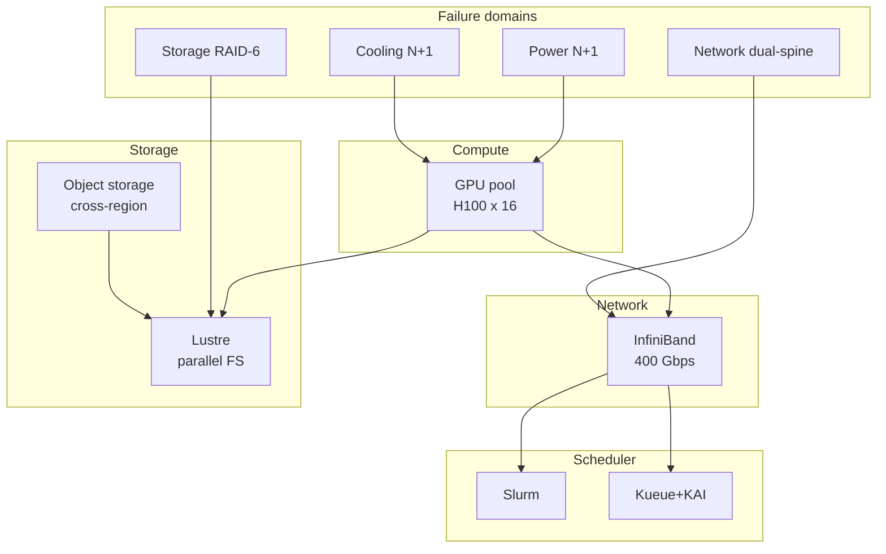

# 19.11 System design: a training cluster

| Field | Value |
|---|---|
| Level | Advanced |
| Priority tier | 2 |
| Lab venue | On-prem |
| Part | Part 19: Capstones, design and interview readiness |
| Primary sources | NVIDIA Zero-to-Hero Volume 23 (`chapter-10-system-design-a-training-cluster.md`); NVIDIA Zero-to-Hero Volume 8 (`chapter-XX-system-design.md`); Part 11 (GPU Kubernetes); Part 12 (AI networking); Part 14 (Distributed training) |
| Cross-references | Chapter 12 (AI networking); Chapter 14.10 (Multi-node training); Chapter 19.1 (Slurm capstone); Chapter 19.2 (Kubernetes GPU platform); Chapter 19.9 (Capacity planning) |
| Coverage file | `planning/coverage/chapters/19-11.md` |
| Claim & number ledger | `planning/ledgers/19-11.md` |

## Training cluster design at a glance



The training cluster design: GPU pool, network, storage, scheduler, failure domains.

## Why this matters for AI infrastructure

A training cluster is a complex system. The design covers: the GPU pool (type, count, topology), the network (bandwidth, latency, topology), the storage (parallel file system, object storage), the scheduler (Slurm or Kueue+KAI), the failure domains (power, network, cooling), the security controls (image signing, access control), and the FinOps integration. A team that has run a training cluster design can describe each piece; a team that has run the design review can identify the gaps.

The training cluster system design is the platform engineer's blueprint. The blueprint is the input to the procurement order; the blueprint is the input to the POC; the blueprint is the input to the production deployment.

```text
Why the training cluster system design matters (V23 ch10; Parts 11, 12, 14):
- A training cluster is a complex system with many interacting components. The
  system design is the blueprint that ties the components together.
- The system design has three perspectives: the platform engineer's view
  (how to size the components); the network engineer's view (how to connect
  the components); the ML engineer's view (how to use the components).
- The system design is the reference architecture. Every chapter in Parts 11,
  12, and 14 maps to a section of the system design.
```

Three operational realities make this chapter a platform-team deliverable rather than a tutorial:

1. **The system design is the blueprint.** The platform team references the system design when sizing a new GPU pool; the platform team references the system design when configuring the network.
2. **The system design is the interview anchor.** The candidate is asked "how would you design a training cluster?"; the candidate points at this system design.
3. **The system design is the procurement gate.** A system design that fails the design review is a system design that does not lead to a procurement order.

**Before a team can claim they have designed a training cluster, the team must have produced this system design. A team that has not produced the system design has not integrated the pieces.**

## Prerequisites and outcomes

### Prerequisites

- Chapter 12 (AI networking).
- Chapter 14.10 (Multi-node training).
- Chapter 19.1 (Slurm capstone).
- Chapter 19.2 (Kubernetes GPU platform).
- Chapter 19.9 (Capacity planning).

### Outcomes

After completing this chapter you will be able to:

1. Size the GPU pool for a given training workload (model size, parallelism strategy, batch size).
2. Select the network topology (fat-tree, dragonfly+, rail-optimised) based on the workload's communication pattern.
3. Design the storage tier (Lustre, parallel file system, object storage) for the workload's IO pattern.
4. Choose the scheduler (Slurm for HPC, Kueue+KAI for cloud-native) based on the team's operational model.
5. Identify the failure domains (power, network, cooling) and design the redundancy.
6. Run the design review with the platform team and the procurement team.

---

## 1. The capacity sizing

### 1.1 The model size and parallelism

The GPU pool is sized based on the model size, the parallelism strategy, and the batch size.

```text
Capacity sizing (Llama 70B, FSDP):
- Model parameters: 70B
- Memory per parameter (BF16): 2 bytes
- Model memory: 70B * 2 bytes = 140 GB
- Optimizer state (AdamW, FP32): 70B * 8 bytes = 560 GB
- Gradient memory (BF16): 70B * 2 bytes = 140 GB
- Total memory: 140 + 560 + 140 = 840 GB
- H100 80GB GPU memory: 80 GB
- FSDP shards: model memory / N + optimizer memory / N
- For 8 GPUs: 840 / 8 = 105 GB per GPU (too large for 80 GB)
- For 16 GPUs: 840 / 16 = 52 GB per GPU (fits in 80 GB)
```

The pattern is: the GPU pool is sized based on the model's memory footprint; the GPU pool is sized to fit the model's memory per shard.

### 1.2 The throughput target

The throughput target is the desired training samples per second. The throughput target drives the GPU count.

```text
Throughput target:
- Target: 1000 samples per second
- Throughput per GPU (H100, BF16, sequence length 2048): ~250 samples per second
- GPU count: 1000 / 250 = 4 GPUs minimum; 16 GPUs with some buffer
```

The pattern is: the GPU pool is sized for the throughput target; the GPU pool includes a buffer for variance.

---

## 2. The network topology

### 2.1 The topology options

The network topology options are: fat-tree, dragonfly+, rail-optimised.

| Topology | Strength | Weakness | Best fit |
|---|---|---|---|
| **Fat-tree** | Uniform bandwidth | More switches; higher cost | General purpose |
| **Dragonfly+** | Lower switch count; good locality | Higher latency for some patterns | HPC workloads |
| **Rail-optimised** | Optimised for GPU-to-GPU traffic | Specific topology | AI training workloads |

The pattern is: the topology is selected based on the workload's communication pattern; the topology is sized for the bandwidth requirement.

### 2.2 The bandwidth requirement

The bandwidth requirement is the bandwidth needed for the collectives. For all-reduce on 16 GPUs with 1 GB message size, the bandwidth must be at least 50 GB/s.

```text
Bandwidth requirement:
- All-reduce on 16 GPUs: 50 GB/s minimum; 100 GB/s target
- All-gather on 16 GPUs: 50 GB/s minimum; 100 GB/s target
- All-to-all on 16 GPUs: 25 GB/s minimum; 50 GB/s target
```

The pattern is: the bandwidth requirement is per collective; the bandwidth requirement drives the network topology.

---

## 3. The storage tier

### 3.1 The storage options

The storage options are: parallel file system (Lustre, Weka, BeeGFS), object storage (S3, GCS, Azure Blob), local NVMe.

| Storage | Strength | Weakness | Best fit |
|---|---|---|---|
| **Parallel FS (Lustre)** | High throughput; POSIX semantics | Complex to operate | Checkpoint I/O; large datasets |
| **Object storage** | Cheap; durable; scalable | High latency; not POSIX | Dataset storage; model artefacts |
| **Local NVMe** | Very high throughput | Limited capacity; not shared | Working data; small datasets |

The pattern is: the storage tier is per workload type; the storage tier is sized for the throughput requirement.

### 3.2 The throughput requirement

The throughput requirement is the bandwidth needed for the checkpoint I/O and the dataset loading. For a 100 GB checkpoint on 16 GPUs, the throughput must be at least 5 GB/s.

```text
Throughput requirement:
- Checkpoint (100 GB, 16 GPUs): 5 GB/s minimum; 10 GB/s target
- Dataset loading (1 TB, 16 GPUs): 10 GB/s minimum; 20 GB/s target
```

The pattern is: the throughput requirement is per workload type; the throughput requirement drives the storage tier selection.

---

## 4. The scheduler

### 4.1 The scheduler options

The scheduler options are: Slurm (HPC) and Kueue+KAI (cloud-native).

| Scheduler | Strength | Weakness | Best fit |
|---|---|---|---|
| **Slurm** | Mature; HPC features; GPU topology awareness | Legacy; less cloud-native | HPC training |
| **Kueue+KAI** | Cloud-native; ecosystem integration; elasticity | Less mature for HPC | Cloud-native AI |

The pattern is: Slurm for HPC training; Kueue+KAI for cloud-native AI. The two can coexist.

---

## 5. The failure domains

### 5.1 The failure domain inventory

The failure domains are: power, network, cooling, storage.

```text
Failure domains:
- Power: dual power feeds; UPS; generator
- Network: dual spine switches; redundant paths
- Cooling: N+1 CRAC units; hot-aisle/cold-aisle containment
- Storage: RAID; replication; backup
```

The pattern is: every failure domain has redundancy; every failure domain is tested quarterly.

### 5.2 The redundancy pattern

The redundancy pattern is: every component has a backup; every component is tested for failover.

```text
Redundancy pattern:
- Power: A+B feeds; UPS on each rack; generator on site
- Network: dual spine; dual leaf; LACP between leaves
- Cooling: N+1 CRAC; cold-aisle containment; leak detection
- Storage: RAID-6; cross-rack replication; daily backup to object storage
```

The pattern is: every component is redundant; every component is tested quarterly.

---

## 6. The design review

### 6.1 The design review checklist

The design review checklist is the structured review of the system design. The checklist covers: capacity, network, storage, scheduler, failure domains, security, FinOps.

```markdown
## Design review checklist

### Capacity
- [ ] GPU count sized for the workload
- [ ] Throughput target met
- [ ] Buffer included for spikes

### Network
- [ ] Topology selected for the workload
- [ ] Bandwidth sized for the collectives
- [ ] Redundancy in place

### Storage
- [ ] Tier selected for the workload
- [ ] Throughput sized for the I/O
- [ ] Backup in place

### Scheduler
- [ ] Slurm or Kueue+KAI configured
- [ ] Multi-tenant queues configured
- [ ] Gang scheduling configured

### Failure domains
- [ ] Power redundancy
- [ ] Network redundancy
- [ ] Cooling redundancy
- [ ] Storage redundancy

### Security
- [ ] Image signing configured
- [ ] Access control configured
- [ ] Audit log configured

### FinOps
- [ ] Cost attribution configured
- [ ] Budget alerts configured
- [ ] Forecast updated
```

The pattern is: the checklist is structured; the checklist is comprehensive; the checklist is reviewed quarterly.

### 6.2 The design review outputs

The design review outputs are: the design is approved, the design is rejected with comments, the design is approved with conditions.

```text
Design review outputs:
- Approved: the design proceeds to procurement
- Rejected: the design returns to the field engineer with comments
- Approved with conditions: the design proceeds with specific requirements
```

The pattern is: the design review has a clear outcome; the design review is documented.

---

## 7. Hands-on lab

This lab walks through the training cluster system design: the capacity sizing, the network topology, the storage tier. The lab is **untested** in this repository.

### 7.1 Prerequisites

- A simulated training workload (e.g. Llama 70B).
- The reference architectures from the capstone templates.

### 7.2 Step 1: size the GPU pool

```bash
python code/part19/size_gpu_pool.py \
  --model llama-70b \
  --parallelism fsdp \
  --batch-size 32 \
  --output gpu_pool_size.md
```

### 7.3 Step 2: select the network topology

```bash
python code/part19/select_topology.py \
  --gpu-count 16 \
  --bandwidth 100 \
  --output network_topology.md
```

### 7.4 Step 3: design the storage tier

```bash
python code/part19/design_storage.py \
  --throughput 10 \
  --capacity 1000 \
  --output storage_design.md
```

### 7.5 Step 4: choose the scheduler

```bash
python code/part19/choose_scheduler.py \
  --workload foundation-model \
  --output scheduler_design.md
```

### 7.6 Step 5: run the design review

```bash
python code/part19/design_review.py \
  --design system_design.md \
  --output review_report.md
```

### 7.7 What to record

After the lab, you should be able to answer five questions in five seconds each:

1. What is the current GPU count?
2. What is the current network topology?
3. What is the current storage tier?
4. What is the current scheduler?
5. What is the current design review status?

If any takes more than 30 seconds, the system design is not yet a production service. The lab is **untested** against a live cluster.

---

## Exercises

1. **Add a new GPU type.** Add a new GPU type to the capacity sizing script. *Solution sketch:* the GPU type configuration.
2. **Add a new topology.** Add a new topology option to the network topology script. *Solution sketch:* the topology configuration.
3. **Add a new storage tier.** Add a new storage tier to the storage tier script. *Solution sketch:* the storage tier configuration.
4. **Add a new scheduler.** Add a new scheduler option to the scheduler script. *Solution sketch:* the scheduler configuration.
5. **Add a new failure domain.** Add a new failure domain to the failure domain inventory. *Solution sketch:* the failure domain configuration.
6. **Add a design review automation.** Automate the design review against the checklist. *Solution sketch:* the design review script.

---

## Checkpoint questions

<details><summary>1. What is the system design for a training cluster?</summary>
The blueprint that ties the GPU pool, the network, the storage, the scheduler, the failure domains, the security, and the FinOps together. The system design is the input to the procurement order; the system design is the input to the POC; the system design is the input to the production deployment.
</details>

<details><summary>2. What is the difference between fat-tree and dragonfly+?</summary>
Fat-tree has uniform bandwidth between any two nodes. Dragonfly+ has lower switch count and better locality but higher latency for some patterns. Fat-tree is general purpose; dragonfly+ is for HPC workloads with locality.
</details>

<details><summary>3. What is the difference between parallel file system and object storage?</summary>
Parallel file system (Lustre) has POSIX semantics and high throughput. Object storage (S3) is cheap and durable but has high latency. Lustre is for checkpoint I/O and large datasets; object storage is for dataset storage and model artefacts.
</details>

<details><summary>4. What is the difference between Slurm and Kueue+KAI?</summary>
Slurm is the mature HPC scheduler with GPU topology awareness. Kueue+KAI is the cloud-native scheduler with elasticity and ecosystem integration. Slurm is for HPC training; Kueue+KAI is for cloud-native AI.
</details>

<details><summary>5. What is the most common training cluster design failure?</summary>
The GPU pool is under-sized. The training workload runs out of memory; the training crashes. The fix is to right-size the GPU pool; add a buffer; track the throughput.
</details>

<details><summary>6. What is the most dangerous training cluster design failure?</summary>
The network topology is mismatched. The NCCL collectives take the slow path; the training is slow. The fix is to verify the topology; set the NCCL_TOPO_FILE; tune the NCCL algorithm.
</details>

<details><summary>7. What is the most expensive training cluster design mistake?</summary>
Choosing the wrong storage tier. The storage is too slow for the checkpoint I/O; the checkpoint times out. The fix is to size the storage for the throughput requirement; use Lustre for hot data and object storage for cold data.
</details>

<details><summary>8. What is the relationship between the training cluster system design and the Slurm capstone?</summary>
The system design is the blueprint; the Slurm capstone is the deployment of the blueprint. The system design includes the Slurm configuration; the Slurm capstone implements the Slurm configuration.
</details>

<details><summary>9. What is the most common failure domain mistake?</summary>
The failure domains are not tested. The team has redundancy but the team has not tested the redundancy. The fix is to run the failure domain drills quarterly; verify the redundancy works.
</details>

<details><summary>10. What is the most expensive failure domain mistake?</summary>
The cooling redundancy is insufficient. The data centre overheats; the GPUs thermal-throttle; the training is slow. The fix is to verify the cooling redundancy; add CRAC units; verify the airflow.
</details>

<details><summary>11. What is the relationship between the training cluster system design and the capacity planning capstone?</summary>
The system design is the blueprint; the capacity planning capstone is the forecast that drives the GPU order. The system design is sized based on the capacity plan; the capacity plan is updated based on the system design.
</details>

<details><summary>12. What is the most important training cluster design metric?</summary>
GPU memory per shard. The metric tells the team whether the GPU pool is sized for the workload. A high memory per shard indicates the GPU pool is under-sized.
</details>

<details><summary>13. What is the relationship between the training cluster system design and the security capstone?</summary>
The system design is the blueprint; the security capstone is the controls that protect the blueprint. The system design includes the security controls; the security capstone implements the security controls.
</details>

<details><summary>14. What is the most common security mistake in training cluster design?</summary>
The training images are not signed. A compromised image can be deployed; the training is compromised. The fix is to enable image signing; configure the admission controller.
</details>

<details><summary>15. What is the relationship between the training cluster system design and the observability capstone?</summary>
The system design is the blueprint; the observability capstone is the monitoring of the blueprint. The system design includes the metrics to be collected; the observability capstone collects the metrics.
</details>

<details><summary>16. Why is the training cluster system design a Tier 2 chapter?</summary>
Because the training cluster system design is the foundation of the production training shape. The system design is what the platform team references; the system design is what the interview candidate points at; the system design is the procurement gate.
</details>

<details><summary>17. What is the most expensive GPU pool mistake?</summary>
Choosing GPUs that are not optimised for the workload. A GPU that is optimised for inference is not optimised for training. The fix is to choose GPUs that are optimised for the workload's specific pattern.
</details>

<details><summary>18. What is the most common network topology mistake?</summary>
Choosing a topology that is not optimised for the workload's communication pattern. A fat-tree for a small cluster is overkill; a dragonfly+ for a large cluster is suboptimal. The fix is to choose the topology based on the cluster size and the communication pattern.
</details>

<details><summary>19. What is the relationship between the training cluster system design and the consulting method capstone?</summary>
The system design is the blueprint that the consulting method delivers. The consulting method uses the system design to scope the deal; the consulting method validates the system design through the POC.
</details>

<details><summary>20. What five questions should the training cluster system design lab let you answer in five seconds each?</summary>
What is the current GPU count. What is the current network topology. What is the current storage tier. What is the current scheduler. What is the current design review status. If any takes more than 30 seconds, the system design is not yet a production service.
</details>

---

## Sources and review notes

- NVIDIA Zero-to-Hero Volume 23 (`chapter-10-system-design-a-training-cluster.md`). Source for the system design patterns. The wording has been rewritten in the handbook's voice.
- NVIDIA Zero-to-Hero Volume 8. Source for the system design patterns.
- Part 11 (GPU Kubernetes) for the cluster patterns.
- Part 12 (AI networking) for the network patterns.
- Part 14 (Distributed training) for the workload patterns.

### Cross-references to other handbook chapters

- Chapter 12 (AI networking) for the network patterns.
- Chapter 14.10 (Multi-node training) for the workload patterns.
- Chapter 19.1 (Slurm capstone) for the Slurm deployment.
- Chapter 19.2 (Kubernetes GPU platform) for the Kubernetes deployment.
- Chapter 19.9 (Capacity planning) for the sizing patterns.

### Migrated from `nvidia-devops`

The training cluster system design operational patterns draw on Volume 23 and the gem-book corpora. The wording has been rewritten in the handbook's voice.

### Explicitly labelled inferences

- The GPU pool size (16 GPUs for Llama 70B FSDP) is a starting point; specific sizes depend on the model and the parallelism strategy.
- The network topology (fat-tree) is a starting point; specific topologies depend on the cluster size and the workload.
- The storage tier (Lustre for checkpoint I/O) is a starting point; specific tiers depend on the workload's I/O pattern.

### Not verified on live hardware

- The lab in Section 7 is **untested** against a live cluster in this repository.
- The capacity sizing assumes the model's memory footprint is documented; production deployments may require model-specific tuning.
- The network topology assumes the workload's communication pattern is documented; production deployments may require profiling.
