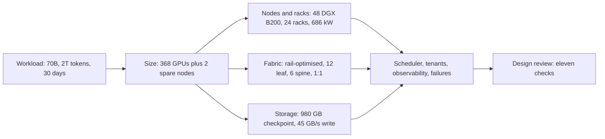

# 19.11 System design: a training cluster

| Field | Value |
|---|---|
| Level | Advanced |
| Priority tier | 2 |
| Lab venue | Local, standard-library Python and pytest. No GPU needed. |
| Part | Part 19: Capstones, design and interview readiness |
| Chapter type | Design and interview chapter |
| Code | `code/part19/c11_size_gpu_pool.py`, `c11_select_topology.py`, `c11_design_storage.py`, `c11_choose_scheduler.py`, `c11_design_review.py`, `c11_worked_example.py`, tests in `test_c11_design.py` |
| Cross-references | [19.1](./01-capstone-a-slurm-gpu-cluster.md), [19.2](./02-capstone-a-kubernetes-gpu-platform-with-kai-and-kueue.md), [19.4](./04-capstone-multi-node-training-with-fault-tolerance.md), [19.5](./05-capstone-an-nccl-tests-fabric-lab.md), [19.9](./09-capstone-capacity-planning.md), [12.13](../part-12-ai-networking/13-fabric-design-topology-oversubscription-and-scale.md), [13.7](../part-13-ai-storage/07-checkpoint-architecture-and-recovery.md), [20.12](../part-20-nebius-sre-interview/12-estimation-toolkit-for-inference-capacity.md), [20.17](../part-20-nebius-sre-interview/17-system-design-drill-sheet-twelve-prompts.md) |
| Ledger | `planning/ledgers/19-11.md` |

## Why this matters for AI infrastructure

An interviewer says "design a training cluster," and then goes quiet. You may feel the pull to start drawing racks right away, and many candidates do. They lose the room, because nobody has said how big the model is or how long the run may take. A good answer starts with a workload, turns that workload into a GPU count, and then lets the count decide the network, the storage and the scheduler.

This chapter is a capstone for the whole handbook. It reuses the Slurm cluster from [19.1](./01-capstone-a-slurm-gpu-cluster.md), the Kubernetes platform from [19.2](./02-capstone-a-kubernetes-gpu-platform-with-kai-and-kueue.md), the fault-tolerant training job from [19.4](./04-capstone-multi-node-training-with-fault-tolerance.md), the fabric tests from [19.5](./05-capstone-an-nccl-tests-fabric-lab.md) and the capacity model from [19.9](./09-capstone-capacity-planning.md). It does not repeat them. Instead it shows how to join them into one design that you can speak aloud in 45 minutes, which is the length of a typical interview round.

Every number in the worked design comes from a script in `code/part19/` that the tests check. Every hardware figure is either taken from a gem book, from an NVIDIA document or page that the chapter names, or it is labelled as an assumption. That labelling matters. When you speak the design aloud, you can say which numbers you were given and which ones you chose. The chapter does not claim to know what any particular company asks. It says what the question tests and how to answer it well.

Think of the scripts as a notebook that a skeptic can rerun. If a number in the chapter changes, the test fails, and that tells you the prose needs updating. The point is not to make the arithmetic look clever. The point is that the next reader can reproduce each line in a few minutes, on a laptop, without trusting the author.

## Prerequisites and outcomes

Your first interview question lands in the middle of a sentence, and the interviewer uses words like "collective" and "rail" as if you already know them. You should know what a collective is, what InfiniBand rails are, and what a checkpoint holds. If not, read [12.13](../part-12-ai-networking/13-fabric-design-topology-oversubscription-and-scale.md) and [14.11](../part-14-training-finetuning/11-checkpointing-fault-tolerance-and-elastic-training.md) first, because the rest of the chapter assumes those words.

Keep the outcomes short and practical. This chapter walks through the whole design in the order you would speak it. It starts with a workload and its assumptions stated in two minutes. It turns parameters, tokens, a deadline and an MFU into a GPU, node, rack and power count, and it counts switches and cables for a non-blocking fat tree, including when a design should move to two tiers. It then shows with arithmetic why dataset reads are small and checkpoint writes are not. It makes a choice between Slurm and Kubernetes with a rule you can defend, and it ends with a design review that fails a design for a stated reason.

### The workload used throughout

Picture a whiteboard with a model, a deadline and a budget, and nothing else on it. Everything below is one worked design built from those inputs. The inputs are assumptions chosen for teaching. They are not a customer's numbers, and you should change them whenever you practise the design.

| Input | Value | Where it comes from |
|---|---|---|
| Model | 70 billion parameters, dense transformer | Assumption |
| Training data | 2 trillion tokens, one pass | Assumption |
| Deadline | 30 days of wall-clock | Assumption |
| GPU | NVIDIA B200 in DGX B200, 8 per node | Assumption, matches the DGX B200 SuperPOD document |
| Peak BF16 per GPU | 2,250 TFLOPS dense | NVIDIA HGX page, fetched 2026-11-10: 36 PFLOPS for 8 GPUs, footnote says dense is half the sparse figure shown. Distributed AI Systems ch. 2 also gives 2.25 PFLOPS |
| MFU | 40 percent | Low end of the 40 to 60 percent range in Distributed AI Systems ch. 2 |
| Per-GPU mean time between failures | 50,000 hours | Assumption, the same placeholder as [20.17](../part-20-nebius-sre-interview/17-system-design-drill-sheet-twelve-prompts.md) |
| Restart after a failure | 10 minutes | Assumption |
| Repair time for a node | 24 hours | Assumption |
| Bytes per token on disk | 4 | Assumption, a vocabulary above 65,536 needs more than 2 bytes |
| Price | 8.50 dollars per GPU-hour | Nebius public price page as recorded in [20.12](../part-20-nebius-sre-interview/12-estimation-toolkit-for-inference-capacity.md), fetched 2026-11-09, a placeholder here |

Read this table as a list of promises you have to keep when you speak. Each row says what you are assuming and where that assumption came from. A row marked as an assumption is not wrong to use. It is only a row that the interviewer is allowed to change, and a good candidate tells them so before they ask.



| Box | What it holds | Section |
|---|---|---|
| Size | FLOPs, MFU, inflation from failures, spare nodes | 2 |
| Nodes and racks | Power, cooling and cables from the SuperPOD document | 3 |
| Fabric | Rails, leaf and spine counts, oversubscription | 4 |
| Storage | Dataset reads, checkpoint writes, retention | 5 |
| Scheduler and after | Slurm or Kubernetes, quotas, signals, restarts | 6 to 9 |
| Design review | A runner that fails a bad design | 10 |

## 1. Requirements first

A designer who skips requirements builds the wrong cluster very well. Picture the interviewer waiting while you draw a spine switch for a workload you never defined. The first five minutes should produce a short list that every later number can point back to. Without that list, each number looks like a guess, and the interviewer has no reason to trust the rest of the drawing.

Think about what the interviewer is actually scoring. A diagram is easy to copy from a slide. The harder skill is turning a vague request into numbers and then showing how each later choice follows from those numbers. The requirements step is where that skill first shows, which is why it comes first and why it deserves the first five minutes.

Ask the questions that change the design. Is this one large pre-training run or many small jobs? How large is the model, how many tokens, and what is the deadline? Does the same hardware also serve inference or notebooks? How many teams share it? Must the data stay in one region? Is the cluster on premises or rented? Each answer moves a number later in the design. A shared estate pushes you toward Kubernetes, a hard deadline pushes the GPU count up, and a rented cluster removes the power section from your concern.

Then say your assumptions out loud, using the table above. Say that you will redo the arithmetic if the interviewer gives you other values. This habit is the main thing that separates a senior answer from a diagram recital. The same habit appears in [20.12](../part-20-nebius-sre-interview/12-estimation-toolkit-for-inference-capacity.md) for inference, where the first sentence of a good answer is also a number.

Write down what you will not design. Here that means the data pipeline that builds the tokens, the model code, security hardening and the inference path. Naming the boundary is cheap, and it keeps the 45 minutes honest. It also shows the interviewer that you know where your answer ends, which is a sign of experience.

A scope boundary also protects you from a trap. Interviewers sometimes add a new requirement near the end, such as security hardening or a data pipeline, to see how you react. If you wrote the boundary down early, you can say that the topic is outside the design and offer to sketch it if there is time left.

**Decision rule:** do not draw a box until the workload, the deadline and the sharing model are written down with their assumptions.

**In one minute:** Requirements are a short list of workload numbers and sharing facts. State them with assumptions, and name what is out of scope. Every later section points back to this list.

## 2. Sizing the GPU pool

On day one of a real run, the finance lead asks how many GPUs you need, and "a lot" is not an answer. The answer is a chain of four lines that anyone can check. It starts with a rule of thumb that Distributed AI Systems ch. 2 gives for a dense transformer: about six floating point operations per parameter per token, counting the forward and backward passes together.

```text
FLOPs = 6 x parameters x tokens
GPUs  = FLOPs / (peak FLOPS x MFU x seconds available)
```

The second line means that the more of the datasheet peak you actually use, the fewer GPUs you buy. MFU, which stands for model FLOPs utilisation, is the model's useful FLOPs per second divided by the peak FLOPS. Distributed AI Systems ch. 2 says a well-tuned large run reaches 40 to 60 percent, and it shows a 70B example near 43 percent on H100. The design uses 40 percent, the low end of that range, because a design should not assume the best case.

Read the formula from the inside out, because that is how it behaves. The FLOPs are the amount of arithmetic the run must finish. The denominator is what one GPU can really do per second, scaled by the share of that work the model uses, multiplied by the time you are willing to wait. Divide the first by the second, and you get a count of GPUs. If the deadline shrinks, the GPU count grows in the same proportion, which is why a short deadline is expensive. Nothing in the formula is hidden, so anyone in the room can change one input and see the answer move.

`size_gpu_pool.py` also corrects for two costs that the simple formula hides. The first is that a checkpoint takes time to write. The second is that a failure throws away the work since the last checkpoint. A bigger pool fails more often, so the correction depends on the answer itself. The script iterates until the node count stops changing. The correction model is this chapter's own reasoning, and the Young interval inside it is a first-order result. [20.17](../part-20-nebius-sre-interview/17-system-design-drill-sheet-twelve-prompts.md) checked that result against Aupy and co-authors.

The full output of `python3 c11_worked_example.py` follows. It is pasted from the file `c11_worked_example_output.txt`, and later sections quote lines from it. Read it as a sequence of answers to the questions in the previous paragraphs. Its last eleven lines are the design review, which section 10 explains.

```text
FLOPs: 8.400e+23
ideal GPUs: 360.1
checkpoint bytes: 980 GB, write 21.8 s at 45 GB/s
cluster MTBF: 135.9 h, Young interval: 4616 s
inflation: 1.0107
training nodes 46 (368 GPUs), spares 2, total nodes 48 (384 GPUs)
state floor: 8 GPUs at 16 B/param on 192 GB at 80 percent
dataset read: 3.1 MB/s
sync stall at 1800 s: 1.21 percent
write bandwidth for 3 percent at 1800 s: 18.1 GB/s
retained 5 checkpoints: 4.90 TB
run cost at 8.50 per GPU-hour, 368 GPUs, 30 days: 2252160 USD
sync checkpoint stall costs: 27248 USD
one more MFU point saves 8.8 GPUs, 53749 USD
fabric (64-port): {"tiers": 2, "leaf": 12, "spine": 6, "super_spine": 0, "switches": 18, "endpoint_cables": 384, "leaf_spine_cables": 384, "spine_super_cables": 0, "leaf_oversub": 1, "top_oversub": 1}
max two-tier endpoints at 64 ports: 2048
scale-up to scale-out ratio, 1800 GB/s vs 400 Gb/s: 36
racks at 2 nodes each: 24, power 686.4 kW
scheduler: Slurm (slurm 4, k8s 1)
alternative profile: Kubernetes with KAI (slurm 0, k8s 4)
requirements   PASS workload stated
compute        PASS pool delivers 8.58e+23 FLOPs, job needs 8.40e+23
memory         PASS state 3.0 GB of 192 GB HBM (80 percent rule)
fabric         PASS leaf oversubscription 1:1
power          PASS rack draws 28.6 kW of 28.6 kW
spares         PASS 2 spare nodes, rule asks for 2
checkpoint     PASS synchronous stall 1.21 percent, budget 3 percent
scheduler      PASS scheduler named with reasons
observability  PASS all signals present
quota          PASS quotas total 368 GPUs of 368
failure_plan   PASS health check and automatic restart named
```

Read the sizing numbers in order, because each line feeds the next one. The job needs 8.4e23 FLOPs, which is 360 GPUs if nothing ever failed. Checkpoint writes and failures add about 1.1 percent, so the pool becomes 46 nodes, which is 368 GPUs. Two spare nodes cover the expected nodes down during a 24 hour repair, plus one. That is 48 nodes and 384 GPUs to buy. Notice that the spare nodes add more than the failure correction does, so the spares are the bigger decision.

Do not stop at compute. The training state must also fit in memory, and that is a separate check. Distributed AI Systems ch. 5 says Adam keeps two FP32 copies at 8 bytes per parameter, and a FP32 master copy adds 4 more. With BF16 weights at 2 and gradients at 2, the sum is 16 bytes per parameter, so 1.12 TB for this model. Eight B200 GPUs with 192 GB each could hold that state alone. The script prints 8 as a floor because it does not count activations. At 368 GPUs sharded, the state is about 3 GB per GPU. Memory is not the constraint here. Compute is.

State the cost in one sentence too, because the finance lead will ask. Holding 368 GPUs for 30 days at the placeholder price is about 2.25 million dollars. One more MFU point saves about 8.8 GPUs, which is about 54 thousand dollars. That is why people spend weeks tuning kernels and overlap. For the full capacity method, with scenarios and forecast bands, use [19.9](./09-capstone-capacity-planning.md).

| Question the interviewer may ask | Short answer from the script |
|---|---|
| What if MFU is only 30 percent | GPUs scale with 1 over MFU, so about 480 ideal |
| What if the deadline is 60 days | About half the GPUs, but you pay roughly the same GPU-hours |
| Why spares | Expected nodes down during repair plus one |
| Why not size for 50 percent MFU | A design should survive a bad first month |

**Decision rule:** size from FLOPs and a conservative MFU, add checkpoint and failure inflation, then round up to whole nodes and add spares.

**In one minute:** FLOPs equal six times parameters times tokens. Divide by peak times MFU times the deadline to get GPUs. Add about one percent for checkpoints and failures here, round to nodes, and add spares. The worked answer is 368 GPUs plus 2 spare nodes.

## 3. Node and rack design, with power and cooling

A facilities engineer reads your design and asks how many kilowatts each rack draws. If you guess, the project stops, and the engineer stops trusting the rest of the diagram too. The DGX B200 SuperPOD data center document gives the numbers, so quote them and do not invent any. When a number comes from a document, say which document it came from.

Power and cooling are where a design meets the building. A rack that draws more power than its circuits can supply will trip a breaker, and a rack that is not cooled will throttle the GPUs inside it. Both problems appear only after the racks are installed, when moving equipment is expensive. That is why a designer quotes these numbers early and checks them against the vendor document.

A DGX B200 draws up to 14.3 kW, is 10 rack units tall, and is air cooled, according to that document. A scalable unit holds up to 32 systems and 458 kW. A management appliance takes the place of one node, so a full SuperPOD tops out at 127 DGX B200 servers. The typical rack holds two systems. That rack needs 28.6 kW and about 4,290 cubic feet per minute of supply air, at the document's assumed 150 cubic feet per minute per kilowatt at sea level. A high-density option holds four systems at 57.2 kW and 8,580 cubic feet per minute in a 52U rack.

To make the power numbers concrete, picture two servers in a rack, each pulling a steady load, with fans pushing cool air in at the front and hot air out at the back. The rack has to deliver enough power to both servers and enough cold air to carry the heat away. If either supply is short, the servers slow down or shut off. The document's cooling figures tell you how much air the room has to move for each kilowatt the rack consumes.

Power is provisioned as N equals 2 circuits. Each circuit must be rated for half of the rack's peak demand after breaker derating, which is the reduction that keeps a breaker from running at its limit. The document's example for the two-system rack uses two 380 V three-phase 32 A circuits. Supply air should stay at or under 30 degrees Celsius for these systems, with filtration rated MERV 13 or better. The document says rear door heat exchangers and in-row coolers are not typically suitable for DGX B200.

In practice this means the facilities team plans for a failure before it happens. If one circuit goes out, the other must carry the rack's load alone, so the design only works if each circuit can handle the full peak on its own. That is why the phrase "half of the peak" appears in the document. A designer who misreads it can end up with a rack that trips the moment its neighbour's breaker opens.

Apply that to the worked design. The 48 nodes sit in 24 racks of two. The compute alone draws 48 times 14.3, which is 686.4 kW. Switches, storage and management come on top of that. The documents give no sourced figure for them, so this chapter states none. In the interview, say that the number covers compute only. Then offer to ask the facilities team for the rest.

If the interviewer picks the newer rack-scale system instead, the DGX GB300 SuperPOD reference architecture changes the picture. Its scalable unit is 8 racks, each with 72 GPUs, and the unit needs 1.2 MW of thermal design power. Hybrid cooling means the GPUs and CPUs are liquid cooled and the other parts are air cooled. A power shelf has six 5.5 kW supplies and delivers up to 33 kW, and each rack has eight shelves. Dividing 1.2 MW by 8 racks gives 150 kW per rack. That is only a division, though, because the unit includes more than the racks. The document says the data center should meet Uptime Tier 3 or an equivalent class.

| Fact | DGX B200 | DGX GB300 |
|---|---|---|
| GPUs per node or rack | 8 per node | 72 per rack |
| Cooling | Air | Hybrid, liquid for GPUs and CPUs |
| Scalable unit | Up to 32 nodes, 458 kW | 8 racks, 1.2 MW TDP |
| Typical rack | 2 nodes, 28.6 kW | One rack system |
| Source | DGX B200 data center best practices | DGX GB300 SuperPOD reference architecture |

Cables matter as much as watts. The same B200 document warns that central management racks concentrate cables, and that tray fill and floor loading need planning. The cabling slides list passive copper at 3 meters for 400 Gb/s and active optical cables up to 30 meters. Its FAQ says InfiniBand reach cannot be extended with patch panels or extra top-of-rack switches, so rack placement follows cable length, not the other way round.

**Decision rule:** quote power, airflow and cable limits from the vendor document for the exact system, and say plainly which parts you did not source.

**In one minute:** A DGX B200 draws 14.3 kW and two fit a 28.6 kW air-cooled rack. The worked pool is 24 racks and 686 kW for compute only. GB300 racks are liquid cooled at much higher density. Cable reach decides where racks can sit.

## 4. Fabric topology

At step 40,000 the loss curve flattens, and nodes in one corner of the cluster run 15 percent slower. The cause turns out to be a leaf switch whose uplinks are oversubscribed. This is why the fabric section needs counts and not adjectives. A word like "fast" cannot tell you where the bottleneck sits, but a count of ports can.

Start with rails. AI Data Center Network Design and Technologies ch. 3 calls the layout where each of a server's 8 GPUs connects to a different leaf switch a rail-optimised design. GPU 1 on every server meets GPU 1 on every other server on the same leaf, so the most frequent traffic stays one hop away. The DGX GB300 reference architecture describes the same idea, as a rail-optimised, non-blocking, full fat tree on InfiniBand, with each SU holding eight leaf switches. Traffic between different rails crosses the spine.

Here is the intuition behind rails. Imagine eight GPUs in each server, and each GPU has its own network card. If all the GPUs numbered 1 across every server plug into the same leaf switch, then a message from GPU 1 on one server to GPU 1 on another crosses only that leaf. Most collective traffic in training has this shape, so keeping it on one switch saves a trip up to the spine and back.

Now the counting. Take a switch with 64 ports of 400 Gb/s. A non-blocking leaf gives 32 ports to servers and 32 to spines, and the book states exactly that example. A two-tier fabric then reaches 32 times 64, which is 2,048 endpoints. Past that point you need a third tier or oversubscription. `select_topology.py` implements the counting, and the tests check it against the book and the vendor tables.

| Check | Expected | Source of expectation | Test result |
|---|---|---|---|
| 256 GPUs on 64-port switches | 8 leaf, 4 spine | Network book ch. 3, Fig. 3-9 | Matches |
| 512 GPUs | 16 leaf, 8 spine | Same | Matches |
| 4,096 GPUs at 2:1 on the super spine | 128 leaf, 128 spine, 32 super spine | Same, Fig. 3-12 | Matches |
| B200 SuperPOD, 1, 2 and 4 SUs | 8/4, 16/8, 32/16 leaf and spine, 256, 512, 1,024 leaf-spine cables | DGX B200 SuperPOD cabling table | Matches |
| B200 SuperPOD, 3 SUs | Table says 16 spines | Same table | Formula gives 12 |
| GB300, 2 SUs, 144-port switch | 16 leaf, 8 spine | GB300 RA Table 3 | Matches |
| GB300, 4, 8 and 16 SUs | Table says 18, 36, 72 spines | Same table | Formula gives 16, 32, 64 |

Two rows disagree with the formula. The vendor tables list more spines than plain counting gives, in the 3-SU B200 case and in the larger GB300 cases. The documents do not say why. A likely reason is a rail or plane balance rule that they do not spell out, but that is a guess, and the chapter labels it as one. In a real design, build to the vendor table and ask the vendor.

A useful habit here is to write the disagreement down rather than to smooth it over. Put the formula result and the vendor result side by side in your notes, with the source of each. If the interviewer asks why they differ, you can say what you know, what you do not know, and how you would find out. That answer is stronger than a confident guess.

For the worked design, 384 endpoints on 64-port switches need 12 leaf and 6 spine switches. That makes 18 switches and 384 leaf-to-spine cables. The SuperPOD documents say to build the fabric for a full scalable unit and leave ports unused where nodes are not installed. So the real order follows the vendor pattern and not the plain minimum. The GB300 document says the same thing for non-standard sizes.

Ports are the hidden cost of any switch count. A leaf that is built for a full scalable unit may carry empty ports for a while, and that is normal. Buying the minimum and adding nodes later can force a rewire, which is expensive and risky. Following the vendor's pattern is often cheaper in the long run, even though it lists more switches on the order sheet.

Oversubscription is a choice, and the choice should come from traffic. The network book notes that some companies evaluate up to 7:1 at the super spine, and it warns that congestion then needs DCQCN. For a single large training job with all-reduce across the whole fabric, design for 1:1. For many small jobs that stay inside a rail group, a higher ratio may be acceptable, but measure the traffic first. The GB300 document itself uses 1:3 blocking on the Ethernet compute leaves of the storage and in-band fabric, which is a separate network. That shows the same cluster can mix ratios by purpose.

The phrase 1:1 sounds abstract until you picture a leaf switch. A 1:1 leaf sends as much traffic up to the spines as it receives from its servers, so the uplinks are never the bottleneck. A leaf with more server ports than uplink capacity is fine when traffic is light, and painful when every GPU sends at once. The choice is about how often the whole job will hit the uplinks together.

Scale-up and scale-out differ by a large factor. A B200 has 1.8 TB/s of NVLink bandwidth per GPU, according to Distributed AI Systems ch. 2 and the GB300 document. A 400 Gb/s rail NIC is 50 GB/s. The script gives a ratio of 36. So put tensor parallelism inside the NVLink domain, which is 8 GPUs in a DGX B200 node or 72 in a GB300 rack, and let data-parallel traffic cross the NICs. The details of NCCL on this fabric are in [19.5](./05-capstone-an-nccl-tests-fabric-lab.md) and [12.13](../part-12-ai-networking/13-fabric-design-topology-oversubscription-and-scale.md).

A separate storage network keeps training traffic predictable. The GB300 document dedicates a 400 Gb/s port to storage and a separate link of at least 200 Gb/s to in-band traffic, so storage RoCE traffic does not share a bonded interface. Out-of-band management sits on its own switches. State all four fabrics when you speak: NVLink, compute InfiniBand, storage and in-band Ethernet, and out-of-band.

**Decision rule:** design the compute fabric at 1:1 and rail-optimised, count switches with the formula, and match the vendor table when it lists more.

**In one minute:** A 64-port switch splits 32 down and 32 up. Two tiers reach 2,048 endpoints. The worked design needs 12 leaf and 6 spine switches. Vendor tables sometimes list more spines than the formula, so follow them and ask why.

## 5. Storage for datasets and checkpoints

At 02:00 the job stalls for two minutes every half hour, and the dashboard shows GPUs idle. Nobody is reading data. The job is writing a checkpoint. This section shows why that write is the storage number you have to size, and why the read number is usually the one people worry about by mistake.

Start with dataset reads, because people over-size them. The run reads 2 trillion tokens over 30 days. That is about 770,000 tokens per second. At 4 bytes per token it is 3.1 MB per second for the whole cluster. Text pre-training barely touches storage. The numbers change for multimodal data. If each sample is 500 KB and the cluster consumes 20,000 samples per second, the read rate is 10 GB per second. Use `design_storage.py` with your own sample size, and say which case you are in.

Checkpoints are the heavy part. A checkpoint holds the weights and the optimizer state, but not the gradients. Using Distributed AI Systems ch. 5, that is 2 bytes of BF16 weights plus 12 bytes of FP32 optimizer-side state. Those sum to 14 bytes per parameter. For 70 billion parameters, that comes to 980 GB per checkpoint. Multiply the parameters by the bytes per parameter first, and only then think about bandwidth.

A checkpoint is closer to a saved game than to a photo. It has to hold everything the training run needs to continue exactly where it stopped, which is the weights and the optimizer's running state. Losing the saved game means losing the work since the last save. That is why the write speed matters. A slow save makes the whole run wait, and every wait is paid for in GPU time.

How long does the write take? It depends on the bandwidth. The DGX GB300 reference architecture gives guidelines for one scalable unit. Its Table 5 lists 90 GB/s read and 45 GB/s write for a "standard" level, and 280 and 140 for "enhanced". That is a different system from the B200 in the worked design, so the table serves only as an order of magnitude. At 45 GB/s the write takes 21.8 seconds. At 10 GB/s, the same checkpoint would take 98 seconds.

```text
checkpoint size  = 70e9 x 14 bytes            = 980 GB
write time       = 980 GB / 45 GB/s           = 21.8 s
synchronous stall every 1,800 s               = 1.21 percent
bandwidth needed for a 3 percent stall budget = 18.1 GB/s
five retained checkpoints                     = 4.90 TB
```

The 3 percent budget is a policy default, not a standard. The reading is simple. A synchronous checkpoint every 30 minutes at 45 GB/s costs 1.2 percent of the run, which is about 27 thousand dollars at the placeholder price. At 10 GB/s the stall would be 5.4 percent. The GB300 document also notes that asynchronous checkpointing lets training continue while the write happens in the background. Then the stall is only the in-memory snapshot, and the script models that with an extra argument.

Operations matter here too. AI Systems Performance Engineering ch. 3 warns that checkpoint bursts can fill the OS page cache and cause stalls, and it describes tuning the dirty-page settings. Treat that as a reason to test a real write at full node count before launch. [13.7](../part-13-ai-storage/07-checkpoint-architecture-and-recovery.md) teaches how to run that test.

Many teams discover the page cache problem only after a real run stalls. A test that writes a full-size checkpoint from every node, at the same time, shows the stall before the run starts. That test is cheap compared with a lost day of GPU time, and it is the reason the chapter asks for a full-scale write before launch.

Tiering follows from the arithmetic. A parallel file system with RDMA serves the training reads and the shared checkpoints. The GB300 document requires file storage with RDMA support, linear scaling and non-disruptive upgrades. A second tier of object storage holds older checkpoints and the raw dataset. Local NVMe on each node, four 3.84 TB drives in the GB300 compute tray, is useful for scratch and for a fast first checkpoint copy. A two-step checkpoint to local NVMe and then to remote storage is a common pattern. It is not verified against a vendor source, so this chapter presents it as reasoning and not as a standard.

A tier is a place where data lives for a different length of time and at a different speed. The fast tier is expensive per terabyte and holds the data the next hours of training need. The slow tier is cheap and holds what the team may need in a month or a year. Moving data between tiers is an operation with its own cost, so the design should say what moves, how often and who decides.

User storage is separate. The GB300 document puts home directories and logs on NFS over the in-band network, with at least 100 GbE. Do not put them on the training file system, because a busy user's job would then compete with the checkpoints that protect the run.

| Item | Worked value | Basis |
|---|---|---|
| Dataset on disk | 8 TB | 2e12 tokens times 4 bytes, assumption |
| Dataset read rate, text | 3.1 MB/s | Script output |
| Checkpoint size | 980 GB | 14 bytes per parameter |
| Write bandwidth target | 45 GB/s | GB300 Table 5, standard level, order of magnitude |
| Retained checkpoints | 5, 4.9 TB | Assumption |

**Decision rule:** size reads from the data type, size writes from the checkpoint and the stall budget, and test a real full-scale write before launch.

**In one minute:** Text training reads only about 3 MB/s. A 980 GB checkpoint is the real load, and 45 GB/s writes it in 22 seconds. Use asynchronous checkpoints to shrink the stall. Keep user storage off the training file system.

## 6. Scheduler: Slurm or Kubernetes

Two platform leads argue for an hour about the scheduler, and neither one moves. The argument ends when you write down the five facts that actually decide it. This section gives those facts as a rule that runs as code, so the next argument starts from the same inputs.

*Supercomputers for Linux SysAdmins* ch. 13 says Kubernetes is built for scaling services. It is not intended to be good at network topology, job priorities or job queuing. In HPC, demand usually exceeds supply, so the order of the queue matters a lot. The author adds that Kubernetes can do the job with plugins, sidecars and operators, and asks whether that is worth the effort. The book still says there are cases where it is reasonable. That is a fair and honest framing to use in the room.

Here is a plain way to hold the difference. Kubernetes was built to keep a fleet of services running and to replace the parts that fail. Slurm was built to decide which job runs next on a fixed pool of machines and to keep a long queue fair. A training run is a job with a queue, so Slurm's habits fit it well. A shared estate full of services needs the Kubernetes habits, and the rule in this section tries to make that choice visible.

The newer platforms soften the picture. The DGX GB300 reference architecture says Mission Control gives scheduler access with Slurm, and with Kubernetes through Run:ai. Handbook chapters [11.13](../part-11-gpu-kubernetes/13-kai-scheduler-why-default-scheduling-is-not-enough.md) to [11.20](../part-11-gpu-kubernetes/20-scheduler-comparison-guide-kai-kueue-volcano-yunikorn-and-slurm.md) show how KAI and Kueue add gang scheduling, queues and topology awareness. [6.16](../part-06-hpc-slurm/16-slurm-on-kubernetes-slinky-and-soperator.md) covers running Slurm on Kubernetes.

`choose_scheduler.py` encodes the rule. It takes eight answers and returns a choice together with every reason behind it. The weights are a judgement call, and the output tells you which ones fired, so you can argue about the weights instead of the conclusion.

Think of the rule as a checklist that a reviewer can argue with. Each answer is a fact about the estate, and each fact moves the score toward one scheduler. When someone disagrees with the result, the disagreement usually sits in one answer, such as whether the team really knows Slurm. Pointing at that answer is more productive than arguing about the whole design.

| Answer | Pushes toward | Why |
|---|---|---|
| Dedicated batch training only | Slurm | No services share the GPUs |
| Inference or notebooks share the GPUs | Kubernetes | One control plane for everything |
| Team already runs Slurm | Slurm | Skills are a real cost |
| Team already runs Kubernetes | Kubernetes | Same |
| Demand exceeds supply | Slurm | Native queues, priorities, backfill |
| Five or more tenants, or borrow-and-reclaim quotas | Kubernetes | Kueue and KAI queues |
| Needs GPU fractions | KAI over Kueue | Fractions are a KAI feature, see [11.17](../part-11-gpu-kubernetes/17-kai-gpu-sharing-and-fractions.md) |

Close scores with both sides strong return "Slurm on Kubernetes." A tie with weak evidence returns "undecided" and recommends a short pilot. A missing answer raises an error, because a decision made without a fact is a guess dressed up as a result.

The example file `c11_design_example.json` holds two scheduler profiles and the design dictionary that the review runs on. It is shown below, so you can see the inputs that produce the answers in this section.

The two profiles work like this. The worked cluster is dedicated to training, the team knows both systems, there are three tenants and the queue is deep. The result is Slurm, with a score of 4 to 1. The alternative profile shares the GPUs with services, has eight tenants, needs borrow and reclaim and wants fractions. It returns Kubernetes with KAI, at 4 to 0. Say both out loud, and then say which fact would flip your answer.

```json
{
  "scheduler_profile": {
    "dedicated_training": true, "shared_with_services": false,
    "team_slurm_skill": true, "team_k8s_skill": true, "tenants": 3,
    "demand_exceeds_supply": true, "needs_borrow_reclaim": false,
    "needs_gpu_fractions": false
  },
  "scheduler_profile_alt": {
    "dedicated_training": false, "shared_with_services": true,
    "team_slurm_skill": false, "team_k8s_skill": true, "tenants": 8,
    "demand_exceeds_supply": false, "needs_borrow_reclaim": true,
    "needs_gpu_fractions": true
  },
  "design": {
    "workload": {"params": 70e9, "tokens": 2e12, "days": 30},
    "pool": {"gpus": 368, "peak_tflops": 2250, "mfu": 0.40},
    "memory": {"state_gb_per_gpu": 3.04, "hbm_gb": 192},
    "fabric": {"leaf_oversub": 1},
    "rack": {"nodes_per_rack": 2, "node_kw": 14.3, "rack_limit_kw": 28.6},
    "spares": {"have": 2, "nodes": 46, "node_mtbf_h": 6250, "repair_h": 24},
    "storage": {"ckpt_write_s": 21.8, "ckpt_interval_s": 1800},
    "scheduler": {"choice": "Slurm", "reasons": ["batch training only", "team runs Slurm", "queue is oversubscribed"]},
    "observability": ["gpu_xid", "nccl_busbw", "ib_link_errors", "step_time", "checkpoint_age"],
    "tenants": {"pretrain": 256, "post_training": 80, "research": 32},
    "failure_plan": {"health_check": "prolog and periodic GPU and IB checks", "auto_restart": "requeue from last checkpoint"}
  }
}
```

**Decision rule:** pick Slurm for a dedicated, deeply queued training estate, pick Kubernetes with KAI or Kueue when the same GPUs also serve services and many tenants, and run Slurm on Kubernetes when both are strong.

**In one minute:** The rule has eight yes or no inputs and prints reasons. Slurm wins for dedicated training with a deep queue. Kubernetes wins for shared estates and many tenants. A pilot settles ties.

## 7. Multi-tenancy

Three teams share the cluster, and the pre-training team holds it for a month. The post-training team files a ticket on day two. Fair sharing is a policy you must write down before that ticket arrives, not after it. Otherwise every ticket becomes a negotiation.

Fair sharing is easier to agree on before there is a dispute, because nobody is yet defending a particular job. Once a team has a running job that depends on borrowed GPUs, any change to the borrowing rule looks like a threat. Writing the rule down in calm weather is the kindest thing a platform team can do for the people who share its cluster.

Give each tenant a quota, a priority and a rule for borrowing. In the worked design the 368 training GPUs are split as 256 for pre-training, 80 for post-training and 32 for research. The design review checks that the quotas add up to the pool, because quotas that exceed the hardware promise something you cannot deliver. The big run then borrows idle quota, or reserves the whole pool for 30 days by agreement, and the policy says which one applies.

A quota is a promise about the future, and the design should be honest about what it can keep. If the quotas add up to more GPUs than exist, the promise breaks on the first day that every team asks for its share. The review check that adds the quotas up is a small test, but it stops a very common planning mistake.

On Slurm, use accounts, QOS and fairshare as in [19.1](./01-capstone-a-slurm-gpu-cluster.md). On Kubernetes, use Kueue ClusterQueues or KAI queues with reclaim, as in [19.2](./02-capstone-a-kubernetes-gpu-platform-with-kai-and-kueue.md). Isolation inside a node is a separate question. Training jobs should own whole nodes, so MIG and sharing do not apply to them. Chapter [19.8](./08-capstone-mig-multi-tenancy.md) covers MIG for the smaller jobs.

Fairness needs a measure. Report the GPU-hours used against each tenant's quota every week, so a team that is over its share sees it before the complaint arrives. Preemption should be explicit as well. A preemptible research job must checkpoint, and a pre-training job should not be preemptible at all.

**Decision rule:** give every tenant a quota that sums to the pool, a priority, and a written borrowing rule, and report usage against quota weekly.

**In one minute:** Quotas must add up to hardware. Whole nodes for training avoid sharing problems. Write down who may borrow and who may preempt.

## 8. Observability

The loss is still decreasing, but throughput has dropped 8 percent over two days. No alert fired. This is the failure that dashboards miss most often, because nothing has died. The design needs signals that show slow, not only dead.

A slow failure is harder to spot than a dead one, because every single check still passes. The loss goes down, the job is alive and the GPUs are busy. The signals in this section catch the gap between busy and useful, such as a step time that creeps up or a bandwidth number that drops after a repair.

The review runner requires five signals. They are GPU error events from the driver, NCCL bus bandwidth from periodic tests, InfiniBand link error counters, step time per rank, and the age of the newest checkpoint. Step time per rank finds the straggler, the one rank that holds everybody else back. Checkpoint age tells you how much work a crash would lose right now. Chapters [17.4](../part-17-operations/04-dcgm-exporter-and-interpreting-gpu-metrics.md) and [17.6](../part-17-operations/06-alerting-slos-and-health-checks-for-gpu-clusters.md) cover the stack, and [19.7](./07-capstone-an-observability-platform.md) builds it.

*Supercomputers for Linux SysAdmins* ch. 3 lists the checks a cluster needs. They are a node readiness check before and after jobs, a periodic node health check, a node performance check after a repair, and a verification after maintenance. It names HPL, NCCL tests, IOR, STREAM and FIO as useful benchmarks. Use them as acceptance gates. A node does not join the pool until the NCCL test passes on its rail.

Page on capacity loss and on hardware events. Do not page on a utilization number, which is the rule from [19.2](./02-capstone-a-kubernetes-gpu-platform-with-kai-and-kueue.md). A drop of NCCL bandwidth below a baseline you measured at acceptance is a good page, because it points at a cable or a switch before the job fails.

**Decision rule:** collect the five signals, gate node admission on measured evidence, and page on capacity loss and bandwidth regressions.

**In one minute:** Watch step time per rank, NCCL bandwidth, link errors, GPU error events and checkpoint age. Run benchmarks at admission. Alert on measured regressions against acceptance baselines.

## 9. Failure handling and checkpoint overhead

A node dies at 03:10, and the job hangs. Nobody notices until the loss graph stops at 06:00, which is a long stretch of lost time. The design must decide how fast the system notices, how it recovers and how much work it loses. Each of those three answers costs something, so they are worth writing down.

Failure arithmetic starts from the per-GPU rate. With the assumed 50,000 hour mean time between failures per GPU, 368 GPUs fail on average every 136 hours, which is about once every 5.7 days. Over a 30 day run you expect about five interruptions. Distributed AI Systems ch. 2 says a cluster of 10,000 GPUs may see failures every few hours, which is the same scaling at a larger size. The independence assumption is mine, and real failures tend to cluster.

The reason failures scale with cluster size is simple. Each GPU is a small chance of a bad day, and a job that uses many GPUs has many chances at once. Doubling the GPUs roughly doubles the number of bad days for the job, even though each individual GPU is no less reliable. That is why a design that works at a small size can fail every few hours when it grows.

The Young interval for this cluster is 4,616 seconds, about 77 minutes. The script's inflation model gives 1.0107. If you checkpoint every 30 minutes instead, the cost of the writes is 1.21 percent, and the expected lost work per failure is 15 minutes plus the 10 minute restart. Both choices are cheap. The curve is flat near its minimum, so pick a round interval that operations can remember. The DGX GB300 document also describes Mission Control automatically restarting failed ranks from the most recent valid checkpoint, which is the behaviour you want from any scheduler. [19.4](./04-capstone-multi-node-training-with-fault-tolerance.md) builds that loop.

Detection is the part that wastes the most time. Use a health check that runs before a job, after a job and periodically. Drain a node on a hardware error, and requeue the job automatically from the last checkpoint. A hung collective needs a timeout, so the job fails fast instead of waiting forever. The NCCL debugging steps are in [12.18](../part-12-ai-networking/18-nccl-debugging-hangs-timeouts-and-errors.md).

Detection is slow because a hung job looks busy from the outside. The GPUs still show activity, the process still exists, and the scheduler still counts the job as running. A good design makes the hang visible through a timeout or a health check, so the system stops pretending the job is making progress and starts the recovery path.

Failure domains deserve a sentence each. The B200 document's pattern is N with two circuits, each rated for half of peak demand. Read plainly, that gives no circuit redundancy, so losing one circuit takes down the rack's systems. Redundancy then comes from spare nodes and checkpoints. A leaf switch failure cuts one rail for the nodes behind it. That is an inference and not a vendor statement. A storage failure stops checkpoints, so the file system needs its own redundancy. The GB300 document states that the data center should be concurrently maintainable, with no single point of failure.

A failure domain is the set of things that break together. A rack shares a power circuit, so a circuit fault takes the whole rack down at once. A leaf switch shares its uplinks, so a leaf fault cuts a rail for everything behind it. Naming the domains tells you where the spares must sit, because a spare in the same domain as the failure is no help at all.

**Decision rule:** checkpoint on a round interval near the Young optimum, fail fast on hangs, drain bad nodes, and requeue automatically.

**In one minute:** About five interruptions are expected in the 30 day run. The Young interval is about 77 minutes and the cost is about one percent. Fast detection and automatic requeue save more than a perfect interval.

## 10. Operations, cost and the design review

Procurement wants a signature, and the operations lead wants to know who carries the pager. A design is finished only when it can pass a review that someone else runs. `design_review.py` is that review, written as code, so the reviewer and the author see the same checks.

It takes a design dictionary and runs eleven checks. The requirements are stated. The pool delivers the FLOPs. The state fits in memory. The fabric is not oversubscribed at the leaf. The rack stays within its power limit. The spares match the rule. The checkpoint stall is within budget. The scheduler has reasons. The five signals exist. The quotas fit the pool. A failure plan names a health check and a restart. A missing section fails the check, and it does not crash the runner. The thresholds of 3 percent and 80 percent of HBM are policy defaults chosen for the chapter.

Run on the example design, all eleven checks print PASS, as the last lines of the output in section 2 show. The tests then plant nine separate faults, one per check, and confirm that each one is caught. The power check passes with exactly 28.6 kW of 28.6 kW, which is a good case to point at. It has no margin, so ask about the circuit rating.

Planted faults are a useful habit for any review. A review that has never failed a design has never been tested. By changing one value at a time, the tests show that each check responds to its own input and to nothing else. That gives you confidence that a PASS on the real design means something.

Operations needs a few more lines in the answer. Lifecycle work, such as driver and firmware upgrades, follows [17.10](../part-17-operations/10-cluster-lifecycle-upgrades-and-change-management.md). Runbooks and game days follow [17.11](../part-17-operations/11-incident-response-and-game-days.md) and [17.15](../part-17-operations/15-on-call-runbooks.md). The NVIDIA Mission Control stack in the GB300 document is the vendor option for health checks and recovery, and it names Base Command Manager for provisioning and operations.

A design that stops at the hardware leaves the on-call engineer alone at night. Operations is the part of the answer that describes the work after the racks are running. It covers upgrades that happen on a schedule, runbooks for the failures you expect, and practice drills that test the runbooks before a real incident does.

Cost closes the answer. The run costs about 2.25 million dollars at the placeholder price. Say what moves that number: MFU, price, the spare count and the checkpoint stall. Buying instead of renting changes the shape of the cost, and [19.9](./09-capstone-capacity-planning.md) has the buy-versus-rent model. Do not quote a purchase price, because the sources give none.

Cost is the part of the answer that ties the whole design together. Every earlier choice shows up as a line of money, and the finance lead will ask which choice matters most. The honest answer is the one with the biggest lever, and that lever is usually MFU, since each point of it moves the GPU count and the bill together.

**Decision rule:** call the design done only when an independent review runner passes it and the thresholds it used are written down.

**In one minute:** Eleven checks cover compute, memory, fabric, power, spares, checkpoints, scheduler, signals, quotas and failures. The example passes and nine planted faults each fail. Cost levers are MFU, price, spares and stall.

## 11. Hands-on lab

Imagine a colleague asks you to prove the arithmetic before the design goes to procurement. You have only a laptop, and that is enough for this lab. It runs entirely on a laptop. It exercises the five scripts and their tests. Not run: anything that needs GPUs, InfiniBand, a parallel file system, Slurm or Kubernetes, because this host has none of them.

Run the lab in order, and keep a short notebook beside you. Write down what each command printed, and mark any line that surprised you. The surprises are the most useful part of a lab like this, because they show you where your mental model of the design is wrong.

1. Go to the code directory and run the tests.

```bash
cd code/part19
python3 -m pytest test_c11_design.py -q
```

Expected result: 48 passed. What to record: the count and the time. Run here: yes, 48 passed.

2. Print the worked example, and compare it with the chapter.

```bash
python3 c11_worked_example.py > /tmp/c11_out.txt
diff /tmp/c11_out.txt c11_worked_example_output.txt
```

Expected result: no difference. What to record: any line that differs. Run here: yes, and a test also compares the live output with the saved file.

3. Change the MFU in `c11_worked_example.py` from 0.40 to 0.30, and then rerun. Expect more nodes. What to record: the new node count and the new cost. Run here: the arithmetic is covered by the tests, and the edit is yours to make.

4. Change the checkpoint bandwidth from 45 to 10 GB/s. Expect a 98 second write and a larger stall. Then plant a fault in `c11_design_example.json`, such as setting `leaf_oversub` to 4, and rerun the review. Expect a WARN or FAIL that names the check. What to record: which checks changed.

5. On a real cluster, run the checks that matter and compare the results with your design. Not run here, because it needs GPUs. The expected shape is an NCCL all-reduce bus bandwidth near your fabric's acceptance baseline, a measured checkpoint write time near the script's estimate, and a drained node that returns to the pool only after a passing test. The method is in [19.5](./05-capstone-an-nccl-tests-fabric-lab.md) and [13.7](../part-13-ai-storage/07-checkpoint-architecture-and-recovery.md).

## How to answer out loud

The interviewer gives you 45 minutes and says, "design a training cluster." The plan below is for that round. Say the numbers, say the trade-offs, and stop at the end of each block so the interviewer can redirect you. Redirection is normal, and it is a good sign that the interviewer is engaged.

A round like this rewards pace. Each block in the table below has a rough time, and the times are a guide, not a contract. If the interviewer asks a deep question during the sizing block, answer it, and then return to the plan. The aim is a clear, complete design that you can defend, not a finished diagram at the buzzer.

| Minutes | Block | What to say |
|---|---|---|
| 0 to 5 | Requirements | Workload, deadline, sharing, assumptions, scope. Write the table. |
| 5 to 12 | Sizing | 6 times parameters times tokens, MFU 40 percent, 360 GPUs ideal, 368 with inflation, 2 spare nodes. |
| 12 to 18 | Nodes, racks | 8 GPUs per node, 14.3 kW, 2 per rack, 686 kW compute only, air or liquid depends on the system. |
| 18 to 26 | Fabric | Rail-optimised, 32 down and 32 up, 12 leaf and 6 spine, 1:1, separate storage and management networks. |
| 26 to 32 | Storage | 3 MB/s reads for text, 980 GB checkpoints, 45 GB/s, async checkpointing, tiers. |
| 32 to 37 | Scheduler and tenants | The rule, the answer, what would change it, quotas that add up. |
| 37 to 42 | Failures and observability | Five interruptions per run, Young interval, health checks, five signals. |
| 42 to 45 | Cost and review | 2.25 million dollars, levers, eleven-check review. |

Say these numbers aloud: 8.4e23 FLOPs, 360 ideal GPUs, 368 plus 2 spare nodes, 14.3 kW per node, 12 leaf and 6 spine, 980 GB per checkpoint, and about 5 failures in 30 days. Say "assumption" every time a number is not sourced, so the interviewer knows which ones you can defend.

Saying numbers aloud is a skill you can practise in the car or at the desk. Pick five numbers from the list, say the arithmetic that produces each one, and then say the assumption behind it. Doing this a few times makes the numbers feel like yours, and it stops you from reaching for a figure you cannot defend.

Likely follow-ups and short answers:

| Follow-up | Answer |
|---|---|
| What if the model is a mixture of experts | The 6 times rule uses active parameters, and all-to-all traffic raises the fabric stakes. There is no sourced figure here, so measure it. |
| What if they want 10,000 GPUs | Leave two tiers at 2,048 endpoints per 64-port fabric, use three tiers or oversubscribe the top, and revisit failure rates because the cluster MTBF drops to hours. |
| Why not Ethernet | Possible, see [12.12](../part-12-ai-networking/12-ethernet-versus-infiniband-a-design-decision-guide.md). The worked design follows the NVIDIA SuperPOD documents, which use InfiniBand for compute. |
| Why not Kubernetes | The rule in section 6, and flip the choice if services share the GPUs. |
| How do you know MFU will hold | You do not know yet. Measure it on the first day and resize. |

Mistakes to avoid:

- Drawing boxes before stating a workload and a deadline, which leaves the interviewer with no way to judge the boxes.
- Quoting a GPU count with no formula behind it, which sounds like a guess even when it is right.
- Forgetting spares, restart time or checkpoint cost, which are the parts that fail in production.
- Quoting power or cooling numbers from memory instead of from the system's document.
- Sizing dataset reads for text as if it were video.
- Presenting a scheduler as obvious and not as a rule with a flip condition.
- Claiming that a company asks a given question, or that a vendor does a thing, without a source.

## Exercises

A reviewer sends you a note at the end of the week: change one input, then tell me what moves. Each exercise below does that, and the sketch shows the arithmetic so you can check your own answer.

1. The model is 13 billion parameters, trained on 1 trillion tokens. The run takes 14 days at 45 percent MFU on the same B200. How many ideal GPUs do you need? Solution sketch: start with the FLOPs, which are 6 times the parameters times the tokens. Here that is 7.8e22. The parameters are 13e9 and the tokens are 1e12. Divide by the peak FLOPS, 2.25e15, and by the MFU, 0.45. Also divide by the seconds in the run, which is 14 times 86,400. The answer is about 63.7 GPUs. Round to 8 nodes, then run `size_gpu_pool` for inflation and spares.
2. Count switches for 1,024 endpoints. Use 64-port switches. Keep the ratio at 1:1, which is non-blocking. Solution sketch: 32 down per leaf gives 32 leaf switches. Each leaf has 32 uplinks, so there are 1,024 uplinks in total. Those need 16 spines of 64 ports. Check with `fat_tree(1024, 64)`.
3. The checkpoint bandwidth you can buy is 12 GB/s. How often can you checkpoint synchronously and stay under a 3 percent stall? Solution sketch: the write takes 980 over 12. That is 81.7 seconds. The interval must be at least 81.7 over 0.03. That is 2,722 seconds. Check with `min_write_gbs` run in reverse.
4. A team wants to run inference on the same GPUs. Which scheduler does the rule choose, and why? Solution sketch: set `shared_with_services` to true and run `choose_scheduler`. Expect Kubernetes, and explain that the rule gave 2 points to shared services.
5. Add a twelfth review check for rack airflow. Solution sketch: add a `cfm` input. Compare it with 150 cubic feet per minute times rack kilowatts, as in the B200 document. Add a test that fails it, and keep the checks independent.
6. The vendor table lists 16 spines for 3 SUs. The formula says 12. What do you do? Solution sketch: build to the vendor table, ask the vendor for the rule, record the question, and never claim the formula is the vendor's design.

## Checkpoint questions

<details><summary>1. What is the sizing formula for GPUs from a model and a deadline?</summary>

FLOPs equal six times parameters times tokens. GPUs equal FLOPs divided by peak FLOPS times MFU times the seconds available.
</details>

<details><summary>2. Why does the design use an MFU of 40 percent?</summary>

It is the low end of the 40 to 60 percent range given in Distributed AI Systems ch. 2. A design should survive a poor first month.
</details>

<details><summary>3. What two costs does the simple formula hide?</summary>

Checkpoint write time and the work lost to failures. A bigger pool also fails more often, so the script iterates to a fixed point.
</details>

<details><summary>4. How many GPUs and nodes does the worked design need?</summary>

360 ideal, 368 GPUs which is 46 nodes after inflation, and 2 spare nodes, so 48 nodes and 384 GPUs in total.
</details>

<details><summary>5. How much does a DGX B200 draw and how many fit in a typical rack?</summary>

Up to 14.3 kW per system, and two per rack at 28.6 kW, according to the DGX B200 data center document.
</details>

<details><summary>6. Why is the 686 kW figure incomplete?</summary>

It covers the 48 compute nodes only. There is no sourced figure for switches, storage or management, so none is stated.
</details>

<details><summary>7. What does a rail-optimised design mean?</summary>

Each GPU of a server connects to a different leaf switch, and the same GPU number across servers shares a leaf. Frequent traffic stays one hop away.
</details>

<details><summary>8. How many endpoints can a two-tier non-blocking fabric of 64-port switches reach?</summary>

2,048. Each leaf uses 32 ports down and 32 up, and there can be at most 64 leaves.
</details>

<details><summary>9. How many leaf and spine switches does the worked design need?</summary>

12 leaf and 6 spine for 384 endpoints. That is 18 switches and 384 leaf-to-spine cables.
</details>

<details><summary>10. Where do vendor tables disagree with the plain formula, and what do you do?</summary>

For 3 SUs of B200 and for 4, 8 and 16 SUs of GB300 the table lists more spines. Build to the vendor table and ask why, since the reason is not in the documents.
</details>

<details><summary>11. How large is the dataset read rate for text and why?</summary>

About 3.1 MB per second for the whole cluster, because 2 trillion tokens at 4 bytes spread over 30 days is tiny. Multimodal data changes this.
</details>

<details><summary>12. How big is a checkpoint and how is that computed?</summary>

980 GB for 70 billion parameters at 14 bytes each. That is 2 bytes of BF16 weights plus 12 bytes of FP32 optimizer-side state.
</details>

<details><summary>13. What does a synchronous checkpoint cost at 45 GB/s every 30 minutes?</summary>

A 21.8 second write and a 1.21 percent stall, about 27 thousand dollars at the placeholder price.
</details>

<details><summary>14. How does asynchronous checkpointing change the stall?</summary>

Training continues while the write happens in the background, so the stall is only the in-memory snapshot time.
</details>

<details><summary>15. When does the scheduler rule choose Slurm?</summary>

When the estate is dedicated to batch training, the queue is deep and the team knows Slurm. In the worked design it scores 4 to 1.
</details>

<details><summary>16. When does it choose Kubernetes with KAI?</summary>

When services share the GPUs, many tenants need borrow and reclaim, and GPU fractions are wanted. The alternative profile scores 4 to 0.
</details>

<details><summary>17. What does the rule return when scores are close and both sides are strong?</summary>

Slurm on Kubernetes, through projects such as Slinky or Soperator. A weak tie returns undecided with a pilot recommendation.
</details>

<details><summary>18. How many interruptions do you expect in the 30 day run?</summary>

About five. With an assumed 50,000 hour MTBF per GPU, 368 GPUs fail every 136 hours on average, and the independence assumption is mine.
</details>

<details><summary>19. Which five signals does the review require?</summary>

GPU error events, NCCL bus bandwidth, InfiniBand link errors, step time per rank and checkpoint age.
</details>

<details><summary>20. Why does the design review fail a missing section and not crash?</summary>

A design that cannot answer a question has not passed it. The runner reports FAIL with the missing key.
</details>

## Sources and review notes

### Sources

- AI Data Center Network Design and Technologies, ch. 3 "Network Design Considerations": rail-optimised design, 64 x 400 Gb/s leaf with 32 down and 32 up, rows in Figs. 3-9 and 3-12, 7:1 at the super spine and DCQCN.
- NVIDIA DGX B200 data center best practices (gem book superpod-b200-dc): 14.3 kW system, 458 kW scalable unit, 127 servers, rack profiles, circuits, airflow, supply air limit, cabling table, cable reach, FAQ.
- NVIDIA DGX SuperPOD reference architecture for DGX GB300 (gem book superpod-gb300-ra): scalable unit, 1.2 MW, hybrid cooling, power shelves, NVLink, fabric tables 3 and 4, storage Table 5, Mission Control.
- Distributed AI Systems, ch. 2: six FLOPs per parameter per token, MFU, B200 figures, MTBF remark. Ch. 5: 8 plus 4 bytes of optimizer-side state.
- Supercomputers for Linux SysAdmins, ch. 13 "Job Management Systems": Kubernetes paragraph. Ch. 3: node check types and benchmarks.
- AI Systems Performance Engineering, ch. 3: page cache and checkpoint bursts. Ch. 1: goodput.
- NVIDIA HGX page, https://www.nvidia.com/en-us/data-center/hgx/, fetched 2026-11-10: BF16 36 PFLOPS for 8 Blackwell GPUs with a footnote that dense is half the sparse figure.
- AI Factory: read for framing only, nothing quoted. AI Networking Cookbook: read, a recipe book for scripted network generation, nothing used.

### Cross-references to other handbook chapters

[19.1](./01-capstone-a-slurm-gpu-cluster.md), [19.2](./02-capstone-a-kubernetes-gpu-platform-with-kai-and-kueue.md), [19.4](./04-capstone-multi-node-training-with-fault-tolerance.md), [19.5](./05-capstone-an-nccl-tests-fabric-lab.md), [19.7](./07-capstone-an-observability-platform.md), [19.8](./08-capstone-mig-multi-tenancy.md), [19.9](./09-capstone-capacity-planning.md), [12.13](../part-12-ai-networking/13-fabric-design-topology-oversubscription-and-scale.md), [12.18](../part-12-ai-networking/18-nccl-debugging-hangs-timeouts-and-errors.md), [13.7](../part-13-ai-storage/07-checkpoint-architecture-and-recovery.md), [20.12](../part-20-nebius-sre-interview/12-estimation-toolkit-for-inference-capacity.md), [20.17](../part-20-nebius-sre-interview/17-system-design-drill-sheet-twelve-prompts.md).

### Migrated from `nvidia-devops`

- `docs/nvidia-zero-to-hero/volume-23/chapter-10-system-design-training-cluster.md`: its interview-phase structure and its idea of a two-step checkpoint informed the layout. Only its headings were used, and none of its numbers.
- Volume 8 (system design) is cited in the chapter's lineage but was not re-read.

### Explicitly labelled inferences

- The checkpoint and failure inflation model, the N+1 spare rule, the 3 percent stall budget, the 80 percent HBM rule and the scheduler weights are reasoning, not sourced figures.
- The 14 and 16 bytes per parameter are sums of statements in Distributed AI Systems.
- The 150 kW per GB300 rack is a division that includes more than the racks.
- A rail or plane balance rule as the reason for extra spines is a guess.
- The two-step checkpoint to local NVMe and then remote storage is not verified.

### Not verified or not run

- The lab is untested on real hardware. No GPU, InfiniBand, Slurm, Kubernetes or parallel file system was available.
- Per-GPU MTBF, restart time, repair time, bytes per token and the price are assumptions.
- Young's formula is a first-order result confirmed through [20.17](../part-20-nebius-sre-interview/17-system-design-drill-sheet-twelve-prompts.md), not re-derived here.
- The GB300 storage table is for a different system than the worked B200 design.
- Power for switches, storage and management is not sourced.

### Verification log

| Measure | Count |
|---|---|
| Claims checked against a source or a script | 44 |
| Confirmed | 36 |
| Corrected during writing | 4 |
| Removed as unsourced | 9 |
| Still unverified and labelled | 8 |

The scripts `choose_scheduler.py`, `design_review.py`, `design_storage.py`, `select_topology.py` and `size_gpu_pool.py` exist with the `c11_` prefix. No H100 16-GPU sizing, per-GPU sample rate, dragonfly+ or RAID-6 claim is made, because none is sourced.
