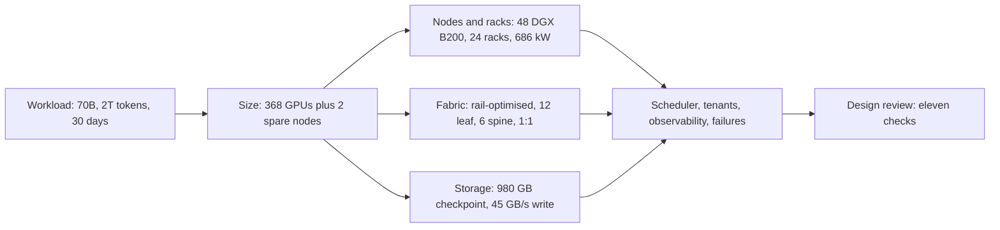

# 19.11 System design: a training cluster

| Field | Value |
|---|---|
| Level | Advanced |
| Priority tier | 2 |
| Lab venue | Local, standard-library Python and pytest. No GPU needed. |
| Part | Part 19: Capstones, design and interview readiness |
| Chapter type | Design and interview chapter |
| Code | `code/part19/c11_size_gpu_pool.py`, `c11_select_topology.py`, `c11_design_storage.py`, `c11_choose_scheduler.py`, `c11_design_review.py`, `c11_worked_example.py`, tests in `test_c11_design.py` |
| Cross-references | [19.1](./01-capstone-a-slurm-gpu-cluster.md), [19.2](./02-capstone-a-kubernetes-gpu-platform-with-kai-and-kueue.md), [19.4](./04-capstone-multi-node-training-with-fault-tolerance.md), [19.5](./05-capstone-an-nccl-tests-fabric-lab.md), [19.9](./09-capstone-capacity-planning.md), [12.13](../part-12-ai-networking/13-fabric-design-topology-oversubscription-and-scale.md), [13.7](../part-13-ai-storage/07-checkpoint-architecture-and-recovery.md), [20.12](../part-20-nebius-sre-interview/12-estimation-toolkit-for-inference-capacity.md), [20.17](../part-20-nebius-sre-interview/17-system-design-drill-sheet-twelve-prompts.md) |
| Ledger | `planning/ledgers/19-11.md` |

## Why this matters for AI infrastructure

An interviewer says "design a training cluster" and goes quiet. Candidates who start drawing racks lose the room, because nobody has said how big the model is or how long the run may take. A good answer starts with a workload, turns it into a GPU count, and then lets that count decide the network, the storage and the scheduler.

This chapter is a capstone for the whole handbook. It reuses the Slurm cluster from [19.1](./01-capstone-a-slurm-gpu-cluster.md), the Kubernetes platform from [19.2](./02-capstone-a-kubernetes-gpu-platform-with-kai-and-kueue.md), the fault-tolerant training job from [19.4](./04-capstone-multi-node-training-with-fault-tolerance.md), the fabric tests from [19.5](./05-capstone-an-nccl-tests-fabric-lab.md) and the capacity model from [19.9](./09-capstone-capacity-planning.md). It does not repeat them. It shows how to join them into one design you can speak aloud in 45 minutes.

Every number in the worked design comes from a script in `code/part19/` that the tests check. Every hardware figure is either from a gem book, from an NVIDIA document or page the chapter names, or it is labelled an assumption. The chapter does not claim what any company asks. It says what the question tests and how to answer it.

## Prerequisites and outcomes

You should know what a collective is, what InfiniBand rails are, and what a checkpoint holds. If not, read [12.13](../part-12-ai-networking/13-fabric-design-topology-oversubscription-and-scale.md) and [14.11](../part-14-training-finetuning/11-checkpointing-fault-tolerance-and-elastic-training.md) first.

After this chapter you can:

1. State a training workload and every assumption behind it in two minutes.
2. Turn parameters, tokens, a deadline and an MFU into a GPU, node, rack and power count.
3. Count switches and cables for a non-blocking fat tree and say when to leave two tiers.
4. Show with arithmetic that dataset reads are small and checkpoint writes are not.
5. Choose between Slurm and Kubernetes with a rule you can defend, and say what would change your mind.
6. Run a design review that fails a design for a stated reason.

### The workload used throughout

Everything below is one worked design. The inputs are assumptions chosen for teaching. They are not a customer's numbers.

| Input | Value | Where it comes from |
|---|---|---|
| Model | 70 billion parameters, dense transformer | Assumption |
| Training data | 2 trillion tokens, one pass | Assumption |
| Deadline | 30 days of wall-clock | Assumption |
| GPU | NVIDIA B200 in DGX B200, 8 per node | Assumption, matches the DGX B200 SuperPOD document |
| Peak BF16 per GPU | 2,250 TFLOPS dense | NVIDIA HGX page, fetched 2026-11-10: 36 PFLOPS for 8 GPUs, footnote says dense is half the sparse figure shown. Distributed AI Systems ch. 2 also gives 2.25 PFLOPS |
| MFU | 40 percent | Low end of the 40 to 60 percent range in Distributed AI Systems ch. 2 |
| Per-GPU mean time between failures | 50,000 hours | Assumption, the same placeholder as [20.17](../part-20-nebius-sre-interview/17-system-design-drill-sheet-twelve-prompts.md) |
| Restart after a failure | 10 minutes | Assumption |
| Repair time for a node | 24 hours | Assumption |
| Bytes per token on disk | 4 | Assumption, a vocabulary above 65,536 needs more than 2 bytes |
| Price | 8.50 dollars per GPU-hour | Nebius public price page as recorded in [20.12](../part-20-nebius-sre-interview/12-estimation-toolkit-for-inference-capacity.md), fetched 2026-11-09, a placeholder here |



| Box | What it holds | Section |
|---|---|---|
| Size | FLOPs, MFU, inflation from failures, spare nodes | 2 |
| Nodes and racks | Power, cooling and cables from the SuperPOD document | 3 |
| Fabric | Rails, leaf and spine counts, oversubscription | 4 |
| Storage | Dataset reads, checkpoint writes, retention | 5 |
| Scheduler and after | Slurm or Kubernetes, quotas, signals, restarts | 6 to 9 |
| Design review | A runner that fails a bad design | 10 |

## 1. Requirements first

A designer who skips requirements builds the wrong cluster very well. Picture the interviewer waiting while you draw a spine switch for a workload you never defined. The first five minutes should produce a short list that every later number can point back to.

Ask the questions that change the design. Is this one large pre-training run or many small jobs? How large is the model, how many tokens, and what is the deadline? Does the same hardware also serve inference or notebooks? How many teams share it? Must data stay in one region? Is the cluster on premises or rented? Each answer moves a number later. A shared estate pushes you toward Kubernetes, a hard deadline pushes the GPU count up, and a rented cluster removes the power section.

Then say your assumptions out loud, using the table above. Say that you will redo the arithmetic if the interviewer gives other values. This habit is the main thing that separates a senior answer from a diagram recital. The same habit appears in [20.12](../part-20-nebius-sre-interview/12-estimation-toolkit-for-inference-capacity.md) for inference, where the first sentence is also a number.

Write down what you will not design. Here that is the data pipeline that builds the tokens, the model code, security hardening and the inference path. Naming the boundary is cheap and it keeps the 45 minutes honest.

**Decision rule:** do not draw a box until the workload, the deadline and the sharing model are written down with their assumptions.

**In one minute:** Requirements are a short list of workload numbers and sharing facts. State them with assumptions, and name what is out of scope. Every later section points back to this list.

## 2. Sizing the GPU pool

On day one of a real run the finance lead asks how many GPUs you need, and "a lot" is not an answer. The answer is a chain of four lines that anyone can check. It starts with a rule of thumb that Distributed AI Systems ch. 2 gives for a dense transformer: about six floating point operations per parameter per token, forward and backward together.

```text
FLOPs = 6 x parameters x tokens
GPUs  = FLOPs / (peak FLOPS x MFU x seconds available)
```

The second line means: the more of the datasheet peak you actually use, the fewer GPUs you buy. MFU is model FLOPs per second over peak FLOPS. The same book says a well-tuned large run reaches 40 to 60 percent and shows a 70B example near 43 percent on H100. The design uses 40 percent because a design should not assume the best case.

`size_gpu_pool.py` also corrects for two costs the simple formula hides. A checkpoint takes time to write, and a failure throws away the work since the last checkpoint. A bigger pool fails more often, so the correction depends on the answer. The script iterates until the node count stops changing. The correction model is this chapter's own reasoning, and the Young interval inside it is a first-order result that [20.17](../part-20-nebius-sre-interview/17-system-design-drill-sheet-twelve-prompts.md) checked against Aupy and co-authors.

The full output of `python3 c11_worked_example.py` follows, pasted from the file `c11_worked_example_output.txt`. Later sections quote lines from it. Its last eleven lines are the design review.

```text
FLOPs: 8.400e+23
ideal GPUs: 360.1
checkpoint bytes: 980 GB, write 21.8 s at 45 GB/s
cluster MTBF: 135.9 h, Young interval: 4616 s
inflation: 1.0107
training nodes 46 (368 GPUs), spares 2, total nodes 48 (384 GPUs)
state floor: 8 GPUs at 16 B/param on 192 GB at 80 percent
dataset read: 3.1 MB/s
sync stall at 1800 s: 1.21 percent
write bandwidth for 3 percent at 1800 s: 18.1 GB/s
retained 5 checkpoints: 4.90 TB
run cost at 8.50 per GPU-hour, 368 GPUs, 30 days: 2252160 USD
sync checkpoint stall costs: 27248 USD
one more MFU point saves 8.8 GPUs, 53749 USD
fabric (64-port): {"tiers": 2, "leaf": 12, "spine": 6, "super_spine": 0, "switches": 18, "endpoint_cables": 384, "leaf_spine_cables": 384, "spine_super_cables": 0, "leaf_oversub": 1, "top_oversub": 1}
max two-tier endpoints at 64 ports: 2048
scale-up to scale-out ratio, 1800 GB/s vs 400 Gb/s: 36
racks at 2 nodes each: 24, power 686.4 kW
scheduler: Slurm (slurm 4, k8s 1)
alternative profile: Kubernetes with KAI (slurm 0, k8s 4)
requirements   PASS workload stated
compute        PASS pool delivers 8.58e+23 FLOPs, job needs 8.40e+23
memory         PASS state 3.0 GB of 192 GB HBM (80 percent rule)
fabric         PASS leaf oversubscription 1:1
power          PASS rack draws 28.6 kW of 28.6 kW
spares         PASS 2 spare nodes, rule asks for 2
checkpoint     PASS synchronous stall 1.21 percent, budget 3 percent
scheduler      PASS scheduler named with reasons
observability  PASS all signals present
quota          PASS quotas total 368 GPUs of 368
failure_plan   PASS health check and automatic restart named
```

Read the sizing numbers in order. The job needs 8.4e23 FLOPs, which is 360 GPUs if nothing ever failed. Checkpoint writes and failures add about 1.1 percent, so the pool becomes 46 nodes, which is 368 GPUs. Two spare nodes cover the expected nodes down during a 24 hour repair, plus one. That is 48 nodes and 384 GPUs to buy.

Do not stop at compute. The training state must also fit in memory. Distributed AI Systems ch. 5 says Adam keeps two FP32 copies at 8 bytes per parameter and a FP32 master copy adds 4 more. With BF16 weights at 2 and gradients at 2, the sum is 16 bytes per parameter, so 1.12 TB for this model. Eight B200 GPUs with 192 GB each could hold that state alone. The script prints 8 as a floor because activations are not counted. At 368 GPUs sharded, state is about 3 GB per GPU. Memory is not the constraint here. Compute is.

State the cost in one sentence too. Holding 368 GPUs for 30 days at the placeholder price is about 2.25 million dollars. One more MFU point saves about 8.8 GPUs, which is about 54 thousand dollars. That is why people spend weeks tuning kernels and overlap. For the full capacity method with scenarios and forecast bands, use [19.9](./09-capstone-capacity-planning.md).

| Question the interviewer may ask | Short answer from the script |
|---|---|
| What if MFU is only 30 percent | GPUs scale with 1 over MFU, so about 480 ideal |
| What if the deadline is 60 days | About half the GPUs, but you pay roughly the same GPU-hours |
| Why spares | Expected nodes down during repair plus one |
| Why not size for 50 percent MFU | A design should survive a bad first month |

**Decision rule:** size from FLOPs and a conservative MFU, add checkpoint and failure inflation, then round up to whole nodes and add spares.

**In one minute:** FLOPs equal six times parameters times tokens. Divide by peak times MFU times the deadline to get GPUs. Add about one percent for checkpoints and failures here, round to nodes, and add spares. The worked answer is 368 GPUs plus 2 spare nodes.

## 3. Node and rack design, with power and cooling

A facilities engineer reads your design and asks how many kilowatts each rack draws. If you guess, the project stops. The DGX B200 SuperPOD data center document gives the numbers, so quote them and do not invent any.

A DGX B200 draws up to 14.3 kW, is 10 rack units tall, and is air cooled, according to that document. A scalable unit holds up to 32 systems and 458 kW. A management appliance takes the place of one node, so a full SuperPOD tops out at 127 DGX B200 servers. The typical rack holds two systems. That rack needs 28.6 kW and about 4,290 cubic feet per minute of supply air, at the document's assumed 150 cubic feet per minute per kilowatt at sea level. A high-density option holds four systems at 57.2 kW and 8,580 cubic feet per minute in a 52U rack.

Power is provisioned as N equals 2 circuits. Each circuit must be rated for half of the rack's peak demand after breaker derating. The document's example for the two-system rack uses two 380 V three-phase 32 A circuits. Supply air should stay at or under 30 degrees Celsius for these systems, with filtration rated MERV 13 or better. The document says rear door heat exchangers and in-row coolers are not typically suitable for DGX B200.

Apply that to the worked design. The 48 nodes sit in 24 racks of two. The compute alone draws 48 times 14.3, which is 686.4 kW. Switches, storage and management come on top. The documents give no sourced figure for them, so the chapter states none. In the interview say that the number is compute only. Then offer to ask the facilities team for the rest.

If the interviewer picks the newer rack-scale system instead, the DGX GB300 SuperPOD reference architecture changes the picture. Its scalable unit is 8 racks, each with 72 GPUs, and the unit needs 1.2 MW of thermal design power. Hybrid cooling means GPUs and CPUs are liquid cooled and other parts are air cooled. A power shelf has six 5.5 kW supplies and delivers up to 33 kW, and each rack has eight shelves. Dividing 1.2 MW by 8 racks gives 150 kW per rack, but that is a division, and the unit includes more than the racks. The document says the data center should meet Uptime Tier 3 or an equivalent class.

| Fact | DGX B200 | DGX GB300 |
|---|---|---|
| GPUs per node or rack | 8 per node | 72 per rack |
| Cooling | Air | Hybrid, liquid for GPUs and CPUs |
| Scalable unit | Up to 32 nodes, 458 kW | 8 racks, 1.2 MW TDP |
| Typical rack | 2 nodes, 28.6 kW | One rack system |
| Source | DGX B200 data center best practices | DGX GB300 SuperPOD reference architecture |

Cables matter as much as watts. The same B200 document warns that central management racks concentrate cables and that tray fill and floor loading need planning. The cabling slides list passive copper at 3 meters for 400 Gb/s and active optical cables up to 30 meters. Its FAQ says InfiniBand reach cannot be extended with patch panels or extra top-of-rack switches, so rack placement follows cable length.

**Decision rule:** quote power, airflow and cable limits from the vendor document for the exact system, and say plainly which parts you did not source.

**In one minute:** A DGX B200 draws 14.3 kW and two fit a 28.6 kW air-cooled rack. The worked pool is 24 racks and 686 kW for compute only. GB300 racks are liquid cooled at much higher density. Cable reach decides where racks can sit.

## 4. Fabric topology

At step 40,000 the loss curve flattens and nodes in one corner of the cluster run 15 percent slower. The cause is a leaf switch whose uplinks are oversubscribed. This is why the fabric section needs counts and not adjectives.

Start with rails. AI Data Center Network Design and Technologies ch. 3 calls the layout where each of a server's 8 GPUs connects to a different leaf switch a rail-optimised design. GPU 1 on every server meets GPU 1 on every other server on the same leaf. That keeps the most frequent traffic one hop away. The DGX GB300 reference architecture describes the same idea: a rail-optimised, non-blocking, full fat tree on InfiniBand, with each SU holding eight leaf switches. Traffic between different rails crosses the spine.

Now the counting. Take a switch with 64 ports of 400 Gb/s. A non-blocking leaf gives 32 ports to servers and 32 to spines. The book states exactly that example. A two-tier fabric then reaches 32 times 64, which is 2,048 endpoints. Past that you need a third tier or oversubscription. `select_topology.py` implements the counting and the tests check it against the book and the vendor tables.

| Check | Expected | Source of expectation | Test result |
|---|---|---|---|
| 256 GPUs on 64-port switches | 8 leaf, 4 spine | Network book ch. 3, Fig. 3-9 | Matches |
| 512 GPUs | 16 leaf, 8 spine | Same | Matches |
| 4,096 GPUs at 2:1 on the super spine | 128 leaf, 128 spine, 32 super spine | Same, Fig. 3-12 | Matches |
| B200 SuperPOD, 1, 2 and 4 SUs | 8/4, 16/8, 32/16 leaf and spine, 256, 512, 1,024 leaf-spine cables | DGX B200 SuperPOD cabling table | Matches |
| B200 SuperPOD, 3 SUs | Table says 16 spines | Same table | Formula gives 12 |
| GB300, 2 SUs, 144-port switch | 16 leaf, 8 spine | GB300 RA Table 3 | Matches |
| GB300, 4, 8 and 16 SUs | Table says 18, 36, 72 spines | Same table | Formula gives 16, 32, 64 |

Two rows disagree with the formula. The vendor tables list more spines than plain counting in the 3-SU B200 case and in the larger GB300 cases. The documents do not say why. A likely reason is a rail or plane balance rule that they do not spell out, but that is a guess. In a real design, build to the vendor table and ask the vendor.

For the worked design, 384 endpoints on 64-port switches need 12 leaf and 6 spine switches. That is 18 switches and 384 leaf-to-spine cables. The SuperPOD documents say to build the fabric for a full scalable unit and leave unused ports where nodes are not installed, so the real order follows the vendor pattern and not the plain minimum. The GB300 document says the same for non-standard sizes.

Oversubscription is a choice, and the choice should come from traffic. The network book notes that some companies evaluate up to 7:1 at the super spine and warns that congestion then needs DCQCN. For a single large training job with all-reduce across the whole fabric, design for 1:1. For many small jobs that stay inside a rail group, a higher ratio may be acceptable, but measure the traffic first. The GB300 document itself uses 1:3 blocking on the Ethernet compute leaves of the storage and in-band fabric, which is a separate network. That shows that the same cluster can mix ratios by purpose.

Scale-up and scale-out differ by a large factor. A B200 has 1.8 TB/s of NVLink bandwidth per GPU according to Distributed AI Systems ch. 2 and the GB300 document. A 400 Gb/s rail NIC is 50 GB/s. The script gives a ratio of 36. So put tensor parallelism inside the NVLink domain, which is 8 GPUs in a DGX B200 node or 72 in a GB300 rack, and let data parallel traffic cross the NICs. The details of NCCL on this fabric are in [19.5](./05-capstone-an-nccl-tests-fabric-lab.md) and [12.13](../part-12-ai-networking/13-fabric-design-topology-oversubscription-and-scale.md).

A separate storage network keeps training traffic predictable. The GB300 document dedicates a 400 Gb/s port to storage and a separate link of at least 200 Gb/s to in-band traffic, so that storage RoCE traffic does not share a bonded interface. Out-of-band management sits on its own switches. State all four fabrics: NVLink, compute InfiniBand, storage and in-band Ethernet, and out-of-band.

**Decision rule:** design the compute fabric at 1:1 and rail-optimised, count switches with the formula, and match the vendor table when it lists more.

**In one minute:** A 64-port switch splits 32 down and 32 up. Two tiers reach 2,048 endpoints. The worked design needs 12 leaf and 6 spine switches. Vendor tables sometimes list more spines than the formula, so follow them and ask why.

## 5. Storage for datasets and checkpoints

At 02:00 the job stalls for two minutes every half hour and the dashboard shows GPUs idle. Nobody is reading data. The job is writing a checkpoint. This section shows why that is the storage number to size.

Start with dataset reads, because people over-size them. The run reads 2 trillion tokens over 30 days. That is about 770,000 tokens per second. At 4 bytes per token it is 3.1 MB per second for the whole cluster. Text pre-training barely touches storage. The numbers change for multimodal data. If each sample is 500 KB and the cluster consumes 20,000 samples per second, the read rate is 10 GB per second. Use `design_storage.py` with your own sample size, and say which case you are in.

Checkpoints are the heavy part. A checkpoint holds the weights and the optimizer state, not the gradients. Using Distributed AI Systems ch. 5, that is 2 bytes of BF16 weights plus 12 bytes of FP32 optimizer-side state, which sums to 14 bytes per parameter. For 70 billion parameters that is 980 GB per checkpoint.

How long does the write take? It depends on the bandwidth. The DGX GB300 reference architecture gives guidelines for one scalable unit. Table 5 lists 90 GB/s read and 45 GB/s write for a "standard" level and 280 and 140 for "enhanced". It is a different system from the B200 in the worked design, so it serves only as an order of magnitude. At 45 GB/s the write takes 21.8 seconds. At 10 GB/s it would take 98 seconds.

```text
checkpoint size  = 70e9 x 14 bytes            = 980 GB
write time       = 980 GB / 45 GB/s           = 21.8 s
synchronous stall every 1,800 s               = 1.21 percent
bandwidth needed for a 3 percent stall budget = 18.1 GB/s
five retained checkpoints                     = 4.90 TB
```

The 3 percent budget is a policy default, not a standard. The reading is simple: a synchronous checkpoint every 30 minutes at 45 GB/s costs 1.2 percent of the run, which is about 27 thousand dollars at the placeholder price. At 10 GB/s the stall would be 5.4 percent. The GB300 document also notes that asynchronous checkpointing lets training continue while the write happens in the background. Then the stall is only the in-memory snapshot, and the script models that with an extra argument.

Operations matter here too. AI Systems Performance Engineering ch. 3 warns that checkpoint bursts can fill the OS page cache and cause stalls, and it describes tuning the dirty-page settings. Treat that as a reason to test a real write at full node count before launch, which is what [13.7](../part-13-ai-storage/07-checkpoint-architecture-and-recovery.md) teaches.

Tiering follows from the arithmetic. A parallel file system with RDMA serves the training reads and the shared checkpoints. The GB300 document requires file storage with RDMA support, linear scaling and non-disruptive upgrades. A second tier of object storage holds older checkpoints and the raw dataset. Local NVMe on each node, four 3.84 TB drives in the GB300 compute tray, is useful for scratch and a fast first checkpoint copy. The old draft of this chapter, and NVIDIA Zero-to-Hero volume 23, describe a two-step checkpoint to local NVMe and then to remote storage. That is not verified against a vendor source, so it is presented as reasoning and not as a standard.

User storage is separate. The GB300 document puts home directories and logs on NFS over the in-band network with at least 100 GbE. Do not put them on the training file system.

| Item | Worked value | Basis |
|---|---|---|
| Dataset on disk | 8 TB | 2e12 tokens times 4 bytes, assumption |
| Dataset read rate, text | 3.1 MB/s | Script output |
| Checkpoint size | 980 GB | 14 bytes per parameter |
| Write bandwidth target | 45 GB/s | GB300 Table 5, standard level, order of magnitude |
| Retained checkpoints | 5, 4.9 TB | Assumption |

**Decision rule:** size reads from the data type, size writes from the checkpoint and the stall budget, and test a real full-scale write before launch.

**In one minute:** Text training reads only about 3 MB/s. A 980 GB checkpoint is the real load, and 45 GB/s writes it in 22 seconds. Use asynchronous checkpoints to shrink the stall. Keep user storage off the training file system.

## 6. Scheduler: Slurm or Kubernetes

Two platform leads argue for an hour about the scheduler and neither moves. The argument ends when you write down the five facts that actually decide it. This section gives those facts as a rule that runs as code.

Supercomputers for Linux SysAdmins ch. 13 says Kubernetes is built for scaling services. It is not intended to be good at network topology, job priorities or job queuing. In HPC, demand usually exceeds supply, so the queue order matters a lot. The author adds that Kubernetes can do it with plugins, sidecars and operators, and asks whether that is worth the effort. The book still says there are cases where it is reasonable. That is a good honest framing for the room.

The newer platforms soften the picture. The DGX GB300 reference architecture says Mission Control gives scheduler access with Slurm and with Kubernetes through Run:ai. Handbook chapters [11.13](../part-11-gpu-kubernetes/13-kai-scheduler-why-default-scheduling-is-not-enough.md) to [11.20](../part-11-gpu-kubernetes/20-scheduler-comparison-guide-kai-kueue-volcano-yunikorn-and-slurm.md) show how KAI and Kueue add gang scheduling, queues and topology awareness. [6.16](../part-06-hpc-slurm/16-slurm-on-kubernetes-slinky-and-soperator.md) covers running Slurm on Kubernetes.

`choose_scheduler.py` encodes the rule. It takes eight answers and returns a choice with every reason. The weights are a judgement call, and the output tells you which ones fired.

| Answer | Pushes toward | Why |
|---|---|---|
| Dedicated batch training only | Slurm | No services share the GPUs |
| Inference or notebooks share the GPUs | Kubernetes | One control plane for everything |
| Team already runs Slurm | Slurm | Skills are a real cost |
| Team already runs Kubernetes | Kubernetes | Same |
| Demand exceeds supply | Slurm | Native queues, priorities, backfill |
| Five or more tenants, or borrow-and-reclaim quotas | Kubernetes | Kueue and KAI queues |
| Needs GPU fractions | KAI over Kueue | Fractions are a KAI feature, see [11.17](../part-11-gpu-kubernetes/17-kai-gpu-sharing-and-fractions.md) |

Close scores with both sides strong return "Slurm on Kubernetes". A tie with weak evidence returns "undecided" and recommends a short pilot. A missing answer raises an error, because a decision made without the fact is a guess.

The example file `c11_design_example.json` holds two scheduler profiles and the design dictionary that the review runs on. It is shown below.

The two profiles work like this. The worked cluster is dedicated to training, the team knows both systems, there are three tenants and the queue is deep. The result is Slurm with a score of 4 to 1. The alternative profile shares the GPUs with services, has eight tenants, needs borrow and reclaim and wants fractions. It returns Kubernetes with KAI at 4 to 0. Say both out loud and then say what fact would flip your answer.

```json
{
  "scheduler_profile": {
    "dedicated_training": true, "shared_with_services": false,
    "team_slurm_skill": true, "team_k8s_skill": true, "tenants": 3,
    "demand_exceeds_supply": true, "needs_borrow_reclaim": false,
    "needs_gpu_fractions": false
  },
  "scheduler_profile_alt": {
    "dedicated_training": false, "shared_with_services": true,
    "team_slurm_skill": false, "team_k8s_skill": true, "tenants": 8,
    "demand_exceeds_supply": false, "needs_borrow_reclaim": true,
    "needs_gpu_fractions": true
  },
  "design": {
    "workload": {"params": 70e9, "tokens": 2e12, "days": 30},
    "pool": {"gpus": 368, "peak_tflops": 2250, "mfu": 0.40},
    "memory": {"state_gb_per_gpu": 3.04, "hbm_gb": 192},
    "fabric": {"leaf_oversub": 1},
    "rack": {"nodes_per_rack": 2, "node_kw": 14.3, "rack_limit_kw": 28.6},
    "spares": {"have": 2, "nodes": 46, "node_mtbf_h": 6250, "repair_h": 24},
    "storage": {"ckpt_write_s": 21.8, "ckpt_interval_s": 1800},
    "scheduler": {"choice": "Slurm", "reasons": ["batch training only", "team runs Slurm", "queue is oversubscribed"]},
    "observability": ["gpu_xid", "nccl_busbw", "ib_link_errors", "step_time", "checkpoint_age"],
    "tenants": {"pretrain": 256, "post_training": 80, "research": 32},
    "failure_plan": {"health_check": "prolog and periodic GPU and IB checks", "auto_restart": "requeue from last checkpoint"}
  }
}
```

**Decision rule:** pick Slurm for a dedicated, deeply queued training estate, pick Kubernetes with KAI or Kueue when the same GPUs also serve services and many tenants, and run Slurm on Kubernetes when both are strong.

**In one minute:** The rule has eight yes or no inputs and prints reasons. Slurm wins for dedicated training with a deep queue. Kubernetes wins for shared estates and many tenants. A pilot settles ties.

## 7. Multi-tenancy

Three teams share the cluster and the pre-training team holds it for a month. The post-training team files a ticket on day two. Fair sharing is a policy you must write down before that ticket arrives.

Give each tenant a quota, a priority and a rule for borrowing. In the worked design the 368 training GPUs are split as 256 for pre-training, 80 for post-training and 32 for research. The design review checks that quotas add up to the pool, because quotas that exceed hardware promise something you cannot deliver. The big run then borrows idle quota or reserves the whole pool for 30 days by agreement, and the policy says which.

On Slurm, use accounts, QOS and fairshare as in [19.1](./01-capstone-a-slurm-gpu-cluster.md). On Kubernetes, use Kueue ClusterQueues or KAI queues with reclaim as in [19.2](./02-capstone-a-kubernetes-gpu-platform-with-kai-and-kueue.md). Isolation inside a node is a separate question. Training jobs should own whole nodes, so MIG and sharing do not apply here. Chapter [19.8](./08-capstone-mig-multi-tenancy.md) covers MIG for the smaller jobs.

Fairness needs a measure. Report GPU-hours used against quota per tenant each week. Preemption should be explicit. A preemptible research job must checkpoint, and a pre-training job should not be preemptible at all.

**Decision rule:** give every tenant a quota that sums to the pool, a priority, and a written borrowing rule, and report usage against quota weekly.

**In one minute:** Quotas must add up to hardware. Whole nodes for training avoid sharing problems. Write down who may borrow and who may preempt.

## 8. Observability

The loss is still decreasing but throughput has dropped 8 percent over two days. No alert fired. The design needs signals that show slow, not only dead.

The review runner requires five signals. GPU error events from the driver, NCCL bus bandwidth from periodic tests, InfiniBand link error counters, step time per rank, and the age of the newest checkpoint. Step time per rank finds the straggler. Checkpoint age tells you how much work a crash would lose right now. Chapters [17.4](../part-17-operations/04-dcgm-exporter-and-interpreting-gpu-metrics.md) and [17.6](../part-17-operations/06-alerting-slos-and-health-checks-for-gpu-clusters.md) cover the stack, and [19.7](./07-capstone-an-observability-platform.md) builds it.

Supercomputers for Linux SysAdmins ch. 3 lists the checks a cluster needs: a node readiness check before and after jobs, a periodic node health check, a node performance check after a repair, and a verification after maintenance. It names HPL, NCCL tests, IOR, STREAM and FIO as useful benchmarks. Use them as acceptance gates. A node does not join the pool until the NCCL test passes on its rail.

Page on capacity loss and on hardware events. Do not page on a utilization number, which is the rule from [19.2](./02-capstone-a-kubernetes-gpu-platform-with-kai-and-kueue.md). A drop of NCCL bandwidth below a baseline you measured at acceptance is a good page, because it points at a cable or a switch before the job fails.

**Decision rule:** collect the five signals, gate node admission on measured evidence, and page on capacity loss and bandwidth regressions.

**In one minute:** Watch step time per rank, NCCL bandwidth, link errors, GPU error events and checkpoint age. Run benchmarks at admission. Alert on measured regressions against acceptance baselines.

## 9. Failure handling and checkpoint overhead

A node dies at 03:10 and the job hangs. Nobody notices until the loss graph stops at 06:00. The design must decide how fast the system notices, how it recovers and how much work it loses.

Failure arithmetic starts from the per-GPU rate. With the assumed 50,000 hour mean time between failures per GPU, 368 GPUs fail on average every 136 hours, which is about once every 5.7 days. Over a 30 day run you expect about five interruptions. Distributed AI Systems ch. 2 says a cluster of 10,000 GPUs may see failures every few hours, which is the same scaling at larger size. The independence assumption is mine and real failures cluster.

The Young interval for this cluster is 4,616 seconds, about 77 minutes, and the script's inflation model gives 1.0107. If you checkpoint every 30 minutes instead, the cost of writes is 1.21 percent and the expected lost work per failure is 15 minutes plus the 10 minute restart. Both choices are cheap. The shape of the curve is flat near its minimum, so pick a round interval that operations can remember. The DGX GB300 document also describes Mission Control automatically restarting failed ranks from the most recent valid checkpoint, which is the behaviour you want from any scheduler. [19.4](./04-capstone-multi-node-training-with-fault-tolerance.md) builds that loop.

Detection is the part that wastes the most time. Use a health check that runs before a job, after a job and periodically, drain a node on a hardware error, and requeue the job automatically from the last checkpoint. A hung collective needs a timeout so the job fails fast instead of waiting forever. The NCCL debugging steps are in [12.18](../part-12-ai-networking/18-nccl-debugging-hangs-timeouts-and-errors.md).

Failure domains deserve a sentence each. The B200 document's pattern is N with two circuits, each rated for half of peak demand. Read plainly, this gives no circuit redundancy, so losing one circuit takes down the rack's systems. Redundancy then comes from spare nodes and checkpoints. A leaf switch failure cuts one rail for the nodes behind it, which is an inference and not a vendor statement. A storage failure stops checkpoints, so the file system needs its own redundancy. The GB300 document states the data center should be concurrently maintainable with no single point of failure.

**Decision rule:** checkpoint on a round interval near the Young optimum, fail fast on hangs, drain bad nodes, and requeue automatically.

**In one minute:** About five interruptions are expected in the 30 day run. The Young interval is about 77 minutes and the cost is about one percent. Fast detection and automatic requeue save more than a perfect interval.

## 10. Operations, cost and the design review

Procurement wants a signature and the operations lead wants to know who carries the pager. A design is finished when it can pass a review that someone else runs. `design_review.py` is that review as code.

It takes a design dictionary and runs eleven checks. The requirements are stated, the pool delivers the FLOPs, the state fits in memory, the fabric is not oversubscribed at the leaf, the rack stays within its power limit, the spares match the rule, the checkpoint stall is within budget, the scheduler has reasons, the five signals exist, the quotas fit the pool, and a failure plan names a health check and a restart. A missing section fails the check, it does not crash. The thresholds of 3 percent and 80 percent of HBM are policy defaults chosen for the chapter.

Run on the example design, all eleven checks print PASS, as the last lines of the output in section 2 show. The tests then plant nine separate faults, one per check, and confirm that each is caught. The power check passes with exactly 28.6 kW of 28.6 kW, which is a good case to point at: it has no margin, so ask about the circuit rating.

Operations needs a few more lines in the answer. Lifecycle work, such as driver and firmware upgrades, follows [17.10](../part-17-operations/10-cluster-lifecycle-upgrades-and-change-management.md). Runbooks and game days follow [17.11](../part-17-operations/11-incident-response-and-game-days.md) and [17.15](../part-17-operations/15-on-call-runbooks.md). The NVIDIA Mission Control stack in the GB300 document is the vendor option for health checks and recovery and names Base Command Manager for provisioning and operations.

Cost closes the answer. The run costs about 2.25 million dollars at the placeholder price. Say what moves it: MFU, price, spare count, and checkpoint stall. Buying instead of renting changes the shape, and [19.9](./09-capstone-capacity-planning.md) has the buy-versus-rent model. Do not quote a purchase price, because the sources give none.

**Decision rule:** call the design done only when an independent review runner passes it and the thresholds it used are written down.

**In one minute:** Eleven checks cover compute, memory, fabric, power, spares, checkpoints, scheduler, signals, quotas and failures. The example passes and nine planted faults each fail. Cost levers are MFU, price, spares and stall.

## 11. Hands-on lab

This lab runs entirely on a laptop. It exercises the five scripts and their tests. Not run: anything that needs GPUs, InfiniBand, a parallel file system, Slurm or Kubernetes, because this host has none of them.

1. Go to the code directory and run the tests.

```bash
cd code/part19
python3 -m pytest test_c11_design.py -q
```

Expected result: 48 passed. What to record: the count and the time. Run here: yes, 48 passed.

2. Print the worked example and compare it with the chapter.

```bash
python3 c11_worked_example.py > /tmp/c11_out.txt
diff /tmp/c11_out.txt c11_worked_example_output.txt
```

Expected result: no difference. What to record: any line that differs. Run here: yes, and a test also compares the live output with the saved file.

3. Change the MFU in `c11_worked_example.py` from 0.40 to 0.30 and rerun. Expect more nodes. What to record: the new node count and the new cost. Run here: the arithmetic is covered by the tests, the edit is yours.

4. Change the checkpoint bandwidth from 45 to 10 GB/s. Expect a 98 second write and a larger stall. Then plant a fault in `c11_design_example.json`, such as setting `leaf_oversub` to 4, and rerun the review. Expect a WARN or FAIL naming the check. What to record: which checks changed.

5. On a real cluster, run the checks that matter and compare with your design. Not run here: needs GPUs. The expected shape is an NCCL all-reduce bus bandwidth near your fabric's acceptance baseline, a measured checkpoint write time near the script's estimate, and a drained node that returns to the pool only after a passing test. Method: [19.5](./05-capstone-an-nccl-tests-fabric-lab.md) and [13.7](../part-13-ai-storage/07-checkpoint-architecture-and-recovery.md).

## How to answer out loud

The design below is for a 45 minute round. Say the numbers, say the trade-offs and stop at the end of each block for the interviewer to redirect you.

| Minutes | Block | What to say |
|---|---|---|
| 0 to 5 | Requirements | Workload, deadline, sharing, assumptions, scope. Write the table. |
| 5 to 12 | Sizing | 6 times parameters times tokens, MFU 40 percent, 360 GPUs ideal, 368 with inflation, 2 spare nodes. |
| 12 to 18 | Nodes, racks | 8 GPUs per node, 14.3 kW, 2 per rack, 686 kW compute only, air or liquid depends on the system. |
| 18 to 26 | Fabric | Rail-optimised, 32 down and 32 up, 12 leaf and 6 spine, 1:1, separate storage and management networks. |
| 26 to 32 | Storage | 3 MB/s reads for text, 980 GB checkpoints, 45 GB/s, async checkpointing, tiers. |
| 32 to 37 | Scheduler and tenants | The rule, the answer, what would change it, quotas that add up. |
| 37 to 42 | Failures and observability | Five interruptions per run, Young interval, health checks, five signals. |
| 42 to 45 | Cost and review | 2.25 million dollars, levers, eleven-check review. |

Say these numbers aloud: 8.4e23 FLOPs, 360 ideal GPUs, 368 plus 2 spare nodes, 14.3 kW per node, 12 leaf and 6 spine, 980 GB per checkpoint, about 5 failures in 30 days. Say "assumption" every time a number is not sourced.

Likely follow-ups and short answers:

| Follow-up | Answer |
|---|---|
| What if the model is a mixture of experts | The 6 times rule uses active parameters, and all-to-all traffic raises the fabric stakes. There is no sourced figure here, so measure it. |
| What if they want 10,000 GPUs | Leave two tiers at 2,048 endpoints per 64-port fabric, use three tiers or oversubscribe the top, and revisit failure rates because the cluster MTBF drops to hours. |
| Why not Ethernet | Possible, see [12.12](../part-12-ai-networking/12-ethernet-versus-infiniband-a-design-decision-guide.md). The worked design follows the NVIDIA SuperPOD documents, which use InfiniBand for compute. |
| Why not Kubernetes | The rule in section 6, and flip the choice if services share the GPUs. |
| How do you know MFU will hold | You do not know yet. Measure it on the first day and resize. |

Mistakes to avoid:

- Drawing boxes before stating a workload and a deadline.
- Quoting a GPU count with no formula behind it.
- Forgetting spares, restart time or checkpoint cost.
- Quoting power or cooling numbers from memory instead of from the system's document.
- Sizing dataset reads for text as if it were video.
- Presenting a scheduler as obvious and not as a rule with a flip condition.
- Claiming that a company asks a given question, or that a vendor does a thing, without a source.

## Exercises

1. The model is 13 billion parameters on 1 trillion tokens in 14 days at 45 percent MFU on the same B200. How many ideal GPUs? Solution sketch: FLOPs are 6 times 13e9 times 1e12, which is 7.8e22. Divide by 2.25e15 times 0.45 times 14 times 86,400 seconds, which is about 63.7 GPUs. Round to 8 nodes, then run `size_gpu_pool` for inflation and spares.
2. Count switches for 1,024 endpoints on 64-port switches at 1:1. Solution sketch: 32 down per leaf gives 32 leaf switches, and 32 uplinks each give 1,024 uplinks, so 16 spines of 64 ports. Check with `fat_tree(1024, 64)`.
3. The checkpoint bandwidth you can buy is 12 GB/s. How often can you checkpoint synchronously and stay under a 3 percent stall? Solution sketch: the write takes 980 over 12, which is 81.7 seconds, so the interval must be at least 81.7 over 0.03, which is 2,722 seconds. Check with `min_write_gbs` run in reverse.
4. A team wants to run inference on the same GPUs. Which scheduler does the rule choose and why? Solution sketch: set `shared_with_services` true and run `choose_scheduler`. Expect Kubernetes, and explain that the rule gave 2 points to shared services.
5. Add a twelfth review check for rack airflow. Solution sketch: add a `cfm` input, compare it with 150 cubic feet per minute times rack kilowatts as in the B200 document, add a test that fails it, and keep the checks independent.
6. The vendor table lists 16 spines for 3 SUs and the formula says 12. What do you do? Solution sketch: build to the vendor table, ask the vendor for the rule, record the question, and never claim the formula is the vendor's design.

## Checkpoint questions

<details><summary>1. What is the sizing formula for GPUs from a model and a deadline?</summary>

FLOPs equal six times parameters times tokens. GPUs equal FLOPs divided by peak FLOPS times MFU times the seconds available.
</details>

<details><summary>2. Why does the design use an MFU of 40 percent?</summary>

It is the low end of the 40 to 60 percent range given in Distributed AI Systems ch. 2. A design should survive a poor first month.
</details>

<details><summary>3. What two costs does the simple formula hide?</summary>

Checkpoint write time and the work lost to failures. A bigger pool also fails more often, so the script iterates to a fixed point.
</details>

<details><summary>4. How many GPUs and nodes does the worked design need?</summary>

360 ideal, 368 GPUs which is 46 nodes after inflation, and 2 spare nodes, so 48 nodes and 384 GPUs in total.
</details>

<details><summary>5. How much does a DGX B200 draw and how many fit in a typical rack?</summary>

Up to 14.3 kW per system, and two per rack at 28.6 kW, according to the DGX B200 data center document.
</details>

<details><summary>6. Why is the 686 kW figure incomplete?</summary>

It covers the 48 compute nodes only. There is no sourced figure for switches, storage or management, so none is stated.
</details>

<details><summary>7. What does a rail-optimised design mean?</summary>

Each GPU of a server connects to a different leaf switch, and the same GPU number across servers shares a leaf. Frequent traffic stays one hop away.
</details>

<details><summary>8. How many endpoints can a two-tier non-blocking fabric of 64-port switches reach?</summary>

2,048. Each leaf uses 32 ports down and 32 up, and there can be at most 64 leaves.
</details>

<details><summary>9. How many leaf and spine switches does the worked design need?</summary>

12 leaf and 6 spine for 384 endpoints. That is 18 switches and 384 leaf-to-spine cables.
</details>

<details><summary>10. Where do vendor tables disagree with the plain formula, and what do you do?</summary>

For 3 SUs of B200 and for 4, 8 and 16 SUs of GB300 the table lists more spines. Build to the vendor table and ask why, since the reason is not in the documents.
</details>

<details><summary>11. How large is the dataset read rate for text and why?</summary>

About 3.1 MB per second for the whole cluster, because 2 trillion tokens at 4 bytes spread over 30 days is tiny. Multimodal data changes this.
</details>

<details><summary>12. How big is a checkpoint and how is that computed?</summary>

980 GB for 70 billion parameters at 14 bytes each. That is 2 bytes of BF16 weights plus 12 bytes of FP32 optimizer-side state.
</details>

<details><summary>13. What does a synchronous checkpoint cost at 45 GB/s every 30 minutes?</summary>

A 21.8 second write and a 1.21 percent stall, about 27 thousand dollars at the placeholder price.
</details>

<details><summary>14. How does asynchronous checkpointing change the stall?</summary>

Training continues while the write happens in the background, so the stall is only the in-memory snapshot time.
</details>

<details><summary>15. When does the scheduler rule choose Slurm?</summary>

When the estate is dedicated to batch training, the queue is deep and the team knows Slurm. In the worked design it scores 4 to 1.
</details>

<details><summary>16. When does it choose Kubernetes with KAI?</summary>

When services share the GPUs, many tenants need borrow and reclaim, and GPU fractions are wanted. The alternative profile scores 4 to 0.
</details>

<details><summary>17. What does the rule return when scores are close and both sides are strong?</summary>

Slurm on Kubernetes, through projects such as Slinky or Soperator. A weak tie returns undecided with a pilot recommendation.
</details>

<details><summary>18. How many interruptions do you expect in the 30 day run?</summary>

About five. With an assumed 50,000 hour MTBF per GPU, 368 GPUs fail every 136 hours on average, and the independence assumption is mine.
</details>

<details><summary>19. Which five signals does the review require?</summary>

GPU error events, NCCL bus bandwidth, InfiniBand link errors, step time per rank and checkpoint age.
</details>

<details><summary>20. Why does the design review fail a missing section and not crash?</summary>

A design that cannot answer a question has not passed it. The runner reports FAIL with the missing key.
</details>

## Sources and review notes

### Sources

- AI Data Center Network Design and Technologies, ch. 3 "Network Design Considerations": rail-optimised design, 64 x 400 Gb/s leaf with 32 down and 32 up, rows in Figs. 3-9 and 3-12, 7:1 at the super spine and DCQCN.
- NVIDIA DGX B200 data center best practices (gem book superpod-b200-dc): 14.3 kW system, 458 kW scalable unit, 127 servers, rack profiles, circuits, airflow, supply air limit, cabling table, cable reach, FAQ.
- NVIDIA DGX SuperPOD reference architecture for DGX GB300 (gem book superpod-gb300-ra): scalable unit, 1.2 MW, hybrid cooling, power shelves, NVLink, fabric tables 3 and 4, storage Table 5, Mission Control.
- Distributed AI Systems, ch. 2: six FLOPs per parameter per token, MFU, B200 figures, MTBF remark. Ch. 5: 8 plus 4 bytes of optimizer-side state.
- Supercomputers for Linux SysAdmins, ch. 13 "Job Management Systems": Kubernetes paragraph. Ch. 3: node check types and benchmarks.
- AI Systems Performance Engineering, ch. 3: page cache and checkpoint bursts. Ch. 1: goodput.
- NVIDIA HGX page, https://www.nvidia.com/en-us/data-center/hgx/, fetched 2026-11-10: BF16 36 PFLOPS for 8 Blackwell GPUs with a footnote that dense is half the sparse figure.
- AI Factory: read for framing only, nothing quoted. AI Networking Cookbook: read, a recipe book for scripted network generation, nothing used.

### Cross-references to other handbook chapters

[19.1](./01-capstone-a-slurm-gpu-cluster.md), [19.2](./02-capstone-a-kubernetes-gpu-platform-with-kai-and-kueue.md), [19.4](./04-capstone-multi-node-training-with-fault-tolerance.md), [19.5](./05-capstone-an-nccl-tests-fabric-lab.md), [19.7](./07-capstone-an-observability-platform.md), [19.8](./08-capstone-mig-multi-tenancy.md), [19.9](./09-capstone-capacity-planning.md), [12.13](../part-12-ai-networking/13-fabric-design-topology-oversubscription-and-scale.md), [12.18](../part-12-ai-networking/18-nccl-debugging-hangs-timeouts-and-errors.md), [13.7](../part-13-ai-storage/07-checkpoint-architecture-and-recovery.md), [20.12](../part-20-nebius-sre-interview/12-estimation-toolkit-for-inference-capacity.md), [20.17](../part-20-nebius-sre-interview/17-system-design-drill-sheet-twelve-prompts.md).

### Migrated from `nvidia-devops`

- `docs/nvidia-zero-to-hero/volume-23/chapter-10-system-design-training-cluster.md`: its interview-phase structure and its idea of a two-step checkpoint informed the layout. Only its headings were used, and none of its numbers.
- Volume 8 (system design) is cited in the chapter's lineage but was not re-read.

### Explicitly labelled inferences

- The checkpoint and failure inflation model, the N+1 spare rule, the 3 percent stall budget, the 80 percent HBM rule and the scheduler weights are reasoning, not sourced figures.
- The 14 and 16 bytes per parameter are sums of statements in Distributed AI Systems.
- The 150 kW per GB300 rack is a division that includes more than the racks.
- A rail or plane balance rule as the reason for extra spines is a guess.
- The two-step checkpoint to local NVMe and then remote storage is not verified.

### Not verified or not run

- The lab is untested on real hardware. No GPU, InfiniBand, Slurm, Kubernetes or parallel file system was available.
- Per-GPU MTBF, restart time, repair time, bytes per token and the price are assumptions.
- Young's formula is a first-order result confirmed through [20.17](../part-20-nebius-sre-interview/17-system-design-drill-sheet-twelve-prompts.md), not re-derived here.
- The GB300 storage table is for a different system than the worked B200 design.
- Power for switches, storage and management is not sourced.

### Verification log

| Measure | Count |
|---|---|
| Claims checked against a source or a script | 44 |
| Confirmed | 36 |
| Corrected during writing | 4 |
| Removed as unsourced | 9 |
| Still unverified and labelled | 8 |

The old draft's H100 16-GPU sizing, 250 samples per GPU, dragonfly+ and RAID-6 claims were removed. Its cited files `choose_scheduler.py`, `design_review.py`, `design_storage.py`, `select_topology.py` and `size_gpu_pool.py` did not exist and now exist with the `c11_` prefix.
