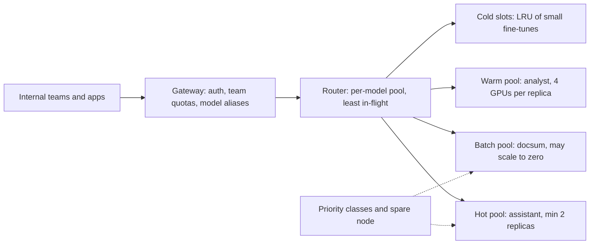

# 19.12 System design: inference serving

| Field | Value |
|---|---|
| Level | Advanced |
| Priority tier | 2 |
| Lab venue | Laptop / Docker (no GPU needed) |
| Part | Part 19: Capstones, design and interview readiness |
| Primary sources | Hands-On LLM Serving and Optimization (chapters 3, 4, 8); Distributed AI Systems (chapter 9); Generative AI on Kubernetes (chapters 1, 4); Production Kubernetes (chapters 12, 13); LLMs in Production (chapters 3, 6); Machine Learning Platform Engineering (chapters 10, 13); upstream KEDA and Kubernetes documentation |
| Cross-references | 20.12 (estimation); 20.13 (multi-tenant API); 20.14 (rollout); 20.18 (failures); 20.19 (SLOs); 20.20 (autoscaling); 20.21 (routing); 20.22 (engines); 19.3; 19.9 |
| Coverage file | `planning/coverage/chapters/19-12.md` |
| Claim & number ledger | `planning/ledgers/19-12.md` |

## Why this matters for AI infrastructure

A platform team is asked to run the language models for the whole company. The support team wants a chat assistant, finance wants document summaries overnight, and an analytics group wants a large model for reports. Each team asked for its own GPUs. Together they asked for more than the company can pay for.

That request is the system design question in this chapter. It is not "design a public API", which chapter 20.13 already covers for a vendor with outside customers. Here the customers are internal teams, the traffic is small, the models differ in size, and the pool is shared. The skill being tested is how you turn several unrelated demands into one pool that stays fast, stays cheap and stays safe to change.

As a capstone for the design track, this chapter is the vendor-neutral, platform-engineer's version of that design, written for interview pace. It builds on the Volume 20 chapters by link and does not repeat them. It adds one worked example, and four small tested programs that you can run on a laptop. **Decision rule:** if you can say your sizing, your placement rule, your scaling signal and your rollback trigger as numbers, you have a design. If you can only say product names, you have a diagram.

**In one minute:** the design is a shared pool with priorities. Models are sized one by one with a tested estimator, then placed together so that their peaks do not coincide. Scaling and rollout are written as code with tests, so the rules are checked before they run.

## Prerequisites and outcomes

### Prerequisites

- Chapter 20.12, the estimation toolkit. This chapter imports its estimator.
- Chapters 20.13 and 20.14, the multi-tenant API and rollout designs.
- Chapters 20.19 and 20.20, SLOs and autoscaling.
- Basic Kubernetes: Deployments, HPA, priority classes, namespaces.

### Outcomes

After this chapter you can:

1. State the requirements and assumptions for a shared internal inference pool in five minutes.
2. Size each model with the 20.12 estimator and compare a shared pool with dedicated pools.
3. Choose an engine and defend the choice by workload, not by benchmark.
4. Place hot, warm, batch and cold models on one pool, with priorities and an eviction rule.
5. Write the autoscaling policy and the canary plan as code that fails when a rule is broken.
6. Run a design review with a checklist and give the 45-minute answer out loud.

## 1. Requirements and the worked example (minutes 0 to 5)

On Monday the finance team complains that the summaries are late. On Tuesday the support team complains that the assistant is slow at ten in the morning. Both teams use the same GPUs. Nobody wrote down what "fast" meant, so nobody can say who is right.

So the first job is to write the requirements as numbers. Ask five questions. Which models and which teams use them? What are the peak requests per second and the prompt and answer lengths? What latency and availability does each team need? Is the data allowed to leave the company? Who pays, and how is use measured?

Then state your assumptions out loud. The table below is the worked example for the whole chapter. Every figure is my assumption for teaching. None of it is a measurement of a real company.

| Workload | Model | Tier | Peak QPS | Prompt and answer tokens | Batch | GPUs per replica |
|---|---|---|---|---|---|---|
| assistant | Qwen3-8B, BF16 | hot | 30 | 1,500 and 300 | 64 | 1 |
| docsum | Qwen3-8B, BF16 | batch | 8 | 6,000 and 400 | 32 | 1 |
| analyst | Qwen2.5-72B, BF16 | warm | 4 | 3,000 and 600 | 16 | 4 |
| contracts-8b, hr-8b, finance-8b | fine-tunes of the 8B model | cold | under 1 each | about 1,000 and 300 | 1 slot | 1 |

The GPU is an 80 GB H100 SXM. The model sizes come from 20.12. The traffic shapes are also assumed. The assistant peaks in office hours, docsum runs as a batch job in the first five hours of the night, and the analyst peaks around midday.

The service levels are assumptions too. The assistant needs 99.9 percent availability, a time to first token under 2 seconds at the 99th percentile, and a time per output token under 50 milliseconds at the 95th. The analyst allows 4 seconds to the first token. The batch summaries only need to finish within a night. How to turn such numbers into alerts is the subject of chapter [20.19](../part-20-nebius-sre-interview/19-slis-slos-and-alerts-for-token-apis.md).

This framing differs from the public API in 20.13 in three ways. The tenants are teams you can talk to, so you can use quotas and chargeback, not only rate limits. There are few models, so placement matters more than routing. And nobody sells the capacity, so cost is a budget you defend to finance.



The diagram shows one front door and four pools that share nodes. A table of what each part decides follows.

| Part | Decides | Chapter section |
|---|---|---|
| Gateway | who may call which model, how many tokens per team | 5 |
| Router | which replica of the chosen model gets the request | 5 |
| Pools and priorities | where each model runs and who yields when GPUs run out | 4 |
| Autoscaler | how many replicas each model has | 6 |
| Canary controller | when a new model version takes traffic | 7 |

**Decision rule:** do not draw a box until you have written the peak QPS, the token lengths and the latency target for each model.

**In one minute:** an internal platform differs from a public API because tenants are known and models are few. Write four tiers of workload, state every number as an assumption, and say so out loud.

## 2. Sizing with the 20.12 estimator (minutes 5 to 11)

The finance team asks for eight GPUs for the summaries. You answer with arithmetic, not with a feeling. Chapter [20.12](../part-20-nebius-sre-interview/12-estimation-toolkit-for-inference-capacity.md) explains each formula. This chapter does not redo them. The file `c12_size_inference_pool.py` imports `capacity_estimator` from `code/part20` and calls its functions for each workload.

The estimator gives a ceiling for one replica, in requests per second. It assumes decode is limited by memory bandwidth and prefill by compute. It does not model tensor-parallel communication, so the 72-billion-parameter figure is the most optimistic of the three. Treat every result as an upper bound that you then check against a load test.

| Workload | Weights | Ceiling per replica | Replicas at peak | GPUs at peak |
|---|---|---|---|---|
| assistant | 16.4 GB | 9.19 req/s | 4 | 4 |
| docsum | 16.4 GB | 2.37 req/s | 4 | 4 |
| analyst | 145.4 GB | 1.36 req/s | 4 | 16 |

Replicas at peak use the 20.12 default of 90 percent target utilisation and no spare. The assistant keeps a floor of two replicas, so one failure is not an outage. The 72B model does not fit one GPU, so a replica takes four, and the script raises an error if you ask for fewer. A test covers that failure.

Now the question that makes this a shared-pool design. Do the peaks coincide? The script holds an hourly profile for each model and adds the GPUs each model needs in each hour.

| Hours | GPUs needed | What drives it |
|---|---|---|
| 00:00 to 04:59 | 10 | night batch at full rate |
| 05:00 to 07:59 | 7 | floors only |
| 10:00 to 11:59 | 21 | assistant and analyst peaks together |
| 14:00 to 15:59 | 21 | second office peak |
| 18:00 to 23:59 | 7 | floors only |

The shared pool needs 21 GPUs at its busiest hour, plus one cold slot for the small fine-tunes. That is 22. Three dedicated pools, each sized for its own peak, need 24 plus the same slot, so 25. The saving in GPUs is small, only three. The big saving is not in the peak. It is in the hours when the pool shrinks, which section 8 prices.

A pool also needs spare capacity. I choose one whole 8-GPU node, because losing a node must not take the largest model down. That brings the static pool to 30 GPUs. The packer places replicas first-fit by size, never splits a replica across nodes, and finds that the peak layout fills four nodes.

**Decision rule:** size each model alone, add the hourly demand, then add one node of spare. Say that the result is a ceiling, and that a load test replaces it.

**In one minute:** the estimator says 22 GPUs at peak against 25 for dedicated pools. Floors and the 72B model dominate the count. The real gain comes from letting the pool shrink at night.

## 3. Engine choice (minutes 11 to 14)

Someone on the analytics team says, "we already use Triton, so use Triton." Someone else wants the fastest engine on a leaderboard. Both start from a tool instead of from the workload.

Hands-On LLM Serving and Optimization, chapter 8, gives a method. Write the targets first. Look at the real prompts and note whether they are prefill-heavy or decode-heavy. Compare engines with the same model, precision and batch. Measure start-up time, observability and upgrade effort too. Its closing advice is "workload first, not hype".

Its recommendations are short. vLLM is the fastest path to production, with broad model coverage. SGLang suits agent workloads and strict structured output. TensorRT-LLM suits teams standardised on NVIDIA that want the most tokens per dollar. llama.cpp suits local and edge use. The book also says to re-evaluate every three to six months and to keep an abstraction layer so you can swap engines.

For this pool I would pick vLLM for all four tiers. The reason is operational, not about speed. One engine means one set of metrics, one probe design and one upgrade path for five models. Chapter [20.22](../part-20-nebius-sre-interview/22-operating-vllm-triton-ray-and-tensorrt-llm.md) has the flags, the metrics and the version-skew rules. I would revisit the choice for the analyst model first, because it uses the most GPUs and would gain most from a faster engine.

A server like Triton is a different layer from an engine. It can host many model types behind one API. This pool serves only language models, so I would not add it unless a non-LLM model joins.

**Decision rule:** pick one engine for the whole pool unless a measured gap on your own prompts justifies a second.

**In one minute:** choose by SLOs and operability, then fix one engine to keep operations simple. Put an abstraction at the gateway so the choice can change.

## 4. Batching and placement for several models (minutes 14 to 21)

The overnight summary job starts at midnight and takes every free GPU. At seven the assistant is slow because the batch pods are still holding the nodes. The team asks why a batch job can hurt an interactive service.

The answer is that nothing told the scheduler which one matters more. Production Kubernetes, chapter 13, shows the pattern for cheap placeholder pods. Give them a lower priority, so any other pod pushes them out the moment it needs room. I use the same idea for the batch tier, with two priority classes.

```yaml
# code/part19/c12_priority_classes.yaml
# Two priority classes for the shared pool. Interactive pods may preempt batch pods when GPUs run out.
# Values are examples. Batch pods must set priorityClassName: llm-batch, interactive pods llm-interactive.
apiVersion: scheduling.k8s.io/v1
kind: PriorityClass
metadata:
  name: llm-interactive
value: 1000
preemptionPolicy: PreemptLowerPriority
globalDefault: false
description: "Interactive LLM engines. They may preempt llm-batch pods."
---
apiVersion: scheduling.k8s.io/v1
kind: PriorityClass
metadata:
  name: llm-batch
value: 100
preemptionPolicy: Never
globalDefault: false
description: "Batch LLM engines. They wait for free GPUs and never preempt anyone."
```

Interactive pods may preempt, and batch pods never preempt anyone. The Kubernetes documentation says a pod with `preemptionPolicy: Never` waits in the queue ahead of lower-priority pods and cannot evict others. It was fetched on 2026-11-10. The classes pass kubeconform. They were not applied to a cluster.

Four tiers follow from this. Each answers a different question about cold starts.

| Tier | Example | Minimum replicas | When it loads | What it gives up |
|---|---|---|---|---|
| hot | assistant | 2 or more, always loaded | at deploy | pays for idle GPUs at night |
| warm | analyst | 1, always loaded | at deploy | pays for four idle GPUs |
| batch | docsum | 0 | when work is queued | waits for free GPUs, can be preempted |
| cold | contracts-8b and two more | 0 | on first request | the first request waits for the load |

Hands-On LLM Serving and Optimization, chapter 3, describes the trade-off between two multi-model designs. A shared design saves money but suffers cold starts and hot-model scaling. A dedicated design per model has no cold start and is simpler, but wastes capacity on models that are used little. My tiers use both. Hot and warm models are dedicated. Cold models share slots.

The cold slots use a least-recently-used rule, the same one the book's `ModelManager` uses. When all slots are taken, the model unused for longest is unloaded. The class `ModelCache` in the code implements it. I assumed a load time of 16.4 GB at 2 GB per second plus 45 seconds of engine start, about 53 seconds. These are my assumptions. The book says a cold start can take several seconds or tens of seconds, and Distributed AI Systems puts loading and warm-up at 30 to 60 seconds for LLMs. Generative AI on Kubernetes says large models can take many minutes.

The trace in the code has 16 requests across the three small models. The results show what a slot buys.

| Cold slots | Hit rate | Total waiting | Evictions |
|---|---|---|---|
| 1 | 38 percent | 532 s | 9 |
| 2 | 50 percent | 426 s | 6 |
| 3 | 81 percent | 160 s | 0 |

One slot thrashes when two teams alternate. Three slots remove all evictions. Each slot is a GPU, so this is a price in GPUs against a wait for the first request. I would start with two slots and watch the miss rate.

Two more points belong here. First, a tensor-parallel replica must sit on one node, so a four-GPU replica never spans a node boundary. This is my reasoning from the link speed inside a node, and the packer enforces it. Second, when the small models are LoRA adapters on a shared base, they can live in one engine process. Generative AI on Kubernetes notes that this saves hardware but breaks the usual one-model-per-endpoint mapping in routing. My example uses full fine-tunes, so it does not apply here.

Batching inside each engine is the engine's job, with continuous batching, as chapter [20.22](../part-20-nebius-sre-interview/22-operating-vllm-triton-ray-and-tensorrt-llm.md) explains. The platform's job is to choose the design batch for each model, because the estimator and the autoscaler both use it. Larger batches raise throughput and raise latency. LLMs in Production, chapter 6, says the same about adaptive batching.

**Decision rule:** give every model a tier, give each tier a priority class, and give the cold tier a slot count chosen from a measured miss rate.

**In one minute:** hot and warm models are dedicated, batch yields through a priority class, and cold models share LRU slots. One slot thrashes, three do not, and each slot costs one GPU.

## 5. Routing and the gateway (minutes 21 to 26)

A new engineer on the support team points a script at the 72B model by mistake and runs a loop. The analyst team notices at once. The gateway should have stopped it.

Distributed AI Systems, chapter 9, lists the parts. The gateway handles routing, authentication, rate limiting and load balancing. It is the single entry point. Hands-On LLM Serving and Optimization, chapter 4, shows a gateway that checks a JWT or an API key, finds the tenant, applies a rate limit, then picks an endpoint from a route table. The table can hold a weighted canary and tenant overrides.

I would keep five decisions at the gateway.

1. Authenticate every call, even internal ones. LLMs in Production, chapter 6, says internal access keys give a way to cut off a rogue process and to control cost.
2. Map a model alias such as `assistant` to a version. Teams never see version numbers, so you can roll forward without asking them.
3. Limit by tokens per team, not only by requests. Chapter [20.13](../part-20-nebius-sre-interview/13-design-a-multi-tenant-llm-inference-api.md) has the token-bucket design and the metering.
4. Attach a retry budget and a deadline. Chapter [20.21](../part-20-nebius-sre-interview/21-request-routing-retries-and-overload-control.md) explains why retries without a budget turn a partial outage into a full one.
5. Reject early when the queue is full. Distributed AI Systems says to return 503 at once from a bounded queue, so clients see a clear signal.

Inside one model, the router picks a replica. Distributed AI Systems names three balancers, which are round-robin, least connections and weighted. For LLMs, least in-flight requests is the sensible default, because request cost varies so much. When many requests share a long prefix, route by prefix to the replica that holds the cache. Generative AI on Kubernetes calls this prefix-aware routing, and the 20.21 chapter compares it with load-aware routing. With only four replicas of a model, I would start with least in-flight and add prefix routing only if the cache hit rate is measured and worth it.

Kubernetes offers the pieces. Distributed AI Systems lists Services and Ingress for load balancing, weighted routing for canary, and readiness probes for health. KServe, KubeAI and llm-d are Kubernetes-native stacks the book compares. I would not choose one in an interview. I would say which problem each one solves and ask what the team already runs.

**Decision rule:** put identity, token quotas, aliases and deadlines at the gateway, and keep replica choice in the router.

**In one minute:** one gateway with five jobs. Inside a model, route to the least busy replica, and add prefix routing only when measurements justify it.

## 6. Autoscaling policy as code (minutes 26 to 31)

At nine in the morning the assistant's queue grows. The autoscaler adds two replicas. They take two and a half minutes to become ready, and by then the queue has doubled. Everyone agrees the policy is wrong, but no one can say which number to change.

Writing the policy as code fixes that. The function `scaled_object()` in `c12_design_autoscaling.py` builds a KEDA ScaledObject from the sizing, and `check_policy()` rejects policies that break the rules. Chapter [20.20](../part-20-nebius-sre-interview/20-autoscaling-gpu-inference.md) explains the signals and the stabilization windows in depth. This chapter applies them to the shared pool.

Generative AI on Kubernetes, chapter 4, gives the background. The default HPA watches CPU and memory, which says little about an LLM engine. Knative's autoscaler counts requests, but one request may produce ten tokens and the next ten thousand. KEDA can scale on any query, and vLLM publishes the waiting-requests metric and the token timings. The same chapter notes that scale-to-zero is impractical for most LLM deployments because loading takes minutes.

The policy derives its numbers from the sizing. Little's law says in-flight requests equal rate times time in system. At the ceiling, the in-flight count equals the design batch. The target is 70 percent of that batch, which leaves room for growth during a cold start. For the assistant that is 45 requests per replica, from a batch of 64.

```yaml
# code/part19/c12_inference_scaling.yaml
# KEDA ScaledObject for the hot model, generated by c12_design_autoscaling.scaled_object().
# Targets are derived from the sizing in c12_size_inference_pool.py: 70 percent of a batch of 64 is 45 in flight.
# Label selectors, the Prometheus address and the namespace are examples.
apiVersion: keda.sh/v1alpha1
kind: ScaledObject
metadata:
  name: vllm-assistant
  namespace: llm
spec:
  scaleTargetRef:
    name: vllm-assistant
  pollingInterval: 15
  minReplicaCount: 2
  maxReplicaCount: 8
  advanced:
    horizontalPodAutoscalerConfig:
      behavior:
        scaleUp:
          stabilizationWindowSeconds: 0
          policies:
          - type: Percent
            value: 100
            periodSeconds: 60
        scaleDown:
          stabilizationWindowSeconds: 900
          selectPolicy: Min
          policies:
          - type: Pods
            value: 1
            periodSeconds: 180
  triggers:
  - type: prometheus
    name: inflight
    metricType: AverageValue
    metadata:
      serverAddress: http://prometheus.monitoring.svc:9090
      query: sum(vllm:num_requests_running{namespace="llm",pod=~"vllm-assistant-.*"}) + sum(vllm:num_requests_waiting{namespace="llm",pod=~"vllm-assistant-.*"})
      threshold: '45'
      ignoreNullValues: 'false'
  - type: prometheus
    name: kv_cache
    metricType: Value
    metadata:
      serverAddress: http://prometheus.monitoring.svc:9090
      query: avg(vllm:kv_cache_usage_perc{namespace="llm",pod=~"vllm-assistant-.*"})
      threshold: '0.8'
      ignoreNullValues: 'false'
  fallback:
    failureThreshold: 3
    replicas: 2
    behavior: currentReplicas
```

The block is the file `c12_inference_scaling.yaml`. It was validated against the upstream KEDA CRD, using the repository kedacore/keda at commit 2132ca7 from 2026-11-07, cloned on 2026-11-10. The checker `tools/check_crd_yaml.py` reported 2 resources and 0 problems for this file and the batch file. It was not applied to a cluster. Label selectors and the address are examples.

Read the design choices one at a time.

- The minimum of 2 comes from the hot tier rule. The maximum of 8 comes from the 8 GPUs this model may grow into.
- Scale-up has no delay. Scale-down waits 15 minutes and removes one replica every 3 minutes. My reasoning is that the window should be at least three cold starts, and the code computes a cold start of 150 seconds with a free node.
- Two triggers ask for replicas, and the larger answer wins. In-flight requests catch queueing. KV-cache use catches long prompts.
- The fallback keeps two replicas if the metrics query fails three times. Without it, a broken query could freeze the fleet at the wrong size.

The cold start of 150 seconds is the sum of an assumed 120 seconds to load weights and 30 seconds to warm up. Without a free node, add 240 seconds to get a node and 90 to pull the image, so 480 seconds. These are assumptions from the 20.20 simulator. Measure your own.

That 330-second gap is why the pool keeps a spare node. Production Kubernetes, chapter 13, explains that the cluster autoscaler reacts to pods that cannot be scheduled, so the cluster is already full when it acts. Over-provisioning with low-priority placeholder pods keeps a node ready. The batch tier can play that role, because it is preempted first. For a ramp of 3 requests per second per minute, the code says one replica of headroom is enough with a free node, and three without one.

The batch workload is different. The file `c12_inference_scaling_batch.yaml` lets docsum scale to zero and wake when a queue appears. vLLM metrics do not exist when there are no pods, so the trigger reads a queue-depth metric that our own gateway would export. The metric name `gateway_queue_depth` is an example and was not run.

What the checker rejects is as important as what it generates. Each of these is a tested failure case.

| Broken policy | Why it fails |
|---|---|
| hot model with minimum 0 | one scale-down empties the model |
| trigger on CPU or GPU utilisation | utilisation does not track queueing |
| maximum replicas above the GPUs the model may use | the autoscaler will ask for GPUs that do not exist |
| scale-down window under three cold starts | the pool will flap |
| no fallback | a broken metric freezes scaling |

**Decision rule:** derive every threshold from the sizing, write the policy as code, and let a test reject the five broken forms.

**In one minute:** scale on in-flight requests and KV-cache use, never on CPU or GPU utilisation. Keep a floor for hot models, a slow scale-down, a fallback, and a spare node.

## 7. Canary and rollback as code (minutes 31 to 36)

The data science team ships a new version of the assistant model. Latency is the same and errors are the same. A week later users complain that answers are cut short. Nobody looked at how answers ended.

Chapter [20.14](../part-20-nebius-sre-interview/14-design-dedicated-endpoints-and-safe-model-rollout.md) already has the gate logic. Its `decide()` function compares a canary with the baseline on error rate, time to first token, inter-token latency, the share of answers that stop on length, and a quality score. The file `c12_design_canary.py` imports `decide`, `Gates` and `Metrics` from it and does not copy them. Distributed AI Systems, chapter 9, describes the same ladder, with a canary at 10 percent and a gradual shift to 100.

What the shared pool adds is three things.

First, the canary needs GPUs. A plan for the assistant at 30 QPS gives the ladder below. Each step needs the replicas to carry its share at 90 percent utilisation.

| Traffic to canary | Canary replicas | Extra GPUs |
|---|---|---|
| 5 percent | 1 | 1 |
| 25 percent | 1 | 1 |
| 50 percent | 2 | 2 |
| 100 percent | 4 | 4 |

With 8 spare GPUs every step fits. With only 1 spare, the plan stops at 50 percent and returns "hold". The ladder is a teaching choice. The book's ladder starts at 10 percent.

Second, a canary can hurt its neighbours. If the canary takes GPUs by preempting batch pods, or loads a different engine build on a shared node, the analyst may slow down. The function `neighbour_impact()` compares the time to first token of every other model before and during the canary. A rise above 20 percent forces a rollback, even when the canary looks healthy. A test shows this case.

Third, rollback has an order. The function `rollback_order()` returns three steps. Set the canary weight to zero at the gateway. Wait for in-flight requests to finish, then scale the canary to zero. Return the GPUs and resume any paused batch pods. Traffic comes first because it stops the harm at once.

The tests cover the cases that matter. A good canary promotes. A quality drop rolls back. Too few requests holds. A failing step at 25 percent stops the ladder there. A pool with too few spare GPUs holds before the step that does not fit.

Distributed AI Systems also separates canary from A/B tests. A canary is about safety. An A/B test compares options and needs the same user to see the same variant. For model upgrades inside a company, use the canary first.

**Decision rule:** a version moves up the ladder only if its error, latency, finish-reason and quality gates pass and no neighbour got slower.

**In one minute:** import the gate logic, add a plan that fits the spare GPUs, a neighbour check and a fixed rollback order. A test proves each one, including the failures.

## 8. Cost and utilisation (minutes 36 to 39)

Finance reads the bill and asks why the GPUs cost so much when the dashboards show them mostly idle. The truthful answer is that they pay for the peak of the busiest hour, all day.

The script prices three designs with an assumed $4.50 per GPU-hour. That is the Nebius on-demand H100 list price that chapter 20.12 cites from nebius.com/prices, fetched 2026-11-09, so treat it as a placeholder. Use your own contract rate. A month has 30 days.

| Design | GPUs paid | Utilisation | Cost per month |
|---|---|---|---|
| three dedicated pools plus spare node | 33, all day | n/a | $106,920 |
| one shared pool, fixed at peak plus spare | 30, all day | 20 percent | $97,200 |
| one shared pool that follows the load | 30 at most, fewer off-peak | 29 percent | $66,285 |

The busy fraction is 143 GPU-hours of real work per day, from the estimator's ceilings. Utilisation here means that work divided by the GPU-hours paid. It is not the number `nvidia-smi` prints.

The big step is the last row. A fixed pool saves $9,720 over three dedicated pools, because the peaks do not coincide. A pool that follows the load saves $40,635, because the night hours are cheap. That saving depends on scaling down safely, which section 6 covers, and on the spare node being a placeholder that other work can use.

Utilisation also sets the price of a token. The formula from 20.12 gives the assistant $0.45 per million output tokens at full utilisation. At the pool's 29 percent it is $1.56. At 20 percent it is $2.28. The GPU price did not change. The idle time did.

Distributed AI Systems says spot or preemptible capacity can cost 60 to 90 percent less and suggests running about half of baseline capacity on it. I would only put the batch tier on spot, because it can wait. Do not put hot models there. Chapter 6 of LLMs in Production adds a warning from experience: GPUs are scarce, and a scale-up can fail because a whole region has none left. A spare node is partly insurance against that.

Finance also wants chargeback. The gateway already counts tokens per team and model, so a monthly report is a sum over its logs. Charge input and output tokens separately, because prefill and decode cost different GPU time.

**Decision rule:** quote cost with its utilisation, and say which lever you pull first: let the pool shrink, then batch on spot, then quantise.

**In one minute:** sharing saves 9 percent at peak and following the load saves 38 percent. The cost per token is set by idle time, not by the GPU price.

## 9. Security (minutes 39 to 41)

A contractor's laptop token ends up in a public repository. It can call the 72B model. The cost is small this time. The next token might read another team's prompts.

Production Kubernetes, chapter 12, treats tenancy as a spectrum. It lists namespaces as the base boundary, with resource quotas, RBAC and network policies built on them. It recommends a default deny-all network policy so that tenants must declare the traffic they need. It also warns that container isolation is weaker than a hypervisor, and that noisy neighbours are hard to remove fully.

For this pool I would do five things.

1. Run engines in their own namespace with a default deny-all network policy. Only the gateway may reach them.
2. Give each team a gateway credential with a model allow-list and a token quota. Revoke one team without touching the rest.
3. Keep weights out of the image. LLMs in Production, chapter 6, calls baking a model into an image an antipattern. It also names the security cost, because the image is easy to reach. Mount weights from a volume or a local cache instead.
4. Pin the engine image by version or digest. Generative AI on Kubernetes says never to use a mutable tag such as latest.
5. Apply input and output guards in the application layer, not in the pool. Machine Learning Platform Engineering, chapter 13, describes guards for personal data and prompt injection around the model.

One caution. Production Kubernetes presents Pod Security Policies. That API was removed from Kubernetes, and the book's text predates the replacement. Use Pod Security Admission instead. I did not fetch its documentation in this session, so treat that line as unverified.

Secrets in the examples are placeholders only. A real gateway key lives in a secret store, readable only by the gateway service account, with a file mode of 0400 if mounted as a file.

**Decision rule:** one namespace for engines, default deny, credentials per team, and no weights or secrets in images.

**In one minute:** isolate the engines, authenticate every team, keep weights and keys out of images, and put content guards in the application.

## 10. Observability and failure handling (minutes 41 to 45)

At 14:10 the analyst's replies stop. The dashboard shows the pool at 60 percent GPU use and no errors. A node died, the 72B replica on it vanished, and the second replica was already full.

Start with what to watch. Distributed AI Systems names three kinds of telemetry: traces, metrics and structured logs. Its key LLM metrics are requests per second by model, latency percentiles, active requests and GPU use. Generative AI on Kubernetes adds time to first token, inter-token latency, queue depth and KV-cache use. The SLO side is in [20.19](../part-20-nebius-sre-interview/19-slis-slos-and-alerts-for-token-apis.md). Measure at the gateway and explain at the engine.

The failure modes are in [20.18](../part-20-nebius-sre-interview/18-how-llm-serving-fails.md). For this design I would rehearse four.

| Failure | What users see | The design's answer |
|---|---|---|
| node loss | the 72B model drops to one replica | spare node and priority preemption of batch |
| cold-model miss | the first call of a rare model waits about a minute | LRU slots, a timeout and a clear error |
| metrics outage | scaling freezes | the fallback replica count in the policy |
| bad canary | answers get shorter or slower | gate, rollback order, neighbour check |

Node loss deserves the arithmetic. The 72B replica needs four GPUs. A spare node holds eight. So the spare absorbs one node loss, and batch pods on the other nodes can be preempted for a second. The review checklist flags a pool whose spare is smaller than its largest replica.

Streams also need care on scale-down. If the termination grace period is shorter than the longest request, replies are cut mid-stream. The checklist tests that as well.

The file `c12_design_review.py` is the checklist as code. It takes a design as a plain dictionary and returns findings, each tied to a section of this chapter. The good example design has no findings. The bad example has 21, across eight sections. Use it in a real review as a list of questions, not as a pass mark. The checks are my reasoning and not an external standard.

**Decision rule:** for every component on the diagram, name the failure, the signal that shows it and the action that fixes it.

**In one minute:** watch the gateway for symptoms and the engine for causes. Rehearse node loss, cold misses, metric loss and a bad canary, and run the checklist before you ship.

## 11. Hands-on lab

This lab runs on a laptop. It needs Python 3, pytest, PyYAML, kubeconform and a shallow clone of kedacore/keda. It needs no GPU.

**What was run here, and what was not.** I ran every command below on a macOS arm64 laptop on 2026-11-10 and 2026-11-11. I did not run any model, engine, Kubernetes cluster, KEDA operator or Prometheus. Every figure about GPU speed comes from the 20.12 estimator, which gives ceilings. Not run: needs GPUs and a cluster.

The script `c12_lab.sh` holds all the commands.

```bash
#!/usr/bin/env bash
# code/part19/c12_lab.sh
# Lab for chapter 19.12. Run from the repository root. Needs python3, pytest, PyYAML and kubeconform.
# KEDA_CRD must point at config/crd/bases/keda.sh_scaledobjects.yaml in a clone of kedacore/keda.
set -euo pipefail
: "${KEDA_CRD:?set KEDA_CRD to keda.sh_scaledobjects.yaml from a shallow clone of kedacore/keda}"

python3 code/part19/c12_size_inference_pool.py
python3 code/part19/c12_design_canary.py
python3 code/part19/c12_design_review.py
python3 -m pytest code/part19 -q -k c12
kubeconform -strict -summary code/part19/c12_priority_classes.yaml
python3 -I tools/check_crd_yaml.py "$KEDA_CRD" -- \
  code/part19/c12_inference_scaling.yaml code/part19/c12_inference_scaling_batch.yaml
```

1. Clone the KEDA CRD source and point `KEDA_CRD` at it.
   Expected result: the file `config/crd/bases/keda.sh_scaledobjects.yaml` exists.
   What to record: the commit hash of the clone. Mine was 2132ca7.
2. Run the sizing script.
   Expected result: the printed lines `assistant: 9.19 req/s per replica`, `peak_shared_gpus: 22`, `dedicated_gpus: 25` and `static_gpus: 30`, with 4 nodes at peak.
   What to record: the hourly GPU list and the three monthly costs. Change a workload in `WORKLOADS` and see which line moves first.
3. Run the canary and review scripts.
   Expected result: four ladder steps for the assistant, then "good 0 findings" and "bad 21 findings".
   What to record: which findings you would fix first.
4. Run the tests.
   Expected result: all `c12` tests pass. In my run, 30 passed, with one skip that belongs to another chapter's torch test.
   What to record: the number of tests and the failure cases they cover.
5. Validate the YAML.
   Expected result: kubeconform reports 2 valid resources. The CRD checker reports `checked 2 resources, 0 problems`.
   What to record: the tool versions and the date. Then break the file by adding a field the CRD does not have, and watch the checker fail.

Observed output, from my run:

```text
assistant: 9.19 req/s per replica (1 GPU), 4 replicas at peak
docsum: 2.37 req/s per replica (1 GPU), 4 replicas at peak
analyst: 1.36 req/s per replica (4 GPU), 4 replicas at peak
peak_shared_gpus: 22
dedicated_gpus: 25
static_gpus: 30
nodes_at_peak: 4
utilisation static 20%, autoscaled 29%
Summary: 2 resources found in 1 file - Valid: 2, Invalid: 0, Errors: 0, Skipped: 0
checked 2 resources, 0 problems
```

The full-repo run of `python3 -m pytest code/part19 -q` showed 2 failures in `test_c11_design.py`, which belongs to chapter 19.11. They are outside this chapter.

## How to answer out loud

The interviewer says: "Design inference serving for a company with several internal models and a shared GPU pool. You have 45 minutes."

Start with the requirements and the numbers. Say that every number is an assumption and that you will change it. Then walk the sections in order.

| Minutes | Say | Numbers to state |
|---|---|---|
| 0 to 5 | questions, then tiers and SLOs | peak QPS, token lengths, 99.9 percent, TTFT 2 s |
| 5 to 11 | sizing with an estimator, shared against dedicated | 9.19, 2.37 and 1.36 req/s per replica, 22 against 25 GPUs |
| 11 to 14 | engine by workload, one engine for the pool | none, name the method |
| 14 to 21 | tiers, priority classes, LRU slots | 2 hot replicas, one spare node, 2 cold slots |
| 21 to 26 | gateway jobs, router rule | token quota per team, least in-flight |
| 26 to 31 | autoscaling policy | 70 percent of batch, 15 minute scale-down, 150 s cold start |
| 31 to 36 | canary ladder and rollback order | 5, 25, 50, 100 percent, 20 percent neighbour limit |
| 36 to 39 | cost and utilisation | $66k against $107k a month, 29 percent |
| 39 to 41 | security | default deny, credentials per team |
| 41 to 45 | observability and failures, then the checklist | four failures, one spare node |

Say the trade-offs plainly. Shared pools cost less and risk cold starts. Dedicated pools are simpler and waste GPUs. A larger spare node costs money every hour and saves you on the worst day. A longer scale-down window wastes some GPU time and prevents flapping.

Expect these follow-ups, and answer each in one or two sentences.

- "What if the 72B model's traffic triples?" Recompute with the estimator. Its replicas grow in fours, so the pool grows by half a node at a time.
- "What if finance wants guaranteed latency?" Move the batch tier to spot, move the assistant to a dedicated pool, and show the cost.
- "How do you know the estimate is right?" It is a ceiling. Load test one replica and replace the ceiling with the measurement.
- "What would you do first on Monday?" Write the SLOs and the metric list, because the rest depends on them.

Do not say "it depends" and stop. Do not say "we use product X" without a reason. Do not claim a number you did not state as an assumption.

### Mistakes to avoid

- Drawing the architecture before writing numbers.
- Scaling on CPU or GPU utilisation.
- Giving every model its own pool without computing the peak sum.
- Letting batch work share GPUs with no priority rule.
- Promoting a canary on latency and errors alone.
- Forgetting that the autoscaler reacts after the cluster is full.
- Quoting cost without utilisation.

## Exercises

1. **Change the traffic.** The assistant's peak rises from 30 to 60 QPS. How many replicas does it need, and what happens to the pool?
   Worked sketch: at 9.19 req/s and 90 percent utilisation each replica carries 8.27 req/s. Sixty divided by 8.27 is 7.3, so 8 replicas. The assistant now needs 8 GPUs at peak, so the shared peak rises by 4. Run the script with a new `Workload` to confirm.

2. **Move to H200.** Replace the GPU and read the result.
   Worked sketch: call `replica_capacity(w, gpu="h200")`. The 72B model has more memory and bandwidth per GPU, so you may fit it on 2 GPUs. Check that `fits_requests` is at least 1. A model that does not fit raises an error, as the test shows.

3. **Add a fourth cold model.** Use the trace in `COLD_TRACE` with 4 models and 2 slots.
   Worked sketch: add the model to `COLD_MODELS`. Update the trace. Call `cold_demo(2)`. Expect a lower hit rate than with 3 models. Decide whether a third slot is worth a GPU.

4. **Break the autoscaling policy.** Remove the fallback and set the scale-down window to 120 seconds.
   Worked sketch: call `check_policy`. It returns the fallback problem and the flap problem. Then explain each in one sentence.

5. **Add a gate.** Add a gate on the share of requests that hit the context limit and wire it into `evaluate()`.
   Worked sketch: add a field to the metrics, compare canary to baseline, and return "rollback" above a limit. Write a test with a failing case first. State the limit as your choice and say you would tune it.

6. **Review a design.** Write a design dictionary for your own platform and run `review()`.
   Worked sketch: start from `GOOD`. Replace values with yours. Every finding is a question. Mark each as fix now, accept, or unknown. Present the first three to your team.

## Checkpoint questions

<details><summary>1. Why is this design different from a public multi-tenant API?</summary>
The tenants are internal teams you can talk to, so quotas and chargeback work. There are few models, so placement matters more than routing. Cost is a budget, not revenue.
</details>

<details><summary>2. What are the first numbers you write down?</summary>
Peak QPS, prompt and answer lengths, latency and availability targets for each model, and the GPU type. You also say they are assumptions.
</details>

<details><summary>3. Where does the sizing code get its per-replica capacity?</summary>
It imports `capacity_estimator` from `code/part20`, the 20.12 estimator, and calls its functions. A test checks the result against a direct call.
</details>

<details><summary>4. Why is the estimator's answer a ceiling?</summary>
It assumes bandwidth-bound decode and compute-bound prefill at an assumed utilisation. It ignores tensor-parallel communication and real scheduling, so a load test must replace it.
</details>

<details><summary>5. Why does the 72B model need four GPUs per replica in this design?</summary>
Its BF16 weights are about 145 GB, which does not fit one 80 GB GPU. The script raises an error when asked to place it on one.
</details>

<details><summary>6. Why is the shared pool only three GPUs smaller at peak?</summary>
The hot floor and the 72B replicas dominate the count, and two peaks coincide around midday. The larger saving comes from the quiet hours.
</details>

<details><summary>7. How does the book say to choose an engine?</summary>
Start from SLOs, test real prompts, compare engines under the same settings, and measure operability. The rule is workload first, not hype.
</details>

<details><summary>8. Why choose one engine for the whole pool?</summary>
One engine means one set of metrics, probes and upgrade steps. Revisit the choice when a measured gap on your prompts justifies it.
</details>

<details><summary>9. What does the batch priority class prevent?</summary>
It stops batch pods from evicting interactive pods. With `preemptionPolicy: Never` they wait for free GPUs. Interactive pods can preempt them.
</details>

<details><summary>10. What are the four tiers and what does each give up?</summary>
Hot pays for idle GPUs, warm pays for idle GPUs at a larger size, batch waits and may be preempted, and cold makes its first request wait for a load.
</details>

<details><summary>11. What does an LRU slot do for cold models?</summary>
When all slots are taken, it unloads the model used least recently and loads the requested one. More slots raise the hit rate and cost one GPU each.
</details>

<details><summary>12. What five jobs does the gateway do?</summary>
Authenticate, map aliases to versions, limit tokens per team, attach retry budgets and deadlines, and reject early when the queue is full.
</details>

<details><summary>13. Why scale on in-flight requests and KV-cache use?</summary>
CPU and GPU utilisation do not track queueing, and request counts ignore token length. In-flight requests and KV-cache use track the real load.
</details>

<details><summary>14. How is the in-flight target derived?</summary>
By Little's law, in-flight equals rate times time. At the ceiling that equals the design batch, so the target is 70 percent of it. For the assistant that is 45.
</details>

<details><summary>15. Why does the scale-down window have a floor?</summary>
A replica takes minutes to return. If the window is shorter than three cold starts, a short dip removes capacity that must be rebuilt, and the pool flaps.
</details>

<details><summary>16. What does the canary plan check beyond the 20.14 gates?</summary>
That the canary's GPUs fit the spare, and that no neighbouring model's time to first token rose more than 20 percent.
</details>

<details><summary>17. What is the rollback order?</summary>
Set the canary weight to zero, drain and scale it down, then return the GPUs and resume paused batch pods. Traffic comes first.
</details>

<details><summary>18. What decides the cost per token?</summary>
Utilisation. The same GPU gives $0.45 per million output tokens at full use and $1.56 at 29 percent, in this example.
</details>

<details><summary>19. What does a default deny network policy achieve?</summary>
Nothing may reach the engines until a rule allows it. Only the gateway gets a rule, and teams cannot call engines directly.
</details>

<details><summary>20. What does the spare node protect against?</summary>
Loss of a node that holds the largest replica, and a scale-up that cannot find GPUs. It must be at least the size of the largest replica.
</details>

## Sources and review notes

Sources, by book and chapter. Book text was read from the local corpus on 2026-11-10.

- Hands-On LLM Serving and Optimization, chapter 3 "Model Serving System Design: A Deep Dive": multi-model serving, LRU model cache, cold start and hot-model challenges, cost-optimised and latency-optimised designs, multi-LoRA. Chapter 4 "Model Serving Best Practices": public API, JWT or API key, rate limit, route table with canary and tenant override. Chapter 8 "LLM Serving Frameworks": engine selection method and recommendations.
- Distributed AI Systems, chapter 9 "Production LLM Serving Stack": gateway, routing, load balancers, canary ladder, cold start of 30 to 60 seconds, backpressure with 503, spot capacity, Kubernetes primitives, observability, KServe, KubeAI and llm-d.
- Generative AI on Kubernetes, chapter 4 "Running in Production": HPA, KPA and KEDA, scale-to-zero, model storage options, prefix-aware routing, LoRA routing, pinned image tags.
- Production Kubernetes, chapter 12 "Multitenancy": namespaces, quotas, default deny network policy, noisy neighbours. Chapter 13 "Autoscaling": custom metrics, cluster autoscaler, overprovisioning with a low-priority class.
- LLMs in Production, chapter 3 "Large language model operations" and chapter 6 "Large language model services": deployment times, GPU scarcity, cost, model storage, adaptive batching, rate limiters, access keys.
- Machine Learning Platform Engineering, chapter 10 "Model inference and serving" and chapter 13 "Production LLM system design": KServe as an option, guardrails, PII and prompt-injection defences.
- Kubernetes documentation, "Pod Priority and Preemption", fetched 2026-11-10: the `value` field and non-preempting classes.
- KEDA, repository kedacore/keda at commit 2132ca7 dated 2026-11-07, cloned 2026-11-10: the ScaledObject CRD used for validation.
- Code reused by import: `code/part20/capacity_estimator.py` (20.12), `code/part20/c14_rollout_sim.py` (20.14), `code/part20/c20_autoscale_sim.py` (20.20).

Cross-references: [20.12](../part-20-nebius-sre-interview/12-estimation-toolkit-for-inference-capacity.md), [20.13](../part-20-nebius-sre-interview/13-design-a-multi-tenant-llm-inference-api.md), [20.14](../part-20-nebius-sre-interview/14-design-dedicated-endpoints-and-safe-model-rollout.md), [20.18](../part-20-nebius-sre-interview/18-how-llm-serving-fails.md), [20.19](../part-20-nebius-sre-interview/19-slis-slos-and-alerts-for-token-apis.md), [20.20](../part-20-nebius-sre-interview/20-autoscaling-gpu-inference.md), [20.21](../part-20-nebius-sre-interview/21-request-routing-retries-and-overload-control.md), [20.22](../part-20-nebius-sre-interview/22-operating-vllm-triton-ray-and-tensorrt-llm.md), and chapters 19.3 and 19.9.

Migrated from `nvidia-devops`: the earlier draft cited Volume 23 `chapter-11-system-design-inference-serving.md` and Volume 8 `chapter-XX-system-design.md`. I did not re-read those files this session. The earlier draft's sizing figures (a 70B model at 5,000 tokens per second per GPU, 320 KB of KV cache per token) were removed because they were unsourced, and the KV figure was inconsistent with the estimator.

Explicitly labelled inferences:

- All workload numbers, SLOs and hourly traffic shapes in section 1.
- The 90 percent sizing utilisation is the 20.12 default. The 70 percent autoscaling target, the three-cold-start window, the 20 percent neighbour limit and the ladder steps are my choices.
- One whole node as spare, and the placement rule that a tensor-parallel replica stays on one node.
- The assumed cold load of 16.4 GB at 2 GB per second plus 45 seconds.
- The tier names and the review checks.
- The price of $4.50 per GPU-hour, taken from 20.12 and replaceable.

Not verified or not run:

- No GPU, engine, cluster, KEDA operator or Prometheus was used. All throughput figures are estimator ceilings.
- The KEDA field `fallback.behavior` and the trigger metadata were validated against the CRD schema, but trigger metadata is free-form in the CRD, so the checker cannot validate it. Its names come from chapter 20.20.
- The metric `gateway_queue_depth` is an example, not a real exporter.
- Pod Security Admission was not fetched. The statement that Pod Security Policies were removed is from my memory and is unverified.
- The books' framework descriptions are from the editions in the local corpus and may be out of date.

### Verification log

- Claims checked: 40, listed in `planning/ledgers/19-12.md`.
- Confirmed: 31, by running code, reading book text, or reading upstream files.
- Labelled inference: 5.
- Corrected: 2. The old draft's KV-cache size and its GPU counts and throughput figure were replaced by estimator output.
- Removed: the old draft's multi-region failover and unsourced cost statements.
- Still unverified: 4, listed above.
- Gates run on 2026-11-11: pytest for `code/part19`, `check_code_files.py`, `chain_gate.py`, `check_mermaid.mjs`, `validate_chapter.py 19.12` and `check_provenance.py 19.12`. Results are in the final report.

corrected 2026-11-11: the $4.50 per GPU-hour is labelled as a placeholder equal to the Nebius list price cited in chapter 20.12 (nebius.com/prices, fetched 2026-11-09).
