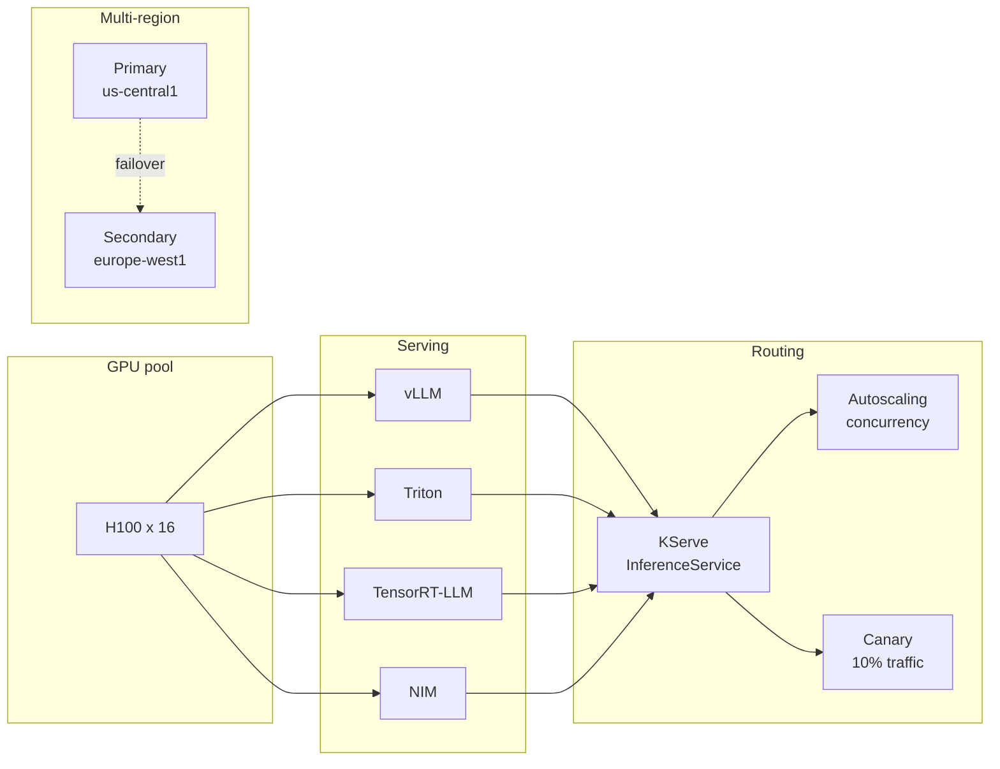

# 19.12 System design: inference serving

| Field | Value |
|---|---|
| Level | Advanced |
| Priority tier | 2 |
| Lab venue | GCP / GKE |
| Part | Part 19: Capstones, design and interview readiness |
| Primary sources | NVIDIA Zero-to-Hero Volume 23 (`chapter-11-system-design-inference-serving.md`); NVIDIA Zero-to-Hero Volume 8 (`chapter-XX-system-design.md`); Part 15 (Inference); Part 11 (GPU Kubernetes) |
| Cross-references | Chapter 15 (Inference); Chapter 11.22 (KServe); Chapter 19.3 (Inference capstone); Chapter 19.9 (Capacity planning) |
| Coverage file | `planning/coverage/chapters/19-12.md` |
| Claim & number ledger | `planning/ledgers/19-12.md` |

## Inference serving design at a glance



The inference serving stack: GPU pool, serving engines, KServe routing, autoscaling, canary, multi-region failover.

## Why this matters for AI infrastructure

An inference serving system is the production shape of LLM serving at scale. The system design covers: the GPU pool (sized for tokens per second), the KV cache memory, the autoscaling policy, the canary rollout, the multi-region failover, the cost per inference, and the security. A team that has run a system design for inference serving can describe each piece; a team that has run the design review can identify the gaps.

The inference serving system design is the platform engineer's blueprint for the inference layer. The blueprint is the input to the inference capstone; the blueprint is the input to the production deployment.

```text
Why the inference serving system design matters (V23 ch11; Parts 11, 15):
- An inference serving system is the production shape of LLM serving at scale.
  The system design is the blueprint that ties the GPU pool, the KV cache,
  the autoscaling, and the failover together.
- The system design has three perspectives: the platform engineer's view
  (how to size the components); the inference engineer's view (how to
  configure the engines); the FinOps lead's view (how to track the cost).
- The system design is the reference architecture. Every chapter in Parts 11
  and 15 maps to a section of the system design.
```

Three operational realities make this chapter a platform-team deliverable rather than a tutorial:

1. **The system design is the blueprint.** The platform team references the system design when sizing a new inference pool; the platform team references the system design when configuring autoscaling.
2. **The system design is the interview anchor.** The candidate is asked "how would you design inference serving at scale?"; the candidate points at this system design.
3. **The system design is the cost-efficiency gate.** An inference serving system that is not designed is an inference serving system that wastes GPUs.

**Before a team can claim they have designed inference serving, the team must have produced this system design. A team that has not produced the system design has not integrated the pieces.**

## Prerequisites and outcomes

### Prerequisites

- Chapter 15 (Inference).
- Chapter 11.22 (KServe).
- Chapter 19.3 (Inference capstone).
- Chapter 19.9 (Capacity planning).

### Outcomes

After completing this chapter you will be able to:

1. Size the GPU pool for a given inference throughput (tokens per second).
2. Calculate the KV cache memory per request; size the GPU pool for the concurrency target.
3. Design the autoscaling policy based on concurrency, latency, and token throughput.
4. Design the canary rollout strategy for safe model deployment.
5. Plan the multi-region failover for inference serving.
6. Run the design review with the platform team and the inference team.

---

## 1. The capacity sizing

### 1.1 The throughput target

The GPU pool is sized based on the throughput target. The throughput target is the desired tokens per second; the throughput target drives the GPU count.

```text
Throughput sizing (Llama 70B, vLLM):
- Target: 10,000 tokens per second
- Throughput per GPU (H100, BF16, batch 32): ~5,000 tokens per second
- GPU count: 10,000 / 5,000 = 2 GPUs minimum; 8 GPUs with some buffer
- Plus replicas for redundancy: 16 GPUs
```

The pattern is: the GPU pool is sized for the throughput target; the GPU pool includes a buffer for variance; the GPU pool includes replicas for redundancy.

### 1.2 The KV cache memory

The KV cache memory is the memory required per request. The KV cache memory drives the GPU memory required for the concurrency target.

```text
KV cache memory (Llama 70B):
- Per token (BF16): 2 bytes * 2 (K and V) * 80 (layers) * 8 (heads) * 128 (head dim) = 320 KB
- Per request (2K context): 320 KB * 2048 = 655 MB
- Concurrency target: 32 concurrent requests per GPU
- KV cache per GPU: 655 MB * 32 = 21 GB
- Model weights: 140 GB
- Activations and overhead: 10 GB
- Total per GPU: 140 + 21 + 10 = 171 GB (requires 2x H100 80GB or 1x H100 160GB)
```

The pattern is: the KV cache memory is per request; the GPU memory is the model weights plus the KV cache; the GPU pool is sized for the GPU memory.

---

## 2. The autoscaling policy

### 2.1 The metrics

The autoscaling policy is based on three metrics: concurrency, latency, token throughput.

| Metric | When to use | Target |
|---|---|---|
| **Concurrency** | LLM serving (vLLM, NIM) | 4-8 concurrent requests per GPU |
| **Latency** | Strict latency SLO | p99 < 300 ms |
| **Token throughput** | High-throughput batch inference | > 500 tokens/sec per GPU |

The pattern is: pick the metric that matches the workload; the metric is per InferenceService.

### 2.2 The scaling rules

The scaling rules are the Prometheus recording rules that drive the autoscaler.

```yaml
# code/part19/inference_scaling.yaml (shape only)
groups:
  - name: inference_scaling
    rules:
      - record: inference:concurrency:5m
        expr: sum by (inference_service) (inference_request_in_flight)
      - record: inference:latency:p99:5m
        expr: histogram_quantile(0.99, sum by (inference_service, le) (rate(inference_request_duration_seconds_bucket[5m])))
```

The pattern is: the recording rules pre-compute the metrics; the autoscaler reads the recording rules; the autoscaler scales the InferenceService.

---

## 3. The canary rollout

### 3.1 The canary strategy

The canary strategy deploys a new model version alongside the production version. The router sends 10% of traffic to the canary; the canary's SLO is monitored; the rollout completes when the canary is healthy.

```text
Canary rollout:
- Phase 1: 10% traffic to canary; 90% to production; monitor for 24 hours
- Phase 2: 50% traffic to canary; 50% to production; monitor for 1 hour
- Phase 3: 100% traffic to canary; retire production
- Rollback: if canary's SLO breaches, route 100% to production
```

The pattern is: gradual rollout; continuous monitoring; automatic rollback on SLO breach.

### 3.2 The canary metrics

The canary metrics are: inference latency p99, inference error rate, model quality score (live accuracy).

```promql
# Inference latency p99
histogram_quantile(0.99, rate(inference_request_duration_seconds_bucket{inference_service="churn-model-canary"}[5m]))

# Inference error rate
sum(rate(inference_request_total{status=~"5..", inference_service="churn-model-canary"}[5m])) / sum(rate(inference_request_total{inference_service="churn-model-canary"}[5m]))

# Model quality score
model_quality_score{inference_service="churn-model-canary"}
```

The pattern is: the canary is monitored on the same metrics as production; the canary's SLO is compared against production's SLO; the rollout proceeds when the canary's SLO is met.

---

## 4. The multi-region failover

### 4.1 The failover plan

The failover plan covers: the primary region, the secondary region, the data replication, the workload failover.

```text
Multi-region failover plan:
- Primary region: us-central1
- Secondary region: europe-west1
- Data replication: object storage cross-region replication
- Workload failover: InferenceService replicated in both regions
- Failover trigger: regional health check failure
- Recovery time: < 30 minutes
- Data loss: < 1 minute
```

The pattern is: the primary region serves traffic; the secondary region is pre-warmed; the failover is automatic.

### 4.2 The cost per inference

The cost per inference is the dollar cost of running inference. The cost per inference drives the right-sizing decisions.

```text
Cost per inference (H100, batch 32):
- GPU cost per hour: $3.20 (spot) or $5.00 (reserved)
- Throughput per GPU: ~5,000 tokens per second
- Cost per 1M tokens: ($3.20 / 3,600 / 5,000) * 1,000,000 = $0.18
```

The pattern is: the cost per inference is per token; the cost per inference drives the right-sizing decisions; the cost per inference is tracked on the FinOps dashboard.

---

## 5. The design review

### 5.1 The design review checklist

The design review checklist is the structured review of the inference serving system design. The checklist covers: capacity, KV cache, autoscaling, canary, failover, security, FinOps.

```markdown
## Design review checklist (inference serving)

### Capacity
- [ ] GPU count sized for the throughput target
- [ ] KV cache memory calculated per concurrency target
- [ ] Buffer included for spikes

### Autoscaling
- [ ] Metric selected (concurrency, latency, token throughput)
- [ ] Min and max replicas configured
- [ ] Scale target configured

### Canary
- [ ] Canary traffic percent configured
- [ ] Canary metrics configured
- [ ] Rollback trigger configured

### Failover
- [ ] Multi-region replication configured
- [ ] Health check trigger configured
- [ ] RTO and RPO documented

### Security
- [ ] Image signing configured
- [ ] Network policies configured
- [ ] Secret management configured

### FinOps
- [ ] Cost per inference tracked
- [ ] Budget alerts configured
- [ ] Forecast updated
```

The pattern is: the checklist is structured; the checklist is comprehensive; the checklist is reviewed quarterly.

---

## 6. Hands-on lab

This lab walks through the inference serving system design: the capacity sizing, the autoscaling, the canary. The lab is **untested** in this repository.

### 6.1 Prerequisites

- A simulated inference workload (e.g. Llama 70B).
- The reference architectures from the capstone templates.

### 6.2 Step 1: size the GPU pool

```bash
python code/part19/size_inference_pool.py \
  --model llama-70b \
  --throughput 10000 \
  --concurrency 32 \
  --output inference_pool_size.md
```

### 6.3 Step 2: design the autoscaling

```bash
python code/part19/design_autoscaling.py \
  --metric concurrency \
  --target 4 \
  --min 2 \
  --max 16 \
  --output autoscaling_design.md
```

### 6.4 Step 3: design the canary rollout

```bash
python code/part19/design_canary.py \
  --initial-percent 10 \
  --promotion-threshold latency_p99<300ms \
  --output canary_design.md
```

### 6.5 Step 4: run the design review

```bash
python code/part19/design_review.py \
  --design inference_system_design.md \
  --output review_report.md
```

### 6.6 What to record

After the lab, you should be able to answer five questions in five seconds each:

1. What is the current GPU count?
2. What is the current throughput target?
3. What is the current canary traffic percent?
4. What is the current failover status?
5. What is the current cost per inference?

If any takes more than 30 seconds, the system design is not yet a production service. The lab is **untested** against a live inference serving system.

---

## Exercises

1. **Add a new model size.** Add a new model size to the capacity sizing script. *Solution sketch:* the model size configuration.
2. **Add a new metric.** Add a new autoscaling metric to the design script. *Solution sketch:* the metric configuration.
3. **Add a new canary strategy.** Add a new canary strategy to the design script. *Solution sketch:* the canary strategy configuration.
4. **Add a new failover plan.** Add a new failover plan to the design script. *Solution sketch:* the failover plan configuration.
5. **Add a new security control.** Add a new security control to the design review checklist. *Solution sketch:* the security control configuration.
6. **Add a design review automation.** Automate the design review against the checklist. *Solution sketch:* the design review script.

---

## Checkpoint questions

<details><summary>1. What is the inference serving system design?</summary>
The blueprint that ties the GPU pool, the KV cache, the autoscaling, the canary, and the failover together. The system design is the input to the inference capstone; the system design is the input to the production deployment.
</details>

<details><summary>2. What is the KV cache?</summary>
The Key-Value cache that stores the attention keys and values for every token in the context. The KV cache memory is per request; the GPU memory is the model weights plus the KV cache; the GPU pool is sized for the GPU memory.
</details>

<details><summary>3. What is the difference between concurrency-based and latency-based autoscaling?</summary>
Concurrency-based autoscaling scales on the number of in-flight requests. Latency-based autoscaling scales on the p99 latency. Concurrency is suitable for LLM serving where latency is variable; latency is suitable for strict SLOs.
</details>

<details><summary>4. What is the most common inference serving design failure?</summary>
The GPU pool is under-sized for the KV cache. The KV cache fills the GPU memory; the inference crashes. The fix is to right-size the GPU pool for the concurrency target; add a buffer.
</details>

<details><summary>5. What is the most dangerous inference serving design failure?</summary>
The canary rollout is too aggressive. The canary receives 100% traffic before the SLO is validated; the customer experiences a bad model. The fix is to follow the gradual rollout plan; respect the phase gates.
</details>

<details><summary>6. What is the most expensive inference serving design mistake?</summary>
Choosing the wrong GPU type. A GPU that is not optimised for inference is a GPU that wastes money. The fix is to choose GPUs that are optimised for the inference workload.
</details>

<details><summary>7. What is the relationship between the inference serving system design and the inference capstone?</summary>
The system design is the blueprint; the inference capstone is the deployment of the blueprint. The system design includes the InferenceService configuration; the inference capstone implements the InferenceService.
</details>

<details><summary>8. What is the most important inference serving design metric?</summary>
The cost per inference. The metric tells the team whether the inference is cost-efficient. A high cost per inference indicates that the GPU pool is over-sized; a low cost per inference indicates that the GPU pool is right-sized.
</details>

<details><summary>9. What is the relationship between the inference serving system design and the capacity planning capstone?</summary>
The system design is the blueprint; the capacity planning capstone is the forecast that drives the GPU order. The system design is sized based on the capacity plan; the capacity plan is updated based on the system design.
</details>

<details><summary>10. What is the most common inference serving security failure?</summary>
The image is not signed. A compromised image can be deployed; the inference is compromised. The fix is to enable image signing; configure the admission controller.
</details>

<details><summary>11. What is the most expensive inference serving autoscaling mistake?</summary>
Setting the scale target too high. The autoscaler scales the replicas too high; the cost is too high. The fix is to set the scale target based on the workload's actual concurrency.
</details>

<details><summary>12. What is the most common inference serving canary failure?</summary>
The canary's SLO metrics are not configured. The canary receives traffic without the SLO check; the customer experiences a bad model. The fix is to configure the canary's SLO metrics; validate the canary before promotion.
</details>

<details><summary>13. What is the relationship between the inference serving system design and the security capstone?</summary>
The system design is the blueprint; the security capstone is the controls that protect the blueprint. The system design includes the security controls; the security capstone implements the security controls.
</details>

<details><summary>14. What is the relationship between the inference serving system design and the observability capstone?</summary>
The system design is the blueprint; the observability capstone is the monitoring of the blueprint. The system design includes the metrics to be collected; the observability capstone collects the metrics.
</details>

<details><summary>15. Why is the inference serving system design a Tier 2 chapter?</summary>
Because the inference serving system design is the foundation of the inference production shape. The system design is what the platform team references; the system design is what the interview candidate points at; the system design is the cost-efficiency gate.
</details>

<details><summary>16. What is the most common inference serving failover failure?</summary>
The failover is not automated. The team has to manually failover when the primary region fails; the customer experiences an outage. The fix is to automate the failover; use the global load balancer.
</details>

<details><summary>17. What is the relationship between the inference serving system design and the FinOps dashboard?</summary>
The system design drives the FinOps dashboard. The dashboard shows the cost per inference; the system design sets the throughput target. Together, they inform the cost-vs-latency trade-off.
</details>

<details><summary>18. What is the most expensive inference serving network mistake?</summary>
Using a network topology that is not optimised for inference. A fat-tree for inference is overkill; an InfiniBand for inference is suboptimal. The fix is to choose the network topology based on the workload.
</details>

<details><summary>19. What is the relationship between the inference serving system design and the training cluster system design?</summary>
The inference serving system design consumes the output of the training cluster system design. The training cluster produces the model; the inference serving system serves the model. The two are complementary.
</details>

<details><summary>20. What five questions should the inference serving system design lab let you answer in five seconds each?</summary>
What is the current GPU count. What is the current throughput target. What is the current canary traffic percent. What is the current failover status. What is the current cost per inference. If any takes more than 30 seconds, the system design is not yet a production service.
</details>

---

## Sources and review notes

- NVIDIA Zero-to-Hero Volume 23 (`chapter-11-system-design-inference-serving.md`). Source for the inference serving system design patterns. The wording has been rewritten in the handbook's voice.
- NVIDIA Zero-to-Hero Volume 8. Source for the system design patterns.
- Part 15 (Inference) for the inference engines.
- Part 11 (GPU Kubernetes) for the cluster patterns.

### Cross-references to other handbook chapters

- Chapter 15 (Inference) for the inference engines.
- Chapter 11.22 (KServe) for the serving framework.
- Chapter 19.3 (Inference capstone) for the deployment.
- Chapter 19.9 (Capacity planning) for the sizing patterns.

### Migrated from `nvidia-devops`

The inference serving system design operational patterns draw on Volume 23 and the gem-book corpora. The wording has been rewritten in the handbook's voice.

### Explicitly labelled inferences

- The GPU count for Llama 70B (16 GPUs) is a starting point; specific counts depend on the throughput target.
- The KV cache memory (21 GB per GPU for Llama 70B) is a starting point; specific memory depends on the model and the sequence length.
- The cost per inference ($0.18 per 1M tokens) is a starting point; specific costs depend on the model and the GPU price.

### Not verified on live hardware

- The lab in Section 6 is **untested** against a live inference serving system in this repository.
- The capacity sizing assumes the model's KV cache is documented; production deployments may require profiling.
- The canary strategy assumes the inference engine supports canary; production deployments may require engine-specific tuning.
