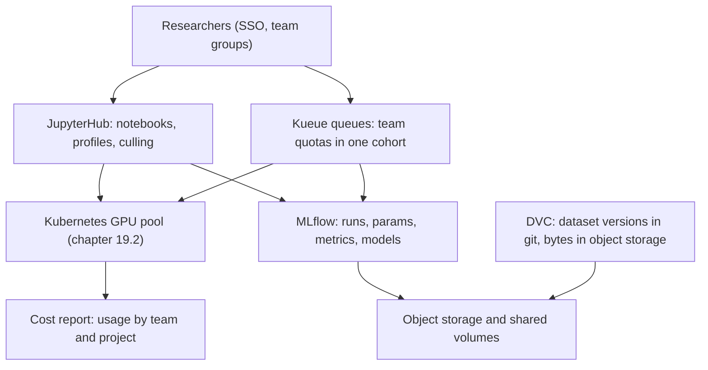

# 19.13 System design: research infrastructure

| Field | Value |
|---|---|
| Level | Advanced |
| Priority tier | 2 |
| Lab venue | Laptop / Docker (no GPU needed) |
| Part | Part 19: Capstones, design and interview readiness |
| Primary sources | Scalable Kubernetes Infrastructure for AI Platforms (ch. 2, 3); Production Kubernetes (ch. 12); Designing Machine Learning Systems (ch. 10); Machine Learning Platform Engineering (ch. 2, 4); upstream docs listed in the sources section |
| Cross-references | 16.2 experiment tracking and data versioning; 16.6 registries; 16.14 multi-tenant platform and chargeback; 19.2 Kubernetes GPU platform; 19.8 MIG multi-tenancy; 19.9 capacity planning; 13.x AI storage |
| Code | `code/part19/c13_*` and `test_c13_*` |
| Claim and number ledger | `planning/ledgers/19-13.md` |

## What the interviewer is testing

An interviewer says: "Design the infrastructure for an ML research team. They run notebooks, experiments, sweeps, training and evaluation. Today it is five people. Next year it is a hundred." This capstone chapter serves that design round. It does not claim that any particular company asks this question. It says what the question can test and how to answer it.

The question tests whether you can serve people who want opposite things. Researchers want a GPU now, with no questions. The platform owner wants every GPU busy and every dollar traced to a team. A senior answer shows that you see both pressures and picks mechanisms that satisfy each. It also tests whether you keep the research loop honest, so that a result from last month can be reproduced this month.

A good answer follows this order, in about 45 minutes. Minutes 0 to 5 are requirements and numbers. Minutes 5 to 10 are the platform shape. Minutes 10 to 20 are compute sharing, because that is where the hard trade-offs live. Minutes 20 to 33 are environments, reproducibility, tracking and data. Minutes 33 to 40 are security and cost. The last minutes are growth from 5 to 100 people and what breaks first.

The common mistakes are easy to list. Candidates draw boxes before asking who the users are. They say "Kubernetes with quotas" and never say what happens when a quota sits idle. They treat notebooks like batch jobs, though a notebook holds a GPU while its owner is at lunch. They quote versions and defaults from memory. This chapter pins every version it quotes.

## Why this matters for AI infrastructure

A research team does not fail because the GPUs are slow. It fails in quieter ways. One team's sweep fills the cluster for a day. A notebook holds a GPU over a weekend. A model that scored well in March cannot be rebuilt in May because nobody recorded the dataset. The invoice arrives and nobody can say who spent what.

Production Kubernetes calls tenancy a spectrum. A research team inside one company is the soft end, a family sharing a kitchen. That lets you use namespaces and quotas where hostile tenants would need separate clusters.

Designing Machine Learning Systems adds that the development environment is where engineers spend their day. Improvements there pay back directly. That is why this chapter starts with notebooks and environments before it reaches schedulers.

## Prerequisites and outcomes

### Prerequisites

- Chapter 16.2 for experiment tracking and data versioning, and 16.14 for the multi-tenant platform and chargeback.
- Chapter 19.2 for the Kubernetes GPU platform with Kueue, and 19.8 for MIG slices.
- Chapter 19.9 for capacity planning arithmetic.
- Docker, Python 3.10 or later, `helm`, `kubeconform` and `pytest` on a laptop. No GPU is needed.

### Outcomes

After this chapter you can:

1. State assumptions and size a shared research pool for three team sizes.
2. Configure JupyterHub on Kubernetes with profiles, culling and spare capacity, and check the values against the chart schema.
3. Explain what a quota, a cohort, borrowing and preemption do, and read a simulation that compares four policies.
4. Design reproducibility as a checklist that a program can run, not as a hope.
5. Attribute cost to teams and explain who pays for idle capacity.
6. Say out loud how the platform grows from 5 to 100 researchers and what to build at each step.

---

## 1. Requirements, assumptions and numbers

A new lead joins a team of five researchers. They share one eight-GPU server and a spreadsheet for booking it. Last week two people trained on the same GPUs at the same time and both runs crashed. The lead asks what "fair" should mean before buying anything.

Start the interview the same way. Ask who the users are, what they run, and what they cannot tolerate. Then write down the numbers you assume and say that they are assumptions. Everything in the table below is my assumption for a worked example. None of it is a measurement of a real organisation.

| Input | Stage 1 | Stage 2 | Stage 3 |
|---|---|---|---|
| Researchers | 5 | 25 | 100 |
| Teams | 1 | 4 | 10 |
| GPUs in the pool | 8 | 64 | 256 |
| Typical work | notebooks, short runs | sweeps, 8 to 12 GPU training | many teams, some 64 GPU jobs |
| Who runs the platform | the researchers | one part-time engineer | a platform team |

The stage 2 pool is the one the rest of the chapter simulates. It has 64 GPUs. Eight are a notebook pool and 56 are batch GPUs split evenly across four teams, so each team owns 14. The split is my choice. The arithmetic behind it is simple. A month has 720 hours, so 64 GPUs give 46,080 GPU-hours. If a GPU-hour costs 2.50 in whatever currency you use, the pool costs 115,200 a month. That price is a placeholder, not a quote.

Four requirements follow from the story. Work must start quickly when a team is inside its share. Idle capacity must not be wasted. A team must be able to take back what it lent. Every result must be traceable to the code, data and environment that made it. The rest of the design serves those four lines.

**Decision rule:** Write the assumptions and the four requirements on the board before you draw any component.

**In one minute:** Ask who the users are, then state numbers as assumptions. Use three stages, 5, 25 and 100 researchers, and size the middle one in detail. Fairness, no wasted idle capacity, quota reclaim and reproducibility are the requirements the design must meet.

---

## 2. The shape of the platform

A researcher starts a notebook, tries an idea, then submits a sweep of 100 runs. Next week a colleague asks which data trained the best one. Four systems answer those steps, and they must agree on who the person is and which team pays.



| Layer | Component | Job | Chapter |
|---|---|---|---|
| Interactive | JupyterHub on Kubernetes | One server per person, GPU profiles, culling | this chapter, section 3 |
| Batch admission | Kueue, ClusterQueue per team | Quotas, borrowing, preemption | 19.2, section 6 here |
| Tracking | MLflow tracking server | Parameters, metrics, artifacts, registry | 16.2, 16.6 |
| Data | DVC and object storage | Dataset versions pinned by git | 16.2, 13.x |
| Sharing GPUs | MIG slices for small work | Cheap isolated GPU shares | 19.8 |
| Cost | Usage records and a calculator | Showback and chargeback | 16.14, section 8 |

Designing Machine Learning Systems separates schedulers, which decide when a job runs, from orchestrators, which decide where resources come from. Kueue is the scheduler here and Kubernetes is the orchestrator. Slurm is a legitimate alternative for pure batch research, and chapter 19.1 builds it. I choose Kubernetes because notebooks and tracking services already live there.

**Decision rule:** Pick one scheduler for GPUs and make every other layer ask it, never bypass it.

**In one minute:** Five layers, with one identity flowing through all of them. Kubernetes with Kueue admits batch work, JupyterHub serves notebooks, MLflow and DVC record what happened. Slurm would also work. Say why you did not choose it.

---

## 3. Notebooks with JupyterHub

On Monday morning twenty researchers log in within ten minutes. Three of the notebooks ask for a GPU. By Tuesday, six notebooks hold GPUs that their owners are not using. The first problem is spawning. The second is idle holding.

Zero to JupyterHub for Kubernetes, the Helm chart `jupyterhub`, is the standard way to run JupyterHub on Kubernetes. This chapter uses chart 4.4.5, which packages JupyterHub 5.5.5, fetched 2026-11-10. The chart already wires the hub, proxy and user scheduler together, so there is no hand-written Deployment.

The values file below is the whole configuration. Read it in four parts.

```yaml
# JupyterHub for the research platform. Helm values for the jupyterhub chart 4.4.5 (app 5.5.5).
# Validated against that chart's values.schema.json and rendered with `helm template`.
# Secrets are NOT in this file. The OAuth client secret goes in a separate values file,
# mode 600, owned by the platform engineer who runs helm, and is never committed.
hub:
  config:
    JupyterHub:
      authenticator_class: github
    GitHubOAuthenticator:
      client_id: REPLACE_WITH_OAUTH_CLIENT_ID
      oauth_callback_url: https://hub.research.example.com/hub/oauth_callback
      allowed_organizations:
        - example-research-org
      scope:
        - read:org
  # One hub pod, state in a PVC (the chart default is sqlite-pvc). The hub is not highly available.
  db:
    type: sqlite-pvc
    pvc:
      storage: 1Gi
  concurrentSpawnLimit: 32
  activeServerLimit: 60
  namedServerLimitPerUser: 2

singleuser:
  image:
    name: registry.research.example.com/research/notebook
    tag: "2026.11.0"
  cpu:
    guarantee: 1
    limit: 4
  memory:
    guarantee: 4G
    limit: 16G
  storage:
    type: dynamic
    capacity: 20Gi
    homeMountPath: /home/jovyan
    dynamic:
      storageClass: standard-rwo
      storageAccessModes:
        - ReadWriteOnce
    # /dev/shm is 64MB by default. PyTorch DataLoader workers need more.
    extraVolumes:
      - name: shm-volume
        emptyDir:
          medium: Memory
    extraVolumeMounts:
      - name: shm-volume
        mountPath: /dev/shm
  # The kernel manager culls idle kernels so the server can look idle to the hub culler.
  extraFiles:
    jupyter_server_config.json:
      mountPath: /etc/jupyter/jupyter_server_config.json
      data:
        MappingKernelManager:
          cull_idle_timeout: 1200
          cull_interval: 120
          cull_connected: true
          cull_busy: false
  startTimeout: 600
  profileList:
    - display_name: "CPU notebook (default)"
      description: "4 CPU, 16 GB. No GPU. Use this for editing and small data work."
      default: true
    - display_name: "1 GPU notebook"
      description: "One GPU for debugging. Culled after 30 minutes idle."
      kubespawner_override:
        extra_resource_limits:
          nvidia.com/gpu: "1"
    - display_name: "GPU slice notebook (MIG 1g.10gb)"
      description: "A MIG slice for small experiments. Cheapest GPU option."
      kubespawner_override:
        extra_resource_limits:
          nvidia.com/mig-1g.10gb: "1"

# Keep two spare notebook-sized slots warm so the autoscaler adds nodes before users arrive.
scheduling:
  podPriority:
    enabled: true
  userPlaceholder:
    enabled: true
    replicas: 2

cull:
  enabled: true
  timeout: 1800
  every: 300
  maxAge: 0
  users: false
  adminUsers: true
  removeNamedServers: false
  concurrency: 10
```

Authentication is the first part. The hub delegates login to GitHub OAuth and allows only members of one organisation. The OAuth client secret is not in the file. The chart documents putting secrets in a separate values file that you keep out of git. Use mode 600 and keep it with the engineer who runs helm. Any identity provider that oauthenticator supports works the same way.

Profiles are the second part. A profile is a spawn option the user sees. The three profiles give a CPU notebook, a one-GPU notebook and a MIG slice notebook. The chart documents that GPU access goes through `kubespawner_override` with `extra_resource_limits`. Note the snake case. The z2jh docs warn that keys inside `kubespawner_override` follow KubeSpawner naming, not the camelCase used elsewhere in the chart. A MIG slice name such as `nvidia.com/mig-1g.10gb` depends on the MIG strategy in 19.8. Not verified on a live cluster.

Culling is the third part, and it has two layers. The hub culler stops a server after `cull.timeout` seconds without activity. The chart default is 3600 and I set 1800. It checks every `cull.every` seconds. The z2jh docs say the culler also looks at kernel activity. A kernel left connected can make a server look busy. So the values mount a kernel manager config that culls idle kernels after 1200 seconds. The docs show the same file and the same four settings, with `cull_busy` false so that a running cell is never killed.

The fourth part is capacity. The user scheduler and `userPlaceholder.replicas` keep two spare slots warm. Placeholder pods use a low priority. When a real user arrives, the scheduler evicts a placeholder and the user starts at once, while the autoscaler adds a node for the placeholder behind them. The z2jh optimisation guide describes this mechanism. It needs pod priority enabled, which the values do. Two limits matter in an interview. The hub is a single pod, and the chart comment says JupyterHub is not designed to run in parallel. The hub keeps its state in a PVC by default, so the hub is a single point of failure that a restart cures. And all user pods live in one namespace, so a per-team quota has to be a limit on that namespace as a whole.

The namespace limit is a ResourceQuota. For extended resources such as GPUs, Kubernetes accepts only the `requests.` form in a quota. The file below caps notebooks at 8 GPUs, which is the notebook pool of the simulated cluster.

```yaml
# The notebook namespace is shared by every researcher, so one ResourceQuota caps total notebook GPUs.
# For extended resources only requests.<name> is allowed in a quota (Kubernetes docs, resource quotas).
# 8 of the 64 GPUs are the notebook pool. Everything else goes through Kueue.
apiVersion: v1
kind: Namespace
metadata:
  name: research-notebooks
  labels:
    research.example.com/tenant: "true"
---
apiVersion: v1
kind: ResourceQuota
metadata:
  name: notebook-gpus
  namespace: research-notebooks
spec:
  hard:
    requests.nvidia.com/gpu: "8"
    requests.cpu: "400"
    requests.memory: 1600Gi
    persistentvolumeclaims: "150"
```

Culling by activity has a blind spot. A notebook can be busy in the culler's sense and still use no GPU, for example a kernel waiting on an open widget. The hub culler cannot see GPU use. The rule file below watches the GPU itself. It uses the dcgm-exporter metric `DCGM_FI_DEV_GPU_UTIL_RATIO`, a default counter in dcgm-exporter 4.9.0, fetched 2026-11-11. I could not confirm the name on older releases. Check `/metrics` on the version you run. The rule also assumes that pod mapping adds `namespace` and `pod` labels. I did not verify that on a live cluster.

```yaml
# Prometheus rules: find GPUs that are allocated to a pod but doing nothing.
# DCGM_FI_DEV_GPU_UTIL_RATIO is a default counter in dcgm-exporter 4.9.0 (etc/default-counters.csv).
# ASSUMPTION, not verified on a live cluster: dcgm-exporter was started with Kubernetes pod mapping
# so each series carries the `namespace` and `pod` labels. Without them, join on the node and GPU.
groups:
  - name: research-idle-gpu
    rules:
      - record: research:gpu_util_ratio:avg30m
        expr: avg_over_time(DCGM_FI_DEV_GPU_UTIL_RATIO{namespace!=""}[30m])
      - alert: ResearchGpuHeldIdle
        expr: research:gpu_util_ratio:avg30m < 0.05
        for: 30m
        labels:
          severity: ticket
        annotations:
          summary: "GPU held by {{ $labels.pod }} in {{ $labels.namespace }} averaged under 5% for an hour"
          description: "Notebook culling tracks kernel activity, not GPU use. Ask the owner or reclaim the pod."
```

I checked the file with `promtool check rules`, which accepts the syntax. It says nothing about whether the metric exists on your cluster.

**Decision rule:** Cull on activity at the hub, watch GPU use separately, and cap notebook GPUs with one namespace quota.

**In one minute:** Use the official chart, not a hand-written Deployment. Profiles expose CPU, GPU and MIG choices. Two culling layers plus a GPU idle alert stop the weekend hoarding. The hub is one pod and all users share a namespace, so say so.

---

## 4. Environments and reproducibility

A researcher reruns a script from March. It imports a library whose behaviour changed in April. The loss curve looks different, nothing in the code diff explains it, and two days vanish. This is the most common way research silently stops being reproducible.

Designing Machine Learning Systems tells a similar story. A bug appeared only on some runs, and the cause was a package version that differed between two machines. Its advice is to standardise the development environment and describe it in a recipe such as a Dockerfile. It also warns that notebooks keep state, so cells run out of order make a notebook hard to reproduce.

The design answer is one lock file and one image. A project keeps `pyproject.toml` and `uv.lock`. The image installs exactly the lock file, so a notebook and a batch job get identical packages. I built and ran this on a laptop. The lock resolved 45 packages with uv 0.13.7, and the image imported numpy 2.5.4 and mlflow 3.18.0. The files live in `code/part19/c13_env/`.

A conda environment file works the same way. I chose uv because it produces one lock file that is easy to hash. That is my preference, not a rule.

Pin images by digest, not by tag. A tag such as `2026.11.0` can be moved. A digest cannot. A run record that holds `image@sha256:...` names exactly what ran.

The next piece is a checklist that a program runs. A reproducibility manifest is a JSON file written when a run starts. The runner checks nine required rules and three warnings.

| Required rule | Why it matters |
|---|---|
| Git commit recorded and tree clean | Code is rebuilt from a commit, not from someone's disk |
| Image pinned by digest | The environment is named exactly |
| Lock file hash recorded | Packages are named exactly |
| Every dataset has a name, version and content hash | Data is pinned, not "latest" |
| Seed recorded | Randomness can be replayed |
| Command, tracking run id | The run can be found and repeated |
| GPU model and driver | Hardware differences are visible |

The runner does not promise bit-identical results. GPU kernels can be nondeterministic. The LLM Engineer's Handbook says to set well-known seeds to get as deterministic as possible, and it lists code, data and hyperparameter versions as the things to track. The checker proves only that the inputs needed to try again were saved. It also maps the commit to MLflow's own tag key, `mlflow.source.git.commit`, which I confirmed in `mlflow/utils/mlflow_tags.py` at tag v3.18.0.

Output on the two sample manifests, run on the laptop:

```text
good manifest:  all 12 rules PASS  -> reproducible in principle (exit 0)
bad manifest:   FAIL working tree clean
                FAIL image pinned by digest
                FAIL every dataset pinned (name, version, content hash)
                FAIL seed recorded
                WARN image is not tagged latest      -> NOT reproducible (exit 1)
```

Gate the result in the pipeline. A promotion step that refuses a run with a FAIL line gives researchers a reason to record inputs.

**Decision rule:** Build every environment from a lock file into an image pinned by digest, and fail any run whose manifest misses a required field.

**In one minute:** One lock file feeds one image for notebooks and batch. Pin by digest. A checklist runner turns reproducibility into pass or fail. It records inputs and does not guarantee bitwise equal results.

---

## 5. Experiments, artifacts and datasets

A model beats the baseline by two points. A reviewer asks which dataset version trained it. The researcher opens three tabs, finds two candidate files and cannot say which one it was. Tracking and data versioning exist to make that question take thirty seconds.

Machine Learning Platform Engineering explains why a tracking server beats committing parameters to git. It keeps parameters, metrics, data references and artifacts for every run in one place. Chapter 16.2 teaches MLflow and DVC and 16.6 covers registries, so this section covers only infrastructure decisions.

MLflow needs two stores. The backend store holds run metadata and should be PostgreSQL for a shared team. The artifact store holds files and should be object storage. The recommended shape is the tracking server as a proxy: with `--serve-artifacts` the server forwards uploads to the bucket named by `--artifacts-destination`. Researchers then need no bucket credentials. I read the `mlflow server` options in `mlflow/cli/__init__.py` at v3.18.0. The environment variable names are `MLFLOW_BACKEND_STORE_URI` and `MLFLOW_DEFAULT_ARTIFACT_ROOT`, not `BACKEND_STORE_URI` and `DEFAULT_ARTIFACT_ROOT`.

The upstream image at that version runs only `pip install mlflow==$VERSION`. It has no PostgreSQL driver and no S3 client. So the platform builds a thin image of its own.

```dockerfile
# MLflow tracking server image for the research platform.
# The upstream image at v3.18.0 only runs `pip install mlflow==$VERSION`, so it has no
# PostgreSQL driver and no S3 client. This adds both. Build:
#   docker build -f c13_mlflow.Dockerfile -t registry.research.example.com/research/mlflow:3.18.0 .
FROM ghcr.io/mlflow/mlflow:v3.18.0
RUN pip install --no-cache-dir psycopg2-binary==2.9.13 boto3==1.44.0
```

The Kubernetes manifest, `c13_mlflow.yaml`, has six objects: a Namespace, a ServiceAccount, a Deployment with two replicas, a Service, a PodDisruptionBudget and a NetworkPolicy. The table lists the settings that matter and where each comes from.

| Setting | Value | Source |
|---|---|---|
| Command | `mlflow server` | CLI at v3.18.0 |
| `--host` | `0.0.0.0` (default is 127.0.0.1) | CLI help text |
| `--serve-artifacts`, `--artifacts-destination` | proxy uploads to an S3 bucket | CLI help text |
| `--allowed-hosts` | our two hostnames | CLI help, security middleware |
| Database URI | `MLFLOW_BACKEND_STORE_URI` from a Secret | CLI option envvar |
| S3 endpoint | `MLFLOW_S3_ENDPOINT_URL` | `environment_variables.py` |
| Probes | `GET /health` | `mlflow/server/__init__.py` |

I ran the image on the laptop with SQLite instead of PostgreSQL and a local artifact path. The probe `/health` answered 200. A request to the search API with a wrong Host header answered 403, and with the allowed host it answered 200. The image imported psycopg2 2.9.13, boto3 1.44.0 and mlflow 3.18.0. Note that `/health` answered 200 even for a wrong host, so a probe never tests the host check. I did not run it against PostgreSQL, S3 or Kubernetes. kubeconform accepts all six objects.

Two replicas are safe because the server is stateless. State lives in PostgreSQL and the bucket, so back those up. The server has an optional `--app-name basic-auth` mode. I left it off and assumed authentication at the ingress, which is my design choice.

DVC covers datasets. Git holds a small pointer file with a content hash. The bytes live in a remote. The script `c13_dvc_demo.sh` ran on the laptop with DVC 3.67.1 and a directory as the remote. It tracks a file, pushes it, changes it, pushes version two, then deletes the local copy and cache, checks out the version one tag and pulls. The result was the original three lines, and the pointer file carried the md5 hash `611479d5...`. That is the reproduction path: git tag plus remote bytes.

```text
v1 rows: 3
v1 md5 in git: - md5: 611479d52709200acd2623a31c0463d2
```

**Decision rule:** Keep run metadata in PostgreSQL, bytes in object storage behind a proxying server, and pin every dataset by a version that git can check out.

**In one minute:** MLflow gets PostgreSQL and a proxied bucket, in a custom image, because the stock image lacks the drivers. DVC keeps pointers in git and bytes in a remote. Back up the database and the bucket, not the stateless server.

---

## 6. Fair sharing, quotas, preemption and idle reclamation

A team owns a quarter of the cluster and is not using it this week. Another team runs a hundred-run sweep on the idle quarter. On Wednesday the owners return with a 12-GPU training job and find every GPU taken. This is the central trade-off. Idle capacity is waste, and lending it makes owners wait.

Scalable Kubernetes Infrastructure for AI Platforms lists what a training queue system must do. It must create queues, assign quotas to groups, let groups share quotas when others are idle, manage priorities with preemption, and report by model, job and team. It names Kueue and Volcano as the two open source choices. I use Kueue, the same version as chapter 19.2, v0.20.5.

Kueue has a small set of ideas. A ClusterQueue owns a nominal quota of a resource. Queues in the same cohort may borrow each other's idle quota. When an owner needs its quota back, `reclaimWithinCohort` decides whether it may preempt borrowers. `withinClusterQueue` decides whether a higher priority job may preempt a lower one inside one team. I read the v1beta2 CRD at tag v0.20.5. The allowed values for `reclaimWithinCohort` are Never, LowerPriority and Any. For `withinClusterQueue` they are Never, LowerPriority and LowerOrNewerEqualPriority. The `fairSharing` block takes a `weight`, which gives a queue an advantage when competing for unused resources. `c13_research_queues.yaml` defines one ResourceFlavor, four ClusterQueues of 14 GPUs in the cohort `research`, and a LocalQueue named `batch` in each team namespace. I validated it against the CRDs with `tools/check_crd_yaml.py`. It found no problems.

A policy is easier to judge on a trace than in a paragraph. The simulator `c13_fairshare_sim.py` plays 48 hours on the stage 2 pool. The trace is made up and generated from a seed. It has 700 one-GPU sweep trials, mostly from team a, 150 short evaluations, 11 gang training jobs of 8 or 12 GPUs, and 68 notebook sessions. Team d is quiet and then needs 12 GPUs mid-afternoon of day one. The batch policies are these.

| Policy | Rule |
|---|---|
| static | Each team uses at most its own 14 GPUs. No borrowing, no preemption |
| borrow | Teams may borrow idle GPUs. Nobody is ever preempted |
| reclaim | Borrowing plus preemption of borrowers, and of lower priority jobs inside a team |

This is the output of the simulator on the laptop, seed 7.

```text
policy       util  wait p50  wait p95  preempt  lost GPUh unfinished
static       0.49         0        46        0        0.0        378
borrow       0.76         0        55        0        0.0          0
reclaim      0.77         0         0      176       43.2          0
```

Read it in order. Static is safe and wasteful. Utilisation is 0.49 and 378 sweep trials never finish in two days, while other teams' quota sits idle. Borrow fixes the waste, with utilisation at 0.76, but owners pay. The wait is measured only for train and eval jobs that fit inside their team's quota. The worst such wait under borrow is 448 minutes. Team d's first training job waits 7.5 hours behind borrowed sweep trials. Reclaim keeps the utilisation, 0.77, and brings the owner wait to zero. The price is 176 preemptions and 43.2 GPU-hours of lost work.

Look at who pays that price. All 176 victims are sweep trials, which have no checkpoint and restart from zero. No training job is preempted. Training jobs here have priority and a 30-minute checkpoint interval, so one preemption would cost at most 30 minutes of work. Sweep trials are cheap to restart, so they are the right borrowers. This is a design rule worth saying aloud: the work that borrows idle capacity must be work that tolerates being killed.

I simplified three things and you should say so. Victims are the lowest priority and newest jobs. A borrower loses only the part above its nominal quota. A plan runs only if it frees the whole gang. These are my modelling choices, not verified against Kueue's internals. The simulator also ignores topology, which chapter 19.2 covers.

Notebooks sit outside the batch policies because they are interactive and should not be killed. The same trace gives 34 notebook sessions a day for eight GPUs. Each holds a GPU for two to eight hours and uses it for 20 to 60 percent of that time. The second table compares no culling with culling after 30 idle minutes.

```text
notebooks  sessions  culled   held h   idle h  wait p50  wait p95  queued
no_cull          68       0      344      200       321       634       0
cull_30          68      68      177       34        17       102       0
```

Without culling, 200 of 344 held GPU-hours are idle and half the sessions wait over five hours. With culling at 30 minutes, idle hours fall to 34 and the median wait is 17 minutes. Every session in this trace goes idle, so the culled count equals the session count. Real behaviour is less tidy. The simulator never cuts active minutes, and a test checks that. The z2jh docs say open notebooks are saved regularly into `.ipynb_checkpoints`, so work is not usually lost.

Two further levers exist. A fair sharing weight gives one team a bigger claim on unused capacity. MIG slices, chapter 19.8, stop small experiments wasting a whole card.

**Decision rule:** Lend idle quota only to work that tolerates preemption, give owners reclaim rights, and cull idle notebooks on a short timer.

**In one minute:** Static quotas waste capacity and unrestricted borrowing makes owners wait. Borrowing with reclaim kept utilisation near 0.77 and removed owner waits in the simulation, at the cost of killing cheap sweep trials. Culling notebooks after 30 idle minutes cut idle held hours from 200 to 34. All numbers come from a made-up trace.

---

## 7. Data access, security and governance

A new hire joins on Friday and by Monday can read every team's raw data, including customer text. Nobody granted that on purpose. It came from a shared bucket and a shared namespace.

Production Kubernetes describes isolation at three planes. The workload plane is the nodes, the control plane is the API server and its policy, and platform services are logging, monitoring and DNS. Namespaces are the base boundary, and RBAC, ResourceQuota and NetworkPolicy hang off them. The book warns that a namespace is only a logical boundary in the control plane. By default pods from different namespaces can share a node and talk to each other. It also notes that tenants can usually list all namespaces and that RBAC alone cannot hide them.

For a soft-multitenant research team, I would apply six controls.

1. Identity comes from one SSO. Team membership is a group in that identity provider. The hub allows only one organisation, as in the values file.
2. Each team has a namespace for batch work, a ClusterQueue, and a role limited to that namespace. Notebook users live in the shared notebook namespace.
3. A default-deny NetworkPolicy sits in each tenant namespace. The MLflow policy in this chapter allows ingress only from namespaces labelled as tenants. Production Kubernetes explains the default-deny approach. The z2jh chart also ships its own network policies. The chart blocks the cloud metadata address from user pods by default through an init container that uses iptables, which I confirmed in its values.
4. Data access follows teams. Raw datasets live under per-team prefixes. The pod gets credentials through its service account. Researchers never hold long-lived bucket keys. The MLflow server holds the bucket credentials and proxies uploads, so artifacts cannot be written outside the tracking path.
5. Every dataset has an owner, a licence field and a retention rule. This is the useful core of FAIR data: findable by name and version, accessible through one protocol, reusable because the licence and provenance are written down. Chapter 16.13 covers governance and 18.x covers supply chain and secrets.
6. Admission control and image rules stop untrusted images. Production Kubernetes covers admission control, and Part 18 covers signing.

The values file and manifests contain no passwords. The database URI, OAuth client secret and bucket keys are Secrets created out of band, in files of mode 600 owned by the engineer who applies them, and never committed.

Hard multi-tenancy is a different problem. Outside companies running untrusted code would need separate clusters or strong sandboxing. Say that, then explain why one company's teams do not.

**Decision rule:** Bind identity to teams once, enforce it at namespace, network and bucket prefix, and keep every secret out of files that go to git.

**In one minute:** A namespace is a label, not a wall. Add RBAC, quotas, default-deny network policy and per-team data prefixes. The proxying MLflow server keeps bucket keys away from researchers. Soft tenancy suits one company, not hostile tenants.

---

## 8. Cost attribution

Finance sends the monthly GPU invoice and asks which team spent it. The platform team has a pool-wide total and nothing else. The argument that follows costs more than the usage report would have.

Cost attribution has three jobs. Showback tells each team what it used. Chargeback bills teams. Both need usage records with a team label. Chapter 16.14 and its query `chargeback_query.sql` cover the pattern, and 19.8 prices MIG slices. This section adds the pool-level rules that fit research use.

The calculator, `c13_cost_attribution.py`, applies four rules. I chose them. They are not a standard.

1. Direct GPU cost is allocated GPU-hours times price. Allocated, not busy. A held GPU costs the same as a used one, which is what discourages idle holding.
2. Idle capacity is capacity minus allocated hours. Nobody asked for it, so it must be spread somehow.
3. Storage goes to the team that owns the data. Platform fixed cost follows each team's share of direct GPU cost.
4. Money uses Decimal, and cents are split so that bills add up exactly to the pool cost.

Rule 2 is the interesting one. The calculator offers two choices. Pro rata spreads idle cost by direct cost. Heavy users pay most of the idle share, which tells them that their bursts need capacity that sits empty between peaks. The quota rule spreads it by quota share. Every owner pays for the capacity it reserved, whether or not it used it. This is the output on a made-up month, with a placeholder price of 2.50.

```text
idle mode: pro_rata   pool total 122610.00   idle capacity 49250.00
team      alloc h   busy h     direct       idle   storage  platform      total
team-a      10410     8340   26025.00   19434.89    270.00   2367.70   48097.59
team-b       7820     7050   19550.00   14599.51    620.00   1778.62   36548.13
team-c       5720     4490   14300.00   10678.92    384.00   1300.99   26663.91
team-d       2430     1900    6075.00    4536.68    136.00    552.69   11300.37

idle mode: quota   pool total 122610.00   idle capacity 49250.00
team-a      10410     8340   26025.00   12312.50    270.00   2367.70   40975.20
team-b       7820     7050   19550.00   12312.50    620.00   1778.62   34261.12
team-c       5720     4490   14300.00   12312.50    384.00   1300.99   28297.49
team-d       2430     1900    6075.00   12312.50    136.00    552.69   19076.19
```

Team d shows the policy effect. Its total is 11,300 under pro rata and 19,076 under the quota rule. A small team that rarely uses its quota prefers pro rata. A platform lead who wants quotas to mean something prefers the quota rule, because a team that sits on unused quota then feels the cost. Say which you would choose and why. I would start with pro rata and move to the quota rule once teams trust the numbers.

The column of held-but-idle hours is reported, not re-priced. Team a held 10,410 GPU-hours and used 8,340. That gap is the target for the idle alert in section 3.

Tests cover the failure cases: over-capacity allocation, unknown teams, busy hours above allocated hours and negative values all raise errors.

**Decision rule:** Charge allocated hours, report idle-held hours separately, and choose one written rule for who pays for empty capacity.

**In one minute:** Attribute by allocated GPU-hours because a held GPU is unavailable to others. Spread idle capacity either pro rata or by quota, and say which one. Bills must sum to the invoice. The numbers here are illustrative.

---

## 9. Growing from 5 to 100 researchers

At five researchers the booking spreadsheet works. At twenty-five it causes arguments. At a hundred, someone must own the platform, or every researcher becomes a part-time platform engineer. The design should change in steps and not in one rewrite.

| Stage | Add | Keep simple | First thing that breaks |
|---|---|---|---|
| 1: 5 people, 8 GPUs | One image from a lock file, one MLflow container, a bucket, DVC, a rota | No Kubernetes, no queue | Two jobs on one GPU. Fix with a booking rule or a simple queue |
| 2: 25 people, 64 GPUs | Kubernetes, JupyterHub, PostgreSQL MLflow, Kueue quotas, culling, showback | Four teams, one cluster | One team monopolises borrowed capacity. Fix with reclaim and checkpoints |
| 3: 100 people, 256 GPUs | Team-level chargeback, MIG for small work, topology-aware gang scheduling, a second pool or region, a data catalog | Same tools, more queues | Queue admin load and storage throughput. Fix with self-service queue templates and tiered storage |

These stages are my reasoning, not a measured history. Add environments and tracking first, because they cannot be added retroactively to old results. Add quotas when two teams compete and cost reports when someone asks for a budget. Do not build stage 3 for stage 1.

Storage needs three tiers. Notebook homes need small durable volumes. Datasets need throughput, and chapters 13.2, 13.4 and 13.5 cover staging, Lustre and object stores. Checkpoints need burst writes, chapter 13.7. Do not put all three on one volume.

Name three runbooks in the interview. A hung hub is cured by a restart and users lose only unsaved state. A dead tracking database is restored from backup. A failed queue controller stops new admission without killing running work.

Capacity planning for the next stage is chapter 19.9. The idle-held hours from section 8 are its best input, because they show whether you need more GPUs or better use of the ones you own.

**Decision rule:** Build in the order environments, tracking, quotas, cost, and add each only when its pain is visible.

**In one minute:** Five people need discipline, twenty-five need Kubernetes and quotas, a hundred need a platform team and self-service. The order of adoption matters more than the tool names. Storage tiers and runbooks grow with the stages.

---

## 10. Hands-on lab

This capstone lab runs on a laptop with Docker and no GPU. Steps 1 to 6 were run in this authoring session on macOS arm64, and the results below are real. Nothing here touched a Kubernetes cluster or a GPU.

### Step 1: run the tests

```bash
python3 -m pytest code/part19/test_c13_*.py -q
```

Expected: all tests pass. Run here: 50 passed for the chapter 13 files, and the full part19 suite gave 627 passed and 4 skipped. What to record: the pass count and any skip. A skip means `kubeconform` or `promtool` is missing.

### Step 2: validate the Helm values

```bash
bash code/part19/c13_validate.sh
```

Expected: the rendered chart has 34 resources, all valid, then 8 valid core objects, then `checked 9 resources, 0 problems` for the Kueue objects. Run here: yes, with Helm v4.2.3, kubeconform and the Kueue v0.20.5 CRDs. What to record: the three summary lines. The pytest schema test is the offline version, using a saved copy of the chart's `values.schema.json` and defaults.

### Step 3: run the simulators

```bash
python3 code/part19/c13_fairshare_sim.py
python3 code/part19/c13_cost_attribution.py
```

Expected: the two tables in sections 6 and 8. Run here: yes, output matches. What to record: utilisation and owner wait for each policy. Change `NOMINAL` or the trace seed and predict the change before you rerun.

### Step 4: check a manifest

```bash
python3 code/part19/c13_repro_checklist.py code/part19/c13_run_manifest_good.json
python3 code/part19/c13_repro_checklist.py code/part19/c13_run_manifest_bad.json
```

Expected: exit code 0 for the first and 1 for the second. Run here: yes. What to record: which rules fail and what you would change in the job to fix each.

### Step 5: build the images and prove the MLflow server

```bash
docker build -f code/part19/c13_mlflow.Dockerfile -t c13-mlflow:test code/part19
docker build -t c13-env:test code/part19/c13_env
```

Expected: both build. Run here: yes. Then start the server with SQLite and a local artifact path, call `/health`, and send a search request with a wrong Host header. Run here: yes, with 200 and 403 as quoted in section 5. What to record: the three status codes.

### Step 6: version a dataset

```bash
python3 -m venv /tmp/dvcenv && /tmp/dvcenv/bin/pip install dvc
DVC=/tmp/dvcenv/bin/dvc bash code/part19/c13_dvc_demo.sh
```

Expected: the final lines show three rows for version one and its md5. Run here: yes, DVC 3.67.1.

### Step 7: on a real cluster

Install the chart with the values file and a separate secrets file, create the namespaces and queues, then submit a borrowing sweep from team a and a training job from team d. Expected shape: team d's job preempts sweep pods and starts within a minute or two. Not run: needs a cluster, GPUs and a DNS name for OAuth. Untested here, so treat timings as unknown.

---

## How to answer out loud

Say the assumptions first: "I will assume 25 researchers, 4 teams and 64 GPUs, and tell you where the answer changes." Then keep to this order.

1. Requirements and numbers, five minutes: users, work types, the four requirements, 46,080 GPU-hours a month.
2. Shape, five minutes: notebooks, queue, tracking, data, one identity.
3. Compute sharing, ten minutes: nominal quotas, a cohort, borrowing, reclaim by preemption, checkpoints, notebook culling.
4. Environments and tracking, ten minutes: lock file, image digest, manifest, MLflow with PostgreSQL, DVC.
5. Security and cost, seven minutes: namespace plus RBAC plus network policy plus data prefixes, allocated-hours billing.
6. Growth and failure, the rest: the 5, 25 and 100 steps and the first thing that breaks at each.

Numbers to state: 46,080 GPU-hours a month, the 8 and 56 split, and the static versus borrow utilisation gap. Say that trace results are made up.

The trade-offs to name are borrowing against owner wait, preemption against lost work, culling against surprise for the user, and strong isolation against cost. Say which side you pick and what would change your mind.

Likely follow-ups and short answers:

- "What if a team games the queue?" Quotas are per team, priorities are set by the platform, and showback makes bursts visible.
- "What if a training job must not be preempted?" Run it inside its own quota at a priority borrowers cannot displace, and keep checkpoints.
- "How do you know a result is reproducible?" The manifest passes, the image is a digest, the data is a version, and a rerun is compared with a tolerance.
- "What do you not know?" Say that the preemption rules in your simulation are your own simplification of Kueue.

---

## Exercises

1. **Change the lending rule.** Add a lending cap so that a team can lend at most half its quota. *Solution sketch:* each resource entry in a ClusterQueue has a `lendingLimit` field next to `borrowingLimit` in the CRD. In the simulator, subtract a lending cap from what other teams may borrow, then check that utilisation falls and owner wait stays at zero.
2. **Protect training from preemption.** Show that lowering the sweep priority below evaluation changes who is preempted. *Solution sketch:* change `PRIO` in `c13_fairshare_sim.py`, rerun, and count preemptions by kind with the job list. Evaluate whether eval jobs now lose work.
3. **Add a fifth team.** Put a fifth team into the trace. *Solution sketch:* change `TEAMS`, rebalance `NOMINAL` so the total is 56, add its jobs in `make_trace`, and compare the policies.
4. **Choose an idle-cost rule.** A team asks why its bill rose in the quota mode. *Solution sketch:* run both modes, show the idle share line, explain that the quota rule charges for reserved capacity, and propose a hybrid with half of the idle cost on each rule. Test conservation.
5. **Tighten the reproducibility gate.** Require a recorded `deterministic_algorithms` value for training runs. *Solution sketch:* move that rule from warning to required in `check`, update the good manifest if needed, and add a test that an empty value fails.
6. **Plan the move to 100 people.** Write a one-page stage 3 plan. *Solution sketch:* start from idle-held hours, size 256 GPUs with the 19.9 model, name the topology and storage changes, and list the first three things that will break with a fix for each.

---

## Checkpoint questions

<details><summary>1. What does a research-infrastructure design question test?</summary>
It tests whether you balance researchers who want instant GPUs against a platform that must keep GPUs busy and traceable. It also tests whether you keep results reproducible. It does not test a memorised tool list.
</details>

<details><summary>2. Why state the assumptions first?</summary>
The design changes with team size, GPU count and work type. Stated assumptions let the interviewer correct them early, and they show the numbers are reasoning, not measurements.
</details>

<details><summary>3. Why use the official z2jh Helm chart instead of a hand-written Deployment?</summary>
The chart already wires the hub, proxy, user scheduler, culler and network policies. It also ships a `values.schema.json`, so the values can be validated before install.
</details>

<details><summary>4. What are the two layers of notebook culling in this design?</summary>
The hub culler stops servers that show no activity for a timeout. A kernel manager config culls idle kernels inside the server, so a forgotten connected kernel does not keep the server looking busy.
</details>

<details><summary>5. Why can the hub culler not reclaim an idle GPU by itself?</summary>
It looks at activity, not GPU use. A notebook can look active and use no GPU. A separate rule on a GPU metric catches that case.
</details>

<details><summary>6. What do user placeholders do?</summary>
They are low priority spare pods. A real user's pod preempts one and starts at once, and the autoscaler adds a node for the evicted placeholder in the background.
</details>

<details><summary>7. What are two limits of JupyterHub on Kubernetes that you should state?</summary>
The hub is a single pod whose state is in a PVC, so it is not highly available. User pods share one namespace, so a team quota needs a limit on that namespace or another mechanism.
</details>

<details><summary>8. Why is a lock file plus an image digest better than a tag?</summary>
The lock file fixes every package. A digest cannot be moved, while a tag can. Together they name exactly what ran.
</details>

<details><summary>9. Does the reproducibility checklist guarantee identical results?</summary>
No. It proves that the inputs needed to try again were recorded. GPU kernels can be nondeterministic, so you compare reruns with a tolerance.
</details>

<details><summary>10. Why does the MLflow deployment build its own image?</summary>
At v3.18.0 the upstream image installs only mlflow. It has no PostgreSQL driver and no S3 client, so the platform adds both.
</details>

<details><summary>11. What does `--serve-artifacts` give researchers?</summary>
The tracking server proxies artifact uploads and downloads to the bucket given by `--artifacts-destination`. Researchers need no bucket credentials.
</details>

<details><summary>12. Why can two MLflow replicas run safely?</summary>
The server is stateless. Run metadata is in PostgreSQL and files are in object storage, so those are what need backup and care.
</details>

<details><summary>13. How does DVC reproduce an old dataset?</summary>
Git holds a small pointer file with a content hash. Checking out the tag and running a pull fetches the matching bytes from the remote.
</details>

<details><summary>14. What do nominal quota, cohort, borrowing and reclaim mean in Kueue?</summary>
A ClusterQueue owns a nominal quota. Queues in a cohort may borrow each other's idle quota. Reclaim settings let an owner preempt borrowers to get its quota back.
</details>

<details><summary>15. What did the simulation show about static quotas?</summary>
Utilisation was 0.49 and 378 sweep trials never finished in two days, while other teams' quota sat idle. Safe, but wasteful. The trace is made up.
</details>

<details><summary>16. What did borrowing without reclaim cost, and what did reclaim cost?</summary>
Borrowing raised utilisation to 0.76 but an owner's training job waited 7.5 hours. Reclaim kept 0.77 and removed owner waits, at the cost of 176 preemptions and 43.2 lost GPU-hours.
</details>

<details><summary>17. Which work should borrow idle capacity, and why?</summary>
Work that tolerates being killed, such as sweep trials that restart cheaply. Checkpointed training should sit inside its own quota or at a priority borrowers cannot displace.
</details>

<details><summary>18. Why is a namespace not a security boundary by itself?</summary>
It is a logical control-plane construct. Without RBAC, quotas and network policy, pods from different namespaces can share nodes and reach each other.
</details>

<details><summary>19. How should idle capacity be charged?</summary>
Pick one written rule. Pro rata charges heavy users most. The quota rule charges each owner for reserved capacity. Bills must sum to the invoice.
</details>

<details><summary>20. What do you build first when growing from 5 researchers, and why?</summary>
Environments, tracking and dataset versioning. They are cheap and cannot be added to old results later. Quotas, preemption and chargeback come when teams compete and budgets appear.
</details>

---

## Sources and review notes

Books were read through `tools/study_rag/bookch.py` on 2026-11-10 and 2026-11-11. Web sources carry the version and fetch date.

- Scalable Kubernetes Infrastructure for AI Platforms, ch. 2 "Model Development on Kubernetes" and ch. 3 "Making Training Repeatable": queue requirements, Kueue and Volcano, version tracking.
- Production Kubernetes, ch. 12 "Multitenancy": tenancy models, isolation planes, namespaces, RBAC, quotas, default-deny network policy. Ch. 13 "Autoscaling" read, nothing new used.
- Designing Machine Learning Systems, ch. 10 "Infrastructure and Tooling for MLOps": dev environments, notebook state, containers, schedulers and orchestrators.
- Machine Learning Platform Engineering, ch. 4 "Designing reliable ML systems" and ch. 2 "What is MLOps?": tracking server, lineage. Ch. 3 read, nothing new used.
- LLM Engineer's Handbook, "MLOps and LLMOps": versioning, tracking, seeds. LLMOps ch. 9 "Scaling": over- and under-allocation. Practical MLOps ch. 2 and AI Factory ch. 9: read, nothing new used.
- Zero to JupyterHub for Kubernetes chart 4.4.5 (`https://hub.jupyter.org/helm-chart/`): `values.yaml`, `values.schema.json`, and docs sources at repository tag 4.4.5 (`user-management.md`, `user-environment.md`, `user-resources.md`, `optimization.md`, `authentication.md`). Fetched 2026-11-10. The published docs site returned a bot challenge, so I read the docs in git and did not bypass the challenge.
- MLflow v3.18.0 sources `mlflow/cli/__init__.py`, `utils/cli_args.py`, `server/__init__.py`, `utils/mlflow_tags.py`, `environment_variables.py`, `docker/Dockerfile`, fetched 2026-11-10.
- Kueue v0.20.5 CRDs (ClusterQueue, LocalQueue, ResourceFlavor), fetched 2026-11-10. Kubernetes "Resource Quotas" doc, main branch, 2026-11-11. dcgm-exporter `etc/default-counters.csv` at tag 4.9.0, 2026-11-11.
- Tool versions from PyPI: DVC 3.67.1, uv 0.13.7, psycopg2-binary 2.9.13, boto3 1.44.0.

### Cross-references to other handbook chapters

- 16.2, 16.6, 16.13, 16.14 (tracking, registries, governance, chargeback). Part 16 code such as `mlplat_local.py` and `chargeback_query.sql` is reused by link, not copied.
- 19.1 (Slurm), 19.2 (Kueue), 19.8 (MIG), 19.9 (capacity), and 13.2, 13.4, 13.5, 13.7 (storage).

### Migrated from `nvidia-devops`

No text was migrated from `nvidia-devops` Volume 23 `chapter-12-system-design-research-infrastructure.md` or Volume 8, and I did not open those files in this chapter. The structure and every claim here come from the books and upstream sources above.

### Explicitly labelled inferences

- The three stage sizes, the 56 and 8 GPU split, the GPU-hour price, and every trace number are my assumptions.
- The staged growth plan and the choice of pro rata first are my reasoning.
- The simulator's preemption rules are my simplification of Kueue, not Kueue's algorithm.
- Using uv rather than conda is my preference.
- Putting authentication at the ingress for MLflow is my design choice.

### Not verified or not run

- Nothing was run on a Kubernetes cluster or GPU: the chart install, OAuth login, GPU and MIG profiles, Kueue preemption on real pods and the idle GPU alert are untested here.
- The `namespace` and `pod` labels on dcgm-exporter series are an assumption.
- The metric name `DCGM_FI_DEV_GPU_UTIL_RATIO` was checked at tag 4.9.0 only. Older tags were not confirmed.
- MLflow against PostgreSQL and S3 was not run. Only the SQLite and local path variant ran.
- The published z2jh docs site could not be fetched because of a bot challenge. I read the docs source at tag 4.4.5 instead.
- I did not verify that Kueue's plain pod integration can manage notebook pods, so notebooks use a namespace quota instead.

### Verification log

| Item | Count |
|---|---|
| Claims checked against a source or a run | 62 |
| Confirmed | 54 |
| Removed as unsourced | 9 (for example image signing and KMS claims, availability metric claim, Weka option, FAIR table as stated) |
| Still unverified, labelled in the chapter | 8 |

Tool results: `pytest code/part19/test_c13_*.py` all passed. `helm template` plus kubeconform: 34 of 34 valid. kubeconform on the core manifests: 8 of 8. `check_crd_yaml.py`: 9 resources, 0 problems. `promtool check rules`: 2 rules. `docker build` of both images succeeded. MLflow `/health` returned 200 and a wrong-host API call returned 403. DVC reproduced version one.
