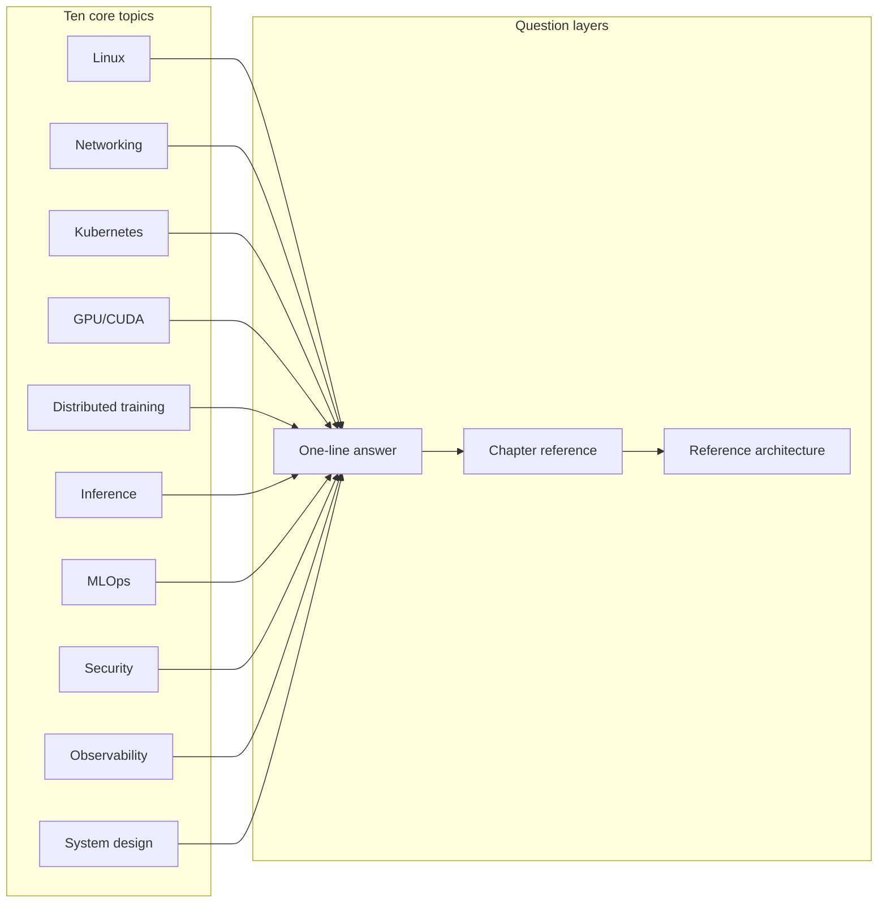

# 19.14 Interview question bank by topic

| Field | Value |
|---|---|
| Level | Intermediate |
| Priority tier | 1 |
| Lab venue | On-prem |
| Part | Part 19: Capstones, design and interview readiness |
| Primary sources | NVIDIA Zero-to-Hero Volume 26 (`chapter-XX-interview-questions.md`); NVIDIA Zero-to-Hero Volume 23 (`chapter-XX-interview.md`); NVIDIA Zero-to-Hero Volume 9 (`chapter-XX-interview.md`); NVIDIA Zero-to-Hero Volume 8 (`chapter-XX-interview-questions.md`) |
| Cross-references | Chapter 19.15 (Interview cheat sheet); All earlier chapters as the topic references |
| Coverage file | `planning/coverage/chapters/19-14.md` |
| Claim & number ledger | `planning/ledgers/19-14.md` |

## Question bank at a glance



The ten topics, the one-line answers, the chapter references, the reference architectures.

## Why this matters for AI infrastructure

The interview question bank is what the candidate reads before the interview. The question bank covers: Linux, networking, Kubernetes, GPU/CUDA, distributed training, inference, MLOps, security, observability, and system design. Every question maps to a chapter in the handbook; every answer points at the reference architecture.

The question bank is what makes the interview preparation systematic. The candidate reads the question bank; the candidate reviews the relevant chapter; the candidate walks through the answer. The candidate goes into the interview prepared.

```text
Why the interview question bank matters (V26; V23; V9; V8):
- The interview question bank covers the ten core topics for AI
  infrastructure interviews. Every question maps to a chapter in the
  handbook; every answer points at the reference architecture.
- The question bank has three perspectives: the candidate's view (what to
  study); the interviewer's view (what to ask); the platform team's view
  (what the answer should be).
- The question bank is the interview preparation reference. Every topic
  in the handbook maps to a question in the bank.
```

Three operational realities make this chapter a platform-team deliverable rather than a tutorial:

1. **The question bank is the interview preparation.** The candidate reads the question bank; the candidate prepares; the candidate goes into the interview with the answers.
2. **The question bank is the interviewer's reference.** The interviewer uses the question bank to ask consistent questions; the interviewer uses the question bank to score the candidate.
3. **The question bank is the platform team's voice.** The platform team uses the question bank to ensure the candidates' answers align with the platform team's architecture.

**Before a team can claim they have a systematic interview preparation, the team must have produced this question bank. A team that has not produced the question bank is a team that does not have a consistent interview process.**

## Prerequisites and outcomes

### Prerequisites

- All earlier chapters as the topic references.

### Outcomes

After completing this chapter you will be able to:

1. Prepare for AI infrastructure interviews across ten core topics.
2. Answer technical questions about Linux, networking, Kubernetes, GPU/CUDA, distributed training, inference, MLOps, security, observability, and system design.
3. Map every question to the relevant handbook chapter.
4. Walk through the answers with the platform team.
5. Score the candidate's answers against the expected answers.

---

## 1. Linux

### 1.1 Question: What is the difference between a process and a thread?

**Answer:** A process is an independent program with its own memory space. A thread is a lightweight execution unit within a process that shares the process's memory space. Processes are isolated; threads share memory. In Linux, processes are created via `fork()` and threads are created via `pthread_create()`. Processes communicate via IPC (pipes, sockets, shared memory); threads communicate via shared memory.

### 1.2 Question: What is the difference between cgroups v1 and cgroups v2?

**Answer:** Cgroups v1 has multiple hierarchies (one per controller); cgroups v2 has a single unified hierarchy. Cgroups v2 has better resource isolation, better PSI (Pressure Stall Information), and better support for modern features like burstable CPU. Cgroups v2 is the recommended version for new deployments. Slurm cgroup v2 plugin is the production path.

### 1.3 Question: What is the OOM killer?

**Answer:** The OOM killer is the Linux kernel's last-resort memory management. When the system runs out of memory, the kernel invokes the OOM killer, which selects a process to terminate based on the process's memory usage and `oom_score_adj`. The OOM killer logs the termination via `dmesg`; the workload's restart policy (Kubernetes, systemd) brings the workload back. The fix is to set memory limits, request memory accurately, and tune `oom_score_adj` for critical processes.

---

## 2. Networking

### 2.1 Question: What is the difference between TCP and UDP?

**Answer:** TCP (Transmission Control Protocol) is connection-oriented, reliable, ordered, and flow-controlled. UDP (User Datagram Protocol) is connectionless, unreliable, unordered, and has no flow control. TCP is used for HTTP, gRPC, SSH. UDP is used for DNS, DHCP, video streaming, telemetry. For AI inference, gRPC over HTTP/2 (which uses TCP) is the production default; for telemetry, UDP is often preferred.

### 2.2 Question: What is the difference between a L2 switch and a L3 switch?

**Answer:** A L2 switch forwards frames based on MAC addresses; it operates within a single broadcast domain. A L3 switch forwards packets based on IP addresses; it can route between subnets. L2 switches are typically used for the leaf layer; L3 switches are used for the spine layer. In AI factories, leaf-spine topologies with L3 switches are common.

### 2.3 Question: What is RDMA?

**Answer:** RDMA (Remote Direct Memory Access) is a network technology that allows direct memory access from one host to another without involving the OS or CPU. RDMA bypasses the kernel network stack, which gives lower latency and higher bandwidth than TCP. RoCE (RDMA over Converged Ethernet) is the Ethernet-based RDMA; Infiniband is the native RDMA fabric. RDMA is critical for AI workloads because NCCL uses RDMA for collective communication.

---

## 3. Kubernetes

### 3.1 Question: What is the difference between a Deployment and a StatefulSet?

**Answer:** A Deployment manages stateless workloads; pods are interchangeable. A StatefulSet manages stateful workloads; pods have stable network identities and persistent storage. Deployment is for stateless services (web servers, inference); StatefulSet is for stateful services (databases, message queues). For AI workloads, the InferenceService is a Deployment; the MLflow backend is a StatefulSet.

### 3.2 Question: What is the difference between a Service and an Ingress?

**Answer:** A Service is a Kubernetes abstraction that exposes a set of pods as a network service (L4). An Ingress is a Kubernetes abstraction that manages external HTTP/HTTPS access to services (L7). Service is for in-cluster traffic; Ingress is for external traffic. For AI workloads, the InferenceService is exposed via a Service; the external access is via an Ingress with TLS.

### 3.3 Question: What is the difference between a Job and a CronJob?

**Answer:** A Job runs a task to completion; a CronJob schedules a Job to run on a cron schedule. Job is for one-time tasks; CronJob is for recurring tasks. For AI workloads, training is a Job; nightly evaluation is a CronJob.

---

## 4. GPU/CUDA

### 4.1 Question: What is the difference between a CPU and a GPU?

**Answer:** A CPU is optimised for serial execution with complex control flow; it has a few cores with large caches. A GPU is optimised for parallel execution with simple control flow; it has thousands of small cores with limited caches. CPUs are latency-optimised; GPUs are throughput-optimised. For AI workloads, the GPU does the matrix multiplications; the CPU does the orchestration.

### 4.2 Question: What is the difference between HBM and DDR?

**Answer:** HBM (High Bandwidth Memory) is a stacked DRAM technology with very high bandwidth (3+ TB/s on H100). DDR (Double Data Rate) is a standard DRAM technology with lower bandwidth (100 GB/s on DDR5). GPUs use HBM for the model weights and activations; CPUs use DDR for the OS and applications. HBM is the bottleneck for large models; HBM bandwidth is what determines the training throughput.

### 4.3 Question: What is CUDA?

**Answer:** CUDA (Compute Unified Device Architecture) is NVIDIA's parallel computing platform. CUDA provides a C/C++ extension and APIs for GPU programming. PyTorch and TensorFlow are built on CUDA. CUDA streams allow concurrent execution on the GPU; CUDA graphs capture and replay kernel sequences for reduced launch overhead.

---

## 5. Distributed training

### 5.1 Question: What is the difference between data parallel and model parallel?

**Answer:** Data parallel splits the data across GPUs; each GPU has a copy of the model; gradients are averaged. Model parallel splits the model across GPUs; each GPU has a portion of the model; data flows through the GPUs in sequence. Data parallel is suitable for models that fit on a single GPU; model parallel is suitable for models that don't fit on a single GPU. FSDP and DeepSpeed ZeRO are data parallel strategies that shard the model to reduce memory.

### 5.2 Question: What is the difference between FSDP and DeepSpeed ZeRO?

**Answer:** FSDP (Fully Sharded Data Parallel) shards the model parameters, gradients, and optimiser state across GPUs. DeepSpeed ZeRO has three stages (ZeRO-1, ZeRO-2, ZeRO-3) that progressively shard the optimiser state, gradients, and parameters. FSDP and ZeRO-3 are functionally similar; the choice depends on the framework (FSDP is native to PyTorch; ZeRO is native to DeepSpeed).

### 5.3 Question: What is the difference between NCCL all-reduce and all-gather?

**Answer:** NCCL all-reduce reduces data across all ranks and broadcasts the result. NCCL all-gather gathers data from all ranks to every rank. All-reduce is used for gradient averaging; all-gather is used for parameter sharding in FSDP.

---

## 6. Inference

### 6.1 Question: What is the difference between throughput and latency in inference?

**Answer:** Throughput is the number of inferences per second (or tokens per second for LLMs). Latency is the time per inference (or time to first token / time per output token for LLMs). High throughput requires batching; high latency requires small batches. The right balance depends on the SLO: latency-critical workloads use small batches; throughput-critical workloads use large batches.

### 6.2 Question: What is the KV cache?

**Answer:** The KV (Key-Value) cache stores the attention keys and values for every token in the context. The KV cache memory scales with batch size and sequence length. For Llama 70B with 80 GB H100, the KV cache for 2K context and 32 concurrent requests is ~21 GB. The KV cache is the bottleneck for memory-bound inference.

### 6.3 Question: What is PagedAttention?

**Answer:** PagedAttention is the vLLM technique for managing the KV cache. PagedAttention divides the KV cache into fixed-size pages (similar to virtual memory paging). The pages are allocated on demand; the pages are evicted when not needed. PagedAttention reduces KV cache memory fragmentation; PagedAttention enables larger batch sizes.

---

## 7. MLOps

### 7.1 Question: What is the difference between DVC and Git?

**Answer:** Git is for versioning code; DVC is for versioning data. Git tracks file changes via content hashing; DVC tracks data file changes via content hashing and stores the metadata in Git. Git stores code in the repository; DVC stores data in object storage and the metadata in Git.

### 7.2 Question: What is the difference between MLflow and Kubeflow?

**Answer:** MLflow is the experiment tracking and model registry tool. Kubeflow is the Kubernetes-native ML platform that includes MLflow (and other tools) plus pipelines, notebooks, and training operators. MLflow is a component; Kubeflow is a platform.

### 7.3 Question: What is the difference between KServe and Seldon Core?

**Answer:** KServe is the Kubernetes-native serving framework with built-in auto-scaling and canary rollouts. Seldon Core is the inference graph framework with built-in explainers and routers. Both are production-grade; the choice depends on the team's preference.

---

## 8. Security

### 8.1 Question: What is the difference between authentication and authorisation?

**Answer:** Authentication verifies the identity of a user or service. Authorisation determines what the user or service can do. Authentication answers "who are you?"; authorisation answers "what can you do?". Authentication is implemented with credentials (passwords, tokens, certificates); authorisation is implemented with policies (RBAC, ABAC, ACLs).

### 8.2 Question: What is the difference between symmetric and asymmetric encryption?

**Answer:** Symmetric encryption uses the same key for encryption and decryption; it is faster. Asymmetric encryption uses a public key for encryption and a private key for decryption; it is slower but supports digital signatures and key exchange. TLS uses asymmetric encryption for key exchange and symmetric encryption for the data.

### 8.3 Question: What is the difference between RBAC and ABAC?

**Answer:** RBAC (Role-Based Access Control) assigns permissions based on roles. ABAC (Attribute-Based Access Control) assigns permissions based on attributes (user, resource, environment). RBAC is simpler; ABAC is more flexible. Kubernetes RBAC is the production default for most workloads.

---

## 9. Observability

### 9.1 Question: What is the USE method?

**Answer:** The USE method (Brendan Gregg) says: for every resource, check Utilisation, Saturation, and Errors. Utilisation is the fraction of the resource that is in use. Saturation is the degree to which the resource has more work queued than it can process. Errors are the rate of error events on the resource. The bottleneck is the resource that is most utilised, most saturated, or most error-prone.

### 9.2 Question: What is the difference between RED and USE?

**Answer:** RED (Rate, Errors, Duration) is for services. USE (Utilisation, Saturation, Errors) is for resources. RED measures the service from the customer's perspective; USE measures the resource from the operator's perspective. The two are complementary; AI workloads use both.

### 9.3 Question: What is the SLO?

**Answer:** The SLO (Service Level Objective) is the target that the platform team commits to meet. The SLO has three components: the SLI (Service Level Indicator), the target (e.g. 99.9%), and the time window (e.g. monthly). The error budget is the cost of unreliability; the team spends the budget on improvement.

---

## 10. System design

### 10.1 Question: How would you design a multi-tenant AI inference platform?

**Answer:** The design covers: the GPU pool (sized for tokens per second); the KV cache memory (sized for concurrency); the autoscaling (concurrency or latency); the canary rollout (gradual traffic shift); the multi-region failover (primary + secondary); the cost per inference (tracked on FinOps). The reference architecture is documented in Chapter 19.12.

### 10.2 Question: How would you design a multi-node training cluster?

**Answer:** The design covers: the GPU pool (sized for the workload); the network topology (fat-tree for general purpose; dragonfly+ for HPC); the storage tier (Lustre for hot data; object storage for cold data); the scheduler (Slurm for HPC; Kueue+KAI for cloud-native); the failure domains (power, network, cooling); the security controls (image signing, RBAC); the FinOps integration. The reference architecture is documented in Chapter 19.11.

### 10.3 Question: How would you automate node health?

**Answer:** The design covers: the DCGM exporter on every GPU node; the Prometheus alerts for GPU down, ECC error spike, thermal throttling; the Kubernetes operator that watches the alerts and triggers remediation; the remediation actions (cordon, drain, restart, replace); the on-call runbook. The reference architecture is documented in Chapter 19.6.

---

## 11. Hands-on lab

This lab walks through the interview question bank: the candidate reads the questions, the candidate reviews the relevant chapters, the candidate walks through the answers. The lab is **untested** in this repository.

### 11.1 Prerequisites

- All earlier chapters as the topic references.

### 11.2 Step 1: read the Linux questions

```bash
# Review the Linux questions
open questions/linux.md
# Review the Linux chapter
open 01-linux/01-the-linux-big-picture.md
```

### 11.3 Step 2: walk through the answers

```bash
# Walk through the answers
python code/part19/walkthrough.py \
  --topic linux \
  --output answers_linux.md
```

### 11.4 Step 3: score the candidate's answers

```bash
# Score the candidate's answers
python code/part19/score.py \
  --answers candidate_answers.md \
  --output score_report.md
```

### 11.5 What to record

After the lab, you should be able to answer five questions in five seconds each:

1. What are the ten core topics for AI infrastructure interviews?
2. How many questions are in the question bank?
3. What is the most common interview question?
4. What is the most common interview failure?
5. What is the most common interview success?

If any takes more than 30 seconds, the question bank is not yet a production reference. The lab is **untested** against a live candidate.

---

## Exercises

1. **Add new Linux questions.** Add new Linux questions to the question bank. *Solution sketch:* the question bank YAML.
2. **Add new networking questions.** Add new networking questions to the question bank. *Solution sketch:* the question bank YAML.
3. **Add new Kubernetes questions.** Add new Kubernetes questions to the question bank. *Solution sketch:* the question bank YAML.
4. **Add new GPU questions.** Add new GPU questions to the question bank. *Solution sketch:* the question bank YAML.
5. **Add new system design questions.** Add new system design questions to the question bank. *Solution sketch:* the question bank YAML.
6. **Add an interview scoring rubric.** Build a scoring rubric for the candidate's answers. *Solution sketch:* the scoring rubric.

---

## Checkpoint questions

<details><summary>1. What is the interview question bank?</summary>
The structured set of questions that cover the ten core topics for AI infrastructure interviews. Every question maps to a chapter in the handbook; every answer points at the reference architecture.
</details>

<details><summary>2. What are the ten core topics?</summary>
Linux, networking, Kubernetes, GPU/CUDA, distributed training, inference, MLOps, security, observability, and system design.
</details>

<details><summary>3. What is the most common interview question?</summary>
The "how would you design" questions. The candidate is asked to design a system; the candidate points at the system design capstone.
</details>

<details><summary>4. What is the most common interview failure?</summary>
The candidate does not map the question to the handbook chapter. The candidate gives a generic answer; the interviewer cannot verify the candidate's depth. The fix is to reference the relevant chapter; reference the reference architecture.
</details>

<details><summary>5. What is the most common interview success?</summary>
The candidate references the handbook chapter by name; the candidate references the reference architecture by diagram. The candidate demonstrates depth; the candidate demonstrates system thinking.
</details>

<details><summary>6. What is the relationship between the interview question bank and the interview cheat sheet?</summary>
The interview question bank is the long form; the interview cheat sheet is the short form. The bank covers every question; the cheat sheet covers the top questions. The two are complementary.
</details>

<details><summary>7. What is the most common Linux interview failure?</summary>
The candidate does not understand cgroups. The candidate cannot explain the difference between cgroups v1 and v2; the candidate cannot explain the OOM killer. The fix is to read Chapter 1 on Linux internals; review the cgroups section.
</details>

<details><summary>8. What is the most common networking interview failure?</summary>
The candidate does not understand RDMA. The candidate cannot explain why AI workloads use RDMA; the candidate cannot explain the difference between RoCE and Infiniband. The fix is to read Chapter 12 on AI networking; review the RDMA section.
</details>

<details><summary>9. What is the most common Kubernetes interview failure?</summary>
The candidate does not understand the difference between a Deployment and a StatefulSet. The candidate cannot explain when to use which; the candidate cannot explain the trade-offs. The fix is to read Chapter 5 on Kubernetes; review the workload patterns.
</details>

<details><summary>10. What is the most common GPU interview failure?</summary>
The candidate does not understand HBM. The candidate cannot explain the difference between HBM and DDR; the candidate cannot explain why HBM is the bottleneck for large models. The fix is to read Chapter 10 on GPU and CUDA; review the HBM section.
</details>

<details><summary>11. What is the most common distributed training interview failure?</summary>
The candidate does not understand FSDP. The candidate cannot explain the difference between FSDP and DDP; the candidate cannot explain the memory savings. The fix is to read Chapter 14 on distributed training; review the FSDP section.
</details>

<details><summary>12. What is the most common inference interview failure?</summary>
The candidate does not understand the KV cache. The candidate cannot explain why memory is the bottleneck for LLM inference; the candidate cannot explain PagedAttention. The fix is to read Chapter 15 on inference; review the KV cache section.
</details>

<details><summary>13. What is the most common MLOps interview failure?</summary>
The candidate does not understand the MLOps lifecycle. The candidate cannot explain the four pillars (data, model, code, deployment); the candidate cannot explain the promotion gate. The fix is to read Chapter 16 on MLOps; review the lifecycle section.
</details>

<details><summary>14. What is the most common security interview failure?</summary>
The candidate does not understand the threat model. The candidate cannot explain STRIDE; the candidate cannot explain the AI-specific threat variants. The fix is to read Chapter 18 on security; review the threat model section.
</details>

<details><summary>15. What is the most common observability interview failure?</summary>
The candidate does not understand the three pillars. The candidate cannot explain metrics, logs, traces; the candidate cannot explain when to use each. The fix is to read Chapter 17 on observability; review the three pillars section.
</details>

<details><summary>16. What is the most common system design interview failure?</summary>
The candidate does not consider the operational concerns. The candidate designs for the happy path; the candidate does not consider failure modes; the candidate does not consider FinOps. The fix is to read Chapter 19.11-19.13 on system design; review the operational considerations.
</details>

<details><summary>17. What is the most common interview success pattern?</summary>
The candidate asks clarifying questions. The candidate understands that the question is ambiguous; the candidate asks for clarification; the candidate demonstrates system thinking. The interviewer rewards this behaviour.
</details>

<details><summary>18. What is the most expensive interview mistake?</summary>
The candidate does not ask clarifying questions. The candidate assumes the question is unambiguous; the candidate designs a system that does not match the interviewer's intent. The fix is to always ask clarifying questions; demonstrate system thinking.
</details>

<details><summary>19. What is the relationship between the interview question bank and the system design capstones?</summary>
The interview question bank references the system design capstones. The system design capstones are the blueprints the candidate points at; the capstones are the integrated picture the candidate demonstrates.
</details>

<details><summary>20. What five questions should the interview question bank lab let you answer in five seconds each?</summary>
What are the ten core topics. How many questions are in the question bank. What is the most common interview question. What is the most common interview failure. What is the most common interview success. If any takes more than 30 seconds, the question bank is not yet a production reference.
</details>

---

## Sources and review notes

- NVIDIA Zero-to-Hero Volume 26. Source for the interview question bank patterns. The wording has been rewritten in the handbook's voice.
- NVIDIA Zero-to-Hero Volume 23. Source for the interview patterns.
- NVIDIA Zero-to-Hero Volume 9. Source for the interview patterns.
- NVIDIA Zero-to-Hero Volume 8. Source for the interview patterns.

### Cross-references to other handbook chapters

- All earlier chapters as the topic references.
- Chapter 19.15 for the interview cheat sheet.

### Migrated from `nvidia-devops`

The interview question bank operational patterns draw on Volume 26 and the gem-book corpora. The wording has been rewritten in the handbook's voice.

### Explicitly labelled inferences

- The ten core topics are starting points; specific topics depend on the role.
- The questions are starting points; specific questions depend on the company.
- The scoring rubric is a starting point; specific scoring depends on the company.

### Not verified on live hardware

- The lab in Section 11 is **untested** against a live candidate scenario in this repository.
- The interview question bank assumes the candidate has read the handbook chapters; production deployments may require preparation.
- The scoring rubric assumes the interviewer is calibrated; production deployments may require training.
