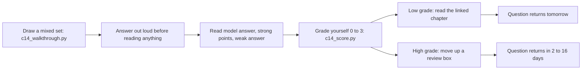

# 19.14 Interview question bank by topic

| Field | Value |
|---|---|
| Level | Intermediate |
| Priority tier | 1 |
| Lab venue | On-prem (runs on any laptop, no GPU needed) |
| Part | Part 19: Capstones, design and interview readiness |
| Primary sources | The handbook chapters each question links to, `nvidia-devops-core-interview` (Consolidated Core Interview Questions), `planning/INTERVIEW_TOPICS.md` and `planning/JD_MAPPING.md` |
| Cross-references | Volume 20 (Nebius SRE interview), Chapter 19.15 (interview cheat sheet), every chapter named in the bank |
| Coverage file | `planning/coverage/chapters/19-14.md` |
| Claim & number ledger | `planning/ledgers/19-14.md` |

## Why this matters for AI infrastructure

A candidate has read forty chapters and still freezes when an interviewer asks why a training pod ignores a shutdown signal. The knowledge is there, but it was never practised out loud. Reading a chapter and answering a question are different skills, and only the second one is tested in a loop.

This chapter turns the handbook into a practice bank. It holds 176 questions across sixteen topics and three levels. Every question points to the chapter that teaches the answer, so a missed question sends you to a known page and not to a search engine.

The bank is a capstone for the whole handbook. It is also honest about its limits. A question of this kind may be asked in an interview, but no entry claims that any company asks it. The answers are outlines in plain speech, taken from what each chapter sources. They are meant to be rephrased in your own words, with your own numbers from your own work.

The full bank lives in `code/part19/c14_question_bank.json` and has tested tools around it. This chapter teaches how to use the bank, how to shape an answer, and shows 40 complete questions as a sample. Nebius-specific drill questions are not repeated here, because Volume 20 already holds them.

## Prerequisites and outcomes

### Prerequisites

- Python 3 and pytest for the lab. Nothing in this chapter needs a GPU or a cluster.
- A first pass through the handbook parts you are interviewing for. The bank tests recall, so it works best on material you have read once.
- Volume 20 for company-specific preparation, which this chapter links and does not copy.

### Outcomes

- Draw a mixed practice set by topic and level, and grade yourself honestly.
- Turn a topic into an answer with a clear opening, a mechanism, a number and a trade-off.
- Find the chapter behind any question you miss, and schedule it for review.
- Validate the bank when you add your own questions.

## 1. How the bank is built

You open a mock interview and the first question is on Kubernetes. The second is on storage. The third is a behavioural prompt. Real loops jump between topics, so the bank is organised to let you practise that jump.

Each entry has the same fields, so nothing is left to memory. The question, the level, the topic and the teaching chapter come first. Then a model answer outline, what a strong answer contains, a common weak answer, and a follow-up the interviewer might ask next. The weak answer matters most. Many failed answers are not wrong, they are shallow.



The diagram shows one cycle. The steps are in the table below.

| Step | What you do | Tool |
|---|---|---|
| Draw | Pick N questions, spread over topics and levels | `c14_walkthrough.py` |
| Answer | Speak for about two minutes, no notes | You |
| Compare | Read the model answer and the weak answer | `c14_score.py` |
| Grade | Score 0 blank, 1 weak, 2 good, 3 strong | `c14_score.py` |
| Review | Missed questions return the next day | `c14_score.py` state file |
| Repair | Read the linked chapter and redo the question | Handbook |

The levels have a plain meaning. Core questions test definitions and the first thing you would check. Senior questions test mechanism and trade-off. Stretch questions test arithmetic, rare failures or design under constraints. A candidate for a platform role should be comfortable with core and most of senior.

**Decision rule:** Practise in short mixed sets of ten, and send every grade of 0 or 1 back to its chapter the same day.

**In one minute:** The bank is a table of linked questions with an answer outline, a weak answer and a follow-up. You draw a mixed set, answer aloud, grade yourself and let the scheduler bring back what you missed. The chapter link turns every miss into a reading task.

## 2. How to answer

The interviewer asks why a node is slow, and the candidate starts listing tools. After a minute the interviewer still does not know what the candidate thinks. A list of tools is not an answer.

A good answer has a shape. Say what you think the problem is in one sentence. Give the mechanism in plain words. Name the first measurement you would take, and say what result would change your mind. Close with the trade-off or the fix. The entries in the bank follow this shape, so reading ten of them teaches it.

Three habits separate strong answers from weak ones. First, separate what you know from what you assume. A sentence such as "I would check this first, because it is cheap" is better than a confident guess. Second, keep numbers few and sourced. If you quote a default, say where it comes from, or say you would check your version. Third, answer the question that was asked, then offer the deeper layer only if invited. The follow-up field in each entry shows where interviewers usually go next.

Weak answers in the bank fall into a few patterns. Some name a fix without a cause. Some blame the biggest component, such as the network or the scheduler. Some quote a peak figure as if it were an operating figure. Some restart things before reading evidence. When you grade yourself, check whether your answer matches one of these patterns.

For design and behavioural questions, spoken order matters more. Section 5 gives a speaking order. For incident stories, give the role, the impact, the mitigation and what changed afterwards, and never invent numbers.

**Decision rule:** Open with your best one-sentence diagnosis, then the mechanism, then the first measurement, then the trade-off.

**In one minute:** A good answer has a shape. Say the diagnosis, explain the mechanism, name the first measurement and close with a trade-off. Mark what you know and what you assume, and keep numbers few and sourced.

## 3. The bank at a glance

You have two weeks before a loop and a job description that mentions Slurm, Kubernetes and inference. You need to know where the questions are and how many of each there are. The table lists them, with the home chapters.

| Topic | Questions | Core / senior / stretch | Teaching chapters |
|---|---|---|---|
| Linux | 12 | 7 / 3 / 2 | 1.8, 1.12, 1.15, 1.17, 1.18, 1.19 |
| Networking | 12 | 5 / 6 / 1 | 2.6, 2.8, 2.9, 2.20, 2.22, 2.30 |
| Python and automation | 13 | 6 / 6 / 1 | 3.5, 3.6, 3.9, 4.2, 4.6, 4.12, 4.17, 4.19, 4.26 |
| Kubernetes | 15 | 5 / 8 / 2 | 5.3, 5.5, 5.6, 5.9, 5.10, 5.16, 5.18, 5.20, 5.23, 5.25 |
| GPU and CUDA | 12 | 6 / 3 / 3 | 10.2, 10.3, 10.6, 10.8, 10.20, 10.21, 10.22 |
| GPU on Kubernetes | 12 | 5 / 6 / 1 | 11.2, 11.7, 11.8, 11.12, 11.24, 11.25, 11.26 |
| AI networking | 12 | 2 / 7 / 3 | 12.3, 12.4, 12.12, 12.15, 12.18, 12.19 |
| Storage | 9 | 2 / 6 / 1 | 13.6, 13.7, 13.8, 14.11 |
| Training | 11 | 3 / 6 / 2 | 14.3, 14.4, 14.5, 14.7, 14.11, 14.12 |
| Inference | 12 | 4 / 6 / 2 | 15.2, 15.3, 15.8, 15.10, 15.14, 15.16, 15.18 |
| MLOps | 10 | 4 / 5 / 1 | 16.2, 16.6, 16.9, 16.10 |
| Observability and operations | 9 | 5 / 4 / 0 | 5.24, 17.6, 17.11, 17.13, 17.14 |
| Security | 10 | 3 / 5 / 2 | 1.21, 2.21, 5.21, 5.22, 5.27, 11.29 |
| System design | 9 | 2 / 5 / 2 | 5.18, 5.22, 9.13, 11.29, 12.12, 15.18 |
| Behavioural | 8 | 3 / 5 / 0 | 5.25, 9.13, 11.26, 17.11, 17.13, 20.28 |
| Slurm, HPC and hardware | 10 | 3 / 5 / 2 | 6.9, 6.10, 6.14, 6.15, 8.5, 9.6 |

Topic weights should follow the job description. `planning/JD_MAPPING.md` states that GPU-cloud roles treat Slurm, InfiniBand and NCCL as hard requirements, and that Kubernetes and inference roles lean on GPU Operator, DCGM, vLLM, Triton and KServe. So a candidate for the first family should draw more from slurm_hpc_hardware, ai_networking and gpu_cuda, and a candidate for the second family should draw more from gpu_on_kubernetes, inference and mlops. The walkthrough runner accepts repeated `--topic` filters for this.

Some topics point outward. Linux triage, network debugging, estimation, serving failure, SLO design, autoscaling, request routing, Terraform and incident drills already exist as company-specific questions in Volume 20. Do those drills there. This bank links to them and does not copy them: chapters 20.3 to 20.28.

Some topic chapters are still drafts. Parts 16, 17, 18 and the earlier drafts of Part 19 have not yet been through the same source check as the other parts. Entries linked to them carry a note in the `basis` field, and their thresholds should be read as chapter examples.

**Decision rule:** Weight your practice by the job description, and do company-specific drills in Volume 20.

**In one minute:** There are 176 questions linked to 90 chapters. Topics map to parts of the handbook, and the weight you give each topic should follow the role. Volume 20 holds the Nebius drills, and entries linked to draft chapters are marked.

## 4. Sample questions with answers

It is the night before a mock interview and you want to see what a full entry looks like in each topic. The 40 entries below are a sample. The other questions are in the JSON file, with the same fields.

The sample leaves out the strong-points list to save space, but the JSON has it. Read the question, answer aloud, then read the entry. Do not read the model answer as a script. It is an outline in plain speech, and the point is to hit the same ideas in your own words.

### Linux

**Why must memlock and nofile limits be raised on a GPU compute node, and why does editing limits.conf not fix a systemd service?**

Level core. Teaching chapter: [1.8](../part-01-linux/08-processes-signals-and-job-control.md).

Model answer. RDMA and CUDA pinned host memory lock large buffers in RAM, so the node needs memlock unlimited. Distributed training opens many sockets and shard files, so it needs a high nofile value. PAM applies /etc/security/limits.conf only to login sessions. A systemd service ignores that file, so the unit file needs LimitMEMLOCK=infinity and LimitNOFILE.

A common weak answer: Says to run ulimit -n in the shell before starting the service and does not know why it fails under systemd.

Follow-up: How do you check the limits a running process really has?

**How do you stop a runaway GPU job from taking sshd and kubelet down with it, and why must MemoryMax never be set on system.slice?**

Level senior. Teaching chapter: [1.15](../part-01-linux/15-systemd-units-targets-timers-journald.md).

Model answer. system.slice holds sshd, kubelet, containerd, slurmd and journald. A MemoryMax there makes the kernel throttle or kill the very daemons you need to recover the node. Protect them with a CPU weight and a memory low setting on system.slice and a strongly negative OOMScoreAdjust on sshd and kubelet. Enforce hard memory limits on the job slices, not on the system slice.

A common weak answer: Sets a large MemoryMax on system.slice to be safe.

Follow-up: How would you confirm after the change that the OOM killer picks the job first?

**Is there a container object in the Linux kernel? What actually makes a container?**

Level core. Teaching chapter: [1.19](../part-01-linux/19-namespaces-the-kernel-feature-behind-containers.md).

Model answer. No, there is no container object. A container is an ordinary process tree. Namespaces limit what it can see. Cgroups limit what it can use. A root filesystem gives it its own view of the file tree, and capabilities, seccomp and security modules limit what it can do. All of it runs on the one host kernel.

A common weak answer: Describes a container as a lightweight virtual machine.

Follow-up: What does that shared kernel mean for security between tenants?


### Networking

**What are the two queues behind listen(), and how do you tell which one is overflowing?**

Level core. Teaching chapter: [2.6](../part-02-networking/06-tcp-in-depth-handshake-windows-congestion-control-retransmission.md).

Model answer. The SYN queue holds half-open connections that wait for the final ACK. The accept queue holds finished connections that wait for the application to call accept. Its size is the smaller of the backlog argument and net.core.somaxconn. When the accept queue is full the kernel drops or refuses new connections, and the listen-overflow counters rise. Check ss on the listening socket and the TCP extended counters from nstat.

A common weak answer: Says to raise somaxconn without checking why the application is slow to accept.

Follow-up: What does tcp_syncookies change about the SYN queue?

**Why must NAT never sit inside an InfiniBand or RoCE v2 training fabric?**

Level core. Teaching chapter: [2.9](../part-02-networking/09-dhcp-nat-and-pat.md).

Model answer. During queue-pair setup the ranks exchange addresses and queue-pair numbers and program them into the network card. A middlebox that rewrites addresses or ports in flight makes that state wrong. It also breaks hardware offload and adds a stateful bottleneck. The back-end fabric should be routed, not translated.

A common weak answer: Says NAT is fine if the table is large.

Follow-up: Where does NAT belong in an AI cluster instead?

**A stall lasts exactly 5 seconds, or exactly 60. What do you suspect first?**

Level stretch. Teaching chapter: [2.30](../part-02-networking/30-network-troubleshooting-method-and-case-studies.md).

Model answer. Hardware faults do not keep to round durations. A round time is a software or protocol timer. About 40 ms suggests delayed ACK with Nagle. 200 ms matches the minimum retransmission timeout. One, three or seven seconds match SYN retransmission backoff, which hints at a full accept queue or a drop. Five seconds fits the DNS retry. Match the number to the timer.

A common weak answer: Starts replacing cables.

Follow-up: Which timer fits a stall of about one minute?


### Python and automation

**Why pass subprocess.run an argument list instead of shell=True, and what do check, timeout and stdin do?**

Level core. Teaching chapter: [3.5](../part-03-python/05-errors-files-text-and-bytes-subprocess-and-system-scripting.md).

Model answer. A list calls the program directly with no shell, so a hostname containing a semicolon or a command substitution stays a plain string. check=True raises an error on a non-zero exit. timeout stops a hung child from blocking the script. Closing stdin stops a child from waiting on a prompt that no one can answer.

A common weak answer: Uses shell=True for convenience and quotes the input by hand.

Follow-up: What goes wrong with a pipe deadlock on Popen?

**What makes an Ansible task idempotent, and what breaks it?**

Level core. Teaching chapter: [4.6](../part-04-automation/06-ansible-playbooks-tasks-modules-idempotency-and-check-mode.md).

Model answer. A task is idempotent when a second run on a host already in the right state changes nothing and reports ok. A template that embeds a timestamp or random value renders a different file every run, so the task always reports changed and restarts services. Use modules with state, and use creates, changed_when and checks for commands.

A common weak answer: Says idempotent means the playbook can be run twice without errors.

Follow-up: How does check mode help prove idempotency?

**You need a quick kubectl hotfix but GitOps self-heal is on. What happens and what is the right procedure?**

Level senior. Teaching chapter: [4.26](../part-04-automation/26-gitops-with-argo-cd-and-flux.md).

Model answer. Self-heal overwrites a manual edit within seconds. In an emergency you first pause automatic sync for that application, then apply the hotfix and verify it. Afterward you put the same change into Git and resume sync. Record the break-glass action so the audit trail is complete.

A common weak answer: Disables the GitOps controller for the whole cluster and forgets to turn it back on.

Follow-up: How do you handle an HPA that makes Argo show out of sync?


### Kubernetes

**Trace the timeline when a worker node stops heartbeating.**

Level senior. Teaching chapter: [5.3](../part-05-kubernetes/03-kubernetes-architecture-overview-components-and-what-talks-to-what.md).

Model answer. The kubelet renews a lease about every ten seconds. After the node-monitor grace period, which defaults to forty seconds, the node lifecycle controller marks the node unknown and adds taints. Pods then become eligible for eviction after their toleration time. Only then are replacements scheduled. A stateful or gang job may need extra steps, so recovery is slower than people expect.

A common weak answer: Says pods move at once when a node dies.

Follow-up: How would you make GPU job recovery faster and still safe?

**Two 4-pod training jobs are submitted to a cluster with 6 free nodes. What deadlock can occur and how do you avoid it?**

Level senior. Teaching chapter: [5.18](../part-05-kubernetes/18-scheduling-in-depth-kube-scheduler-affinity-taints-priority-and-preemp.md).

Model answer. The default scheduler places pods one at a time. Three pods of each job may land on the six nodes. Each job waits for its fourth rank and holds its nodes, so neither can start. This is hold and wait. A queueing layer or gang scheduler admits a job only when all its pods can be placed.

A common weak answer: Says the cluster simply needs more nodes.

Follow-up: How does Kueue prevent this without replacing the scheduler?

**Pod A cannot reach Service B. Describe a bisection.**

Level senior. Teaching chapter: [5.25](../part-05-kubernetes/25-troubleshooting-kubernetes-from-the-node-crictl-nsenter-tcpdump-and-ip.md).

Model answer. Test in hops from the client pod. First a backend pod on the same node by pod IP. Then a backend on another node by pod IP. Then the Service by cluster IP. Then the Service by DNS name. The first hop that fails tells you the layer: application, pod network, service rules or DNS. Capture in the right network namespace to confirm.

A common weak answer: Restarts kube-proxy first.

Follow-up: How do you check conntrack exhaustion on the node?


### GPU and CUDA

**A 13B model in FP16 sits on an 80 GB H100. What is the lower bound on decode latency per token at batch one?**

Level core. Teaching chapter: [10.3](../part-10-gpu-cuda/03-the-gpu-memory-hierarchy.md).

Model answer. The weights take 13 billion times two bytes, which is 26 GB. At batch one every token reads all the weights once. With 3,350 GB per second of memory bandwidth the floor is about 7.76 ms per token. The free memory does not lower this floor. Only more bandwidth, smaller weights or larger batches do.

A common weak answer: Quotes the compute rate in FLOPS as the limit.

Follow-up: How does batching change the picture?

**What does persistence mode do, and what happens without it?**

Level core. Teaching chapter: [10.8](../part-10-gpu-cuda/08-operating-gpu-nodes-nvidia-smi-topology-clocks-and-throttling.md).

Model answer. With no process holding the device open the driver can tear down its state. The next job waits for device initialisation, and power or clock settings reset. Persistence mode, normally via the persistence daemon, keeps the state loaded and removes that start-up stall.

A common weak answer: Says it is only a power saving feature.

Follow-up: Where would you enable it in a node bring-up playbook?

**After an Xid 79 you want to recover the GPU without rebooting the host. What are the steps and the gate?**

Level senior. Teaching chapter: [10.21](../part-10-gpu-cuda/21-gpu-health-dcgm-ecc-row-remapping-and-xid.md).

Model answer. Cordon and drain the node first. Remove the PCIe device and rescan the bus through sysfs. Confirm the GPU comes back at full link width and speed. Reload the driver if needed. Only a passing level-three diagnostic from DCGM lets you uncordon. If it fails, the node goes to hardware repair.

A common weak answer: Resets the GPU under a running job.

Follow-up: Why check link width after recovery?


### GPU on Kubernetes

**Why does adding a RuntimeClass not make a GPU workload schedulable?**

Level core. Teaching chapter: [11.2](../part-11-gpu-kubernetes/02-device-plugin-container-toolkit-cdi-and-runtime-classes.md).

Model answer. A RuntimeClass only tells the kubelet which runtime handler to use for the pod sandbox. It knows nothing about GPU inventory. A GPU becomes schedulable only after the device plugin advertises it as an extended resource on the node and the pod requests it.

A common weak answer: Says the runtime class gives the pod a GPU.

Follow-up: What do the toolkit and the plugin each do at pod start?

**Why does a plain ResourceQuota waste GPUs, and how do Kueue cohorts help?**

Level senior. Teaching chapter: [11.8](../part-11-gpu-kubernetes/08-kueue-volcano-and-scheduler-plugins.md).

Model answer. A ResourceQuota is a hard static ceiling per namespace. A team at its cap cannot use GPUs that other teams leave idle. Kueue cohorts let queues borrow unused quota from each other and reclaim it when the owner needs it back, so the cluster stays busy and each team keeps its guaranteed share.

A common weak answer: Raises the quota for everyone.

Follow-up: What does preemption do when a lender wants capacity back?


### AI networking

**Why does one dropped packet hurt a 400 Gbps RoCEv2 link so much?**

Level senior. Teaching chapter: [12.3](../part-12-ai-networking/03-rocev2-transport-and-congestion-management.md).

Model answer. At that speed and a round trip of about twenty microseconds, roughly 250 packets are in flight. With go-back-n recovery the receiver discards every packet after the lost one and the sender repeats them all. Selective repeat would resend only the lost packet. That is why RoCE fabrics aim to be lossless and why loss shows up as a large throughput drop.

A common weak answer: Says a single drop costs one packet.

Follow-up: What does PFC do to keep the fabric lossless, and what can go wrong?

**A 400 Gbps port reports link up, yet the host sees about 16 GB per second. Why?**

Level senior. Teaching chapter: [12.12](../part-12-ai-networking/12-ethernet-versus-infiniband-a-design-decision-guide.md).

Model answer. The PCIe link may have trained down, for example to a narrower width, because of riser wiring or bifurcation. The slot then caps DMA throughput regardless of the network speed. lspci shows the link capability next to the link status. Reseat or fix the slot and retrain.

A common weak answer: Blames the switch.

Follow-up: How does this show up in an nccl-tests result?

**NCCL fails with a system error about no space in /dev/shm in a container. Why, and how do you size it?**

Level senior. Teaching chapter: [12.18](../part-12-ai-networking/18-nccl-debugging-hangs-timeouts-and-errors.md).

Model answer. The default shared-memory size of 64 MiB is too small for an 8-GPU node, because NCCL places buffers there. The chapter's worked example needs over a gigabyte. Set a larger shared memory size for the pod, using a memory-backed volume, and check the NCCL buffer settings.

A common weak answer: Increases the host disk.

Follow-up: Which memlock failure looks similar at start-up?


### Storage

**State Young's and Daly's formulas for checkpoint interval and say what the variables mean.**

Level stretch. Teaching chapter: [13.7](../part-13-ai-storage/07-checkpoint-architecture-and-recovery.md).

Model answer. Young's interval is the square root of two times the write time times the cluster mean time between failures. Daly's adjusted version subtracts the write time from that. The cluster MTBF is the node MTBF divided by the number of nodes. Longer write time or lower MTBF changes the interval, so shortening the write pays twice.

A common weak answer: Picks a round interval such as every hour.

Follow-up: What is the interval for 8 hours MTBF and 180 seconds write?

**Estimate read bandwidth for 200 MB per second per GPU on 8 GPUs, 64 GPUs and a 72-GPU rack.**

Level core. Teaching chapter: [13.8](../part-13-ai-storage/08-capacity-performance-and-cost-planning.md).

Model answer. Multiply per-GPU demand by the GPU count. Eight GPUs need 1.6 GB per second, 64 need 12.8 GB per second, and 72 need 14.4 GB per second. State the per-GPU assumption and add headroom for bursts and for several jobs starting together.

A common weak answer: Quotes the storage vendor peak figure.

Follow-up: Why is text pre-tokenised pretraining not read-bound?


### Training

**DDP hangs when a conditional branch leaves a parameter unused. Why and what are the options?**

Level senior. Teaching chapter: [14.4](../part-14-training-finetuning/04-data-parallelism-and-ddp.md).

Model answer. An unused parameter never fires its gradient hook, so its bucket never becomes ready and the all-reduce never starts on some ranks. Setting find unused parameters makes DDP scan the graph every step, which costs time. If the graph is fixed, static graph is cheaper. The best fix is to make every parameter participate.

A common weak answer: Increases the timeout.

Follow-up: How do you set collective timeouts in current PyTorch?

**Compute the Young-Daly checkpoint interval for 8 hours MTBF and a 180-second write.**

Level senior. Teaching chapter: [14.11](../part-14-training-finetuning/11-checkpointing-fault-tolerance-and-elastic-training.md).

Model answer. Take the square root of two times 28,800 seconds times 180 seconds, which is about 3,220 seconds. Subtract the write time of 180 seconds. The result is about 3,040 seconds, or roughly 51 minutes. The value is an estimate, so round it and review it when the failure rate changes.

A common weak answer: Checkpoints every 5 minutes to be safe.

Follow-up: How does async checkpointing change the optimum?


### Inference

**Why does LLM inference need a KV cache and training does not?**

Level core. Teaching chapter: [15.2](../part-15-inference/02-batching-the-kv-cache-and-quantization-fundamentals.md).

Model answer. In training the whole target sequence is known, so attention over all tokens runs in one parallel pass. In generation the tokens come one at a time. Without a cache, every new token would recompute keys and values for all earlier tokens. The cache stores them, so each step computes only the new token. The cost is memory that grows with context length and batch size.

A common weak answer: Says the cache stores the model outputs for repeat questions.

Follow-up: How do you compute the cache size per token?

**Define goodput. Why did the colocated GPU in the DistServe example reach 3 RPS on TTFT yet only 1.6 RPS goodput?**

Level senior. Teaching chapter: [15.8](../part-15-inference/08-nvidia-dynamo-llm-d-and-disaggregated-serving.md).

Model answer. Goodput counts only requests that meet both the time-to-first-token and time-per-output-token targets. When prefill and decode share a GPU, long prompts delay running decodes, so the per-token target is missed even when first-token latency is fine. Counting only requests that meet both targets gives 1.6.

A common weak answer: Quotes raw throughput as the headline number.

Follow-up: How does separating prefill and decode change goodput?

**How do you stop 503 errors when a model pod is terminated or reloaded?**

Level senior. Teaching chapter: [15.16](../part-15-inference/16-production-serving-stack-and-reliability.md).

Model answer. First fail the readiness check so the pod is removed from endpoints. Then wait in a pre-stop hook long enough for the proxies to notice, and give the engine a long grace period to finish streams. Use a disruption budget for planned changes. Test it with a streaming load while rolling the deployment.

A common weak answer: Raises the replica count only.

Follow-up: What about requests that stream for five minutes?


### MLOps

**Why stage the previous model for rollback in advance?**

Level senior. Teaching chapter: [16.6](../part-16-mlops-llmops/06-model-registry-ci-cd-and-gitops-for-models.md).

Model answer. Rollback happens under time pressure, so you want a tag change, not a model download or rebuild. Keep the previous version warm in the registry, in object storage and in the cluster's image cache. The cost is one extra artefact. Test the rollback path regularly.

A common weak answer: Plans to retrain if the new model fails.

Follow-up: What is the difference between a model rollback and a cluster rollback?

**Why is the regression set more important than the golden set?**

Level senior. Teaching chapter: [16.9](../part-16-mlops-llmops/09-llm-evaluation-and-guardrails.md).

Model answer. The golden set measures overall quality on a sample. The regression set holds known failure cases, so a change that breaks one of them is caught even if the average looks fine. Its value depends on coverage, so add every production failure to it.

A common weak answer: Says the golden set is enough.

Follow-up: How often should the eval set be refreshed?


### Observability and operations

**What causes a Prometheus cardinality explosion and how do you stop it quickly?**

Level senior. Teaching chapter: [5.24](../part-05-kubernetes/24-observability-for-kubernetes.md).

Model answer. Series count is the product of the distinct values of all labels. One unbounded label, like a user id or a raw URL path, multiplies it. Find the culprit with the top-series queries on the server, then drop or relabel the label at scrape time, or normalise the path. Fix the source in code afterwards.

A common weak answer: Restarts Prometheus to free memory.

Follow-up: How would you budget cardinality in advance?

**Define RTO and RPO and say why they must be agreed with the business.**

Level core. Teaching chapter: [17.14](../part-17-operations/14-disaster-recovery-and-data-resilience.md).

Model answer. The recovery time objective is how long a service may be down after a disaster. The recovery point objective is how much data you may lose. They set cost, because shorter targets need replication and standby capacity. The chapter gives example tiers, but the real values come from the business and must be tested.

A common weak answer: Says RPO is how fast you recover.

Follow-up: What does a restore drill measure?


### Security

**What do the three Pod Security Standards profiles allow, and how is Pod Security Admission turned on for a namespace?**

Level core. Teaching chapter: [5.21](../part-05-kubernetes/21-certificates-identity-admission-control-and-policy.md).

Model answer. Privileged is unrestricted and is for trusted system components. Baseline blocks known host escapes such as host networking, privileged containers and host paths. Restricted adds hardening such as non-root users and dropped capabilities. You apply them with labels on the namespace that set enforce, audit and warn modes. Start with audit and warn, then enforce.

A common weak answer: Says it is a per-pod setting inside the pod spec only.

Follow-up: Which namespaces would need privileged?

**Why is loading a PyTorch checkpoint with the default loader risky, and what are safer options?**

Level senior. Teaching chapter: [5.27](../part-05-kubernetes/27-software-supply-chain-security.md).

Model answer. Those files are Python pickle streams. A pickle can name any callable to run on load, so loading an untrusted file can execute code. Safer options are weight-only loading modes, tensor formats that carry no code such as safetensors, and verifying signatures or hashes of model files. Treat third-party weights as untrusted input.

A common weak answer: Says weights are just data.

Follow-up: What does trust_remote_code do in model loading?


### Slurm, HPC and hardware

**A researcher says their job is stuck in PENDING. How do you read the reason?**

Level core. Teaching chapter: [6.9](../part-06-hpc-slurm/09-slurm-accounting-and-scheduling-policy-qos-fairshare-backfill-preempti.md).

Model answer. Show the reason with squeue for that job, then match it. Priority means higher-priority jobs are ahead, so look at the priority factors and fairshare. Resources means it is at the top and waiting for nodes. A limit reason such as an association group limit means a quota is hit. A node-not-available reason points to a reservation or a drained node. A time-limit reason means the request exceeds the partition limit.

A common weak answer: Tells the user to resubmit.

Follow-up: How do you check fairshare for the account?

**After a reboot a node is drained with gres/gpu count too low. What happened and how do you fix it?**

Level senior. Teaching chapter: [6.10](../part-06-hpc-slurm/10-slurm-gpu-scheduling-gres-nvml-autodetect-mig-and-device-constraints.md).

Model answer. slurmd may have started before the driver, the NVML library or the MIG layout was ready, or a GPU may have dropped off the bus, which shows as an Xid in the kernel log. Check that all GPUs appear in nvidia-smi, fix the cause, and order the services so slurmd starts after the GPU stack. Resume the node only after a health check passes.

A common weak answer: Resumes the node straight away.

Follow-up: How does a health-check program help?


### System design

**Five jobs ask for 8, 4, 4, 8 and 4 GPUs on 8-GPU nodes. How many nodes with and without bin-packing?**

Level core. Teaching chapter: [9.13](../part-09-nvidia-systems/13-sizing-and-capacity-planning-exercises.md).

Model answer. Without packing, one job per node needs five nodes and uses 28 of 40 GPUs, which is 70 percent. With packing, the two 4-GPU jobs share a node, and the third 4-GPU job takes its own, so four nodes are enough with 28 of 32 GPUs, which is 87.5 percent. Packing improves utilisation, but it needs isolation between jobs on one node.

A common weak answer: Gives one node per job without checking packing.

Follow-up: How does GPU fragmentation arise in the default scheduler?

**Design GPU queueing for three teams with guaranteed shares and borrowing.**

Level senior. Teaching chapter: [5.18](../part-05-kubernetes/18-scheduling-in-depth-kube-scheduler-affinity-taints-priority-and-preemp.md).

Model answer. Define resource flavours for hardware tiers, a namespaced local queue per team, and a cluster queue per team with a nominal quota. Put the queues in a cohort so unused quota can be borrowed, with limits for borrowing and lending. Add priorities and preemption rules, gang admission for multi-node jobs and a clear policy for fairness. Monitor wait time per queue.

A common weak answer: Uses a namespace quota per team.

Follow-up: What happens when a lender needs its quota back?


### Behavioural

**Tell me about an incident you led. How do you structure your answer?**

Level senior. Teaching chapter: [17.11](../part-17-operations/11-incident-response-and-game-days.md).

Model answer. Use situation, impact, detection, actions and result. Name your role, whether commander or responder, and what you decided. Give the timeline and the mitigation before the root cause. Say what you changed afterward and what the follow-up items were. Do not invent numbers, and be honest about what went badly.

A common weak answer: Tells a story where nothing went wrong.

Follow-up: What would you do differently?

**A customer asks for a cluster design, but their requirements are vague. What do you do first?**

Level senior. Teaching chapter: [9.13](../part-09-nvidia-systems/13-sizing-and-capacity-planning-exercises.md).

Model answer. Ask questions to find the workload, scale, deadlines, data size, security and budget. Write down what you learn as requirements and what you assume as assumptions. Offer two or three options with trade-offs, and propose a small test. Do not promise numbers you cannot support. Leave an action list at the end of the meeting.

A common weak answer: Presents a favourite architecture at once.

Follow-up: How do you handle a requirement that cannot be met?

**Describe the stages of your architecture method when a customer asks for a design.**

Level core. Teaching chapter: [9.13](../part-09-nvidia-systems/13-sizing-and-capacity-planning-exercises.md).

Model answer. Discover the requirements and constraints. Model the data and request path, control, trust, state, failure domains and observability. Compare options with their trade-offs. Recommend one and say why. Validate with a falsifiable test. Adopt with a plan for operation. Keep requirements, assumptions, constraints and trade-offs separate in the write-up.

A common weak answer: Jumps to a product list.

Follow-up: Which stage do people most often skip?


**Decision rule:** After each sample question, grade yourself and read the linked chapter for any grade below 2.

**In one minute:** The 40 sample entries show the format the JSON bank uses for all 176 questions. Each has an answer outline, a weak answer and a follow-up, and the JSON adds the strong points. The chapter link is the repair path.

## 5. Hands-on lab

This lab runs entirely on your laptop. Nothing needs a GPU, a cluster or a network. The commands were run here on a macOS arm64 laptop while writing this chapter, and the outputs below are from that run.

The lab script is `code/part19/c14_lab.sh`. It validates the bank, draws a mixed set, runs a short scripted quiz, prints the report and runs the tests. Run it from the repository root.

```bash
#!/usr/bin/env bash
# Lab for 19.14: validate the bank, draw a mixed set, run a short scored quiz, run the tests.
# Run from the repository root. Needs Python 3 and pytest. No GPU, cluster or network access.
set -euo pipefail
cd code/part19
python3 c14_bank.py
python3 c14_walkthrough.py --n 6 --seed 14
printf '\n\n3\n\n1\nq\n' | python3 c14_score.py --state /tmp/c14_lab_state.json --n 2 --topic linux --seed 1
python3 c14_score.py --state /tmp/c14_lab_state.json --report
python3 -m pytest test_c14_bank.py test_c14_score.py test_c14_walkthrough.py -q
```

### Step 1. Validate the bank

`c14_bank.py` checks that every entry has a topic, a level, a chapter link that resolves to a file, a model answer and a follow-up. It also checks that ids are unique, that the count is between 150 and 200, and that no entry claims a company asks the question.

Expected result: the summary lines and the word VALID, with exit code 0. What to record: the count per topic. A topic with fewer than eight questions is one to add to. What was run here: yes. The output ended with `176 questions, 90 chapters linked` at the top and `VALID` at the bottom.

### Step 2. Draw a mixed set

`c14_walkthrough.py --n 6 --seed 14` prints six questions, spread over six different topics, each with its chapter path. The same seed gives the same set, so you can repeat a drill. Without `--answers` the model answers stay hidden.

Expected result: six numbered questions, no answers. What to record: which topics you could not start. Run here: yes. The set began with a storage question about the 1.2 million image benchmark and a GPU sharing question about time-slicing.

### Step 3. Run a scored quiz

The script feeds the quiz runner a scripted session: Enter to reveal, an empty line that is rejected, a grade of 3, a second question, a grade of 1, then q. The runner re-asks on bad input, which the log shows as "Please enter 0, 1, 2, 3 or q."

Expected result: two graded questions and a state file. What to record: the grade and the follow-up you could not answer. Run here: yes.

### Step 4. Read the report

The report rolls the latest grades up by topic and level, as a percent of the maximum grade of 3. In the run here, one linux core question graded 3 and one linux stretch question graded 1 gave 66.7 percent for linux, 100.0 for core and 33.3 for stretch.

Expected result: a JSON report and a line naming the weakest topics. What to record: the weakest topic and the chapter you will reread. Run here: yes.

### Step 5. Run the tests

Pytest runs 36 tests for the three tools. They include failure cases: a missing follow-up, a broken link, a duplicate id, an unknown topic, a company-claim phrase, a bad grade, and a request for more questions than exist. The tests also recompute the arithmetic quoted in the bank, such as the bandwidth-delay product of 87.5 MB and the Young-Daly interval of 3,040 seconds.

Expected result: `36 passed`. What to record: nothing, unless a test fails, in which case record which. Run here: yes. All 36 passed.

### Not run

Nothing in this lab needs hardware, so nothing was skipped for that reason. What is not verified is the quality of the answers against a live interviewer. Whether an answer would satisfy a given interviewer is a judgement the bank cannot test. The chapter therefore labels the bank as practice material, not a guarantee.

**Decision rule:** Run the lab once to see the loop, then run a ten-question set every day.

**In one minute:** Validate, draw, answer, grade, report, test. Every step ran here without hardware. The tests include failure cases and recompute the arithmetic quoted in the answers.

## How to answer out loud

When the question is open, such as a design prompt or a behavioural story, the speaking order is what the interviewer remembers. Practise this order and time it at two minutes.

1. Restate the question and the constraint in one sentence, so the interviewer can correct you early.
2. Give the diagnosis or the design choice in one sentence.
3. Explain the mechanism in plain words, with at most two numbers.
4. Name the first measurement or the first check, and what result would change your mind.
5. State the trade-off and one alternative you rejected.
6. Stop, and invite the follow-up.

Numbers to state are the ones you can source. Say "about 87 MB" for a bandwidth-delay product you computed, and "I would check the default on our version" for a default you did not verify. If you are asked for a figure you do not know, say how you would find it. Never invent a flag, a metric name or a default.

Trade-offs worth naming come up again and again in the bank. Isolation against utilisation, as in MIG against time-slicing. Throughput against latency, as in batching. Cost against availability, as in N+1 against 2N. Speed of recovery against blast radius, as in automated remediation with a cap. Pick the one that fits the question and say what you give up.

Follow-ups usually go one level deeper, or ask what you would do if the first fix failed. The follow-up field in each entry is a good guess. Prepare one sentence for it.

## Exercises

1. **Add a question and validate it.** Write one new core question for the topic with the fewest entries, with all fields, and run `c14_bank.py`. Then delete the follow-up and run it again. *Solution sketch:* append an object to the questions list with a unique id such as `STO-10`, a real chapter path that is also in the chapters registry, and the required fields. The first run prints VALID. After the follow-up is removed, the validator prints `STO-10: missing or empty follow_up` and exits 1.
2. **Compute a review schedule.** You grade one question 3, 3, 1, 2 on days 0, 2, 6 and 7. Give the box and the due date after each grade. *Solution sketch:* the boxes are 2, 3, 1, 2. Gaps after each grade are 2, 4, 1 and 2 days, so the due dates are day 2, day 6, day 7 and day 9. A grade of 2 or 3 moves up a box, and a grade of 0 or 1 returns to box 1.
3. **Find your weakest topic.** Grade 20 questions from a mixed set and run the report. Name the weakest topic and the chapters to reread. *Solution sketch:* use `--n 20 --seed 1`, grade honestly, then run `--report`. The line "Weakest topics" gives up to three names. Open the chapters linked from your grade-0 and grade-1 entries.
4. **Weight a set for a job description.** A posting asks for Slurm, InfiniBand, NCCL and Linux. Draw 12 questions with the right filters and explain the choice. *Solution sketch:* run `c14_walkthrough.py --n 12 --topic slurm_hpc_hardware --topic ai_networking --topic linux --topic gpu_cuda`. These match the hard requirements in `planning/JD_MAPPING.md` for GPU-cloud roles.
5. **Turn a weak answer into a strong one.** Take the entry about the 40 ms RPC delay. Write your own two-minute answer with the speaking order from this chapter. *Solution sketch:* open with Nagle and delayed ACK as the diagnosis, explain that the second write waits for the ACK of the first, name a packet capture as the first check, give TCP_NODELAY or one write as the fix, and mention that round numbers point to timers.
6. **Recompute three numbers.** Recompute the bandwidth-delay product for 10 Gb per second at 70 ms, the break-even utilisation for a $12.40 per hour replica at 2,100 tokens per second against a $4 per million tokens API, and the Young-Daly interval for 8 hours MTBF and 180 seconds write. *Solution sketch:* 1,250 MB per second times 0.070 s is 87.5 MB. The replica makes 7.56 million tokens an hour, so full-use cost is about $1.64 per million tokens and break-even is about 41 percent. The interval is the square root of 2 times 28,800 times 180, minus 180, which is about 3,040 seconds.

## Checkpoint questions (20)

These 20 questions are the most representative of the bank. They span every major topic.

<details><summary>1. A training pod ignores SIGTERM for 30 seconds and then dies with exit code 137. Why, and what is the fix?</summary>
Kubernetes sends SIGTERM only to the process with PID 1 in the container. When the entrypoint is a shell script, the shell is PID 1 and it does not pass the signal on to python. See chapter [1.8](../part-01-linux/08-processes-signals-and-job-control.md).
</details>

<details><summary>2. A data-loader runs on socket 0 and feeds a GPU on socket 1. What is the first-touch rule and how does it hurt here?</summary>
Under the default local policy a page is placed on the NUMA node of the core that first writes it. A loader on socket 0 faults its batch buffers there, so every host-to-device copy crosses the link between sockets. See chapter [1.17](../part-01-linux/17-memory-management-virtual-memory-numa-huge-pages-oom.md).
</details>

<details><summary>3. An RPC call has a steady 40 ms delay. What is the likely cause and the fix?</summary>
Nagle's algorithm holds a small write while earlier data is unacknowledged. Delayed ACK holds the receiver's acknowledgement for up to about 40 ms. See chapter [2.6](../part-02-networking/06-tcp-in-depth-handshake-windows-congestion-control-retransmission.md).
</details>

<details><summary>4. Why must a Terraform pipeline apply the exact plan file that was reviewed?</summary>
If the pipeline plans for review and then runs a new apply after the merge, anything that changed in between is applied unreviewed. That could be a change in state, in the cloud, or in a data source. See chapter [4.2](../part-04-automation/02-ci-cd-pipelines-concepts-and-design.md).
</details>

<details><summary>5. The API server and etcd go down during a multi-node training run. What happens to the running pods?</summary>
Running pods keep running. The containers are managed locally by the container runtime and the kubelet, and the network rules stay programmed in the node kernels. See chapter [5.3](../part-05-kubernetes/03-kubernetes-architecture-overview-components-and-what-talks-to-what.md).
</details>

<details><summary>6. The scheduler says 20 nodes have insufficient GPU, but Grafana shows many of them idle. Why?</summary>
The scheduler works from resource requests compared with node allocatable, never from live utilisation. An idle notebook or a stuck job can hold GPU requests without using them. See chapter [5.18](../part-05-kubernetes/18-scheduling-in-depth-kube-scheduler-affinity-taints-priority-and-preemp.md).
</details>

<details><summary>7. Why can nvidia-smi show 100 percent utilisation while the GPU does almost no useful math?</summary>
The metric says that at least one kernel was running during the sample period. One warp spinning on one multiprocessor counts. See chapter [10.8](../part-10-gpu-cuda/08-operating-gpu-nodes-nvidia-smi-topology-clocks-and-throttling.md).
</details>

<details><summary>8. What is the difference between Xid 63 and Xid 64?</summary>
Xid 63 is informational. It records a normal page retirement or row remap after a correctable event. See chapter [10.21](../part-10-gpu-cuda/21-gpu-health-dcgm-ecc-row-remapping-and-xid.md).
</details>

<details><summary>9. Two 8-node jobs share a 12-node cluster without gang scheduling. What can happen?</summary>
Pods of both jobs are placed as capacity appears, say six nodes each. Both jobs wait for the two missing nodes and neither starts, while all the GPUs sit allocated and idle. See chapter [11.7](../part-11-gpu-kubernetes/07-multi-node-jobs-why-a-pod-cannot-span-nodes-and-gang-scheduling-concep.md).
</details>

<details><summary>10. An NCCL timeout is logged by a healthy rank. Why is it the wrong rank to blame?</summary>
Collectives act as barriers. Healthy ranks finish their work, enter the collective first and start their watchdog timers. See chapter [12.18](../part-12-ai-networking/18-nccl-debugging-hangs-timeouts-and-errors.md).
</details>

<details><summary>11. Why is a sharded checkpoint write so much faster than gathering to rank 0?</summary>
Gathering moves the whole payload to one rank and writes it from one node. In the chapter's 70B example that takes about 269 seconds. See chapter [13.7](../part-13-ai-storage/07-checkpoint-architecture-and-recovery.md).
</details>

<details><summary>12. Why can a GPU show 100 percent utilisation and only 15 to 22 percent MFU?</summary>
Utilisation says a kernel was active, not how much of the hardware it used. Many tiny memory-bound kernels, waiting on data or communication, keep the GPU busy but do little tensor-core work. See chapter [14.12](../part-14-training-finetuning/12-training-performance-engineering-and-troubleshooting.md).
</details>

<details><summary>13. How does PagedAttention reduce memory waste?</summary>
It splits the KV cache into small fixed-size blocks and maps each sequence's logical blocks to any free physical block through a block table. There is no need for contiguous memory, so external fragmentation disappears, and waste is limited to the last partly filled block. See chapter [15.3](../part-15-inference/03-vllm-in-depth.md).
</details>

<details><summary>14. Why does a closed-loop load test hide overload, and what should you use?</summary>
A closed-loop test has a fixed number of clients, each waiting for its reply before sending the next request. When the server slows, the arrival rate drops automatically, so queues never build and the test looks healthy. See chapter [15.14](../part-15-inference/14-benchmarking-genai-perf-latency-percentiles-and-goodput.md).
</details>

<details><summary>15. The overall AUC is flat but one customer segment got much worse. How does a promotion gate catch that?</summary>
The gate reads per-segment metrics from the run record and refuses promotion when any segment drops by more than a set limit. The overall number can hide a sharp fall in one slice, so the gate checks slices, not just the average. See chapter [16.2](../part-16-mlops-llmops/02-data-versioning-and-experiment-tracking-dvc-mlflow-weights-and-biases.md).
</details>

<details><summary>16. In Alertmanager, what do grouping, inhibition and silences do, and what is a watchdog alert?</summary>
Grouping collapses many alerts from one outage into one notification. Inhibition suppresses symptom alerts while a root-cause alert is firing. See chapter [5.24](../part-05-kubernetes/24-observability-for-kubernetes.md).
</details>

<details><summary>17. Explain keyless image signing in CI and the policy mistake that defeats it.</summary>
The CI job gets a short-lived identity token from its provider. A certificate authority issues a short-lived certificate tied to that identity, the image is signed, and the signature goes to a transparency log. See chapter [5.27](../part-05-kubernetes/27-software-supply-chain-security.md).
</details>

<details><summary>18. Compare DRAINING, DRAINED and DOWN. When do you use drain and when down?</summary>
Draining marks a node so it takes no new jobs while running jobs finish. Drained means the node is empty and stays out until resumed. See chapter [6.14](../part-06-hpc-slurm/14-slurm-operations-prolog-epilog-health-checks-drain-reason-codes-troubl.md).
</details>

<details><summary>19. Self-hosting costs $12.40 an hour for 2,100 tokens per second at peak. A managed API costs $4 per million tokens. What is the break-even?</summary>
At full use the replica makes 7.56 million tokens an hour, so it costs about $1.64 per million. Divided by the API price, break-even utilisation is about 41 percent. See chapter [15.18](../part-15-inference/18-inference-cost-capacity-and-cost-per-token.md).
</details>

<details><summary>20. What are the core elements of a blameless post-incident review?</summary>
A factual timeline, the impact, the contributing factors and the detection gap. It asks how the system allowed the error, not who made it. See chapter [5.25](../part-05-kubernetes/25-troubleshooting-kubernetes-from-the-node-crictl-nsenter-tcpdump-and-ip.md).
</details>


---

## Sources and review notes

### Sources

- `nvidia-devops-core-interview` (the Consolidated Core Interview Questions book, read in full, one chapter). It supplied the shape of the entries and the topic list. Its answers were not copied. Several of its claims differ from the handbook, for example its PCIe and NVSwitch bandwidth figures, so every answer here follows the handbook chapter instead.
- The handbook chapters named in the bank. Each model answer paraphrases that chapter's own checkpoint answer, so it is sourced as the chapter sources it. The registry in `c14_question_bank.json` lists, for each chapter, the books its Sources section names. Fetch date for repository content: 2026-11-11.
- `planning/INTERVIEW_TOPICS.md` and `planning/JD_MAPPING.md` for topic weighting.
- The style of the drill sections in `docs/part-20-nebius-sre-interview/` chapters 20.3 to 20.28 for the question and answer form.

### Cross-references to other handbook chapters

- Chapter 19.15 for the cheat sheet that complements this bank.
- Chapter 19.11 to 19.13 for the system design chapters, still being rebuilt.
- Volume 20, chapters 20.3 to 20.28, for company-specific drills.
- All chapters linked in the bank, listed in the table in section 3.

### Migrated from `nvidia-devops`

- `~/Desktop/books-toon-rag`: book `nvidia-devops-core-interview`, chapter "Consolidated Core Interview Questions" (the consolidated core interview corpus, used as a topic checklist).
- The previous draft of this chapter cited `nvidia-zero-to-hero` volumes 26, 23, 9 and 8. Those files were not found in this repository, and no claim from them was kept.

### Explicitly labelled inferences

- The sixteen-topic split, the three levels, the grading scale and the review intervals of 1, 2, 4, 8 and 16 days are my design choices. The intervals follow a common Leitner scheme and are not from a source.
- The weights for the mixed set, 40 percent core, 45 percent senior and 15 percent stretch, are my choice.
- The behavioural answers marked "my reasoning" in the `basis` field are structure advice, not sourced claims.
- The level of each question, core, senior or stretch, is my judgement.

### Not verified or not run

- Nothing here needs hardware. What is not verified is whether any given answer satisfies a particular interviewer.
- Answers linked to Parts 16, 17, 18 and the 19.x drafts rely on chapters that have not yet been through the source check. Thresholds in them, such as the drift index values, are chapter examples and not universal.
- No company is claimed to ask any question in the bank. A question of this kind may be asked.

### Verification log

| Item | Count |
|---|---|
| Questions in the bank | 176 |
| Chapters linked, all resolving to a file | 90 |
| Answers paraphrased from a chapter's own checkpoint answer | all except the behavioural entries marked as reasoning |
| Claims in the chapter prose checked against the chapters or code | 18, all confirmed |
| Corrected | 2 (a THP policy wording and the level mix) |
| Removed | the old unsourced text, the two missing code files |
| Still unverified | answers linked to unremediated draft chapters, listed above |
| Tests | 36 for the bank tools, all passing, plus the full Part 19 suite |
