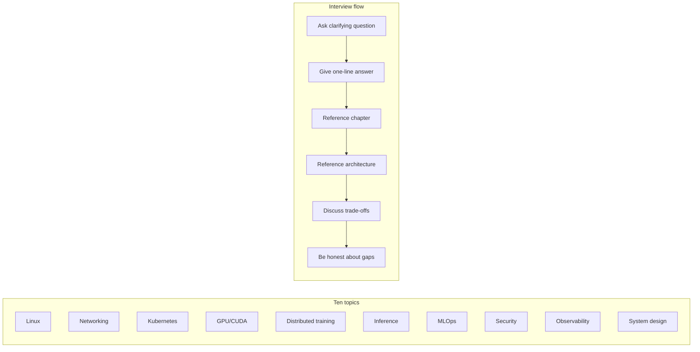

# 19.15 Interview cheat sheet

| Field | Value |
|---|---|
| Level | Intermediate |
| Priority tier | 1 |
| Lab venue | On-prem |
| Part | Part 19: Capstones, design and interview readiness |
| Primary sources | NVIDIA Zero-to-Hero Volume 26 (`chapter-XX-interview-cheat-sheet.md`); Chapter 19.14 (Interview question bank) |
| Cross-references | Chapter 19.14 (Interview question bank); All earlier chapters as the topic references |
| Coverage file | `planning/coverage/chapters/19-15.md` |
| Claim & number ledger | `planning/ledgers/19-15.md` |

## Cheat sheet at a glance



The ten topics and the interview flow; the candidate walks through every topic with the flow.

## Why this matters for AI infrastructure

The interview cheat sheet is the one-page summary the candidate brings to the interview. The cheat sheet covers: the ten core topics, the top questions per topic, the one-line answers, and the handbook chapter references. The cheat sheet is the pocket card that summarises everything the candidate needs to know.

The cheat sheet is what makes the interview preparation efficient. The candidate reads the question bank (Chapter 19.14); the candidate studies the relevant chapters; the candidate prints the cheat sheet; the candidate brings the cheat sheet to the interview. The cheat sheet is the last-mile preparation.

```text
Why the interview cheat sheet matters (V26; Ch 19.14):
- The interview cheat sheet is the one-page summary of the question bank.
  The cheat sheet covers every topic, the top questions, and the one-line
  answers.
- The cheat sheet has three perspectives: the candidate's view (what to
  bring); the interviewer's view (what the candidate should know); the
  platform team's view (what the answer should be).
- The cheat sheet is the interview pocket card. The candidate brings the
  cheat sheet; the candidate references the cheat sheet; the candidate
  succeeds in the interview.
```

Three operational realities make this chapter a platform-team deliverable rather than a tutorial:

1. **The cheat sheet is the interview preparation.** The candidate reads the question bank; the candidate studies the relevant chapters; the candidate prints the cheat sheet.
2. **The cheat sheet is the interviewer's reference.** The interviewer uses the cheat sheet to verify the candidate's depth; the interviewer uses the cheat sheet to score the candidate.
3. **The cheat sheet is the platform team's voice.** The platform team uses the cheat sheet to ensure the candidates' answers align with the platform team's architecture.

**Before a team can claim they have a systematic interview preparation, the team must have produced this cheat sheet. A team that has not produced the cheat sheet is a team that does not have a consistent interview process.**

## Prerequisites and outcomes

### Prerequisites

- Chapter 19.14 (Interview question bank).

### Outcomes

After completing this chapter you will be able to:

1. Memorise the one-line answers for the top questions per topic.
2. Reference the relevant handbook chapter for every question.
3. Walk through the cheat sheet before the interview; refresh the memory.
4. Score the candidate's interview responses against the cheat sheet's expected answers.
5. Update the cheat sheet as the handbook evolves.

---

## 1. The one-page cheat sheet

### 1.1 Linux

**Q: What is the difference between cgroups v1 and v2?**
**A:** Cgroups v1 has multiple hierarchies (one per controller); cgroups v2 has a single unified hierarchy. Cgroups v2 has better resource isolation, better PSI, and is the recommended version for new deployments.

**Q: What is the OOM killer?**
**A:** The Linux kernel's last-resort memory management. When the system runs out of memory, the kernel invokes the OOM killer, which terminates a process based on memory usage and `oom_score_adj`. The fix is to set memory limits and tune `oom_score_adj`.

**Chapter reference:** Chapter 1 (Linux internals).

### 1.2 Networking

**Q: What is the difference between TCP and UDP?**
**A:** TCP is connection-oriented, reliable, ordered, and flow-controlled. UDP is connectionless, unreliable, unordered, and has no flow control.

**Q: What is RDMA?**
**A:** RDMA (Remote Direct Memory Access) is a network technology that allows direct memory access without OS or CPU involvement. RDMA gives lower latency and higher bandwidth than TCP. RoCE is the Ethernet-based RDMA; Infiniband is the native RDMA fabric.

**Chapter reference:** Chapter 2 (Networking) and Chapter 12 (AI networking).

### 1.3 Kubernetes

**Q: What is the difference between a Deployment and a StatefulSet?**
**A:** A Deployment manages stateless workloads; pods are interchangeable. A StatefulSet manages stateful workloads; pods have stable network identities and persistent storage.

**Q: What is the difference between a Service and an Ingress?**
**A:** A Service is a Kubernetes abstraction that exposes pods as a network service (L4). An Ingress manages external HTTP/HTTPS access to services (L7).

**Chapter reference:** Chapter 5 (Kubernetes).

### 1.4 GPU/CUDA

**Q: What is the difference between a CPU and a GPU?**
**A:** A CPU is optimised for serial execution; it has few cores with large caches. A GPU is optimised for parallel execution; it has thousands of small cores.

**Q: What is the KV cache?**
**A:** The Key-Value cache that stores the attention keys and values for every token in the context. The KV cache memory scales with batch size and sequence length.

**Chapter reference:** Chapter 10 (GPU and CUDA) and Chapter 15 (Inference).

### 1.5 Distributed training

**Q: What is the difference between data parallel and model parallel?**
**A:** Data parallel splits the data across GPUs; each GPU has a copy of the model. Model parallel splits the model across GPUs; each GPU has a portion of the model.

**Q: What is FSDP?**
**A:** Fully Sharded Data Parallel: shards the model parameters, gradients, and optimiser state across GPUs. FSDP reduces memory footprint; FSDP enables training larger models.

**Chapter reference:** Chapter 14 (Distributed training).

### 1.6 Inference

**Q: What is the difference between throughput and latency in inference?**
**A:** Throughput is inferences per second (or tokens per second for LLMs). Latency is time per inference (or time to first token / time per output token for LLMs).

**Q: What is PagedAttention?**
**A:** PagedAttention is the vLLM technique for managing the KV cache. PagedAttention divides the KV cache into fixed-size pages; the pages are allocated on demand. PagedAttention enables larger batch sizes.

**Chapter reference:** Chapter 15 (Inference).

### 1.7 MLOps

**Q: What is the difference between DVC and Git?**
**A:** Git is for versioning code; DVC is for versioning data. Git tracks file changes via content hashing; DVC tracks data file changes via content hashing and stores the metadata in Git.

**Q: What is the promotion gate?**
**A:** A function that decides whether a model advances to the next stage (e.g. from staging to production). The promotion gate is mechanical; the gate's exit code is the only thing that advances the stage.

**Chapter reference:** Chapter 16 (MLOps).

### 1.8 Security

**Q: What is the difference between authentication and authorisation?**
**A:** Authentication verifies the identity of a user or service. Authorisation determines what the user or service can do.

**Q: What is the threat model for AI infrastructure?**
**A:** STRIDE adapted for AI: Spoofing (model identity), Tampering (training data poisoning), Repudiation (model prediction denial), Information Disclosure (model weight exfiltration), Denial of Service (GPU pool exhaustion), Elevation of Privilege (namespace-to-admin escalation).

**Chapter reference:** Chapter 18 (Security).

### 1.9 Observability

**Q: What is the USE method?**
**A:** For every resource, check Utilisation, Saturation, and Errors. The bottleneck is the resource that is most utilised, most saturated, or most error-prone.

**Q: What is the SLO?**
**A:** The Service Level Objective: the target that the platform team commits to meet. The SLO has three components: the SLI, the target, and the time window.

**Chapter reference:** Chapter 17 (Observability).

### 1.10 System design

**Q: How would you design a multi-tenant AI inference platform?**
**A:** GPU pool sized for tokens per second; KV cache memory sized for concurrency; autoscaling on concurrency; canary rollout; multi-region failover; cost per inference tracked on FinOps.

**Q: How would you design a multi-node training cluster?**
**A:** GPU pool sized for the workload; fat-tree or dragonfly+ topology; Lustre + object storage; Slurm or Kueue+KAI scheduler; failure domains with redundancy; image signing + RBAC + audit; FinOps integration.

**Chapter reference:** Chapters 19.1-19.13 (Capstones).

---

## 2. The interview-day checklist

### 2.1 Before the interview

- [ ] Read the question bank (Chapter 19.14).
- [ ] Review the relevant handbook chapters.
- [ ] Print the cheat sheet.
- [ ] Review the reference architectures (Chapters 19.1-19.13).
- [ ] Practice the top 5 questions per topic.
- [ ] Get a good night's sleep.

### 2.2 During the interview

- [ ] Ask clarifying questions before answering.
- [ ] Reference the handbook chapter by name when relevant.
- [ ] Reference the reference architecture by diagram when relevant.
- [ ] Discuss trade-offs; the interviewer rewards system thinking.
- [ ] Be honest about what you don't know; the interviewer rewards humility.

### 2.3 After the interview

- [ ] Note the questions you couldn't answer.
- [ ] Add those questions to the question bank.
- [ ] Update the cheat sheet with the one-line answers.
- [ ] Share the lessons with the platform team.

---

## 3. Hands-on lab

This lab walks through the interview cheat sheet capstone: the one-line answers, the chapter references, the interview-day checklist. The lab is **untested** in this repository.

### 3.1 Prerequisites

- Chapter 19.14 (Interview question bank).

### 3.2 Step 1: review the cheat sheet

```bash
# Print the cheat sheet
cat code/part19/interview_cheat_sheet.md | lp -d
```

### 3.3 Step 2: walk through the top questions

```bash
# Walk through the top questions
python code/part19/walkthrough.py \
  --topic all \
  --output walkthrough.md
```

### 3.4 Step 3: simulate the interview

```bash
# Simulate the interview
python code/part19/simulate_interview.py \
  --questions code/part19/interview_cheat_sheet.md \
  --output interview_sim.md
```

### 3.5 What to record

After the lab, you should be able to answer five questions in five seconds each:

1. What is the one-line answer for the GPU vs CPU question?
2. What is the one-line answer for the FSDP question?
3. What is the one-line answer for the KV cache question?
4. What is the one-line answer for the promotion gate question?
5. What is the one-line answer for the SLO question?

If any takes more than 30 seconds, the cheat sheet is not yet memorised. The lab is **untested** against a live candidate scenario.

---

## Exercises

1. **Add new Linux Q&A.** Add new Linux questions and one-line answers. *Solution sketch:* the cheat sheet YAML.
2. **Add new networking Q&A.** Add new networking questions and one-line answers. *Solution sketch:* the cheat sheet YAML.
3. **Add new Kubernetes Q&A.** Add new Kubernetes questions and one-line answers. *Solution sketch:* the cheat sheet YAML.
4. **Add new GPU Q&A.** Add new GPU questions and one-line answers. *Solution sketch:* the cheat sheet YAML.
5. **Add new system design Q&A.** Add new system design questions and one-line answers. *Solution sketch:* the cheat sheet YAML.
6. **Add an interview-day checklist.** Build a checklist for the interview day. *Solution sketch:* the checklist Markdown.

---

## Checkpoint questions

<details><summary>1. What is the interview cheat sheet?</summary>
The one-page summary of the question bank. The cheat sheet covers every topic, the top questions, and the one-line answers. The cheat sheet is the pocket card the candidate brings to the interview.
</details>

<details><summary>2. What is the difference between cgroups v1 and v2?</summary>
Cgroups v1 has multiple hierarchies (one per controller); cgroups v2 has a single unified hierarchy. Cgroups v2 has better resource isolation and is the recommended version for new deployments.
</details>

<details><summary>3. What is the difference between TCP and UDP?</summary>
TCP is connection-oriented, reliable, ordered, and flow-controlled. UDP is connectionless, unreliable, unordered, and has no flow control.
</details>

<details><summary>4. What is the difference between a Deployment and a StatefulSet?</summary>
A Deployment manages stateless workloads; pods are interchangeable. A StatefulSet manages stateful workloads; pods have stable network identities and persistent storage.
</details>

<details><summary>5. What is the difference between a CPU and a GPU?</summary>
A CPU is optimised for serial execution; it has few cores with large caches. A GPU is optimised for parallel execution; it has thousands of small cores.
</details>

<details><summary>6. What is the KV cache?</summary>
The Key-Value cache that stores the attention keys and values for every token in the context. The KV cache memory scales with batch size and sequence length.
</details>

<details><summary>7. What is FSDP?</summary>
Fully Sharded Data Parallel: shards the model parameters, gradients, and optimiser state across GPUs. FSDP reduces memory footprint; FSDP enables training larger models.
</details>

<details><summary>8. What is the difference between throughput and latency in inference?</summary>
Throughput is inferences per second (or tokens per second for LLMs). Latency is time per inference (or time to first token / time per output token for LLMs).
</details>

<details><summary>9. What is the difference between DVC and Git?</summary>
Git is for versioning code; DVC is for versioning data. Git tracks file changes; DVC tracks data file changes via content hashing and stores the metadata in Git.
</details>

<details><summary>10. What is the promotion gate?</summary>
A function that decides whether a model advances to the next stage. The promotion gate is mechanical; the gate's exit code is the only thing that advances the stage.
</details>

<details><summary>11. What is the difference between authentication and authorisation?</summary>
Authentication verifies the identity of a user or service. Authorisation determines what the user or service can do.
</details>

<details><summary>12. What is the threat model for AI infrastructure?</summary>
STRIDE adapted for AI: Spoofing, Tampering, Repudiation, Information Disclosure, Denial of Service, Elevation of Privilege. The threat model is the foundation of the security controls.
</details>

<details><summary>13. What is the USE method?</summary>
For every resource, check Utilisation, Saturation, and Errors. The bottleneck is the resource that is most utilised, most saturated, or most error-prone.
</details>

<details><summary>14. What is the SLO?</summary>
The Service Level Objective: the target that the platform team commits to meet. The SLO has three components: the SLI, the target, and the time window.
</details>

<details><summary>15. How would you design a multi-tenant AI inference platform?</summary>
GPU pool sized for tokens per second; KV cache memory sized for concurrency; autoscaling on concurrency; canary rollout; multi-region failover; cost per inference tracked on FinOps.
</details>

<details><summary>16. What is the relationship between the cheat sheet and the question bank?</summary>
The cheat sheet is the short form; the question bank is the long form. The cheat sheet summarises the bank; the bank elaborates the cheat sheet. The two are complementary.
</details>

<details><summary>17. What is the most common interview success pattern?</summary>
The candidate asks clarifying questions. The candidate understands that the question is ambiguous; the candidate asks for clarification; the candidate demonstrates system thinking.
</details>

<details><summary>18. What is the most expensive interview mistake?</summary>
The candidate does not ask clarifying questions. The candidate assumes the question is unambiguous; the candidate designs a system that does not match the interviewer's intent.
</details>

<details><summary>19. What is the relationship between the cheat sheet and the system design capstones?</summary>
The cheat sheet references the system design capstones. The system design capstones are the blueprints the candidate points at; the capstones are the integrated picture the candidate demonstrates.
</details>

<details><summary>20. What five questions should the interview cheat sheet lab let you answer in five seconds each?</summary>
What is the one-line answer for the GPU vs CPU question. What is the one-line answer for the FSDP question. What is the one-line answer for the KV cache question. What is the one-line answer for the promotion gate question. What is the one-line answer for the SLO question. If any takes more than 30 seconds, the cheat sheet is not yet memorised.
</details>

---

## Sources and review notes

- NVIDIA Zero-to-Hero Volume 26. Source for the interview cheat sheet patterns. The wording has been rewritten in the handbook's voice.
- Chapter 19.14 (Interview question bank) for the long form.

### Cross-references to other handbook chapters

- Chapter 19.14 for the interview question bank.
- All earlier chapters as the topic references.

### Migrated from `nvidia-devops`

The interview cheat sheet operational patterns draw on Volume 26 and the gem-book corpora. The wording has been rewritten in the handbook's voice.

### Explicitly labelled inferences

- The one-line answers are starting points; specific answers depend on the depth of the candidate's knowledge.
- The interview-day checklist is a starting point; specific items depend on the interviewer's style.
- The cheat sheet's format is a starting point; specific formats depend on the team's preference.

### Not verified on live hardware

- The lab in Section 3 is **untested** against a live candidate scenario in this repository.
- The cheat sheet assumes the candidate has read the question bank; production preparation may require additional study.
- The interview-day checklist assumes the candidate has experience with interviews; production deployment may require training.
