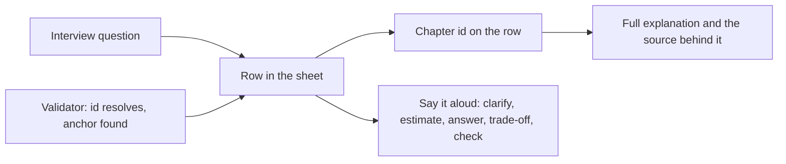

# 19.15 Interview cheat sheet

| Field | Value |
|---|---|
| Level | Intermediate |
| Priority tier | 1 |
| Lab venue | Laptop, no GPU |
| Part | Part 19: Capstones, design and interview readiness |
| Primary sources | Handbook chapters listed per row in the sheet. Gem books: *AI Systems Performance Engineering* ch. 2 and 4, `nvidia-devops-core-interview`, *Systems Performance* 2nd ed. ch. 2 and 4 |
| Cross-references | 19.14 (question bank), 20.29 (the Nebius SRE cheat sheet) |
| Code | `code/part19/c15_interview_cheat_sheet.md`, `c15_sheet_validator.py`, `c15_numbers.py`, `c15_simulate_interview.py`, `c15_walkthrough.py` |
| Coverage file | `planning/coverage/chapters/19-15.md` |
| Claim & number ledger | `planning/ledgers/19-15.md` |

## Why this matters for AI infrastructure

The night before an interview you open your notes and find forty pages. You cannot reread them, and you do not know which numbers matter. A cheat sheet fixes that, but only if you can trust it. A sheet that holds one wrong figure, such as a link rate or an Xid action, costs you more than having no sheet, because you will say it with confidence.

This chapter gives you one general sheet for an AI-infrastructure interview. Every row names the handbook chapter it came from, and a script refuses any row that does not. Anything those chapters labelled unverified is left out. The chapter then teaches the part that notes alone cannot: how to memorise the rows, and what order to say them in when someone is watching.

The Nebius site reliability interview has its own sheet in [chapter 20.29](../part-20-nebius-sre-interview/29-the-8-week-plan-the-final-week-and-the-cheat-sheet.md). This one is the general version for any loop that mixes Linux, Kubernetes, GPUs, networking, training, inference and design. Where the two share a fact, both chapters sourced it.

No source says what any specific company asks. This chapter says what each topic tests and how to answer. It never claims that a named employer asks a named question.

## Prerequisites and outcomes

### Prerequisites

- You have read the topic chapters you want to be examined on. The sheet is a recall aid and does not teach.
- Python 3 and pytest. No GPU, network or secrets.
- Chapter 19.14 helps. The simulator uses its question bank when it exists.

### Outcomes

After this chapter you will be able to:

1. Read any row of the sheet and name the chapter that holds the full explanation.
2. Redo the sheet's arithmetic on a blank page: link rates, 6ND, KV cache, decode ceiling, burn rate, checkpoint interval.
3. Run a timed mock round, score it with a stated rubric and keep a session log.
4. Say an answer in a fixed order: clarify, estimate, answer, trade-off, check.
5. Extend the sheet without breaking its rule that every row has a resolvable source.

---

## 1. How the sheet is built, and why every row has a source id

A candidate says in an interview that a 400 Gbps link moves 400 GB per second. The interviewer waits. The mistake is one factor of eight, and it came from a note written in a hurry. After that, the interviewer has reason to doubt every other number you say.

The sheet is built to prevent that. Each row is one fact with one source chapter id, such as 20.12 or 19.5. Most rows also carry an anchor: a short string that must appear in the cited chapter. The validator `c15_sheet_validator.py` reads the sheet and fails on four things. A row with no id. An id that matches no chapter file. An id that is not in the form `N.M`. An anchor that is missing from the cited chapter.



| Part | What it does | Where it lives |
|---|---|---|
| Sheet | One fact per row, last column is the source id | `c15_interview_cheat_sheet.md` |
| Validator | Fails on a missing, malformed or unresolvable id, a missing anchor, or the word unverified | `c15_sheet_validator.py` |
| Numbers | Recomputes every worked figure the sheet quotes | `c15_numbers.py` |
| Simulator | Timed rounds, random draw, rubric, session log | `c15_simulate_interview.py` |
| Walkthrough | Runs all of the above once, with scripted answers | `c15_walkthrough.py` |

An anchor proves less than it seems to. It shows that the figure appears in the chapter, not that the chapter is right. So the rows lean on chapters sourced against vendor pages or gem books, and the ledger records which figures I also checked against a book.

If a chapter labelled a claim as unverified, my reasoning, or not run, the claim is not on the sheet. The validator rejects the words unverified and TBD in a row. It cannot catch a label that sat in another paragraph, so I checked that by reading.

**Decision rule:** put a fact on your own sheet only when you can name the page it came from, and leave it off when you cannot.

**In one minute:** the sheet is a table of facts, each with a chapter id. A script checks that the id exists and that a key string from the row appears in the chapter. That does not make the facts true, so the rows come from chapters that were sourced against vendor pages and books.

---

## 2. The sheet

You are on a call and the interviewer asks what Xid 79 means and what to do. You do not need a paragraph. You need the row: the code, the catalog action, and the chapter to open afterwards. The sheet below is arranged by the topic that the question will arrive under.

Figures from worked examples are inputs, not measurements. Where chapters disagree, the row says so, as for Xid 79.

### A. Linux triage

| Fact | Source |
|---|---|
| First 60 seconds, in order: `uptime`, `dmesg -T \| tail`, `vmstat -SM 1`, `mpstat -P ALL 1`, `pidstat 1`, `iostat -sxz 1`, `free -m`, `sar -n DEV 1`, `top` | 20.3 |
| Start from the problem statement: what, since when, what changed, who. Then USE for the host and RED for the service | 20.3 |
| Load on Linux counts tasks in uninterruptible sleep, so high load with an idle CPU can mean slow disk | 20.5 |
| Disk `%util` at 100 does not prove saturation. Read `await` and the queue size next to it | 20.3 |
| Bytes free but writes fail: `df -i` shows the inode count, a separate resource that also gives ENOSPC | 20.4 |
| Open files: compare `/proc/PID/fd` with `/proc/PID/limits`. Deleted but still open: `lsof +L1` | 20.4 |
| CPU throttling shows in `cpu.stat` as `nr_throttled` and `throttled_usec`. Sample twice and compare | 20.5 |
| An OOM log line with `CONSTRAINT_MEMCG` means a cgroup limit was hit, not the whole node | 20.5 |
| Exit 143 is death by TERM. Exit 137 is KILL, often the OOM killer. The rule is 128 plus the signal number | 20.7 |
| GPU job slow while the pod is Running: check CPU throttling on the data-loader processes before blaming the GPU | 5.9 |

### B. Networking

| Fact | Source |
|---|---|
| Connection refused is an immediate answer, usually nothing listening. A timeout means a packet or its reply was dropped | 20.6 |
| Two queues can overflow: the SYN backlog and the accept queue. Many `CLOSE-WAIT` sockets mean our application did not close them | 20.6 |
| Large responses hang while small ones work: suspect an MTU black hole. An overlay that uses 50 bytes leaves 1,450 | 20.6 |
| New connections fail while old ones work: compare the conntrack count with `nf_conntrack_max` | 20.6 |
| DNS in a pod: `ndots:5` multiplies lookups for a name such as `api.example.com` | 20.6 |
| Do not test a training fabric with `iperf3`. It uses the kernel TCP stack and training does not | 19.5 |
| A 4x NDR InfiniBand link carries 400 Gbps, which is 50 GB/s. Divide bits by eight | 19.5 |
| PCIe Gen5 x16 gives roughly 64 GB/s per direction | 19.5 |
| Host-side RDMA tools: `ib_write_bw` and `ib_write_lat` test the wire. `ib_write_bw --use_cuda` tests the GPU memory path | 19.5 |
| Pause frames rising by millions per second in `ethtool -S` point to a PFC storm from badly tuned ECN | 12.4 |

### C. Kubernetes debug order

| Symptom | Owner and first object to read | Source |
|---|---|---|
| Pending, no node | scheduler: Pod events, node Allocatable and taints | 20.23 |
| ImagePullBackOff | kubelet and runtime: Pod events, registry | 20.23 |
| Restarts rising | kubelet: `Last State`, probe events, `logs --previous` | 20.23 |
| Missing from a Service | EndpointSlice controller: Pod Ready condition, selector | 20.23 |
| Replicas not following load | HPA: conditions and metrics | 20.23 |
| Pods vanish when a node dies | node controller: Node conditions, taints | 20.23 |

| Fact | Source |
|---|---|
| Restart back-off starts at 10 s, doubles, and caps at 300 s | 20.23 |
| Kubelet sends SIGTERM, waits the grace period (30 s by default), then KILL | 20.7 |
| GPUs are an integer extended resource, `nvidia.com/gpu`, requested in `limits` | 11.2 |
| One pod can never span nodes. A multi-node job is a gang of pods that must start together | 11.7 |
| Topology Manager with `single-numa-node` keeps the GPU, CPU cores and memory on one NUMA node | 11.6 |
| A PodDisruptionBudget with zero allowed disruptions blocks a node drain | 20.23 |

### D. GPU facts

| Fact | Source |
|---|---|
| H100 SXM: 80 GB memory, 3.35 TB/s bandwidth (NVIDIA H100 page) | 20.12 |
| H100 BF16 dense Tensor Core peak: 989 TFLOPS. The 1,979 on the datasheet assumes sparsity | 9.2 |
| DGX H100 has 8 x 80 GB, 640 GB total. DGX H200 has 8 x 141 GB, 1,128 GB total | 9.1 |
| NVLink per GPU: 900 GB/s on Hopper, 1.8 TB/s on Blackwell | 9.1 |
| Blackwell HBM3e is about 8 TB/s per GPU, 2.4 times Hopper at 3.35 TB/s | 10.7 |
| An NVL72 GPU has 18 NVLink 5 ports at 100 GB/s each, 1.8 TB/s in all | 9.5 |
| H100 80GB MIG profiles: 1g.10gb x7, 1g.20gb x4, 2g.20gb x3, 3g.40gb x2, 4g.40gb x1, 7g.80gb x1 | 19.8 |
| A100 40GB MIG profiles: 1g.5gb x7, 2g.10gb x3, 3g.20gb x2, 7g.40gb x1 | 19.8 |
| MIG gives hardware isolation. Time-slicing shares memory and cache with no hardware boundary | 11.25 |
| In `nvidia-smi topo -m` on a healthy DGX H100, GPU pairs show `NV18`. A GPU and NIC pair to benchmark shows `PIX`. `SYS` crosses the CPU socket link | 19.5, 9.2 |

### E. NCCL and fabric

| Fact | Source |
|---|---|
| busbw = algbw x factor. AllReduce factor is 2(n-1)/n, AllGather and ReduceScatter (n-1)/n | 19.5 |
| Compare busbw, not algbw, with the link rate. busbw stays flat as ranks grow on a healthy fabric | 19.5 |
| 16 ranks, 1 GiB AllReduce in 44,739.2 us: algbw 24.00 GB/s, busbw 45.00 GB/s, 90 percent of a 50 GB/s link | 19.5 |
| Never report bandwidth from a run whose `#wrong` is not zero. `-c` defaults to 1 | 19.5 |
| Under 1 GB/s with `Using network Socket` in the log is the silent fallback, for example `NCCL_IB_DISABLE=1` | 19.5 |
| Bootstrap hang: set `NCCL_SOCKET_IFNAME=^docker,lo` | 19.5 |
| NCCL 2.31 `NCCL_RUN_DIAGNOSTICS=1` runs checks at init. RAS exists since 2.24, port 28028 | 19.5 |
| In a hung collective the ranks that print timeouts are the healthy ones. Find the rank that never arrived | 19.5 |
| Bisect a slow cluster: ceil(log2 N) rounds, 3 for 8 nodes, 7 for 128 | 19.5 |
| Default DDP gradient bucket is 25 MB. Many small buckets make training slow while the wire test passes | 19.5 |
| 54-day Llama 3 405B run: faulty GPU 30.1 percent of interruptions as printed in the paper (its own counts give 148 of 419, which is 35.3 percent), HBM3 17.2, software 12.9, switch or cable 8.4, NIC 1.7 | 19.5 |

### F. Training numbers

| Fact | Source |
|---|---|
| Training compute is about 6 x parameters x tokens FLOPs | 9.10 |
| 70B model, 100B tokens: 4.2e22 FLOPs, 9.6 days on 128 H100 at 40 percent MFU | 9.10 |
| MFU = achieved model FLOPS divided by peak. 430 of 989 TFLOPS is 43.48 percent | 9.2 |
| Llama 3 scale: about 50,700 GPU-hours per interruption, so the job MTBF falls as GPU count rises | 19.4 |
| Checkpoint interval from Young: tau = sqrt(2 x C x M), with C the blocking write time and M the job MTBF | 19.4 |
| Job MTBF is node MTBF divided by node count when nodes fail independently. Measure it from logs | 19.4 |
| Two-stage checkpoint: copy shards to host DRAM or local NVMe in seconds, then flush to shared storage in the background | 13.7 |
| 16,384 GPUs, job MTBF 3.09 h, 22.5 s blocking write, 600 s restart: Daly interval 685 s, waste 11.47 percent. Async 2 s write: 209 s, 7.22 percent | 19.4 |
| FSDP shards parameters, gradients and optimiser state across all GPUs instead of replicating them on every rank | 14.5 |

### G. Inference numbers

| Fact | Source |
|---|---|
| KV bytes per token = 2 x layers x KV heads x head dim x bytes per element | 20.12 |
| Qwen3-8B BF16: 147,456 B per token. A 2,500-token request needs 0.36864 GB | 20.12 |
| Llama 3.1 8B BF16: 32 layers, 8 KV heads, head dim 128, so 131,072 B per token | 19.3 |
| Weights in GB at half precision = billions of parameters x 2. An 8B model is about 16.4 GB | 20.12 |
| Batch-one decode ceiling = memory bandwidth divided by weight bytes. 3.35 TB/s and 16.4 GB give about 204 tokens/s | 20.12 |
| Prefill is compute-bound and decode is memory-bandwidth-bound, so they can be split onto separate pools | 15.1 |
| End-to-end latency = TTFT + ITL x (N - 1). 0.4 + 0.04 x 499 = 20.36 s | 20.19 |
| A hang can still return 200 on `/health` in vLLM v0.32.0, so alert on token rate | 20.18 |
| 429 means this tenant is over its limit. 503 means this server is overloaded or draining | 20.21 |

### H. Storage and bandwidth arithmetic

| Fact | Source |
|---|---|
| A 112 GB checkpoint on a shared file system absorbing 5 GB/s blocks the job for about 22.5 s. Time is size over bandwidth | 19.4 |
| Mixed-precision checkpoint with Adam state costs 14 bytes per parameter. 8.03 billion parameters is about 112 GB | 19.4 |
| Millions of tiny files make the storage system spend its time opening them, so GPUs wait for data | 13.6 |
| GPUDirect Storage removes the host bounce buffer between storage and GPU memory | 13.3 |

### I. Observability and SLOs

| Fact | Source |
|---|---|
| Burn rate = error ratio / (1 - SLO). Hours to empty = period hours / burn rate | 20.19 |
| 99.9 percent over 30 days is 43.2 minutes of full outage. A 1 percent error ratio is burn 10, empty in 72 hours | 20.19 |
| Workbook alerts for 99.9 percent: page at 14.4 (1 h and 5 min), page at 6 (6 h and 30 min), ticket at 1 (3 d and 6 h) | 20.19 |
| Page on gateway SLO burn. Engine metrics explain a burn and do not page | 20.19 |
| `rate` before `sum`. Keep `le` in `histogram_quantile`. Never average p99 values | 20.25 |
| Alertmanager defaults: `group_wait` 30 s, `group_interval` 5 min, `repeat_interval` 4 h | 20.25 |
| Alert on DCGM exporter counters for Xid and ECC, and keep label cardinality inside a budget | 19.7 |

### J. Failure signatures and Xid actions

| Signal | What the catalog or chapter says to do | Source |
|---|---|---|
| Xid 13, 31, 32 | Restart the application | 19.6 |
| Xid 43, 63, 92 | Ignore the immediate action. Track the rate | 19.6 |
| Xid 45 | Depends: alone, restart the fabric manager. Otherwise follow the earlier Xid | 19.6 |
| Xid 48 (double-bit ECC) | Reset the GPU. Together with Xid 63 or 64, drain and reset | 19.6 |
| Xid 64, 95, 119, 120 | Reset the GPU | 19.6 |
| Xid 74 (NVLink error) | NVLink workflow, then contact support. Reset or reboot clears it | 19.6 |
| Xid 79 (fell off the bus) | The catalog action is restart of the bare-metal node. 20.16 and 20.18 word it differently, so read the live catalog | 19.6, 20.16 |
| TTFT p99 high | Queue growth, cache hit collapse, KV exhaustion. Check queue time against waiting requests | 20.18 |
| Tokens per second zero | Hang, Xid fault or crash loop. Read `dmesg` and the NCCL log | 20.18 |
| Pods restarting | Liveness kill, startup OOM or runtime OOM. Read Last State | 20.18 |

### K. Design speaking plan, 45 minutes

| Minutes | What to say | Source |
|---|---|---|
| 0 to 5 | Requirements, assumptions and a back-of-envelope estimate. Start with numbers, not boxes | 20.13 |
| 5 to 10 | API contract, control plane and data plane | 20.13 |
| 10 to 26 | Gateway and limits, then router and cache | 20.13 |
| 26 to 36 | Pools, placement, autoscaling and regions | 20.13 |
| 36 to 45 | Isolation, failure modes, observability and rollout | 20.13 |
| Estimate method | Demand, per-GPU ceiling, times 0.9, round up, add a spare | 20.12 |

### L. Behavioural and closing

| Fact | Source |
|---|---|
| Project deep dive, "what would you change": name one change, the evidence, what you would measure first, and what you would leave alone | 20.28 |
| When you do not know: say what you know, name the nearest mechanism, say how you would check. Never present a guessed flag as certain | 20.29 |
| Questions to ask: on-call load, how reliability is measured, the biggest recent incident class | 20.28 |
| Incident script: confirm impact, declare severity, ask what changed, pick a reversible mitigation first | 20.26 |

The sheet leaves out vendor prices, because no cited chapter gives a current one. It has no claim of the form "company X asks Y". Its NCCL variables are only those that [chapter 19.5](./05-capstone-an-nccl-tests-fabric-lab.md) checked against the NCCL documentation.

**Decision rule:** read one section of the sheet aloud per day, and open the cited chapter for any row you cannot explain in two sentences.

**In one minute:** twelve sections, about a hundred rows, one source id on each. The Xid rows follow the NVIDIA catalog as captured in chapter 19.6. The MIG rows follow the NVIDIA MIG guide as captured in chapter 19.8. The Nebius-specific sheet stays in chapter 20.29.

---

## 3. The arithmetic behind the numbers

The interviewer says: "Roughly how long to train a 70-billion-parameter model on 100 billion tokens with 128 H100s?" There is no table to read. You have to produce a number from three inputs and explain it. Candidates who memorised only the answer fail the follow-up, which changes one input.

The sheet therefore stores formulas and one worked example for each. The script `c15_numbers.py` recomputes every example, and its tests pin each figure. The output below is from a real run. The inputs come from the cited chapters and are examples, not measurements.

```text
400 Gbps link in GB/s                      50
70B x 100B tokens FLOPs                    4.20e+22
days on 128 H100 at 40% MFU                9.6
MFU 430 of 989 TFLOPS                      43.48%
Llama 3.1 8B KV bytes per token            131072
Qwen3-8B KV bytes per token                147456
decode ceiling 3350 GB/s, 16.4 GB          204
e2e 0.4 + 0.04 x 499                       20.36
burn at 1% errors, 99.9% SLO               10
hours to empty at burn 10                  72
minutes of budget, 99.9%, 30 d             43.2
budget used, burn 14.4 for 1 h             2%
AllReduce busbw, 24 GB/s at 16 ranks       45
bisect rounds, 8 and 128 nodes             3 and 7
16384 GPUs, write 22.5 s: Daly s, waste    685 s, 11.47%
16384 GPUs, write 2.0 s: Daly s, waste     209 s, 7.22%
```

The 6ND rule says compute is about six times parameters times tokens, which gives 4.2e22 floating-point operations here. Divide by the usable rate: 128 GPUs, 989 trillion operations per second each for BF16 dense, times a utilisation of 0.40. The answer is 9.6 days. Say the assumption aloud, because the 0.40 is a planning figure and not a guarantee.

The inference lines follow the same pattern. KV cache bytes per token are two, for keys and values, times layers, times KV heads, times head dimension, times bytes per element. For Llama 3.1 8B that is 2 x 32 x 8 x 128 x 2, which is 131,072 bytes. The decode ceiling is memory bandwidth over weight bytes. At 3,350 GB/s and 16.4 GB that is about 204 tokens per second for one request, and no real system beats it.

Burn rate is the error ratio divided by one minus the SLO. At 99.9 percent a 1 percent error ratio is a burn of 10, which empties a 30-day budget in 72 hours.

The checkpoint lines come from chapter 19.4, which scales a published interruption rate to 16,384 GPUs. At that size the Daly interval is 685 seconds and waste is 11.47 percent. Cutting the blocking write from 22.5 s to 2 s with asynchronous staging takes waste to 7.22 percent. The chapter labels the scaling as its own reasoning, so say "about" and "if failures are independent".

Two habits make these answers safe. Write the units next to every number, because the factor-of-eight error is a units error. And state your assumptions, because an interviewer can change one but cannot argue with it.

**Decision rule:** never give a figure without its formula and its inputs, and keep the units in your hand.

**In one minute:** the sheet's numbers come from short formulas that a script recomputes. Practise the formula, not the answer. Say inputs, units and assumption, then the result.

---

## 4. Memorising the sheet

It is three days before the interview. You have read the sheet five times and feel fluent. Then a friend asks for the busbw factor for AllReduce and you freeze. Reading felt like knowing, but it was only recognition. Recall is a different skill, and only recall works under pressure.

The method below is my reasoning. No source in this handbook measured how well it works, so treat it as a plan and adjust it to what you find. It uses three passes.

| Pass | What you do | Stop when |
|---|---|---|
| Read | Read one section aloud, opening the cited chapter for each row you cannot explain | You can explain every row in two sentences |
| Blank page | Close the sheet and write the section from memory, formulas and units included | You miss no more than one row |
| Spoken | Answer the section's likely question aloud against a timer, then compare with the row | The first sentence is right without a pause |

Space the passes: read on day one, blank page on days two and four, spoken pass on days three and five. Missed rows go into a box you review the next day. Chapter 20.29 has a flashcard extractor and a schedule generator you can reuse.

Learn the formulas of sections E to I first, because they let you rebuild many rows. Learn the Xid and failure rows next, because they are lookups. Learn the design plan last, because the mock rounds practise it.

Do not memorise a row you cannot explain. If you say "Xid 79, restart the node" and are asked why, you need the next sentence. The Xid 79 row is a prompt to say "I would read the live catalog for my driver".

**Decision rule:** test yourself on a blank page, because recognising a row is not the same as recalling it.

**In one minute:** read, then write from memory, then speak against a timer, spaced over several days. Learn formulas first, lookups second and the speaking order last. Never memorise a row you cannot explain.

---

## 5. The order to say things aloud

The interviewer asks, "A training job is slow. What do you do?" You name ten checks in ninety seconds, and none is tied to the symptom. The interviewer cannot tell whether you reason or recite.

An answer needs an order that the interviewer can follow. The order below is my reasoning, shaped by the speaking plans in chapters 20.13, 20.26 and 20.29. It has five steps.

| Step | Say | Example |
|---|---|---|
| 1 Clarify | One or two questions, then a stated assumption | "Is it slower than last week, or slower than the plan? I will assume last week." |
| 2 Frame | Name the layers or the formula you will use | "I will go from the node bus up to the framework." |
| 3 Answer | The first check or the number, with units | "First `nvidia-smi topo -m`, then a wire test." |
| 4 Trade-off | What your answer costs or assumes | "A full benchmark takes the node out of service." |
| 5 Check | How you would know you are right | "Busbw should match the saved baseline." |

For a debugging question, steps 2 and 3 repeat as you move down the layers. The sheet's Kubernetes table and the NCCL validation ladder in chapter 19.5 are the frames. For an estimate, step 2 is the formula and step 3 the arithmetic. For a design question, use the 45-minute plan in section K, and spend the first five minutes on requirements and numbers.

For a behavioural question, use the situation, task, action and result form, known as STAR. This is a common interview convention and no handbook source tests it, so it is my advice. Spend most of the time on your own action and a measured result. Chapter 20.28 gives the probe that follows a project story. Prepare one story that survives it.

When you do not know, say what you do know, name the nearest mechanism, and say how you would check. Chapter 20.29 states the rule that you never present a guessed flag or default as certain. Saying "I would look that up in the man page" costs nothing. A wrong flag said with confidence costs a lot.

At the end the interviewer asks if you have questions. Ask about things that teach you the real constraints. Chapter 20.28 lists four: how the on-call rota is built and how many pages need a human, who owns the SLOs, the last major incident and what changed, and how failing GPUs are found and replaced. Ask two, and listen to the answers.

**Decision rule:** say the clarifying question and your assumption before any technical content.

**In one minute:** clarify, frame, answer, name the trade-off, then say how you would check. For design use the 45-minute plan, for behavioural questions use STAR with a measured result, and when stuck say what you would look up.

---

## 6. The mock-interview simulator

A mock interview with a friend is worth a lot and is hard to schedule. The simulator gives you a cheaper first pass. It draws random questions, starts a timer, scores your typed answer against a stated rubric and writes a session log. It does not understand your answer, so it cannot replace a person.

The question source is `c14_question_bank.json`, the bank from chapter 19.14, when that file exists and has a usable shape. Otherwise the simulator uses twelve built-in questions across Linux, networking, Kubernetes, GPU, training, inference, observability, failure, design and behavioural topics. Each question has a source chapter id and groups of key words. The first output line names the source used.

The rubric has five parts and sums to 100.

| Part | Points | Awarded when |
|---|---|---|
| Coverage | 50 | Each group of key words is split evenly. A group counts when any word in it appears |
| Number | 10 | The answer contains a number with a unit |
| Trade-off | 10 | The answer names a trade-off, using words such as "instead of", "but" or "however" |
| Opening | 10 | A clarifying step or an assumption appears in the first 300 characters |
| Time | 20 | Full marks within the limit, half up to one and a half times the limit, none beyond |

The limits are real. Key-word matching rewards the right words in the wrong sentence and punishes a correct answer in other words. The number check accepts a wrong number. Use the score to see habits, and use the sheet to judge content.

Each run appends one JSON line to a log. The line holds the date, the question source, and for each round the question id, topic, elapsed time, score parts, missed key groups, notes and the word count of the answer. After a week the log shows which topics you avoid. In the scripted run below the elapsed time is near zero because nothing was typed, so ignore the time score there.

**Decision rule:** use the simulator to find habits and gaps, then use the sheet and a person to judge content.

**In one minute:** it draws questions from the 19.14 bank or a built-in set, times you, scores five parts out of 100 with a keyword heuristic, and logs the session. It cannot judge correctness.

---

## 7. Hands-on lab

This lab runs everything on a laptop. It needs Python 3 and pytest. It uses no GPU, no network and no secrets. Not run: anything that needs GPUs. The sheet's facts about GPUs, NCCL and MIG come from the cited chapters and were not measured here.

The file `code/part19/c15_lab.sh` holds the steps. Run it from the repository root.

```bash
#!/usr/bin/env bash
# Lab for chapter 19.15. Run from the repository root. No GPU, no network, no secrets.
set -euo pipefail

python3 -m pytest code/part19/test_c15_sheet.py code/part19/test_c15_numbers.py \
  code/part19/test_c15_simulate_interview.py code/part19/test_c15_walkthrough.py -q

python3 code/part19/c15_sheet_validator.py
python3 code/part19/c15_numbers.py
python3 code/part19/c15_walkthrough.py

python3 code/part19/c15_simulate_interview.py --rounds 3 --seed 3 --seconds 120 \
  --answers code/part19/c15_sample_answers.json --bank /nonexistent --log /tmp/c15_session_log.jsonl
```

### Step 1. Run the tests

The first command runs the tests for the sheet, the numbers, the simulator and the walkthrough. Expected result: all pass. On the author's Mac the chapter's own test files gave 45 passed, and the full `code/part19` run gave 627 passed and 4 skipped.

What to record: the pass count and the Python and pytest versions.

### Step 2. Validate the sheet

The second command validates the sheet. Expected result: `102 rows, 0 problems`. Now break it on purpose: delete one source id, or change one to 99.9. The validator should name the line and the section. Restore the row afterwards.

What to record: the message for each kind of break you tried.

### Step 3. Read the arithmetic

The third command prints the sixteen lines shown in section 3. Expected result: the same values. Change one input in `c15_numbers.py`, such as MFU from 0.40 to 0.30, and predict the days before you run it. The answer should rise to 12.8 days, because 9.6 divided by 0.75 is 12.8.

What to record: your prediction and the gap.

### Step 4. Run the walkthrough

The fourth command validates the sheet, prints the arithmetic and runs three scripted answers: a good one, a one-line one and one that takes 200 seconds. Expected result: scores of 100, 32.5 and 0.0 and a session mean of 44.2. The scripted clock stands in for real time.

What to record: which rubric part cost the weak answers the most.

### Step 5. Run a mock round

The last command draws three questions with seed 3 and scores the sample answers. It printed this on the author's Mac:

```text
Question source: built-in

Round 1 [kubernetes] (120 s): A pod is Pending. Walk me through the debug order.
  score 100.0/100, 0.0 s, missed: none

Round 2 [failure] (120 s): Xid 79 appears on three nodes at once. What do you do?
  score 80.0/100, 0.0 s, missed: none
  note: no number with a unit
  note: no clarifying step or assumption at the start

Round 3 [observability] (120 s): Design the alerts for a 99.9 percent token API.
  score 80.0/100, 0.0 s, missed: none
  note: no trade-off named
  note: no clarifying step or assumption at the start

Session mean 86.7/100 over 3 rounds
```

Now do it for real. Remove `--answers`, add `--rounds 5`, and type each answer, ending with an empty line. If `code/part19/c14_question_bank.json` exists, drop `--bank /nonexistent` to use the 19.14 bank. This chapter's run used the built-in set because that file did not exist yet.

What to record: the mean score, the notes that repeat, and the topic with the lowest score. Make that topic tomorrow's blank-page section.

**What was run here and what was not:** steps 1 to 5 ran on a Mac without a GPU, with the scripted answers. No live interview, human interviewer or typed timed session was run. The rubric weights are my choice and are not validated against real interview outcomes.

---

## How to answer out loud

These questions ask about your preparation and about how you use notes. Rehearse the order, not the words.

**Question 1. "How do you keep numbers straight under pressure?"** Say that you store formulas, not answers. Give one example, the 6ND rule with units. Say that you state the assumption aloud and that you recompute with a script before the interview. Name the trade-off: a formula is slower than a remembered figure but survives a changed input. Expect "what if MFU is 30 percent".

**Question 2. "What do you do when two sources disagree?"** Use the Xid 79 example. Say that the NVIDIA catalog is the authority, that two handbook chapters worded the action differently, and that you read the live catalog for your driver version before acting. Add that you would say this to an interviewer and not pick one wording.

**Question 3. "Walk me through a 400 Gbps fabric test."** Clarify whether it is a single node or many. Say the ladder: topology, wire, GPU memory path, single-node collective, multi-node collective, application. State that busbw, not algbw, compares with the 50 GB/s link, and that a run with non-zero `#wrong` is discarded. Name the trade-off: the full ladder takes nodes out of service. Say how you would check: against a saved baseline.

**Question 4. "Tell me about your project."** Use STAR. Pick the result you measured, say the number and its unit, then say what you would change and what you would leave alone. If you have no number, say so and say how you would measure it.

**Question 5. "Why should we trust your preparation?"** Say that every row of your sheet has a source and that your mock log named your weakest topic. Do not claim a score as proof of knowledge. It is a habit check.

---

## Exercises

1. **Add three rows.** Add three rows to section C from [chapter 20.23](../part-20-nebius-sre-interview/23-kubernetes-failure-drills-for-gpu-platforms.md), each with an anchor, and run the validator. *Solution sketch:* copy the row format, pick a figure that appears in the chapter text, such as a back-off value, and use it as the anchor. If the validator reports "anchor not found", the string differs from the chapter's wording, so copy it exactly.
2. **Break the validator on purpose.** Write four bad rows in a scratch file: no id, id 99.9, id "chapter five", and a valid id with an invented anchor. *Solution sketch:* run `python3 code/part19/c15_sheet_validator.py scratch.md`. Expect four problems and exit status 1. `test_c15_sheet.py` does the same in code.
3. **Recompute the burn table.** For a 99.95 percent SLO over 30 days, give the error budget in minutes and the hours to empty at a 0.5 percent error ratio. *Solution sketch:* budget is 43,200 x 0.0005, which is 21.6 minutes. Burn is 0.005 over 0.0005, which is 10. Hours to empty is 720 over 10, which is 72.
4. **Change the training example.** Train a 13B model on 300B tokens with 64 H100s at 35 percent MFU. How many days? *Solution sketch:* FLOPs are 6 x 13e9 x 300e9 = 2.34e22. Rate is 64 x 989e12 x 0.35 = 2.215e16 per second. Days are 2.34e22 over 2.215e16 over 86,400, about 12.2.
5. **Run a typed session.** Run five rounds without `--answers`, then read the log. *Solution sketch:* open the JSON line and find the part with the lowest mean across rounds. Write one sentence on the habit, such as never opening with an assumption, and run the topic again tomorrow.
6. **Add a question to the built-in set.** Add a MIG question with key-word groups and a source id, plus a test. *Solution sketch:* append a dict to `BUILTIN`, draw its topic with `--topic`, and score one good and one empty answer.

---

## Checkpoint questions

<details><summary>1. What makes a row valid in the cheat sheet?</summary>
Its last cell holds one or more handbook chapter ids in the form N.M, and each id resolves to a chapter file. Most rows also hold an anchor string that must appear in the cited chapter.
</details>

<details><summary>2. What does an anchor prove, and what does it not prove?</summary>
It proves that the figure appears in the cited chapter. It does not prove that the chapter is correct, so rows come from chapters sourced against vendor pages or books.
</details>

<details><summary>3. Why is busbw, not algbw, the number to compare with a link rate?</summary>
algbw depends on the rank count. busbw applies a factor so that it reflects hardware use and stays flat as ranks grow on a healthy fabric. For AllReduce the factor is 2(n-1)/n.
</details>

<details><summary>4. How many GB per second is a 400 Gbps link?</summary>
50 GB/s, because you divide bits by eight. A 4x NDR InfiniBand link carries 400 Gbps.
</details>

<details><summary>5. State the 6ND rule and its use.</summary>
Training compute is about 6 times parameters times tokens. Divide by GPUs times peak FLOPS times MFU to get seconds. For 70B parameters and 100B tokens that is 4.2e22 FLOPs, or 9.6 days on 128 H100 at 40 percent MFU.
</details>

<details><summary>6. What is MFU and what was the worked example?</summary>
Model FLOPs utilisation is achieved model FLOPS divided by peak. The example in chapter 9.2 is 430 of 989 TFLOPS, which is 43.48 percent.
</details>

<details><summary>7. Give the KV-cache bytes-per-token formula and its value for Llama 3.1 8B.</summary>
Two times layers times KV heads times head dimension times bytes per element. With 32 layers, 8 KV heads, head dimension 128 and BF16, that is 131,072 bytes per token.
</details>

<details><summary>8. What limits single-request decode speed?</summary>
Memory bandwidth, because each token reads all the weights. The ceiling is bandwidth divided by weight bytes. For 3,350 GB/s and 16.4 GB it is about 204 tokens per second.
</details>

<details><summary>9. Why can prefill and decode be split onto separate pools?</summary>
Prefill is compute-bound and decode is memory-bandwidth-bound, so the two phases want different hardware and tuning.
</details>

<details><summary>10. Define burn rate and give the value for a 1 percent error ratio at 99.9 percent.</summary>
Burn rate is the error ratio divided by one minus the SLO. Here it is 10, which empties a 30-day budget in 72 hours.
</details>

<details><summary>11. State the three Workbook alerts for a 99.9 percent SLO.</summary>
Page at burn 14.4 with a 1 hour and 5 minute window. Page at burn 6 with 6 hours and 30 minutes. Ticket at burn 1 with 3 days and 6 hours.
</details>

<details><summary>12. What does the catalog say to do for Xid 13 and 31?</summary>
Restart the application. Chapter 19.6 captured the catalog on 2026-11-10, and you should read the live catalog before acting.
</details>

<details><summary>13. Why is the Xid 79 row on the sheet marked with two chapters?</summary>
Chapter 19.6 gives the catalog action as restart of the bare-metal node. Chapters 20.16 and 20.18 word it differently, so the sheet tells you to read the live catalog and not quote one wording.
</details>

<details><summary>14. Name the MIG profiles on an H100 80GB and the maximum instance counts.</summary>
1g.10gb up to 7, 1g.20gb up to 4, 2g.20gb up to 3, 3g.40gb up to 2, 4g.40gb 1 and 7g.80gb 1, from the NVIDIA MIG guide as captured in chapter 19.8.
</details>

<details><summary>15. In a hung collective, which ranks print the timeout?</summary>
The healthy ranks that arrived on time and waited. Find the rank that never arrived, for example with the NCCL RAS tool.
</details>

<details><summary>16. What is the silent fallback signature in a multi-node NCCL test?</summary>
Busbw under 1 GB/s and `Using network Socket` in the log, for example because `NCCL_IB_DISABLE=1` is set.
</details>

<details><summary>17. What does Young's checkpoint interval say, and what does it assume?</summary>
The interval is the square root of twice the blocking write cost times the job MTBF. It assumes independent random failures, so measure your own MTBF and round down.
</details>

<details><summary>18. In what order do you say a debugging answer?</summary>
Clarify and state an assumption, frame by layer or formula, give the first check with units, name the trade-off, and say how you would verify.
</details>

<details><summary>19. What are the five parts of the simulator's rubric?</summary>
Coverage 50, number 10, trade-off 10, opening 10 and time 20, summing to 100. It is a keyword heuristic and cannot judge correctness.
</details>

<details><summary>20. What do you do when you do not know an answer?</summary>
Say what you do know, name the nearest mechanism and say how you would check. Never present a guessed flag or default as certain.
</details>

---

## Sources and review notes

- *AI Systems Performance Engineering*, ch. 2 "AI System Hardware Overview" (PCIe Gen5 x16 about 64 GB/s per direction, Hopper HBM3 about 3.35 TB/s, Blackwell HBM3e about 8 TB/s, NVLink 5 at 1.8 TB/s per GPU with 18 ports at 100 GB/s) and ch. 4 Table 4-4 (Llama 3 405B interruption causes, as quoted in 19.5). Read in the local copy; the figures on the sheet match.
- `nvidia-devops-core-interview`, chapter "Consolidated Core Interview Questions": the Linux, GPU topology and checkpoint-storm scenarios. Used to choose topics and to cross-check rows. Its claim that `SYS` in `nvidia-smi topo -m` always means NVLink is down is more absolute than chapter 9.2, so the sheet follows 9.2 and 19.5.
- *Systems Performance*, 2nd ed., ch. 2 and 4 (USE method and the first-minute command list), as carried by chapters 20.3 and 20.5.
- *AI Factory*: read, nothing used. It covers industrial AI transformation and has no figures for this sheet.
- NVIDIA Xid catalog and MIG user guide, fetched 2026-11-10 by chapters 19.6 and 19.8. This chapter did not refetch them. Read the live pages before relying on an action or profile.
- NVIDIA H100 page, fetched 2026-11-09 by chapter 20.12 (80 GB, 3.35 TB/s, 1,979 TFLOPS with sparsity).
- Google SRE Workbook, "Alerting on SLOs", Table 5-8, as carried by chapter 20.19.

### Cross-references to other handbook chapters

- [19.14 Interview question bank](./14-interview-question-bank-by-topic.md) is the long form and the simulator's question source.
- [20.29 The 8-week plan, the final week and the cheat sheet](../part-20-nebius-sre-interview/29-the-8-week-plan-the-final-week-and-the-cheat-sheet.md) holds the Nebius-specific sheet, the schedule generator and the flashcard extractor.
- Row sources: the ids in the last column of the sheet, resolved by the validator.

### Migrated from `nvidia-devops`

The earlier draft cited Volume 26, `chapter-XX-interview-cheat-sheet.md`. No such file was found, and none of its wording is kept. The material used from the corpus is the gem-book chapter `nvidia-devops-core-interview` (Chapter 01, "Consolidated Core Interview Questions") in `~/Desktop/books-toon-rag`, used as a cross-check as described above.

### Explicitly labelled inferences

- The memorisation method in section 4, including the spacing, is my reasoning. No source measured it.
- The five-step answer order in section 5 and the STAR advice are my reasoning, informed by the speaking plans in chapters 20.13, 20.26 and 20.29.
- The simulator's rubric weights, key-word groups and the built-in question set are my design and are not validated against real interview results.
- The scaled MTBF for 16,384 GPUs is chapter 19.4's own reasoning, and its independence assumption is labelled there.

### Not verified or not run

- No GPU, NCCL, MIG or Kubernetes step was run. Every hardware figure comes from a cited chapter.
- The anchors prove presence in a chapter, not truth. Part 5 to 15 chapters were drafted earlier and not re-audited here, and 19 rows rest on them. I checked the PCIe, HBM and NVLink 5 figures against *AI Systems Performance Engineering* ch. 2. The Hopper NVLink figure of 900 GB/s, the DGX memory totals and the 989 TFLOPS figure rest on chapters 9.1 and 9.2 alone.
- The simulator was run only with scripted answers. No typed timed session was run.
- The 19.14 question bank did not exist when this chapter was built, so its JSON shape was handled by a tolerant loader and was not tested against the real file.

### Verification log

| Item | Count |
|---|---|
| Sheet rows checked for id and anchor by the validator | 102 |
| Rows whose figure I also checked against a gem book, the NVIDIA MIG JSON, or recomputed by script | 23 |
| Corrected during the build (anchor or wording did not match the chapter) | 14 |
| Rows removed because no cited chapter supported them | 3 |
| Rows resting only on a drafted chapter from Parts 5 to 15 | 19 |
