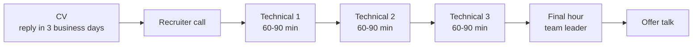

# 20.1 The Nebius loop and how to use this volume

## What the interviewer is testing

The recruiter email arrives and says only "we would like to talk". You have a job posting, a handful of anonymous reports and a volume of 30 chapters. You need to know which stage each chapter serves, so you do not spend a week on the wrong one.

This chapter serves every stage, because it is the map. It also serves the very first conversation. The recruiter call asks about your career, your skills and your interest. The official page tells you to have your resume and the job posting ready, so expect questions about both. Chapter 20.2 gives you that posting line by line.

Evidence tags used in this volume are the same everywhere. [official] means a Nebius page. [report] means an anonymous candidate report. [vendor] means Nebius marketing. [gap] means Nebius has not published it. Every Nebius fact in this chapter was read from the official interview page or the job posting on 2026-11-09, or comes from the research notes in the volume plan.

A realistic question in the interviewer's voice, from the recruiter call: "Tell me about the systems you have run in production, and which part of inference reliability you would want to own first."

## The core ideas

### 1. The process, stage by stage

You start by sending a CV. The official page says you will hear back within three business days. Then comes a recruiter call with a talent specialist. After that come three technical interviews of 60 to 90 minutes each, run by interviewers from different teams. The last step is a final hour with a team leader. After that you discuss an offer with the recruiter and the team lead.

The page says the interviews can be spread across several days. It also says that after each interview your recruiter contacts you within a week to talk about the meeting and the next steps. The page names Zoom for every video interview.

The page describes the technical content as formats, not as a fixed order. The initial interview covers your experience with languages, operating systems, databases and other technologies. It includes questions on service management, Linux, Unix and networks, at least one coding or algorithms task, and practical tasks in the Linux console. The technical interview is a standardised session on coding, troubleshooting and debugging. The system design interview asks you to design all or part of a distributed system, estimate the compute it needs and discuss storage and processing trade-offs.

The final meeting is a conversation with a team leader about the team and its projects. You may get extra technical questions, and the page says you are told in advance.

| Stage | What Nebius states | Tag | Prepare with |
| --- | --- | --- | --- |
| CV review | Reply within 3 business days | [official] | Chapter 20.2 |
| Recruiter call | Career, skills, interest | [official] | This chapter, 20.2 |
| Initial interview | Languages, OS, databases, Linux, networks, one coding task, console tasks | [official] | 20.3 to 20.8 |
| Technical interview | Coding, troubleshooting, debugging | [official] | 20.3 to 20.11 |
| System design | Design a distributed system, estimate resources, trade-offs | [official] | 20.12 to 20.17 |
| Final hour | Team leader, projects, possible extra technical questions | [official] | 20.27, 20.28 |

Decide now to treat this table as the only firm structure you have. Everything that follows about order and content is softer.

### 2. What is known and what is not

Nebius has published the stages, the formats, the tips, the setup checklist and a reading list. Nebius has not published a scoring rubric, the order of the three technical interviews, how many problems each includes, or what the interview teams are. The page lists areas that are assessed: Linux and networking, console tools, handling common service operation issues, writing working and testable code, system design, and algorithms and data structures. It gives no weights and no pass mark. [official] for the list, [gap] for everything else here.

Nebius also has not said whether a take-home task or a long project deep dive is part of the SRE loop. The page only says the final meeting may include extra technical tasks. One candidate report mentions a stage where you solve a production incident in 30 minutes. The official page does not name that stage. So the incident round in this volume is [report] only.

The practical result is simple. **Prepare for the hardest plausible loop and learn the real one from your recruiter.** The questions in section 9 are how you do that.

### 3. How the candidate reports differ, and what to make of it

You will find reports that disagree with each other. That is normal here, and you should read them as a range, not as promises. The research found only about four Nebius-specific reports, and none for this exact role. Several pages could not be fetched in full.

| Report | What it said | Tag |
| --- | --- | --- |
| Amsterdam SRE | Four stages: Linux troubleshooting on the command line for an hour, two easy or medium algorithm problems for an hour, system design for an hour, then a 30-minute production-incident "stress interview". Topics seen included file descriptors, syscalls and a file a service could not read where chmod did not help. | [report] |
| Dublin SRE or DevOps | A recruiter screen, then up to six or seven rounds. | [report] |
| London Senior SRE | Five rounds, mostly junior-level questions, no proper system design, some rescheduling and poor communication. | [report] |
| Czech Senior SRE, June 2025 | About a week, no offer, an interviewer without a technical background. | [report] |

Two things stand out. The number of rounds ranges from about four to seven, while the official page says three technical interviews plus a final hour. The duration also differs. The page suggests days, and the reports say one to three months.

Reasons are my reasoning, not facts: different teams may run different loops, the reports span years and offices, and anonymous reports skew toward bad experiences.

What to do with it: prepare for the Amsterdam version, because it is the most detailed and the hardest. Expect some rounds to be easier than you prepared for. Do not read the easy reports as a reason to skip system design.

### 4. How interviews are scored, in general

This is the shortest section, because Nebius has said very little. The official page does not publish a rubric. It publishes advice on how to behave, in these words: "Articulate your thought process aloud." It also says not to hesitate to ask for a hint, to offer alternative solutions, to review your code for errors before submitting, and that "You can use any technology and any language." It adds that you should tell the interviewer if you find a better answer later and adjust gracefully if the problem's parameters change.

From that advice you can see what the interviewer is allowed to see. They see your reasoning, how you use a hint, whether you can compare options and whether you check your own work. Nebius has not said that these are scored, or how. My reading, labelled as inference, is that an interviewer writes notes on exactly these things. So behave as if every one of them goes into the notes.

This reading also gives you a plan. A correct answer with no reasoning shows less than a partly correct answer with a clear chain of thought. A hint taken well can look better than a silent struggle. **Make your reasoning visible, because that is the only thing you control.**

### 5. The think-aloud protocol as a script

You get a problem and your mind goes quiet. The interviewer cannot hear quiet. This script gives you words to say in a fixed order, so you speak even when you are not sure. It works for coding, console, design and incident rounds. I wrote it from the official advice above, so it is a technique, not Nebius policy.

1. Restate the problem in one sentence. Say: "So the input is ..., the output is ..., and the limit is ...".
2. Ask two clarifying questions. Say: "Can the input be empty? What size should I plan for?"
3. Say your plan before you act. Say: "My first approach is X. It costs about Y. I will start with that and improve it if there is time."
4. Work in small steps and name each one. Say: "Now I am parsing the line. Next I will count."
5. Check as you go. Say: "Let me test this on a small example."
6. Review at the end. Say: "Let me read it once for off-by-one errors and empty input."
7. Offer an alternative. Say: "A different way is Z, which trades memory for speed. I would pick it if ..."

In a console round the same seven steps become: state the symptom, say what you will check first and why, run one command, say what the output means, and name your next hypothesis. In a design round step 3 is where you state your assumptions and numbers. In an incident round step 3 is where you say what you will do to protect users before you know the cause. Chapter 8 has the coding version with timing, and chapter 26 has the incident version.

Say your numbers out loud with their units. Say "about 40 gigabytes of KV cache per replica", not just "40". The interviewer cannot check what they did not hear.

Practise this script until the sentences are boring. Then they are free when stress arrives.

### 6. How to handle being stuck

You will get stuck. Everyone does, and the page itself tells you that asking for a hint is fine. The mistake is not being stuck. The mistake is staying silent about it.

Use this order. First, say it plainly: "I am not sure how to get below this complexity." Second, shrink the problem. Solve a smaller case by hand and say what you see. Third, say what you do know: "I know the answer must visit every item once, so I need a way to find the partner quickly." Fourth, ask a specific question: "Would a hash map be the right direction here?" A specific question is a better hint request than "I give up". Fifth, offer the slow answer and improve it: "The brute force is quadratic. Let me write that first, then look for the speed-up."

A rule I suggest, and label as my advice: do not stay silent for more than half a minute. If you need to think, say "I need a moment to think about X", and then do.

### 7. Logistics: Zoom and the setup checklist

The official page names Zoom for all video interviews and tells you to install it beforehand. Its checklist has four items: a stable internet connection, headphones to reduce background noise, a tested microphone and headphones, and a tidy background. [official] That is the whole list.

My advice, not Nebius policy: join a Zoom test meeting the evening before, and keep a phone hotspot ready as a second connection.

Ask the recruiter what the shared editor or terminal will be. The page says any language is allowed and mentions Python and Go as examples. It also suggests practice on LeetCode or HackerRank. It does not say which editor is used, and Nebius has not published that. Chapter 8 teaches you to be fluent in a plain editor with no autocomplete, which is the safe choice.

### 8. The official reading list, mapped to this volume and the library

The page lists five books and a pointer to the Google SRE books at sre.google/books. You will not read all of them in the time you have. This table says what each covers, which chapters of this volume use the same ground, and whether the book is in the library I checked. "In the library" means the book corpus on the machine where this volume was written, checked on 2026-11-09.

| Official reading | In the library? | Chapters here that cover the same ground |
| --- | --- | --- |
| Systems Performance: Enterprise and the Cloud | Yes, 2nd edition | 20.3, 20.5, 20.6, 20.10, 20.25, and 1.23 to 1.25 |
| The Linux Programming Interface | No | 20.4 and 1.11 |
| UNIX and Linux System Administration Handbook | No | 20.7 and Part 1 |
| Practical Monitoring: Effective Strategies for the Real World | No | 20.15, 20.19, 20.25 and 17.1 to 17.3 |
| Performance Analysis and Tuning on Modern CPUs | No | 20.5 and 1.24 |
| Google SRE books | No | 20.19, 20.21, 20.26, 20.27 and 17.11 |

For the books not in the library, this volume teaches the interview skill and links to handbook chapters on the same topics. The library holds books the chapters draw on heavily. Systems Performance chapter 2 on methodologies supports the triage, incident and project chapters. How Linux Works supports 20.3, 20.5 and 20.7. Production Kubernetes supports 20.15, 20.23 and 20.24 together with Terraform Up and Running. Distributed AI Systems chapter 9 on the production LLM serving stack supports 20.9, 20.18 and 20.21.

Keep Systems Performance chapter 2 open all week.

### 9. Questions to ask the recruiter this week

You have a recruiter who must reply to you. Use that. Five questions turn the gaps in section 2 into facts.

First, ask which technical interviews will take place and in what order, and how long each is. Say: "I am preparing for a console round, a coding round and a design round. Are those the right three?" Second, ask about languages and environment: "Which language may I use, and will it be a shared editor, a terminal or my own machine?" Third, ask about project work: "Is there a project deep dive or a take-home task, and if so for how long?" Fourth, ask which teams the interviewers come from, because the page says they come from different teams, and ask whether the role's day-to-day work is closer to the platform or the infrastructure side. Fifth, ask for the timeline and the status of the posting, because the posting I fetched is dated 27 Jul 2026 and shows "4 months ago" in the aggregator copy. Ask whether the role is still open.

Ask for the format, not the questions themselves.

### 10. A reader's map: which chapter serves which stage

This table maps each stage to chapters. Part B is the console round. Part C is coding. Part D is system design. Part E is inference knowledge that feeds design and the incident round. Part G is the incident round and the final hour.

| Stage or skill | Chapters | Tag for the stage |
| --- | --- | --- |
| Recruiter call, CV | 20.1, 20.2 | [official] |
| Linux console and troubleshooting | 20.3, 20.4, 20.5, 20.6, 20.7 | [official] and [report] |
| Coding and algorithms | 20.8, 20.9, 20.10, 20.11 | [official] and [report] |
| System design | 20.12, 20.13, 20.14, 20.15, 20.16 | [official] and [report] |
| Inference knowledge for design and incidents | 20.18, 20.19, 20.20, 20.21, 20.22 | job posting |
| Kubernetes, Terraform, observability | 20.23, 20.24, 20.25 | job posting |
| Stress interview, 30-minute incident | 20.26, 20.27 | [report] |
| Final hour, project deep dive | 20.28 | [official] |
| Public architecture map | 20.30 to 20.33 | [vendor] and [official] |
| Schedule | 20.29 | volume plan |

The volume plan also lists a chapter 20.17, a design drill sheet with twelve prompts. It was not written when this chapter was drafted, so there is no link to it. Use 20.13 to 20.16 for design practice until it appears.

If your interview is close, the plan in the volume's research notes gives a priority order. Start with the Linux console chapters in Part B and the system design chapters in Part D, because both appear in every report. Then read Part E and Part G. Take Part C and Part F after that. Chapter 20.29 turns this into an eight-week schedule.

## How to answer out loud

These are the likely questions in the first conversation. The order of speaking matters more than the words.

**Question 1. "Tell me about yourself and your background."** Speak for about two minutes. First, your current role in one sentence. Second, one system you ran in production, with one number such as traffic, cluster size or an uptime figure you can defend. Third, one incident you handled, and what you changed afterwards. Fourth, why this role: it is about reliability of GPU inference, and your next step is to move from general DevOps into that. Expect the follow-up "what was your part in that system?", so know the answer without hedging.

**Question 2. "Why Nebius, and why this role?"** Use only what is public. The posting says the role owns reliability, performance and observability for the inference stack of Token Factory, and that the platform serves text, vision, audio and multimodal models. Say what attracts you in your own words, for example the combination of autoscaling, telemetry and incident work on GPUs. Do not claim knowledge of internal systems. If you are asked what you know about Token Factory, give the public points from chapter 20.2 and say you would like to learn the rest.

**Question 3. "Which part of this job is your weakest?"** Name a real gap from your self-assessment in chapter 20.2, then say what you did about it this month. For example, you might say you have not run vLLM in production, so you ran it on a laptop and read its metrics. A specific gap with a specific action sounds stronger than a hidden gap.

**Question 4. "Do you have questions for us?"** Ask two. One about how the team measures reliability for inference and what the on-call load looks like. One about what the first 90 days include.

## Worked scenarios

### Scenario 1. You freeze during the coding round

The interviewer gives you: "Given a log of request times, find the busiest one-minute window." You read it twice and nothing comes. Say so. "I want to be sure of the input first. Are timestamps sorted? Can there be millions of lines?" The answer is probably yes to both.

Now shrink it. With five timestamps, you could count by hand. "For each timestamp I could count how many fall in the next 60 seconds. That is quadratic." Then ask the specific question: "Since they are sorted, could two pointers do this in one pass?" Even if the interviewer smiles, you have shown the full path from slow to fast. Write the slow version if the fast one does not come. Then test it on an empty log and a single line. Chapter 20.9 covers the sliding window pattern in depth.

### Scenario 2. A console round with a silent terminal

You get a shell and the sentence "the service is slow". Do not type yet. Say: "First I want to know what slow means. Since when, for whom, and what changed?" Then say what you will run and why: "I will start with load, memory and disk pressure, because they take a few seconds and rule things out." Run one command. Read the output aloud: "Load is high but CPU is idle, so the machine is waiting on something, probably disk or locks."

Each step costs ten seconds of speech and gives the interviewer a reason to believe your method. Chapter 20.3 gives the first-minute order and chapter 20.4 the file and permission puzzles that one report mentions.

## Hands-on lab

This lab has no commands to run on a machine. Every step is a practice you do yourself. I did not run these steps, because they are your own preparation.

1. Install Zoom and join a test meeting with your headphones. Expected result: you can hear yourself in a recording and see your background. Fix anything you see.
2. Pick one easy problem from chapter 20.11. Set a 25-minute timer and record your screen and voice while you solve it using the seven steps from section 5. Expected result: a recording with your voice running throughout, and a working solution.
3. Play the recording back. Count silences longer than 30 seconds. Expected result: three or fewer. If there are more, repeat with a different problem.
4. Send the five questions from section 9 to your recruiter. Expected result: written answers, or a call, within the week the page promises. Write the answers at the top of your study notes.
5. Start the self-assessment table in chapter 20.2. Expected result: every skill has a confidence number and a chapter to study.

## Drill questions

1. List the stages of the Nebius loop in order, with the time limits the official page gives.

CV review with a reply in three business days. A recruiter call. Three technical interviews of 60 to 90 minutes each, run by interviewers from different teams. A final hour with a team leader. Then an offer discussion. The recruiter follows up within a week after each interview.

2. Name three things the official page tells you to do during a technical interview.

Say your thought process aloud, ask for a hint when needed, offer alternative solutions, review your code before submitting and adjust gracefully if the problem changes. Any three of these is a full answer.

3. Does Nebius publish a scoring rubric for the SRE interview?

No. The page lists the areas assessed and gives advice on how to behave. It gives no weights and no pass mark. Anything more specific is inference.

4. What do the candidate reports disagree about?

The number of rounds, from about four to seven. The difficulty, from junior-level questions to hard console and design tasks. And the duration, from about a week to one to three months. They are anonymous and few, so they are a range and not a promise.

5. Which stage appears only in a candidate report and not on the official page?

The 30-minute production-incident "stress interview" reported by the Amsterdam candidate. The official page says the final meeting may have extra technical tasks but does not name an incident round.

6. Give the seven steps of the think-aloud script.

Restate the problem. Ask clarifying questions. Say your plan and its cost. Work in small named steps. Check on a small example. Review the finished work. Offer an alternative. The script is a technique built from the official advice, not Nebius policy.

7. You are stuck in a coding round. What do you say and do?

Say plainly that you are stuck. Solve a smaller case by hand. State what you do know. Ask a specific question about a direction. Offer the brute-force version and improve it. Never stay silent for long.

8. What is on the official setup checklist?

A stable internet connection, headphones to reduce background noise, a tested microphone and headphones, and a tidy background. Interviews run on Zoom, which you should install beforehand.

9. Which of the official reading-list books is in the library, and which chapter of this volume leans most on it?

Systems Performance, second edition, is in the library. Chapter 20.3 leans on its methodology chapter for triage, and 20.5 leans on its CPU and memory chapters. The others on the list were not found in the corpus checked.

10. Which five things should you ask the recruiter this week?

Which interviews and in what order. Which language and what environment. Whether a project deep dive or take-home exists. Which teams the interviewers come from. The timeline and whether the posting is still open.

## Common mistakes and weak answers

The first mistake is treating one report as the loop. Say "one candidate reported" in your own notes and keep preparing for all stages. The second is silence. An interviewer who cannot hear you cannot score your reasoning. Use the script.

The third mistake is to answer "why Nebius" with claims about internals. You do not know them. Say what the posting and public pages say and ask about the rest. The fourth is hiding a gap. A named gap with an action beats a vague "I am good at everything".

The fifth is leaving logistics to the last minute. The sixth is ignoring the recruiter as a source. Five short questions can replace a week of guessing.

## Connections to the rest of the handbook

- [20.2 The role in one page](02-the-role-in-one-page-the-job-posting-line-by-line.md) gives the posting line by line and the self-assessment table.
- [20.3 Triage method for a sick Linux box](03-triage-method-for-a-sick-linux-box.md) and [20.8 The coding round](08-the-coding-round-what-to-expect-and-how-to-perform.md) apply the think-aloud script to a console task and a coding task.
- [20.12 Estimation toolkit for inference capacity](12-estimation-toolkit-for-inference-capacity.md) and [20.13 Design a multi-tenant LLM inference API](13-design-a-multi-tenant-llm-inference-api.md) start the design stage.
- [20.26 The stress interview](26-the-stress-interview-production-incident-role-play.md) and [20.27 Post-mortems, on-call and incident leadership](27-post-mortems-on-call-and-incident-leadership.md) cover the incident round and the incident stories.
- [20.28 The project deep dive and the final round](28-the-project-deep-dive-and-the-final-round.md) covers the final hour.
- [20.30 From AI factory to Token Factory](30-nebius-ai-factory-to-token-factory-architecture.md) maps the public architecture.
- [17.11 Incident response and game days](../part-17-operations/11-incident-response-and-game-days.md) and [1.23 Performance methodology](../part-01-linux/23-performance-methodology-use-workload-characterisation-drill-down.md) are the earlier-part anchors for the method.
- The eight-week plan is chapter 20.29 and was being written by another author when this chapter was drafted.

## Sources and review notes

Sources and dates fetched, all on 2026-11-09:

- Nebius interview page for SRE roles, https://nebius.com/careers/interviews/sre, fetched twice. The fetch tool returned summaries with short quotes, not the full page text, so wording outside the quoted phrases is my paraphrase. The page states no scoring rubric.
- Senior Site Reliability Engineer, Token Factory (Inference Platform), as copied on https://cloudcomputingjobs.co.uk/jobs/senior-site-reliability-engineer-token-factory-inference-platform-nebius. It shows "Posted 27 Jul 2026 (4 months ago)", location line "London" and work location "Remote". This is an aggregator copy, not nebius.com.
- The volume plan, `planning/VOLUME_20_NEBIUS_SRE_PLAN.md` section 1, for the four candidate reports and the task list. Their original pages were not re-fetched, and the plan says Glassdoor and Blind could not be fetched in full.
- Handbook chapters 20.3 to 20.28 front matter and headings, for the chapter map.
- Book corpus listing on the writing machine, for the "in the library" column. Systems Performance, 2nd edition, chapter 2 Methodologies, is the book chapter that the later chapters cite most, and I did not re-read it for this chapter.

Explicitly labelled inferences:

- That interviewers take notes on reasoning, hint use, alternatives and self-review. Nebius has not said how it scores.
- The reasons the reports differ.
- The seven-step script, the 30-second silence rule and the extra setup items.
- The priority order for buying books.

Not verified:

- The plan says the posting covers Remote Europe, London, Amsterdam, Berlin and Prague. The copy I fetched shows London and Remote only.
- Whether the posting is still open on nebius.com. Ask the recruiter.
- The plan's phrase that reasoning is valued as much as answers was not found on the official page. I did not use it.
- Nothing in this chapter was run, because it contains no commands.
