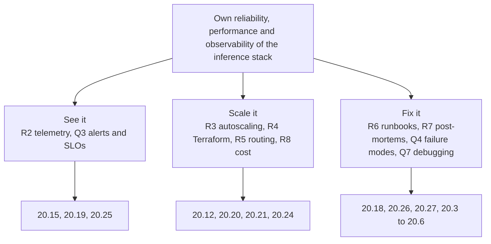

# 20.2 The role in one page: the job posting line by line

## What the interviewer is testing

You open the posting the night before the recruiter call. You read it fast and everything sounds familiar. Then the recruiter asks, "Which of these have you done yourself?" and you realise you never separated the lines you can prove from the lines you can only talk about.

This chapter serves the recruiter call, the first technical interview and every later stage, because the interviewers read the same posting. The skills it checks are the ones the posting lists. Evidence tags work as in chapter 20.1: [official] is a Nebius page, [vendor] is Nebius marketing, [report] is an anonymous candidate report, [gap] is not public. I label any statement of mine about daily work as [inference].

A realistic question in the interviewer's voice: "The posting says you would tune autoscalers for GPU efficiency. Have you done something like that, and how would you start here?"

## The core ideas

### 1. The posting in one picture

The posting I fetched is titled Senior Site Reliability Engineer, Token Factory (Inference Platform). It shows "Posted 27 Jul 2026", a location line "London" and a work location "Remote". This is a copy on a job aggregator, so ask your recruiter to confirm the role is open and where it sits. [official, via an aggregator copy]

It has no headings for duties and requirements. The responsibilities and requirements run as prose paragraphs. I split them into numbered lines so that we can refer to them. R is a responsibility and Q is a requirement or a preference. The lines fall into three families: seeing the system, scaling the system and responding when it breaks.



### 2. Responsibilities, line by line

Each quote below is under 15 words and comes from the fetched posting on 2026-11-09. Where a quote is cut, the posting continues. The last two columns point to the chapters of this volume and the earlier handbook parts that cover the topic. Earlier parts are listed as part and chapter, for example 5.23 is Part 5, chapter 23.

| ID | Posting wording | This volume | Earlier parts |
| --- | --- | --- | --- |
| R1 | "own the reliability, performance, and observability of the entire" inference stack | 20.18, 20.19 | 15.16, 17.13 |
| R2 | "designing and refining telemetry pipelines" for metrics, logs and traces | 20.15, 20.25 | 17.1 to 17.3, 17.5 |
| R3 | "tune Kubernetes autoscalers to squeeze more efficiency out of GPUs" | 20.20 | 5.23, 15.15, 11.6 |
| R4 | "craft Terraform modules that bake resilience into every new cluster" | 20.24 | 4.18 to 4.24, 4.27 |
| R5 | "harden our request-routing and retry logic" | 20.21 | 2.20, 15.9 |
| R6 | "rely on the automation and runbooks you helped create" | 20.26 | 17.7, 17.11, 17.15 |
| R7 | "drive the post-mortem culture that prevents recurrence" | 20.27 | 17.11 |
| R8 | "scaling the platform smoothly while hitting" targets | 20.12, 20.16 | 15.18, 17.12 |

The posting continues R8 with cost and reliability targets. The summary I fetched said so, but I did not capture the exact words, so I quote only the start.

Decide now which of these eight lines you can back with a real story from your own work. Those are your strongest openings.

### 3. What each responsibility likely means day to day

Everything in this section is [inference], because Nebius has not published how the team works. I describe what such a job usually involves, using the posting's own verbs.

R1 is the umbrella. Owning reliability of the stack means you are the person who is paged and also the person who changes the system so that the page does not come again. R2 is about the pipes that carry measurements. At very high volume, the work is deciding what not to collect, because every label and log line has a cost. Chapter 20.15 is built on that point.

R3 mixes two ideas that are often confused. Autoscaling decides how many replicas you run. GPU efficiency asks whether those replicas do useful work. For inference, the usual trap is scaling on a signal that looks fine when the system is drowning. Nebius has not published its autoscaling signals, so the interviewer will probe your reasoning and not your recall. [gap]

R4 is about modules and the shape of failure. A resilient cluster module sets defaults such as spread across zones and safe upgrade settings, so every new cluster starts safe. R5 is about the path of a request. Retries hide a transient failure from a user, and the same retries can multiply load in a partial outage. The vendor case study in section 6 mentions exactly that problem. [vendor]

R6 and R7 are about the rest of the incident life. Detection, isolation and remediation should be automated where possible, and runbooks cover the rest. Leading post-mortems means you write the document and also push the follow-up work to completion.

### 4. Requirements, line by line

The same rule applies: short quotes, then where to study.

| ID | Posting wording | This volume | Earlier parts |
| --- | --- | --- | --- |
| Q1 | "deep fluency with Kubernetes, Prometheus, Grafana, Terraform" | 20.23, 20.24, 20.25 | 5.3, 5.9, 5.18, 5.25, 17.2 |
| Q2 | "script comfortably in Python or Bash" | 20.7 to 20.11 | 1.9, 3.5, 3.8 |
| Q3 | "nuances of alert design and SLOs" | 20.19, 20.25 | 17.6 |
| Q4 | "how distributed back-ends fail" | 20.18, 20.21, 20.23 | 17.7, 17.13 |
| Q5 | "shepherding GPU-heavy workloads" with vLLM, Triton, Ray | 20.22 | 15.3 to 15.6, 16.5 |
| Q6 | "a background in MLOps or model-hosting platforms" | 20.14 | 16.1, 16.6, 16.7 |
| Q7 | "building self-healing systems, thrive on debugging performance" | 20.3 to 20.6, 20.16 | 1.11, 1.23, 1.24, 2.30, 5.25, 10.21 |

Q4 and Q7 also contain wording I took from the volume plan: "how distributed back-ends fail" and debugging "from kernel to application layer". The aggregator copy I fetched later gave the same lines in different words. Q5 and Q6 are described as desirable, not required. That matters for how you pitch yourself. If you have not run vLLM, you are not disqualified. You are expected to show how you would learn it.

Three things stand out. Alert design and SLOs appear for "high-throughput APIs", which is why chapter 20.19 is a core chapter and not an extra. Kubernetes, Prometheus, Grafana and Terraform are named as a group, so expect at least one question on each. Python or Bash is a minimum, and the coding round tests more than scripts.

The posting does not mention security, fabrics or storage. Parts 12 and 18 of the handbook cover networking for AI and security. They are adjacent and may come up in design questions on multi-tenancy. That is my reasoning, not Nebius content.

Pick your two weakest lines from this table and read their chapters first.

### 5. The self-assessment template

You need a table that is honest and that a script can read. The columns are the skill, the posting lines it maps to, your confidence from 1 to 5, your evidence, and the chapters to study. Confidence 5 means you could teach it and have run it in production. Confidence 1 means you have only read about it. Evidence means a real thing you did, such as "ran HPA on queue depth for six months". Leave confidence blank until you can write the evidence.

Copy the template below into a file, fill in confidence and evidence, and run the tracker in section 7. The template is also saved as `code/part20/c02_assessment_template.md`.

```markdown
| Skill | Posting lines | Confidence (1-5) | Evidence | Chapter to study |
| --- | --- | --- | --- | --- |
| Kubernetes operations and GPU autoscaling | R3, R8, Q1 |  |  | 20.20, 20.23 |
| Prometheus and PromQL | R2, Q1, Q3 |  |  | 20.25 |
| Grafana dashboards | R2, Q1 |  |  | 20.25 |
| Telemetry pipelines at very high volume | R1, R2 |  |  | 20.15 |
| Terraform and infrastructure as code | R4, Q1 |  |  | 20.24 |
| Python or Bash scripting | R6, Q2 |  |  | 20.8, 20.9 |
| SLOs and alert design | R1, R6, Q3 |  |  | 20.19 |
| Distributed back-end failure modes | R1, R5, Q4 |  |  | 20.18, 20.21 |
| Request routing, retries and overload | R5, Q4 |  |  | 20.21 |
| Incident response, runbooks and automation | R1, R6, Q7 |  |  | 20.26 |
| Post-mortems | R7 |  |  | 20.27 |
| Debugging from kernel to application | R1, Q7 |  |  | 20.3 to 20.6 |
| vLLM, Triton or Ray in production | R1, R3, Q5 |  |  | 20.22 |
| Model hosting and MLOps | Q5, Q6 |  |  | 20.14 |
| Cost and capacity at scale | R3, R8 |  |  | 20.12, 20.16 |
| Self-healing systems | R6, Q7 |  |  | 20.16, 20.23 |
```

The posting-lines column is not decoration. It tells the tracker how much a skill matters. A skill that appears in three posting lines hurts you three times if it is weak.

Fill the table in one sitting, without looking things up. Your first honest answer is the best data.

### 6. What Token Factory is, from public sources only

Token Factory is the inference platform within Nebius Cloud. The posting says it serves text, vision, audio and multimodal foundation models at large scale. [official] Beyond that, what follows is from Nebius marketing and documentation as recorded in the volume plan, and I did not re-fetch those pages today. [vendor]

It offers serverless endpoints and dedicated endpoints, with an OpenAI-compatible API and the full set of vLLM parameters. The control plane, which handles create, update, enable, disable and delete, is separate from a region-specific data plane. For a dedicated endpoint you choose the GPU type from L40, H100, H200 and B200, the number of GPUs per replica, the minimum and maximum replicas, and the region, either EU or US, which is a data-residency choice. There are two flavors, base and fast. Fast uses smaller batches and speculative decoding. The listed optimisations include KV cache, paged attention, flash attention, quantisation, continuous batching, context caching and speculative decoding. [vendor]

Customers see latency at p50, p90 and p99, time to first token, token throughput, active replicas and scaling, errors by status code, traffic by prompt size and region, and the link between KV-cache reuse and tail latency. [vendor] That list is useful to you, because it tells you what Nebius thinks a user should be able to see.

A chat-application case study, published by Nebius, describes separate prefill and decode pools, cache-aware routing with the hit rate rising from about 5 percent to 30 percent and then 50 to 60 percent, and backpressure to stop decode queues from overrunning. It describes a change to retry logic to stop amplification in partial outages. It reports that aggressive liveness probes restarted healthy workers, and that restarted workers sometimes did not rejoin the pool, so capacity shrank silently. It describes X+1 redundancy, alerts on tail time to first token, cache drops, finish-reason drift and decode error bursts, and a 99.9 percent SLA on dedicated endpoints. It says latency must be "stable, not just fast". [vendor] Each of these is a failure story you can discuss, and chapters 20.18 and 20.21 teach them.

Nebius states the current hardware as B200 and has announced Vera Rubin NVL72 and Groq 3 LPX. [vendor]

What is not public: the autoscaling signals and thresholds, the router algorithm, the targets for time per output token and the probe settings. [gap] When asked about these, say: "Nebius has not published this. A reasonable design is ...", and then give your reasoning. Chapter 20.30 maps the public architecture further.

### 7. The gap tracker: turning the table into a study order

Reading all 30 chapters evenly is a poor plan. The tracker ranks skills by how much confidence you lack and by how many posting lines the skill touches. The priority of a skill is five minus confidence, multiplied by the number of posting lines. A skill rated 2 that maps to three lines scores 9. A skill rated 4 that maps to one line scores 1.

The script reads the first markdown table that has Skill and Confidence columns. It ignores blank confidence cells and lists those skills as not rated. It raises an error for a confidence outside 1 to 5. It warns when you rate yourself 4 or 5 with no evidence. Ties go to the lower confidence and then to the name. The file uses only the standard library.

```python
#!/usr/bin/env python3
"""Rank study order from the filled self-assessment table in chapter 20.2.

Reads a markdown file, finds the first table whose header has the columns
"Skill", "Posting lines", "Confidence" and "Chapter to study", and prints the
skills in study order. Priority = (5 - confidence) * number of posting lines.
Standard library only.

Usage: python3 c02_gap_tracker.py assessment.md
"""
import re
import sys
from dataclasses import dataclass

SEPARATOR = re.compile(r"^:?-{3,}:?$")
BLANKS = {"", "?", "-", "_", "n/a", "tbd"}


@dataclass
class Row:
    skill: str
    confidence: "int | None"
    lines: int
    evidence: str
    chapter: str

    @property
    def priority(self):
        return 0 if self.confidence is None else (5 - self.confidence) * self.lines


def split_row(line):
    cells = line.strip().strip("|").split("|")
    return [c.strip() for c in cells]


def count_lines(cell):
    """'R3, Q1, R8' -> 3. A bare number such as '3' is used as the count. Empty -> 1."""
    cell = cell.strip()
    if re.fullmatch(r"\d+", cell):
        return max(1, int(cell))
    items = [x for x in re.split(r"[,;]", cell) if x.strip()]
    return max(1, len(items))


def parse_confidence(cell, skill):
    cell = cell.strip()
    if cell.lower() in BLANKS:
        return None
    if not re.fullmatch(r"[1-5]", cell):
        raise ValueError(f"confidence for {skill!r} must be 1 to 5, got {cell!r}")
    return int(cell)


def parse_table(text):
    """Return a list of Row from the first matching table. Raise ValueError if none."""
    rows, cols = [], None
    for raw in text.splitlines():
        if not raw.strip().startswith("|"):
            if cols and rows:
                break
            continue
        cells = split_row(raw)
        if all(SEPARATOR.match(c) for c in cells if c):
            continue
        lowered = [c.lower() for c in cells]
        if cols is None:
            if "skill" in lowered and any(c.startswith("confidence") for c in lowered):
                cols = {
                    "skill": lowered.index("skill"),
                    "lines": next((i for i, c in enumerate(lowered) if c.startswith("posting")), None),
                    "conf": next(i for i, c in enumerate(lowered) if c.startswith("confidence")),
                    "evidence": next((i for i, c in enumerate(lowered) if c.startswith("evidence")), None),
                    "chapter": next((i for i, c in enumerate(lowered) if c.startswith("chapter")), None),
                }
            continue
        def cell(key):
            i = cols[key]
            return cells[i] if i is not None and i < len(cells) else ""
        skill = cell("skill")
        if not skill:
            continue
        rows.append(Row(skill, parse_confidence(cell("conf"), skill),
                        count_lines(cell("lines")), cell("evidence"), cell("chapter")))
    if cols is None:
        raise ValueError("no table with Skill and Confidence columns found")
    return rows


def study_order(rows):
    """Rated rows, highest priority first. Ties: lower confidence, then skill name."""
    rated = [r for r in rows if r.confidence is not None]
    return sorted(rated, key=lambda r: (-r.priority, r.confidence, r.skill.lower()))


def warnings(rows):
    out = []
    for r in rows:
        if r.confidence is None:
            out.append(f"not rated: {r.skill}")
        elif r.confidence >= 4 and not r.evidence.strip():
            out.append(f"confidence {r.confidence} without evidence: {r.skill}")
    return out


def render(rows):
    lines = []
    for n, r in enumerate(study_order(rows), 1):
        study = r.chapter or "(no chapter given)"
        lines.append(f"{n:>2}. {r.skill} | priority {r.priority} "
                     f"(5-{r.confidence})x{r.lines} | study: {study}")
    lines += [f"warning: {w}" for w in warnings(rows)]
    return "\n".join(lines)


def main(argv):
    if len(argv) != 2:
        print(__doc__.strip().splitlines()[-1], file=sys.stderr)
        return 2
    with open(argv[1], encoding="utf-8") as f:
        text = f.read()
    try:
        rows = parse_table(text)
    except ValueError as e:
        print(f"error: {e}", file=sys.stderr)
        return 1
    print(render(rows))
    return 0


if __name__ == "__main__":
    sys.exit(main(sys.argv))
```

The tests cover the helper functions, the ordering, the tie-break, the warnings, the command line and the template file.

```python
import pytest
from c02_gap_tracker import (Row, count_lines, main, parse_confidence, parse_table,
                             render, study_order, warnings)

TABLE = """Some intro text.

| Skill | Posting lines | Confidence (1-5) | Evidence | Chapter to study |
| --- | --- | --- | --- | --- |
| Terraform | R4, Q1 | 2 | used it a year | 20.24 |
| SLOs | R1, R6, Q3 | 2 | | 20.19 |
| Bash | R6, Q2 | 5 | wrote the deploy tool | 20.7 |
| vLLM | R1, R3, Q5 | | | 20.22 |

Text after the table.
"""


def test_count_lines_list_number_and_empty():
    assert count_lines("R3, Q1, R8") == 3
    assert count_lines("R3;Q1") == 2
    assert count_lines("4") == 4
    assert count_lines("") == 1
    assert count_lines("0") == 1


def test_parse_confidence_blank_and_valid():
    assert parse_confidence("", "x") is None
    assert parse_confidence("?", "x") is None
    assert parse_confidence(" 3 ", "x") == 3


@pytest.mark.parametrize("bad", ["0", "6", "high", "3.5"])
def test_parse_confidence_rejects(bad):
    with pytest.raises(ValueError, match="1 to 5"):
        parse_confidence(bad, "x")


def test_parse_table_skips_separator_and_stops_at_text():
    rows = parse_table(TABLE)
    assert [r.skill for r in rows] == ["Terraform", "SLOs", "Bash", "vLLM"]
    assert rows[0].lines == 2 and rows[1].lines == 3
    assert rows[3].confidence is None


def test_parse_table_without_table_raises():
    with pytest.raises(ValueError, match="no table"):
        parse_table("just text\n| a | b |\n| - | - |\n")


def test_parse_table_bad_confidence_raises():
    bad = TABLE.replace("| 2 | used", "| 9 | used")
    with pytest.raises(ValueError):
        parse_table(bad)


def test_priority_is_gap_times_lines():
    assert Row("a", 2, 3, "", "").priority == 9
    assert Row("a", 5, 3, "", "").priority == 0
    assert Row("a", None, 3, "", "").priority == 0


def test_study_order_weights_by_lines_and_excludes_unrated():
    order = study_order(parse_table(TABLE))
    assert [r.skill for r in order] == ["SLOs", "Terraform", "Bash"]
    assert [r.priority for r in order] == [9, 6, 0]


def test_study_order_tie_breaks_on_lower_confidence_then_name():
    rows = [Row("b", 3, 2, "", ""), Row("a", 3, 2, "", ""), Row("c", 1, 1, "", "")]
    # priorities: b=4, a=4, c=4 -> lower confidence first, then name
    assert [r.skill for r in study_order(rows)] == ["c", "a", "b"]


def test_warnings_for_unrated_and_unevidenced_high_confidence():
    w = warnings(parse_table(TABLE))
    assert "not rated: vLLM" in w
    assert not any("Bash" in x for x in w)
    rows = [Row("Go", 4, 1, "", "")]
    assert warnings(rows) == ["confidence 4 without evidence: Go"]


def test_render_lines_and_warnings():
    out = render(parse_table(TABLE)).splitlines()
    assert out[0].startswith(" 1. SLOs | priority 9 (5-2)x3 | study: 20.19")
    assert out[-1] == "warning: not rated: vLLM"


def test_main_prints_order(tmp_path, capsys):
    f = tmp_path / "a.md"
    f.write_text(TABLE)
    assert main(["prog", str(f)]) == 0
    assert "SLOs" in capsys.readouterr().out


def test_main_errors(tmp_path, capsys):
    f = tmp_path / "a.md"
    f.write_text("nothing here")
    assert main(["prog", str(f)]) == 1
    assert "error:" in capsys.readouterr().err
    assert main(["prog"]) == 2


def test_template_parses_and_is_unrated():
    import pathlib
    text = (pathlib.Path(__file__).parent / "c02_assessment_template.md").read_text()
    rows = parse_table(text)
    assert len(rows) == 16
    assert all(r.confidence is None for r in rows)
    assert study_order(rows) == []
```

Run the tracker once a week. The order should change as your confidence changes. If it does not, you are reading and not practising.

### 8. Sister Nebius SRE roles

The volume plan lists three sister Nebius SRE postings: DevTools, Compute Node and NetSRE. I did not fetch them and I do not know their contents. From the names alone, and as [inference], DevTools suggests internal developer tooling, Compute Node suggests the host and virtualisation layer, and NetSRE suggests networking. If your recruiter mentions one of these, ask what the team owns before you prepare for it.

### 9. The honest gaps list

These are the limits of what anyone can know before the interview. Read them so that you do not mistake a hole in the research for a hole in you.

- The scoring rubric, the order of rounds and the interview teams are not public. [gap]
- Autoscaling signals, router algorithm, TPOT targets and probe settings are not public. [gap]
- On 2026-11-09 a search found many aggregator copies of this posting, none from nebius.com itself. They list Amsterdam, Berlin, London, Prague and remote Europe, and some add remote United States. One reports senior level as 5 to 10 years and one reports a closing date of 22 November. These are third-party claims and I did not confirm them. A similar posting titled AI Studio (Inference Platform) also exists, so the role may have been renamed. Ask the recruiter which title and location apply to you.
- I could not confirm the posting against nebius.com, and the plan says it lists Remote Europe, London, Amsterdam, Berlin and Prague while the aggregator shows London and Remote. Confirm with the recruiter.
- I did not read the sister postings.
- The day-to-day descriptions in section 3 are my inference.
- The Token Factory facts are from the plan, which recorded them from vendor pages. I did not re-check the vendor pages today.

Prepare for these by reasoning aloud, and ask the recruiter for the rest.

## How to answer out loud

**Question 1. "Which parts of this role have you done?"** Speak for two minutes. Pick the three posting lines where your evidence is strongest. For each, say what you ran, one number that describes its scale and one thing that went wrong and what you changed. Then name one line where you are newer and say what you are doing about it. The interviewer will follow up on the number, so use one you can defend.

**Question 2. "What do you know about Token Factory?"** Use only the public facts in section 6. Say it serves several model types, has serverless and dedicated endpoints with an OpenAI-compatible API, and separates a control plane from a regional data plane. Mention one public failure story, such as silent pool shrink after restarts. Then say what you do not know, for example the autoscaling signals, and offer how you would reason about them. Do not claim anything about Nebius internals.

**Question 3. "What would you do in your first 90 days?"** This is your reasoning. Give three phases. First, learn the system: read the dashboards, the alerts, the last ten incidents and the on-call load. Second, fix one small recurring problem end to end so that you learn the release and review process. Third, pick one larger reliability theme, such as retries or autoscaling signals, and propose a measured change. Say you would measure before and after.

**Question 4. "Where are you weakest against this posting?"** Name the lowest-confidence line from your table, say what evidence you do have that is nearest to it, and say what you did this month. Chapter 20.1 has the same question in the recruiter-call setting.

## Worked scenarios

### Scenario 1. Reading a filled table

You fill the template and cut it to three skills for this example. The first has confidence 2 and evidence "ran it on one cluster". The second is SLOs at 4 with no evidence. The third is cost and capacity at 1. Running the tracker gave this real output, from the file `mini.md` I made for this chapter:

```text
 1. Kubernetes operations and GPU autoscaling | priority 9 (5-2)x3 | study: 20.20, 20.23
 2. Cost and capacity at scale | priority 8 (5-1)x2 | study: 20.12, 20.16
 3. SLOs and alert design | priority 3 (5-4)x3 | study: 20.19
warning: confidence 4 without evidence: SLOs and alert design
```

Read it in order. Kubernetes autoscaling comes first because it appears in three posting lines and your confidence is low. Cost comes second even though your confidence there is the lowest, because it touches only two lines. The warning is the most useful line. If you cannot write evidence for SLOs, then 4 was a hope and not a fact. Correct it and the ranking will change.

### Scenario 2. A line you have never done

The interviewer says: "You have not run vLLM in production. Why should we consider you?" Q5 is desirable, so you have room. Answer in three parts. State the truth: "I have not run it in production." Show the nearest evidence: "I have run GPU workloads on Kubernetes and I read its metrics on a test server." State the plan: "I read the metrics design and I know the three places a request waits, which are the waiting queue, the running batch and the KV cache." Chapter 20.18 teaches those three places. That answer uses a gap as proof of how you learn.

### Scenario 3. Explaining "tune autoscalers for GPU efficiency"

The interviewer asks what that phrase means to you. Start with the problem: GPUs are expensive and idle capacity costs money, while too little capacity makes users wait. Say that scaling on GPU utilisation alone can mislead, because a drowning engine and a healthy one can both look busy. Say you would prefer signals such as queue depth and time spent waiting, and that you would add headroom because a new GPU replica takes minutes to be ready. State that Nebius has not published its signals, so this is your design. Chapter 20.20 gives the full argument and the sources.

## Hands-on lab

1. Open a terminal in the handbook repository and run the tests. Expected result: 17 passed. I ran this step.

```bash
cd code/part20
python3 -m pytest -q test_c02_gap_tracker.py
```

2. Copy the template to a new file and fill in your confidence and evidence.

```bash
cp c02_assessment_template.md my_assessment.md
```

Expected result: a table with every row rated. This is a manual step and I did not run it for you.

3. Run the tracker on your file. Expected result: a numbered list, highest priority first, and a warning for each blank row or unevidenced 4 or 5. I ran the same command on a three-row sample, shown in scenario 1.

```bash
python3 -I c02_gap_tracker.py my_assessment.md
```

4. Take the first three skills in the list and open their chapters in this volume. Expected result: a study plan for this week. Write it into chapter 20.29's schedule when that chapter is ready.

5. Check the static gate. Expected result: no problems. I ran it on the whole `code/part20` folder and it reported 287 files and 0 problems.

```bash
python3 -I tools/check_code_files.py code/part20
```

## Drill questions

<details><summary>1. What are the three families of work in the posting, and which chapters match each?</summary>
Seeing the system, scaling the system and responding when it breaks. Seeing: telemetry, alerts and SLOs in chapters 20.15, 20.19 and 20.25. Scaling: autoscaling, Terraform, routing and cost in 20.12, 20.20, 20.21 and 20.24. Responding: failure modes, incident drills and post-mortems in 20.18, 20.26 and 20.27.
</details>

<details><summary>2. Which two requirements does the posting describe as desirable and not required?</summary>
Experience with GPU-heavy workloads on vLLM, Triton, Ray or similar, and a background in MLOps or model-hosting platforms.
</details>

<details><summary>3. Which tools does the posting name as one group of deep fluency?</summary>
Kubernetes, Prometheus, Grafana and Terraform, together with infrastructure as code in general.
</details>

<details><summary>4. What is the formula the gap tracker uses?</summary>
Priority equals five minus confidence, times the number of posting lines the skill maps to. A skill with confidence 5 scores zero.
</details>

<details><summary>5. What does the tracker do with a blank confidence cell and with a 4 that has no evidence?</summary>
A blank cell is not ranked and is listed as "not rated". A 4 or 5 with empty evidence is ranked normally but produces a warning.
</details>

<details><summary>6. Name the two endpoint types and the two flavors of Token Factory.</summary>
Serverless and dedicated endpoints. Base and fast, where fast uses smaller batches and speculative decoding. This is vendor material.
</details>

<details><summary>7. How are the control plane and the data plane arranged, according to Nebius?</summary>
The control plane handles the lifecycle, which is create, update, enable, disable and delete. It is separate from a data plane that is specific to a region. This is vendor material.
</details>

<details><summary>8. Name three failure stories from the chat-application case study.</summary>
Retry amplification in partial outages, aggressive liveness probes restarting healthy workers, and restarted workers that did not rejoin the pool so capacity shrank silently. This is vendor material.
</details>

<details><summary>9. Name three things about Token Factory that Nebius has not published.</summary>
The autoscaling signals and thresholds, the router algorithm, the targets for time per output token and the probe settings. Any three are correct.
</details>

<details><summary>10. How should you answer a question about a line of the posting you have never done?</summary>
Say plainly that you have not done it. Give the nearest real evidence. Then state a concrete step you have taken to learn it, with something you can name from the topic.
</details>

## Common mistakes and weak answers

The first mistake is rating every skill 4 or 5. The tracker will then have nothing to rank and you will have no study plan. The second is quoting the posting back to the interviewer. Say what you did, not what the line says. The third is claiming knowledge of how Token Factory works inside. Public facts are fine and everything else is a reasoned design.

The fourth is treating the desirable lines as requirements and panicking, or treating them as optional and skipping them. Learn the basics of vLLM metrics even if you never ran it. The fifth is forgetting that the posting is dated. It was posted on 27 Jul 2026 per the copy I fetched, so ask whether it is still open and whether the scope has changed.

## Connections to the rest of the handbook

- [20.1 The Nebius loop and how to use this volume](01-the-nebius-loop-and-how-to-use-this-volume.md) gives the stages, the think-aloud script and the questions to ask the recruiter.
- [20.18 How LLM serving fails](18-how-llm-serving-fails.md), [20.19 SLIs, SLOs and alerts for token APIs](19-slis-slos-and-alerts-for-token-apis.md), [20.20 Autoscaling GPU inference](20-autoscaling-gpu-inference.md) and [20.21 Request routing, retries and overload control](21-request-routing-retries-and-overload-control.md) cover R1, R3, R5, Q3 and Q4.
- [20.15 Design: an observability pipeline for very high volume](15-design-an-observability-pipeline-for-very-high-volume.md) and [20.25 PromQL, Grafana and tracing](25-promql-grafana-and-tracing-traps.md) cover R2 and Q1.
- [20.24 Terraform for resilient GPU clusters](24-terraform-for-resilient-gpu-clusters.md) covers R4 and [20.23 Kubernetes failure drills](23-kubernetes-failure-drills-for-gpu-platforms.md) covers Q1 and Q7.
- [20.26 The stress interview](26-the-stress-interview-production-incident-role-play.md) and [20.27 Post-mortems, on-call and incident leadership](27-post-mortems-on-call-and-incident-leadership.md) cover R6 and R7.
- [20.22 Operating vLLM, Triton, Ray and TensorRT-LLM](22-operating-vllm-triton-ray-and-tensorrt-llm.md) covers Q5.
- [20.30 From AI factory to Token Factory](30-nebius-ai-factory-to-token-factory-architecture.md) maps the public architecture.
- [15.16 Production serving stack and reliability](../part-15-inference/16-production-serving-stack-and-reliability.md), [17.6 Alerting, SLOs and health checks](../part-17-operations/06-alerting-slos-and-health-checks-for-gpu-clusters.md) and [17.11 Incident response and game days](../part-17-operations/11-incident-response-and-game-days.md) are the strongest earlier-part anchors.

## Sources and review notes

Sources and dates fetched, all on 2026-11-09:

- Job posting, Senior Site Reliability Engineer, Token Factory (Inference Platform), copy at https://cloudcomputingjobs.co.uk/jobs/senior-site-reliability-engineer-token-factory-inference-platform-nebius. Fetched twice. The fetch tool returned summaries with short verbatim quotes. Quoted fragments are from the second fetch, and the rest is paraphrase. The listing showed "Posted 27 Jul 2026 (4 months ago)", location "London" and work location "Remote".
- Nebius interview page, https://nebius.com/careers/interviews/sre, used only in chapter 20.1 and for the point that the page has no rubric.
- Volume plan section 1, `planning/VOLUME_20_NEBIUS_SRE_PLAN.md`, for all Token Factory facts in section 6, the sister roles and the two quotes in Q4 and Q7. The underlying Nebius pages were not re-fetched.
- Front matter and headings of chapters 20.3 to 20.33 and the file listing of Parts 1 to 17, for the chapter mappings.

Sister roles and the gaps list are in sections 8 and 9.

Explicitly labelled inferences: the three families in section 1, all of section 3, the 90-day answer, the priority formula's use as a study heuristic, and the adjacency of Parts 12 and 18.

Not verified: only the tracker and its tests were run. The chapter mappings were made from chapter titles and descriptions, and I did not read every chapter in full. The earlier-part chapter numbers were taken from the file listing.
