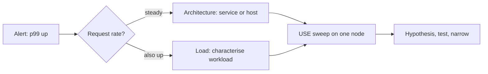
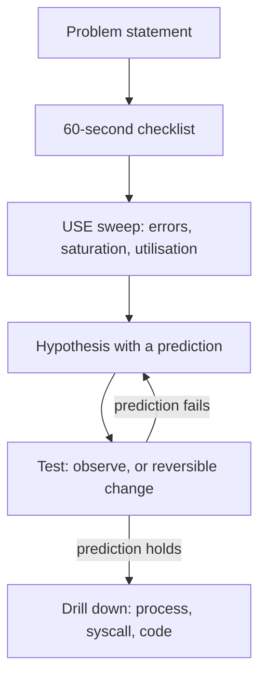

# 20.3 Triage method for a sick Linux box

Honest status first. The first draft of this chapter was written on a Mac with no Docker daemon. It has since been run on Linux, with limits. The scripts ran in a throwaway container, `ubuntu:24.04`, image digest `sha256:fe81560990fae86dc4743202b2cb4d3df98d0bcf949173cecef15ce1127ef852`, arm64, on the Docker VM kernel `6.18.37-0-virt` with 2 CPUs and no swap. **A container shares the VM's kernel and hides parts of it, so some output here differs from a real server.** Section "What the container run showed" lists the differences, and "Not verified" lists what still could not run.

## What the interviewer is testing

This chapter serves the first stage of the loop, the Linux console round. Nebius says the technical interviews include "practical tasks in the Linux console" and "coding, troubleshooting, debugging". The job posting asks for debugging "from kernel to application layer". The plan, section 1, also records Nebius's own advice for every round: say your reasoning aloud, ask for hints, offer alternatives.

One candidate reported that the Amsterdam SRE loop opens with an hour of Linux troubleshooting on the command line. That is one anecdote, a hint about format and not a promise. The same report mentioned file descriptors, syscalls and a file the service cannot access even though `chmod` does nothing. Chapter 20.4 covers those.

This round mostly checks whether you have a method, read ordinary output correctly, and let the interviewer follow your thinking.

A realistic question in the interviewer's voice: "You have SSH access to a server. The team says it got slow about twenty minutes ago. Show me what you do, and tell me what you are thinking as you do it."

## The core ideas

### 1. Start with the problem statement, not a tool

A page says "the box is slow". You have a prompt open and your hands want to type `top`. Stop for one minute and ask questions first.

Systems Performance, in its chapter on methodologies, calls this the problem statement method and says to use it first. The questions are short. What makes you think there is a problem? Has this system ever performed well? What changed recently, in software, hardware or load? Can the problem be expressed as latency or runtime? Does it affect other people or only you? What is the environment, with versions and configuration?

The book reports solving issues over the phone with these questions alone. In the interview, say the questions aloud and answer them from the system yourself. Two answers matter most. A start time lets you line up logs, deploys and graphs. A user-visible symptom matters because "slow" and "failing" lead to different checks. **Before you touch a tool, say what you know, what you do not know, and what changed.**

### 2. A method beats a favourite tool

Systems Performance names three anti-methods. The streetlight anti-method picks familiar tools, like looking for lost keys under the lamp because the light is better there. The random-change anti-method changes settings until the problem seems to go away. The blame-someone-else anti-method hands the issue to another team with no data behind the guess.

All three feel productive and all three lose points. The streetlight method may find an issue but not the issue. Random change can leave tuning nobody understands and can worsen peak load. Blame wastes other teams' time.

An interviewer can always tell whether you are guessing. A sentence like "I will check every resource for errors, saturation and utilisation before I form a theory" shows you are not.

The book also lists the ad hoc checklist as a legitimate method. It gives value fastest and it ages. The 60-second checklist below is one, and the USE method stops it becoming a streetlight.

**Name your method before your first command, and name it again whenever you change direction.**

### 3. The first 60 seconds, command by command

Systems Performance, in its introduction, gives a ten-command checklist that fits in the first minute of an investigation. It uses only tools found on most distributions. Table 20.3.1 restates it with what each line is really asking.

| # | Command | The question it answers |
|---|---|---|
| 1 | `uptime` | Is demand rising or falling? Compare the 1, 5 and 15 minute numbers. |
| 2 | `dmesg -T \| tail` | Did the kernel log errors, including OOM kills? |
| 3 | `vmstat -SM 1` | Run queue, swapping and overall CPU split, one second at a time. |
| 4 | `mpstat -P ALL 1` | Is one CPU busy while the others idle? |
| 5 | `pidstat 1` | Which processes use the CPU, and user or kernel time? |
| 6 | `iostat -sxz 1` | Disk IOPS, throughput, wait time and percent busy. |
| 7 | `free -m` | Memory in use, including the page cache. |
| 8 | `sar -n DEV 1` | Network interface throughput and packets. |
| 9 | `sar -n TCP,ETCP 1` | TCP connection rates and retransmits. |
| 10 | `top` | A sanity overview of everything above. |

Table 20.3.1: the 60-second checklist, from Systems Performance 2nd edition, section 1.10.1.

Three habits make the list work. Use a one-second interval, because a graph averaged over a minute hides short bursts of saturation. Read the whole screen before you comment. And keep one line per command, even in your head, so you can finish with "CPU is saturated, disk is fine, memory is fine".

The tools must be installed before the crisis. The book's chapter on observability tools lists the packages. The package `procps` gives `vmstat`, `uptime` and `top`. The package `util-linux` gives `dmesg`. The package `sysstat` gives `iostat`, `mpstat`, `pidstat` and `sar`. The package `iproute2` gives `ss` and `nstat`. A default install may only have the first two, and installing under load takes longer than usual.

The script `triage_first60.sh` runs the ten commands for a few samples each and writes one text file per command. It is read-only and it refuses to run on anything that is not Linux. A missing tool is recorded as a missing tool, which matters because the book calls unanswered questions "known-unknowns" and says that knowing about them is itself useful.

```bash
# code/part20/triage_first60.sh
#!/usr/bin/env bash
# Collect the Linux 60-second checklist (Systems Performance, 2nd ed, section 1.10.1).
# Read-only. Linux only. Usage: triage_first60.sh [OUTDIR]   SAMPLES=5 by default.
# Unverified flags (not in the books): timeout 30, mktemp -d, top -b -n 1.
set -u
if [ "$(uname -s)" != "Linux" ]; then
  echo "triage_first60.sh needs Linux; this is $(uname -s)." >&2
  exit 2
fi
out="${1:-$(mktemp -d /tmp/first60.XXXXXX)}"
mkdir -p "$out"
n="${SAMPLES:-5}"

# run NAME COMMAND...  writes OUTDIR/NAME.txt and notes a missing tool.
run() {
  name="$1"; shift
  if ! command -v "$1" >/dev/null 2>&1; then
    echo "missing tool: $1" | tee "$out/$name.txt" >&2
    return 0
  fi
  timeout 30 "$@" >"$out/$name.txt" 2>&1 || echo "exit $? from: $*" >>"$out/$name.txt"
}

nproc >"$out/nproc.txt"
run uptime  uptime
run dmesg   dmesg -T
tail -n 50 "$out/dmesg.txt" >"$out/dmesg_tail.txt" 2>/dev/null
run vmstat  vmstat -SM 1 "$n"
run mpstat  mpstat -P ALL 1 "$n"
run pidstat pidstat 1 "$n"
run iostat  iostat -sxz 1 "$n"
run free    free -m
run sar_dev sar -n DEV 1 "$n"
run sar_tcp sar -n TCP,ETCP 1 "$n"
run top     top -b -n 1
run ss      ss -s

# PSI exists from Linux 4.20 (Systems Performance, section 6.6.1).
for r in cpu memory io; do
  [ -r "/proc/pressure/$r" ] && cp "/proc/pressure/$r" "$out/psi_$r.txt"
done
echo "wrote $out"
```

**Run the checklist top to bottom without stopping to theorise, then say what each line told you.**

### 4. Reading load, run queue and pressure correctly

Load average is the number everyone reads first and half of them read wrongly. A senior answer needs three facts.

First, the load average counts demand, not only CPU demand. Since 1993 Linux has included tasks in the uninterruptible state, shown as state D, so threads stuck on disk count too. The book says the load is current usage plus queued work. A load of 20 on a 64-CPU machine is headroom. A load of 128 on the same machine means one thread running and one waiting per CPU, on average, if the load is all CPU.

Second, the three numbers are an exponentially damped average, and the damping is slow. In the book's experiment a single CPU-bound thread took about one minute for the 1-minute average to reach about 61 percent of the real load. A problem that started thirty seconds ago barely shows in load. The `r` column of `vmstat` shows it at once, because it counts runnable threads right now, both running and waiting.

Third, the trend carries meaning. If the 1-minute number is lower than the 15-minute number, load is falling and you may have missed the event. If it is higher, things may be getting worse.

Linux 4.20 added pressure stall information, called PSI. It gives a percentage of time that tasks were stalled on cpu, memory or io, averaged over 10, 60 and 300 seconds. The book's table shows the difference. With 2 CPUs and 3 busy threads, load is 3.0 and CPU pressure is 50.0. With 2 busy threads, load is 2.0 and pressure is 0.0.

You read PSI by comparing the windows. If the 10-second average is higher than the 300-second average, pressure is rising. The book's memory example has 2.84 against 0.32, and its I/O example has 63.11 against 8.62. The file for each resource has a `some` line and, for memory and I/O, a `full` line where all non-idle threads stalled.

Table 20.3.2 compares the three. None of them says why.

| Signal | What it counts | Where to read it | Trap |
|---|---|---|---|
| Load average | Running, waiting and uninterruptible tasks | `uptime`, `/proc/loadavg` | Slow to react, includes disk waits |
| Run queue `r` | Runnable threads now | `vmstat 1` | Includes the threads that are running |
| PSI | Percent of time stalled per resource | `/proc/pressure/cpu`, `memory`, `io` | Needs Linux 4.20 or newer |

Table 20.3.2: three ways to see CPU demand, from Systems Performance chapter 6.

The book warns against spending more than five minutes on load averages. Read them, note the trend, move on.

**Say "load is demand, not just CPU, so I will confirm with the run queue and pressure" before you call a CPU problem.**

### 5. Reading memory and disk output

Memory output is where tired engineers misread. The `free -m` line has a column called `free` and a column called `available`. The book's example shows 163 MB free and 1187 MB available on a 1950 MB machine. The page cache holds most of the difference, and the kernel gives it back to applications on demand.

The book says `available` is how much memory applications can use without swapping, and that tools differ in what they count. Check saturation in `vmstat` next. Swapping shows as non-zero `si` and `so`, and the OOM killer shows in `dmesg` as "Out of memory".

The `vmstat` output has a trap in its first line. On the version the book uses, the first row is a summary since boot for some columns, and the memory columns are current. Always compare the later rows. In the book's `vmstat 1 3` example the first row has `so` of 4 and the next two have 0. If you read the first row you would call swapping that never happened.

Table 20.3.3 shows the columns you will actually say aloud.

| Column | Meaning | Source |
|---|---|---|
| `r` | Threads runnable now, waiting or running | Systems Performance, appendix A note |
| `b` | Threads blocked | How Linux Works, chapter 8 |
| `si`, `so` | Memory swapped in and out | both books |
| `bi`, `bo` | Blocks read in and written out | How Linux Works, chapter 8 |
| `us`, `sy`, `id`, `wa` | CPU split: user, kernel, idle, waiting for I/O | both books |

Table 20.3.3: the `vmstat` columns for the first minute.

How Linux Works shows both pictures. On a quiet machine idle is around 99 and `si` and `so` stay zero, even if some swap is in use. When memory runs out, buffer and cache shrink, `so` turns non-zero, system time and disk traffic rise, and processes block waiting for pages. That is thrashing.

For disks, the book calls `iostat` the first command for disk I/O problems. The extended view `iostat -sxz 1` shows `tps` as IOPS, `await` as average response time in milliseconds, `aqu-sz` as the average queue length, and `%util` as the percent of time the device was busy. The book says `await` is the most important metric for delivered performance.

Here is the interpretation that separates seniors from juniors. `%util` at 100 only says the device was never idle. The book says it may mean little for a virtual device backed by several disks. Its own example has an NVMe device at 100 percent utilisation with an `await` of 0.44 ms and a queue of 0.00. That is busy, not saturated. Saturation in the USE checklist is a queue above 1 or a high `await`.

Also read the `avg-cpu` line above the device table. A high `%iowait` means CPUs were idle while threads waited on I/O. The USE appendix counts it as idle, so a CPU can look idle while the system is slow.

**Always check saturation next to utilisation, and say "busy is not the same as saturated" whenever a device shows 100 percent.**

### 6. The USE method as a sweep

The checklist finds what is obvious. The USE method finds what is missing. For every resource, check utilisation, saturation and errors.

The book defines the three. Utilisation is the percent of time the resource was busy, or for memory the share of capacity used. Saturation is extra work the resource cannot service, usually waiting in a queue. Errors are counts of error events. The method iterates over resources, not tools. You write the full list of questions first and only then look for tools, and unanswered questions become known-unknowns.

The order matters. The book says check errors first because they are objective and quick to interpret. Check saturation second because any non-zero saturation can be a problem. Check utilisation last. The book also says utilisation beyond about 60 percent can hide short bursts of 100 percent, so look at one-second numbers and not five-minute averages.

Table 20.3.4 condenses Appendix A of Systems Performance for the resources you can check in a console.

| Resource | Utilisation | Saturation | Errors |
|---|---|---|---|
| CPU | `mpstat -P ALL 1`, `vmstat 1` `us`+`sy` | `vmstat 1` `r` above CPU count, `sar -q` | `dmesg` machine check messages |
| Memory | `free -m`, `vmstat 1` | `vmstat 1` `si`/`so`, `sar -B`, OOM in `dmesg` | `dmesg`, ECC tools |
| Network interface | `ip -s link`, `sar -n DEV` | `nstat` `TcpRetransSegs`, `sar -n EDEV` drops | `ip -s link` errors |
| Disk I/O | `iostat -xz 1` `%util` | `iostat` `aqu-sz` above 1 or high `await` | `smartctl`, `/sys` error counters |
| Disk capacity | `df -h` | not meaningful once full | ENOSPC in `strace` or logs |
| File descriptors | `/proc/sys/fs/file-nr`, `ls /proc/PID/fd` against `ulimit -n` | not meaningful | EMFILE in `strace` |
| Tasks and threads | `top` Tasks against `threads-max` | blocked allocation | "can't fork" errors |

Table 20.3.4: the USE checklist for Linux, condensed from Systems Performance appendix A.

Two lines are easy to forget. Software resources count, because running out of file descriptors or threads looks like application errors. Resource controls count too. The book says a tenant's memory saturation shows as limit-imposed allocation errors even when the host has memory to spare, so a container can be out of memory on a healthy host.

The script `triage_use_sweep.sh` prints one line per resource in this table from `/proc` and `/sys`. It decides nothing. It makes the sweep fast and shows which cells you could not fill.

```bash
# code/part20/triage_use_sweep.sh
#!/usr/bin/env bash
# One line per resource for the USE method (Systems Performance, Appendix A).
# Read-only. Linux only. Prints raw numbers; you decide what they mean.
# Unverified flags (not in the books): df -x, df -i, nstat -az.
set -u
if [ "$(uname -s)" != "Linux" ]; then
  echo "triage_use_sweep.sh needs Linux; this is $(uname -s)." >&2
  exit 2
fi

cpus="$(nproc)"
read -r l1 l5 l15 _ < /proc/loadavg
echo "CPU    U/S  load $l1 $l5 $l15 on $cpus CPUs (load also counts tasks stuck in I/O)"

mem_total=$(awk '/^MemTotal:/ {print $2}' /proc/meminfo)
mem_avail=$(awk '/^MemAvailable:/ {print $2}' /proc/meminfo)
swap_total=$(awk '/^SwapTotal:/ {print $2}' /proc/meminfo)
swap_free=$(awk '/^SwapFree:/ {print $2}' /proc/meminfo)
echo "MEM    U    available ${mem_avail} kB of ${mem_total} kB; swap free ${swap_free} of ${swap_total} kB"
if dmesg >/dev/null 2>&1; then
  echo "MEM    E    dmesg lines with 'killed': $(dmesg 2>/dev/null | grep -c killed)"
else
  echo "MEM    E    dmesg not readable here (container or dmesg_restrict): known-unknown"
fi

for r in cpu memory io; do
  if [ -r "/proc/pressure/$r" ]; then
    echo "PSI    S    $r: $(head -n 1 /proc/pressure/$r)"
  else
    echo "PSI    S    $r: not available (needs Linux 4.20 or newer with PSI enabled)"
  fi
done

echo "FDS    U    system file-nr (allocated, unused, max): $(cat /proc/sys/fs/file-nr)"
echo "FDS    U    this shell ulimit -n: $(ulimit -n)"
echo "TASKS  U    threads-max: $(cat /proc/sys/kernel/threads-max)"
echo "DISK   U    capacity (df -h):"
df -h -x tmpfs -x devtmpfs 2>/dev/null | sed 's/^/                /'
echo "DISK   U    inodes (df -i):"
df -i -x tmpfs -x devtmpfs 2>/dev/null | sed 's/^/                /'
echo "NET    E    ip -s link (read the errors and dropped lines):"
ip -s link 2>/dev/null | sed 's/^/                /'
echo "NET    S    TCP retransmits (nstat TcpRetransSegs):"
nstat -az TcpRetransSegs 2>/dev/null | sed 's/^/                /'
echo "Known-unknowns: interconnects, per-disk errors, GPU. Use perf, smartctl, dcgmi."
```

**Sweep every resource for errors, then saturation, then utilisation, and say out loud which cells you could not fill.**

### 7. RED and golden signals: from the box to the service

A Linux box is not the product. A service on it is. Systems Performance puts it clearly: the USE method is for machine health and the RED method is for user health. They complement each other.

RED means, for every service, check request rate, errors and duration. The book says to look at duration with percentiles and not only the average. The request rate is the early clue. If the rate has been steady but duration has risen, the problem is in the architecture, meaning the service itself. If both have risen, the cause may be load, and workload characterisation comes next.

Ask that before you log in. If traffic doubled, no tuning of this box fixes the real issue.

The handbook's chapter 17.1 shows how the golden signals combine the two. Latency, traffic and errors come from RED, and saturation comes from USE. The book's Netflix example bridges the two. For a microservice, utilisation is average CPU across instances, errors are request errors, and saturation is approximated by the gap between p99 latency and the average.

For Token Factory the customer-facing metrics Nebius lists are end-to-end latency percentiles, time to first token, token throughput, errors by status code and active replicas. Those are the service-side signals. Nebius has not published how its own on-call maps those to host checks. A reasonable design, and this is my reasoning, is to let the RED-style alert tell you which service is unhealthy and let the USE sweep on one of its nodes tell you why.



Figure 20.3.1: RED tells you whether to look at load or architecture, then USE looks at the machine.

**Decide whether the problem is load or architecture from the request rate before you tune anything on the box.**

### 8. Hypotheses out loud: the scientific method

When the checklist shows something odd, you need a theory and a test. The book gives the steps: question, hypothesis, prediction, test, analysis. It also gives a faster loop, the diagnosis cycle, which is hypothesis, instrumentation, data, hypothesis again. The advice is to move from theory to data quickly so bad theories die early.

Spoken, it is five short sentences. "My question is why latency rose at ten past. My hypothesis is the CPUs are saturated. If that is true, `vmstat` should show a run queue above the CPU count and `mpstat` should show little idle. I am checking that now. It shows idle at 2 percent, so the hypothesis holds, and next I want to know who is using the CPU."

The prediction is the important sentence. A hypothesis that predicts nothing cannot be tested, and a test without a prediction cannot be wrong. The book tests "noisy neighbours cause slow queries" by predicting that file system time dominates query time. Tracing showed under 5 percent, so the hypothesis died. The book counts ruling out a big component as progress.

Experiments must be clean. If a change does not fix the problem, reverse it before the next hypothesis, because changing several things at once hides which one mattered. In a console round, say "I will not change anything yet, I only want to read".

Prefer observational tests on a production machine. Reading `vmstat` costs nothing. Restarting might fix the symptom and destroy the evidence, so say what you would capture first.



Figure 20.3.2: the triage loop. Every arrow back to the hypothesis box is normal.

**State a prediction with every hypothesis, and say "that rules it out" without embarrassment when the test fails.**

### 9. Drill-down after the 60 seconds

The 60 seconds are one stage of three. Systems Performance describes drill-down analysis as monitoring, identification and analysis. Monitoring records statistics and alerts. Identification narrows to a resource on one machine, and the 60-second tools belong here. Analysis traces or profiles to find the cause, with tools such as `strace`, `perf`, BCC tools and bpftrace.

The book's slow-disks story shows the order. A database team says the disks are slow. Sumit, the book's administrator, asks the problem statement questions and learns the claim is a guess. The USE method shows disk utilisation near 80 percent in monitoring graphs. Then `iostat` at one second shows the device hitting 100 percent, with saturation. An off-CPU tracing tool proves the database is blocked on file system reads.

Then he asks why, and characterises the workload by IOPS, throughput and read-write ratio. The disks are fine and the load is high. A prototype application was growing in memory, shrinking the page cache, so more reads reached the disk. The cache hit ratio was 91 percent here and above 98 percent on similar machines.

Notice the shape. Every step was a question that halved the search space. The book calls this latency analysis and compares it to a binary search. Is it on-CPU or off-CPU? If off-CPU, what is it waiting for? If disk, is it queueing or being serviced?

Workload characterisation sits beside this. The book's four questions are who causes the load, why, what it looks like, and how it changes over time. The best wins come from removing unnecessary work.

Chapters 20.4 to 20.6 take the three likely branches: files and syscalls, CPU, memory and disk, and the network.

**Finish the identification stage with one named resource before you reach for a tracer.**

### 10. Narrating a one-hour console round

Nebius says to say your reasoning aloud. In a console round that is a skill with a shape. The interviewer sees keystrokes, not reasons.

Use three beats for every command: why you run it, the run, then what it rules in or out. "I am checking `dmesg` for OOM kills because the service may have been killed. Nothing in the tail, so memory kills are unlikely." Short, plain, and each sentence carries a decision.

Nebius has not published a structure for the hour. This plan is my own default.

| Minutes | Do this | Say this |
|---|---|---|
| 0 to 5 | Problem statement, ask what changed | "I will ask before I look." |
| 5 to 10 | The 60-second checklist | "Ten checks, one line each." |
| 10 to 20 | USE sweep, name the resource | "CPU saturated, disk and memory fine." |
| 20 to 40 | Hypothesis loop and drill-down | "My prediction is X. Testing." |
| 40 to 50 | Mitigation, then confirm it worked | "I will stop the bleeding, then find the cause." |
| 50 to 60 | Summary and follow-ups | "Cause, evidence, fix, what I would add." |

Table 20.3.5: a time plan for a console round. This is an inference, not Nebius's format.

Mitigation comes before root cause, as chapter 17.11 explains. Say it explicitly. "If users are failing now I would first remove the bad node from rotation, then keep investigating with the evidence still on it."

Ask for hints as options. "I see two directions, the disk and the network. The disk looks normal, so I would go to the network unless you want me elsewhere." That follows the official advice to ask for hints and offer alternatives.

If you are stuck, go back to the method. "I have no hypothesis, so I return to USE and find the resources I have not checked." That beats silence.

**Narrate in three beats, why, run, meaning, and keep a running list of what is ruled out.**

### 11. A sick box inside Kubernetes

The role asks for Kubernetes experience, so the interviewer may mix the two. Public Token Factory material says a dedicated endpoint has a minimum and maximum number of replicas in a chosen region. Nebius has not published how its nodes are laid out, so what follows is how the books describe nodes and pods.

Know whether you are on the host or in a container. Systems Performance says that with only container access, analysis is much slower because observability sources and permissions are limited. It suggests a privileged debugging container with the tools installed and shared namespaces where needed.

Know that cgroups limit the pod and that you can read the limit. How Linux Works shows `memory.max` and `pids.current` in the cgroup file system, and Systems Performance says PSI is tracked per cgroup2. So `memory.max` might explain a kill that host-level `free` never showed.

Know that Kubernetes Events disappear. Production Kubernetes says Events are stored in etcd and, by default, retained for one hour. If the incident is older than that, `kubectl describe pod` will not show the story, and you need logs and metrics.

**Say whether you are checking the host or the container, and check the limit as a resource.**

## How to answer out loud

These outlines are for rehearsal. Say each answer aloud in under two minutes.

**Question 1. "A server is slow. What do you do in the first minute?"**

1. Ask the problem statement questions: what is slow, since when, what changed, who is affected.
2. Say your method: the 60-second checklist, then USE.
3. Name the commands in order: `uptime`, `dmesg -T | tail`, `vmstat 1`, `mpstat -P ALL 1`, `pidstat 1`, `iostat -sxz 1`, `free -m`, `sar -n DEV 1`, `sar -n TCP,ETCP 1`, `top`.
4. Say what you will conclude: CPU, memory, disk or network, each as errors, saturation, utilisation.
5. Follow-up: "What if all of that looks normal?" The box may be healthy, so check the service with RED and its dependencies.

**Question 2. "Load average is 40 on a 16-core machine. Is that bad?"**

1. Say load is demand, so 40 on 16 means about 2.5 per CPU, if it is CPU load.
2. Say Linux also counts uninterruptible tasks, so it might be disk.
3. Check `vmstat 1`: `r` above 16 means CPU, `b` and `wa` high means I/O.
4. Check the trend: 1 minute against 15 minutes.
5. Check PSI if the kernel has it.
6. Follow-up: "Why not just look at CPU percent?" Utilisation hides saturation, and averages hide bursts.

**Question 3. "CPU is mostly idle but the app is slow. Why?"**

1. Say idle CPU means the CPU is not the limit, so look at waiting.
2. Check `%iowait` and `iostat` for disk, and `b` in `vmstat` for blocked threads.
3. Check memory: swapping, page cache shrinkage, cgroup limits.
4. Check network waits: retransmits, connection counts.
5. Check software limits: threads, file descriptors, locks.
6. Name how to prove it: off-CPU analysis, covered in chapter 20.5.

**Question 4. "How do you know the disk is the bottleneck?"**

1. Say you need three things together: the device is busy, requests are queueing or slow, and the application is blocked on it.
2. Show it: `iostat -sxz 1` for `%util`, `aqu-sz` and `await`, then a per-process view.
3. State the trap: `%util` at 100 does not prove saturation, and the book's example shows 100 percent with 0.44 ms `await`.
4. Follow-up: "What next?" Workload characterisation: who reads or writes, how much, what mix.

**Question 5. "How do you decide whether the problem is the host or the service?"**

1. Say you look at RED for the service and USE for the host.
2. Request rate steady and duration up points to the service or its host, rate up as well points to load.
3. Say you compare with a healthy node, because comparison is the cheapest analysis. The book's case study splits traffic between a slow and a fast machine and runs the same commands on both.
4. Follow-up: "What if you only see the container?" Say what you cannot see and ask for host access or a debug container.

## Worked scenarios

Each scenario uses output printed in a book, so the numbers are real and the interpretation is the point. The matching reproduction scripts are in `code/part20/`. On Linux you can create a milder version of each broken state with `triage_repro.py`.

### Scenario 1: load of 85 on a 48-CPU machine

Two servers run the same service. The book's case study prints `uptime` on both. Server A shows load averages of 85.09, 89.25 and 91.26. Server B shows 17.94, 16.92 and 16.62. A first `mpstat 10` on A reports 48 CPUs and about 2 percent idle. On B it reports 64 CPUs and about 78 percent idle.

Step 1 is the trend. On A the 1-minute number is lower than the 15-minute one, so the load is slightly falling. On B it is slightly rising. Neither is a sudden event.

Step 2 is load per CPU. On A it is 85.09 divided by 48, about 1.77. On B it is 17.94 divided by 64, about 0.28. A has more demand than CPUs. B has plenty of room.

Step 3 confirms it is CPU load. The book found `vmstat` run queues similar to the load averages, with little disk I/O in `iostat` and little network I/O in `sar`.

Step 4 is the book's estimate. With 85 on 48 CPUs the book says threads were waiting about 77 percent of the time, from 85 divided by 48 minus 1. It says removing the waiting should speed things up about four times. That is the book's rough arithmetic and not a measurement. The book says that magnitude corresponded to the observed three to four times latency difference.

The answer to say aloud: server A is CPU saturated, so its latency is queueing time, and B is fast because it is not saturated. The next hypothesis is why A uses more CPU per request. The book went on to compare processor configuration and to suspect hyperthread contention above 50 percent utilisation. That is chapter 20.5 material.

Run the findings on these numbers with the tests, which use the same text:

```bash
python3 -m pytest -q code/part20/test_triage.py
```

On Linux, `python3 triage_repro.py cpu` starts twice as many busy processes as CPUs. Expect the `vmstat` `r` column to climb above the CPU count within seconds, and the load average to climb slowly over a minute or more.

### Scenario 2: the disk is 100 percent busy

The book's `iostat -sxz 1` example prints, for `nvme0n1`, 1642 transactions per second, 9064 kB per second, an `await` of 0.44, an `aqu-sz` of 0.00, an `areq-sz` of 5.52 and a `%util` of 100.00. The `avg-cpu` line above it shows 31.63 percent `%iowait`, 40.31 percent idle and 1.53 percent `%steal`.

The tempting answer is "the disk is saturated". Apply the method instead.

Utilisation is high, because the device was never idle in the interval. Saturation is not shown, because the queue length is zero and the wait is under half a millisecond. Errors are not in `iostat`, so check `/sys`, `smartctl` or the logs. The 5.52 kB request size suggests random I/O that could not be merged, as the book describes for `areq-sz`.

The 31.63 percent `%iowait` says threads waited on I/O while CPUs were idle. That is worth a second look, because the USE appendix counts `%iowait` as idle time. The next step is per-process I/O, then workload characterisation.

The answer to say aloud: the disk is busy and the work is small random I/O, but it is not queueing, so the device is not the limit by itself. I want to know which process issues those 1642 operations per second and whether the application is blocked on them.

The test `test_iostat_busy_is_not_saturated` asserts a utilisation finding and no saturation finding for this text. On Linux, `python3 triage_repro.py disk` writes and syncs a temporary file in a loop and cleans up after itself.

### Scenario 3: swapping with a quiet run queue

The book's memory exercise prints `vmstat 1` output with a nearly idle first line and then rows like `2 0 418036 68172 68 3808 0 4692 4520 4692 1060 1939 61 38 0 1 0`. Reading with the header, `swpd` is 418036, `free` is 68172, `buff` is 68, `cache` is 3808, `si` is 0, `so` is 4692, `bi` is 4520 and `bo` is 4692. Idle is 0. The run queue `r` is only 1 or 2.

Start with saturation, as the USE method says. The `so` column is non-zero in live rows, so memory is saturated. The buffer and cache are tiny, which suggests the kernel has little left to cache files with. The `bi` and `bo` columns show block traffic that matches the swap rate.

Now the surprise. The CPU is fully used with `us` around 60 and `sy` around 40, but the run queue is small. The book does not say how many CPUs this machine has, so I cannot claim saturation from `r` alone. What I can say is that idle reached zero, and that high system time is consistent with kernel paging work. That is a hypothesis, and the prediction is that tracing or per-process page faults would show a process with a growing resident set.

The next test is observational. Ask `ps -o pid,min_flt,maj_flt PID` for major faults, check `dmesg` for OOM kills, check `free` for `available`, and read `/proc/pressure/memory`.

The answer to say aloud: memory is saturated and the machine is swapping, so the fix is to find the process that grew, stop it or limit it, and not to add CPU.

The first `vmstat` row is the trap. In the `vmstat 1 3` sample from the observability chapter it has `so` of 4 and later rows have none. The test `test_vmstat_first_row_is_marked_and_ignored` shows the findings code skips it. On Linux, `python3 triage_repro.py mem --mb 256` holds touched memory for a minute. It will not cause swapping on a machine with spare memory, so it practises reading `free` and does not reproduce the book's output.

## Hands-on lab

The scripts and parser are in `code/part20/`. Every step below was run, steps 1 to 6 on Linux in the container described at the top of the chapter. Start the container with `docker run --rm -it -v $PWD/code/part20:/work:ro ubuntu:24.04 bash`, then run `apt-get update && apt-get install -y procps sysstat iproute2 python3 python3-pytest`.

1. **Run the unit tests.** Copy `/work` to `/tmp/w`, then run `python3 -m pytest -q test_triage.py test_triage_repro.py` there. Result: 16 passed. The fixtures are text copied from the books, named above each fixture.
2. **Check the scripts.** Run `bash -n` on both scripts. Expected: no output. On a Mac each script prints that it needs Linux and exits with status 2. Both were run. An earlier run with a fake `uname` showed that a missing tool left text the parser could not read, and the report crashed. The fix and a test are in the code.
3. **Baseline.** Run `bash triage_first60.sh /tmp/base`, then `python3 triage_report.py /tmp/base`. Real output, idle container:

```text
wrote /tmp/base
U  cpu            load trend is rising (0.52, 0.14, 0.05)
U  memory         available 4809 of 5918 (81 percent)
U  cpu            mpstat all busy 1.1 percent
```

4. **CPU saturation.** Start `python3 triage_repro.py cpu --seconds 25 &`, wait 5 seconds, then run the checklist and the report. Real output, 2 CPUs, 4 busy processes:

```text
S  cpu            run queue r above the CPU count 2
U  cpu            load trend is rising (0.64, 0.25, 0.09)
U  cpu            idle reached 0 in a live row
U  cpu            mpstat all busy 100.0 percent
```

The `vmstat` rows showed `r` of 4 and `id` of 0 to 1, with `us` at 97 to 98. The load was 0.64 against 4 busy processes. That is the lag from section 4, seen for real.

5. **Disk activity.** Run `python3 triage_repro.py disk --mb 2048 --seconds 40 &` and watch with `iostat -sxz 1 4` at once. Real output from the three interval reports, container disk `vda`:

```text
Device  tps      kB/s   await  aqu-sz  %util   (avg-cpu %iowait)
vda     1368.00  477888  0.58   1.33    79.50   39.69
vda     1155.00  403480  0.63   1.16    71.90   36.13
vda     1723.00  601636  0.42   1.12    71.90   34.90
```

The `vmstat` `bo` column showed about 490000 and `wa` about 43. This is busy with a small queue and a sub-millisecond `await`, which is the reading of Scenario 2, and not saturation. Important correction: the 2048 MB write finishes in about four seconds. `triage_first60.sh` runs its tools one after another, so by the time it reached `iostat` the burst was over and `iostat.txt` showed an idle disk. Only `vmstat.txt`, the third tool, caught it. Run `iostat` by hand beside a short burst.

6. **Sweep.** Run `bash triage_use_sweep.sh`. It ran. The container gave these differences from a real host:

```text
MEM    E    dmesg not readable here (container or dmesg_restrict): known-unknown
PSI    S    cpu: not available (needs Linux 4.20 or newer with PSI enabled)
FDS    U    system file-nr (allocated, unused, max): 761	0	604700
```

   Then record yourself repeating step 4 with the three beats for each command. Recording yourself was not something a script can check.

## What the container run showed

Seven corrections came out of running this on Linux. Each one is fixed in the code or the text.

- **`dmesg` is refused in the container.** The output is `dmesg: read kernel buffer failed: Operation not permitted`. The old sweep printed `dmesg lines with 'killed': 0`, which reads as "no OOM kills" and was wrong. The sweep now says `dmesg not readable here`, and `triage_report.py` reports a known-unknown. Test added. On a real host with `kernel.dmesg_restrict` set you need `sudo`.
- **PSI is absent on this kernel.** `/proc/pressure` does not exist on `6.18.37-0-virt`, although the kernel is far newer than 4.20. PSI also needs to be compiled in and enabled. The sweep message now says so. Section 4's description of PSI is from the book and was not seen here.
- **The first `vmstat` row really is since boot.** In the baseline run the first row had `bi` 5223 and `bo` 5987 and the later rows 0 and 4. This confirms drill question 6 on a live system.
- **The first `iostat` report is since boot too.** Its first `vda` row showed 2.83 percent busy and 212 MB per second averaged over the whole uptime. Skip it, exactly as with `vmstat`.
- **Newer `vmstat` has an extra `gu` column.** The parser read it fine. Column names still differ across versions.
- **One sample above the CPU count raised an `S` finding.** On the memory drill the 2-CPU box showed `r` of 3 and 4 for single seconds, from short-lived helper processes, and the report said "run queue above the CPU count". The rule is a screen, so say "one spike" and look at the other rows before you call saturation.
- **Flags confirmed on this system.** `timeout 30`, `mktemp -d`, `top -b -n 1`, `df -h -x tmpfs -x devtmpfs`, `df -i`, `nstat -az TcpRetransSegs`, `sar -n TCP,ETCP`, `iostat -sxz` and `mpstat -P ALL` all ran with procps and sysstat from Ubuntu 24.04.

The scenario 3 memory drill, `triage_repro.py mem --mb 256`, ran and held memory. It did not swap, because the VM has no swap, which is what the chapter predicted.

## Drill questions

Answer each without notes. Then open the answer.

<details><summary>1. What are the first three questions in the problem statement method?</summary>

What makes you think there is a problem, has this system ever performed well, and what changed recently? The book adds latency or runtime, who is affected, and what the environment is.

</details>

<details><summary>2. What is the 60-second checklist, in order?</summary>

`uptime`, `dmesg -T | tail`, `vmstat -SM 1`, `mpstat -P ALL 1`, `pidstat 1`, `iostat -sxz 1`, `free -m`, `sar -n DEV 1`, `sar -n TCP,ETCP 1`, and `top`.

</details>

<details><summary>3. Why does the 1-minute load average lag behind a new CPU hog?</summary>

Load averages are exponentially damped. In the book's experiment, a single busy thread took about a minute for the 1-minute average to reach about 61 percent of its true load. The `r` column in `vmstat` reacts at once.

</details>

<details><summary>4. What does Linux count in the load average besides runnable tasks?</summary>

Tasks in the uninterruptible state, usually waiting on disk I/O. This has been so since 1993, so a high load can be an I/O problem and not a CPU problem.

</details>

<details><summary>5. How do you read PSI, and when is pressure rising?</summary>

Each file under `/proc/pressure` gives the percent of time tasks stalled, averaged over 10, 60 and 300 seconds. Pressure is rising when the 10-second value is higher than the 300-second value. It needs Linux 4.20 or newer.

</details>

<details><summary>6. Why is the first row of `vmstat` dangerous?</summary>

On the version in the book it is a summary since boot for some columns, mixed with current memory values. A swap or CPU figure there describes the whole uptime, not the last second. Read later rows.

</details>

<details><summary>7. `iostat` shows 100 percent `%util`. Is the disk saturated?</summary>

Not necessarily. `%util` only says the device was never idle. Saturation means a queue above 1 or a high `await`. The book's example is at 100 percent with a 0.44 ms `await` and a zero queue.

</details>

<details><summary>8. In what order does the USE method check the three metrics, and why?</summary>

Errors first because they are objective and quick, then saturation because any non-zero saturation can matter, then utilisation. Look at one-second values, since long averages hide bursts.

</details>

<details><summary>9. Which question does RED answer that USE does not?</summary>

User health. USE is machine health. RED, with request rate, errors and duration, shows whether the service has a problem and whether it is load, if the rate rose, or architecture, if the rate is steady and duration rose.

</details>

<details><summary>10. Name the five steps of the scientific method and the rule about experiments.</summary>

Question, hypothesis, prediction, test, analysis. If an experimental change does not fix the problem, reverse it before the next hypothesis, because changing several things at once hides which one mattered.

</details>

## Common mistakes and weak answers

- **Typing `top` and saying "CPU is high".** Say which method you are following and check saturation, not only percent used.
- **Treating load average as CPU percent.** Say it counts uninterruptible tasks and lags, then confirm with `vmstat` `r` and PSI.
- **Calling a disk saturated because `%util` is 100.** Say busy is not saturated, then show `aqu-sz` and `await`.
- **Reading the first `vmstat` line.** Say it covers the time since boot and look at the next rows.
- **Using `free` as the memory number.** Say `available` is the number, because the page cache is reclaimable.
- **Restarting first.** Say what you would capture before the restart and what the restart would destroy.
- **Changing three things at once.** Say one change, one prediction, and reverse it if it fails.
- **Going quiet.** Say your next question aloud. When stuck, return to USE and name the resource you have not checked.
- **Pretending to know Nebius's setup.** Say it is unpublished and give your reasoning.

## Connections to the rest of the handbook

- [1.23 Performance methodology](../part-01-linux/23-performance-methodology-use-workload-characterisation-drill-down.md) holds the full USE, workload and drill-down method. This chapter turns it into a console routine.
- [1.24 Observability tools](../part-01-linux/24-observability-tools-perf-ftrace-bpf-and-bpftrace.md) is where `perf`, Ftrace and BPF live, which you need after identification.
- [1.17 Memory management](../part-01-linux/17-memory-management-virtual-memory-numa-huge-pages-oom.md) and [1.18 CPU scheduling and cgroups](../part-01-linux/18-cpu-scheduling-and-cgroups-v1-and-v2.md) explain what `free`, `vmstat` and the container limits are measuring.
- [1.8 Processes and signals](../part-01-linux/08-processes-signals-and-job-control.md) and [1.10 procfs](../part-01-linux/10-devices-udev-sysfs-and-procfs.md) back the per-process checks.
- [17.1 Observability foundations](../part-17-operations/01-observability-foundations-metrics-logs-and-traces.md) has the golden signals and [17.6 Alerting and SLOs](../part-17-operations/06-alerting-slos-and-health-checks-for-gpu-clusters.md) shows how alerts reach you.
- [17.8 Performance methodology](../part-17-operations/08-performance-engineering-methodology-and-decision-trees.md), [17.11 Incident response](../part-17-operations/11-incident-response-and-game-days.md) and [17.15 On-call runbooks](../part-17-operations/15-on-call-runbooks.md) cover mitigation before root cause and what to write down.
- Volume 20 chapters 20.4 (files, descriptors, syscalls), 20.5 (CPU, memory, disk, scheduler) and 20.6 (network) are the three branches after this triage. Chapter 20.7 is the lab set.

## Sources and review notes

Sources used, all read in this session. No web page was fetched, so there are no fetch dates.

- Systems Performance, 2nd edition, Brendan Gregg: chapter 1 "Introduction" section 1.10.1 and the case study in 1.11; chapter 2 "Methodologies" sections 2.5.1 to 2.5.13; chapter 4 "Observability Tools" sections 4.1 to 4.2; chapter 6 "CPUs" sections 6.6.1 to 6.6.7; chapter 7 "Memory" sections 7.4 and 7.5; chapter 8 "File Systems" section 8.6; chapter 9 "Disks" section 9.6; chapter 16 "Case Study"; appendix A "USE Method: Linux".
- How Linux Works, 3rd edition: chapter 8 "A Closer Look at Processes and Resource Utilization", sections 8.5 and 8.6.
- Production Kubernetes: chapter 9 "Observability", the section on Events.
- Handbook chapters 1.23, 17.1, 17.8 and 17.11, for linking only.
- The plan `planning/VOLUME_20_NEBIUS_SRE_PLAN.md` section 1, for the Nebius interview wording, the candidate report and the Token Factory facts. The Nebius careers page itself was not fetched in this session.

Version notes: the container run used procps and sysstat from Ubuntu 24.04. The book examples come from kernel 5.3 era systems and sysstat 12.3.x. Column names in `iostat` differ across sysstat versions, for example `aqu-sz` and `avgqu-sz`, so the parser accepts both. Upstream Linux man pages, kernel documentation and sysstat documentation were not fetched.

Explicitly labelled inferences:

- The one-hour time plan in Table 20.3.5 is my reasoning, not a Nebius format.
- The idea of using RED to pick a service and USE to pick a node for Token Factory is my reasoning. Nebius has not published its on-call practice.
- The 10 percent `available` memory default in `triage_findings.py` is my choice. The book gives no number.
- The claim that high system time in Scenario 3 is consistent with kernel paging work is a hypothesis and not a measurement.

Not verified:

- The environment was a Docker container on a Rancher Desktop Alpine VM, kernel 6.18.37-0-virt, 2 CPUs, no swap, no PSI. A real server with several disks, swap, PSI and a readable `dmesg` was not available.
- Not run: `dmesg` content, PSI files, swapping under memory pressure (Scenario 3's book output), a saturated disk queue, and anything on a real NIC. The book numbers in the scenarios are still the book's, not this run's.
- Upstream Linux man pages, kernel documentation and sysstat documentation were not fetched.
- The golden signals table is taken from handbook chapter 17.1. The Google SRE text was not re-read.
- The Amsterdam candidate report is a single anecdote.
