# 20.4 Files, descriptors, syscalls and permissions

A service is failing and the interviewer has handed you a shell. The log says `Too many open files`, or `No space left on device` while the disk looks half empty, or `Permission denied` on a file whose mode is 666. You have a few minutes, and every command you type is being watched. This chapter explains the mechanism behind each of those three messages and gives you an order in which to check them. The order matters as much as the commands, because it lets you say what you are doing and why at every step.

Here is how the order works in practice. You start by reading the exact message, because the message names the resource that is short or refusing you. Next you ask which resource that is, and you check it with a read-only command that changes nothing. Only then do you decide whether a fix is safe on a live box. Each of the three messages in the opening paragraph follows that path, and the sections below walk through them in that order, so that you can repeat the same path under pressure.

The scripts and commands here were run on Linux, inside a container. The container was a throwaway `ubuntu:24.04` image, image digest `sha256:fe81560990fae86dc4743202b2cb4d3df98d0bcf949173cecef15ce1127ef852`, arm64, on the Docker VM kernel `6.18.37-0-virt`. The scripts ran as an ordinary user named `u` that I created in the container. Three scenarios needed the container started with `--security-opt seccomp=unconfined --security-opt apparmor=unconfined`, because Docker's default profile blocks unprivileged user namespaces. Scenario 8 needed `--cap-add LINUX_IMMUTABLE`. Neither setup used `--privileged`. A container shares the VM's kernel and hides parts of it, so the section "What the container run showed" lists what differs from a real server. Output marked "real output" was captured in that container.

## What the interviewer is testing

Picture the first stage of the loop. The video call is running, a shared terminal opens, and the interviewer says that a service on this box is broken and asks you to find out why. The Linux console round is built this way, and it rewards a calm sequence of checks more than a memorised list of commands.

This chapter serves the first stage of the loop, the Linux console round. Nebius states that the technical interviews include "Practical tasks in the Linux console" and cover coding, troubleshooting and debugging [official: nebius.com/careers/interviews/sre]. The job posting asks for debugging from kernel to application layer. The official reading list names Systems Performance, which covers this in chapters 5 and 8, and The Linux Programming Interface, which I did not read here.

One candidate reported an Amsterdam SRE loop whose first stage was one hour of Linux server troubleshooting through the command line. The topics that candidate remembered were file descriptors, syscalls, and a file the service cannot access where chmod does not help [report]. That is one anecdote, not a rule. It is still a good guide, because these topics show whether you understand the kernel boundary or only know commands. Anyone who can explain what sits between a program and the disk can work through a new error on the spot.

The skills under test are narrow. Can you name the resource that ran out and prove it from `/proc`? Can you find the one failing line in a trace? Can you check the permission layers in order? Each question is answerable in a minute if you know where to look.

A realistic question: "The inference gateway on this node logs `cannot open /var/lib/gw/state.db: Permission denied`. The file is mode 666 and the service runs as root. I have started a shell for you. Tell me what you are doing and why."

## The core ideas

A ticket arrives in the middle of the night with one of three messages in its body. Each message points at a different kernel object, and each object has its own limit. The sections below go through those objects one at a time.

### 1. A descriptor is a small number that points at a kernel object

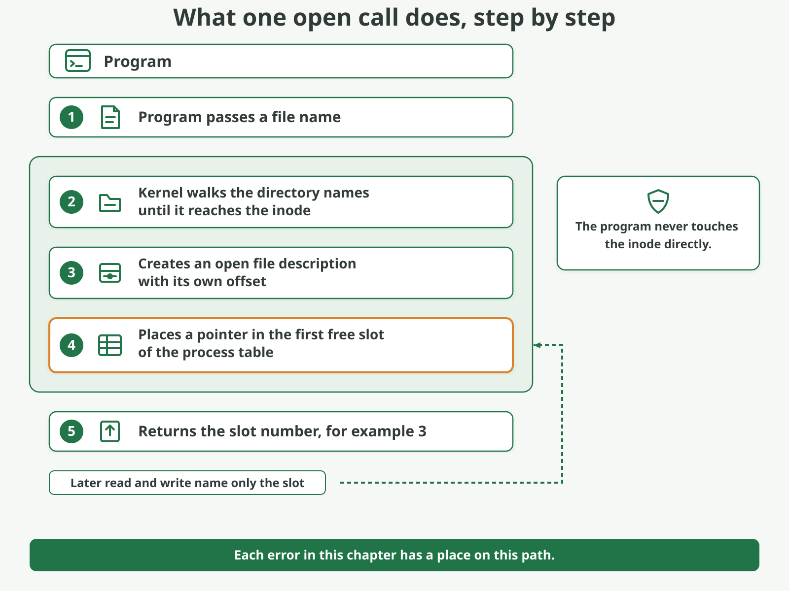

*Figure 20.4.1. The steps of one open call: the kernel walks the names to the inode, creates an open file description, and returns a slot number.*

Picture a process that has just opened a log file. The program holds the number 3 and passes it to every later `read` and `write`. The program never sees the file itself. Behind that number the kernel keeps three things, and each has its own limit and its own error.

It helps to walk through what happens on one `open` call. The program passes a file name. The kernel walks the directory names until it reaches the inode. It then creates an open file description, which is the record of this one open, with its own offset. Finally it places a pointer to that record in the first free slot of the process's table, and returns the slot number to the program. The program never touches the inode directly. Each later `read` or `write` names only the slot, and the kernel follows the pointers from there. Once you hold that walk in your head, each error in this chapter has an obvious place on the path.

Each process has a table that maps small numbers to open files. Each entry points to an open file description, which stores the offset and the flags. The offset is the position where the next read or write happens. The description points to an inode, which holds the type, the permissions and the location of the data. Names live in directories, and a directory is itself an inode that lists names and the inodes they point to. This model comes from How Linux Works, chapter 4, and Systems Performance, chapter 8.

The manual pages support each box. `/proc/PID/fd` has one link per open descriptor. `/proc/PID/fdinfo` shows `pos`, the flags, `mnt_id`, and since Linux 5.14 the `ino` field. The counter in `/proc/sys/fs/file-nr` counts open file descriptions, which the manual calls allocated file handles.

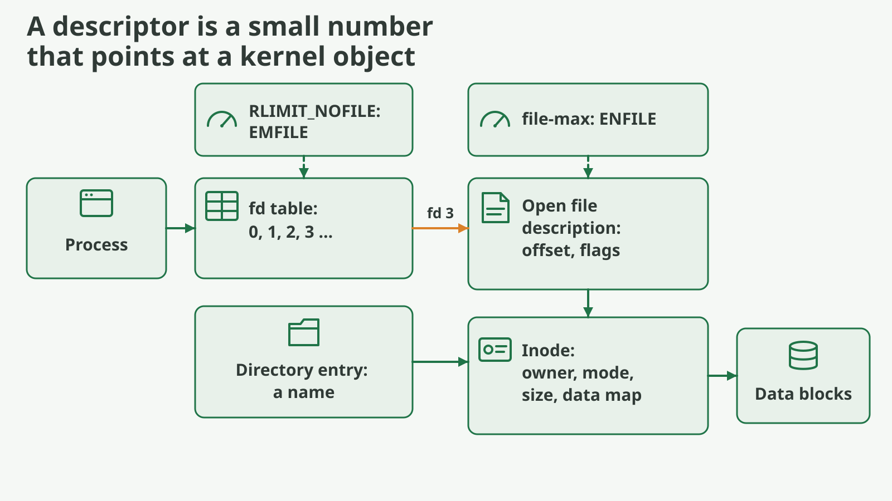

*Figure 20.4.2. A descriptor is a small number that points at a kernel object, as a diagram.*

Deleting a name lowers the link count, while an open description keeps pointing at the inode. That detail drives the deleted-file puzzle in section 5. A descriptor also need not be a disk file. The proc_pid_fd manual says pipes and sockets read as `type:[inode]`, and objects such as epoll instances read as `anon_inode:[eventpoll]`. An epoll instance is the kernel object a program uses to wait on many sockets at once.

**When someone says a process leaked files, ask what kind of descriptor leaked.** Sockets, pipes, regular files and epoll instances each point to a different bug.

### 2. Three ceilings: per process, per system, and the cap on the cap

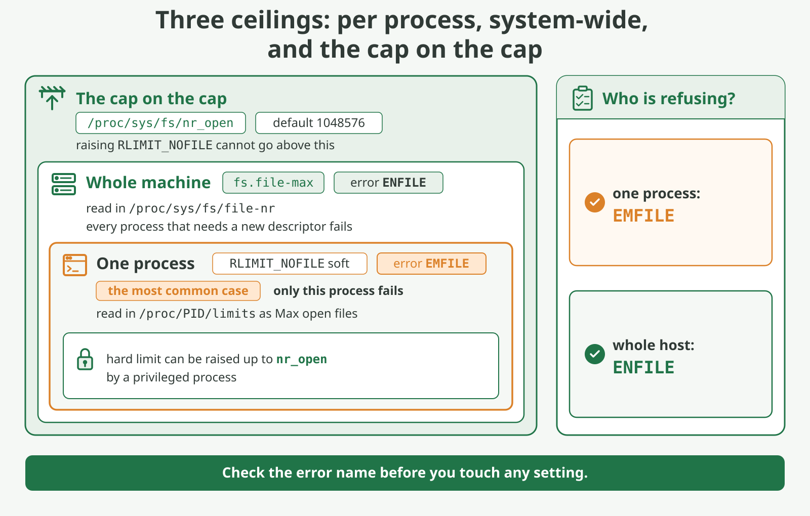

*Figure 20.4.3. EMFILE means one process hit its own limit, ENFILE means the whole machine hit the shared pool, and nr_open caps how high a process limit can go.*

A server accepts connections until one day it stops, and the log fills with `Too many open files`. The text comes from one of two errors, and the open(2) manual defines both. The difference tells you where to look, so check the error name before you touch any setting.

A simple way to keep the two apart is to ask who is refusing. With `EMFILE` the process has used up its own allowance, so only that process fails and the other services on the host keep working. With `ENFILE` the whole machine has run out of the shared pool, so every process that needs a new descriptor starts to fail, and even the tools you would use to investigate may stop working.

`EMFILE` means the per-process limit was reached. That limit is `RLIMIT_NOFILE`, with a soft value and a hard value. The kernel enforces the soft value, and an unprivileged process may raise it up to the hard value. The getrlimit(2) manual also says a child inherits its parent's limits, so the value in your own shell says nothing about a service that systemd started.

`ENFILE` means the system-wide limit was reached. That limit is `/proc/sys/fs/file-max`, and `/proc/sys/fs/file-nr` shows allocated handles, free handles and the maximum. The proc_sys_fs manual says the kernel log then contains `VFS: file-max limit <number> reached`. A third file, `/proc/sys/fs/nr_open`, caps how high `RLIMIT_NOFILE` can go, and its default is 1048576.

| Symptom | Limit | Where to read it | Who can raise it |
|---|---|---|---|
| `EMFILE` | RLIMIT_NOFILE soft | `/proc/PID/limits`, line Max open files | the process up to its hard limit, or the unit file |
| Raise refused | RLIMIT_NOFILE hard | same file, second column | privileged process, never above nr_open |
| `ENFILE` | `fs.file-max` | `/proc/sys/fs/file-nr` | root through sysctl |
| `ENOSPC` from `inotify_add_watch` | `max_user_watches` | `/proc/sys/fs/inotify/` | root through sysctl |
| `EMFILE` from `inotify_init` | `max_user_instances` | same directory | root through sysctl |

For a service run by systemd, the limit comes from the unit file. The systemd.exec manual describes `LimitNOFILE=` as a soft and hard pair, written as one value or as `soft:hard`. It says the hard limit nowadays defaults to 524288, and it warns that `select(2)` cannot use descriptors above 1023. It also says descriptors are accounted like other memory, so I read it as a reason to cap memory with `MemoryMax=` and leave the hard limit alone.

Systems Performance gives the method in its USE appendix. USE stands for utilisation, saturation and errors, and the appendix applies those three questions to each resource. Per-process utilisation is `echo /proc/PID/fd/* | wc -w` against `ulimit -n`. System-wide it is `file-nr` against `file-max`. The book says saturation may not make sense here. Errors are `strace` seeing `EMFILE`, or the `opensnoop -x` tool.

**Before you raise any limit, find out whether the process is leaking.** A higher limit on a leaking process only delays the same outage.

### 3. Read /proc and lsof before you attach a tracer

The process is still alive, and that is good news. The cheapest evidence needs no tracer and does not slow the service. Read the limit, count the descriptors, and group them by what they point at. Each step takes a few seconds, and together they tell you whether you are looking at a leak or a limit that is simply too low.

```bash
pid=$(pidof gateway)
grep 'Max open files' /proc/$pid/limits
ls /proc/$pid/fd | wc -l
ls -l /proc/$pid/fd | awk 'NR > 1 {print $NF}' | sort | uniq -c | sort -rn | head
```

Read the three commands as a short chain. The first finds the process and asks for its limit. The second counts how many descriptors it holds right now. The third groups them by what they point at, so a single target that repeats rises to the top of the list. If you have time for only one command, run the grouping, because the count alone does not say what is leaking.

The last line shows the shape of the leak. One regular file repeated hundreds of times points to a missing `close`. Hundreds of `socket:[...]` entries point to connections nobody closed. A path ending in ` (deleted)` is the subject of section 5.

Reading the links under `/proc/PID/fd` is governed by a ptrace access check, and `fdinfo` files are readable only by the process owner. Run the commands as root or as that user. If you see permission errors here, you are not looking at the bug yet. You are looking at your own access.

`lsof` gives the same view with more columns. How Linux Works, chapter 8, lists `COMMAND`, `PID`, `USER`, `FD`, `TYPE`, `DEVICE`, `SIZE/OFF`, `NODE` and `NAME`. The `FD` column holds a purpose such as `cwd` or `txt`, or a number with an access letter such as `3u`. The `NODE` column is the inode. The lsof manual adds `-p PID` for one process, `+D DIR` for a directory tree, and `+L1` for open files whose link count is below one, which means files deleted while open.

A quick walk through the output helps. The first line of the grouped listing is the biggest pile. If it is a regular file path repeated many times, you have a missing `close` in some code path that opens that file. If it is a line of socket entries, the leak is in network code, and the next question is which connections stay open after their requests finish. Either way you now have a name to take to the developers, which is more useful than a count.

**Use `/proc` first.** It needs no extra package and cannot be missing from a minimal image. Use `lsof` when you want one listing across many processes.

### 4. strace: how to read what it prints

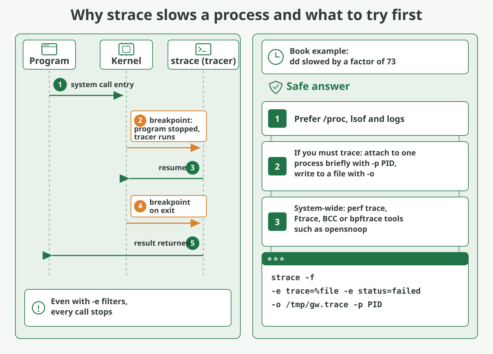

*Figure 20.4.4. strace uses ptrace breakpoints on every system call, so prefer proc, lsof and logs first and trace one process briefly.*

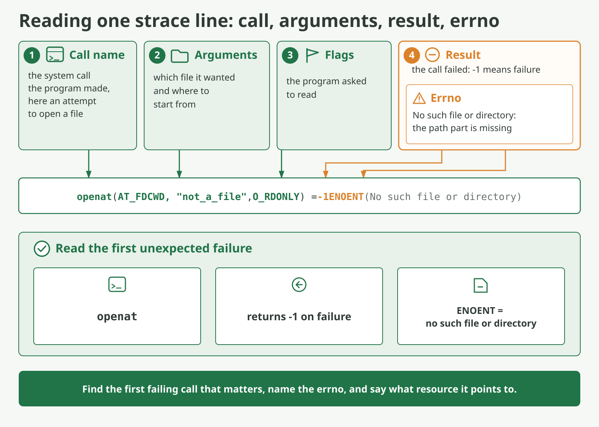

*Figure 20.4.5. Each strace line gives the call name, its arguments and a result, and a failure shows as minus one with an errno name.*

A process hangs on startup, or exits with a vague error, and the logs say nothing useful. `strace` shows every system call the program makes, in order, with its result. How Linux Works, chapter 8, presents it as the tool to reach for when logs fail, especially for missing files.

A line reads as the call name, its arguments, an equals sign and the result. The book's `strace cat not_a_file` ends in a line you can read at a glance.

```text
openat(AT_FDCWD, "not_a_file", O_RDONLY) = -1 ENOENT (No such file or directory)
```

A successful `openat` returns the new descriptor, which is 3 in the book's trace of `cat /dev/null`. A failure returns `-1`, the errno name and its description. The discipline is simple. Find the first failing call that matters, name the errno, and say what resource it points to. Most of a long trace is the program checking for files it may not need, so the failure you want is usually not the first one you see.

Take a worked example. Suppose a line reads `openat(AT_FDCWD, "/etc/gw/tls.pem", O_RDONLY) = -1 EACCES`. The call name tells you the program tried to open a file for reading. The path tells you which file it wanted. The errno tells you the kernel refused on permissions, not that the file is missing. The next step is therefore the path walk in section 6, and not a change to the file itself. Reading one line this way, call by call, is what the interviewer wants to see you do out loud.

The strace manual defines the options you need. `-f` follows child processes, and with `-p PID` it attaches to all threads. `-o FILE` writes to a file, and `-ff` writes one file per process. `-T` prints the time spent in each call, and `-ttt` prints epoch timestamps. `-s N` raises the string limit, which defaults to 32 characters.

Four more options save the most time. `-e trace=%file` traces every call that takes a file name, and `%desc` and `%network` do the same for descriptors and sockets. `-e status=failed` prints only calls that returned an error. `-y` prints the path next to each descriptor number. `-c` prints a summary table whose `errors` column shows which calls fail.

```bash
strace -f -e trace=%file -e status=failed -o /tmp/gw.trace -p "$pid"
strace -c -p "$pid"          # summary; stop it with Ctrl-C
strace -f -yy -T -p "$pid"   # paths, socket info, call durations
```

Now the warning interviewers like. Systems Performance, chapter 5, explains that this `strace` sets breakpoints on entry and exit of every system call through `ptrace`, even when you filter with `-e`. Each breakpoint stops the program and hands control to the tracer, so the cost adds up on programs that make many calls. Syscall-heavy applications can slow down by an order of magnitude, and the book's `dd` example slows by a factor of 73.

The safe answer has three parts. Prefer `/proc`, `lsof` and logs. If you must trace, attach to one process briefly and write to a file. For system-wide work, name the tools the book lists: `perf trace`, Ftrace, and BCC or bpftrace tools such as `opensnoop`. I have not run any of them.

The errno you read decides the next command. Think of it as a label on a returned envelope. The label does not say what is inside, but it tells you which office to send the envelope to. The wording below follows the open(2), getrlimit(2) and path_resolution(7) manual pages.

| Errno | Plain meaning | First thing to check |
|---|---|---|
| `ENOENT` | A path part is missing or a symlink dangles | the exact path in the trace, the working directory, the mount namespace |
| `EACCES` | Refused by modes, an ACL, a directory without search permission, noexec, or a policy module | every directory on the path, then section 6 |
| `EPERM` | The operation needs ownership or a capability | immutable flag, capabilities, ID mapping |
| `EROFS` | The file is on a read-only filesystem | mount flags, pod security context |
| `EMFILE` | Per-process descriptor limit | `/proc/PID/fd` against `/proc/PID/limits` |
| `ENFILE` | System-wide open file limit | `/proc/sys/fs/file-nr` |
| `ENOSPC` | No room to create: blocks, inodes or watches | `df -h`, `df -i`, deleted-but-open files |
| `EDQUOT` | A block or inode quota is used up | the user's quota |
| `ETXTBSY` | Writing to an executable that is running | stop it, or write a new file and rename it |

The helper `ch04_strace_errors.py` parses lines like these, counts failures by call and errno, and prints a hint for each. Its tests use lines quoted from the two books.

**When you read a trace, look for the first unexpected failure and ignore the noise.** Most programs probe for optional files and get `ENOENT` many times, and that is normal.

### 5. Blocks, inodes, and files that are deleted but still open

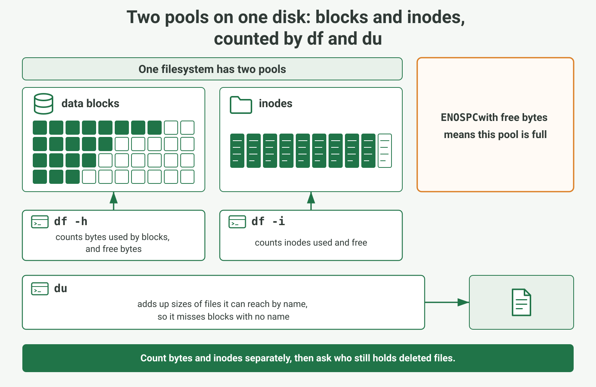

*Figure 20.4.6. Free bytes and free inodes are separate pools, and df and du answer different questions about them.*

A disk alert fires at 95 percent. You run `du` and the numbers add up to far less than the alert claims. Or a create fails with `No space left on device` while `df -h` shows half the disk free. Both puzzles exist because a filesystem has two resources, not one. It has a pool of data blocks, and it has a database of inodes. Either pool can run out while the other still has room.

How Linux Works, chapter 4, describes a traditional Unix filesystem as a pool of data blocks plus a database of inodes. An inode records the type, the permissions and where the data lives. A directory inode lists names and the inodes they refer to. The link count is the number of directory entries that point to an inode, and removing a file lowers it by one. When it reaches zero, no names remain and the kernel can delete the inode and its data.

A short walk shows why the two disk puzzles look alike. Suppose a process writes a 20 MB log. The blocks that hold those 20 MB belong to the inode. Removing the name removes one directory entry, so the link count drops to zero. The process still holds its descriptor, though, so the kernel keeps the inode alive. Until the process closes that descriptor, the blocks stay in use. `df` keeps counting them, while `du` no longer finds the file because it has no name left to walk to.

The two commands answer different questions, and that is the whole reason to run both. `df` asks the filesystem how many blocks and inodes are in use. `du` adds up the sizes of the files it can reach by name. A block with no name is counted by `df` and invisible to `du`, and an inode pool that is full can refuse a create while bytes remain free.

On a filesystem with a fixed inode pool, many tiny files can use every inode while most blocks stay free. The symptom is `ENOSPC` on create. `df -h` shows free bytes and `df -i` shows 100 percent inode use. Running both commands is the fastest way to tell the two pools apart. The kernel tmpfs documentation shows the same split in two mount options, `size` and `nr_inodes`, and says the default for `nr_inodes` is half the number of physical RAM pages. Scenario 3 builds a tiny tmpfs to reproduce the error without root.

The fix for an inode shortage differs from the fix for a block shortage. Deleting a few large files may do nothing for inodes if the directory still holds a million tiny ones, and deleting the wrong files wastes the few minutes you have. Count first, then choose what to remove, and say which pool you freed.

The other puzzle is the deleted file that still holds space. A process opened a log file, and then someone or a rotation tool ran `rm`. The name is gone, so `ls` and `du` cannot see it, but the process still holds a descriptor. The kernel keeps the blocks until that descriptor closes, so `df` still counts them. The proc_pid_exe manual says an unlinked path is shown with ` (deleted)` appended, and the lsof manual says `+L1` selects open files that were unlinked.

Two things here are not sourced from a manual. That the kernel keeps the blocks until the last descriptor closes is standard Unix behaviour. The ` (deleted)` marker on `/proc/PID/fd` links, as opposed to `/proc/PID/exe`, is not quoted from a manual either. Scenario 2 checked both in the container. The link read `/tmp/ch04-s2.Fi38Mc/app.log (deleted)`, `df` used space did not move after `rm`, and it fell by about 20 MB after the truncate.

If the process is still running, you can usually fix this without a restart. Copy what you want out of `/proc/PID/fd/N`, then truncate through the same link, which frees the blocks while the process keeps writing. The lasting fix is to make the writer reopen its file after rotation, so that the old descriptor is closed for good.

The rescue step deserves a plain explanation, because it sounds risky. The file under `/proc/PID/fd/N` is the same file the process writes to, reached through a second name. Copying it first gives you a safe record. Truncating it through that link sets its length to zero, which frees the blocks. The process keeps its descriptor and keeps writing from its current offset, so the file may show a hole of zeros for a moment, but the disk space comes back. Nothing is restarted, and no other process loses its place.

Log rotation is the usual way this happens. A tool renames or deletes the old log and starts a fresh one, but a service that opened the old file keeps writing into it. The new log stays small, the old file grows in the dark, and the disk fills while every directory listing looks normal. Many logging setups send a signal or call a reopen function for this reason. When you find a deleted file held open after a rotation, the question to ask the team is whether the writer was told to reopen.

**Always put the question in two halves.** Out of bytes, or out of inodes? Then ask who still holds the files that someone deleted.

### 6. Permission checks beyond the mode bits

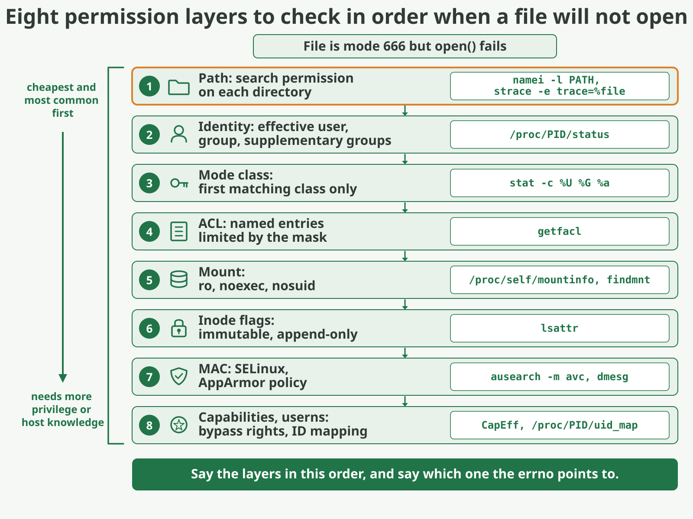

*Figure 20.4.7. The mode bits are one layer of eight; work down the ladder only when the layers above come back clean.*

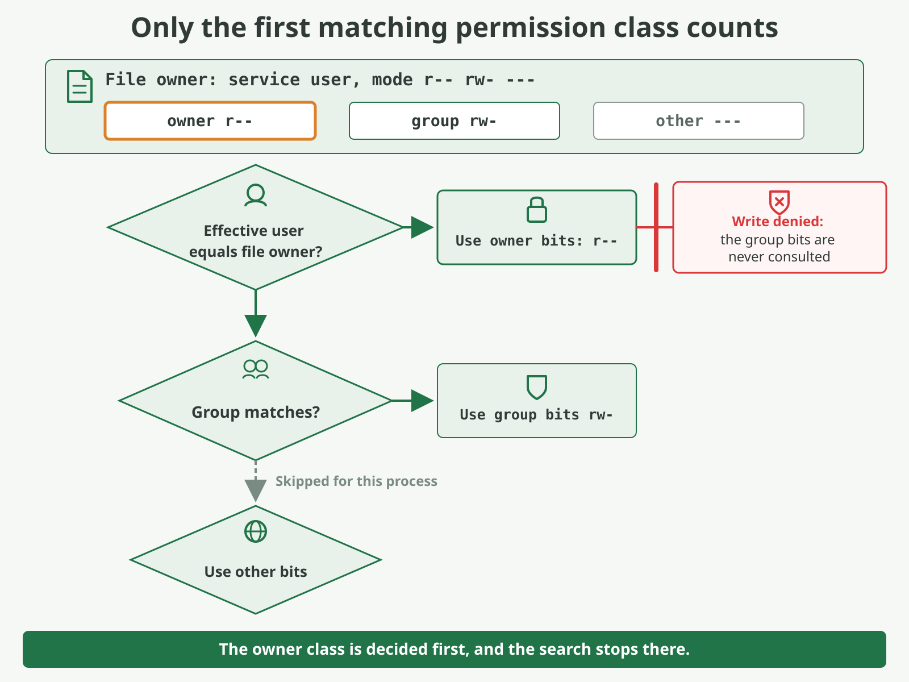

*Figure 20.4.8. The first matching permission class decides the access, so an owner with r-- cannot write even when the group bits allow it.*

Back to the opening question. The file is mode 666 and the service still cannot open it. The mode bits are one layer of several, and the errno narrows the list before you check anything. Treat the mode as the first of several layers, not as the whole answer.

The path comes first. The path_resolution(7) manual says the kernel walks a path one component at a time and needs search permission on each directory. A missing search bit gives `EACCES`. A file with mode 666 inside a directory with mode 600 cannot be opened by anyone except root, and chmod on the file does not help. The file is fine, and the door in front of it is locked.

Think of a path as a set of rooms. You need permission to pass through each room on the way to the file, and the file itself is the last door. A missing search bit on any room, even one you did not expect, stops the walk before the file is reached. That is why the check starts with the directories and not with the file.

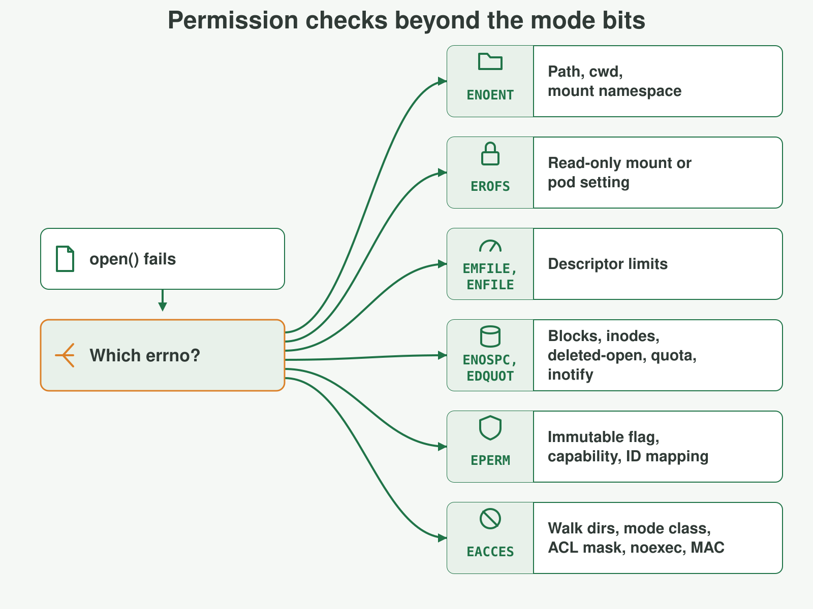

*Figure 20.4.9. Permission checks beyond the mode bits, as a diagram.*

Next is who the process really is. The mode bits use the effective user ID and the group IDs of the process, including supplementary groups. Look at the process, not at your shell. `/proc/PID/status` shows `Uid` and `Groups`. A service started by systemd has the groups its unit gave it. If you added the account to a group later, a running process probably keeps its old list. That is my reasoning from the credentials manual. I tested it in the container. A running `sleep` started as user `u` showed `Groups: 1001`, and after `usermod -aG g1 u`, `id u` listed two groups while the running process still showed only `1001`.

Then come the classes. The path_resolution manual says the owner bits apply when the effective user ID equals the file owner, the group bits when the group matches, and the other bits otherwise. Only the first matching class counts. This is the surprising part, and it trips people up because the group bits look like they should help. For the owner they do not, because the owner class is decided first and the search stops there. If the service owns the file and the owner bits are `r--`, it cannot write even when the group bits say `rw-`, because the group bits are never consulted for that process.

Then the ACL. The acl(5) manual says that when a mask entry exists, the group bits of the mode are the mask. The mask is the most that any named user or named group can receive. So `chmod 640` on a file with a named entry of `rw-` sets the mask to `r--`, and the named user can only read. `getfacl` prints `#effective:` beside such an entry, and `ls -l` shows a trailing `+` according to Supercomputers for Linux SysAdmins, chapter 12. Scenario 5 reproduces it.

Then the mount. The mount manual lists `ro`, `noexec` and `nosuid`. A read-only mount gives `EROFS` on any write. A `noexec` mount refuses to run binaries from it, and the execute bit is never consulted. A `nosuid` mount ignores setuid bits and file capabilities. A read-only bind mount makes only that mount read-only, and the manual says the original filesystem stays writable. Scenarios 4 and 7 reproduce the first two.

Then the inode flags. The chattr manual says an immutable file cannot be modified, deleted, renamed or linked, and cannot be opened for writing. Only a process with `CAP_LINUX_IMMUTABLE` can set or clear the flag. `ls -l` does not show it, so use `lsattr`. The error is `EPERM`, so an `EPERM` in a root shell should make you think of this flag. Scenario 8 reproduces it.

Then mandatory access control. The capabilities manual says `CAP_DAC_OVERRIDE` bypasses discretionary checks, meaning mode bits and ACLs. The AppArmor manual says a confined process is restricted even as root, and that profiles run in enforce or complain mode. For evidence, the ausearch manual gives `ausearch --start today -m avc -i` for SELinux denials, and the Kubernetes AppArmor page says denials appear in `dmesg` and in `journalctl`. I did not verify `getenforce`, `ls -Z` or `restorecon` against a manual, so check them before you quote them.

Last come capabilities and user namespaces, covered in section 7. `/proc/PID/status` shows the sets as `CapEff` and `CapBnd`.

| Layer | What is checked | Evidence on the box |
|---|---|---|
| Path | search permission on each directory | `namei -l PATH`, `strace -e trace=%file` |
| Identity | effective user, group, supplementary groups | `/proc/PID/status` |
| Mode class | first matching class only | `stat -c '%U %G %a'` |
| ACL | named entries limited by the mask | `getfacl` |
| Mount | `ro`, `noexec`, `nosuid` | `/proc/self/mountinfo`, `findmnt` |
| Inode flags | immutable, append-only | `lsattr` |
| MAC | SELinux, AppArmor policy | `ausearch -m avc`, `dmesg` |
| Capabilities, userns | bypass rights, ID mapping | `CapEff`, `/proc/PID/uid_map` |

The table is a checklist, and the rows are not a random list. The top rows are the cheapest and most common causes, and the lower rows need more privilege or more knowledge of the host. Work downward only when the rows above come back clean. In practice most real cases are settled by the path or the mode class in the first few minutes, and the rest of the table is there for the cases that survive that first pass.

Both `namei -l` and `findmnt` ran in the container. Neither is quoted from a manual in my sources, so check the flags on your box. The helper `ch04_access_check.py` models the path walk, class order, ACL mask, mounts, immutable flag and root bypass, and its 11 tests cover each rule.

**In the interview, say the layers in this order, and say which one the errno points to.** That shows you do not guess.

### 7. Containers and Kubernetes change the answer

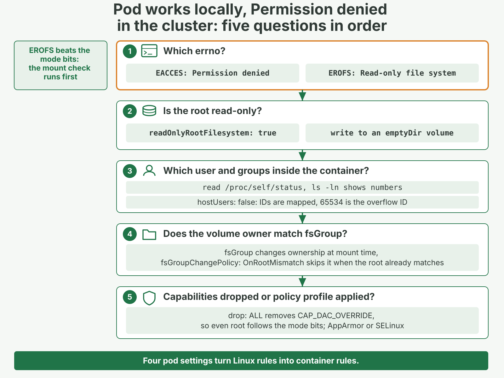

*Figure 20.4.10. Ask five questions in order when a pod fails to read or write a file.*

A pod that works on your laptop fails in the cluster with `Permission denied` or `Read-only file system`. The cause is almost always a setting, not a bug in the application. Four settings are worth knowing well enough to recite, and each one turns a familiar Linux rule into a container rule.

A useful habit is to ask what the container is before asking what the process is. A container is an ordinary process with its own view of the filesystem, a set of capabilities, an ID mapping and a list of mounts. The pod spec can change each of those four things. If a file works on your laptop and fails in the cluster, one of them differs, and the pod spec usually tells you which one.

Read-only root filesystem. The Kubernetes security context page says `readOnlyRootFilesystem` mounts the container's root filesystem as read-only, so any write returns `EROFS`. The app must write only to volumes. The companion manifest below gives two `emptyDir` volumes. The volumes page says an `emptyDir` is created when the pod is assigned to a node, survives container crashes, and is deleted permanently when the pod leaves the node. Production Kubernetes, chapter 4, adds that writes to the container's own filesystem are lost on restart.

```yaml
# code/part20/ch04_ro_rootfs_pod.yaml
# Companion to scenario 7: a read-only root filesystem in Kubernetes.
# The container can write only to the two emptyDir mounts. Writing anywhere else
# fails with "Read-only file system" (EROFS).
apiVersion: v1
kind: Pod
metadata:
  name: ro-rootfs-demo
spec:
  containers:
    - name: app
      image: busybox:1.36
      command: ["sh", "-c", "touch /tmp/ok && echo tmp-ok; touch /etc/nope; echo etc-exit=$?; sleep 3600"]
      securityContext:
        readOnlyRootFilesystem: true
        allowPrivilegeEscalation: false
        runAsNonRoot: true
        runAsUser: 10001
        capabilities:
          drop: ["ALL"]
      volumeMounts:
        - name: tmp
          mountPath: /tmp
        - name: cache
          mountPath: /var/cache/app
  volumes:
    - name: tmp
      emptyDir: {}
    - name: cache
      emptyDir: {}
```

Walk through a real pod failure the same way. A job writes a checkpoint to a mounted volume and fails with `Permission denied`. First confirm the errno in the application log. Then exec into the container and read the process's user and groups from `/proc/self/status`. Next compare the owner of the mounted directory with that user, using `ls -ln` so that numbers show instead of names. If the owner and the process do not match, the next question is whether `fsGroup` was set and whether the volume type honours it. Only after those checks do you consider capabilities and policy profiles. The order keeps the search short.

The fsGroup setting. The security context page says that when `fsGroup` is set, Kubernetes by default recursively changes ownership and permissions of the volume contents at mount time. That can be slow on large volumes, and `fsGroupChangePolicy: OnRootMismatch` skips the change when the root directory already matches. The field has been stable since 1.23. Think of `fsGroup` as the setting that makes a shared volume writable for a group the process belongs to, without the image having to know that group in advance.

User namespaces. The user_namespaces manual says a new namespace starts with no ID mapping, and unmapped IDs show up as the overflow ID, 65534 by default. A process that creates one gets full capabilities inside it and none in the parent, so root in the container has no override over files owned by an unmapped ID. The Kubernetes page says pods opt in with `hostUsers: false`, that the feature is stable since 1.36 and first appeared in 1.28, and that it needs idmap mounts, which in practice means Linux 6.3 or later. It also says `runAsUser` and `fsGroup` refer to IDs inside the container, so volume ownership does not change.

In plain words, a user namespace is a private phone book for IDs. Inside the container, uid 0 can be a root that is not root on the host, and files written by the host user appear under a different number inside. That is why `ls -ln` matters here. The number on disk and the number the process sees can differ, and a permission check uses the mapped value.

Dropped capabilities and policy modules. A manifest with `capabilities: drop: ["ALL"]` leaves uid 0 without `CAP_DAC_OVERRIDE`, so even root follows the mode bits. AppArmor and SELinux settings in the pod spec add the policy layer. Production Kubernetes, chapter 12, shows a Pod Security Policy example. The Kubernetes documentation says it was removed in 1.25, so take the ideas from the book and not the object itself.

**When a pod fails to read or write a file, ask five questions in order.** Which errno? Is the root read-only? Which user and groups does the process have inside the container? Does the volume owner match `fsGroup`? Are capabilities dropped or a policy profile applied?

## How to answer out loud

Rehearse the order of speech. The interviewer is not only listening for the right command. They want to hear the sequence of reasoning you would follow on a real box, one step at a time, with a reason before each command.

A good answer sounds like a colleague thinking out loud. Say what you suspect, say what the next command should show, then run it and compare the result with what you expected. Nobody expects you to remember every flag. They do expect you to know which question each command answers.

### Question 1. "A service logs Too many open files. What do you do?"

Say the order. Confirm the errno first, because `EMFILE` is per process and `ENFILE` is system-wide. Read the evidence without tracing: the entries in `/proc/PID/fd`, the soft limit in `/proc/PID/limits`, and `file-nr` against `file-max`. Group the descriptors by target to see what leaked.

Then decide. A count at the limit with one repeated file or many sockets is a leak, so restart and file the bug. A count far below the limit means the limit may suit a connection-heavy service badly, so raise `LimitNOFILE=` and justify the number. Name the trade-off: a raised limit hides a leak.

### Question 2. "df shows the disk is full but du finds nothing. Why?"

Check deleted-but-open files first with `lsof +L1`, because they are the commonest surprise on log-heavy hosts. Then a filesystem mounted over a directory that holds files, then another mount that `du -x` skipped, then inodes if the error is `ENOSPC` with free bytes.

State the fix in two steps. Immediately, copy out and truncate through `/proc/PID/fd/N`. Permanently, make the writer reopen after rotation. The trade-off is that truncating loses content, so copy first. A likely follow-up is what `du` shows after the process exits. The space is freed and the numbers agree again. Another follow-up is why you cannot simply delete the file again, and the answer is that the name is already gone, so the only handle left is the descriptor. That is the whole reason for the `/proc` route.

### Question 3. "The file is 666 and root runs the service, but it cannot open it."

Do not start with chmod. Say the mode bits are one layer of several and name the errno you expect. `EACCES` means check the path walk, the ACL mask, noexec and policy modules. `EPERM` means the immutable flag and capabilities. `EROFS` means the mount. Then run `strace -e trace=%file -e status=failed` on that one process to see the failing call and path.

Name the classic traps. A directory on the path without search permission. An ACL mask that a later `chmod` lowered. An immutable flag that `ls -l` never shows. A service that is root only in name, in a container with every capability dropped. If asked how root can be refused, answer that `CAP_DAC_OVERRIDE` is missing, a mandatory policy denies it, or the file is immutable.

### Question 4. "How would you use strace on production, and what do you look at?"

Open with the risk. `ptrace` breakpoints on every syscall slowed the book's `dd` by a factor of 73, so you read `/proc`, `lsof` and logs first. If you trace, attach to one process briefly with `-p PID`, add `-f` for threads, filter with `-e trace=%file` or `-e status=failed`, and write to a file with `-o`.

Then say how you read it. Find the first failing call, read the errno, use `-T` for slow calls and `-c` for a count of failures. For a hung process, the last line is probably the call it is blocked in. Close with `perf trace` or a BPF tool for system-wide work.

### Question 5. "A pod works locally and fails in the cluster with Permission denied."

Ask for the errno and name `Read-only file system` as the other common one. List the pod-level causes: `readOnlyRootFilesystem`, a non-root `runAsUser` against root-owned image files, `fsGroup` not matching the volume, dropped capabilities, an AppArmor or SELinux profile, and user namespaces. Read the pod spec and `/proc/self/status` inside the container, and check the volume owner with `ls -ln`, because numbers show the real mapping.

## Worked scenarios

Each scenario has a script in `code/part20`. Every script refuses to run as root unless it needs root, works only inside a directory from `mktemp -d`, and cleans up on exit. Run `bash SCRIPT answer` to print the answer key without running anything. Scripts that need a mount use a throwaway user and mount namespace. If the kernel disables that, they exit with status 77. All eight scripts and the bonus script were run in the container.

If you want to practise, run each script with the word answer first. That shows you what the right conclusion looks like before you read the output. It is also the order you would follow in an interview, where you name the cause before you look for proof.

The scripts are `ch04_s1_emfile.sh`, `ch04_s2_deleted_open.sh`, `ch04_s3_inodes.sh`, `ch04_s4_noexec.sh`, `ch04_s5_acl_mask.sh`, `ch04_s6_dir_search.sh`, `ch04_s7_readonly_mount.sh` and `ch04_s8_immutable.sh`, numbered like the scenarios.

A bonus script, `ch04_s9_userns_ids.sh`, prints how a user namespace maps IDs.

### Scenario 1: the gateway that stops accepting

Problem. The log says `Too many open files` and new requests fail. Restarting fixes it for about an hour.

Reasoning. A restart that helps for a while is the signature of a leak. Compare the descriptor count with the soft limit of that process, then look at what the descriptors point at. The script runs a leaker that lowers its own soft limit to 24 and opens one file until `open` fails. Real output: 23 entries in `/proc/PID/fd` against a soft limit of 24, 19 of them the same data file, and `file-nr` at `702 0 604700`. The helper printed `verdict: close to the limit`.

<details><summary>Answer key</summary>

The process holds almost as many descriptors as its soft `RLIMIT_NOFILE`, and nearly all point at one file, so a `close` is missing. It is `EMFILE`, not `ENFILE`, because the system counter is far from its maximum. Restart for recovery, or use `prlimit` with privilege. The lasting fix is in the code.

</details>

### Scenario 2: the disk that is full of nothing

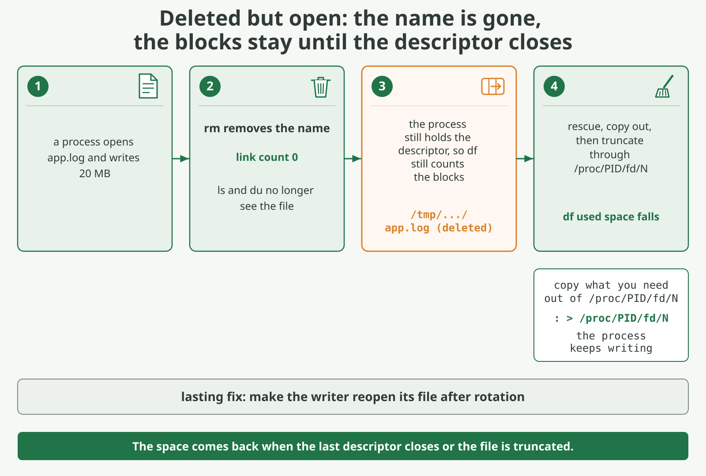

*Figure 20.4.11. A file removed while a process still has it open keeps using disk space until that descriptor is closed or the file is truncated.*

Problem. An alert says a filesystem is 92 percent used. `du -sh /var/log` shows 3 GB on a 100 GB volume, and someone deleted the big log an hour ago.

Reasoning. `du` walks names and `df` asks the filesystem for used blocks. If they disagree, some blocks have no name, and the usual owner is a process that still has the file open. In plain terms, the blocks are still in use but nothing in the directory tree points at them any more. A quick test is to ask whether the used number moves after the delete. If it does not, the blocks are held by a descriptor. The script holds a 20 MB file open, removes the name, then rescues and truncates it through `/proc`. Real output: used space was 27069364 KB before and after `rm`, `stat -L` showed `size=20971520 bytes, links=0`, `lsof` listed the file with `NLINK` 0, and after the truncate the size was 0 and used space fell to 27048884 KB.

<details><summary>Answer key</summary>

`rm` removed the name but the process holds a descriptor, so the blocks stay allocated. Find it with `lsof +L1` or a scan of `/proc/*/fd`. Copy out what you need, truncate with `: > /proc/PID/fd/N`, and fix the writer to reopen after rotation. `df -i` rules out inodes.

</details>

### Scenario 3: no space left, but half the disk is free

Problem. A batch job writing many tiny files fails with `No space left on device`, and `df -h` shows 60 percent free.

Reasoning. A create needs an inode, so check `df -i`. The script mounts a private tmpfs with `size=8m` and `nr_inodes=40` in a throwaway namespace and creates files until the error appears. Real output: `created 39 files, then: ... No space left on device`, `df -h` showing 8.0M available at 0% used, and `df -i` showing 40 inodes, 40 used, 100%. It needed the unconfined seccomp profile described at the top.

<details><summary>Answer key</summary>

The inode pool is exhausted. Remove or archive the tiny files, find which directory owns them, and stop the writer from making millions of small files. For a real ext4 volume you can create it with more inodes next time. For ext4, `mkfs.ext4 -N 20000` worked in the container, and `dumpe2fs -h` showed the inode count change from 4096 to 20000 on a 16 MB image file.

</details>

### Scenario 4: mode 755 and still Permission denied

Problem. An installer drops a script on a data volume. It is mode 755 and owned by the right user, yet running it prints `Permission denied`, and `chmod +x` changes nothing.

Reasoning. Correct bits with a refusal on execute point at the mount. The mount manual says `noexec` means no direct execution of binaries. The script mounts a tmpfs with `noexec` and tries four things: run the file, show the options, run it through `sh`, and remount with `exec`. Real output: the direct run printed `Permission denied` with exit status 126, `mountinfo` listed `rw,noexec,relatime`, and `sh run.sh` printed `it ran`. Correction found by running it: `mount -o remount,exec` failed with `EINVAL`, because mount(8) resends the tmpfs `uid=` and `gid=` options, which a remount rejects. The script now uses `mount -o remount,bind,exec`, which printed `it ran` on the direct run.

<details><summary>Answer key</summary>

The filesystem is `noexec`, so `execve` fails with `EACCES` before the mode bits matter. Prove it with the mount options and with `strace` showing `execve` returning `EACCES`. Run the program from another mount, or remount only if policy allows.

</details>

### Scenario 5: the ACL that a chmod cancelled

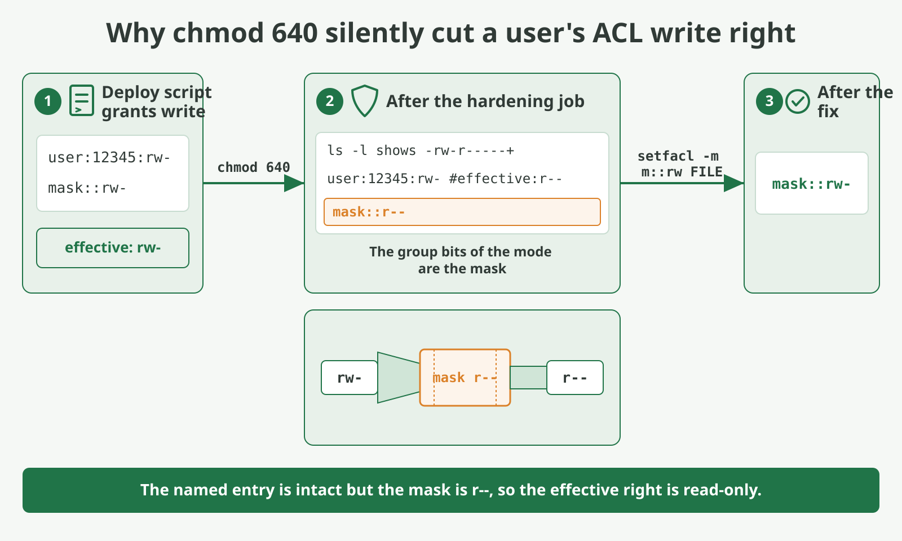

*Figure 20.4.12. The mask is the most any named entry can receive, so chmod 640 lowered the effective right to read-only.*

Problem. A deploy script gives the service account write access through an ACL. A hardening job later runs `chmod 640` on the file. The service can only read, though `getfacl` still shows `rw-`.

Reasoning. With a mask present, the group bits of the mode are the mask, and the mask limits named entries. The script grants a made-up numeric user ID write access, runs `chmod 640`, prints `getfacl` before and after, and widens the mask. Real output after the `chmod 640`: `-rw-r-----+` in `ls -l`, and `user:12345:rw-	#effective:r--` with `mask::r--` in `getfacl`. After `setfacl -m m::rw` the mask line was `mask::rw-`.

<details><summary>Answer key</summary>

The named entry is intact but the mask is `r--`, so the effective right is read-only. Fix it with `setfacl -m m::rw FILE`. The helper `ch04_access_check.py` models this rule.

</details>

### Scenario 6: readable file, locked directory

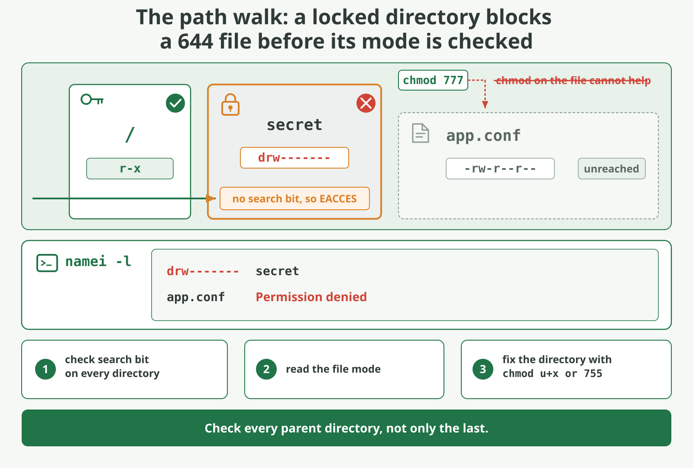

*Figure 20.4.13. Opening a path needs search permission on every directory along the way, so a locked directory blocks a readable file.*

Problem. A secrets file is mode 644 and the service, its owner, still gets `Permission denied`. A colleague already ran `chmod 777` on it.

Reasoning. The path walk comes before the file. The directory above has mode 600, so it has no search bit, and opening anything below it fails with `EACCES`. The script builds this, shows that even `chmod` on the file fails, and shows that `ls` of the directory works while opening a file inside does not. Real output on Linux as user `u`: `cat` printed `Permission denied`, `chmod 777` on the file printed `cannot access ... Permission denied`, `ls` of the directory listed `app.conf`, `namei -l` showed `app.conf - Permission denied` under a `drw-------` directory, and `strace` printed `openat(...) = -1 EACCES`.

```bash
# code/part20/ch04_s6_dir_search.sh
#!/usr/bin/env bash
# Scenario 6: the file is readable by everyone but open() says "Permission denied".
# The directory above it has no search (x) permission. chmod on the FILE cannot help.
# Run as a normal user on Linux: bash ch04_s6_dir_search.sh   (answer key: ... answer)
# Safe: temp dir only.
set -u
if [ "${1:-}" = answer ]; then
  cat <<'KEY'
Cause: opening a path needs search (x) permission on every directory on the way down. The
       directory had r-- but no x, so the kernel stops at that directory with EACCES.
Proof: strace -e trace=%file shows openat(...) = -1 EACCES. namei -l (if installed) shows the
       directory with no x. ls DIR works (read) while stat DIR/file fails (search).
Not the cause: the file's own mode.
Fix now: chmod u+x (or the right class) on the directory. Check EVERY parent, not only the last.
Fix for good: give directories 755 or 750 by default; use setgid directories for shared groups.
KEY
  exit 0
fi
[ "$(uname -s)" = Linux ] || { echo "Linux only. Use a Linux VM or container." >&2; exit 2; }
[ "$(id -u)" -ne 0 ] || { echo "Run as a normal user, not root." >&2; exit 2; }
W=$(mktemp -d "${TMPDIR:-/tmp}/ch04-s6.XXXXXX") || exit 1
trap 'chmod -R u+rwx "$W" 2>/dev/null; rm -rf "$W"' EXIT
mkdir "$W/secret"
echo "token" > "$W/secret/app.conf"
chmod 644 "$W/secret/app.conf"
chmod 600 "$W/secret"            # r and w for the owner, but no x
echo "--- 1. the file looks fine"
ls -ld "$W/secret"
echo "--- 2. open it"
cat "$W/secret/app.conf"; echo "exit status: $?"
echo "--- 3. chmod on the file does nothing for this"
chmod 777 "$W/secret/app.conf" 2>&1 | head -1
cat "$W/secret/app.conf" 2>&1 | head -1
echo "--- 4. reading the directory works, searching it does not"
ls "$W/secret" 2>&1 | head -2
echo "--- 5. the walk, if namei and strace exist"
command -v namei >/dev/null && namei -l "$W/secret/app.conf" 2>&1 | tail -3
command -v strace >/dev/null && strace -e trace=%file cat "$W/secret/app.conf" 2>&1 | grep -E 'EACCES' | head -2
echo "--- 6. fix"
chmod 700 "$W/secret"
cat "$W/secret/app.conf"
```

<details><summary>Answer key</summary>

The directory lacks the search bit, so the kernel cannot descend through it, and the file's own mode never matters. Check every parent directory, not just the last. `namei -l` prints the mode of each component if it is installed. Use 755 or 750 as the default for directories that hold readable files.

</details>

### Scenario 7: mode 777 and Read-only file system

Problem. A container writes a lock file at startup and crashes with `Read-only file system`. The directory is mode 777 and owned by the service user.

Reasoning. The error text is the clue. `Permission denied` is `EACCES`, and `Read-only file system` is `EROFS`, which the open(2) manual lists for a write on a read-only filesystem. The script makes a bind mount, remounts it read-only as the mount manual describes, and shows writes and deletes failing inside the namespace while the original directory stays writable outside. Kubernetes gives the same effect with `readOnlyRootFilesystem: true`, shown in the manifest in section 7. The lesson for the console is that a read-only mount beats the mode bits. Even a directory that everyone can write to returns `EROFS` once the mount is read-only, because the mount check runs first. Real output: `Read-only file system` on the write and on `rm`, mount flags `ro,relatime`, the read printed `one`, and the outside write printed `write ok`. It needed the unconfined seccomp profile. I also ran the pod manifest's container settings with Docker: `docker run --read-only --user 10001 --cap-drop ALL` on `busybox@sha256:73aaf090f3d85aa34ee199857f03fa3a95c8ede2ffd4cc2cdb5b94e566b11662` printed `tmp-ok`, then `touch: /etc/nope: Read-only file system` and `etc-exit=1`. That is the same kernel behaviour, not a Kubernetes run.

<details><summary>Answer key</summary>

The mount is read-only, so any write returns `EROFS` before any ownership check. Write to a mounted volume such as `emptyDir`, or fix the path the app uses. Keep the root read-only and give the app scratch space instead.

</details>

### Scenario 8: root cannot delete the file

Problem. A config file resists every change. `rm -f` as root says `Operation not permitted`, and the file is owned by root with mode 644.

Reasoning. `Operation not permitted` is `EPERM`, a different error from `EACCES`. With root and normal modes, think of inode flags. `ls -l` does not show them and `lsattr` does. The script needs root or passwordless sudo and a filesystem such as ext4 or XFS. It sets the flag on one temp file, shows the refusals and `lsattr`, and clears the flag on exit. Real output as root with `--cap-add LINUX_IMMUTABLE`: the append, `chmod` and both `rm` calls printed `Operation not permitted`, `lsattr` printed `----i---------e-------`, and after `chattr -i` the write worked. Correction found by running it: root in a default container does not have `CAP_LINUX_IMMUTABLE`, so `chattr +i` itself failed with `Operation not permitted` and the script exited with status 77. This confirms the capability rule in section 6. It also worked on a tmpfs.

<details><summary>Answer key</summary>

The file has the immutable attribute. Mode, owner and ACL are not the cause. Run `lsattr`, then `chattr -i` as root after finding out who set it and why.

</details>

## Hands-on lab

These steps were run in a container, not on a live server, so treat the results below as container results and not as proof of how a production host behaves. Start the container with `docker run --rm -it -v $PWD/code/part20:/work:ro ubuntu:24.04 bash`, install `procps psmisc util-linux acl attr e2fsprogs strace lsof iproute2 python3 python3-pytest`, create a normal user with `useradd -m u`, copy `/work` to `/home/u/w`, and run the scripts as `su u -c`. Add the two Docker flags from the top of the chapter for scenarios 3, 4, 7 and 9, and `--cap-add LINUX_IMMUTABLE` for scenario 8.

Run the Part A checks first. They need no privileges, and they confirm that the copied scripts are intact before anything touches a mount or a limit. Part B then moves from reading to changing, one scenario at a time, and each result should match the real output quoted beside it.

### Part A: offline checks

1. Run `python3 -m pytest -q test_ch04_fd_triage.py test_ch04_strace_errors.py test_ch04_access_check.py` from the copied directory. Result: 25 passed.
2. Run `for f in ch04_s*.sh; do bash -n $f; done`. Result: no output.

### Part B: on Linux

1. Run `ls -l /proc/$$/fd`, `cat /proc/$$/limits` and `echo /proc/$$/fd/* | wc -w`. Real output as `su u -c`: descriptors 0, 1 and 2 only. The word count was 3. The limits showed `Max open files 1024 1048576`. With a pipe in front there are no other descriptors, and an interactive shell has more.
2. Run scenarios 1 and 2. Results are in the scenarios above. A note on scenario 1: it failed once in four runs with a bash syntax error reading its own last line, which I could not explain, so rerun it if that happens.
3. Run scenarios 3, 4, 7 and 9 with the unconfined seccomp profile. Without it each printed `Unprivileged user namespaces are not available here. Skipping.` and exited with status 77, as designed. Scenario 9 printed the mapping `0 1001 1`. The root-owned file showed as owner `65534`, and my own file showed as owner `0`. It also printed `cannot write /etc/hostname`, and `CapEff: 000001ffffffffff`.
4. Run scenarios 5 and 6 as the normal user and scenario 8 as root with the capability added. Results are in the scenarios above.
5. Run `strace -f -e trace=%file -e status=failed -o trace.txt bash ch04_s6_dir_search.sh`, then `python3 ch04_strace_errors.py < trace.txt`. Real output: 336 `openat ENOENT`, 60 `newfstatat ENOENT`, 29 `faccessat ENOENT`, and only 2 `openat EACCES` and 4 `newfstatat EACCES` among them. The `EACCES` lines carry the hint, but they are a small part of a long list. This is the point of section 4. Tracing the whole script is noise, so look for the first failure that matters.
6. Try `prlimit`. Real output: `prlimit --pid PID --nofile=2048:4096` changed `/proc/PID/limits` from `1048576 1048576` to `2048 4096` on the running `sleep`.

## What the container run showed

These notes record where the first drafts of the scripts and claims were wrong, and what the container run changed. They matter because a claim that looked right on paper failed once it met a real kernel. Read them as a list of corrections you can repeat when a tool behaves differently from the book.

- **The scenario 1 script was wrong about the count.** It claimed the descriptor count equals the soft limit and that the helper says `exhausted`. In bash, `{fd}` redirections start at descriptor 10, so the leaker held 17 of 24 and the helper said `ok`. The script now opens descriptors 3 to 9 first, and the log file is opened early because no redirect works at the limit. Result: 23 of 24, verdict `close to the limit`.
- **The scenario 4 remount was wrong.** See the scenario. The script now uses `remount,bind,exec`.
- **Scenario 8 needs a capability that container root lacks.** See the scenario.
- **User namespaces were blocked by Docker's default seccomp profile.** The scripts exited with status 77 as designed, and the unconfined profile let them run.
- **Confirmed by running.** The ` (deleted)` marker on `/proc/PID/fd`, a running process keeping its old supplementary groups, `namei -l`, `findmnt`, `prlimit` and `mkfs.ext4 -N`. Also confirmed: dropping only `CAP_DAC_OVERRIDE` makes root fail on a file it does not own, as `cat` printed `Permission denied` for a mode 600 file owned by uid 1001, while it worked with the default capabilities.
- **Not available in the image.** `getenforce` and `restorecon` were not installed, and `ls -Z` printed `?`. There is no SELinux or AppArmor policy to test in the container.

## Drill questions

Answer these without notes, then open the answers. Imagine a colleague on the next desk asking them one at a time while you keep typing.

<details><summary>1. What is the difference between EMFILE and ENFILE, and where do you read each limit?</summary>

`EMFILE` is the per-process limit, `RLIMIT_NOFILE`, read in `/proc/PID/limits` as Max open files. `ENFILE` is the system-wide limit, `/proc/sys/fs/file-max`, and `/proc/sys/fs/file-nr` shows allocated, free and maximum.

</details>

<details><summary>2. Why does ulimit -n in your shell not tell you the limit of a running service?</summary>

A child inherits its parent's limits at creation, so each process has its own values. A service started by systemd gets them from its unit. Read `/proc/PID/limits` of the service itself.

</details>

<details><summary>3. Give the Systems Performance command for per-process descriptor use.</summary>

`echo /proc/PID/fd/* | wc -w`, compared with `ulimit -n` for that process. System-wide, compare `file-nr` with `file-max`.

</details>

<details><summary>4. What do socket:[2248868] and anon_inode:[eventpoll] mean in /proc/PID/fd?</summary>

The first is a socket, and the number is its inode, which you can look up under `/proc/net`. The second is an epoll instance, a descriptor with no file behind it.

</details>

<details><summary>5. strace slows a process badly. Why, and what do you use for system-wide work?</summary>

It uses `ptrace` breakpoints on entry and exit of all system calls, even when you filter, so syscall-heavy programs can slow by an order of magnitude. The book's example is a factor of 73. Use `perf trace`, Ftrace, or a BCC or bpftrace tool, which buffer events in the kernel.

</details>

<details><summary>6. df -h shows 40 percent free and a create fails with ENOSPC. Name two causes.</summary>

The inode pool is exhausted, which `df -i` shows. Or an inotify watch limit was reached, if the failing call was `inotify_add_watch`. On a tmpfs it can also be the `nr_inodes` mount option.

</details>

<details><summary>7. df shows far more used than du does. What is the cause and the fix without a restart?</summary>

A deleted file is still held open by a process. Find it with `lsof +L1`. Copy out what you need from `/proc/PID/fd/N`, then truncate through the same link, and make the writer reopen its file after rotation.

</details>

<details><summary>8. Root cannot write a file. Which errno suggests an immutable flag, and how do you see it?</summary>

`EPERM`, printed as Operation not permitted. `ls -l` does not show the flag, so use `lsattr`. Clearing it needs `CAP_LINUX_IMMUTABLE`.

</details>

<details><summary>9. A named-user ACL entry says rw-, yet the user cannot write. What do you check?</summary>

The mask. With a mask entry present, the group bits of the mode are the mask, and it limits named entries. A `chmod 640` sets it to `r--`. `getfacl` prints `#effective:` beside the entry. Fix it with `setfacl -m m::rw`.

</details>

<details><summary>10. Why does a pod with a read-only root fail writing /etc even as root?</summary>

`readOnlyRootFilesystem` mounts the root read-only, and a read-only mount returns `EROFS` before ownership or mode is checked. Give the app a writable volume such as `emptyDir` for the paths it really writes.

</details>

## Common mistakes and weak answers

Reaching for chmod first shows you treat permissions as one layer. Say the errno and the layer list, then check the path, the mask and the mount. A candidate who types chmod in the first minute loses the chance to show the reasoning, and the interviewer watches for that reasoning more than for the command.

Saying "just increase ulimit" hides a leak and ignores that the limit belongs to the unit or runtime. A higher number changes the symptom and leaves the cause in place, so the outage returns later with more damage. Say you would confirm a leak first, then pick a number for a stated reason.

Attaching strace to the busiest process ignores the documented overhead. Say you would read `/proc` first, then attach briefly to one process with a filter and an output file.

Mixing up the two disk puzzles loses points because `df -h` and `df -i` answer different questions. Say both commands in every no-space answer, then ask about deleted-but-open files.

Stating a default you did not check is worse than saying you are unsure. Say how you would verify it.

## Connections to the rest of the handbook

| Chapter | How it connects |
|---|---|
| 20.3 | The triage order for a sick box. This chapter is its file and permission branch. |
| 20.5 | CPU, memory, disk and the scheduler, including the I/O side of a full disk. |
| 20.6 | Network descriptors and the socket states you meet when sockets leak. |
| 20.7 | Twenty broken-box scenarios. These eight are the first of them. |
| 20.23 | Kubernetes failure drills, including pod security settings. |
| [1.3](../part-01-linux/03-files-and-the-directory-hierarchy-paths-links-inodes.md) | Inodes and links in depth. |
| [1.6](../part-01-linux/06-users-groups-permissions-acls-sudo-and-user-environments.md) | Mode bits and ACLs. |
| [1.8](../part-01-linux/08-processes-signals-and-job-control.md) | `ulimit` and `prlimit`, in its section 7. |
| [1.11](../part-01-linux/11-how-a-program-runs-system-calls-libraries-elf-strace-and-ldd.md) | System calls and tracing in more depth. |
| [1.12](../part-01-linux/12-disks-partitions-and-filesystems.md) | Mounts and the block layer. |
| [1.19](../part-01-linux/19-namespaces-the-kernel-feature-behind-containers.md) | The user and mount namespaces the scripts use. |
| [1.21](../part-01-linux/21-linux-security-capabilities-selinux-apparmor-seccomp-pam-ssh-hardening.md) | Capabilities, SELinux and AppArmor. |

## Sources and review notes

Date fetched for every online source: 2026-11-09.

Books. How Linux Works, 3rd edition: chapter 4, Disks and Filesystems, for the inode and block model, link counts and mount options. Chapter 8, A Closer Look at Processes and Resource Utilization, for `lsof` and `strace`. Systems Performance, 2nd edition: chapter 5, Applications, for `strace`, its overhead and the USE checklist. Chapter 8, File Systems, for VFS and caches. Appendix A, USE Method: Linux, for the descriptor checks. Production Kubernetes: chapter 4, Container Storage, and chapter 12, Multitenancy. Supercomputers for Linux SysAdmins, chapter 12, only for the `+` marker in `ls -l`.

Manual pages and documentation. From man7.org, man-pages 6.19: the proc_pid pages, proc_sys_fs, open, getrlimit, inotify, path_resolution, acl, capabilities, credentials, user_namespaces, chattr, mount, strace and lsof. From man.archlinux.org: ausearch, proc_pid_status and apparmor. Also systemd.exec at freedesktop.org, latest, which showed systemd 262, the kernel tmpfs documentation, and the Kubernetes pages for security context, user namespaces, volumes, the AppArmor tutorial and Pod Security Policies.

Nebius. The interview page and the candidate report come from the volume 20 plan, section 1.

### Explicitly labelled inferences

- The picture of descriptor table, open file description and inode is the standard Unix model. The manual pages support each box, and I found no single page that draws it.
- A running process keeps its supplementary groups after the account joins a group. This is my reading of the credentials manual, and the container run agreed.
- The order of the permission layers is a teaching order, not the kernel's internal order.
- Reading the last line of a hung process's trace as the blocked call, and a mount hiding files from `du`, are general knowledge that I did not source.
- Leaving the hard descriptor limit high follows my reading of the systemd.exec sentence about memory accounting. Running a file with `sh` on a `noexec` mount and truncating a deleted file through `/proc` are stated from general knowledge. Scenarios 2 and 4 confirmed both in the container.

### Not verified

- Environment: Docker container on a Rancher Desktop Alpine VM, kernel 6.18.37-0-virt, arm64. Some scenarios used `seccomp=unconfined` and `apparmor=unconfined`, and scenario 8 used `--cap-add LINUX_IMMUTABLE`. A real host with systemd was not available.
- `getenforce`, `ls -Z`, `restorecon`, `ausearch` and any SELinux or AppArmor denial. No policy module exists in the container.
- `LimitNOFILE=` in a real systemd unit, and the `file-max` limit being reached, which the container could not safely do.
- The Pod manifest was not applied to a Kubernetes cluster and `kubeconform` was not rerun. Only the equivalent `docker run --read-only` settings were run. User namespaces with `hostUsers: false` were not run.
- `perf trace`, Ftrace and the BCC or bpftrace tools, including `opensnoop`. No matching `perf` existed for the VM kernel.
- Whether `ptrace` `strace` slows a syscall-heavy program by the book's factor of 73. I did not measure it.
- The scenario 1 failure that happened once in four runs.
- The Python fixtures use lines quoted from the books and manual pages. The layout of `/proc/PID/limits` lines in the tests uses made-up numbers, though the real layout matched in this run.
