# 20.5 CPU, memory, disk and the scheduler

## What the interviewer is testing

A pod serving a model has become slow, and the on-call channel is full of messages. You are on the node with a shell, and the interviewer wants to hear how you would think about the first ten minutes. This chapter serves the Linux console round. Nebius describes the technical interviews as including "practical tasks in the Linux console", and as covering "coding, troubleshooting, debugging". The job posting asks for debugging "from kernel to application layer". One candidate reported a one-hour Linux troubleshooting stage done through the command line, and a separate 30-minute production incident stage. These are anecdotes, not a promise. Prepare for the hardest version of each.

The interviewer is checking whether you can name the resource that is short, prove it with one number, and say what you would change. Systems Performance by Brendan Gregg is on the official Nebius reading list. This chapter follows its chapters on CPUs, memory, disks, perf and BPF, and adds the container and GPU host parts that an inference platform needs.

A realistic question in the interviewer's voice: "A pod serving a model has p99 latency three times higher than yesterday. On the node, load average is 30, CPU is 40 percent busy, and free memory is under 200 MB. Walk me through what you check and in what order."

Each number in that sentence misleads on its own. Load average is not CPU demand on Linux. Forty percent CPU can hide a throttled container. Low free memory is normal. Be ready to say why, and how to prove it. The rest of this chapter gives you the reasons, and each section gives you the one command that settles the question.

## The core ideas

Every resource has three questions: how busy is it, how long do things wait for it, and is it failing. The three questions are the same whether you are looking at a CPU, a memory bank or a disk. Sections 1 to 5 apply them to the CPU. Sections 6 to 8 cover memory, section 9 covers disk, and the rest give you tools to look inside.

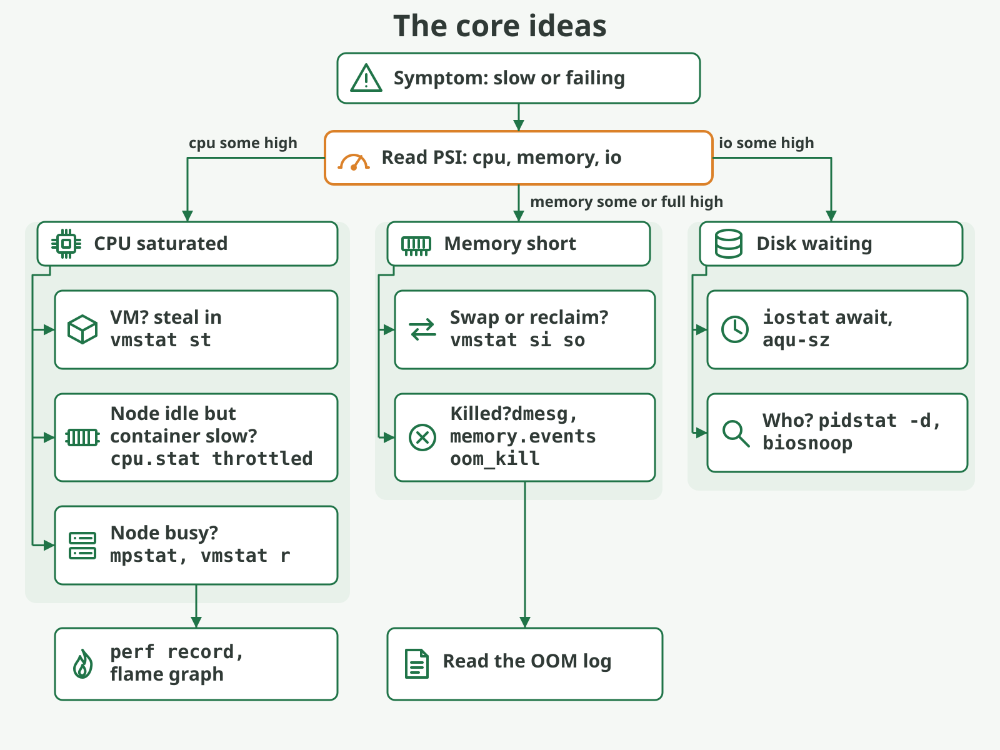

*Figure 20.5.1. The core ideas, as a diagram.*

The diagram is a map you can walk down under pressure. Start at the symptom, read the pressure numbers for the three resources, and follow the branch that is high. Only at the bottom do you reach for a profiler, because a profiler is the most expensive tool on the list and it answers the question "which code" only after you know "which resource".

### 1. Load average, utilisation and saturation

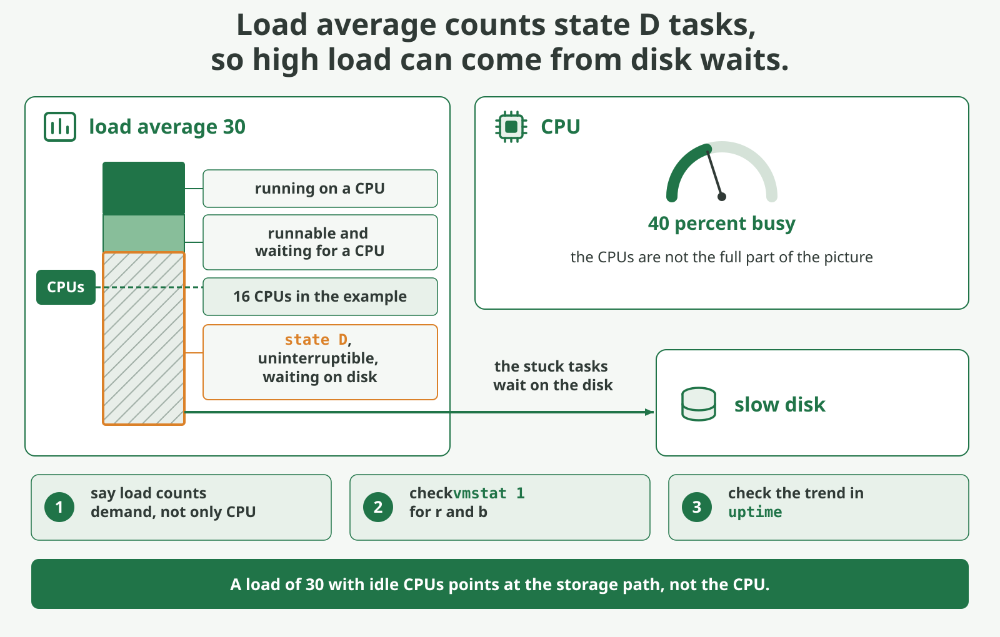

*Figure 20.5.2. Linux counts tasks waiting on disk in the load average, so a high load can come from storage while the CPUs are idle.*

An alert says load average is 30. A junior engineer says the CPUs are overloaded. A senior engineer asks which kind of load. On Linux the answer matters, because the number is not what most people think it is. Think of a shop with a long line at one slow cashier. From the door the shop looks busy, yet most of its staff are standing idle, and the line is the only part that is actually stuck.

Utilisation is how busy a resource is. Saturation is how much work is waiting because the resource is already full. Errors are things that failed. Systems Performance uses these three for every resource, and calls it the USE method. For a CPU, saturation is the run queue, the list of threads that are ready to run but have no CPU yet.

Load average is a count of busy and queued tasks, smoothed over 1, 5 and 15 minutes. Systems Performance explains that Linux changed it in 1993 to include tasks in the uninterruptible state, shown as state D in tools. A task is in state D when it waits for something like disk and cannot be interrupted. So a Linux load average mixes CPU demand and I/O waiting. A host with idle CPUs and thirty tasks stuck on a slow disk shows a load of thirty.

This is why the number misleads. Suppose a batch job starts writing a large file to a slow volume. Each writer sleeps in state D while it waits for the disk, and each sleeping writer adds to the count. The CPUs are free the whole time, and yet the load rises steadily. An engineer who reads only the load number will go looking for a busy CPU that does not exist. The fix is in the storage path, and a CPU upgrade would leave the load exactly where it was.

Two more facts keep you honest. The average is exponentially damped, which means it reacts slowly and remembers the past. In Systems Performance's experiment with one CPU-bound thread, each average had reached about 61 percent of the true load of 1.0 at its own 1, 5 and 15 minute mark. Its advice is to spend no more than five minutes on load averages before moving to better metrics.

The first thing to decide: use load average only to see whether things are getting worse or better, then move to pressure and per-CPU numbers.

### 2. The run queue and pressure stall information

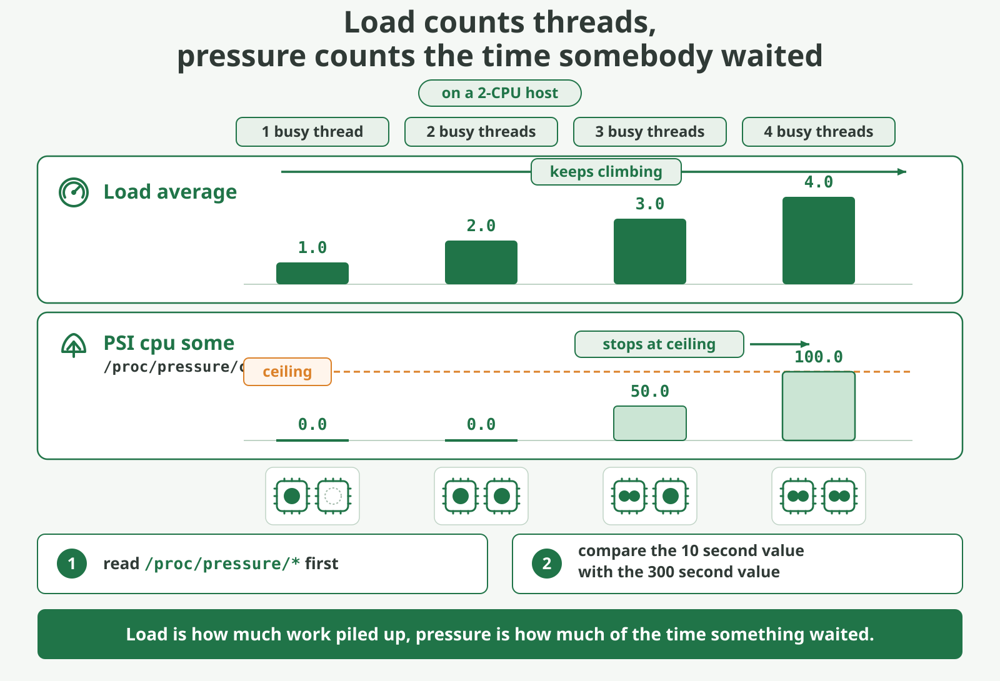

*Figure 20.5.3. Load average grows with the number of busy threads, but CPU pressure only measures the share of time something waited, so it stops at 100.*

Pressure stall information, or PSI, was added in Linux 4.20. It answers the question load average cannot: for each resource, what share of time was something waiting? The word stall means a task could not make progress because the resource was not ready. There are three files, `/proc/pressure/cpu`, `/proc/pressure/memory` and `/proc/pressure/io`.

Each file has a line starting with `some` and, for memory and io, a line starting with `full`. The kernel documentation defines `some` as the share of time in which at least some tasks are stalled on the resource. It defines `full` as the share of time in which all non-idle tasks are stalled at once. The three averages cover 10, 60 and 300 seconds and are percentages. The `total` field is cumulative stall time in microseconds. The cpu file has a `full` line only for compatibility, and the kernel documentation says CPU full is undefined at the system level.

Systems Performance gives the cleanest way to see the difference between the two measures. On a two-CPU host, three busy threads give a load average of 3.0 and a CPU pressure of 50.0. Four busy threads give 4.0 and 100.0. Two busy threads give 2.0 and 0.0, because nobody waits. Load grows forever as work piles up. Pressure tops out at 100 and tells you the share of time that a task had to wait.

Walk through the table one row at a time. With one thread on two CPUs, a CPU is always free, so nothing waits and the pressure stays at zero. With three threads, one of them must wait for a CPU at every moment, and the pressure reads half of the time. With four threads, both CPUs are always taken and somebody is always waiting. The load number keeps climbing in every row, because it counts the threads. The pressure number stops climbing at its ceiling, because it counts the time that somebody waited. That difference is the whole reason PSI exists.

| Situation (2 CPUs) | Load average | PSI cpu some |
|---|---|---|
| 1 busy thread | 1.0 | 0.0 |
| 2 busy threads | 2.0 | 0.0 |
| 3 busy threads | 3.0 | 50.0 |
| 4 busy threads | 4.0 | 100.0 |

The three windows also give you a trend. Systems Performance reads an io file with avg10 of 63.11 and avg300 of 8.62 as pressure that is rising fast. The short window reacts to what is happening now, and the long window shows what the last few minutes looked like. When the short number is far above the long one, the problem started recently. The helper `c05_psi_parse.py` compares them. On that book line, run on this Mac, it printed `io.txt -> ALL non-idle tasks stalled 60.76% of 10s, trend rising`.

Pressure also exists per cgroup. A cgroup is the kernel's grouping of processes, and it is the structure that containers use for their limits. In cgroup v2 each cgroup directory has `cpu.pressure`, `memory.pressure` and `io.pressure`. That lets you ask whether one container is waiting, not only the node. For the run queue itself, `vmstat 1` shows runnable threads in the `r` column and blocked threads in `b`. The first line is an average since boot, so ignore it. `mpstat -P ALL 1` shows each CPU, which catches one hot CPU hiding in an average.

The first thing to decide: read `/proc/pressure/*` before anything else, because it tells you which of the three resources to chase.

### 3. CPU throttling from cgroup limits in containers

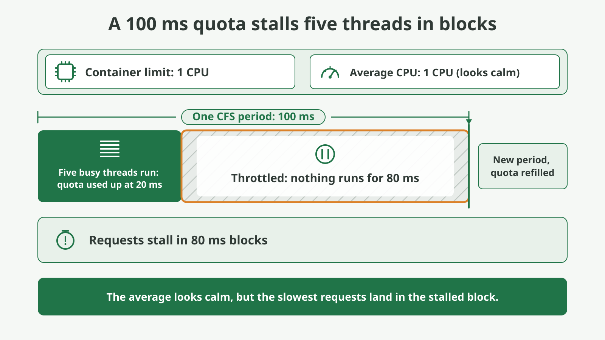

*Figure 20.5.4. A 100 ms CFS quota period in which five threads use the quota in 20 ms, leaving 80 ms of throttling that makes requests stall.*

A model-serving pod has a CPU limit of 2. The node dashboard shows 40 percent CPU. Latency is bad anyway. This is the most common modern version of a CPU saturation question, and it is the one interviewers love, because the physical CPU is not the thing that is full. The limit is the thing that is full. The container is being stopped by its own allowance while the machine sits half idle.

Kubernetes turns a CPU request into cgroup CPU shares and a CPU limit into a CFS quota. CFS is the Completely Fair Scheduler, the default Linux scheduler for ordinary threads. Production Kubernetes, chapter 12, explains both. Shares are relative and only matter when the CPU is contended. The quota is an absolute cap per period. By default the period is 100 ms. A limit of 0.5 CPUs gives 50 ms of CPU time in each 100 ms. Once the quota is spent, every thread of the container waits until the next period starts.

Picture a metered tap that is open for part of every window and shut for the rest of it. Nothing about the water pressure in the pipe has changed. The tap itself is what stops the flow, and that is exactly how a quota behaves.

The trap is threads. The book gives the example: a limit of 1 CPU and 5 busy threads. The 100 ms quota is gone after 20 ms, and the container is throttled for the remaining 80 ms. The container averages one CPU, so every monitoring graph looks calm, yet requests stall in 80 ms blocks. That is exactly what a p99 graph shows, because the slowest one percent of requests are the ones that land in a stalled block.

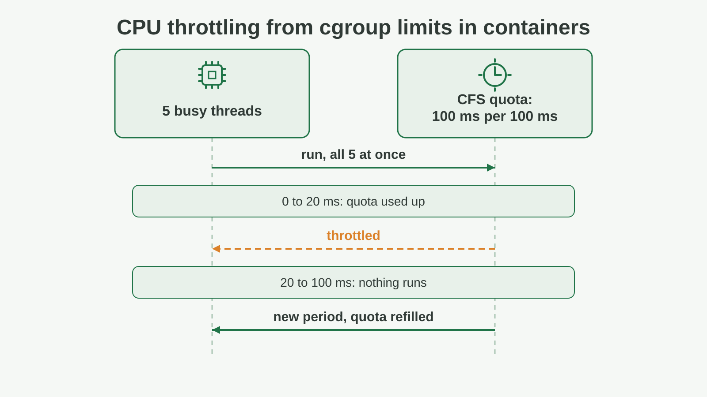

*Figure 20.5.5. CPU throttling from cgroup limits in containers, as a diagram.*

You prove throttling with counters, not with feelings. In cgroup v2 the file `cpu.stat` has `nr_periods`, `nr_throttled` and `throttled_usec`. In cgroup v1 the same idea is `nr_throttled` and `throttled_time` in nanoseconds. Systems Performance shows a v1 example of 74 throttled periods out of 507 and 3.8 seconds throttled. The helper `c05_cpu_throttle.py` turns two samples into a ratio. On that book sample it printed `THROTTLED in 15% of periods`. Scenario 2 shows it on a live container. The file `cpu.max` shows the limit itself as quota and period, and `max 100000` means no limit.

A worked read of `cpu.stat` makes the counters concrete. Take two samples a few seconds apart, and subtract the first from the second. If `nr_periods` grew and `nr_throttled` did not, the container ran in every period and was never stopped. If both grew, the quota was spent in some periods. If `throttled_usec` keeps rising in step with `nr_throttled`, the stall is real, and the ratio of the two growths tells you how often the container was stopped. Only the difference between samples matters, because the counters only ever go up.

Systems Performance also gives a flow chart for container CPU throttling that uses five statistics, including non-voluntary context switches in `/proc/PID/status` and whether the host has idle CPU. A growing throttled time is the straightforward test for bandwidth limits. Shares have no counter, which is why they are harder to diagnose.

For monitoring, cAdvisor documents `container_cpu_cfs_periods_total` and `container_cpu_cfs_throttled_periods_total`. The ratio of the second to the first is the throttle ratio. Alert on it for latency-sensitive pods, not on CPU usage, because a pod can be throttled hard and still show modest usage.

The fix is a trade-off with two sides. Setting limits equal to requests removes variability, which matters for benchmarks and latency-sensitive services. Otherwise an upper bound is not needed, because shares already divide a contended CPU fairly, and idle cycles are not wasted. There is also a kernel bug that throttled containers unnecessarily, fixed in Linux 5.4 and backported to 4.14.154, 4.19.84 and 5.3.9. Check the kernel version before you blame the application.

The first thing to decide: for a slow container, read `cpu.stat` before you read CPU usage graphs.

### 4. Steal time

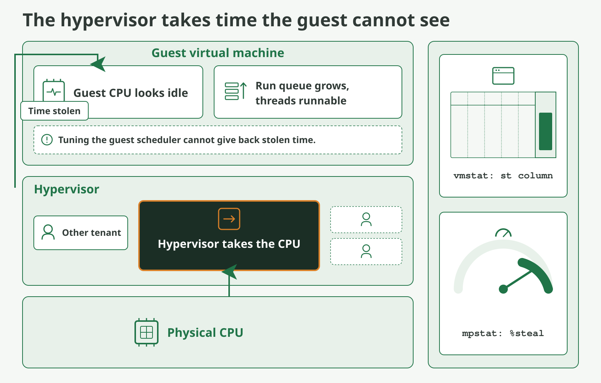

*Figure 20.5.6. Steal time is CPU taken by the hypervisor from a guest, visible as st in vmstat and %steal in mpstat, and guest tuning cannot recover it.*

On a virtual machine, a CPU can be taken away by the hypervisor. The hypervisor is the software that shares the physical machine among several virtual machines. The guest sees a CPU that is not running its threads, and counts the time as steal. Picture a rented desk in a shared office. The desk is yours on paper, but when another tenant uses the room's power, your desk goes dark for a while. You do not see the other tenant, you only see that your work pauses.

This matters for diagnosis. Inside the guest, the threads look runnable and the run queue grows, but the CPU itself seems to do nothing unusual. Without steal in the picture, the tempting move is to tune the guest's scheduler or its priorities, and none of that gives back the time the hypervisor took. In `vmstat` it is the `st` column. In `mpstat` it is `%steal`. Systems Performance, chapter 11, calls it CPU time not available to the guest, which may be consumed by other tenants, or lost to throttling by the instance type.

The book shows a Xen guest where most CPU time was stolen under an aggressive limiting policy. It also shows `runqlat` on a lightly loaded cloud instance with 88 events between 65 and 131 ms of scheduler latency, caused by hypervisor throttling. The lesson is that a guest can be idle and still wait, because the wait happens below it.

If a VM shows high run queue latency while its own CPU is idle, check steal and stop tuning inside the guest. Tuning the guest's scheduler cannot give back time the hypervisor has taken.

The first thing to decide: if `st` is non-zero and rising, move the workload or ask the provider.

### 5. NUMA basics

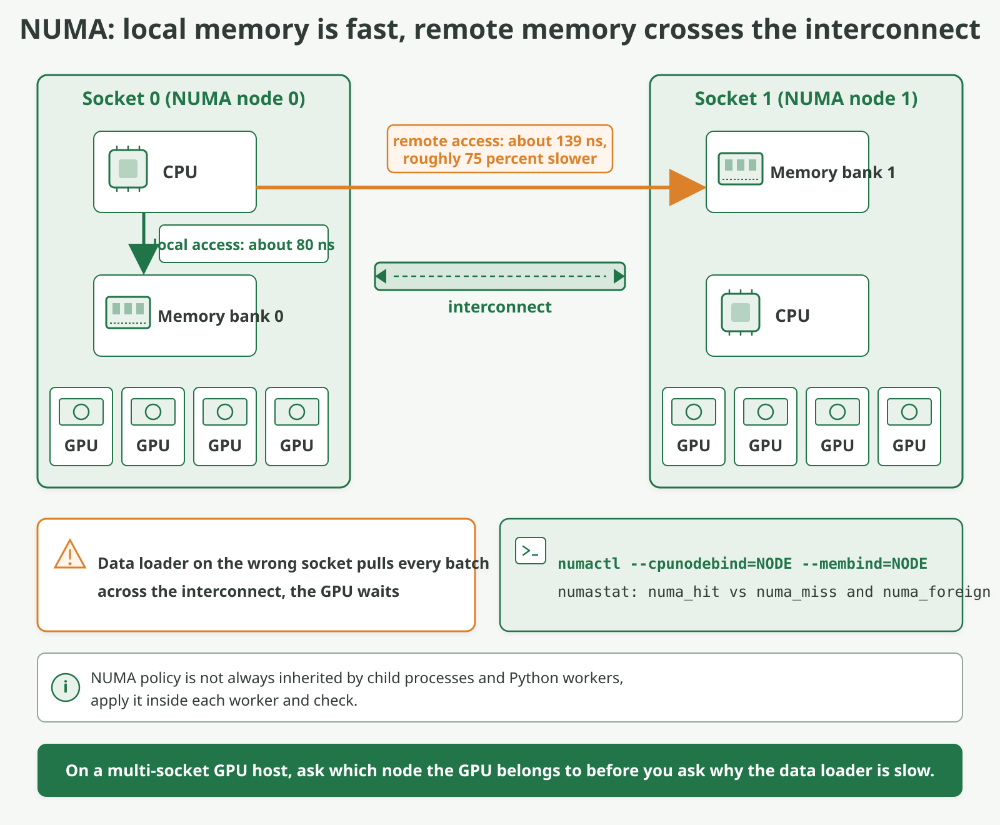

*Figure 20.5.7. Bind each worker to the NUMA node of its GPU, because a remote access takes about 75 percent longer.*

A server with two CPU sockets has two memory banks. Each socket reaches its own bank quickly and the other bank through an interconnect, which is the wire between the sockets. That is non-uniform memory access, or NUMA. The word non-uniform means the cost depends on where the memory sits. Systems Performance describes Linux as trying to allocate on the nearest node, and `numastat` shows how well it succeeds.

A small walk shows how a remote access happens. A thread runs on socket 0 and needs a page that lives on socket 1. The request crosses the interconnect, the memory answers, and the data travels back. Each step is slower than a local access, and a loop that touches that memory millions of times pays the penalty every time. Nothing crashes, so the program simply runs slower than its benchmark promised.

The keys to read are `numa_hit`, allocations on the intended node, and `numa_miss` plus `numa_foreign`, allocations that landed elsewhere. A high hit count compared to the rest is healthy. AI Systems Performance Engineering, chapter 3, gives one experiment where local access took about 80 ns and remote access about 139 ns, roughly 75 percent slower. It also says the default balancing is usually not enough for performance-critical AI work, and recommends binding CPU and memory with `numactl --cpunodebind=<node> --membind=<node>`.

On a GPU host each GPU is attached closer to one CPU socket. The book shows eight GPUs split four and four across two nodes, and recommends running each worker on the node of its GPU. A data loader that runs on the wrong socket pulls its batches across the interconnect every time, and the GPU waits for them. It warns that NUMA policy is not always inherited by child processes and Python workers, so apply it inside each worker and check.

The first thing to decide: on a multi-socket GPU host, ask which node the GPU belongs to before you ask why the data loader is slow.

### 6. Page cache, anonymous memory and swap

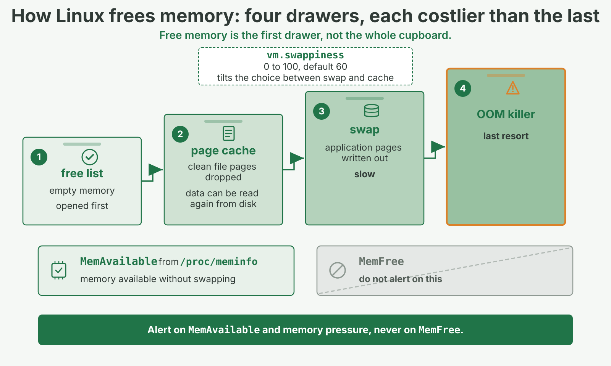

*Figure 20.5.8. The kernel frees memory from the cheapest source first, and the OOM killer is only the last resort.*

An engineer sees `free` report 163 MB free out of 1950 MB and files a ticket. Systems Performance addresses this directly: if there is spare memory, the kernel uses it to cache files, and the cache can be reclaimed quickly when applications need it. Free memory shrinking to near zero after boot is normal, and a healthy host often looks like that for most of its life.

Memory has two broad kinds. File pages belong to the page cache and have a copy on disk. Anonymous memory is the heap and stack of processes and has no file behind it. The cgroup v2 documentation describes `anon` as memory in anonymous mappings and `file` as memory used to cache filesystem data. Clean file pages can be dropped for free, because the disk still has the data. Anonymous pages can only be written to swap or killed, because nothing else holds a copy of them.

Linux frees memory in an order, shown in Systems Performance figure 7.6. It uses the free list first, then the page cache, then swapping of application pages, then reaping by the kernel. The OOM killer comes last. The `vm.swappiness` setting, 0 to 100 with a default of 60, tilts the choice between paging out applications and dropping cache.

Think of the reclaim order as a series of drawers. The free list is the empty drawer, and the kernel opens it first. When it is empty, the kernel drops clean cache, which is cheap because the data can be read again from disk. Only after that does it start pushing application pages to swap, which is slow, and the OOM killer waits behind all of them as the last resort. Each drawer costs more to open than the one before it, so a host under growing pressure moves steadily down the list.

The column to trust is `available` in `free`, which is read from `MemAvailable` in `/proc/meminfo`. It is the memory available without swapping, and accounts for memory that cannot be reclaimed. The helper `c05_meminfo_parse.py` reports both. On a fixture built from a typical `free -m` output it printed `healthy: 60.9% available (free is only 8.4%, the rest is reclaimable cache)`.

Swap is a trade-off. Systems Performance notes that with swap a growth bug first appears as slowness, which gives you time to debug live. Without swap the process is killed, and Netflix runs instances that way, preferring a fast kill and redirect over a slow instance. AI Systems Performance Engineering recommends avoiding swap on GPU hosts, because swapped host memory stalls the GPU. For an inference fleet behind a router, kill-and-replace fits better as long as the router notices. That last clause is my reasoning, not a quote.

Swap activity shows as `si` and `so` in `vmstat`, and as I/O in `iostat`. The signs of real shortage are sustained swapping, page scanning and memory PSI, not a small `free` value. A short spike in swap-in after a restart is normal warm-up, while swap-in that keeps climbing over a long period is a problem.

The first thing to decide: alert on memory PSI and `MemAvailable`, never on `MemFree`.

### 7. The OOM killer and how to read its log

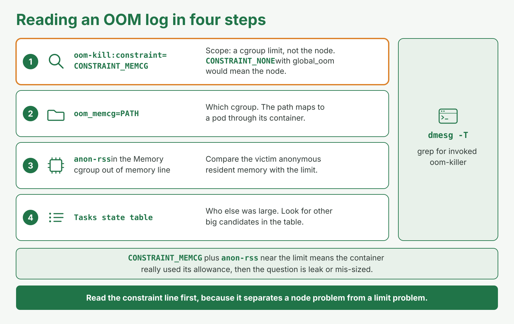

*Figure 20.5.9. An OOM kill log is read by checking the constraint, the cgroup it names, the victim's memory and the other large tasks.*

A process vanishes. No error appears in the application log, and the pod restarts with no message that explains it. This is how the OOM killer behaves, because it sends SIGKILL, which cannot be caught. The program gets no chance to write a final line or run its cleanup. The kernel log is the only witness. Read it with `dmesg -T | grep -i -B2 -A25 'invoked oom-killer'` or `journalctl -k`.

There are two kinds of event. A global OOM happens when the whole node runs out. A cgroup OOM happens when one container reaches its own memory limit, even if the node has plenty free. Systems Performance, chapter 7, says a system may have abundant free memory and still hit the OOM killer because a container exhausted its cgroup limit. The log tells you which kind. The exact line shapes come from the Linux 6.6 kernel source.

| Line | What it tells you |
|---|---|
| `NAME invoked oom-killer: gfp_mask=..., order=N, oom_score_adj=N` | Who asked for memory when it ran out. Not always the victim |
| `Tasks state (memory values in pages)` table | Every candidate task with `rss` in pages and `oom_score_adj` |
| `oom-kill:constraint=CONSTRAINT_MEMCG,...,oom_memcg=PATH,task_memcg=PATH,task=NAME,pid=N` | `CONSTRAINT_MEMCG` means a cgroup limit. `CONSTRAINT_NONE` plus `global_oom` means the node |
| `Memory cgroup out of memory: Killed process PID (NAME) total-vm:..kB, anon-rss:..kB, file-rss:..kB, shmem-rss:..kB` | The victim and how big it really was. `Out of memory:` without `Memory cgroup` is the global kind |

Read it in four steps. First look at the constraint to learn the scope. Second look at `oom_memcg` to learn which cgroup, which maps to a pod through its path. Third compare the victim's `anon-rss` to the limit. Fourth look at the table for who else was large. The kernel source picks the victim by a score. It starts from resident pages plus swap entries plus page tables, then shifts it by `oom_score_adj` scaled to the total memory. A task whose `oom_score_adj` equals the minimum value is skipped and cannot be chosen.

A short example makes the four steps concrete. Imagine a line says the constraint is a memory cgroup, the path ends in a pod's container, and the victim's anonymous resident memory is close to the container's limit. You have three facts in under a minute. The kill was a cgroup limit, not a node shortage. The container really used its allowance. The question left is whether the usage was expected or whether a leak grew over time, and that answer comes from the application's own metrics.

The helper `c05_oom_parse.py` automates the reading. On a log built from the kernel format strings, with invented numbers, it printed `python (pid 2301) killed for container/cgroup limit; anon-rss 100 MiB, file-rss 2 MiB`. That one is a fixture. Scenario 3 has a real log from kernel 6.18, whose task table has three extra columns, `rss_anon`, `rss_file` and `rss_shmem`, that the 6.6 layout lacks. The parser mis-read that table until it was fixed, so a line layout in a book or a kernel source tree can differ from your kernel.

In Kubernetes the same event appears as `OOMKilled` in `kubectl describe pod`, under Last State, as Production Kubernetes chapter 12 shows. Kubernetes documentation says memory limits are enforced reactively by the kernel, so a container that over-allocates may not be killed at the instant it crosses the limit. The kubelet can also evict pods under node pressure, first BestEffort, then Burstable pods above their requests. Eviction by the kubelet and a kill by the kernel are different events with different evidence, so do not use the same fix for both.

The first thing to decide: read the constraint line first, because it separates a node problem from a limit problem.

### 8. cgroup memory limits versus node memory

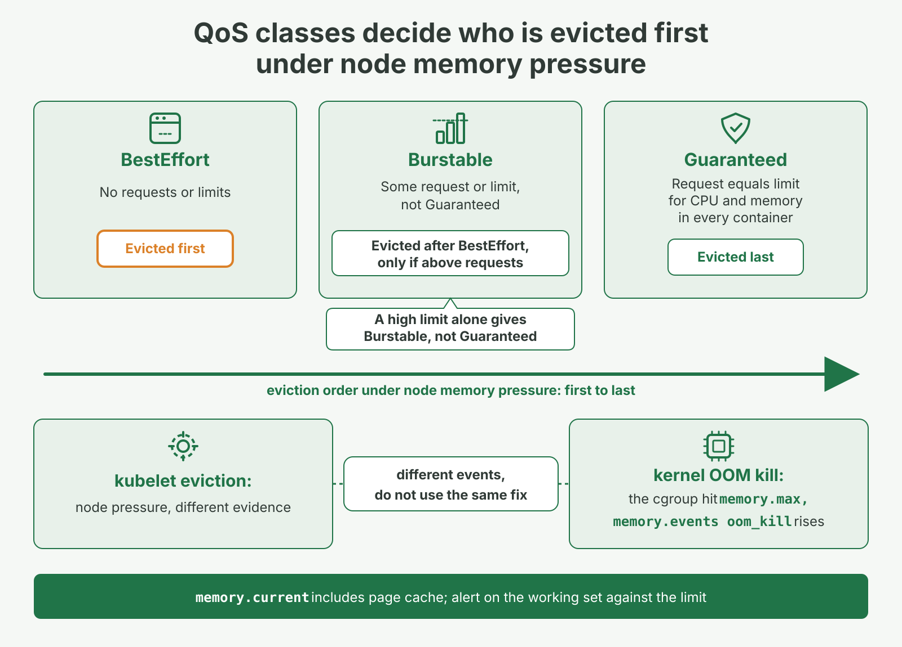

*Figure 20.5.10. The QoS class comes from requests and limits and sets the eviction order, while the kernel OOM kill follows the cgroup limit.*

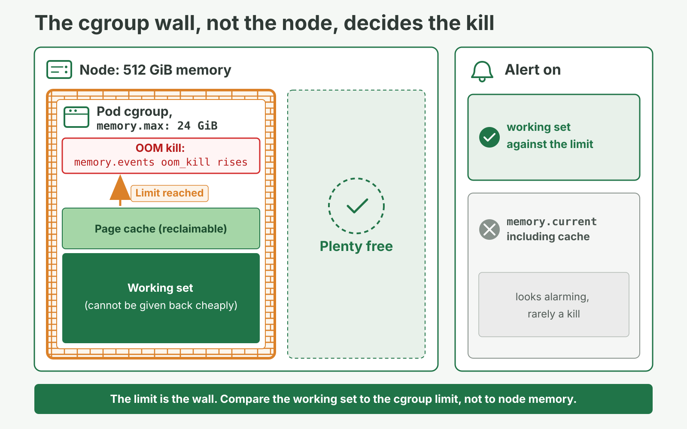

*Figure 20.5.11. A pod is killed at its cgroup memory limit even when the node has plenty of memory, so the working set is compared with the limit.*

A pod has a memory limit of 24 GiB on a node with 512 GiB. The node is fine. The pod is killed. The kernel does not care about the node. It cares about the cgroup, which is the box the pod was given. Production Kubernetes explains why: memory cannot be throttled the way CPU can, so when the limit is reached the process must be killed.

The cgroup v2 files to know are `memory.max`, the hard limit, `memory.high`, a throttle limit that sends processes into direct reclaim, `memory.current`, current use, and `memory.events`. Direct reclaim means the process itself stops to free memory before it can continue. The events file counts `high`, `max`, `oom` and `oom_kill`, among others. A rising `oom_kill` is your proof. The `memory.oom.group` file decides whether the whole cgroup is killed as one unit. How Linux Works, chapter 8, shows `memory.max` reading `max` when there is no limit and explains that cgroup v2 allows a process in one cgroup only.

A useful way to hold the two cgroup numbers apart is to ask what each one is for. The limit is the wall. The current value is how close the container is to the wall, but the closeness includes cache that could be given back for free. The working set is the part of usage that the kernel cannot give back cheaply, so it is the honest measure of how close the container really is.

The key detail for inference hosts is that `memory.current` includes page cache. The kernel documentation lists file cache in the memory statistics of the cgroup. So reading a 15 GiB weights file adds cache to the container. That cache is reclaimable, so it rarely causes a kill, but it makes `memory.current` look alarming. cAdvisor documents `container_memory_working_set_bytes` and `container_memory_cache` as separate gauges for this reason. Alert on the working set against the limit, because the working set is the part the kernel cannot take back for free.

Kubernetes sets QoS classes from requests and limits. QoS means quality of service, and the class decides which pods are evicted first under pressure. Guaranteed needs every container to have equal request and limit for both CPU and memory. Burstable is anything with some request or limit. BestEffort has none. AI Systems Performance Engineering points out that a high limit alone gives Burstable, not Guaranteed.

| Class | Rule | Under node memory pressure |
|---|---|---|
| Guaranteed | Request equals limit for CPU and memory in every container | Evicted last |
| Burstable | Some request or limit, not Guaranteed | Evicted after BestEffort, only if above requests |
| BestEffort | No requests or limits | Evicted first |

AI Systems Performance Engineering warns that a memory limit on a model server must sit above what you expect to use, or you are killed days into a long job. A limit that fits a normal day can fail on the day a longer prompt arrives. Production Kubernetes advises against oversubscribing memory on production nodes, because it trades stability for density.

The first thing to decide: compare working set to the cgroup limit, not to node memory.

### 9. Disk latency versus throughput

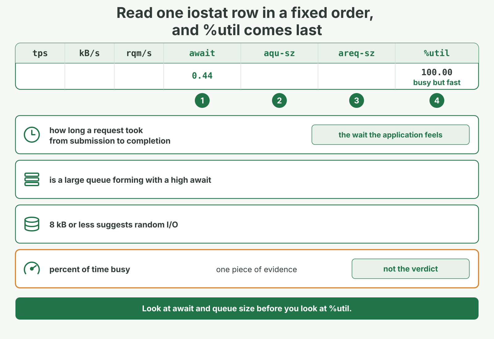

*Figure 20.5.12. Utilisation is read last, after await, queue size and request size, because busy time alone does not show that anyone waited.*

A database host feels slow and `iostat` shows 100 percent utilisation. Is the disk the problem? Maybe not. Systems Performance warns that `%util` is only busy time. For devices that serve many requests in parallel, such as NVMe or arrays, 100 percent does not mean saturated. A device that is busy every moment can still take each request quickly. Judge by latency and by the load applied.

Think of a disk as a bakery with one oven. Throughput is how many loaves leave the oven in an hour, IOPS is how many separate orders it takes, and latency is how long one customer waits from ordering to receiving a loaf. A bakery can bake a great many loaves and still make each customer wait, if every order is a single small bun that needs its own trip to the oven. The disk is the same. Large sequential work can show high throughput while small random reads show poor latency.

Throughput is megabytes per second, IOPS is operations per second, and latency is how long one operation takes. A disk can have high throughput and poor latency for small random reads. The book also notes that on-disk cache hits return in under 100 microseconds while misses take 1 to 8 ms or more, and an average hides that two-mode shape. A mean of the two can look acceptable while a meaningful share of requests are slow.

The command is `iostat -sxz 1`. Read these columns.

| Column | Meaning |
|---|---|
| `tps` | I/O requests completed per second |
| `kB/s` | Throughput |
| `rqm/s` | Requests merged before reaching the device, a sign of some sequential access |
| `await` | Average response time in ms, including queueing in the OS. The most important column for delivered performance |
| `aqu-sz` | Average number of requests waiting and active |
| `areq-sz` | Average request size in kB after merging. 8 kB or less suggests random I/O |
| `%util` | Percent of time the device was busy |

Use `-x` without `-s` to split `r_await` from `w_await`. Reads usually matter more to applications, because write-back caching hides writes. Write-back caching means the operating system acknowledges a write before it reaches the disk. A common rule of thumb is to look for devices over 60 percent busy or with service times over about 10 ms. PSI for io, `/proc/pressure/io`, gives the same idea from the task side. To find who causes the I/O, use `pidstat -d` or `iotop`, which shows threads. How Linux Works chapter 8 covers both. To see latency as a histogram, `biolatency` from BCC shows it in power-of-two buckets, which means each bar counts requests in a range that doubles from the last.

Walk through a single `iostat` row the same way each time. Start with `await`, because it is the time a request spends from submission to completion. Next read `aqu-sz`, because a large queue with a high `await` says requests are waiting in line. Then read `areq-sz`, because a small request size with a high `%util` points at many tiny random operations. Only then look at `%util`, which is one piece of evidence among these and not the verdict on its own.

The helper `c05_iostat_parse.py` applies those rules. On a sample NVMe row, 100 percent util with 0.44 ms await, it printed `busy but fast: judge by IOPS and MB/s, not %util`. On an invented row with 38.5 ms await it printed `slow: await 38.50 ms`.

The first thing to decide: look at `await` and queue size before you look at `%util`.

### 10. perf and flame graphs

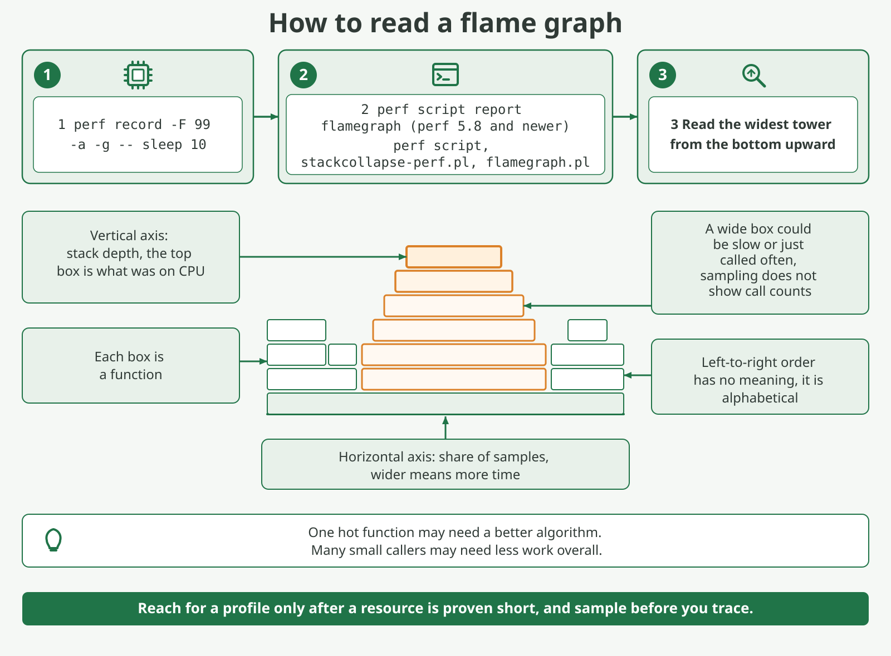

*Figure 20.5.13. Start at the widest tower and walk up until the boxes stop being wide; the top of that path is the function using the most CPU.*

Everything above points you at a resource. Sometimes the question left is which code is using it. For CPU the answer is a profile, and `perf` is the standard Linux tool. A profile samples the program's call stack at regular intervals, so the code that is on the CPU most often appears most often in the samples. Systems Performance chapter 13 gives the core command: `perf record -F 99 -a -g -- sleep 10` samples every CPU 99 times per second for ten seconds, with call stacks.

A flame graph turns thousands of stacks into one picture. In `perf` 5.8 and newer, `perf script report flamegraph` makes one directly. For older kernels use `perf script`, then `stackcollapse-perf.pl`, then `flamegraph.pl`. The script `c05_perf_flamegraph.sh` runs either path.

Reading rules, from Systems Performance section 6.7.3. Each box is a function. The vertical axis is stack depth, and the top box is what was on CPU. The horizontal axis is the share of samples, and the left-to-right order has no meaning, it is alphabetical. Wider means more time. Look at the widest towers first. A wide box could be slow or just called often, since sampling does not show call counts.

Flame graphs are not only for CPU. They can also show context-switch stacks to see why threads leave the CPU, and block I/O creation stacks to see which code issues disk I/O. For a container you can profile by cgroup with `perf record --cgroup=...`.

Be careful on a production host. Sampling at 99 Hz is the standard example. Tracing every scheduler event can cost far more, as the `runqlat` note in section 11 shows. Say that you would sample first, and trace only if sampling does not answer the question.

To read a finished flame graph in practice, start from the bottom of the widest tower and walk upward until the boxes stop being wide. The top of that path is the function that spends the most time on CPU. Then check whether it is a single hot function or many small callers of the same thing, because the fix differs. A single hot function may need a better algorithm, while many callers may need less work overall.

The first thing to decide: reach for a profile only after a resource is proven short, and sample before you trace.

### 11. eBPF tools at a high level

eBPF lets the kernel run small verified programs at events such as a disk request or a scheduler wakeup. Verified means the kernel checks the program before it runs, so a buggy program cannot crash the kernel. For an SRE the useful point is that it gives you histograms and per-process answers that `iostat` and `top` cannot. Systems Performance chapter 15 splits the tooling in two. BCC has more than 80 ready-made tools and suits complex ones. bpftrace is a short scripting language suited to one-off questions. Netflix, as Systems Performance reports, installs both by default on cloud instances and uses them after dashboards point at a problem.

| Question | Tool | Note |
|---|---|---|
| How long do threads wait for a CPU? | `runqlat` | Instruments every wakeup and switch. Can exceed one million events per second, so use with caution |
| How long is the run queue? | `runqlen` | Samples at 99 Hz, negligible overhead. A cheaper approximation |
| What is the disk latency distribution? | `biolatency` | Histogram, can split by flags |
| Which process does the I/O? | `biotop`, `biosnoop` | Per process and per I/O |
| Who was OOM killed? | `oomkill` | Extra detail on kill events |
| Is the page cache working? | `cachestat` | Experimental, uses kprobes, may break across kernels |
| What files are opened? | `opensnoop` | Pairs with chapter 20.4 |
| Why are threads off CPU? | `offcputime` | Feeds off-CPU flame graphs |

The honest interview answer about eBPF is short. Use a canned BCC tool to answer one specific question after a metric points at the resource. Know that some cost more at high event rates. Write a bpftrace one-liner when no canned tool fits. A one-liner is useful for a quick question, such as how many times a particular system call fires per second, and it should be read as a short experiment rather than a monitoring setup. If the interviewer pushes further, say that you would start with the cheapest tool that answers the question, and that you would check its overhead on a test host first.

The first thing to decide: name the exact question before you name the eBPF tool.

### 12. Pinned memory and why GPU inference hosts hit host-memory limits

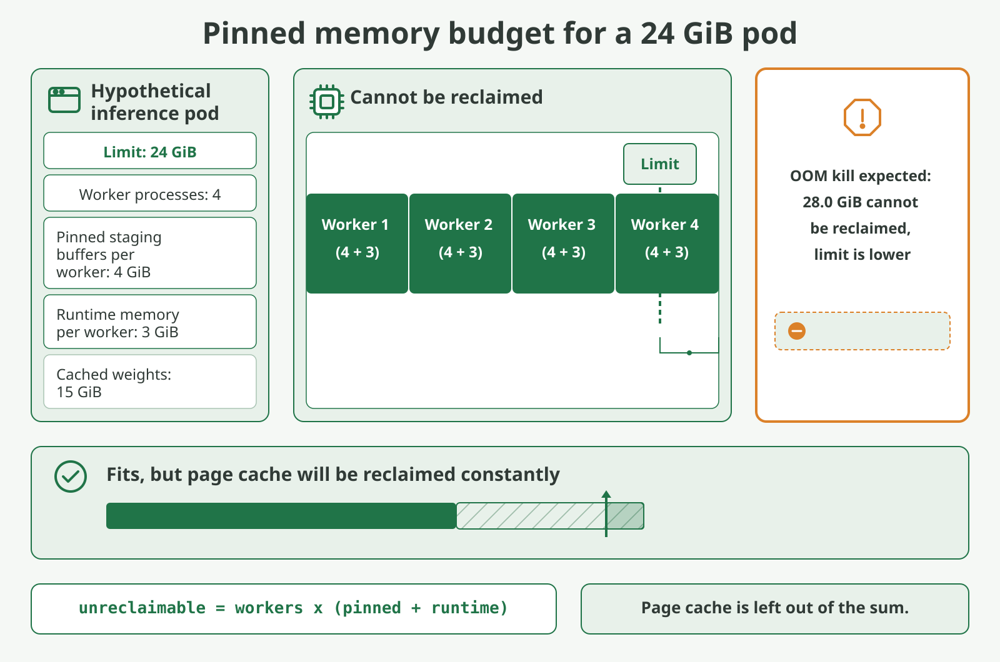

*Figure 20.5.14. A worked host-memory budget where unreclaimable worker memory of 28 GiB exceeds a 24 GiB pod limit, so an OOM kill is expected.*

The model is on the GPU, so why is host memory the problem? Because everything around the GPU runs on the host. Weights are read from disk through the page cache. Worker processes hold a Python runtime. Data is staged in buffers before copying to the GPU. A GPU inference pod can be killed by the host memory limit while its GPUs are nearly empty, and the on-call engineer sees a healthy GPU dashboard next to a restart loop.

Pinned memory, also called page-locked memory, is host memory the operating system will not swap or move. AI Systems Performance Engineering chapter 3 says copying from pinned memory to the GPU can be two to three times faster than from pageable memory. Pageable memory is normal memory that the operating system may move or page out, so the GPU driver has to copy it through a temporary buffer first. The device can do direct memory access from pinned memory, which skips that step. The handbook chapter 10.12 shows the CUDA side. PyTorch exposes it as `pin_memory=True`.

Think of pinning as reserving seats that cannot be given away. The operating system normally moves memory around freely, paging cold pages out and bringing them back when needed. A pinned page is a seat that stays put, so the kernel must plan around it. That is useful for the GPU, because the copy engine can read a seat at any time without waiting. It also means the kernel has fewer pages it can take back when memory runs short.

Pinning has two costs. First, the operating system caps how much an unprivileged process may lock. That cap is `ulimit -l`, the `RLIMIT_MEMLOCK` limit. The man page for `mlock` says a call that exceeds it fails with `ENOMEM`, and the limit is not enforced for a process with the `CAP_IPC_LOCK` capability. For large AI jobs, raise the limit or set it to unlimited, and in containers to use the `--ulimit memlock` setting. Second, pinned pages cannot be swapped. This is inference, not stated by the source. Pinning makes them behave like anonymous memory in a limit calculation, because the kernel cannot reclaim them. That is why pinned buffers appear in OOM kills while reclaimable page cache usually does not.

One more host setting from the same chapter matters here. Transparent hugepages are recommended on for throughput work and off, or `madvise`, for latency-sensitive inference. Transparent hugepages let the kernel back memory with large pages automatically, which can help throughput but can add latency spikes when the kernel compacts memory.

A budget is better than a guess. The helper `c05_host_mem_budget.py` takes your own inputs. All inputs below are hypothetical. The weights arithmetic is a stated calculation: 8 billion parameters at 2 bytes each is 16 billion bytes, which is 14.9 GiB. A 70 billion parameter model at the same precision is 140 billion bytes, which is 130.4 GiB.

Suppose a pod has a 24 GiB limit and four worker processes. Each worker holds 4 GiB of pinned staging buffers and 3 GiB of runtime memory. That is 4 times 7, so 28 GiB that cannot be reclaimed. The 15 GiB of cached weights does not matter, because 28 already exceeds 24. The helper printed `OOM kill expected: 28.0 GiB cannot be reclaimed, limit is lower`. With a 40 GiB limit the pod fits, but the cache adds up to 43 GiB, so it printed `fits, but page cache will be reclaimed constantly`.

A quick way to test a budget is to change one input at a time. Raise the limit, and the verdict may flip from "limit is lower" to "fits". Add a worker, and the unreclaimable total grows by that worker's pinned and runtime memory. Each change shows which input dominates, which tells you where the budget is most fragile.

Connect this to Token Factory carefully. A vendor case study says restarted workers sometimes did not rejoin the pool and capacity shrank silently. Nebius has not published the cause. A reasonable design is to alert on `oom_kill` increases and on pool size. That is my reasoning.

The first thing to decide: before sizing a host-memory limit, add up pinned buffers, runtime memory and weights that stay resident, and keep the cache out of the sum.

## How to answer out loud

Rehearse these five. The pattern is the same each time: say the three-question frame, name the first command, give the number you expect to see, then say what you would change. The interviewer is listening for the order of your thinking more than for the flag names, so practise saying the sequence before you practise typing it.

**Question 1. Load average is 30 and CPU is 40 percent. What do you do?**
Order to speak: say that on Linux load includes tasks in uninterruptible sleep, so this may be I/O and not CPU. Run `uptime` to see the trend, then `/proc/pressure/cpu`, `memory` and `io`. Run `vmstat 1` and look at `r`, `b`, `wa` and `st`. List D state tasks with `ps`. Then `iostat -sxz 1` for `await`. Numbers to state: pressure percentages and `b` count. Trade-off: load is cheap to read but ambiguous. Follow-ups: a container, a VM, a kernel without PSI. When you are asked about a kernel without PSI, say that `vmstat` and `iostat` still give you the blocked count and the wait time.

**Question 2. A container has bad p99 but the node CPU is low.**
Say throttling first. The limit is a quota per 100 ms period, so a multi-threaded process can spend it in a few milliseconds. Read `cpu.stat` for `nr_throttled` and `throttled_usec`, twice, a few seconds apart. Give the example: limit 1, five threads, 80 ms throttled per period. Fix options: raise the limit, reduce threads, set requests equal to limits for predictability, or remove the limit and rely on shares. Name the trade-off. Follow-ups: the kernel bug, alerting, shares versus quota.

**Question 3. A pod was OOMKilled. The node has free memory.**
Say that the memory limit belongs to the cgroup, not the node. Confirm with `kubectl describe pod`, then the kernel log. Read the constraint line: `CONSTRAINT_MEMCG`. Compare `anon-rss` with the limit. Check `memory.events` for `oom_kill`. Then decide whether it is a leak, a mis-sized limit, or something the workload pins. Follow-ups: eviction versus OOM kill, `oom_score_adj`, page cache.

**Question 4. `free` shows almost no free memory. Is that a problem?**
Say no, not by itself. Cache is reclaimable. Look at `MemAvailable`, swap activity and memory PSI. State the kernel's order of reclaim. Follow-ups: swappiness, swap trade-offs, alerts.

**Question 5. A GPU inference pod is killed on host memory while the GPUs are idle.**
List what lives in host memory: runtime per worker, pinned buffers, weights staging, page cache. Say pinned memory cannot be swapped and is bounded by `ulimit -l` for unprivileged processes. Give the budget method and the arithmetic. Say what you would watch: `memory.current`, working set, `oom_kill`, pool size. Follow-ups: NUMA placement of pinned buffers, THP, scale-up time.

## Worked scenarios

Each scenario has a script in `code/part20/`. The scenarios are short broken systems, and each one follows the same pattern: a symptom, the reasoning that points at a cause, the script that reproduces it, and the answer. All of them ran except the `perf` script, and the three that start containers ran as separate `docker run` commands. The environment was a throwaway `ubuntu:24.04` container, image digest `sha256:fe81560990fae86dc4743202b2cb4d3df98d0bcf949173cecef15ce1127ef852`, arm64, on the Docker VM kernel `6.18.37-0-virt` with 2 CPUs, cgroup v2, no swap and no PSI. Scenarios 1, 4 and 5 ran inside that container. Scenarios 2, 3 and 6 start their own containers, so their `docker run` commands were run from the Mac against the same Docker daemon, with `alpine@sha256:d9e853e87e55526f6b2917df91a2115c36dd7c696a35be12163d44e6e2a4b6bc` and `python@sha256:78387bc3881b8273120a12ebe6c1ab22b018ccc2c9adf565ae1ac9b536e184ea` (3.12-slim). Where the output below is marked "real output", it was captured there. Section "What the container run showed" lists corrections.

### Scenario 1. High load, idle CPUs

An alert shows load average 30 on an inference node. `top` shows CPUs mostly idle. The first reaction on most teams is to add CPUs, and that would be the wrong fix.

Reasoning. Load includes state D tasks, so ask what they wait for. `vmstat 1` shows blocked threads in `b`. `/proc/pressure/io` shows stall time. `ps -eo stat,pid,comm` lists D tasks. Then `iostat -sxz 1` and `pidstat -d 1` find the device and the process. The script starts a small, capped number of direct writers to create the same picture, so you can see each signal on a machine you control.

```bash
# code/part20/c05_s1_dstate_load.sh
#!/usr/bin/env bash
# Scenario 1: load average is high but CPUs are idle. Tasks wait on disk (state D).
# Safe: 8 writers x 512 MiB by default, in one scratch directory that is removed on exit.
# Run on a Linux VM, not on a shared production host.
set -euo pipefail
[ "$(uname -s)" = "Linux" ] || { echo "Linux only"; exit 1; }
WORKERS="${WORKERS:-8}"
MB="${MB:-512}"
DIR="${DIR:-/var/tmp/c05_s1}"
[ "$WORKERS" -le 16 ] && [ "$MB" -le 512 ] || { echo "refusing: keep WORKERS<=16 MB<=512"; exit 1; }
mkdir -p "$DIR"
trap 'kill $(jobs -p) 2>/dev/null || true; rm -rf "$DIR"' EXIT

for i in $(seq "$WORKERS"); do
  dd if=/dev/zero of="$DIR/f$i" bs=1M count="$MB" oflag=direct conv=fsync status=none &
done

sleep 1
echo "== uptime (load average counts D-state tasks on Linux)"
uptime
echo "== tasks in D state"
ps -eo stat,pid,comm | awk '$1 ~ /^D/' || true
echo "== vmstat: r is runnable, b is blocked, wa is iowait"
vmstat 1 3
echo "== PSI io (some = at least one task stalled)"
if [ -r /proc/pressure/io ]; then
  cat /proc/pressure/io
  python3 "$(dirname "$0")/c05_psi_parse.py" /proc/pressure/io /proc/pressure/cpu
else
  echo "no /proc/pressure/io on this kernel (PSI not enabled): read vmstat b and wa instead"
fi
wait
echo "done; scratch directory removed"
```

Real output, 8 writers of 512 MiB: `b` was 6 to 8 in `vmstat`, `wa` was 97 to 100, `us` and `sy` were 0 to 3, and `ps` listed seven `dd` processes in state `D`. `uptime` printed `load average: 0.76, 0.34, 0.20` one second in, so the load average had not caught up, which is the lag from section 1. There was no `/proc/pressure/io`, because this kernel has no PSI, and the script now says so and carries on. The first version of the script, with 4 writers of 128 MiB, finished in under a second and showed no `D` tasks at all.

Answer. The load is I/O wait. Fix the storage or the process behind it, not the CPUs.

### Scenario 2. Slow container, idle node

A pod with a CPU limit of 0.5 has stalls every few hundred milliseconds. Node CPU is 10 percent. Nobody on the node can see a problem, and the pod still feels slow.

Reasoning. The quota is 50 ms per 100 ms. With four busy threads the quota is spent in 12.5 ms, so each period has 87.5 ms of forced waiting. That is `burst_throttle_ms(0.5, 4)` in the helper. Prove it with two reads of `cpu.stat`. The script runs a container with `--cpus=0.5` and four busy loops for five seconds, then runs the helper on the before and after files.

```bash
# code/part20/c05_s2_cpu_throttle.sh
#!/usr/bin/env bash
# Scenario 2: a container is slow while the node is mostly idle. CFS quota throttling.
# Needs Docker on Linux. Uses a 0.5 CPU limit and 4 busy loops for 5 seconds.
set -euo pipefail
command -v docker >/dev/null || { echo "docker not found"; exit 1; }
HERE="$(cd "$(dirname "$0")" && pwd)"
TMP="$(mktemp -d)"
trap 'rm -rf "$TMP"' EXIT

# cpu.stat lives at /sys/fs/cgroup/cpu.stat on cgroup v2 and under cpu/ on v1.
docker run --rm --cpus=0.5 alpine:3.20 sh -c '
  f=/sys/fs/cgroup/cpu.stat; [ -r "$f" ] || f=/sys/fs/cgroup/cpu/cpu.stat
  cat "$f" > /tmp/before
  for i in 1 2 3 4; do timeout 5 sh -c "while :; do :; done" & done
  wait
  cat "$f" > /tmp/after
  echo "--- before"; cat /tmp/before; echo "--- after"; cat /tmp/after
  echo "--- cpu.max (v2 only)"; cat /sys/fs/cgroup/cpu.max 2>/dev/null || true
' | tee "$TMP/out.txt"

awk '/--- before/{f="b";next} /--- after/{f="a";next} /--- cpu.max/{f="";next}
     f=="b"{print > "'"$TMP"'/before"} f=="a"{print > "'"$TMP"'/after"}' "$TMP/out.txt"
python3 "$HERE/c05_cpu_throttle.py" "$TMP/before" "$TMP/after"
```

Real output, `--cpus=0.5` and four busy loops for 5 seconds: `cpu.max` read `50000 100000`, `nr_periods` went from 1 to 51, `nr_throttled` from 0 to 50, and `throttled_usec` from 0 to 7428341. The helper printed `THROTTLED in 100% of periods`. Note that 7.4 seconds throttled happened in 5 seconds of wall time, because `throttled_usec` adds up the waiting of all four threads. That detail trips people up, so say it before the interviewer does.

Answer. The container is throttled by its own quota. Raise the limit, reduce parallelism, or set requests equal to limits for predictable behaviour. Check the kernel version for the pre-5.4 bug.

### Scenario 3. OOMKilled with free node memory

A pod restarts. `kubectl describe` shows `OOMKilled`. The node has 400 GiB free, and the dashboard looks calm.

Reasoning. The container has a 100 MiB limit and holds more. The script runs such a container, then reads `docker inspect` for the `OOMKilled` flag, then pipes `dmesg` through the parser. The constraint must be `CONSTRAINT_MEMCG`. If it is not, the kill came from the node, and the fix is different.

```bash
# code/part20/c05_s3_cgroup_oom.sh
#!/usr/bin/env bash
# Scenario 3: a container is OOM killed while the node has plenty of free memory.
# Needs Docker on Linux. The container has a 100 MiB limit and tries to hold 300 MiB.
set -euo pipefail
command -v docker >/dev/null || { echo "docker not found"; exit 1; }
HERE="$(cd "$(dirname "$0")" && pwd)"
NAME=c05_oom_demo
trap 'docker rm -f "$NAME" >/dev/null 2>&1 || true' EXIT

docker run -d --name "$NAME" --memory=100m --memory-swap=100m python:3.12-slim \
  python -c "x = b'x' * (300 * 1024 * 1024); print(len(x))" >/dev/null
docker wait "$NAME" >/dev/null
echo "== OOMKilled flag and exit code"
docker inspect -f 'OOMKilled={{.State.OOMKilled}} ExitCode={{.State.ExitCode}}' "$NAME"
echo "== host memory is not the problem"
free -m
echo "== kernel log (may need sudo; this prints nothing if dmesg is restricted)"
if dmesg 2>/dev/null | tail -n 200 > /tmp/c05_s3_dmesg.txt && [ -s /tmp/c05_s3_dmesg.txt ]; then
  python3 "$HERE/c05_oom_parse.py" < /tmp/c05_s3_dmesg.txt
else
  echo "dmesg unavailable: rerun with sudo or read: journalctl -k | grep -i oom"
fi
rm -f /tmp/c05_s3_dmesg.txt
```

Real output: `OOMKilled=true ExitCode=137`. The kernel log, read from a container with `--cap-add SYSLOG`, held this, trimmed:

```text
python invoked oom-killer: gfp_mask=0x100cca(GFP_HIGHUSER_MOVABLE), order=0, oom_score_adj=0
oom-kill:constraint=CONSTRAINT_MEMCG,nodemask=(null),...,oom_memcg=/docker/d3f7cf...,task_memcg=/docker/d3f7cf...,task=python,pid=30221,uid=0
Memory cgroup out of memory: Killed process 30221 (python) total-vm:320776kB, anon-rss:101640kB, file-rss:52kB, shmem-rss:0kB, UID:0 pgtables:264kB oom_score_adj:0
```

Inside a 100 MiB container, `memory.events` read `max 30`, `oom 1`, `oom_kill 1`, and `memory.max` read `104857600`. The parser printed `python (pid 30221) killed for container/cgroup limit; anon-rss 99 MiB, file-rss 0 MiB`. Without `SYSLOG` or root, `dmesg` is refused in a container, so use `journalctl -k` on a host.

Walk through the evidence in the order you would show it to a colleague. The container status says `OOMKilled=true`, which tells you the kill came from a memory limit and not a crash in the code. The kernel line names the constraint, and the constraint names the cgroup. The parsed line converts the victim's resident memory into mebibytes, so you can compare it with the 100 MiB limit directly. Only then do you decide whether the process was expected to need that much memory.

Answer. This is a cgroup limit kill. Compare `anon-rss` to the limit, decide leak or mis-sizing, and watch `oom_kill` in `memory.events`.

### Scenario 4. No free memory

A ticket says the node has 8 percent free memory and asks for more RAM. Before anyone orders hardware, it is worth checking whether the memory is really gone or just being used for cache.

Reasoning. The script writes a 512 MiB file, prints the memory lines, deletes the file and prints again. If the free number drops and the available number holds steady, the difference is cache, and cache goes back to the pool when the file is removed.

```bash
# code/part20/c05_s4_page_cache.sh
#!/usr/bin/env bash
# Scenario 4: "free memory is almost zero". Page cache grows, then shrinks when the file is deleted.
# Safe: writes one 512 MiB file (override with MB) and removes it. Linux only.
set -euo pipefail
[ "$(uname -s)" = "Linux" ] || { echo "Linux only"; exit 1; }
MB="${MB:-512}"
[ "$MB" -le 2048 ] || { echo "refusing: MB<=2048"; exit 1; }
HERE="$(cd "$(dirname "$0")" && pwd)"
FILE="${FILE:-/var/tmp/c05_s4.bin}"
trap 'rm -f "$FILE"' EXIT

show() {
  echo "== $1"
  grep -E '^(MemFree|MemAvailable|Cached|Dirty):' /proc/meminfo
  python3 "$HERE/c05_meminfo_parse.py"
}
show "before"
dd if=/dev/zero of="$FILE" bs=1M count="$MB" status=none
show "after writing $MB MiB (Cached up, MemAvailable barely moves)"
cat "$FILE" > /dev/null
rm -f "$FILE"
show "after deleting the file (its cache pages are freed)"
```

Real output with a 512 MiB file: `Cached` went from 2249340 kB to 2773628 kB, `MemFree` from 3240588 to 2698228 kB, `MemAvailable` from 4934840 to 4921872 kB, and `Dirty` from 2448 to 364880 kB. After the delete, `Cached` returned to 2249340 kB and `MemFree` to 3253872 kB. The helper moved from `81.4% available` to `81.2%` and back to `81.6%`. On the sample `free -m` numbers it reads 8.4 percent free and 60.9 percent available.

Answer. Not a problem. Alert on `MemAvailable`, swap and memory PSI.

### Scenario 5. Slow disk or just a busy one

Two nodes show 99 to 100 percent `%util`. One is fine. One has slow requests. The same utilisation number describes two very different situations, and the scenario exists to show you how to tell them apart.

Reasoning. The script runs small synchronous writes, then large direct writes, captures `iostat -sxz 1`, and runs the helper. Small synchronous writes make the disk do many tiny jobs, so it looks busy. Large writes make it do a few big jobs, so the time per job is the thing to watch.

```bash
# code/part20/c05_s5_disk_latency.sh
#!/usr/bin/env bash
# Scenario 5: same disk, two workloads. Many small synchronous writes versus big sequential ones.
# Compare await, areq-sz and %util. Safe: 20 MiB of 4 KiB writes, then 256 MiB of 1 MiB writes.
# Writes to a real disk under DIR. Do not run on a busy production host.
set -euo pipefail
[ "$(uname -s)" = "Linux" ] || { echo "Linux only"; exit 1; }
command -v iostat >/dev/null || { echo "install sysstat for iostat"; exit 1; }
HERE="$(cd "$(dirname "$0")" && pwd)"
DIR="${DIR:-/var/tmp/c05_s5}"
mkdir -p "$DIR"
trap 'kill $(jobs -p) 2>/dev/null || true; rm -rf "$DIR"' EXIT

run() {  # $1 label, rest = dd arguments
  local label="$1"; shift
  iostat -sxz 1 6 > "$DIR/iostat.txt" &
  sleep 1
  dd if=/dev/zero of="$DIR/f" status=none "$@"
  wait
  echo "== $label"
  python3 "$HERE/c05_iostat_parse.py" < "$DIR/iostat.txt"
  rm -f "$DIR/f"
}
run "small synchronous writes (4 KiB, dsync)" bs=4k count=5000 oflag=dsync
run "large sequential writes (1 MiB, direct)" bs=1M count=256 oflag=direct
```

Real output from raw `iostat -sxz 1` on the container's `vda`: the 4 KiB `dsync` run showed about 5900 `tps`, `areq-sz` 9.3 kB, `await` 0.14 ms, `aqu-sz` 1.1 and `%util` 78 to 81. The 1 MiB direct run showed 256 `tps`, `areq-sz` 1024 kB, `await` 0.23 ms and `%util` 6.1. So the small-write disk was busier but not slow, and the helper printed `busy but fast`, which is exactly the lesson. The first iostat report is an average since boot, so the helper now skips it. On the invented slow row, `aqu-sz` of 4.60 matches 120 requests per second times 38.5 ms, about 4.62, which is a useful arithmetic check on any iostat row.

Walk through the two runs in order. The small synchronous run keeps the disk working on tiny jobs, so `%util` runs near the top of its range, but each job still returns in a fraction of a millisecond. The large run asks for a few big transfers, so `%util` stays low while each request is large. Put the two side by side and the lesson is plain. Utilisation alone tells you the disk was busy, and it does not tell you whether anyone was waiting.

Answer. Utilisation is not saturation. Judge by `await`, queue size and request size, then find the process with `pidstat -d`.

### Scenario 6. Pinned memory on a GPU host

A pod fails at startup when loading a large model, or is killed. GPU memory is mostly free. The GPU dashboard says the hardware is idle, so the cause has to be on the host side.

Reasoning. Part A tests the locked-memory limit. With a limit of 8 MiB the probe should succeed at 1 and 8 MiB and fail at 64 MiB with `ENOMEM`. With `IPC_LOCK` added the limit should not apply. Part B runs the budget from section 12. The two parts answer two questions. Can the process lock the memory it asks for, and does the pod have room for everything that cannot be reclaimed?

```bash
# code/part20/c05_s6_pinned_memory.sh
#!/usr/bin/env bash
# Scenario 6: pinned (page-locked) memory fails or a pod is OOM killed on a GPU host.
# Part A: lowered locked-memory limit. Needs Docker on Linux. Docker's default
# capabilities do not include IPC_LOCK, so RLIMIT_MEMLOCK applies inside the container.
# Part B: host-memory budget arithmetic for a hypothetical inference pod.
set -euo pipefail
HERE="$(cd "$(dirname "$0")" && pwd)"
command -v docker >/dev/null || { echo "docker not found"; exit 1; }

echo "== A: memlock limit 8 MiB, try to lock 1, 8, 64, 512 MiB"
docker run --rm --ulimit memlock=8388608:8388608 -v "$HERE:/w:ro" python:3.12-slim \
  python /w/c05_mlock_probe.py 1 8 64 512

echo "== A2: same, with IPC_LOCK granted (limit no longer enforced)"
docker run --rm --cap-add IPC_LOCK --ulimit memlock=8388608:8388608 -v "$HERE:/w:ro" \
  python:3.12-slim python /w/c05_mlock_probe.py 1 8 64 512

echo "== B: pod limit 24 GiB, 4 workers, 4 GiB pinned + 3 GiB anon each, 15 GiB weight cache"
python3 "$HERE/c05_host_mem_budget.py" 24 4 4 3 15
```

Real output: part A with `--ulimit memlock=8388608` printed `OK` for 1 and 8 MiB and `ENOMEM` at 64 MiB, and the probe stops at the first failure so 512 was not tried. Part A2 with `--cap-add IPC_LOCK` printed `OK` for all four sizes. In the `python:3.12-slim` container `CapEff` was `00000000a80425fb`, which has no `IPC_LOCK` bit, and `ulimit -l` was 8192 kB. Part B printed `OOM kill expected: 28.0 GiB cannot be reclaimed, limit is lower` for the hypothetical inputs.

Answer. Add up pinned buffers and runtime memory per worker. Raise the memlock limit where needed. Size the pod limit above the unreclaimable total, and leave room for cache.

## Hands-on lab

Use a Linux VM with root, Docker, `sysstat`, `perf` and Python 3. Do not run on a shared production host. The scripts cap their own size, but they write to disk and start busy loops. Where the steps ran is described in the scenario section. The lab steps were run on a Docker VM, not on a live GPU server, so the results below show what this environment printed. Here is each step with its real result.

1. Watch pressure for ten seconds with `bash code/part20/c05_psi_watch.sh 10`. Real output on the Docker VM kernel: `no /proc/pressure/cpu (PSI needs Linux 4.20+)`. That kernel has no PSI, so this step could not show columns. On a kernel with PSI, expect three columns near 0 on an idle machine.
2. Run `bash code/part20/c05_s1_dstate_load.sh`. Result: `D` tasks, `b` of 6 to 8 and `wa` above 95. PSI was absent.
3. Run the scenario 2 `docker run` with `--cpus=0.5`. Result: 100 percent throttled periods. It was not rerun with `--cpus=2`.
4. Run scenario 3. Result: `OOMKilled=true`, a `CONSTRAINT_MEMCG` log and a parsed reading.
5. Run `bash code/part20/c05_s4_page_cache.sh`. Result: `Cached` up by about 524 MB and back, `MemAvailable` flat.
6. Run `bash code/part20/c05_s5_disk_latency.sh`. Result: the small run flagged `busy but fast` and the large run printed `no flag` with an `areq-sz` of 1024 kB in the raw output.
7. Run scenario 6. Result: `ENOMEM` at 64 MiB without the capability and `OK` with it.
8. Run `sudo bash code/part20/c05_perf_flamegraph.sh 10` while `yes > /dev/null` runs. Not run. Ubuntu's `perf` package needs tools that match the running kernel, and for `6.18.37-0-virt` apt had none: `perf` printed `WARNING: perf not found for kernel 6.18.37-0`. The script itself was reached and stopped there.

## What the container run showed

- **`c05_s1_dstate_load.sh` did not show what it promised.** With 4 writers of 128 MiB it finished in under a second, so there were no `D` tasks and the load average stayed near 0.2. It also aborted at the PSI line, because `set -e` met a missing file. Defaults are now 8 writers of 512 MiB, and a missing PSI file is handled.
- **PSI is not a given.** The kernel is far newer than 4.20 and still has no `/proc/pressure` and no `cpu.pressure` in the cgroup. The chapter's advice to read pressure first needs the fallback of `vmstat` `b` and `wa`. Section 2 comes from the reference text and the kernel documentation, not from this run.
- **The OOM parser broke on a newer kernel.** See section 7 and scenario 3. Fixed, with a test built from the real log.
- **The iostat helper treated the since-boot report as live.** Fixed with a skip, and a test.
- **Load average lagged, as claimed.** Eight blocked `dd` processes gave 0.76 after one second.
- **Cgroup facts confirmed.** cgroup v2 with `cpu.stat` fields `nr_periods`, `nr_throttled`, `throttled_usec` and also `nr_bursts` and `burst_usec`, `cpu.max` as `50000 100000`, and `memory.events` with `low`, `high`, `max`, `oom`, `oom_kill` and `oom_group_kill`.
- **Docker defaults confirmed.** The default capability set has no `IPC_LOCK`, and `OOMKilled=true ExitCode=137` matches the docker inspect fields in the script. The exit code of 1 shown in some references does not match.
- **Defaults seen.** `vm.swappiness` was 60, matching the documented default. Transparent hugepages read `[always] madvise never`, which is the opposite of the latency advice in section 12.
- **`dmesg` needs a capability.** In a container it is refused unless `--cap-add SYSLOG` is given.

## Drill questions

Answer without notes. Each answer is hidden below its question. Say your answer out loud first, then open it to check the reasoning.

<details><summary>1. Why can load average be high when CPUs are idle?</summary>
Linux counts tasks in uninterruptible sleep, state D, as part of load. Tasks waiting on disk count, so I/O waiting raises load without using CPU.
</details>

<details><summary>2. What do the `some` and `full` lines in a PSI file mean?</summary>
Some is the share of time at least some tasks were stalled on the resource. Full is the share of time all non-idle tasks were stalled at once. The averages are percentages over 10, 60 and 300 seconds.
</details>

<details><summary>3. On a two-CPU host with three busy threads, what are load average and CPU pressure?</summary>
Load average is 3.0 and CPU some pressure is 50.0, from Systems Performance table 6.10.
</details>

<details><summary>4. A container limited to 1 CPU runs five busy threads. What happens in each 100 ms period?</summary>
The 100 ms quota is used in 20 ms. The container is then throttled for 80 ms.
</details>

<details><summary>5. Which counters prove CPU throttling in cgroup v2?</summary>
In `cpu.stat`, `nr_periods`, `nr_throttled` and `throttled_usec`. Sample twice and compare. A rising `throttled_usec` means throttling.
</details>

<details><summary>6. How do you tell a cgroup OOM kill from a node one in the log?</summary>
The `oom-kill:` line shows `constraint=CONSTRAINT_MEMCG` for a cgroup limit, and `CONSTRAINT_NONE` with `global_oom` for the node. The final line says `Memory cgroup out of memory` for a cgroup kill and `Out of memory` for the node.
</details>

<details><summary>7. Why is a small `free` value not an alert?</summary>
The kernel uses spare memory for the page cache, which can be reclaimed quickly. Use `MemAvailable`, swap activity and memory PSI.
</details>

<details><summary>8. Why can `%util` of 100 percent mislead?</summary>
It measures only busy time. A device that serves many requests in parallel, such as NVMe, can be 100 percent busy and still be fast. Judge by `await`, queue size, IOPS and throughput.
</details>

<details><summary>9. How do you read a flame graph?</summary>
Each box is a function, the top box is on CPU, width is share of samples, and left-to-right order has no meaning. Start with the widest towers.
</details>

<details><summary>10. Why does pinned memory cause host-memory trouble on GPU hosts?</summary>
Pinned pages cannot be swapped, and unprivileged processes are limited by `ulimit -l`. Pinned buffers, runtime memory and weights add up against the pod memory limit and cannot be reclaimed like cache.
</details>

## Common mistakes and weak answers

- Saying "CPU is high so add CPU". Say which saturation measure shows it, and check throttling before node capacity. Adding cores to a throttled container changes nothing, because the quota stays where it was.
- Treating load average as CPU demand. Say that Linux includes uninterruptible tasks, and use PSI.
- Alerting on free memory. Say `MemAvailable`, swap activity and PSI. A host with little free memory and a healthy available number is working as designed, and an alert on `MemFree` will fire every day for no reason.
- Judging a container by the node's CPU graph. The node can be idle while the container is throttled, so the graph that matters is the container's own throttle ratio.
- Saying "the node has memory, so it cannot be OOM". Say that the limit belongs to the cgroup.
- Reading `%util` as saturation. Say `await` and queue size.
- Reaching for `perf` or eBPF first. Say that you prove which resource is short, then profile. A profile of the wrong resource wastes the first ten minutes of an incident.
- Quoting a threshold as a rule of nature. The 60 percent busy and 10 ms await figures are a book rule of thumb.
- Claiming Nebius settings. Say what you would check, not what they run.

## Connections to the rest of the handbook

- c01-17 for memory management, NUMA, huge pages and the OOM killer in depth.
- c01-18 for the scheduler and cgroups v1 and v2, including the CPU controller.
- c01-23 for the USE method and workload characterisation.
- c01-24 for perf, ftrace and bpftrace in depth.
- c10-12 for CUDA pinned memory and streams.
- c10-08 for operating GPU nodes.
- c20-03 for the first-minute triage order that this chapter extends.
- c20-04 for file descriptors and syscalls, which pair with `strace` and `opensnoop`.
- c20-06 for network debugging, the next resource.
- c20-18 for how LLM serving fails, where host memory and OOM kills appear.
- c20-23 for Kubernetes failure drills, including eviction and OOMKilled.

## Sources and review notes

Books, read in the chapters named, from the local gem book library.
- Systems Performance, 2nd edition: Chapter 6 CPUs, sections on load averages, PSI, runqlat, runqlen and flame graphs. Chapter 7 Memory, sections on freeing memory, the OOM killer, PSI, numastat and tuning. Chapter 8 File Systems, sections on free and cachestat. Chapter 9 Disks, sections on iostat and PSI. Chapter 11 Cloud Computing, sections on steal, cgroup statistics and resource controls. Chapter 13 perf. Chapter 15 BPF.
- How Linux Works, 3rd edition: Chapter 8, load averages, vmstat, iostat, iotop, pidstat and cgroups.
- AI Systems Performance Engineering: Chapter 3, NUMA awareness, pinned memory, hugepages, virtual memory and swapping, resource guarantees and memory isolation.
- Production Kubernetes: Chapter 12 Multitenancy, resource requests and limits, CFS throttling and the kernel bug. Chapter 14 Application Considerations, requests and limits.

Upstream documentation, fetched 2026-11-09.
- Linux kernel documentation, cgroup v2 admin guide, `docs.kernel.org/admin-guide/cgroup-v2.html`. Only the first 100,000 characters were read.
- Linux kernel documentation, PSI, `docs.kernel.org/accounting/psi.html`.
- Linux kernel source v6.6, `mm/oom_kill.c` and `mm/memcontrol.c`, fetched from git.kernel.org for the exact log format and the badness calculation.
- Linux man page `mlock(2)`, `man7.org`.
- Kubernetes documentation: Pod Quality of Service Classes, and Resource Management for Pods and Containers. Both fetches were truncated before the end of the page.
- cAdvisor Prometheus metrics, `github.com/google/cadvisor`. The page did not list any PSI metrics.
- Prometheus node_exporter README. The `pressure`, `meminfo`, `diskstats`, `cpu` and `vmstat` collectors are enabled by default. It lists no metric names, so none are given here.
- Nebius interview page and Token Factory facts come from the volume plan, section 1, tagged official, report and vendor there.

Explicitly labelled inferences.
- That pinned memory behaves like anonymous memory in a limit calculation. The books say it cannot be swapped, and the budget treats it as unreclaimable.
- That an OOM kill is one cause of silently shrinking worker pools in a serving fleet.
- That kill-and-replace suits an inference fleet better than swap, as long as the router notices.
- All numbers in the host-memory budget are hypothetical inputs.

Not verified.
- Environment: Docker container and Docker daemon on a Rancher Desktop Alpine VM, kernel 6.18.37-0-virt, arm64, 2 CPUs, no swap, no PSI. Real server hardware, a systemd host and Kubernetes were not available.
- Not run: `perf record` and the flame graph, because no `perf` matched the VM kernel. Section 10 is from the book.
- Not run: PSI files and PSI per cgroup, steal time under a real hypervisor, NUMA (`numastat`, `numactl`, a single-node VM), swapping, `biolatency`, `runqlat` and any other BCC or bpftrace tool.
- Not run: the scenario 2 rerun with a larger CPU limit, and the Kubernetes `OOMKilled` field in `kubectl describe pod`. Only the Docker equivalent ran.
- The OOM log in `test_c05_oom_parse.py` has two fixtures. The first is built from kernel format strings with invented numbers. The second is a real trimmed log from the container.
- The meminfo fixture is built from the book's `free -m` output. `AnonPages` and `Mlocked` are invented.
- The slow iostat row is invented.
- The kernel and cgroup versions on Nebius nodes are unknown.
