# 20.6 Network debugging from socket to switch

## What the interviewer is testing

Picture the console round. The interviewer shares a terminal with you, a client somewhere is reporting an error, and the interviewer wants to watch how you go from that error to a fault. This chapter serves the Linux console round, and it also feeds the 30-minute production-incident round. Nebius states that technical interviews include "practical tasks in the Linux console", "coding, troubleshooting, debugging" and knowledge of "service management, Linux/Unix, networks". The job posting asks for debugging "from kernel to application layer". One candidate reported a Linux server troubleshooting round of one hour on the command line. Nebius has not published which network faults it uses, so this chapter teaches the method and the common faults.

The interviewer is checking three things. Can you name what an error message really means? Can you pick the next command by reasoning, not by habit? Can you say what you would change, and what you would not touch on a live system? A candidate who answers all three well can handle a fault they have never seen before, because the method carries over.

A realistic question, in the interviewer's voice: "A client calls our streaming endpoint and the response stops after about a minute, mid-answer, with no error in our logs. You have a shell on the gateway node. Walk me through it."

The answer needs a mechanism, not a guess. The rest of this chapter builds that answer step by step, with real commands, and then gives you five more answers in the same style.

## The core ideas

### 1. Refused, timed out, reset: three different stories

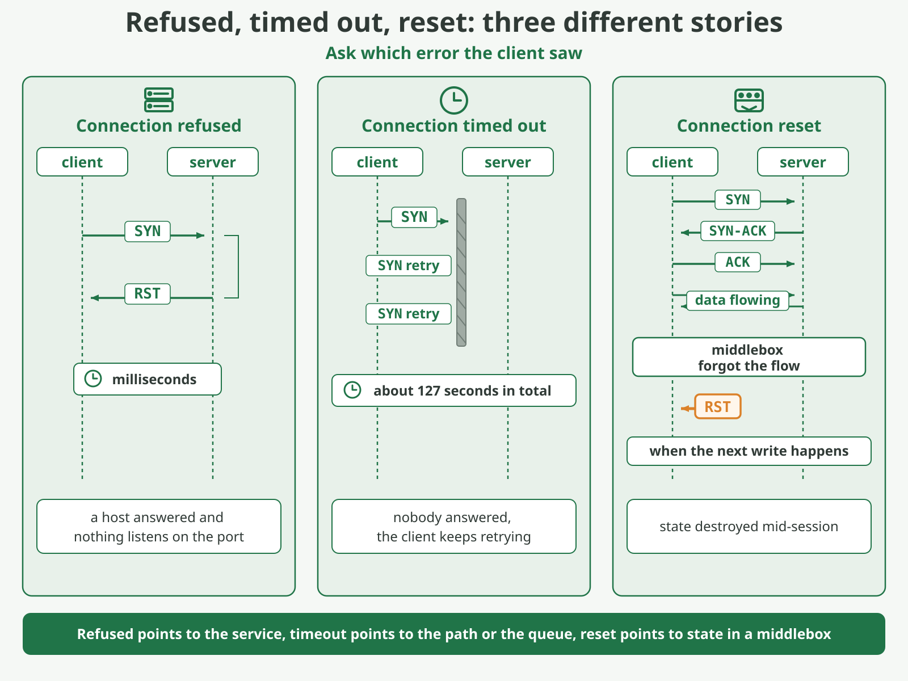

*Figure 20.6.1. A refused connection is answered at once, a timeout is silence while the client retries, and a reset destroys state in the middle of a session.*

An engineer says "the network is down", and the room goes quiet. The first useful thing you can do is ask which error the client saw. Each error points to a different place, so the words are evidence. The question costs nothing, and it narrows the search before you type a single command.

From the client's side the three errors look very different, even though each one ends the call. A refusal returns at once, so the caller sees the failure in milliseconds. A timeout keeps the caller waiting, and the wait itself is the clue, because it matches a retry schedule. A reset often arrives in the middle of a conversation, after some data has already flowed. Asking the client how long it waited, and whether any bytes came back first, often tells you which of the three you are dealing with before you have logged into anything.

Connection refused means a host answered the first packet and said no. The kernel at the other end sent a reset because nothing listens on that port. So the path works, the host is up, and the service is not there. A closed local port shows it. In the lab for this chapter, a Python connect to port 1 on 127.0.0.1 gave `ConnectionRefusedError: [Errno 61] Connection refused`, and the OpenSSL client printed `connect:errno=61`. In an Ubuntu 24.04 container on Linux the same OpenSSL client printed `connect:errno=111`. The error number differs between operating systems, so read the name, not the number.

Connection timed out means nobody answered. A packet was dropped on the way, or a firewall silently discards it, or the host is gone, or its queue is full. The client keeps retrying the SYN until it gives up. A SYN is the first packet of the TCP handshake, the one that asks to open a connection. The Linux man page for tcp says the default for the syn retries setting is 6, which is about 127 seconds of trying. A hung connect that ends after two minutes is this case, and the client's long wait is the retry schedule, not a slow server.

Connection reset during an established session means the other side, or something in the middle, destroyed the connection state and answered your next packet with a reset. The classic cause is a device that forgot the connection, such as a balancer that closed an idle flow. The session looked fine until the moment someone wrote to it.

The listen man page adds a twist that matters for scenario 1. When the queue of pending connections is full, "the client may receive an error with an indication of ECONNREFUSED". Or the request "may be ignored so that a later reattempt at connection succeeds". So a full queue can look like either a refusal or a timeout, depending on the kernel and its settings. That is why the exact words matter, and why you should check the queue before you conclude that the service is missing.

When someone reports an error, ask for the exact words. Refused points to the service, timeout points to the path or the queue, reset points to state in a middlebox. A middlebox is any device between the two ends that keeps its own table of connections, such as a load balancer, a NAT gateway or a firewall.

### 2. The method: split the path in half

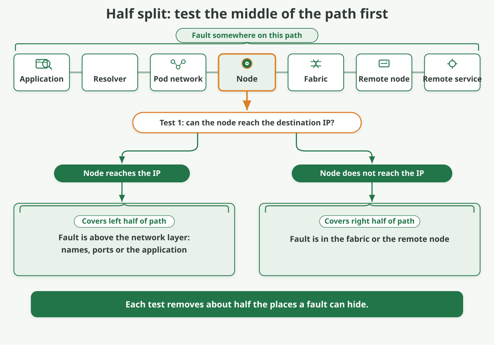

*Figure 20.6.2. A half-split test at the node tells you whether the fault sits in the left half of the path or in the fabric and remote side.*

Picture a pager going off at night. The first instinct is to run twenty commands at once and hope one of them explains the fault. Under stress that feels productive, and it usually wastes the most time. Computer Networking Problems and Solutions, in its Troubleshooting chapter, describes a better habit called half split. Map the path of the signal. Split it roughly in half. Test the signal at the middle. If it is wrong there, move toward the source. If it is right, move toward the destination.

Take the pod-to-database path as a worked example. A reader on the team says the database is "unreachable" from one pod. Your first test is from the node the pod runs on, toward the database address. If that works, the fault is between the pod and the node, which points you at the pod network, its resolver or its policy. If it fails, the fault is further along, in the fabric or on the database side, and your next test moves toward the database. Each answer removes a large part of the path, and you never needed to inspect every hop to get there.

Half split works because each test eliminates about half of the remaining places the fault can hide. A few well-chosen tests find the fault faster than many scattered ones, and each result tells you which half to search next. It is the same idea as a binary search in a sorted list, applied to a network path.

For a request from a pod to a database, the path has these hops: the application, the resolver, the pod network, the node, the fabric, the remote node and the remote service. A good first test is in the middle. Can the node reach the destination IP at all? You then learn which half to search. If the node reaches the IP, the fault is probably above the network layer, in names, ports or the application. If it does not, the fault is in the fabric or in the remote node.

The same book stresses that the purpose is what the system must do, not what one number says. A link can show zero errors while the user's stream still dies. So you test the thing the user cares about, which is a long-lived streaming call that stays up. A clean counter is not the same as a working service.

The mermaid diagram shows the order we use in this chapter. Say it aloud in the interview, then walk down it.

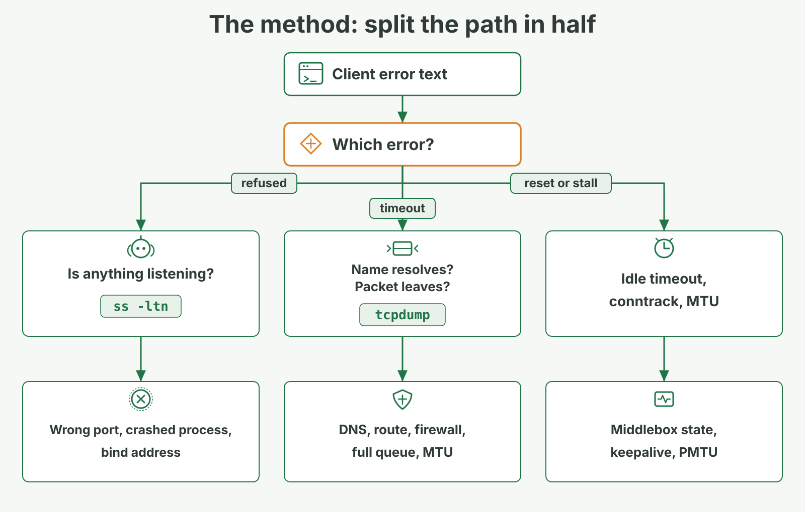

*Figure 20.6.3. The method: split the path in half, as a diagram.*

Before you type, say which half of the path you are testing and what result you expect. Saying the expectation out loud is what turns a command into a test. If the result matches, you have learned something. If it does not, you have found the place to look.

### 3. Reading ss: states and the two numbers

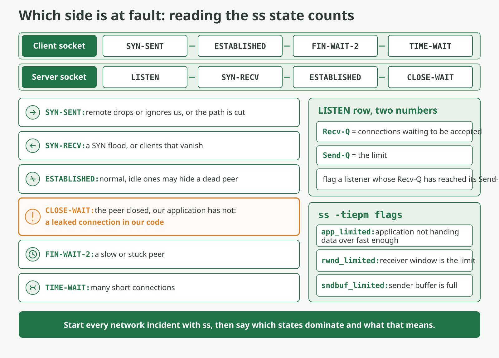

*Figure 20.6.4. Run ss, count the states, and find the one that is out of place; the state tells you who owns the fault.*

Suppose you land on a gateway node with an alert about connect failures. The fastest honest picture of the host's TCP world is `ss`. Systems Performance, in the Network chapter, introduces it as the socket statistics tool from the iproute2 package, which is maintained by the kernel network engineers. Its default output has columns for state, Recv-Q, Send-Q, local address and peer address. Each row is one socket, which is one end of one connection, or one listener waiting for connections.

The book lists the TCP states: LISTEN, SYN-SENT, SYN-RECEIVED, ESTABLISHED, FIN-WAIT-1, FIN-WAIT-2, CLOSE-WAIT, CLOSING, LAST-ACK, TIME-WAIT and CLOSED. The ss manual page uses the spellings syn-recv and listening in its filters. The table below is the lookup you need, and it is worth reading each row as a question about what the state means for your service.

In practice you rarely read the whole list. You run one command, count the states, and look for the one that is out of place. A healthy gateway has a steady mix of ESTABLISHED and a few LISTEN rows. A gateway with a growing pile of CLOSE-WAIT rows is leaking connections, and a gateway with a pile of SYN-RECV rows is either under a flood or waiting on clients that never finish. The count is the first clue, and the queue numbers on the listener are the second.

| State | What it tells you | What to suspect when there are many |
|---|---|---|
| LISTEN | A server socket is waiting | Not applicable. Check its queue numbers |
| SYN-SENT | We sent a SYN, no answer yet | The remote drops or ignores us, or the path is cut |
| SYN-RECV | We got a SYN and answered, handshake unfinished | A SYN flood, or clients that vanish |
| ESTABLISHED | Active session | Normal. Idle ones may hide a dead peer |
| CLOSE-WAIT | The peer closed, our application has not | A bug in our application, usually a leaked connection |
| FIN-WAIT-2 | We closed, the peer has not yet | A slow or stuck peer |
| TIME-WAIT | A closed session is kept briefly | Many short connections, see section 5 |

CLOSE-WAIT deserves emphasis because interviewers like it. The kernel has done its part. The remote side sent its close, and the kernel is waiting for your program to call close. A pile of CLOSE-WAIT sockets is nearly always a leak in the application, such as a forgotten response body. The fault sits with your code, and the kernel is simply holding the socket open for the program that has forgotten it.

For a LISTEN socket the two queue columns change meaning. On Linux, Recv-Q is the number of connections waiting to be accepted and Send-Q is the limit. The ss manual page does not define these columns, but the kernel source does. The kernel file `net/ipv4/tcp_diag.c`, which answers ss, fills the two numbers for a listening socket from `sk_ack_backlog`, the current queue length, and `sk_max_ack_backlog`, the limit. A live run confirms it: a listener created with backlog 5 and never accepted showed `LISTEN 6 5` once it was full. The queue holds one more than the limit, so a full listener reads Recv-Q one above Send-Q. The parser in code/part20 flags a listener whose Recv-Q has reached its Send-Q, which catches both the at-limit and the over-limit row.

For one connection, `ss -tiepm` gives a deep view. A typical output shows the process and file descriptor, the retransmission timeout, the round-trip time, the maximum segment size, the congestion window, and flags such as `app_limited`, `rwnd_limited` and `sndbuf_limited`. You use those flags to learn which side is the bottleneck. `app_limited` means the application is not handing data over fast enough, `rwnd_limited` means the receiver's window is the limit, and `sndbuf_limited` means the sender's buffer is full. You will use them again in chapter 20.18 when streaming slows.

Here is the parser from the code folder. It turns `ss -tan` text into counts and finds a full accept queue.

```python
# code/part20/net06_ss_parser.py
#!/usr/bin/env python3
"""Summarise `ss -tan` output: states, full accept queues, port budget.
For LISTEN sockets Recv-Q is the current accept queue length and Send-Q is
the configured limit (see the chapter, scenario 1). Standard library only."""
import sys
from collections import Counter

STATE = {"ESTAB": "ESTABLISHED", "LISTEN": "LISTEN", "TIME-WAIT": "TIME-WAIT",
         "CLOSE-WAIT": "CLOSE-WAIT", "SYN-SENT": "SYN-SENT",
         "SYN-RECV": "SYN-RECV", "FIN-WAIT-1": "FIN-WAIT-1",
         "FIN-WAIT-2": "FIN-WAIT-2", "LAST-ACK": "LAST-ACK",
         "CLOSING": "CLOSING", "ESTABLISHED": "ESTABLISHED"}

def parse(text):
    """Return rows (state, recvq, sendq, local, peer). Skips header and junk."""
    rows = []
    for line in text.splitlines():
        f = line.split()
        if len(f) < 5 or f[0] not in STATE:
            continue
        if not (f[1].isdigit() and f[2].isdigit()):
            continue
        rows.append((STATE[f[0]], int(f[1]), int(f[2]), f[3], f[4]))
    return rows

def summarize(rows):
    counts = Counter(r[0] for r in rows)
    full = [r for r in rows if r[0] == "LISTEN" and r[2] > 0 and r[1] >= r[2]]
    return {"counts": dict(counts), "full_listeners": [r[3] for r in full]}

def max_new_conn_rate(port_lo, port_hi, time_wait_s=60):
    """Sustained connects per second to one dst ip:port before ports run out.
    Every closed connection holds its source port for time_wait_s."""
    return (port_hi - port_lo + 1) / time_wait_s

if __name__ == "__main__":
    print(summarize(parse(sys.stdin.read())))
```

Start every network incident with ss, then say which states dominate and what that means. A large count of one state is the clue, and the table above tells you which story that state supports.

### 4. SYN backlog and accept queue

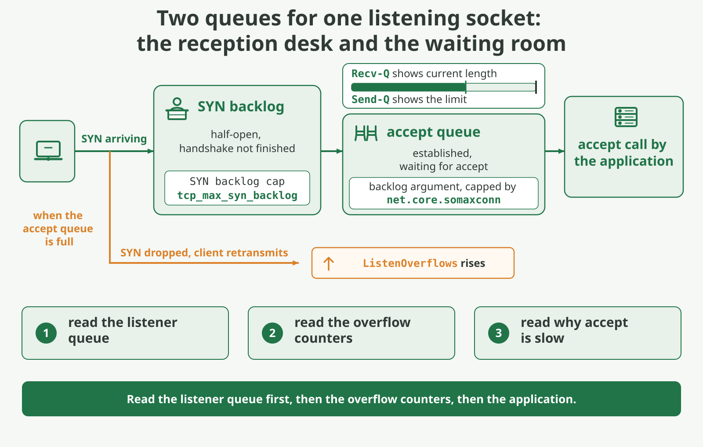

*Figure 20.6.5. Linux keeps two queues per listener, and a full accept queue causes SYNs to be dropped and retried by the client.*

Picture a busy gateway that gets a burst of new connections during a deploy. The application is slow to call accept because its threads are busy. What happens to new clients? The answer depends on the two queues that Linux keeps for every listening socket, and that is the mechanism this section explains.

Systems Performance explains that Linux keeps two queues. The first holds connections that are still completing the handshake, called the SYN backlog. The second holds established sessions waiting for the program to accept them, called the listen backlog. The earlier design used a single queue and was weak against SYN floods, so the split lets the first queue be long and cheap. A SYN flood is an attack that sends SYNs without ever finishing the handshake, so the server's queue fills with half-open connections.

Think of the two queues as a reception desk and a waiting room. The reception desk takes each new arrival and records their request, which costs little. The waiting room holds people whose paperwork is complete and who are waiting to be called in. If the doctor is slow, the waiting room fills, and new arrivals can no longer be seated. That is when the gateway starts to turn clients away.

Both lengths can be tuned. The accept queue is limited by the backlog argument to listen, and the kernel caps it at net.core.somaxconn. The listen man page says that since Linux 5.4 the default of that cap is 4096, and in earlier kernels it was 128. The SYN queue is limited by net.ipv4.tcp_max_syn_backlog. The tcp man page gives its default as 256, raised to 1024 on systems with at least 128 MB of memory. Systems Performance shows one production tuning with 1024 for somaxconn and 8192 for tcp_max_syn_backlog, and calls it a point-in-time example, not a recipe.

When the accept queue is full, SYN packets are dropped and later retransmitted by the client. The client sees this as slow connects, with a gap of seconds, then success or a timeout. Backlog drops and SYN retransmits are signs of host overload. The kernel counter documentation says that when the accept queue has no room the kernel drops the SYN and adds one to TcpExtListenOverflows. TcpExtListenDrops counts any packet the kernel drops on a listening socket. Both counters are cumulative, so you read them twice and compare the difference.

There is a switch that changes the client's view. The tcp man page describes tcp_abort_on_overflow, disabled by default, as enabling reset of connections when the service is too slow. A well-known Netflix tuning example sets it to 1. With it on, clients get a fast refusal instead of a silent retry. That is a policy choice. Fast failure is good when a load balancer can retry elsewhere, and bad for a client with no other option. A fast refusal tells the client to try somewhere else, and a silent drop makes the client wait and wonder.

Walk the deploy scenario from the start. A new version rolls out, and every instance restarts at about the same time. Each restarted process is slow for a while as its caches warm up, so the accept loop falls behind. Clients that arrive during that gap fill the waiting room. From outside you see slow connects that clear up on their own after a minute. That shape, a spike that heals by itself, is the signature of a backlog that absorbed a burst, and it is different from a permanent overload that keeps climbing.

The cure is rarely a bigger queue alone. A longer queue hides a slow application and adds waiting time, because each extra connection in the queue waits longer before anyone serves it. You find out why accept is slow, for example a single-threaded accept loop or a saturated CPU, and you raise the queue only to absorb short bursts.

When connects are slow, read the listener queue, then the overflow counters, then the application.

### 5. TIME_WAIT and ephemeral ports

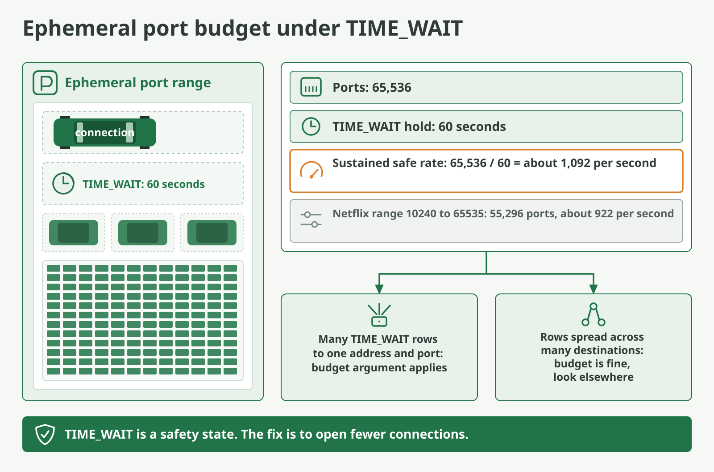

*Figure 20.6.6. The TIME_WAIT port budget: 65,536 ports held for 60 seconds gives a sustained safe rate of about 1,092 connections per second.*

A different story. A service makes thousands of short calls per second to one downstream API, and after a while its calls fail with errors about addresses in use or time out on connect. The cause is port exhaustion, and the first reaction, to suspect the downstream API, is usually wrong.

Systems Performance explains the mechanism. A fully closed session enters TIME_WAIT so late packets are not mixed with a new session on the same ports. The state is typically held for about two minutes, though the same book later describes it as possibly 60 seconds, and the Linux fin timeout default in the tcp man page is 60 seconds. Which value applies depends on the kernel, so state your assumption aloud. The point of the state is safety. A late packet from an old session could otherwise be taken as part of a new one that happens to reuse the same ports.

A connection is identified by source address, source port, destination address and destination port. When a client talks to one server address and one port, only the source port can vary. That port comes from the ephemeral range, which is the pool of temporary port numbers the kernel hands out to outgoing connections. With 65,536 ports and a 60-second TIME_WAIT, a rate above 65,536 connections in 60 seconds can clash.

Think of it as a parking lot with a fixed number of spaces, where each departing car must keep its space reserved for a minute before anyone else can use it. Cars arriving faster than the lot can turn over will find it full, even though the road outside is clear. The lot is the port range, the reserved minute is TIME_WAIT, and the cars are connections.

Where do those bursts of short calls come from? Usually from a loop in the client that opens a new connection for every request, instead of reusing one. Each loop iteration leaves a TIME_WAIT behind, and the rate of iterations sets the rate at which the port budget drains. The sudden failure after a few minutes is what a steady drain looks like once the budget runs out. The fix is in that loop, and the server beside it is innocent.

The arithmetic is short. The code folder has it as a function.

| Input | Value | Source |
|---|---|---|
| Ports in the range 0 to 65535 | 65,536 | Systems Performance, Network |
| TIME_WAIT hold | 60 seconds | same chapter |
| Sustained safe rate | 65,536 / 60 = about 1,092 per second | worked here |
| Netflix range 10240 to 65535 | 55,296 ports, about 922 per second | worked here |

The real range on your host is smaller than 65,536 unless it was widened, and the default is set by net.ipv4.ip_local_port_range. We did not fetch the default value, so read it with sysctl on the machine.

The usual fixes are reuse and recycle behavior in the kernel, more server IP addresses, or a low SO_LINGER time. SO_LINGER controls what happens to a socket when it closes, and a low value can cut the wait short but risks losing data that is still in transit. The tcp man page describes tcp_tw_reuse as allowing reuse of TIME_WAIT sockets "when it is safe from protocol viewpoint" and tells you not to change it without expert knowledge. The best fix is usually in the client. Use connection pooling and keep-alive so you do not open a fresh connection per request. A pool that keeps connections open turns thousands of closes into a handful, and the parking lot stops filling.

A useful check before any tuning is to count the TIME_WAIT rows per destination. If they all point at one address and port, the budget argument applies. If they are spread across many destinations, the budget is fine and the problem is somewhere else, such as a client that closes connections too early. The count separates the two cases in one command.

Do not say "TIME_WAIT is a bug". It is a safety feature, and the answer is to open fewer connections.

### 6. Conntrack: the table that fills quietly

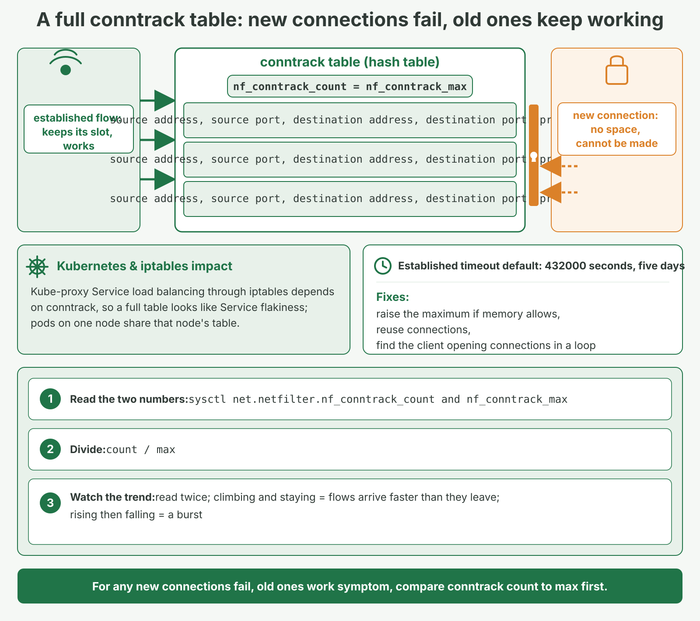

*Figure 20.6.7. A full conntrack table fails quietly: established flows are untouched, only new connections are refused.*

Another story. Pods on one node begin to lose new connections at random, while existing connections are fine. CPU is low and every service is healthy. Suspect the connection tracking table, because a full table fails quietly and leaves every existing flow untouched.

The Networking and Kubernetes book explains it in the Linux Networking chapter. Conntrack is part of Netfilter, the kernel's packet filtering framework. It tracks flows by a tuple of source address, source port, destination address, destination port and protocol, and it stores them in a hash table. A hash table is a lookup structure that finds an entry by computing a key, so each packet can be matched quickly. NAT depends on it, because the kernel has to remember which original address each reply belongs to. The book connects this to Kubernetes directly. Kube-proxy builds Service load balancing with iptables, and without connection tracking every packet would need to be mapped to the same backend, which cannot be done when the backend list changes.

The danger is that conntrack runs out of space for connection tracking, and new connections cannot be made. The maximum is read from /proc/sys/net/nf_conntrack_max and the hash table size from /sys/module/nf_conntrack/parameters/hashsize. The kernel documentation says nf_conntrack_count is the current number of allocated entries, and that the bucket count defaults to total memory divided by 16384, with a floor of 1024 and a ceiling of 262144. The same page lists the default established-state timeout as 432000 seconds, which is five days. So an idle but tracked flow can occupy a slot for a very long time unless something shortens it.

Picture a guest list with a hard cap. People already inside can keep talking and leave when they like, but the door stays shut for newcomers once the cap is reached. Nobody is hurt, the party looks fine, and yet every new guest is turned away. That is the failure a full conntrack table produces, and it is why the symptom is "new fail, old work".

You check it with two numbers and one division. The code below turns sysctl text into a percentage and a verdict.

```python
# code/part20/net06_conntrack_check.py
#!/usr/bin/env python3
"""Judge conntrack table pressure from sysctl-style text.
Input lines look like: net.netfilter.nf_conntrack_count = 31000
Exit code 2 when usage is at or above the alert fraction."""
import re, sys

def read_values(text):
    vals = {}
    for m in re.finditer(r"nf_conntrack_(count|max)\s*=\s*(\d+)", text):
        vals[m.group(1)] = int(m.group(2))
    return vals

def usage(text):
    v = read_values(text)
    if "count" not in v or "max" not in v or v["max"] == 0:
        raise ValueError("need nf_conntrack_count and nf_conntrack_max")
    return v["count"] / v["max"]

def verdict(frac, alert=0.8):
    if frac >= 1.0:
        return "FULL: no space left, new connections cannot be made"
    if frac >= alert:
        return "HOT: raise nf_conntrack_max or cut short-lived flows"
    return "ok"

if __name__ == "__main__":
    f = usage(sys.stdin.read())
    print(f"{f:.1%} {verdict(f)}")
    sys.exit(2 if f >= 0.8 else 0)
```

On a live host you run `conntrack -L` to list flows, and `conntrack -C` for the count. You may need to install the conntrack tool and load the nf_conntrack module. In the Ubuntu test container, started with `--cap-add NET_ADMIN`, the count stayed at 0 at first, because a fresh container namespace tracks nothing until a rule needs tracking. After one iptables rule that matches on connection state was added and a single curl request was made, the tools showed a real flow.

```text
$ conntrack -L
tcp      6 119 TIME_WAIT src=127.0.0.1 dst=127.0.0.1 sport=42460 dport=8000 src=127.0.0.1 dst=127.0.0.1 sport=8000 dport=42460 [ASSURED] mark=0 use=1
conntrack v1.4.8 (conntrack-tools): 1 flow entries have been shown.
$ sysctl net.netfilter.nf_conntrack_count net.netfilter.nf_conntrack_max net.netfilter.nf_conntrack_tcp_timeout_established
net.netfilter.nf_conntrack_count = 1
net.netfilter.nf_conntrack_max = 262144
net.netfilter.nf_conntrack_tcp_timeout_established = 432000
```

The last number is 432,000 seconds, which is the five days the kernel documentation gives for the established timeout. The table could not be filled in the test container, which may not write that sysctl, and Docker refused to set it at start. So the full-table message in scenario 3 is the checker run on real values at 0.0 percent, and the full case stays a test with sample input.

Before you change anything, watch the count move. Take a reading, wait a little, and take another. If the count climbs toward the maximum and stays there, flows are arriving faster than they leave, and the table will fill. If the count rises and then falls back, the table is handling a burst, and the fix may be to wait for the burst to pass. The trend tells you which of the two problems you have, and it costs nothing to collect.

The fix has layers. Raise the maximum if memory allows. Reduce the number of short-lived flows through connection reuse. Look for a client that opens connections in a loop. And in Kubernetes, remember that every pod-to-Service flow passes through here on the node, so a busy node pays for every Service call its pods make.

For any "new connections fail, old ones work" symptom, compare conntrack count to max before you touch anything else.

### 7. DNS failures and ndots in Kubernetes

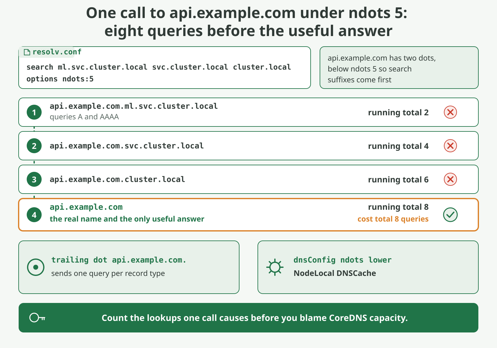

*Figure 20.6.8. With ndots 5, a dotted name is tried with each search suffix first, so one useful answer can cost eight queries.*

An engineer reports that a pod's calls to an external API are slow, and sometimes fail, but pinging the IP is fast. That points to name resolution. The fix often hides in one line of a file, and the file is the one the pod reads before it asks anyone for an address.

How Linux Works describes the resolver. The C library follows rules in nsswitch.conf, often checks the hosts file first, then asks the name server found in resolv.conf. The search line defines rules for incomplete names. A name server cache such as systemd-resolved may sit in front. Each step is a place where time can go, and the slow step may not be the one you expect.

Kubernetes sets the pod's resolv.conf for you. The Kubernetes documentation on DNS for Services and Pods shows an example with the nameserver as the cluster DNS Service, a search line with the pod's namespace domain, the svc domain and the cluster domain, and `options ndots:5`. The docs note that a query for just a short name may be expanded using those search domains.

The ndots value is the number of dots below which a name is first tried with the search list. With ndots 5, a name like api.example.com has two dots, so the resolver tries it with each search suffix before it tries it as written. Each candidate costs an A query and an AAAA query. The script in the code folder lists the candidates and counts the cost.

```python
# code/part20/net06_resolv_ndots.py
#!/usr/bin/env python3
"""Show the lookups a resolver tries for a name, given a resolv.conf.
Rule (resolv.conf(5)): a name with at least ndots dots is tried as written
first, then with each search domain. A name with fewer dots tries the search
domains first, then as written. A trailing dot means absolute: no search.
Each candidate costs two queries (A and AAAA) in a dual-stack pod."""
import sys

def parse_conf(text):
    search, ndots = [], 1
    for line in text.splitlines():
        f = line.split()
        if not f:
            continue
        if f[0] == "search":
            search = f[1:]
        elif f[0] == "options":
            for o in f[1:]:
                if o.startswith("ndots:"):
                    ndots = int(o.split(":")[1])
    return search, ndots

def candidates(name, search, ndots):
    if name.endswith("."):
        return [name]
    expanded = [f"{name}.{d}" for d in search]
    if name.count(".") >= ndots:
        return [name] + expanded
    return expanded + [name]

def queries_until_hit(name, conf, answers):
    """Count queries sent until a candidate in `answers` is found."""
    search, ndots = parse_conf(conf)
    sent = 0
    for c in candidates(name, search, ndots):
        sent += 2          # A + AAAA
        if c in answers:
            break
    return sent

if __name__ == "__main__":
    conf = sys.stdin.read()
    s, n = parse_conf(conf)
    for c in candidates(sys.argv[1], s, n):
        print(c)
```

For api.example.com from the namespace ml, the script prints three suffixed names and then the real name. That is four candidates, or eight queries, for one useful answer. The earlier chapter on cluster DNS in this handbook, chapter 5.11, goes further into the problem and the fixes: a trailing dot on the name, a lower ndots through dnsConfig, and NodeLocal DNSCache.

The Networking and Kubernetes book adds that CoreDNS has an Autopath feature that does the search work on the server side, at the cost of more CoreDNS memory. It also lists the limits: at most three name server addresses and at most six search domains in a pod.

The trailing dot works because it tells the resolver the name is already complete. A name that ends in a dot is absolute, so the search list is skipped and only one query is sent per record type. That is why the fix in the scenario is a one-character change in the configuration rather than a new component. The cost is that the name must be written with the dot, so a config that is shared with other tools needs a check.

A quick way to see the search cost without writing code is to time two lookups from the pod. Look up the short name, then the same name with a trailing dot. If the second is much faster, the search list is doing the work. The difference is the cost you are paying on every call, and it adds up across a busy service.

Debug in this order. First read resolv.conf inside the pod. Then look up a name with the short and the full form. Then check whether CoreDNS pods are running and whether queries are slow or failing. The Kubernetes debug guide itself uses this ladder: `nslookup hostnames`, then `nslookup hostnames.default`, then the full `hostnames.default.svc.cluster.local`, and the first one that fails shows where to look.

When names are slow, count the lookups a single call causes before you blame CoreDNS capacity. Often the server is fine, and the client is asking eight questions where one would do.

### 8. MTU and path MTU black holes

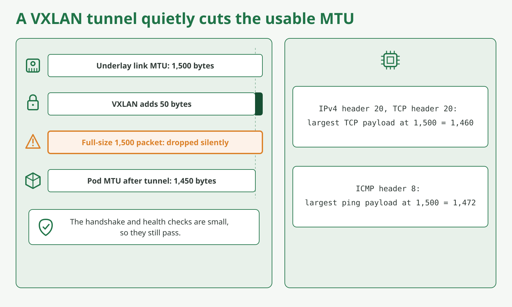

*Figure 20.6.9. VXLAN takes 50 bytes from a 1,500-byte link, leaving 1,450 bytes for the pod, so full-size packets are silently dropped.*

The oddest bug in this list: small requests work, large responses hang. A health check passes. A long answer stalls forever. This is the signature of a path MTU black hole, and it is confusing because every simple test looks green. The handshake and the health check are small, so they pass, and the first big packet is the only one that disappears.

Systems Performance describes the cause. Packet size is limited by the interface MTU, usually 1,500 bytes on Ethernet. MTU stands for maximum transmission unit, the largest packet a link will carry. Devices that cannot carry a larger packet either fragment it or send an ICMP can't-fragment message. The book says that some firewalls were configured to block all ICMP after ping-of-death attacks, which "prevents the helpful can't fragment messages from reaching the sender and causes network packets to be silently dropped once their packet size increases beyond 1,500."

The networking book, in the chapter on higher layer transports, explains Path MTU Discovery. The sender learns the smallest MTU on the path, and the learning relies on the ICMP packet-too-big reply. The book calls the assumption that this works on large public networks "a fairly bad assumption". So the handshake, with tiny packets, succeeds. The first full-size data packet vanishes. Nothing tells the sender why.

Tunnels cause this inside your own platform. A tunnel wraps one packet inside another, and the wrapper takes up room. The handbook's overlay chapter, 2.17, says VXLAN adds 50 bytes, so a 1,500-byte underlay leaves 1,450 for the pod. If the pod's MTU is still 1,500, full-size packets exceed the tunnel. The sender thinks the path can carry them, the tunnel cannot, and the packet is dropped.

The script below does the arithmetic. Headers are 20 bytes for IPv4, 20 for TCP and 8 for ICMP, so the largest TCP payload at MTU 1,500 is 1,460, and the largest ping payload is 1,472.

```python
# code/part20/net06_mtu_math.py
#!/usr/bin/env python3
"""MTU, MSS and ping-size arithmetic for black-hole debugging.
Header sizes: IPv4 20, TCP 20 (no options), ICMP 8. VXLAN adds 50 bytes
(handbook 2.17). ping -s sets only the ICMP payload."""
IP, TCP, ICMP = 20, 20, 8

def inner_mtu(link_mtu, overhead=0):
    return link_mtu - overhead

def tcp_mss(mtu):
    return mtu - IP - TCP

def ping_payload_for(mtu):
    """Largest `ping -M do -s N` that fits without fragmenting."""
    return mtu - IP - ICMP

def blackhole_risk(path_mtu, sender_mtu, icmp_frag_needed_arrives):
    """A DF packet that is too big is dropped. Only the ICMP message lets
    the sender shrink. If ICMP is filtered, small packets pass, big ones hang."""
    if sender_mtu <= path_mtu:
        return "fits"
    return "shrinks via PMTUD" if icmp_frag_needed_arrives else "BLACK HOLE"

if __name__ == "__main__":
    for mtu in (1500, 1450, 9000):
        print(mtu, "mss", tcp_mss(mtu), "ping -s", ping_payload_for(mtu))
```

To test a path, send pings of a chosen size with the do-not-fragment flag set. At MTU 1,500 you would try `ping -M do -s 1472 host` and, if it fails, step down. The do-not-fragment flag tells every router on the path to drop the packet rather than split it, so the answer tells you exactly what fits. The ping command line is the Linux iputils form. It was run in the test container against a dummy interface set to MTU 1,450, which needs `--cap-add NET_ADMIN`. The oversize probe failed at once on the sender with the message below, and the probe sized for 1,450 was sent.

```text
$ ping -c1 -W1 -M do -s 1472 10.9.0.2
PING 10.9.0.2 (10.9.0.2) 1472(1500) bytes of data.
ping: local error: message too long, mtu=1450
$ ping -c1 -W1 -M do -s 1422 10.9.0.2
PING 10.9.0.2 (10.9.0.2) 1422(1450) bytes of data.
```

The second probe got no reply only because the dummy interface has no peer. The point is where the error comes from. This one is local. On a real overlay the same step shows up as a missing reply or an ICMP packet-too-big message from a router on the path. The book says a default ping sends 56 bytes of payload, which is 84 bytes with headers, and that matches the numbers above.

Here is the sequence the sender goes through, in plain steps. It sends a full-size packet with the do-not-fragment bit set. A router whose link is too small drops that packet and returns an ICMP message that says the packet was too big and names the largest size it can carry. The sender reads that message, lowers its size, and tries again. If the ICMP message is filtered somewhere, the sender never hears it. It keeps sending full-size packets that vanish, and the connection looks frozen. Small packets never trigger the problem, which is why the handshake and the health check both pass.

The fixes are to repair ICMP filtering, to set the right MTU on the tunnel interface, or to clamp the TCP maximum segment size so endpoints never send more than fits. Say which you prefer and why. Fixing ICMP is cleanest, because it lets every path learn its own limit. Clamping is a practical bandage when you do not own the whole path, because it works even when the ICMP messages never arrive.

When small works and large hangs, test packet size before you test anything exotic. Write down the largest size that passes and the smallest that fails, because that pair is the evidence you will hand to the network team, and it tells them exactly where to look.

### 9. Retransmits and reading tcpdump

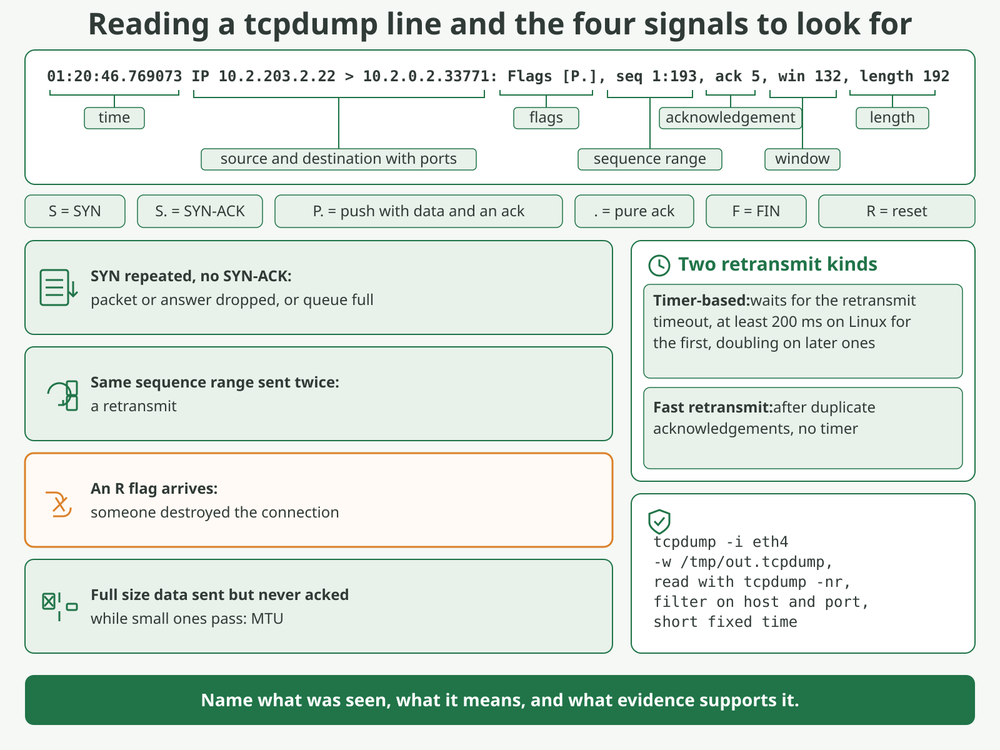

*Figure 20.6.10. Read the flags first, then name the signal before naming the fault.*

At some point the interviewer says "show me on the wire". You need to read a capture, not just run one. A capture is a record of each packet that crossed an interface, and reading it is where the story of a fault becomes visible. The counters tell you that something went wrong, and the capture tells you what happened, packet by packet.

Systems Performance shows both the capture and the read. You write packets to a file with `tcpdump -i eth4 -w /tmp/out.tcpdump`, then read them with `tcpdump -nr /tmp/out.tcpdump`. The `-n` flag skips name lookups. The book warns that capture is expensive in CPU and storage, that the kernel may drop packets when the rate is high, and that you should use it for short periods. Filters run in the kernel using BPF, so a tight filter lowers the cost, because the kernel discards the packets you do not need before they reach tcpdump. A safe capture starts with a host and port filter, runs for a short and fixed time, and writes to a file on a disk with room. Stopping the capture as soon as you have the failing exchange is part of the discipline, because a long capture on a busy host can hurt the very service you are trying to help.

A line has a time, source and destination with ports, flags, sequence range, acknowledgement, window and length. The flags you meet most: S is a SYN, S. is a SYN-ACK, P. is a push with data and an ack, a single dot is a pure ack, F is a FIN and R is a reset. Read the flags first, because they tell you the stage of the conversation at a glance.

The signals to look for:
- A SYN repeated several times with no SYN-ACK. The packet or its answer is dropped, or the queue is full.
- The same sequence range sent twice. That is a retransmit.
- An R flag arriving. Someone destroyed the connection.
- Data packets of full size sent but never acked, while small ones pass. That points to MTU.

The book describes two ways TCP retransmits. A timer-based retransmit waits for the retransmit timeout, which on Linux is at least 200 ms for the first retransmit and doubles on later ones. A fast retransmit starts after duplicate acknowledgements and does not wait for the timer. Tail loss probe sends an extra packet to catch loss of the last segment. Many timer retransmits mean packets are vanishing without any later traffic to trigger the faster path. The gap between two copies of the same segment tells you which mechanism ran.

Counters give you the same story without a capture. The nstat and netstat -s output contains lines such as segments retransmitted, and TCPSynRetrans, which can be caused by the remote endpoint dropping SYNs from a full listen backlog. For per-event tracing, tcpretrans helps. A high rate in the ESTABLISHED state can point to an external network problem, while a high rate in SYN_SENT can point to an overloaded server application. The counter tells you where to look, and the capture tells you why.

The parser below reads tcpdump text and finds repeated segments and unanswered SYNs. Its fixture combines lines that follow the standard output format with synthetic lines.

```python
# code/part20/net06_tcpdump_reader.py
#!/usr/bin/env python3
"""Read `tcpdump -nn` text lines: find retransmitted data and unanswered SYNs.
A retransmit here means the same flow sent the same seq range twice.
Line shape (Systems Performance ch 10):
  01:20:46.769073 IP 10.2.203.2.22 > 10.2.0.2.33771: Flags [P.], seq 1:193, ack 5, win 132, length 192"""
import re, sys

LINE = re.compile(r"IP (\S+) > (\S+?): Flags \[([^\]]+)\](?:, seq (\d+)(?::(\d+))?)?.*length (\d+)")

def parse(text):
    out = []
    for ln in text.splitlines():
        m = LINE.search(ln)
        if m:
            src, dst, flags, s1, s2, ln_ = m.groups()
            out.append({"src": src, "dst": dst, "flags": flags,
                        "seq": int(s1) if s1 else None, "len": int(ln_)})
    return out

def retransmits(pkts):
    seen, dup = set(), []
    for p in pkts:
        if p["len"] > 0 and p["seq"] is not None:
            key = (p["src"], p["dst"], p["seq"], p["len"])
            if key in seen:
                dup.append(key)
            seen.add(key)
    return dup

def unanswered_syns(pkts):
    """SYN (flags exactly 'S') whose reverse flow never shows 'S.'"""
    answered = {(p["dst"], p["src"]) for p in pkts if p["flags"] == "S."}
    syns = [p for p in pkts if p["flags"] == "S"]
    return [(p["src"], p["dst"]) for p in syns if (p["src"], p["dst"]) not in answered]

if __name__ == "__main__":
    pk = parse(sys.stdin.read())
    print("retransmits:", retransmits(pk))
    print("unanswered SYN:", unanswered_syns(pk))
```

Name the signal before you name the fault. "I see the same sequence range twice, so this is a retransmit, and the gap is 300 ms, so it was timer driven." That sentence does three things in order. It names what was seen, it names what that means, and it says what evidence supports the claim.

### 10. TLS handshake failures

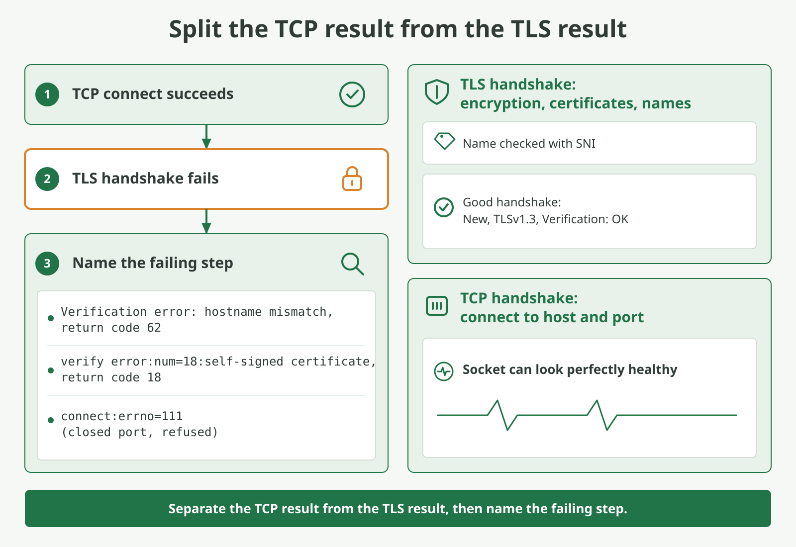

*Figure 20.6.11. A TCP connect that works while the TLS handshake fails points the search at the name or certificate, not the path or port.*

A new client cannot connect to the endpoint over HTTPS, but a plain TCP connect works. The TCP handshake is fine, so the fault is in the layer above it. TLS is the encryption layer that runs on top of TCP, and it has its own handshake, certificates and names. A fault can sit there while the socket looks perfectly healthy.

The handbook's chapter 2.10 covers TLS and certificates, so here we only sort the failures by what you see. The command for a quick view is `openssl s_client -connect host:443 -servername host`. The servername flag sets SNI, the name the client asks for, which matters when one address serves many names. The test used a local server started with `openssl s_server` and a self-signed certificate. Four results are worth knowing by sight.

| Situation | What `s_client` printed |
|---|---|
| Good handshake with the certificate trusted and the right name | `New, TLSv1.3, Cipher is TLS_AES_256_GCM_SHA384` and `Verification: OK` |
| Server name does not match | `Verification error: hostname mismatch`, return code 62 |
| Certificate not trusted | `verify error:num=18:self-signed certificate`, return code 18 |
| Closed port | `connect:errno=111`, the refused case from section 1 |

A client that speaks plain HTTP to the TLS port got no answer at all. `curl -sS https://127.0.0.1:8443/` said `SSL certificate problem: self-signed certificate`. An OpenSSL client pointed at a plain HTTP port printed `wrong version number` and `no peer certificate available`. The messages depend on the version. These came from OpenSSL 3.0.13 in Ubuntu 24.04.

Ask where the failure occurs. If it occurs at connect, it is not TLS at all. If the server sends an alert straight after the hello, suspect a protocol or cipher mismatch, or a wrong SNI. If the handshake completes but the client rejects the certificate, suspect expiry, an incomplete chain, a name that does not match, or a client clock that is wrong. If the failure appears only after hours, suspect a rotated certificate that a long-lived process never reloaded. This last one matters for a platform with long-lived gateway pods. These are general TLS causes, and the exact messages differ per client library, so read the message and do not guess.

A small example shows the split. Suppose the TCP connect succeeds, and the TLS handshake then fails with a hostname mismatch. You now know that the path, the port and the listener are fine. The fault is the name the client asks for, or the certificate the server presents for that name. The next command checks the certificate's names against the name you typed, and the search has narrowed to one object.

Separate the TCP result from the TLS result first, and then name the failing step.

### 11. Idle timeouts and keepalive, the streaming problem

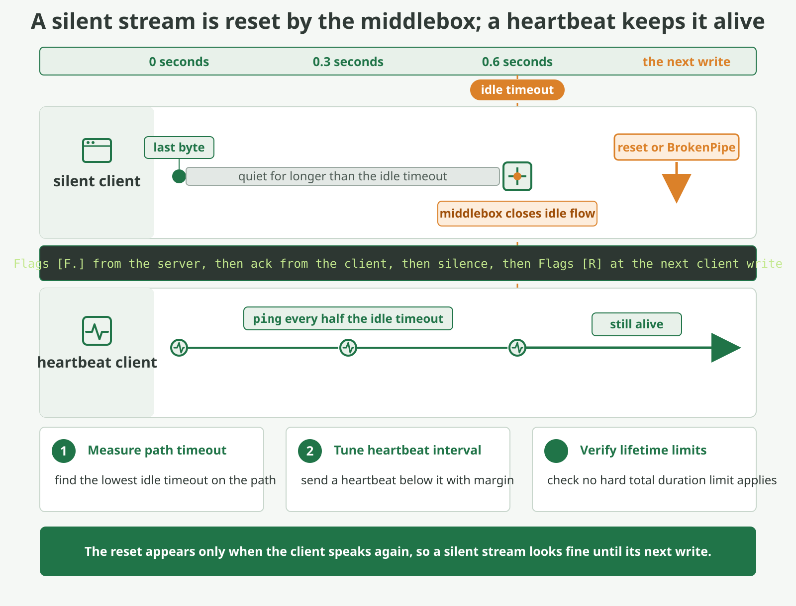

*Figure 20.6.12. A middlebox that forgets an idle flow breaks a silent stream at the next write, while periodic heartbeats keep the flow alive.*

Now the question from the start of the chapter. A token stream starts well, runs for about a minute, and then stops in the middle of an answer. The client sees the connection end. The model server logs show nothing wrong, and the GPUs are busy with other requests. This is the most important section for an inference platform, because streaming is one of the main ways chat answers reach a user, and a stream that dies at a fixed moment is a classic symptom.

Think of a streaming connection as a radio channel that a network device watches on a timer. If nobody speaks on it for a while, the device closes the channel to free the frequency for other callers. Nobody on either end was told. The next time someone presses the button, the channel is simply gone. Heartbeats are the regular short messages that keep the channel marked as in use.

An LLM response may produce no bytes for a long time, for example while a long prompt is being processed before the first token. Between tokens the gap can also be long under load. A load balancer, a NAT gateway or a firewall in the path keeps a table of flows. If a flow sends nothing for longer than that device's idle timeout, the device forgets it. The next packet then meets either a reset or silence, and the stream breaks. The server never sent an error, because from its side the connection was healthy.

The tcp man page gives the Linux defaults for TCP keepalive. The time before probes begin is 7200 seconds. The interval is 75 seconds and the probe count is 9. Probes are sent only when the SO_KEEPALIVE socket option is on. So with defaults, a connection would be silent for two hours before a probe, which is far too late for a device with a short idle timeout. Systems Performance mentions the same long keepalive timer on ESTABLISHED. The conntrack idle timeout for established flows is 432000 seconds on Linux by default, so the shorter limit is normally set by a cloud or hardware device, not by Linux conntrack.

The rule is simple. Make some bytes flow more often than the shortest idle timeout on the whole path. Two ways exist. Set TCP keepalive on the sockets with a short time. Or send application heartbeats, such as an SSE comment line or an empty chunk, every few seconds. Application heartbeats also survive proxies that do not forward TCP keepalives, so they are the safer choice for HTTP streaming. Which devices sit in your path, and what their idle timeouts are, is a fact you must look up in their documentation. We did not fetch any vendor value, and Nebius has not published its balancer settings. So the right interview answer is to say that you would find the lowest idle timeout and set the heartbeat below it with margin.

The demo in the code folder shows the whole behavior on one machine. A small server plays the middlebox and closes a connection idle for 0.6 seconds. One client stays silent and its writes fail with a broken pipe. The other sends a ping every 0.3 seconds and stays alive.

```python
# code/part20/net06_idle_reset_demo.py
#!/usr/bin/env python3
"""Idle-timeout demo: a middlebox forgets an idle connection, then resets it.
Localhost only. The 'middlebox' is a small server that closes any connection
idle for IDLE seconds, like a load balancer idle timeout. A streaming client
that stays silent longer than IDLE loses the stream. A client that sends a
heartbeat every IDLE/2 seconds keeps it."""
import socket, threading, time

IDLE = 0.6

def middlebox(srv, log):
    srv.settimeout(5)
    conn, _ = srv.accept()
    conn.settimeout(IDLE)
    while True:
        try:
            if not conn.recv(64):
                log.append("peer closed"); break
        except socket.timeout:
            log.append("idle timeout, closing")
            conn.close(); break

def client(heartbeat, quiet_for):
    srv = socket.socket(); srv.bind(("127.0.0.1", 0)); srv.listen(1)
    log = []
    t = threading.Thread(target=middlebox, args=(srv, log)); t.start()
    c = socket.create_connection(srv.getsockname())
    end = time.time() + quiet_for
    while time.time() < end:
        if heartbeat:
            c.sendall(b"ping")
        time.sleep(IDLE / 2)
    try:
        c.sendall(b"token")      # first write after the close may succeed
        time.sleep(0.1)
        c.sendall(b"token")      # second write sees the reset or broken pipe
        outcome = "still alive"
    except OSError as e:
        outcome = type(e).__name__
    c.close(); t.join(); srv.close()
    return outcome, log

if __name__ == "__main__":
    print("silent  :", client(heartbeat=False, quiet_for=IDLE * 2))
    print("heartbeat:", client(heartbeat=True, quiet_for=IDLE * 2))
```

There is a second stream killer: timeouts that are not idle timeouts. A proxy may have a maximum total request duration, or a read timeout that counts the gap before the first byte. Those need different settings. A heartbeat does not extend a hard total-duration limit, because the limit counts the whole request no matter how many bytes move. A stream can be healthy every second and still be cut at a fixed total time.

For a streaming symptom that fails at a constant time, find which timer in the path has that value.

### 12. The Kubernetes Service path

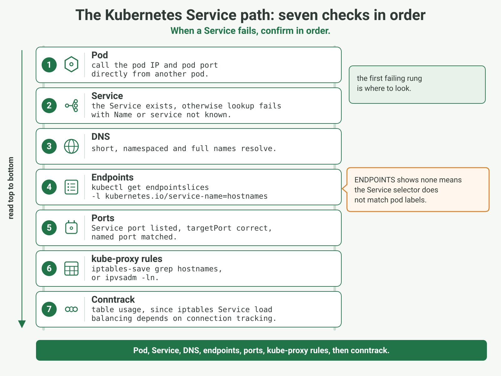

*Figure 20.6.13. A failing Kubernetes Service is checked in a fixed order, so the first failing rung shows where to look.*

Last story. A pod cannot reach a Service by name, or it can but the calls go nowhere. In Kubernetes there are more hops than on a plain host, so the half-split matters more. Each hop is a place where the request can be sent to the wrong address, dropped or rejected, and the error message seldom says which hop failed.

The Kubernetes debug guide gives an order that you can recite. First confirm that the pods themselves work, by calling a pod IP and the pod port directly from another pod. Then check that the Service exists, because without it the lookup fails with `Name or service not known`. Then check DNS with the short, namespaced and full names. Then check that the Service has endpoints. The guide's command is `kubectl get endpointslices -l kubernetes.io/service-name=hostnames`, and it says that if the ENDPOINTS column is `<none>` you should check that the Service's selector matches the pods' labels. Then check the ports. The guide asks whether the Service port is listed, whether the targetPort is correct for the pods, whether a numeric or a string value was meant, and whether a named port has a match.

Then you look at kube-proxy. In iptables mode, each Service port should have one rule in the KUBE-SERVICES chain and one KUBE-SVC chain, and each endpoint should have a KUBE-SEP chain. You see them with `iptables-save | grep hostnames`. In IPVS mode you use `ipvsadm -ln`. The kube-proxy log should include a line saying which proxier is in use. Chapter 5.10 of this handbook explains how the Service becomes those rules, and chapter 5.15 covers NetworkPolicy and the same netfilter machinery.

The script `net06_k8s_service_path.sh` runs the read-only part of this ladder with kubectl. It does not change anything. It was syntax checked but not run, because there is no cluster here.

A hint about how this meets conntrack. The Networking and Kubernetes book states that the Service load balancing by iptables depends on connection tracking. So an exhausted table shows up as Service flakiness even though the rules are right. A pod that works for some calls and fails for others may be a conntrack problem wearing a Service disguise. Also check whether the failing calls share a source node. Pods on one node share that node's table, so a pattern tied to a node points at the table rather than the Service.

The endpoint step is the one that surprises people most. A Service can exist, resolve and show a correct port, and still have zero endpoints, because its selector labels do not match the pods. The listing shows `<none>` in the ENDPOINTS column, and the fix is a label change, not a network change. Reading that column first saves a long detour through the rules.

When a Service fails, confirm in order: pod, Service, DNS, endpoints, ports, kube-proxy rules, and then conntrack.

## How to answer out loud

The five answers below are the ones to rehearse. Each one follows the same shape. You name the signal, you state the mechanism in a sentence, you give the test, and you name the trade-off. Practise them until the order feels natural, because the interviewer will judge your reasoning as much as the facts.

**Question 1: "A connect fails. Walk me through it."** Speak in this order. Ask for the exact error: refused, timeout or reset. Say what each means in one sentence. Pick the half-split test: from a host on the same network, can I connect to the port? Then run `ss -ltn` on the target to see whether anything listens and on which address. Name two follow-ups: a listener bound to 127.0.0.1 only, and a full accept queue. Expect to be asked how a full queue differs from a closed port. The answer is that a full queue can cause timeouts with SYN retransmits, while a closed port gives an immediate refusal.

**Question 2: "Users see slow connects at peak, CPU is fine."** Say that slow connect with seconds of delay is the signature of a dropped SYN retransmitted after the timer. State the two queues. Check Recv-Q against Send-Q on the listener, then the ListenOverflows counter, then why accept is slow. Name the trade-off of enlarging the backlog, which is more hidden waiting. Name the other trade-off, tcp_abort_on_overflow, which turns silent retries into fast refusals.

**Question 3: "Thousands of TIME_WAIT sockets. Is that a problem?"** Say no by itself. It is a safety state. It becomes a problem when one client opens connections to one destination faster than the ephemeral range divided by the hold time. State the calculation: ports in range divided by 60 seconds. Name the cure order: pool connections, then widen the range, then more destination addresses, and last the reuse setting with caution.

**Question 4: "Large responses hang, small ones are fine."** Say path MTU black hole. Explain that ICMP packet-too-big is the signal, that filtering it leaves the sender blind, and that an overlay takes 50 bytes. Show the arithmetic, 1,500 minus 50 is 1,450. Describe the test with the do-not-fragment ping at sizes around the suspected limit. Offer the fixes in your order of preference.

**Question 5: "The stream drops after about 60 seconds."** Say the constant time points to a timer. List the timers in the path: client, ingress proxy, cloud balancer, gateway, server. Say that Linux keepalive defaults start probing at 7200 seconds, which is too late. Propose application heartbeats below the shortest idle timeout with margin, and keepalive on the sockets as a second layer. Say you would confirm with a capture that shows a reset or silence at the failure time. Expect the follow-up "how do you know which device did it?" and answer with a capture on both sides of the suspect hop.

## Worked scenarios

Every scenario below is a short broken system with its script in code/part20. The scripts are safe: localhost only and read-only. The demos need no root. Every scenario ran in an Ubuntu 24.04 container on Linux kernel 6.18.37, and the outputs below are from there. Each one follows the same path: a problem, the reasoning that points at a cause, the commands that test it, and the answer.

### Scenario 1: the full accept queue

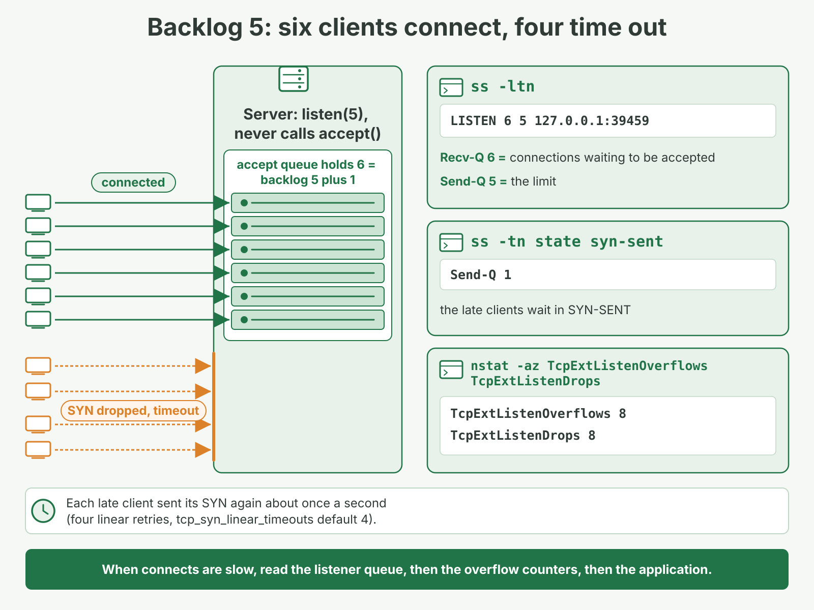

*Figure 20.6.14. Linux admits the backlog plus one connection and drops the SYNs of the rest, which the client retries about once a second.*

**Problem.** A gateway listens on port 8000. During bursts some clients wait seconds to connect and a few time out. CPU is low.

**Reasoning.** Slow connects with gaps of seconds suggest SYN retransmits. Retransmits suggest the listener's queue is full, because SYNs are dropped when the backlog is full. So look at the queue, not the network. The low CPU is a hint too. A server that is not busy but is not accepting has a slow accept loop, not a slow processor.

**Commands.** On a Linux host you run `ss -ltn` and read the listener row. A row like `LISTEN 129 128 0.0.0.0:8000` means the queue is over its limit of 128. Then `nstat -az TcpExtListenOverflows TcpExtListenDrops` shows whether the kernel counted drops. The snapshot script `net06_linux_net_snapshot.sh` collects these. Here is the real result of the demo below with backlog 5 and ten clients, sampled while the server held the queue full.

```text
$ python3 net06_accept_queue_demo.py 5 10 4
backlog=5 results=['connected', 'connected', 'connected', 'connected', 'connected', 'connected', 'timeout', 'timeout', 'timeout', 'timeout']
$ ss -ltn          (from a second shell, during the hold)
State  Recv-Q Send-Q Local Address:Port  Peer Address:PortProcess
LISTEN 6      5          127.0.0.1:39459      0.0.0.0:*
$ ss -tn state syn-sent
Recv-Q Send-Q Local Address:Port  Peer Address:Port Process
0      1          127.0.0.1:54448    127.0.0.1:39459
$ nstat -az TcpExtListenOverflows TcpExtListenDrops
TcpExtListenOverflows           8                  0.0
TcpExtListenDrops               8                  0.0
```

Backlog 5 let six connections in, so the rule is the limit plus one. The listener row reads 6 and 5, the four late clients sit in SYN-SENT, and both counters rose. Each late client sent its SYN again about once a second. In a separate run, a `listen(1)` socket was held full and let `nc -w 5` try to connect. A loopback capture showed the SYN from one source port repeating at intervals of 1.02 seconds, four more times, and `nstat` counted four `TcpExtTCPSynRetrans`. That is not the doubling you may remember. The kernel documentation for `tcp_syn_linear_timeouts`, default 4 on this kernel, says the first four retries use a linear one second timeout, and doubling starts after that.

The demo reproduces the effect in Python.

```python
# code/part20/net06_accept_queue_demo.py
#!/usr/bin/env python3
"""Accept-queue overflow demo. Localhost only, no root, finishes in seconds.
A server calls listen(backlog) but never calls accept(). Clients then connect.
Linux: the first backlog+1 connects succeed, the rest time out (SYN dropped).
Other kernels differ (macOS did not enforce a tiny backlog), so the demo
prints what it saw. An optional third argument holds the sockets open for
that many seconds, so you can run ss -ltn and nstat from a second shell."""
import socket, sys, time

def classify(port, timeout):
    c = socket.socket()
    c.settimeout(timeout)
    try:
        c.connect(("127.0.0.1", port))
        return c, "connected"
    except socket.timeout:
        c.close()
        return None, "timeout"
    except ConnectionRefusedError:
        c.close()
        return None, "refused"
    except ConnectionResetError:
        c.close()
        return None, "reset"

def run(backlog=1, clients=6, timeout=1.0, hold=0.0):
    srv = socket.socket()
    srv.bind(("127.0.0.1", 0))
    srv.listen(backlog)          # never accept(): queue fills and stays full
    port = srv.getsockname()[1]
    held, results = [], []
    for i in range(clients):
        sock, outcome = classify(port, timeout)
        results.append(outcome)
        if sock:
            held.append(sock)
    time.sleep(hold)
    for s in held:
        s.close()
    srv.close()
    return results

if __name__ == "__main__":
    backlog = int(sys.argv[1]) if len(sys.argv) > 1 else 1
    clients = int(sys.argv[2]) if len(sys.argv) > 2 else 6
    hold = float(sys.argv[3]) if len(sys.argv) > 3 else 0.0
    res = run(backlog, clients, hold=hold)
    print(f"backlog={backlog} results={res}")
    print("connected:", res.count("connected"), "timeout:", res.count("timeout"),
          "refused:", res.count("refused"), "reset:", res.count("reset"))
```

**What we ran.** On Linux with backlog 1 and six clients, the run printed `connected: 2 timeout: 4`. With backlog 5 and six clients it printed `connected: 6`, as in the capture above. So Linux admits the backlog plus one and times out the rest. An earlier run of this demo on a Mac printed `connected: 6` for backlog 1, and once a connection reset. So macOS does not enforce a tiny backlog the way Linux does. Do not present the Mac result as Linux behavior.

**Answer.** The accept loop is too slow, so the queue overflows. Find out why accept is slow, then size the queue for bursts, and decide whether fast refusal with tcp_abort_on_overflow suits your clients.

### Scenario 2: ports run out

**Problem.** A service calls one API at a high rate. After a few minutes calls fail. `ss -tan` shows tens of thousands of TIME-WAIT rows to one address and port.

**Reasoning.** All those rows share a destination, so only the source port varies. The budget is the range size divided by the hold time. If the call rate is above that budget, the ports run out no matter how fast the server is, and the fix lives in the client.

**Commands.** `ss -tan | awk 'NR>1 {c[$1]++} END {for (s in c) print s, c[s]}'` gives counts by state. Then `sysctl net.ipv4.ip_local_port_range` reads the range. The parser in section 3 gives counts, and its port budget function gives the rate: 55,296 ports over 60 seconds is about 922 connects per second for the Netflix range. Both the counting and the budget function were tested with pytest, and the parser was run on real `ss -tan` output in the container, where it counted the states and named the full listener. The default range on this kernel, read with `sysctl`, is 32768 to 60999. That is 28,232 ports, so about 470 connects per second over 60 seconds. The Netflix range gives the larger 922. Read the range on your own host before you quote a number.

**Answer.** If the call rate is above the budget, the client must reuse connections. Pooling with keep-alive removes the problem. Widening the range raises the budget a little. Several destination addresses multiply it.

### Scenario 3: conntrack is full

**Problem.** On one node, new connections to Services fail while established ones work. Pods are healthy.

**Reasoning.** New flows need a table slot, and old flows already have theirs. That pattern matches a full table. The healthy pods rule out the application, and the working old flows rule out the network path, so the table is the remaining suspect.

**Commands.** On the node, read the two sysctl values and pipe them to the checker.

```bash
sysctl net.netfilter.nf_conntrack_count net.netfilter.nf_conntrack_max | python3 net06_conntrack_check.py
```

The full case prints a line such as `100.0% FULL: no space left, new connections cannot be made`, with exit code 2. Feeding the checker a sample of equal count and max prints that line. On the real container values it printed `0.0% ok`. The sysctl commands ran, and their output is shown in section 6.

**Answer.** Confirm usage, find which clients create the flows, cut short-lived flows by reuse, and raise the maximum with an eye on memory. Remember the established timeout default of five days when you look for stale entries.

### Scenario 4: the slow external call in a pod

**Problem.** A pod in namespace ml calls api.example.com. Calls are slow, and CoreDNS shows a high query rate.

**Reasoning.** The name has two dots and ndots is 5. So the resolver tries three suffixed names first. Each of those misses costs a query, and the real name comes last. The slowness is in the lookups, not in the API.

**Commands.** Inside the pod, `cat /etc/resolv.conf` shows the search list and ndots. Then pipe a copy to the script:

```bash
printf 'search ml.svc.cluster.local svc.cluster.local cluster.local\noptions ndots:5\n' | python3 net06_resolv_ndots.py api.example.com
```

Run in the Linux container, it printed the three suffixed names and then `api.example.com`. The container's own `/etc/resolv.conf` came from Docker and has no search list or ndots line, so the sample stands in for a pod. The test suite checks that the cost is eight queries for the unsuffixed hit and two with a trailing dot.

**Answer.** Use the fully qualified name with a trailing dot in configuration, or set a lower ndots in the pod's dnsConfig, or add NodeLocal DNSCache. Do not start by scaling CoreDNS, because that treats the symptom.

### Scenario 5: large responses hang over an overlay

**Problem.** Pod to pod requests under a kilobyte work. A response of a few hundred kilobytes stalls. A capture on the sender shows full-size data packets repeated with growing gaps.

**Reasoning.** Handshakes use small packets, so they pass. Full packets of 1,500 bytes exceed a VXLAN tunnel path whose pod MTU should be 1,450. The growing gaps say the sender is retrying, and the retries are not getting through, so the failure is the size, not the rate.

**Commands.** `ip link show` on the pod interface shows its mtu. Then the capture reader finds repeats:

```bash
tcpdump -nn -r capture.pcap | python3 net06_tcpdump_reader.py
```

The reader was run on a real `tcpdump -nn` capture taken on loopback during the accept queue demo. It printed `retransmits: []`, because those were SYN retries and the reader looks for repeated data segments. It listed the three SYNs that never got an answer under `unanswered SYN`. The data retransmit case was tested only on fixture text. The MTU math script prints the sizes to test: 1,450 gives a TCP payload of 1,410 and a ping payload of 1,422.

**Answer.** Set the pod and tunnel MTU to the underlay MTU minus 50, or use a jumbo underlay, or clamp the maximum segment size. Check that ICMP packet-too-big can pass.

### Scenario 6: the stream that dies at one minute

**Problem.** Streaming completions stop after roughly the same time for some clients. Server logs show no error.

**Reasoning.** A constant time implies a timer. A silent stage, such as waiting for the first token, can exceed a middlebox's idle timeout. The server logs are clean because the server never saw anything wrong. The middlebox forgot the flow, and only the next write revealed it.

**Commands.** Run the demo.

```bash
python3 code/part20/net06_idle_reset_demo.py
```

The silent client ended with `BrokenPipeError` after the middlebox logged an idle timeout. The heartbeat client reported `still alive`. A capture with `tcpdump -i lo -nn` shows something the code comment does not say. The demo's middlebox closes politely, so the capture shows a FIN from the server, then the client's ACK. Silence follows. The client's next write, 0.6 seconds later, is answered with `Flags [R]`, a reset, from the server. So the reset appears only when the client speaks again.

```text
20:52:02.458899 IP 127.0.0.1.33653 > 127.0.0.1.56856: Flags [F.], seq 1, ack 1, ...
20:52:02.460148 IP 127.0.0.1.56856 > 127.0.0.1.33653: Flags [.], ack 2, ...
20:52:03.058692 IP 127.0.0.1.56856 > 127.0.0.1.33653: Flags [P.], seq 1:6, ack 2, ..., length 5
20:52:03.058700 IP 127.0.0.1.33653 > 127.0.0.1.56856: Flags [R], seq 1744103780, win 0, length 0
```

A real middlebox that silently drops its state sends nothing at the idle moment and the same reset when the next packet arrives. That is why a client sees the failure only at its next write. On the real path you would find the timer with captures on both sides of each suspect device and note which side sends the first reset.

**Answer.** Heartbeats below the lowest idle timeout, keepalive on the sockets as a second layer, and a check that no hard total-duration limit applies. Add an alert on streams that end without a finish reason, tying this to the latency work in chapter 20.19.

## Hands-on lab

The lab needs a Linux VM or a container with iproute2, and a second shell. You are reproducing each failure on a machine you control, so you can see the same signal the interviewer would expect you to find. It ran in a disposable container: image `ubuntu:24.04`, Ubuntu 24.04.5, kernel `6.18.37-0-virt` aarch64 from the Rancher Desktop VM, started with `docker run --rm --cap-add NET_ADMIN`, with `code/part20` mounted read-only. `NET_ADMIN` was added for the dummy interface, the iptables rule and `conntrack`. Nothing else was privileged. Packages came from apt: iproute2, tcpdump, conntrack, iputils-ping, procps, dnsutils, openssl, netcat-openbsd.

The steps below were run in that container and on a Mac, and they are not run on a live cluster. Treat each result as what this environment printed.

1. Run the tests. In the repository root, run `python3 -m pytest -q code/part20/test_net06_*.py`. Expected: 19 passed. Ran: yes, on the Mac and in the Linux container.
2. Run the code checker with `python3 tools/check_code_files.py code/part20`. Expected: no problems for the files of this chapter. Ran: yes.
3. Run the idle demo as in scenario 6. Expected: the silent client fails and the heartbeat client lives. Ran: yes, on macOS and Linux.
4. Run the accept queue demo with a few different backlog values on a Linux VM. Expected on Linux: connected count is backlog plus one, the rest time out. Ran: yes, backlog 1 gave 2 connected and 4 timeouts. On macOS it printed six connections each time.
5. On the VM run `bash code/part20/net06_linux_net_snapshot.sh` as a normal user. Expected: socket summary, listener rows, state counts, sysctl values, and counters. Ran: yes, all sections printed. The conntrack count was 0 and the max 262144. In a container the `ss -s` totals are small.
6. On the VM, start a listener with `python3 -m http.server 8000`, then run `ss -ltn` and find the row for port 8000. Expected: a LISTEN row. Ran: yes, a Python `http.server` showed `LISTEN 0 5`, an idle queue with the Python default limit of 5. The demo in scenario 1 showed the full case.
7. In a pod, print `/etc/resolv.conf` and feed it to the ndots script with a name of your choice. Expected: the candidate list in order. Ran: the script yes, with a sample file; the pod step no.
8. If you have a cluster, run `bash code/part20/net06_k8s_service_path.sh NAMESPACE SERVICE`. Expected: the ladder of outputs. Ran: syntax check only.

## Drill questions

Answer these without notes, then open the answers. Say each answer aloud first, as you would in the room, and only then check it.

<details><summary>1. What does connection refused mean, and what does it not mean?</summary>

It means a host answered the first packet and rejected it, normally because nothing listens on that port. It does not mean the path is broken. The host is up and reachable, and the problem is the service or its bind address.

</details>

<details><summary>2. What does a connect timeout tell you, and how long does Linux try by default?</summary>

Nobody answered, so a packet or its reply was dropped, or a queue was full. With the default of 6 SYN retries, the tcp man page puts the total at about 127 seconds.

</details>

<details><summary>3. On a LISTEN socket in ss, what do Recv-Q and Send-Q show, and when is it a problem?</summary>

On Linux, Recv-Q is the number of connections waiting to be accepted and Send-Q is the limit. It is a problem when Recv-Q reaches Send-Q, since new connections are then dropped. On the tested kernel a full listener read one above the limit, `LISTEN 6 5`. The kernel source for ss fills these two numbers from the accept queue length and its limit.

</details>

<details><summary>4. Name the two queues for incoming connections and the settings that cap them.</summary>

The SYN backlog holds half-open connections and is capped by tcp_max_syn_backlog. The accept queue holds established connections awaiting accept, and it is capped by the listen backlog argument and net.core.somaxconn. Since Linux 5.4 the somaxconn default is 4096, before that 128.

</details>

<details><summary>5. Many CLOSE-WAIT sockets. Who is at fault?</summary>

Your own application. The peer has closed, and the program has not called close on its side. Look for leaked connections or unclosed response bodies.

</details>

<details><summary>6. How fast can a client open new connections to one server address and port before TIME_WAIT exhausts its ports?</summary>

The number of ports in the ephemeral range divided by the TIME_WAIT hold time. With 65,536 ports and 60 seconds, about 1,092 per second. With the range 10240 to 65535, about 922 per second.

</details>

<details><summary>7. A pod's resolv.conf has ndots 5. How many queries does api.example.com cost with three search domains, and how do you cut it?</summary>

It tries the three suffixed names first, then the real name. That is four candidates, and with A and AAAA queries, eight. Cut it with a trailing dot, a lower ndots in dnsConfig, or a node-local DNS cache.

</details>

<details><summary>8. Small requests work and large responses hang. What is your first suspect and your test?</summary>

A path MTU black hole, where ICMP packet-too-big is filtered or an overlay lowered the real MTU. Test with a do-not-fragment ping at sizes near the limit, such as a payload of 1,472 for a 1,500 MTU.

</details>

<details><summary>9. Why does a default Linux keepalive not protect a streaming connection from a balancer idle timeout?</summary>

The default time before the first probe is 7200 seconds, and probes need SO_KEEPALIVE. A balancer idle timeout is much shorter. You need application heartbeats or short keepalive settings below the shortest idle timeout on the path.

</details>

<details><summary>10. A Service has no response. List your checks in order.</summary>

Pods work when called by pod IP and port. Service exists. DNS resolves the short and full names. Endpoint slices list endpoints. Ports and targetPort are right. Kube-proxy rules exist, in iptables or IPVS. Then conntrack usage and network policy.

</details>

## Common mistakes and weak answers

- Saying "the network is down" without asking which error occurred. Say what refused, timeout and reset each mean, then pick a test. The error text is free evidence, and skipping it wastes the first minute.
- Running tcpdump on a busy host without a filter. Say that capture costs CPU and storage and can drop packets, so you filter in the kernel and capture briefly.
- Raising somaxconn as the only fix for slow connects. Say you would find why accept is slow, since a deeper queue only hides it.
- Calling TIME_WAIT a fault. Say it is a safety state and show the port arithmetic.
- Changing sysctls on a live host to see what happens. Say you would read first, and change one setting with a rollback plan and a reason from evidence.
- Quoting a vendor's idle timeout from memory. Say you would look up the documented value for each device on the path.
- Blaming CoreDNS capacity for slow lookups before counting the queries per call.
- Claiming Nebius uses a particular balancer or setting. Nebius has not published this. Say what you would check.

## Connections to the rest of the handbook

- c02-06 TCP in depth: handshake, windows, retransmission.
- c02-07 UDP, ICMP and the diagnostic tools: ping, traceroute, mtr.
- c02-08 DNS in depth: resolution and caching.
- c02-10 HTTP, TLS and PKI basics.
- c02-20 Load balancing: L4, L7, ECMP and proxies.
- c02-22, c02-23, c02-24 Linux networking: ss, netfilter and conntrack, MTU and tuning.
- c02-26 Packet capture from scratch.
- c02-30 Network troubleshooting method and case studies.
- c05-10 Services, endpoints and kube-proxy.
- c05-11 DNS and service discovery with CoreDNS.
- c05-15 NetworkPolicy and the kernel.
- c05-25 Troubleshooting Kubernetes from the node.
- c20-03 Triage method for a sick Linux box, c20-18 How LLM serving fails, c20-21 Routing and retries, c20-23 Kubernetes failure drills.

## Sources and review notes

Books, read in the local corpus on 2026-11-09:
- Systems Performance, 2nd edition, Chapter 10 Network: TCP states and timers, TIME_WAIT and port exhaustion, connection backlog queues, ss, nstat, tcpdump, tcpretrans, sysctl examples, MTU and ICMP discussion.
- How Linux Works, 3rd edition, Chapter 9 Understanding Your Network and Its Configuration: ping sizes, resolver files, search line, systemd-resolved, ports and netstat.
- Computer Networking Problems and Solutions, Chapter 24 Troubleshooting (half split) and Chapter 5 Higher Layer Data Transports (Path MTU Discovery, ICMP).
- Networking and Kubernetes, Chapter 2 Linux Networking (Conntrack), Chapter 4 Kubernetes Networking Introduction (CoreDNS, Autopath, DNS limits), Chapter 5 (endpoints, kube-proxy).

Upstream documentation fetched on 2026-11-09, current pages at that date with no version pin except where the man page states one:
- https://man7.org/linux/man-pages/man2/listen.2.html (backlog, somaxconn default of 4096 since Linux 5.4)
- https://man7.org/linux/man-pages/man7/tcp.7.html (keepalive, SYN backlog, syncookies, tcp_abort_on_overflow, tcp_tw_reuse, fin timeout, syn retries, retries2)
- https://man7.org/linux/man-pages/man8/ss.8.html (state names, timer option)
- https://man7.org/linux/man-pages/man7/socket.7.html (SO_KEEPALIVE, SO_LINGER, SO_REUSEADDR)
- https://www.kernel.org/doc/html/latest/networking/nf_conntrack-sysctl.html (conntrack max, count, buckets, established timeout)
- https://raw.githubusercontent.com/torvalds/linux/master/net/ipv4/tcp_diag.c (listener Recv-Q is sk_ack_backlog, Send-Q is sk_max_ack_backlog)
- https://docs.kernel.org/networking/ip-sysctl.html (tcp_syn_linear_timeouts, default 4)
- https://docs.kernel.org/networking/snmp_counter.html (ListenOverflows, ListenDrops, TCPSynRetrans)
- https://kubernetes.io/docs/concepts/services-networking/dns-pod-service/ (resolv.conf example with ndots 5)
- https://kubernetes.io/docs/tasks/debug/debug-application/debug-service/ (Service debugging ladder, EndpointSlices, kube-proxy checks)

Explicitly labelled inferences:
- The Recv-Q and Send-Q meaning on LISTEN sockets is now sourced. The ss manual page does not define it, but `net/ipv4/tcp_diag.c` in the kernel source does, and a live run matched it.
- That an idle-timeout device is usually a cloud balancer or NAT, and not Linux conntrack, follows from the five-day conntrack default. It is reasoning, not a measurement of any platform.
- The advice to prefer application heartbeats over TCP keepalive for HTTP streaming is reasoning from how proxies treat flows.
- Nebius has not published its balancer, router or timeout settings. Every design remark about them is a reasonable design, not a fact.

Not verified:
- Linux commands ran in an Ubuntu 24.04 container (`ubuntu:24.04`, Ubuntu 24.04.5, kernel 6.18.37-0-virt aarch64, OpenSSL 3.0.13, iproute2 6.1.0, conntrack 1.4.8) with `--cap-add NET_ADMIN`. That kernel is the Rancher Desktop VM kernel, so numbers such as the port range are that kernel's, not Nebius's.
- A full conntrack table was not reproduced, because the container could not lower `nf_conntrack_max`.
- The idle-reset demo ran on loopback with a polite close. A real balancer or NAT that drops state silently was not tested.
- `net06_k8s_service_path.sh` needs kubectl and a cluster, so it only passed `bash -n`.
- The ndots step used a sample resolv.conf, not a pod.
- The port range on this kernel is 32768 to 60999. The default is a kernel and distribution setting, so check it on the target.
- The fixture lines in the tests are partly taken from book output and partly synthetic, as the comments in the test files say.
- No balancer idle timeout number from any vendor is claimed.
