# 20.7 The console round: text tools, systemd and everyday operations

## What the interviewer is testing

The interviewer pastes a 5xx log into a shell and says: "Which client is hammering us, and when did it start? You have five minutes." Picture that moment. The clock is running, the file has far more lines than anyone wants to read by eye, and nobody on the call wants a lecture on regular expressions. This chapter serves the Linux console round. Nebius describes the first technical round as including "practical tasks in the Linux console", and says that standard console tools and utilities are assessed. The job posting also asks for experience with Linux and Unix, service management and networks.

One candidate reported a one-hour Linux troubleshooting stage done through the command line. That is one report, and it tells you about the format and not about the content. Nebius has not published its tasks, so nobody outside the company can say which commands will appear. What you can train is the skill that every such task needs. You turn a messy text file into a number you can defend, quickly, with no script editor to hide behind. You also say out loud why each step of the pipeline is right, because the interviewer grades the reasoning as much as the answer.

Chapters 20.3 to 20.6 already cover triage method, files and descriptors, CPU, memory and disk, and networking. This chapter does not repeat their scenarios. Think of those chapters as the map of the machine, and this one as the everyday toolkit you carry while you walk it. It adds text pipelines, journald and systemd, signals, cron, user and disk chores, transfer one-liners and safe bash. If a tool name here feels new, the basics live in the Part 1 chapters on [text processing](../part-01-linux/04-text-processing-essentials-grep-sed-awk-find-xargs-sort.md), [processes and signals](../part-01-linux/08-processes-signals-and-job-control.md), [shell scripting](../part-01-linux/09-shell-scripting-that-survives-production.md) and [systemd](../part-01-linux/15-systemd-units-targets-timers-journald.md). Read those first when the commands are unfamiliar.

A realistic question in the interviewer's voice: "Here is an access log from our gateway. Give me the top five clients, the slowest request, the minute with the most 5xx, and the p95 latency. Then tell me which of those numbers you trust and why."

## The core ideas

### 1. Build every pipeline in four moves

A log is open in front of you and the clock is running. The temptation is to write one clever command that does everything at once. Resist it. A long pipeline that fails halfway gives you no clue where the fault is. A short pipeline that you checked at each step gives you an answer you can defend. So build the answer in four moves, and look at the output after each one before you add the next.

Start with the look. `head -3` shows you the first lines, so you learn the format before you trust it, and `wc -l` tells you how much data you are dealing with. Next comes the narrow step. Keep only the lines that matter, using `grep` or an `awk` condition. Then extract, which means reducing each line to the one field you need. The last move is rank. Sort, count the equal lines, then use `sort -rn` on the counts and cut to the top few.

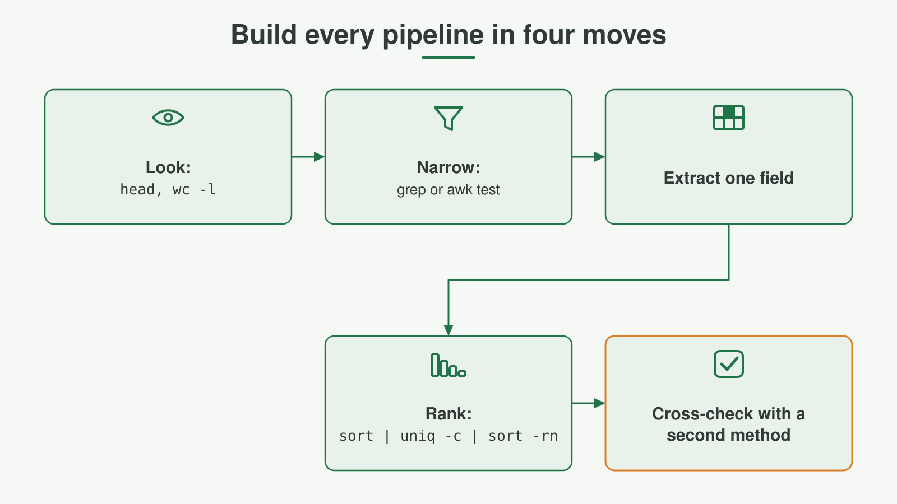

*Figure 20.7.1. Build every pipeline in four moves, as a diagram.*

The fifth box in the diagram, the cross-check, is the step most candidates skip. Count the same thing a second way, for example with an `awk` array, and compare the two results. If the numbers differ, one of the pipelines is wrong. You found that out yourself, before the interviewer did, and that is exactly the habit they want to see. **Never report a number you have produced only one way.**

A cross-check does not have to be fancy. If your first pipeline used `sort` and `uniq -c`, the second can use an `awk` array that adds up the counts in memory, with no sorting at all. Both should agree. When they do, you have two independent routes to the same answer, and the interviewer can see that you did not trust the first one blindly.

Decide: before you type the first pipe, say which field you need and how many lines you expect. Saying the expectation out loud gives you something to check the output against. If the top count comes back far larger than you guessed, stop and look again before you go on.

### 2. The traps inside field splitting

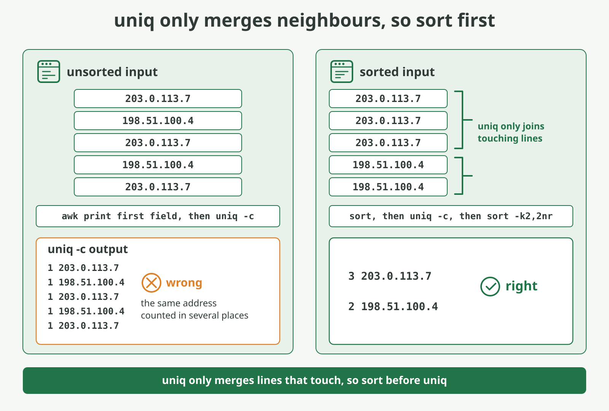

*Figure 20.7.2. uniq only collapses neighbouring equal lines, so the input has to be sorted before uniq -c gives a true count.*

Picture a colleague who gets a different count from you on the same log, and both of you are sure of your own number. Usually one of you split the fields wrong. Most wrong answers come from three mistakes. The first is counting fields from the left when the line has a variable number of words. In an access log the user-agent contains spaces, so the last field is the only stable one when you count from the right. That is why the request time is read with `$NF`.

Here is why the field count matters so much. Two lines can look alike to a human, yet differ by one word in the user-agent. Counting from the left, the request time lands in a different column on each line, and your pipeline quietly reads the wrong value. Counting from the right has no such problem, because the user-agent sits in the middle and never changes the position of the last field.

The second mistake is `uniq`. It collapses only neighbouring equal lines, so it must come after `sort`, which puts equal lines next to each other. The third mistake is sorting numbers as text. A text sort puts `9.5` above `61.004`, because the character 9 is greater than 6. Always write `sort -n` or `-rn` for numbers, and add a second sort key so ties come out in the same order every time.

Here is a trap that catches people who write careful scripts. You end a pipeline with `head`, the output looks right, and then the script fails with a status you did not expect. One more habit pays off under pipefail. When a pipeline ends in `head`, `head` closes its input early, and the earlier command can die with signal 13, which shows up as exit status 141. Running this with `set -o pipefail` on the Mac and in the Linux container gives the same output:

```text
$ bash -c 'set -o pipefail; yes | head -1 >/dev/null; echo st=$?'
st=141
```

The solutions below end with `awk 'NR<=5'` instead of `head -5` for this reason. The awk filter reads all of its input and ignores what it does not want. Nothing upstream receives a closed pipe, so nothing upstream dies with signal 13. You will see this choice in every solution in the chapter, so it is worth understanding once.

Decide: use `$NF` when the tail is stable, a regular expression when the middle moves, and `sort | uniq -c` only as a pair. Each rule answers a different shape of line. Say which shape you are looking at before you choose the tool.

### 3. The Mac is not the interview box

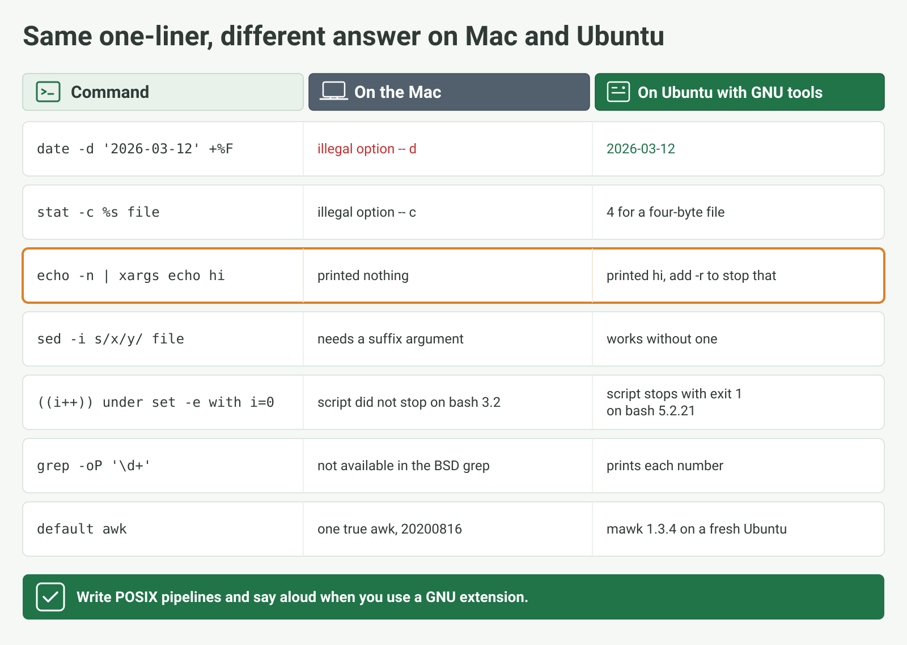

*Figure 20.7.3. Commands that behave differently on a Mac and on Ubuntu with GNU tools, so a one-liner that works on a laptop can fail on the interview box.*

Your laptop runs BSD tools, and the interview shell is almost certainly GNU Linux. That gap is a real trap. Suppose you wrote a helpful one-liner on your Mac, and it worked, and then the same line failed on a server. Everything in this chapter ran twice for that reason. The first run was on macOS with `awk version 20200816`, `bash 3.2.57` and `openrsync`. The second was in a throwaway Ubuntu 24.04 container, image `ubuntu:24.04` (Ubuntu 24.04.5 LTS), kernel `6.18.37-0-virt` on aarch64, with GNU bash 5.2.21, GNU awk 5.2.1, GNU sed 4.9, GNU grep 3.11, GNU tar 1.35, GNU findutils 4.9.0, GNU coreutils sort 9.4, rsync 3.2.7, curl 8.5.0 and jq 1.7.

The code folder was mounted read-only, and the container got no extra privileges. All twelve solutions printed byte-identical output on both systems, and the 17 tests passed on both. The differences in the table below are the ones that did show up. Read the table as a list of traps, because each row is a command that behaves differently in the two worlds.

This matters for the interview because the box you are given is not your laptop. A one-liner that prints a clean answer on your Mac can print an error on a Linux server, and you will not know why unless you have seen the difference before. The table below is a short list of the differences that caught us, and it is worth reading once before the round.

| Command | On the Mac | On Ubuntu with GNU tools |
|---|---|---|
| `date -d '2026-03-12' +%F` | `illegal option -- d` | `2026-03-12` |
| `stat -c %s file` | `illegal option -- c` | `4` for a four-byte file. The BSD form is `stat -f`. |
| `echo -n \| xargs echo hi` | printed nothing | printed `hi`. GNU `xargs` runs the command once on empty input. Add `-r` to stop that. |
| `uniq -c` | counts are padded with spaces | padded too, to width 7 on the left. Normalise with `awk '{print $2, $1}'`. |
| `sed -i s/x/y/ file` | needs a suffix argument, for example `sed -i ''` | works without one. A script that uses `sed -i ''` breaks on GNU. |
| `((i++))` under `set -e` with `i=0` | script did not stop on bash 3.2 | script stops with exit 1 on bash 5.2.21. |
| `grep -oP '\d+'` | not available in the BSD grep | prints each number. This is a GNU extension. |
| default `awk` | one true awk, 20200816 | gawk when installed. A fresh Ubuntu has **mawk** 1.3.4 as awk. |

The last row matters more than it looks. On a bare Ubuntu image, the command `awk` may be mawk and not gawk, so the same script can behave differently on a fresh box. The eleven file-argument solutions and the tests were run again with mawk selected, and every output was identical. The pipelines avoid gawk-only features such as `asort`, `gensub` and `strftime`. If you reach for one, say so aloud, because the interviewer may be running a different awk from yours.

The `xargs` and `((i++))` rows are the ones that break scripts silently, and silent failures are the worst kind. The first row runs a command you did not expect, because GNU `xargs` runs it once even when the input is empty. The second stops a script that seemed to work on a Mac, and it stops it at a line you may not expect.

Decide: write pipelines with only POSIX features, and say out loud when you use a GNU extension. POSIX is the common core that Unix-like systems promise to provide. Staying inside it means your pipeline runs on the interview box, whatever that box turns out to be.

### 4. Percentiles by hand

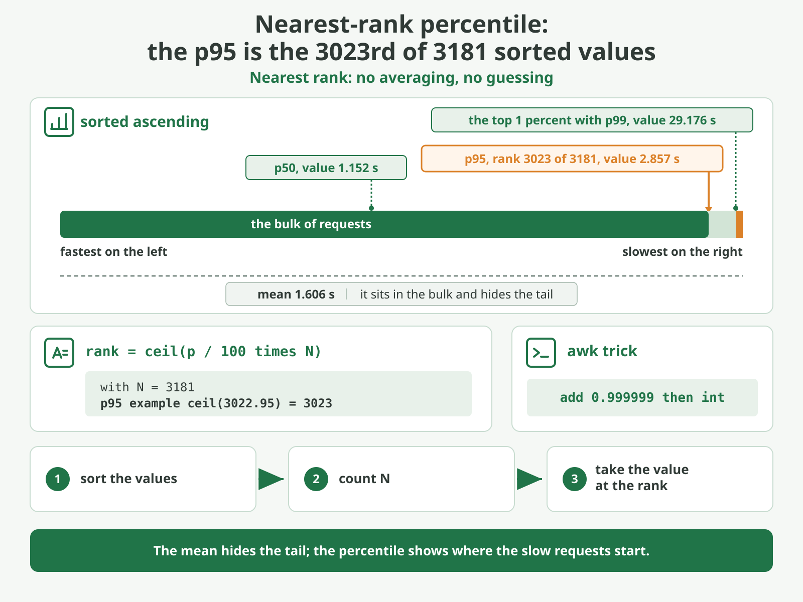

*Figure 20.7.4. A nearest-rank percentile reads one sorted position, so it shows the slow tail that a mean would hide.*

Your team lead asks for the typical request time at the gateway, and you have a file and a few minutes. The easy answer is the average, and the average is the trap. Systems Performance, chapter 2, names latency as an average or a percentile, and an average hides the worst users. In the fixture the mean request time is 1.606 seconds, which looks fine, while the 99th percentile is 29.176 seconds. The 504 timeouts at around 30 seconds live in the tail, and only a percentile shows them.

The nearest-rank method is easy to do by hand, in a shell or on paper. Sort the values from smallest to largest, then count how many there are, which is N. For percentile p, take the value at position ceil(p/100 × N). In words, multiply p by N, divide by 100, and round up. That rounded-up number is the position you want. With 3181 lines, p95 sits at position 3023.

```text
rank = ceil(p / 100 * N)        # p95, N=3181 -> ceil(3022.95) = 3023
```

That tells you the p95 is simply the 3023rd smallest value. Nothing is averaged and nothing is guessed. `awk` has no ceil function, so the trick is to add 0.999999 and take `int()`, which gives the same result as ceil for these inputs. Say plainly that other methods interpolate between neighbours and can give slightly different numbers. For a log this size the difference is small. A good candidate still names the method, because the interviewer may ask which one you used.

Picture a small list of response times sorted from fastest to slowest. Most values sit near the bottom, and only a few sit at the top. The p95 is the point where you have passed nearly all of the list. The few slow requests above it do not move the p95 much, but they do move the mean a lot, which is why the two numbers can tell very different stories about the same file.

Decide: when asked for p99, ask which window and which requests to include, then state the method you used. A p99 over the last five minutes and a p99 over the whole day answer different questions, so the window is part of the answer.

### 5. Reading journald and systemd units

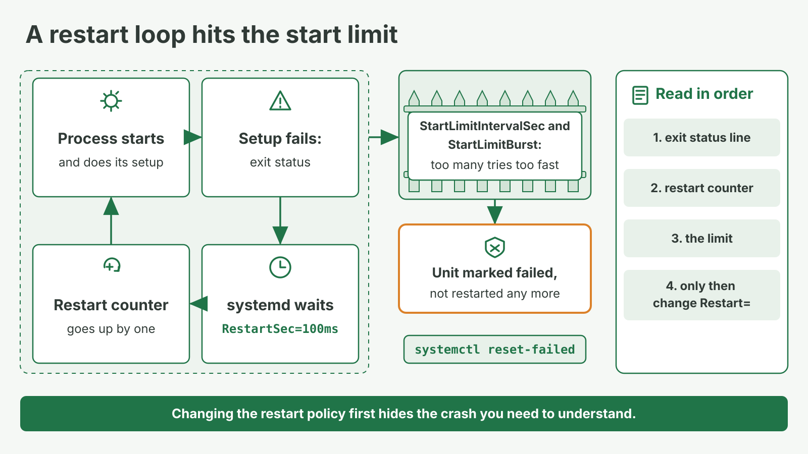

*Figure 20.7.5. A restart loop that crosses the start limit marks the unit as failed, so read the exit status and counter before changing the restart policy.*

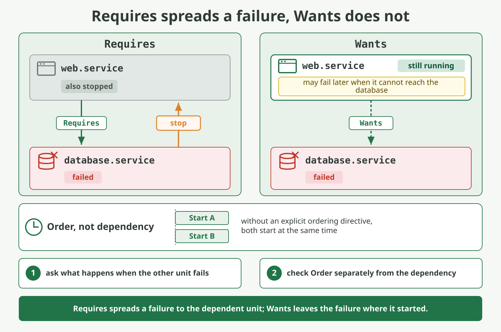

*Figure 20.7.6. Requires makes a dependent unit stop when its dependency fails, while Wants only asks for activation and leaves the failure where it started.*

A service keeps dying, and the on-call engineer says "check the logs" before you have finished reading the page. On a systemd machine the first stop is the journal, not a plain text file in the log folder. How Linux Works, chapter 7, explains the flags you need, and the table below lists the ones you will use most.

The idea behind `journalctl -u` is simple. The journal stores every message with fields attached, such as the unit that wrote it and the process ID. The unit flag is a filter on one of those fields. So when a service misbehaves, you ask the journal for only its messages, in time order, and you read the last few lines before the first error.

| You want | Command |
|---|---|
| One unit | `journalctl -u cron.service` |
| Last four hours | `journalctl -S -4h` |
| Follow live | `journalctl -f` |
| Errors and worse | `journalctl -p 3` |
| This boot, or the previous | `journalctl -b`, `journalctl -b -1` |
| Kernel messages only | `journalctl -k` |
| One process | `journalctl _PID=8792` |
| Regex match | `journalctl -g 'kernel.*memory'` |

The same chapter warns that `-g` needs a build of `journalctl` with a particular library, so some distributions lack it. It also notes that you need root, or membership of the `adm` or `systemd-journal` group, to read everything. `tail -f` does not work, because the journal is not a plain text file. This is a common surprise. People type the habit they already have, `tail -f`, and get nothing useful back. Use `journalctl -f` for the live view instead.

Then look at the unit itself. Picture a unit as a small contract: what runs, what it needs, and in what order. `systemctl status sshd.service` shows state, the main process and the last log lines. Dependencies matter. `Requires` is strict, so if the dependency fails, systemd stops the dependent unit too. `Wants` only asks for activation and does not care if the dependency fails. Think of a web server that needs a database. With `Requires`, a broken database takes the web server down with it. With `Wants`, the web server starts and may fail later when it cannot reach the database. Order is separate again. Without an explicit ordering directive, units that depend on each other start at the same time.

A quick way to remember the dependency words is to ask what happens when the other unit fails. With `Requires`, a failure spreads to the dependent unit. With `Wants`, the failure stays where it started. Order answers a different question, which is when things start, and it does not decide whether they start at all.

Restart behaviour is where flapping services come from. A flapping service starts, crashes, restarts and crashes again, over and over. The dashboard looks busy, and nothing works. The systemd.service page, which the page header reported as version 262, lists the values that `Restart=` can take: `no`, `on-success`, `on-failure`, `on-abnormal`, `on-watchdog`, `on-abort` and `always`. The default is `no`. It says `RestartSec=` defaults to 100ms. A service that fails instantly and restarts every 100 ms hits the start rate limit, which is set by `StartLimitIntervalSec=` and `StartLimitBurst=`, and whose defaults come from the manager configuration. The systemd.unit page says `systemctl reset-failed` flushes the restart counter, and that a unit past its limit is not restarted any more.

In a restart loop the sequence repeats in a tight cycle. The process starts, does its setup, fails, and systemd waits for the restart delay before trying again. Each try increments the restart counter. When the tries come too fast inside the start limit window, systemd stops trying and marks the unit as failed. That is why the start limit message often appears after a burst of restarts and not after a single crash.

The fixture `journal.txt` is a synthetic journal in the `short-iso` style. Task 6 below reads the restart counter lines out of it. Resource limits come from the unit too. The systemd.exec page says `LimitNOFILE=` equals `ulimit -n`, and that the hard limit defaults to 524288. If a service says "too many open files", look for that setting before you touch sysctl. Chapter 20.4 covers the descriptor side of the same problem.

Timers replace cron on many systems. A timer unit only says when something should run. The book explains that it activates a service unit, and the systemd.timer page says `foo.timer` activates `foo.service` unless `Unit=` says otherwise. `OnCalendar=` takes wall-clock expressions. `Persistent=` defaults to false, so a run missed while the machine was off is not made up unless you set it. `AccuracySec=` defaults to one minute, so a timer can fire up to a minute late. That last point surprises people who expect a timer to fire to the second.

Think of a timer and its service as two halves of one job. The timer half holds the schedule, and the service half holds the command and its environment. When you read a timer problem, check both halves. A timer that fires on time but starts a service that exits at once looks, from the outside, like a job that never runs.

Override mechanics come next. Unit files you write belong in `/etc/systemd/system`, and `systemctl daemon-reload` reloads all unit configuration. Drop-in files and `systemctl edit` are not covered by the sources used for this chapter, so they are not verified here. Check `man systemctl` before you rely on them in the interview.

Mostly not run: the real service commands need systemd as PID 1, and a plain container does not have it. A systemd container would need privileged mode or special cgroup mounts, and those were not used. In the container, `systemctl status` printed `System has not been booted with systemd as init system (PID 1). Can't operate.` and `journalctl -n1` printed `No journal files were found.` What did run was `systemd-analyze verify` on a sample unit with `Restart=on-failure`, `RestartSec=100ms`, `StartLimitBurst=3` and `LimitNOFILE=65536`. It exited 0, so those settings parse on systemd 255. The restart counter, the start limit and the journal formats were not observed live. The fixtures contain only the text those tools would have printed.

Decide: in a restart loop, read the exit status line first, then the restart counter, then the limit, and only then think about changing `Restart=`. Changing the restart policy first hides the crash you need to understand.

### 6. Processes, signals, zombies and PID 1

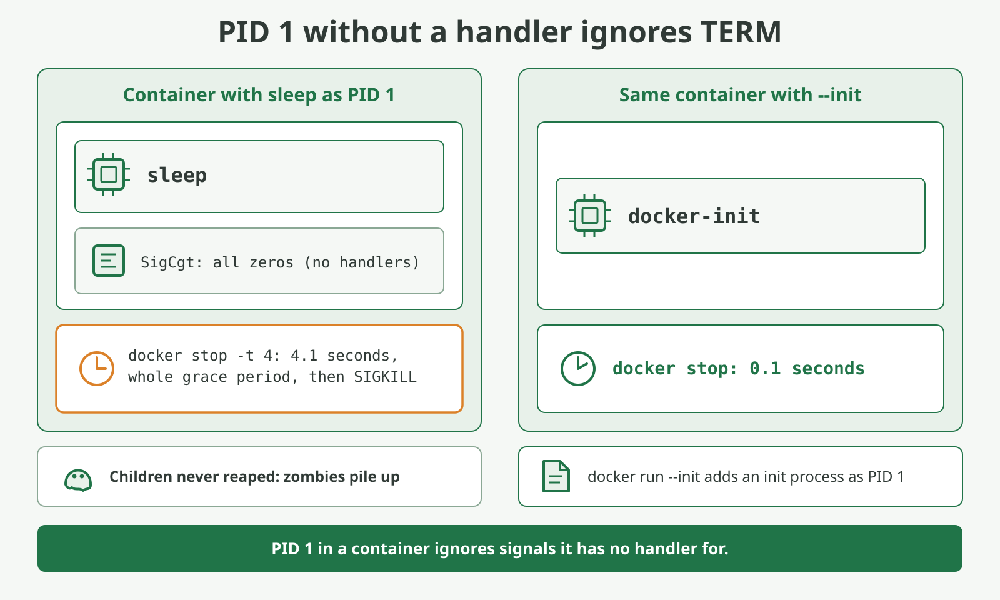

*Figure 20.7.7. A container whose PID 1 has no signal handler takes the whole grace period to stop, while a container started with an init process stops at once.*

A pod will not die, a process shows as `<defunct>`, and a deploy hangs for exactly 30 seconds. All three are signal stories. How Linux Works, chapter 2, says the default signal of `kill pid` is TERM, that most processes get a chance to clean up through a handler, and that a process may ignore it. `kill -STOP` freezes a process and `kill -CONT` resumes it. Run `kill -l` for the number-to-name map.

SIGKILL is different. The process cannot catch or ignore it, so the kernel ends the process without asking it anything. The shell reports a death by signal as 128 plus the signal number. The demo script gives the same exit codes on the Mac and on Linux.

```text
A_handles_TERM: exit=0
B_ignores_TERM: still_running=yes
B_after_KILL: exit=137
C_default_TERM: exit=143
```

So 143 means the process died of TERM with no handler, and 137 means it was killed with KILL. A supervisor or a limit often sends KILL. That helps in an incident. A container exit code of 137 says someone sent SIGKILL, for example the kernel's OOM killer or a termination timeout that ran out.

Production Kubernetes, chapter 14, gives the Kubernetes version of the same story. After the optional pre-stop hook, the kubelet sends SIGTERM and starts a termination period of 30 seconds by default. If the process is still running when the period ends, the kubelet sends SIGKILL. The book recommends that every workload handle SIGTERM. systemd works the same way. The systemd.service page says that if the process does not stop within `TimeoutStopSec=`, it is forcibly terminated by SIGKILL.

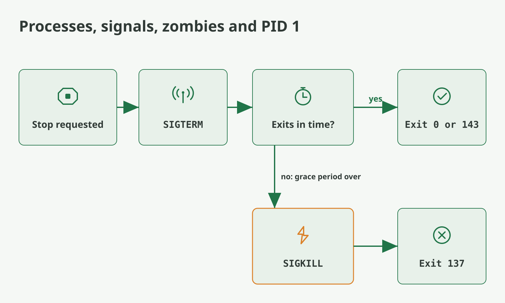

*Figure 20.7.8. Processes, signals, zombies and PID 1, as a diagram.*

A zombie is a finished process whose parent has not yet collected its exit status. Think of it as a note left on a desk that nobody has picked up. It uses no CPU and almost no memory, but it still holds a slot in the process table. You cannot kill a zombie, because it is already dead. You fix the parent, which must call wait, or you stop the parent so that PID 1 adopts and reaps the children. The demo script makes one on purpose. On the Mac the command name of a zombie shows as `<defunct>`. On Linux `ps -o comm` keeps the program name, and the state letter is the clue:

```text
D_zombie_row:    4072    4070 Z    sleep
D_zombie_count: 1
D_parent_pid_matches: yes
```

PID 1 inside a container is special. The pid_namespaces man page says other processes in the namespace can send init only signals for which it has installed a handler, even if they are privileged. It also says SIGKILL and SIGSTOP sent from an ancestor namespace are forcibly delivered, and that orphaned children are reparented to init. So a program that was never written to be PID 1 may ignore SIGTERM and never reap its children. Two consequences follow. Your app may take the full grace period to stop, and zombies can pile up under it.

I ran this with Docker. A container started as `docker run -d ubuntu:24.04 sleep 1000` has `sleep` as PID 1. Its `/proc/1/status` shows `SigCgt` all zeros, so it has no signal handlers. `docker stop -t 4` took 4.1 seconds, the whole grace period, and then SIGKILL ended it. The same container started with `--init` has `docker-init` as PID 1, and `docker stop` took 0.1 seconds.

The zombie half showed up on its own. In my long-lived working container, PID 1 was `sleep`. A count with the task 7 pipeline on live `ps -eo pid,ppid,stat,comm` gave `parent 1 zombies 16`, which are children of earlier commands that nothing reaped. The `--init` flag of `docker run` is one fix. In a pod, the other fix is a pod setting that shares the process namespace. Unverified: check the exact pod field name before you say it aloud.

Decide: for a stuck process, send TERM and wait, then KILL, and say what you lose by skipping the first step. The lost cleanup is the answer the interviewer wants to hear.

The order matters for a practical reason. TERM gives the process a chance to close files, flush buffers and remove temporary state. KILL does none of that, so any data the process was holding in memory is lost. Waiting for the grace period first is the cheap way to avoid losing that data.

### 7. cron and logrotate gotchas

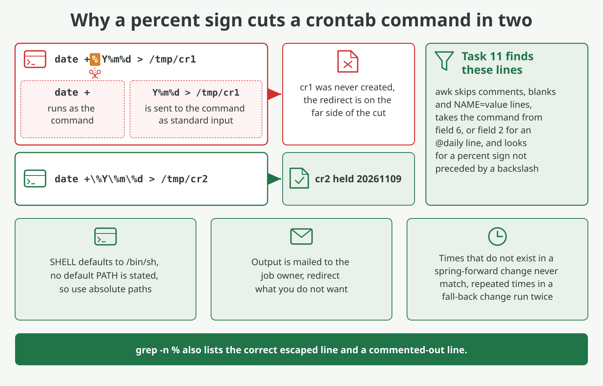

*Figure 20.7.9. In a crontab an unescaped percent sign becomes a newline and the rest goes to standard input, so write it as backslash percent.*

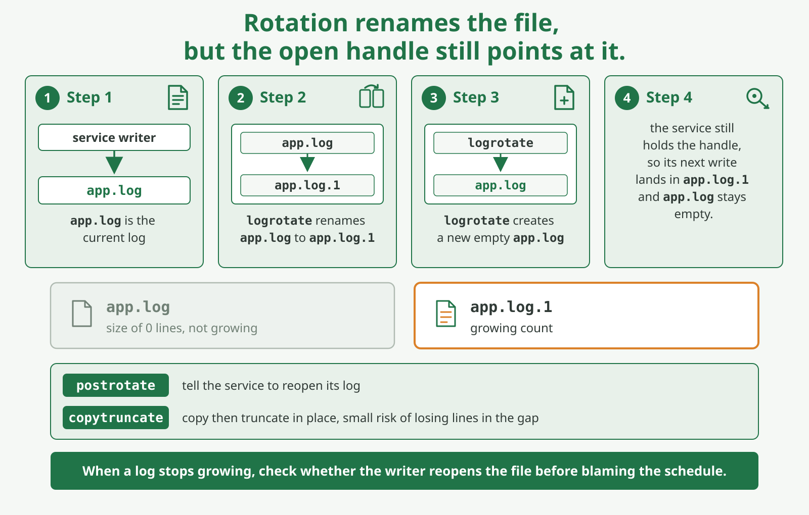

*Figure 20.7.10. A service that keeps its open handle after rotation writes into the renamed file, so the new log stops growing.*

A nightly backup silently produces nothing, or a log file keeps growing after rotation. Both are classics, and both come from a small detail in the scheduler or the rotation tool. The crontab(5) man page says a percent sign in the command, unless escaped with a backslash, becomes a newline, and all data after the first one is sent to the command as standard input. So `date +%Y%m%d` inside a crontab line is cut in two. Task 11 below finds these lines. A test with real cron in the Ubuntu container shows the effect. Two lines ran every minute: `date +%Y%m%d > /tmp/cr1` and the same with `\%` escapes writing to `/tmp/cr2`. The file `cr2` held `20261109`. The file `cr1` was never created, because cron cut the command at the first percent sign and the redirect was on the far side of the cut.

The same page says `SHELL` defaults to `/bin/sh` and does not state a default `PATH`, so always use absolute paths in cron commands. It also says times that do not exist during a spring-forward change never match, and repeated times in a fall-back change run twice. Cron also mails output to the job owner, so redirect the output you do not want to keep. A systemd timer needs two units and cron does not, which is one reason cron survives.

Log rotation has one deep idea. Rotation renames files: `auth.log` becomes `auth.log.1`, and so on. Once a process has a log open, the kernel does not know the file was renamed. The process keeps writing to the renamed file, because the open handle still points there. So after a rotation, a service that never reopens its log keeps writing into `app.log.1` while a fresh, empty `app.log` sits next to it. Chapter 20.4 shows the sibling problem, a deleted file that is still open.

Here is the sequence in plain steps. The rotation tool renames the current log. It then creates a new, empty file under the old name. The service still holds the handle to the renamed file, so its next write lands there. Nothing errors and nothing warns, which is why the problem can run for days before someone notices the file under the old name has stopped growing.

The logrotate man page describes two cures. `postrotate` runs a script after rotation, usually to tell the service to reopen its log. `copytruncate` copies the file and truncates the original in place. The page warns that some logging data might be lost in the small gap between the copy and the truncate. The page also says `create` makes the new file immediately after rotation, `delaycompress` postpones compression to the next cycle, and `missingok` skips a missing log without error. `logrotate -d` is a dry run that changes nothing, and `-f` forces rotation. Use `-d` before you promise anyone that a config is right.

The test used logrotate on Ubuntu 24.04. A Python writer held two logs open and wrote a line every half second. One config used plain `create`, the other used `copytruncate`, and a rotation was forced with `-f` in the middle. The result is the whole lesson in four numbers. Read the lines as a story: the writer kept going, and the question is which file it kept writing into.

```text
app.log:    0 lines     (fresh file created by logrotate, never written)
app.log.1:  6 lines     (the writer kept writing to the renamed file)
app2.log:   3 lines     (copytruncate: writer kept using the original name)
app2.log.1: 3 lines     (the copy made at rotation)
```

With `copytruncate` no lines were lost in this run, but the manual page warns that a gap exists, so treat that result as luck and not as a guarantee. `logrotate -d` printed `warning: logrotate in debug mode does nothing except printing debug messages!` and changed nothing.

Decide: when a log does not rotate, check whether the writer reopens the file before you blame the schedule. The schedule is usually fine, and the writer is usually holding the old name.

### 8. Disk, mount, user and group chores

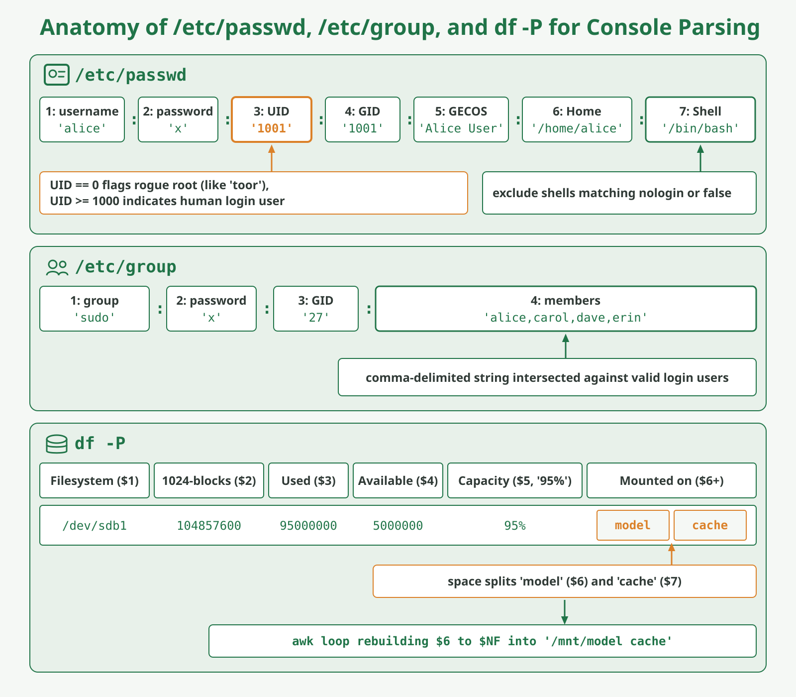

*Figure 20.7.11. Parsing colon-delimited user databases and POSIX df tables relies on fixed field indices and loop reconstruction for spaced paths.*

Someone asks "which filesystems are nearly full" or "who has sudo on this box." These are reading tasks, and they look easy until the output is messy. For disks, use `df -P`, because the POSIX format puts each filesystem on exactly one line and makes the columns predictable. Mount points can contain spaces, as the fixture shows with `/mnt/model cache`. So rebuild the mount point from the sixth field onward. Chapter 20.4 explains when `df` and `du` disagree, and chapter 20.5 covers disk latency.

For users, `/etc/passwd` and `/etc/group` are colon-separated. The book shows the group file as name, password placeholder, group number and a comma-separated member list. In passwd the third field is the user ID and the seventh is the shell. A login user has an ID of 1000 or more on most distributions, and a shell that is not `nologin`. Any account other than root with user ID 0 deserves a hard look, because it is a second root. The 1000 threshold is a convention of common distributions, not a law. Say so when you use it.

A single line in the passwd file reads like a row of labelled boxes separated by colons. The first box is the login name, the third is the user ID, and the seventh is the shell. Reading the file this way means you never guess at a column in a table that a human formatted. You count the colons, and you get the same answer on every machine.

The commands `id`, `findmnt`, `lsblk` and `mount` work in the container, but a container shows an overlay root and no real disks, so the tasks keep their fixtures. Live `df -P` output was also fed to the task 8 pipeline. It printed one line, `95% /code`, which is the read-only code mount. The container's other filesystems were under 85 percent. The live `ps -eo pid,ppid,stat,comm` worked in task 7 as described above. Not run: `visudo`. The exact `visudo` workflow is not verified, because no source used here covers it.

Decide: parse by delimiter and field number from a trusted file layout, never by guessing columns of human-formatted output. Human-formatted output changes width with the data, and a column that lined up yesterday can drift today.

### 9. tar, rsync, curl and jq one-liners

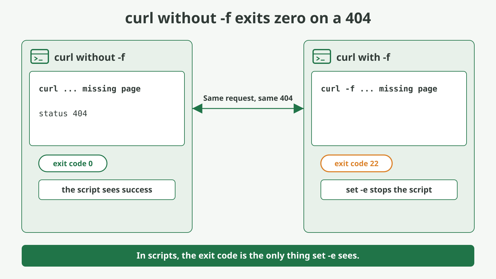

*Figure 20.7.12. A missing page returns exit code 0 from curl by default and exit code 22 with the fail flag, so only the second stops a script.*

Picture a backup job that must copy a directory to a second host, and a colleague who asks you to check the result. Four tools turn up in every console round: `tar`, `rsync`, `curl` and `jq`. The demo script `c07_transfer_demo.sh` ran on the Mac with `openrsync` and `curl 8.9.1`, and on Ubuntu with rsync 3.2.7 and curl 8.5.0. The output was identical. On a bare Ubuntu image the script fails with `rsync: command not found` until the package is installed, which is itself a lesson about minimal hosts.

`tar` is safest with `-C`, which changes directory first so the archive holds relative paths. The tar round trip produced `src/`, `src/a.txt`, `src/sub dir/` and `src/sub dir/b.txt`, and `diff -r` said the restored tree equals the original. `rsync` takes a trailing-slash rule: `src/` means the contents, and `src` means the directory itself. The dry run with `--itemize-changes` printed `>f+++++++ c.txt` on the Mac and `>f+++++++++ c.txt` with rsync 3.2.7. Both read "a new file would be sent", and only the count of plus signs differs. Always dry-run before a copy that can delete or overwrite.

The trailing slash on `rsync` looks like a small detail, and it changes what gets copied. Read the two forms aloud before you run either one. The dry run is the cheap way to see the effect, and it costs nothing but a few seconds of waiting for the list to print.

`curl` hides the HTTP status unless you ask for it. Against my local test server, a missing page printed status 404, but the exit code was 0. With `-f` the same request exits with 22. That matters in scripts, where the exit code is the only thing `set -e` sees. `-w` prints timings, so `%{time_connect}` and `%{time_total}` separate a slow connect from a slow response. How Linux Works, chapter 12, covers file transfer and sharing, and Part 1 chapter 30 covers rsync in depth.

`jq` is the log tool for JSON lines. The trap is a log whose last line is half written, which is normal for a file that a service is still writing. `jq -s` reads the whole file as one array and dies on that line. Task 10 shows the fix, which is to read raw lines and skip the ones that do not parse.

Decide: in a script, always give `curl` the `-f` flag and a time limit, and use `rsync --dry-run` first. A script that gets an error page back and reports success is worse than a script that stops.

### 10. Bash that survives production

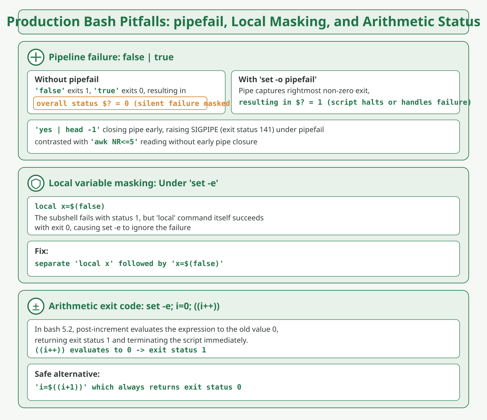

*Figure 20.7.13. Shell safety flags like set -e require defensive coding because pipes, local assignments, and arithmetic expansions can silently mask or trigger exit codes.*

A script works on your laptop and does something awful at 03:00. Chapter 11 of How Linux Works explains that every program leaves an exit code, zero for success, and that `$?` holds the last one and is overwritten by the next command. Its advice on temporary files is to use `trap` so a Ctrl-C does not leave them behind. The demo script `c07_robust_demo.sh` runs eight pitfalls and prints the results. These are real outputs from bash 3.2.57 on macOS. I ran the demo again on bash 5.2.21 in the Ubuntu container. Six of the seven rows matched. The `((i++))` pitfall differs, and it has its own row.

Think of `$?` as a note that the last command leaves behind. Each new command overwrites the note, so a check written two lines later may read a note left by a different command. That is why good scripts test the status right after the command that produced it, or they save it into a variable at once.

| Pitfall | Real result | Lesson |
|---|---|---|
| `set -e` inside an `if f` test | printed `after-false` then `ok` | `set -e` is switched off inside conditions. |
| `false \| true`, no pipefail | status 0 | A failure in the middle of a pipe is lost. |
| the same with `set -o pipefail` | status 1 | pipefail reports it. |
| `set -u` and an unset variable | `unbound variable`, script stopped | Catches typos in names. |
| `local x=$(false)` under `set -e` | printed `reached` | `local` returns its own status and hides the failure. |
| unquoted `$f` with a space | 2 words, versus 1 when quoted | Always quote variables. |
| `trap ... EXIT` then `false` | printed `cleaned`, exit 1 | The trap ran and the exit code survived. |
| `set -e; i=0; ((i++))` | bash 3.2: reached the next line. bash 5.2.21: exit 1, nothing printed | `((i++))` returns status 1 when the old value was 0. Newer bash stops the script. Use `i=$((i+1))`. |

These results come from test runs, not from the Bash manual page for `set`, which was not fetched. Do not rely on `set -e` as a safety net. Check the commands that matter with `||` and an explicit message. Quote every expansion. Put cleanup in a `trap` on `EXIT`. Use `mktemp`. Under pipefail, remember the `head` exit status 141 from idea 2.

Decide: start every script with `set -euo pipefail`, then still handle the failures you care about by hand. The flags help, but they do not replace a check you wrote yourself.

### 11. How to behave in the room

Picture the console round, and the moment you are about to run a command that could change something. Say what you are about to do before you do it. Run a harmless read first. State what the output means and what you will check next. When a command could change state, such as `rm`, `kill` or `rsync --delete`, print what it would hit before you run it.

When you are stuck, say so and name the next two checks. Interviewers in a console round watch method more than syntax, and a clear "I am not sure, so I will check X" scores better than a silent guess. Chapter 20.3 gives the triage order for a sick box. This chapter gives the hands that carry it out.

Decide: narrate every command, and prefer a dry run to a confident guess. A dry run costs a few seconds, and a wrong guess on a live box can cost much more.

## How to answer out loud

### Question 1. "Top talkers and the 5xx burst from this log."

The interviewer hands you the gateway log and asks for the top clients and the burst. Speak in this order. Look at the file and name the format. Say which field holds the client, the status and the request time. Narrow to the lines you need, extract one field, sort, count and rank. Give the numbers, then the cross-check. In the fixture the top client is `203.0.113.77` with 362 of 3181 requests, and the busiest 5xx minute is `10:42` with 140 errors, against 35 in the next minute. State the shape: one sharp burst, not a slow climb. Expect the follow-up "is it one client or many", which you answer by repeating the count for that minute only.

### Question 2. "What is your p95 and how do you know?"

The interviewer asks for the p95 and then asks how you know it is right. Say you sort the times and take the value at rank ceil(0.95 × N). Give N, the rank and the value. Name the method as nearest rank. Say the mean would hide the tail, and give the mean of 1.606 against the p99 of 29.176 as proof. Expect "what about requests that never finished", and answer that a log of completed requests under-counts timeouts that were cut earlier, so you check the gateway metrics too.

### Question 3. "A service restarts every few seconds. What do you do?"

A service restarts every few seconds, and the interviewer wants your first three moves. Run `systemctl status` for state and exit code. Read `journalctl -u` for the last failure. Check the restart counter and whether the start limit was hit. Look at `Restart=` and `RestartSec=`, and at limits such as `LimitNOFILE=`. Fix the cause, then run `systemctl reset-failed` before starting the unit by hand. Name the trade-off: `Restart=always` hides crashes, so alert on the restart counter. Not run here, so say you rely on the documentation for the flags.

### Question 4. "A process will not die. Walk me through it."

A process will not die, and the interviewer asks you to walk through it. Send TERM and wait for the grace period. Check whether it is a zombie by looking at the state column. If so, deal with the parent. If it is stuck in uninterruptible sleep, KILL does not help, so name the wait and go to chapter 20.5. Otherwise send KILL and note that you skipped cleanup. In a container, say PID 1 only receives signals it has a handler for. Expect the follow-up "what exit code do you see": 143 or 137.

### Question 5. "Write a safe script to rotate and copy a directory."

The interviewer asks for a short script that rotates and copies a directory, and wants it to be safe. Start with `set -euo pipefail`, quote everything, use `mktemp -d` and a `trap` on `EXIT`. Use `rsync --dry-run` first, and `curl -f` for any call. Say that you check exit codes explicitly where it matters, because `set -e` is switched off inside conditions.

## Worked scenarios

Twelve tasks follow. Treat each as a timed drill with a budget of about four minutes, and stop when the time is up even if the answer is not perfect. Every fixture is **synthetic**. The generator `code/part20/c07_make_fixtures.py` writes them from a fixed seed, uses only documentation IP ranges, and the files are in `code/part20/c07_fixtures/`. Task 9 uses a generated file tree because file times cannot be stored in git. Every solution ran on the Mac with BSD tools and again on Ubuntu 24.04 with GNU awk 5.2.1 and with mawk 1.3.4. The output shown is real and was identical on all three. The test file `code/part20/test_c07_solutions.py` computes each expected answer in plain Python and compares.

### Task 1. Top five clients (fixture `access.log`)

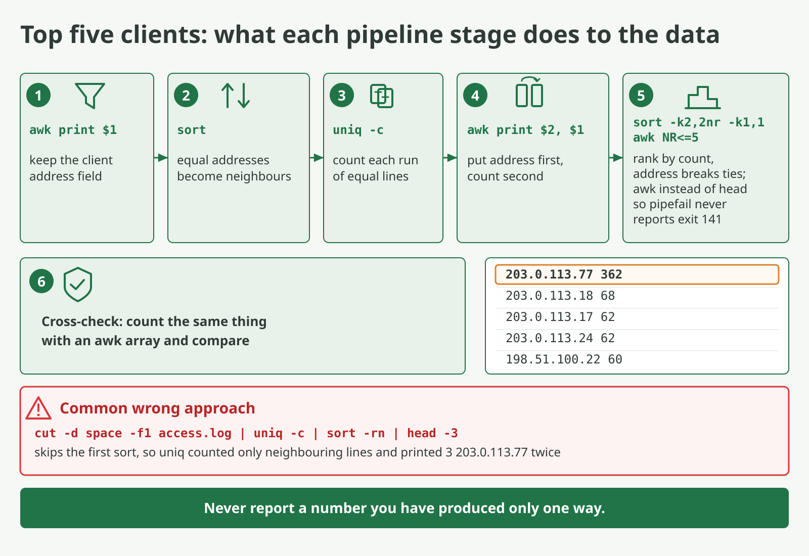

*Figure 20.7.14. Each stage does one job, and sort must come before uniq -c because uniq only merges neighbouring lines.*

Your team wants the five client addresses that sent the most requests in this log. Task: list the five client addresses with the most requests.

Before typing, decide what counts as a client. The address field is the answer, and everything else in the line is noise for this question.

```bash
# code/part20/c07_t01_top_talkers.sh
#!/usr/bin/env bash
# Task 1: top 5 client IPs by request count in an access log.
# Portable: runs with BSD (macOS) and GNU tools. Fixture is synthetic (see c07_make_fixtures.py).
set -euo pipefail
F="${1:-$(dirname "$0")/c07_fixtures/access.log}"
# awk keeps only the first field. sort groups equal IPs. uniq -c counts runs of equal lines.
# The final sort orders by count, then IP, so ties are stable. awk (not head) cuts to 5
# because head closes the pipe early and pipefail can then report exit 141.
awk '{print $1}' "$F" | sort | uniq -c | awk '{print $2, $1}' | sort -k2,2nr -k1,1 | awk 'NR<=5'
```

Output:

```text
203.0.113.77 362
203.0.113.18 68
203.0.113.17 62
203.0.113.24 62
198.51.100.22 60
```

Why it works: `awk` keeps field one, `sort` brings equal addresses together, `uniq -c` counts each run, and the final sort ranks by count with the address as the tie break. Read the pipeline left to right and each stage does one job. Common wrong approach: `cut -d' ' -f1 access.log | uniq -c | sort -rn | head -3` skips the first sort. It printed `3 203.0.113.77` twice, because `uniq` counted only neighbouring lines.

### Task 2. Slowest requests (fixture `access.log`)

Your on-call colleague wants the slowest requests with their status and path, so the team can see what the timeouts look like. Task: show the five slowest requests with status and path.

Before typing, decide what counts as slow. The request time is the answer, and the status and path are context that the on-call engineer will want next to it.

```bash
# code/part20/c07_t02_slowest_requests.sh
#!/usr/bin/env bash
# Task 2: the 5 slowest requests (request_time is the last field).
# Portable: runs with BSD (macOS) and GNU tools. Fixture is synthetic (see c07_make_fixtures.py).
set -euo pipefail
F="${1:-$(dirname "$0")/c07_fixtures/access.log}"
# $NF is the last field, so spaces inside the user-agent do not matter.
# sort -rn is numeric. A text sort would put 9.5 above 61.004.
awk '{print $NF, $9, $7}' "$F" | sort -k1,1nr | awk 'NR<=5'
```

Output:

```text
61.004 200 /v1/completions
48.213 200 /v1/chat/completions
33.900 200 /v1/chat/completions
29.996 504 /v1/completions
29.994 504 /v1/completions
```

Why it works: `$NF` is the last field however many words the user-agent has, and `sort -k1,1nr` is numeric and descending. The pipeline never has to guess where the request time sits. Common wrong approach: `sort | tail -3` on the same field. It printed `48.213`, `61.004` and `9.500` last, so a text sort put 9.5 on top of the list and hid the 61 second request.

### Task 3. The busiest error minutes (fixture `access.log`)

A burst of server errors is on the dashboard, and someone asks when it peaked. Task: give the three minutes with the most 5xx responses.

Before typing, decide what a burst means. Three minutes with the most errors is one clear answer, but the interviewer may also want the shape of the wave around it.

```bash
# code/part20/c07_t03_error_bursts.sh
#!/usr/bin/env bash
# Task 3: the three busiest minutes of 5xx responses.
# Portable: runs with BSD (macOS) and GNU tools. Fixture is synthetic (see c07_make_fixtures.py).
set -euo pipefail
F="${1:-$(dirname "$0")/c07_fixtures/access.log}"
# $4 looks like [12/Mar/2026:10:42:07 so characters 2..18 are the date and the minute.
# $9 is the status. The regex ^5 matches 500 to 599 and nothing else.
awk '$9 ~ /^5/ {print substr($4,2,17)}' "$F" | sort | uniq -c | awk '{print $2, $1}' | sort -k2,2nr -k1,1 | awk 'NR<=3'
```

Output:

```text
12/Mar/2026:10:42 140
12/Mar/2026:10:17 35
12/Mar/2026:10:14 3
```

Why it works: the time field starts with a bracket, so characters 2 to 18 are the date and the minute, and the test `^5` on the status field matches only 500 to 599. Common wrong approach: `grep ' 5[0-9][0-9] '` found 241 lines when the true 5xx count was 207, because the bytes column also holds numbers that start with 5. Use the status field, never a bare pattern. Note that the 10:17 bump holds 504s with times near 30 seconds, a different failure from the 10:42 wave of 502 and 503.

### Task 4. Percentiles by hand (fixture `access.log`)

Your manager wants the sample size and three percentiles in one line, and wants the method to be explained. Task: print N, p50, p95 and p99 of request time.

Before typing, decide which requests belong in the sample. Name that choice out loud, because a percentile over the wrong set answers the wrong question.

```bash
# code/part20/c07_t04_percentile.sh
#!/usr/bin/env bash
# Task 4: p50, p95 and p99 of request_time by hand (nearest-rank method).
# Portable: runs with BSD (macOS) and GNU tools. Fixture is synthetic (see c07_make_fixtures.py).
set -euo pipefail
F="${1:-$(dirname "$0")/c07_fixtures/access.log}"
# Nearest rank: sort ascending, then take the value at position ceil(p/100 * N).
# awk has no ceil, so add 0.999999 and truncate with int().
awk '{print $NF}' "$F" | sort -n | awk '
  {v[NR]=$1}
  END {
    n=NR
    printf "n=%d", n
    split("50 95 99", ps, " ")
    for (i=1; i<=3; i++) {
      r=int(ps[i]/100*n + 0.999999); if (r<1) r=1
      printf " p%s=%.3f", ps[i], v[r]
    }
    printf "\n"
  }'
```

Output:

```text
n=3181 p50=1.152 p95=2.857 p99=29.176
```

Why it works: after a numeric sort, the nearest-rank value is the one at position ceil(p/100 × N). The loop only has to look up three positions in the sorted list. Common wrong approach: reporting the mean. The mean is 1.606 on the same file, and it hides the 504 timeouts that sit in the top one percent.

### Task 5. Failed SSH logins (fixture `auth.log`)

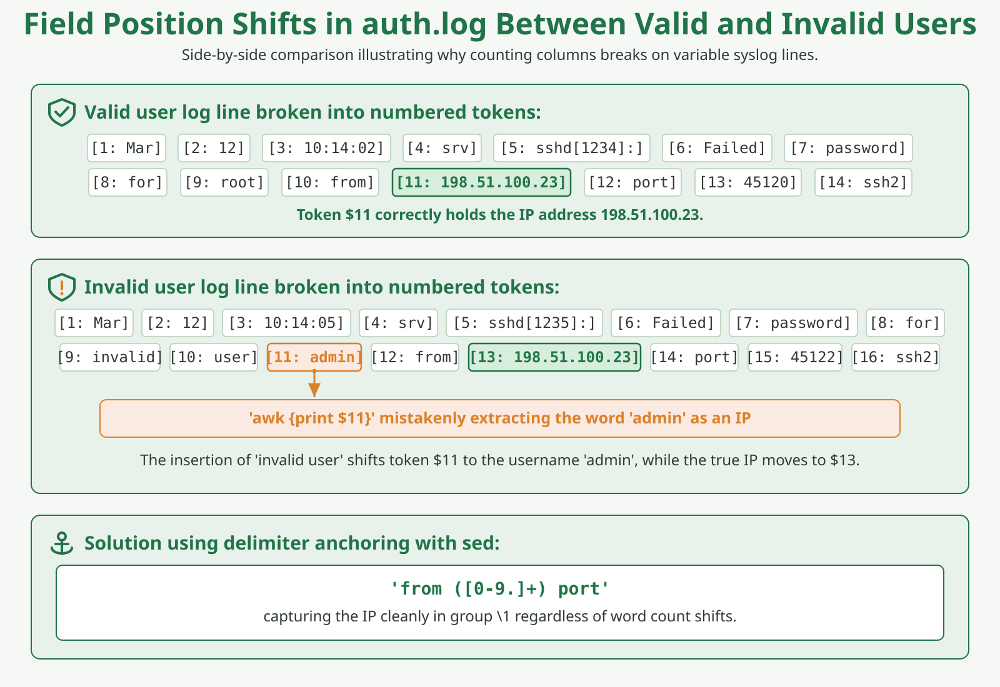

*Figure 20.7.15. Log lines with variable phrase counts shift positional fields, making delimiter-anchored regular expressions far more reliable than fixed column extraction.*

Someone on the security side asks which source addresses are guessing passwords. Task: find the three source addresses with the most failed password attempts.

Before typing, decide what the log line says for a failed login. The word that precedes the address is the reliable anchor, and the field position is not.

```bash
# code/part20/c07_t05_ssh_failures.sh
#!/usr/bin/env bash
# Task 5: top 3 source IPs of failed SSH logins.
# Portable: runs with BSD (macOS) and GNU tools. Fixture is synthetic (see c07_make_fixtures.py).
set -euo pipefail
F="${1:-$(dirname "$0")/c07_fixtures/auth.log}"
# 'invalid user' lines have extra words, so field numbers shift. Match on the text
# after the word "from" instead of counting fields.
grep 'Failed password' "$F" | sed -E 's/.* from ([0-9.]+) port .*/\1/' | sort | uniq -c | awk '{print $2, $1}' | sort -k2,2nr -k1,1 | awk 'NR<=3'
```

Output:

```text
198.51.100.23 202
198.51.100.99 128
192.0.2.14 57
```

Why it works: it matches the text after the word `from`, so lines with `invalid user admin` and lines with `root` give the same capture. Common wrong approach: `awk '{print $11}'`. Valid-user lines have the address in field 11, but invalid-user lines shift it by two words. The wrong version printed counts for the words `admin` and `test` as if they were addresses, and gave 140 for the top address instead of 202.

### Task 6. Restart counters (fixture `journal.txt`)

A service has been bouncing all night, and you want to know which units restarted most. Task: for each unit, the highest restart counter the journal shows.

Before typing, decide what one restart looks like in the journal. Once you know the message text, the task becomes a search for its largest number per unit.

```bash
# code/part20/c07_t06_restart_counters.sh
#!/usr/bin/env bash
# Task 6: highest systemd restart counter per unit, from journal text.
# Portable: runs with BSD (macOS) and GNU tools. Fixture is synthetic (see c07_make_fixtures.py).
set -euo pipefail
F="${1:-$(dirname "$0")/c07_fixtures/journal.txt}"
# The unit name is the word before the colon in "unit: Scheduled restart job, restart counter is at N."
grep 'restart counter is at' "$F" | sed -E 's/.* ([A-Za-z0-9_.@-]+): Scheduled restart job, restart counter is at ([0-9]+)\./\1 \2/' |
  awk '{ if ($2 > max[$1]) max[$1]=$2 } END { for (u in max) print u, max[u] }' | sort -k2,2nr -k1,1
```

Output:

```text
vllm.service 9
dcgm-exporter.service 5
node-exporter.service 2
```

Why it works: systemd logs "Scheduled restart job, restart counter is at N" at each restart, so the maximum per unit is the number of restarts. A numeric comparison in `awk` keeps the largest value. The fixture also holds a line for `vllm.service` reading "Start request repeated too quickly", which is the start rate limit firing. Common wrong approach: `grep -c vllm`. It counts every line that mentions the unit, four per restart, and tells you nothing about the number of restarts.

### Task 7. Zombies and their parents (fixture `ps.txt`)

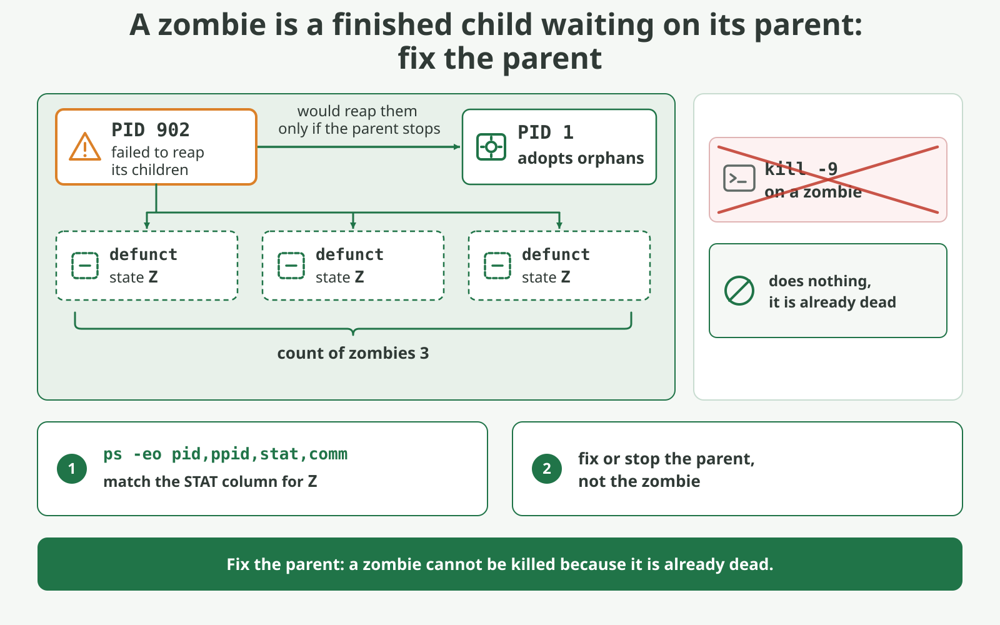

*Figure 20.7.16. Zombies are finished children that the parent has not collected, so the fix is in the parent and not in the zombie.*

The process table is full of defunct entries, and you need to know whose children they are. Task: list zombie processes grouped by parent.

Before typing, decide what marks a zombie in the process table. The state column is the honest answer, and a name that happens to start with Z is not evidence of anything.

```bash
# code/part20/c07_t07_zombies.sh
#!/usr/bin/env bash
# Task 7: zombie processes, grouped by the parent that failed to reap them.
# Portable: runs with BSD (macOS) and GNU tools. Fixture is synthetic (see c07_make_fixtures.py).
set -euo pipefail
F="${1:-$(dirname "$0")/c07_fixtures/ps.txt}"
# STAT is column 3. A zombie starts with Z. Matching the column avoids false hits on
# names like ZMQ-broker. The fix is in the parent (column 2), not the zombie.
awk 'NR>1 && $3 ~ /^Z/ {c[$2]++} END {for (p in c) print "parent", p, "zombies", c[p]}' "$F" | sort -k4,4nr -k2,2n
```

Output:

```text
parent 902 zombies 3
parent 901 zombies 1
parent 981 zombies 1
```

Why it works: it tests the STAT column, so a process named `ZMQ-broker` is not mistaken for a zombie. Parent 902 is the one to fix, because it is the process that failed to reap its children. Common wrong approach: `grep Z ps.txt` listed `ZMQ-broker` and `Zabbix-agent` as well, which are healthy. The other wrong move is `kill -9` on a zombie, which does nothing, because the process is already dead.

### Task 8. Nearly full filesystems (fixture `df.txt`)

The disk alert says a volume is nearly full, and you need the list of filesystems that matter. Task: filesystems at 85 percent or more, ignoring tmpfs and overlay.

Before typing, decide which filesystems are noise. Temporary and overlay mounts fill up for reasons that have nothing to do with the disk the alert is about.

```bash
# code/part20/c07_t08_full_filesystems.sh
#!/usr/bin/env bash
# Task 8: filesystems at 85 percent or more, excluding tmpfs and overlay.
# Portable: runs with BSD (macOS) and GNU tools. Fixture is synthetic (see c07_make_fixtures.py).
set -euo pipefail
F="${1:-$(dirname "$0")/c07_fixtures/df.txt}"
# Mount points can contain spaces, so rebuild the mount from field 6 onward.
# Capacity is field 5, like 98%. awk converts it to a number with +0.
awk 'NR>1 && $1 != "tmpfs" && $1 != "overlay" && ($5+0) >= 85 {
       m=$6; for (i=7; i<=NF; i++) m=m " " $i
       print ($5+0) "% " m }' "$F" | sort -k1,1nr -k2
```

Output:

```text
98% /
95% /mnt/model cache
```

Why it works: the mount point is rebuilt from the sixth field on, so the space in `/mnt/model cache` survives, and `+0` turns `98%` into a number. Note that `/data` at 84 percent is just below the line. Common wrong approach: `sort -k1` on the capacity text. It printed `95% /mnt/model`, cut at the space, and let the overlay row through as a second `98%` line.

### Task 9. Old big logs with spaces in the name (generated tree)

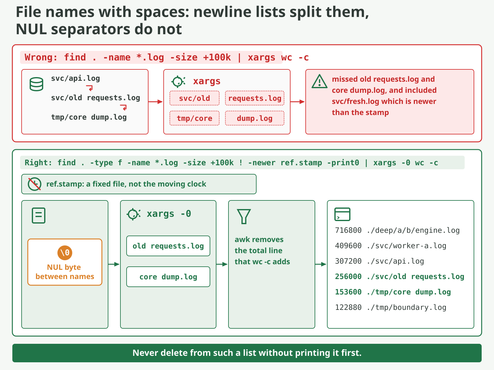

*Figure 20.7.17. Pass names through find -print0 and xargs -0, and compare against ref.stamp instead of the clock.*

A cleanup job needs the old, large log files in a directory tree, and the file names include spaces. Task: under a directory, list `.log` files over 100 KiB that are not newer than `ref.stamp`, safe for spaces.

Before typing, decide what makes a file old. The stamp file gives you a fixed reference point, and that is safer than comparing against the clock, which moves while you work.

```bash
# code/part20/c07_t09_find_old_logs.sh
#!/usr/bin/env bash
# Task 9: log files over 100 KiB that are not newer than ref.stamp, safe for spaces in names.
# Usage: c07_t09_find_old_logs.sh TREE   (TREE made by: c07_make_fixtures.py --tree TREE)
# Portable: runs with BSD (macOS) and GNU tools. Fixture is synthetic.
set -euo pipefail
T="${1:?usage: $0 TREE}"
# -print0 and xargs -0 use a NUL byte between names, so spaces never split a name.
# wc -c prints one byte count per file plus a "total" line, which sed and awk remove.
cd "$T"
find . -type f -name '*.log' -size +100k ! -newer ref.stamp -print0 | xargs -0 wc -c |
  awk '$2 != "total" {n=$1; sub(/^ *[0-9]+ /, ""); print n, $0}' | sort -k1,1nr -k2
```

Output after `c07_make_fixtures.py --tree /tmp/c07tree`:

```text
716800 ./deep/a/b/engine.log
409600 ./svc/worker-a.log
307200 ./svc/api.log
256000 ./svc/old requests.log
153600 ./tmp/core dump.log
122880 ./tmp/boundary.log
```

Why it works: `-print0` and `xargs -0` separate names with a NUL byte, `! -newer ref.stamp` compares against a fixed file instead of the clock, and the `awk` step removes the `total` line that `wc -c` adds. Common wrong approach: `find . -name '*.log' -size +100k | xargs wc -c`. It split `old requests.log` and `core dump.log` at the spaces, missed both, and included `svc/fresh.log`, which is newer than the stamp. Never pass names through `xargs` without `-0`, and never delete from such a list without printing it first.

### Task 10. Error codes in JSON lines (fixture `app.jsonl`)

A JSON log from a service has errors with and without a code field, and the file is still being written. Task: count `error` lines per `code`, where the file ends in a half-written line and some errors have no code.

Before typing, decide what to do with a line that does not parse. In a live log the last line is often the one still being written, and it should be skipped and not allowed to stop the count.

```bash
# code/part20/c07_t10_jq_error_codes.sh
#!/usr/bin/env bash
# Task 10: count error codes in a JSON-lines log that ends in a half-written line.
# Portable: runs with BSD (macOS) and GNU tools. Fixture is synthetic (see c07_make_fixtures.py).
set -euo pipefail
F="${1:-$(dirname "$0")/c07_fixtures/app.jsonl}"
# fromjson? silently drops a line that does not parse, so the truncated last line does
# not abort the run. // "unknown" names the errors that have no code field.
jq -Rr 'fromjson? | select(.level=="error") | (.code // "unknown")' "$F" | sort | uniq -c | awk '{print $2, $1}' | sort -k2,2nr -k1,1
```

Output:

```text
kv_cache_full 45
queue_timeout 21
context_too_long 13
rate_limited 6
unknown 5
```

Why it works: `-R` reads raw lines, `fromjson?` drops any line that does not parse, and `// "unknown"` names the missing code. Common wrong approach: `jq -s`. It failed with `parse error: Unfinished string at EOF at line 502, column 0` and printed nothing useful. The test skips this task if `jq` is not installed. It ran with jq 1.6.

### Task 11. The percent sign in a crontab (fixture `crontab.txt`)

A nightly job has been producing odd output, and you suspect a percent sign in the crontab. Task: report crontab entries that contain an unescaped percent sign.

Before typing, decide which lines are commands at all. Comments and variable assignments are not jobs, and counting them would send you chasing false alarms.

```bash
# code/part20/c07_t11_cron_percent.sh
#!/usr/bin/env bash
# Task 11: crontab entries that contain an unescaped percent sign.
# Portable: runs with BSD (macOS) and GNU tools. Fixture is synthetic (see c07_make_fixtures.py).
set -euo pipefail
F="${1:-$(dirname "$0")/c07_fixtures/crontab.txt}"
# In a crontab, an unescaped % in the command becomes a newline and the rest goes to stdin.
# Skip comments, blanks and NAME=value lines. A @daily line has its command from field 2,
# an ordinary line from field 6.
awk '
  /^[[:space:]]*(#|$)/ {next}
  /^[A-Za-z_][A-Za-z0-9_]*=/ {next}
  { s = ($1 ~ /^@/) ? 2 : 6
    cmd = $s; for (i=s+1; i<=NF; i++) cmd = cmd " " $i
    if (cmd ~ /(^|[^\\])%/) print "line " NR }' "$F"
```

Output:

```text
line 6
line 9
line 10
```

Why it works: it skips comments, blanks and `NAME=value` lines, takes the command from field six, or field two for an `@daily` line, and looks for a percent sign that is not preceded by a backslash. Line 7 uses `\%` correctly and is not reported. Common wrong approach: `grep -n % crontab.txt`. It listed the correct line 7 and a commented-out line 11, so it reported both false alarms.

### Task 12. Who can sudo (fixtures `passwd.txt` and `group.txt`)

Before a change window, someone asks who can become root on this box, and whether any extra account has root's ID. Task: list login users in the `sudo` or `wheel` group, and flag any extra UID 0 account.

Before typing, decide what makes an account a real login user. The ID range and the shell are the two clues, and you should say what you assumed about both.

```bash
# code/part20/c07_t12_sudo_audit.sh
#!/usr/bin/env bash
# Task 12: who can sudo, and who else has UID 0?
# Usage: c07_t12_sudo_audit.sh [PASSWD GROUP]    Fixtures are synthetic.
# Portable: runs with BSD (macOS) and GNU tools.
set -euo pipefail
D="$(dirname "$0")/c07_fixtures"
P="${1:-$D/passwd.txt}"
G="${2:-$D/group.txt}"
# Colon-separated files. In group, field 4 is a comma list of members.
# A real login user has UID >= 1000 and a shell that does not end in nologin or false.
awk -F: 'NR==FNR { if ($3 >= 1000 && $7 !~ /(nologin|false)$/) ok[$1]=1; next }
         $1 == "sudo" || $1 == "wheel" { n=split($4, m, ","); for (i=1; i<=n; i++) if (m[i] in ok) s[m[i]]=1 }
         END { for (u in s) print u }' "$P" "$G" | sort | awk 'BEGIN{printf "sudo:"} {printf " %s", $0} END{printf "\n"}'
awk -F: '$3 == 0 && $1 != "root" {printf "uid0: %s\n", $1}' "$P"
```

Output:

```text
sudo: alice dave erin
uid0: toor
```

Why it works: the first file passes load the set of real login users, those with an ID of at least 1000 and a shell not ending in `nologin` or `false`. Then the group file's member list is intersected with that set. `carol` is in `sudo` but has a `nologin` shell, and `svc-metrics` is in `wheel` but is a service account, so neither is listed. Common wrong approach: `grep sudo /etc/group` and reading the list by eye. It shows `carol` and misses the second root account `toor`.

## Hands-on lab

You can run this whole lab on a laptop with bash, awk, sed, python3, jq and rsync. Everything below ran on a Mac and also in an `ubuntu:24.04` container, so the steps should behave the same on your machine. Work through them in order.

1. Generate the fixtures. Expected result: nine files in `code/part20/c07_fixtures/`. A repeat run gives byte-identical files.

Run this first, because every later step reads the files it writes. If the count of files differs, stop and fix that before you go on.
   `python3 code/part20/c07_make_fixtures.py`
2. Run all twelve solutions and compare with the outputs above. They ran on macOS and on Ubuntu with gawk and mawk, and the outputs matched.
   `for f in code/part20/c07_t0*.sh code/part20/c07_t1[0-2]*.sh; do echo "== $f"; bash $f; done`
Task 9 needs a path argument, so create the tree first with `--tree`. Keep the outputs next to you while you compare, because a small difference in spacing is often the first sign of a different tool.
3. Run the tests. Expected result: 17 passed. It ran on the Mac and on Ubuntu, and it needs rsync installed.

Read the test names as well as the count. They tell you which behaviours the chapter promises, and they are a useful checklist for your own solutions.
   `python3 -m pytest -q code/part20/test_c07_solutions.py`
4. Run the three demos: `c07_signals_demo.sh`, `c07_robust_demo.sh` and `c07_transfer_demo.sh`. The first prints the exit codes 0, 137 and 143, and a zombie row. On Linux the zombie row ends in `sleep`, not `<defunct>`.
5. Time yourself. Cover the solutions, open each task statement, and solve it in four minutes. Then extend each pipeline with a cross-check by a second method.

Keep the timer honest. If you run out of time, note which step stalled, because the stall is the thing to practise next.
6. On a Linux host, repeat tasks 7 and 8 with the live commands `ps -eo pid,ppid,stat,comm` and `df -P`, and confirm that the same pipelines work on real output. Both ran in the container and worked. Task 6 with `journalctl -u` was not run. It needs systemd as PID 1, and the container has none.

## Drill questions

<details><summary>1. Why must `sort` come before `uniq -c`?</summary>

`uniq` only merges equal lines that sit next to each other. Without a sort, the same value in two places is counted twice.

</details>

<details><summary>2. Why does a text sort rank 9.5 above 61.004?</summary>

It compares characters from the left, and the character 9 is greater than 6. Use `sort -n` for numbers.

</details>

<details><summary>3. Which field do you use for request time when the user-agent has spaces, and why?</summary>

The last one, `$NF`. The number of words before it changes from line to line, but the last field does not.

</details>

<details><summary>4. How do you find the p95 by hand?</summary>

Sort ascending, count N, and take the value at position ceil(0.95 × N). Name the method as nearest rank.

</details>

<details><summary>5. What is the difference between `Requires` and `Wants` in a unit?</summary>

`Requires` is strict. If the dependency fails, systemd also stops the dependent unit. `Wants` only asks for activation and ignores a failure.

</details>

<details><summary>6. A unit has hit its start limit. What clears it?</summary>

`systemctl reset-failed` flushes the restart counter, according to the systemd.unit page. Fix the cause first or it will hit the limit again.

</details>

<details><summary>7. A container exited with code 137. What does that mean?</summary>

It was killed by SIGKILL, because 128 plus 9 is 137. Common causes are the OOM killer or a grace period that ran out. Code 143 means SIGTERM with no handler.

</details>

<details><summary>8. Why can you not kill a zombie?</summary>

It is already dead. Only its exit status is waiting for the parent to collect it. Fix or stop the parent.

</details>

<details><summary>9. Why does a cron job with `date +%Y%m%d` in it misbehave?</summary>

Cron turns an unescaped percent sign into a newline and sends the rest to standard input. Write `\%`.

</details>

<details><summary>10. After logrotate, a service still writes to `app.log.1`. Why?</summary>

Rotation renames the file, and the kernel does not tell a process that has it open. The service must reopen its log, which is what `postrotate` is for. `copytruncate` is the alternative, with a small risk of losing lines.

</details>

## Common mistakes and weak answers

- Reporting a number from one pipeline. Say which second method you used to confirm it, because one pipeline can be wrong without any warning.
- Parsing human-formatted output by column position. Match on text instead, or count from the stable end of the line.
- Quoting an average for latency. Give p50, p95 and p99, because the average hides the tail users feel.
- Passing file names through `xargs` without `-0`. Spaces split the names, and you end up acting on the wrong files.
- Treating `set -e` as a guarantee. It is switched off inside conditions, so check the things that matter yourself.
- Saying "kill -9" first. Say TERM, wait, then KILL, and say what you lose by skipping the cleanup.
- Claiming a Linux flag you have never seen work. Say "not sure, I would check the man page" and name the page.
- Running a destructive command without a dry run. Print the targets first, and only then run the command.

## Connections to the rest of the handbook

The console round rarely ends with one command. Use these links to find the chapter that goes deeper on the parts you did not finish.

- [20.3 Triage method for a sick Linux box](03-triage-method-for-a-sick-linux-box.md): where these tools fit in the first 60 seconds.
- [20.4 Files, descriptors, syscalls and permissions](04-files-descriptors-syscalls-and-permissions.md): deleted-but-open logs and descriptor limits.
- [20.5 CPU, memory, disk and the scheduler](05-cpu-memory-disk-and-the-scheduler.md): when a number from `df` or `ps` points at a resource problem.
- [20.6 Network debugging from socket to switch](06-network-debugging-from-socket-to-switch.md): the network side of a 5xx burst.
- [20.18 How LLM serving fails](18-how-llm-serving-fails.md): the same error-burst reading, applied to inference engines.
- Part 1: [text processing](../part-01-linux/04-text-processing-essentials-grep-sed-awk-find-xargs-sort.md), [processes and signals](../part-01-linux/08-processes-signals-and-job-control.md), [shell scripting](../part-01-linux/09-shell-scripting-that-survives-production.md), [systemd and journald](../part-01-linux/15-systemd-units-targets-timers-journald.md), [logging, cron](../part-01-linux/16-logging-time-synchronisation-cron-and-batch-jobs.md).

## Sources and review notes

Books read for this chapter:

- How Linux Works, 3rd edition: chapter 2 (process termination and signals), chapter 6 (systemd units, dependencies, `systemctl status`), chapter 7 (journald and `journalctl`, log rotation, cron and timer units, `/etc/passwd` and `/etc/group`), chapter 8 (`lsof`, nice values), chapter 11 (exit codes, `trap`, `mktemp`).
- Production Kubernetes, chapter 14 "Application Considerations": SIGTERM, the 30 second default termination period, SIGKILL.
- Systems Performance, 2nd edition, chapter 2 "Methodologies": it describes latency as the most important metric for application performance, measured as an average or a percentile. I read only that part for this chapter and took no command output from it.

Upstream documentation fetched on 2026-11-09:

- systemd.service (page header reported version 262): `Restart=` values, `RestartSec=` default of 100ms, SIGTERM then SIGKILL at the stop timeout. https://www.freedesktop.org/software/systemd/man/latest/systemd.service.html
- systemd.unit: start limit settings default to the manager configuration, `systemctl reset-failed`. https://www.freedesktop.org/software/systemd/man/latest/systemd.unit.html
- systemd.exec: `LimitNOFILE=` and the hard limit default of 524288. https://www.freedesktop.org/software/systemd/man/latest/systemd.exec.html
- systemd.timer: `Persistent=`, `AccuracySec=`, `OnCalendar=`, `Unit=`. https://www.freedesktop.org/software/systemd/man/latest/systemd.timer.html
- crontab(5): percent sign, `SHELL`, daylight-saving behaviour. https://man7.org/linux/man-pages/man5/crontab.5.html
- logrotate(8): `copytruncate`, `postrotate`, `delaycompress`, `create`, `missingok`, `-d`, `-f`. https://man7.org/linux/man-pages/man8/logrotate.8.html
- pid_namespaces(7): signals to init, reparenting. https://man7.org/linux/man-pages/man7/pid_namespaces.7.html

Code and runs: all scripts and the test file are in `code/part20/` with the prefix `c07_` and `test_c07_`. I ran the twelve solutions, the three demos and the 17 tests on macOS with bash 3.2.57, awk 20200816, jq 1.6, curl 8.9.1 and openrsync. The tests passed. The Linux run used `ubuntu:24.04` on kernel 6.18.37-0-virt with GNU bash 5.2.21, gawk 5.2.1, mawk 1.3.4, jq 1.7, curl 8.5.0 and rsync 3.2.7, and all 17 tests passed there too.

### Explicitly labelled inferences

- The four-move pipeline method and the four-minute budget per task are teaching devices of mine, not anything Nebius has published.
- That the tasks resemble these twelve is my reasoning from the official wording. Nebius has not published its tasks.
- The advice to start scripts with `set -euo pipefail` and still check by hand is my judgement from the demo runs.

### Not verified

- No running-systemd command worked, because a plain container does not boot systemd. Only `systemd-analyze verify` ran, on systemd 255. Fixtures hold the text those tools print, and the real format on your Linux version may differ.
- The pipelines ran under GNU tools in one Ubuntu image. Other distributions, such as ones with busybox tools, were not tried.
- The bash manual page for `set -e` could not be fetched. The `set -e` behaviour above comes from my runs on bash 3.2.57 and 5.2.21. The `((i++))` result differs between those two versions.
- `systemctl edit`, drop-in override files, `visudo`, and container PID 1 init options are not covered by the sources I read. Check before relying on them.
