# 20.8 The coding round: what to expect and how to perform

## What the interviewer is testing

You get a problem statement and an empty editor. The interviewer says: "Take your time, talk me through it." Picture the first few seconds. Your hands want to start typing, and your mind wants to find the trick that makes the problem easy. Nothing is hidden about the format, but a lot is hidden inside it. This chapter serves the coding part of the first technical interview. Nebius's interview page says the technical interviews include "at least one practical coding / algorithms / data-structures task". That is the plan's wording, taken from the official page.

The same page says you must write working, testable code in a language of your choice, with Python or Go named as examples. It lists classical algorithms and data structures as the topic. It also lists the behaviours that are graded. You should say your thinking aloud, ask for hints, review your code for errors before you submit, offer alternatives, and adapt when the parameters change. Read that list as a description of a good colleague. The interviewer is checking how you work as much as what you produce.

Candidate reports are anecdotes, and they vary. One candidate reported two LeetCode easy or medium problems in one hour. A secondary source reported medium to hard problems, sometimes in a plain editor and without running the code. A report from a Senior SRE software-engineer interview mentions a string compression question. Nebius has not published its problem list. So prepare for the harder version and treat an easy round as a gift. Preparing for the harder version also makes the easier one feel calm.

A realistic question in the interviewer's voice: "Given a stream of request logs, return the k endpoints with the most errors. Write it so I can run it, and tell me what changes if the logs no longer fit in memory."

## The core ideas

### 1. The coding round grades a process, and the code is only the last step

Picture two candidates. One goes silent for six minutes and types a correct solution. The other talks for six minutes, asks two questions, writes a slower solution, and fixes a bug before the interviewer sees it. The second candidate usually scores higher, because the interviewer cannot grade thinking they never heard. The interviewer sees a finished program from the first candidate and a working conversation from the second, and only the conversation gives them evidence about the next problem.

What the interviewer hears in those six minutes matters as much as what they see on the screen. Silence leaves them guessing whether you are stuck, lost or bored. Narration tells them where your thinking is, and that makes every later decision easier for them to score fairly.

Nebius states what it wants: say your reasoning aloud, ask for hints, review the code before submitting, offer alternatives and adapt if parameters change. That is a list of behaviours, not a list of algorithms. Each behaviour is cheap to practise, and each one is visible to the interviewer. A candidate who does all five and writes a slightly clumsy solution beats one who writes an elegant solution in silence. Treat the five behaviours as the rubric, and the algorithm as the material you work with.

A useful way to check yourself is to ask which of the five you did in the last few minutes. If the honest answer is only the code, you have a clear next move, which is to say the next decision out loud before you type it.

As an SRE you already do this in incidents. You state a hypothesis, test it, and say what you ruled out. The Systems Performance book, chapter 2, calls the weak alternative the streetlight anti-method. You try the tool you already know, not the one the problem needs. In a coding round the same trap is reaching for the first pattern you remember. A quick self-check helps. Ask yourself whether the pattern is the one the problem needs or the one your hands know. **Treat the interview as a short incident: state the problem, form a hypothesis, test it, and narrate.**

### 2. The 60-minute structure

An hour with one or two problems leaves little slack. If there are two problems, you have about 25 minutes each plus a buffer. If there is one problem, the interviewer will probably add a follow-up. Use the same seven steps every time, so you never wonder what to do next. A fixed sequence also gives you something to glance at when your mind goes blank, which happens to almost everyone once or twice in a round.

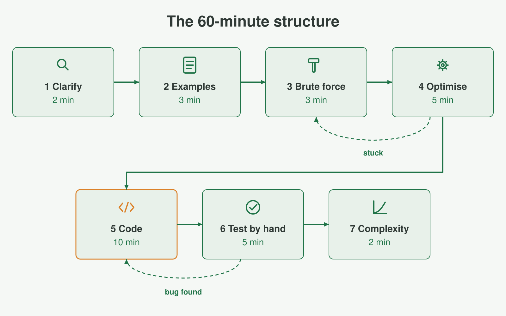

*Figure 20.8.1. The 60-minute structure, as a diagram.*

Clarify means asking about input size, input type, duplicates, empty input, and what to return when there is no answer. Think of it as the questions a careful engineer asks before opening a ticket. Examples means writing two small cases and one edge case on the screen, with the expected output. Brute force means saying the obvious solution and its cost, even if you will not code it. Optimise means asking what the brute force repeats, then removing that repetition with a hash map, a sort, a heap or a window.

For a log problem, a clarifying question might be whether lines are guaranteed to have all fields, or whether a missing status means a failure or just bad data. Those answers change the parser, so asking them first is cheaper than rewriting the parser later.

Code, test and complexity come last. The times above are my planning figures for a 25-minute problem, not Nebius requirements. If you spend 15 minutes before the first line of code, you will be rushed. If you spend none, you will rewrite. The time you put into the first three steps is the time that keeps the coding step short. **Say the brute force out loud before you try to be clever, because it proves you can solve the problem and gives you a baseline to improve.**

### 3. Clarify and use examples as a specification

An interviewer says: "Compress a string." That is not a specification yet. Does "aabcccccaaa" become "a2b1c5a3" or "a2bc5a3"? What if the result is longer than the input? Is the input only lowercase letters? These questions are not stalling. They are the work. The string compression question reported by one candidate has at least three valid readings, and each one gives a different function, so a candidate who codes the first reading they imagine may solve a problem nobody asked for.

Ask three kinds of question. Ask about the input: size, type, range, sorted or not, duplicates, can it be empty. Ask about the output: what to return when nothing matches, whether order matters, whether ties need a rule. Ask about the environment: does it fit in memory, is it called once or many times, can I use the standard library. Each answer changes which solution is acceptable, so each question earns its place.

Then write the examples as the interviewer's contract. In the harness later in this chapter, an example is a pair of arguments and expected value, so your examples become tests with no extra typing. If you wrote "aaa goes to a3" and "abc stays abc", you have also settled the rule for results that are not shorter. **State your assumptions as examples, and let the interviewer correct them in the first three minutes instead of the last three.**

### 4. How to think aloud without rambling

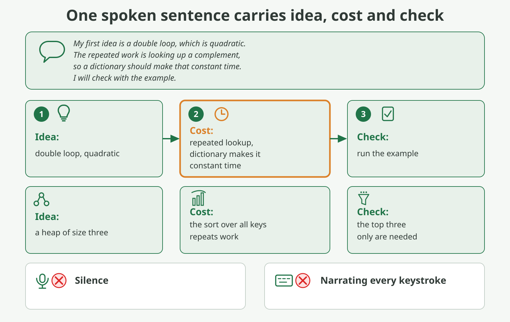

*Figure 20.8.2. A think-aloud sentence has three parts, the idea, its cost and the check, which gives the interviewer something to react to.*

Thinking aloud is a skill with a shape. Use short, structured sentences with a fixed vocabulary. "My first idea is a double loop, which is quadratic. The repeated work is looking up a complement, so a dictionary should make that constant time. I will check with the example." That takes a few seconds to say, and it gives the interviewer three things to react to: the idea, the cost and the check. Practise the shape until it comes out without effort.

Here is the same skill applied to a top-k question. You might say, "I need the three endpoints with the most errors. The brute force is to count everything and sort, which is fine for small logs. What repeats is the sort over all keys, and I only need the top three, so a heap of size three should do." Each sentence gives the interviewer one thing to check, and none of them requires a keystroke.

Avoid two failure modes. The first is silence. The second is narrating every keystroke, which buries the useful parts under noise. Speak at decisions: choosing a structure, choosing a loop bound, handling an edge case. While you type routine lines such as a loop header, silence is fine. A useful test is to ask whether the interviewer could learn something from your next sentence. If yes, say it. If not, keep typing.

Use these sentence starters until they feel natural. "The input could be..." for clarifying. "The brute force is..., which costs..." for the baseline. "What repeats here is..." for optimising. "I will name this because..." for code. "Let me trace the example." for testing. "If the input no longer fits in memory, then..." for follow-ups. Having the starters ready means you spend your attention on the problem, not on the sentence.

Try saying the starters aloud while you cook or walk. The goal is to make them sound like your own words, so that in the round they come out without a search.

**Narrate decisions, not keystrokes.**

### 5. Recovering when you are stuck

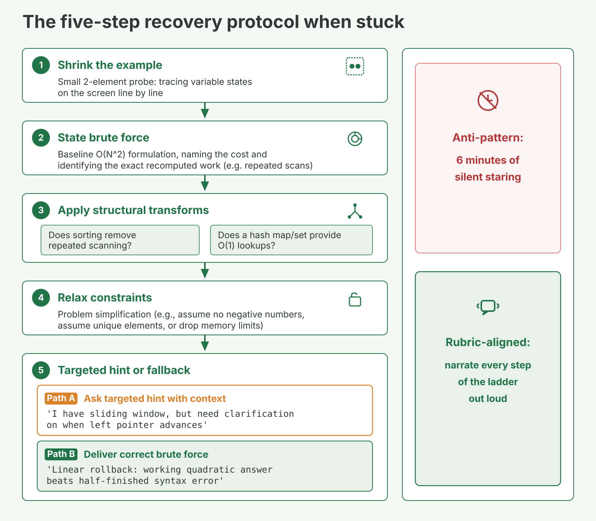

*Figure 20.0.0. When mental block strikes, work down the five-step recovery ladder out loud rather than remaining silent.*

Every candidate gets stuck, including people who have done this many times. The interviewer is watching what you do next, and that is the part that counts. Nebius's page tells you to ask for hints, which means asking is expected and not a failure. A good request is specific: "I have the sliding window idea but I am not sure when to move the left pointer. Can you confirm the window must contain no repeats?" A vague request like "I am stuck" gives the interviewer very little to work with.

It also helps to say what you already know before you ask. "I know the counting part, and I am stuck on the tie rule" is a request the interviewer can answer in one line. It shows you have done the work and only need a nudge on one point.

Use a fixed checklist when your mind goes blank. First, go back to your smallest example and trace it by hand, writing the state of each variable. Second, say the brute force and its cost, then ask what it recomputes. Third, ask whether sorting the input or using a hash map removes the repeated work. Fourth, solve a smaller version: a shorter input, one fewer constraint. Fifth, ask for a hint, saying what you tried. Each step is small enough to do under pressure.

The checklist works because each step produces something you can see on the screen. A traced example gives you values to read, a smaller input gives you a shorter problem, and a named brute force gives you a sentence to build on. Your mind may stay blank, but the screen still gives you something to work from.

If time is nearly gone, deliver something correct and say what is missing. A working brute force with a clear statement of "this is quadratic, and here is the improvement I would make" scores better than half a clever solution that does not run. Switching to the brute force is not giving up. It is the same decision you make in an incident when you roll back instead of debugging live. A rollback buys time, and so does a correct slow answer.

A useful sentence to have ready is "I have a correct version of the slow approach, and this is the change I would make next." It tells the interviewer that the solution is real, and that you know where the next gain would come from.

**When stuck, shrink the example, never the silence.**

### 6. Writing code that runs first time in a plain editor

![A loop that takes s[1:] on every step copies a shrinking list each time so the total cost is quadratic, while passing an index copies nothing, and deque popleft replaces list pop(0).](./img/p3-2008-slice-copy-cost.svg)

*Figure 20.8.3. Pass indexes instead of slicing, and use a deque instead of pop(0), because each slice or pop(0) touches every remaining item.*

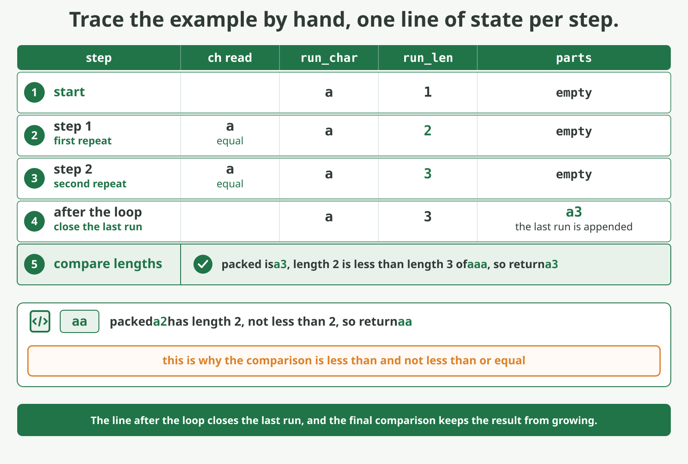

*Figure 20.8.4. Tracing the example by hand shows each variable at each step, including the final comparison that decides between the packed form and the original.*

A secondary source says some rounds use a plain editor and do not let you run the code. Assume the worst. Picture a shared document with no run button, and an interviewer watching you type. In that case the main danger is not the algorithm. It is a typo, an off-by-one error, or a variable that was never defined. The defence is writing in a style that is easy to read back, because you will be reading it back in your head.

Picture a dull but common case. You have a function half written, and the typo in its first line stops the whole thing from running. In a round like that, reading your own code slowly and naming each variable is worth more than a clever idea you cannot check.

Four habits do most of the work. Use names that say what the thing is: `last_seen`, not `d`; `run_len`, not `c`. Write small functions, each doing one job, so you can test them in your head. Prefer a plain loop over a clever one-liner, because a loop can be traced line by line. Handle the empty input first, with an early return, because that is where most bugs live. None of these habits is advanced. They are what makes code readable under pressure.

Avoid tricks you cannot explain. A nested comprehension with a conditional and two function calls will take you longer to check than three plain lines. Avoid reusing one variable for two meanings, because the second meaning quietly breaks the first. Avoid mutating the input unless the interviewer asks for it. Also write the function signature and a one-line docstring first, because the docstring is a written contract you can test against.

A practical test is to read each line of your code aloud and say what it does in plain words. If a line needs a pause, rewrite it into two lines. Plain lines are easier to check and easier for the interviewer to follow.

Here is the string compression function from the practice code. Read it as a model of the style: one pass, named state, early return for empty input, and a documented assumption. Notice that the docstring states the example and the open question together, so a reader sees both at once.

Read the function in order. The first two lines handle the empty input and return early. The loop walks the string once, keeping the current character and a count. The line after the loop closes the last run, which is the line most candidates forget. The final line compares the packed form with the original, so the function never returns something longer than it received.

```python
def compress(s):
    """'aabcccccaaa' -> 'a2b1c5a3'. Return s if the result is not shorter.

    Ask first: should a single letter keep its '1'? Here it does.
    """
    if not s:
        return s
    parts = []
    run_char, run_len = s[0], 1
    for ch in s[1:]:
        if ch == run_char:
            run_len += 1
        else:
            parts.append(run_char + str(run_len))
            run_char, run_len = ch, 1
    parts.append(run_char + str(run_len))
    packed = "".join(parts)
    return packed if len(packed) < len(s) else s
```

The line after the loop is the classic bug. The last run is never closed inside the loop, so you must append it after. Many first attempts forget this, and the output looks almost right, which makes the bug harder to find. Building a list and joining at the end also matters. Python strings cannot change, so repeated `+=` can copy the string each time. The Python 3.12 FAQ says the total cost of concatenating many strings is quadratic in the total length in the general case, and recommends a list and `str.join`. CPython sometimes grows a plain local variable in place, so the slowdown does not always show. In a test on 2026-11-09, 200,000 appends took 0.007 s in a plain local loop but about 0.37 s once a second name referred to the string. The list and join version took 0.0035 s. Do not rely on the in-place shortcut in an interview.

**Write the plain version, trace it once, and only then consider whether it needs to be shorter.**

### 7. Testing by hand with edge-case checklists

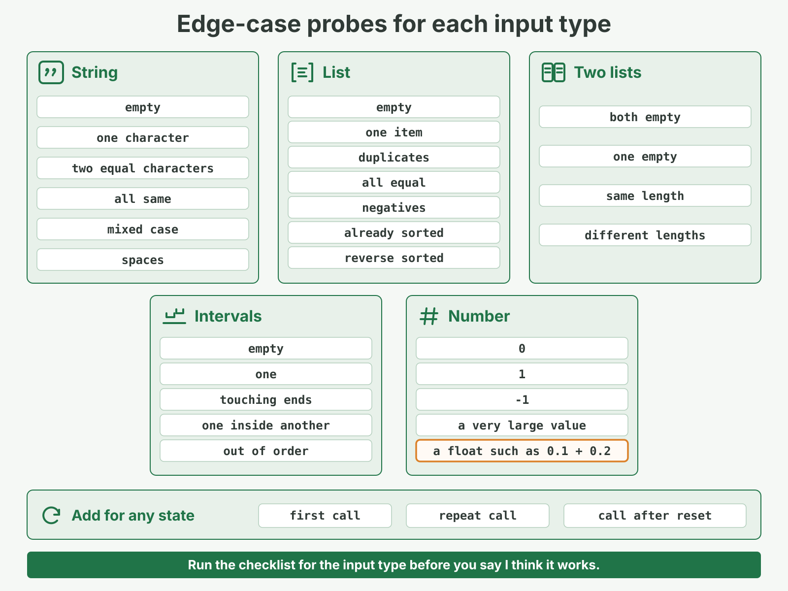

*Figure 20.8.5. Edge-case probes for strings, lists, two lists, intervals and numbers, to run before saying the code works.*

The interviewer asked you to "review code for errors before submitting", in the official page's words. Do it in a fixed order, so the review does not depend on your mood. Trace the example you wrote at the start. Then trace the smallest input. Then trace one input that hits the special branch, such as a repeat at the end of the string. Say the values of the variables as you go, because a spoken value is easier for the interviewer to follow than a silent check.

An edge-case checklist saves you from inventing cases under pressure. Keep one per input type and run through it every time. The idea is that the same kinds of input cause the same kinds of bug, so a list of those inputs catches most of them. The practice code stores them in `EDGE_CHECKLISTS`.

| Input type | Probes to try |
|---|---|
| String | empty, one character, two equal characters, all same, mixed case, spaces |
| List | empty, one item, duplicates, all equal, negatives, already sorted, reverse sorted |
| Two lists | both empty, one empty, same length, different lengths |
| Intervals | empty, one, touching ends, one inside another, out of order |
| Number | 0, 1, -1, a very large value, a float such as 0.1 + 0.2 |

For anything with state, add three more probes: first call, repeat call, and call after reset. For anything with a window, probe a window larger than the input. For anything with a limit, probe exactly the limit, one under and one over.

Two further techniques help. A **stress test** compares your fast solution with an obvious slow one on many small random inputs. You can run it only when code runs, but it catches the bugs that hand tracing misses, so use it in your practice. The other technique is to deep-copy the input before each call, so that a function that changes its input cannot hide a bug in the next case. Both are in the harness below.

**Run the checklist for the input type before you say "I think it works".**

### 8. A reusable harness for practice

Practice should feel like the interview. This harness is small enough to retype from memory in a plain editor. It takes a function and a list of cases, runs each case on a deep copy of the arguments, catches exceptions, compares in exact, unordered or tolerance mode, and prints a line per case with the time. `stress` compares a fast and a brute solution on random inputs. Read the code once for the shape, then close it and type it yourself.

```python
# code/part20/c08_check.py
"""A tiny testing harness for the coding round (chapter 20.8).

Paste the part you need into a plain editor. It uses only the standard library.
"""
import copy
import math
import random
import time


def _same(got, want, unordered, tol):
    if unordered:
        try:
            got, want = sorted(got), sorted(want)
        except TypeError:
            pass
    if tol is not None and isinstance(got, float) and isinstance(want, float):
        return math.isclose(got, want, rel_tol=tol, abs_tol=tol)
    return got == want


def check(fn, cases, unordered=False, tol=None, verbose=True):
    """Run fn on (args, expected) pairs. Return the list of failures.

    Each call gets a deep copy of args, so a function that changes its
    input cannot hide a bug in the next case. An exception counts as a failure.
    """
    failures = []
    for i, (args, want) in enumerate(cases):
        if not isinstance(args, tuple):
            args = (args,)
        start = time.perf_counter()
        try:
            got = fn(*copy.deepcopy(args))
        except Exception as exc:  # report, do not stop
            got = "raised %s: %s" % (type(exc).__name__, exc)
            ok = False
        else:
            ok = _same(got, want, unordered, tol)
        ms = (time.perf_counter() - start) * 1000
        if verbose:
            print("%-4s case %d args=%r got=%r want=%r (%.2f ms)"
                  % ("ok" if ok else "FAIL", i, args, got, want, ms))
        if not ok:
            failures.append((i, args, got, want))
    if verbose:
        print("%d of %d passed" % (len(cases) - len(failures), len(cases)))
    return failures


def stress(fast, brute, make_input, runs=300, seed=0):
    """Compare a fast solution with a slow obvious one on random small input.

    Returns the first input where they differ, or None.
    """
    rng = random.Random(seed)
    for _ in range(runs):
        args = make_input(rng)
        if fast(*copy.deepcopy(args)) != brute(*copy.deepcopy(args)):
            return args
    return None
```

Use it like this. Each case is a pair of arguments and the expected result. Pass a tuple for several arguments. The call below checks three cases at once, including the empty string, which is the one most candidates forget.

```python
from c08_check import check
from c08_edge_cases import compress

check(compress, [("", ""), ("aaa", "a3"), ("abc", "abc")])
```

The file `code/part20/c08_edge_cases.py` holds six solved problems with the checklists as a dictionary. Its tests in `test_c08_edge_cases.py` run each function against its edge cases. Reading the tests is the fastest way to see what a good checklist looks like, because each test is a probe you can copy into your own practice. The functions are `compress`, `two_sum`, `top_k_frequent`, `merge_intervals`, `valid_brackets` and `longest_unique_window`. Their patterns, such as windows and heaps, are taught in c20-09 and the larger set of problems is in c20-11.

The tests in `test_c08_check.py` check the harness itself, including the case where a function mutates its input and the case where a faulty fast solution is caught by `stress`. A harness you do not trust is worse than none, because a silent bug in the checker gives you false confidence in your solutions.

**Retype the harness once a week until you can write it in five minutes.**

### 9. Python tools that save time

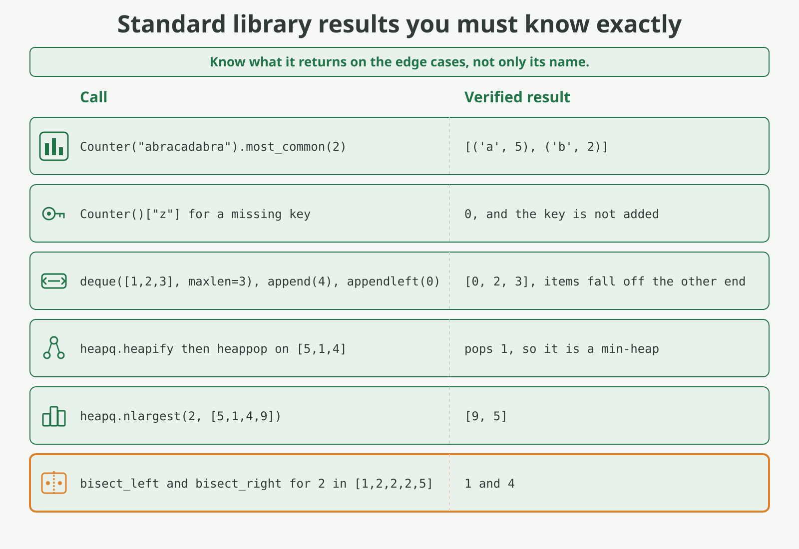

*Figure 20.8.6. Verified results of common Python standard library calls, including Counter, deque with maxlen, heapq and bisect edge cases.*

You are strong in Python, so the point here is to know exact behaviours, because the interviewer will ask "what does that return?" Every result below was produced by running `code/part20/c08_stdlib_tour.py` under Python 3.12.7 on 2026-11-09. The Fluent Python book, chapter 3, says that dict keeps insertion order since Python 3.6, which matters later. A tool you know by name is not enough. You need to know what it returns on the edge cases.

| Tool | Exact behaviour verified |
|---|---|
| `Counter("abracadabra").most_common(2)` | `[('a', 5), ('b', 2)]` |
| `Counter()["z"]` for a missing key | `0`, and the key is not added |
| `Counter("ab") + Counter("bc")` | `Counter({'b': 2, 'a': 1, 'c': 1})` |
| `defaultdict(list)` after only reading `d["missing"]` | the key now exists with `[]` |
| `deque([1,2,3], maxlen=3)` then `append(4)` then `appendleft(0)` | `[0, 2, 3]`, items fall off the other end |
| `heapq.heapify` then `heappop` on `[5,1,4]` | pops `1`, so it is a min-heap |
| `heapq.nlargest(2, [5,1,4,9])` | `[9, 5]` |
| `bisect_left` and `bisect_right` for 2 in `[1,2,2,2,5]` | `1` and `4` |
| `bisect_left` for 3 in the same list | `4`, the insertion point |
| `accumulate([1,2,3,4])` | `[1, 3, 6, 10]` |
| `pairwise("abcd")` | `[('a','b'), ('b','c'), ('c','d')]` |
| `groupby("aabbbc")` run lengths | `[('a',2), ('b',3), ('c',1)]` |
| `len(list(product("ab", repeat=3)))` | `8` |
| `fib(30)` with `lru_cache`, then `cache_info().misses` | `832040` and `31` |
| `statistics.median([1,2,3,4])` | `2.5` |
| `statistics.quantiles([1,2,3,4,100], n=4)` | `[1.5, 3.0, 52.0]` |
| `statistics.mean([1,2,3,4,100])` against `median` | `22` against `3` |

Several of these are answers to follow-up questions. A max-heap does not exist in `heapq`, so negate the values on the way in and out. `bisect_left` finds the first position where you could insert and keep order, so it is the lower bound. `groupby` only groups neighbouring equal keys, so you must sort first, as the pitfalls below show. `pairwise` needs Python 3.10 or newer. When an interviewer asks about one of these, you can answer from memory instead of guessing.

A dataclass with `order=True` compares fields in order, and `field(compare=False)` removes a field from comparison. In the tour, `Job(1, "x") == Job(1, "y")` is `True` for that reason. This is useful for putting jobs on a heap. A regular expression with named groups gives readable log parsing, and the tour parses `10.0.0.7 - GET /v1/chat 503 12ms` into the address, status and latency. The mean of 22 against the median of 3 is the one-line reason that SREs quote percentiles and not averages.

The Learning Python book, chapter 16 onwards, and Fluent Python give the language-level background. The handbook's own Python chapters cover it in depth: [idiomatic Python, the data model, comprehensions and generators](../part-03-python/03-idiomatic-python-the-data-model-comprehensions-generators.md) and [functions, scopes and arguments](../part-03-python/14-functions-scopes-and-arguments-in-depth.md). Do not re-read them for the round. Use them to fill the gaps the harness shows you, and only the gaps.

**Know the five or six tools by exact behaviour, and say which one you chose and why.**

### 10. Go equivalents, briefly

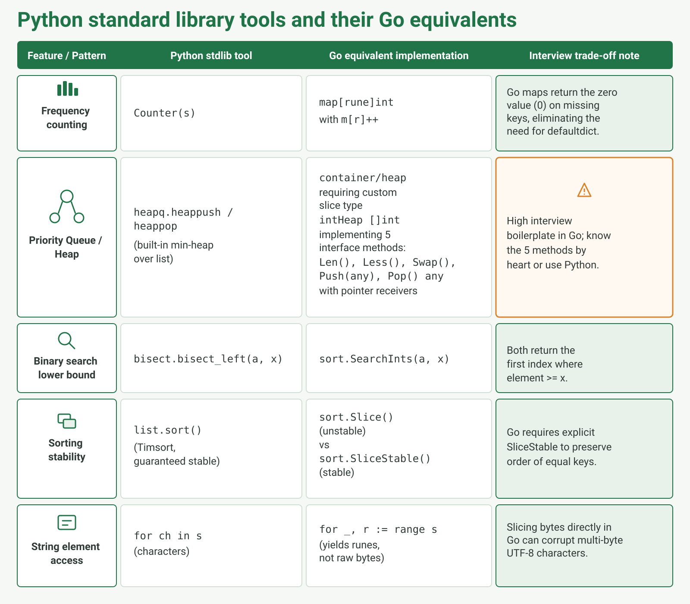

*Figure 20.0.0. Go equivalents for Python coding patterns require explicit boilerplate, especially the five container/heap interface methods and sort.SliceStable.*

Nebius names Go as an acceptable language. If you are weaker in Go than Python, use Python, because the interview grades problem solving and not language choice. If you do use Go, know that it has no built-in counter, no heap function and no ordered-set type. The standard library gives you `map`, `container/heap`, `sort.Slice`, `sort.SliceStable` and `sort.SearchInts`. Each of these needs a small adjustment from what you know in Python, and the adjustments are the part to practise.

The file below was run with Go 1.23.2. `go vet` and `go test` both passed. The Go test file has to end in `_test.go`, which is why it does not follow the `test_c08_` prefix. Read the file for the shape of each helper. The comments say which Python tool each Go function stands in for.

```go
# code/part20/c08_go/c08_toolkit.go
// code/part20/c08_go/c08_toolkit.go
// Go equivalents of the Python toolkit in chapter 20.8.
package c08toolkit

import (
	"container/heap"
	"sort"
)

// Count is Counter: a map with a zero default for missing keys.
func Count(s string) map[rune]int {
	m := map[rune]int{}
	for _, r := range s {
		m[r]++
	}
	return m
}

// intHeap is a min-heap of ints, the shape heapq gives you for free in Python.
type intHeap []int

func (h intHeap) Len() int           { return len(h) }
func (h intHeap) Less(i, j int) bool { return h[i] < h[j] }
func (h intHeap) Swap(i, j int)      { h[i], h[j] = h[j], h[i] }
func (h *intHeap) Push(x any)        { *h = append(*h, x.(int)) }
func (h *intHeap) Pop() any {
	old := *h
	n := len(old)
	x := old[n-1]
	*h = old[:n-1]
	return x
}

// TopK returns the k largest values, largest first, using a size-k min-heap.
func TopK(nums []int, k int) []int {
	h := &intHeap{}
	for _, v := range nums {
		heap.Push(h, v)
		if h.Len() > k {
			heap.Pop(h)
		}
	}
	out := make([]int, h.Len())
	for i := len(out) - 1; i >= 0; i-- {
		out[i] = heap.Pop(h).(int)
	}
	return out
}

// LowerBound is bisect_left: first index whose value is >= x.
func LowerBound(a []int, x int) int { return sort.SearchInts(a, x) }

// Pair is a row used to show that SliceStable keeps equal keys in input order.
type Pair struct {
	Name string
	Rank int
}

func SortByRank(p []Pair) []Pair {
	out := append([]Pair(nil), p...)
	sort.SliceStable(out, func(i, j int) bool { return out[i].Rank < out[j].Rank })
	return out
}

// MergeIntervals merges closed intervals; touching intervals merge.
func MergeIntervals(in [][2]int) [][2]int {
	a := append([][2]int(nil), in...)
	sort.Slice(a, func(i, j int) bool { return a[i][0] < a[j][0] })
	var out [][2]int
	for _, iv := range a {
		if n := len(out); n > 0 && iv[0] <= out[n-1][1] {
			if iv[1] > out[n-1][1] {
				out[n-1][1] = iv[1]
			}
		} else {
			out = append(out, iv)
		}
	}
	return out
}
```

The differences to remember are these. A missing map key returns the zero value, so `m[r]++` works without a default dictionary. A heap needs five methods because it is an interface, and that surprises people who expect a single call. `sort.Slice` is not stable, so use `sort.SliceStable` if equal keys must keep their order. A string is a byte sequence, and ranging over it yields runes. This costs a candidate who treats a string as an array of characters, because the characters and the bytes do not always line up.

**Pick the language you can write without looking things up, and say why.**

### 11. Pitfalls that cost points

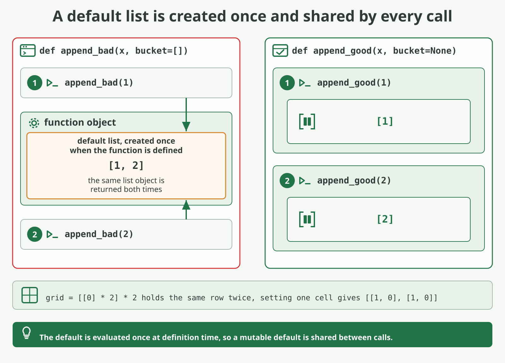

*Figure 20.8.7. Use None as the default argument and create the list inside the function.*

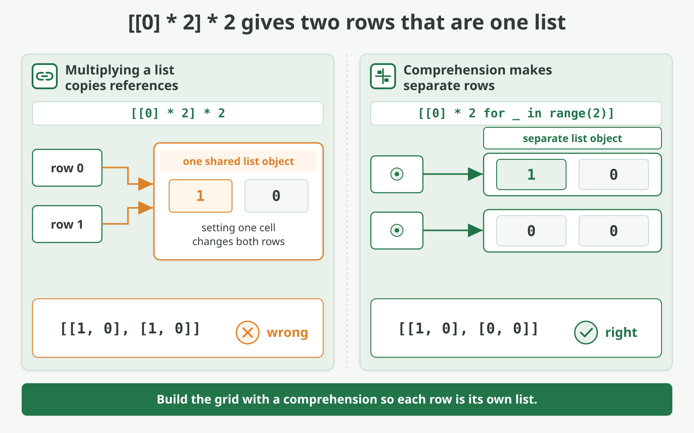

*Figure 20.8.8. Repeating a list with the multiply operator copies references to the same row, so a comprehension is needed for independent rows.*

These are the errors that wreck a correct idea. All of them are in `code/part20/c08_pitfalls.py`, with tests. The outputs below were run on Python 3.12.7. Each one is small, and each one has cost someone a round, so they are worth a slow read now.

A mutable default is shared between calls. Picture a function that collects items into a list, where the list is the default argument. The first call fills it, and the second call sees the first call's items too. Fluent Python, chapter 6, shows it with a bus class and says the fix is `None` as the default. Learning Python, chapter 18, warns the same way. Calling `append_bad(1)` and then `append_bad(2)` returns the same list object both times, holding `[1, 2]`. The good version, which creates the list inside the function, returns `[1]` then `[2]`.

Integer division differs from float division. Python gives `7 / 2` as `3.5` and `7 // 2` as `3`. Floor division rounds toward minus infinity, so `-7 // 2` is `-4`, and `-7 % 3` is `2`. This matters in binary search midpoints and in modular arithmetic on negative numbers. A midpoint calculation that works for positive numbers can quietly go wrong when the range is shifted below zero.

Multiplying a list copies references. The grid `[[0] * 2] * 2` holds the same row twice, so setting one cell changes both rows: `[[1, 0], [1, 0]]`. Build the grid with a comprehension instead, and each row is separate, which gives `[[1, 0], [0, 0]]`. The bug is easy to miss in a plain editor, because the code looks tidy and the output looks almost right.

Slicing makes a copy. `data[1:4]` is a new list, and changing it does not change `data`. On a list of one million items, `a[1:]` takes about 2.7 ms on a Mac. So a loop that slices on every step, such as `s[1:]` in a recursion, turns a linear algorithm into a quadratic one. Pass indexes instead. Similarly `list.pop(0)` moves every other item. On a 100,000-item list, `pop(0)` with `append` costs about 14 microseconds, against about 0.05 for a `deque` doing `popleft` and `append`. These are single measurements on one machine, so trust the ratio and not the digits. Systems Performance, chapter 2, gives a time-scale table that is the right mental model: a copy goes through memory, so cost scales with size.

A good mental model is to think of a slice as a photocopy. Copying a short page is quick, and copying a long book every time you need one line is slow. The loop that slices at each step is the one that keeps photocopying the book.

The recursion limit is 1000 by default. `sys.getrecursionlimit()` returned `1000`, and recursing 5000 deep raised `RecursionError`. For a depth that large, write the loop or use an explicit stack. Raising the limit is a risky answer. The Python 3.12 documentation for `sys.setrecursionlimit` says a too-high limit can lead to a crash, because the limit exists to protect the C stack. In my test on Python 3.12.7, a pure Python function recursed 5,000,000 deep after raising the limit without crashing, so the risk depends on the version and on recursion through C code. Treat the crash as a documented risk and not as something you can reproduce on demand.

The safest answer in an interview is to rewrite the recursion as a loop or an explicit stack, and to say why. Raising the limit is the answer to avoid, because it moves the failure point rather than removing it.

Dictionary order is insertion order, and Fluent Python, chapter 3, confirms it. In the run, adding `z` then `a` gave the key list `['z', 'a']`. Two dicts with the same items but different insertion order still compare equal. So you can rely on order for output, but not for equality. Keep the two ideas separate when you answer, because mixing them up is a common slip.

This also helps with output that must look stable. If you print counts from a dict, the insertion order is predictable, and that predictability is what makes a test easy to write. Do not build your correctness on it when a sort gives you a rule you can state.

Sorting is stable. Sorting `[("b",1),("a",1),("c",0)]` by the second field gave `[('c',0),('b',1),('a',1)]`, and the two items with rank 1 kept their input order. A stable sort keeps the original order of equal keys, which matters when you sort by one field after another. In Go, use `SliceStable` for the same promise.

Floats do not compare exactly. `0.1 + 0.2 == 0.3` is `False` and `math.isclose(0.1 + 0.2, 0.3)` is `True`. The reason is that binary floating point cannot store 0.1 or 0.2 exactly, so the sum drifts a little. Use integers for money and counts, and use a tolerance for measurements.

A tolerance is a rule you choose, not a fact about the data. State the tolerance you used, and say why it fits the measurement. An interviewer who asks about money will expect integers, because cents can be stored exactly.

Changing a list while looping over it skips items. Removing the even numbers from `[2, 4, 6, 8]` inside a `for` loop left `[4, 8]`. The loop moves forward while the list shrinks under it, so it steps over the item that slid into the gap. Build a new list, or loop over a copy.

`itertools.groupby` groups only neighbours. Running it on the unsorted string "aabaa" gave `[('a', 2), ('b', 1), ('a', 2)]`, so `a` appears twice. Sort first, or use a `Counter`. The mistake looks harmless until a count comes out wrong in the middle of a round.

**Before you submit, scan your code for each of these ten, and say that you did.** Saying the scan out loud is itself evidence that you know where the traps are, and it gives the interviewer a reason to trust the answer.

### 12. Follow-ups: when the parameters change

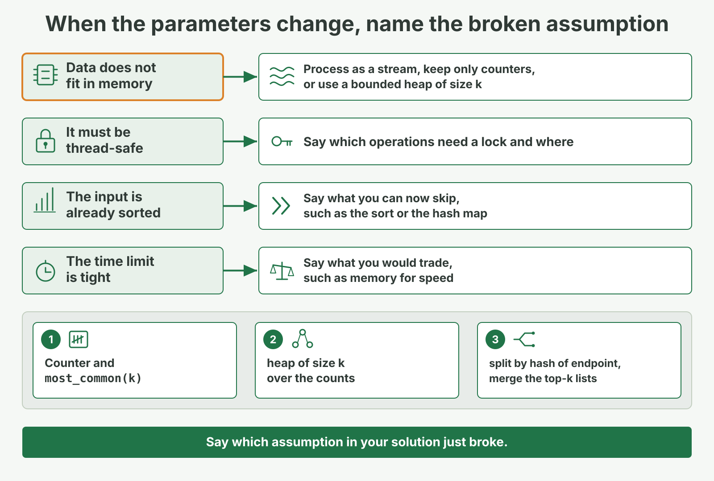

*Figure 20.8.9. Four common changes to a coding problem, each paired with the standard answer and the assumption it breaks.*

Nebius lists "adapt if parameters change". Expect the interviewer to say: "Now the input has a billion lines." Or: "Now it must be thread-safe." Or: "Now the list is sorted." These are not traps. They test whether you understand why your solution works, and a solution you understand bends without breaking.

Prepare standard answers. If the data does not fit in memory, process it as a stream and keep only counters, or use a bounded heap of size k. If it must be thread-safe, say which operations need a lock and where. If the input is already sorted, say what you can now skip, such as the sort or the hash map. If the time limit is tight, say what you would trade, such as memory for speed. Having these ready means the follow-up becomes a short conversation.

For the top-k errors question at the start, the answer has three layers. The simple version counts with a `Counter` and takes `most_common(k)`. The memory-bounded version keeps a heap of size k over the counts. When the number of distinct endpoints is itself too large, you split the input by a hash of the endpoint so each worker holds only its share of keys, then merge the per-worker top-k lists. The last step is my reasoning and not a Nebius answer.

**When the parameters change, say what assumption in your solution just broke.**

### 13. A four-week practice routine

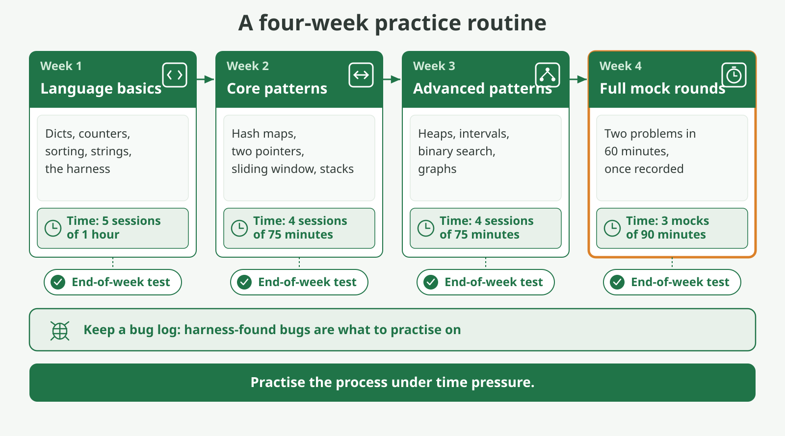

*Figure 20.8.10. The four-week practice routine, moving from language basics to full mock rounds, with a short test at the end of each week.*

The plan fits a person with a job. It is my suggestion and not a Nebius requirement. Budget about five hours a week, and treat the weeks as a sequence where each one builds on the last. The problem set is in c20-11 and the patterns are in c20-09.

Each week should end with a small test of the skill for that week. Week one ends when the harness runs cleanly, week two when you narrate a full problem, and so on. The test tells you whether to move on or repeat the week.

| Week | Focus | Time budget |
|---|---|---|
| 1 | Language basics: dicts, counters, sorting, strings, the harness. Do 6 easy problems in plain-editor mode with no running code, then run the harness. | 5 sessions of 1 hour |
| 2 | Core patterns: hash maps, two pointers, sliding window, stacks. Do 8 problems, each 25 minutes, narrating aloud. | 4 sessions of 75 minutes |
| 3 | Heaps, intervals, binary search, graphs. Do 6 problems, plus the stress test for each. Add one Go solution per session if you plan to use Go. | 4 sessions of 75 minutes |
| 4 | Full mock rounds: two problems in 60 minutes, once with a friend who changes the parameters at the end, once recorded. Review pitfalls and complexity. | 3 mocks of 90 minutes, plus review |

Keep a log with the problem, minutes taken, bugs found by hand, bugs found by the harness, and the one thing you would do differently. The harness-found bugs are what to practise on, because they are the blind spots you cannot see by reading your own code. When the number of harness-found bugs falls to zero for three problems in a row, you are ready for the plain-editor round.

A simple log can be a plain text file with one line per problem and a short note after it. The format matters less than the habit of writing down the bug you missed, because the same bug tends to come back under pressure.

Review the log once a week. The pattern in the bugs is more useful than any single problem, because it tells you which habit to fix first.

**Practise the process under time pressure, because knowing the answer is not the skill being graded.**

## How to answer out loud

### The first two minutes of any problem

The interviewer has just given you a problem, and the clock has started. Say: "Let me restate the problem to check I understand it." Restate it in one sentence. Then ask three questions: size of the input, what to return on empty or impossible input, and whether I can use the standard library. Write two examples and one edge example. Then say: "Is that what you meant?"

Expect the interviewer to refine the problem here. Do not take it as a sign that you did something wrong. Refinement is the normal shape of a good answer, and it often shows that the interviewer is engaged. If they say "use your judgment", write the assumption down on the screen and move on.

If the refinement changes the whole problem, that is still a good sign. It means the interviewer is testing your judgement about which parts of your plan survive the change.

### Presenting brute force and the improvement

You have a brute force solution in mind, and the interviewer is waiting for the next move. Say: "The brute force is this, and it costs this much. What it repeats is this. So I will use this structure, and the cost becomes this." Always give cost in both time and extra memory. A sample: "Two nested loops is quadratic time with constant memory. The repeated work is searching for the complement. A dictionary makes that lookup constant on average, so the total is linear time with linear extra memory."

The follow-up to expect is "can you do it in constant memory?" Have a sentence ready on the trade-off, even if you cannot solve it. Saying what you would give up to get less memory shows you understand the cost, and that is the thing the follow-up tests.

### Before running or submitting

You have written the code, and the interviewer wants to see it work. Say: "I will trace the first example, then an empty input, then the case where the pattern is at the end." Do it aloud with variable values. When you find a bug, say what it was and why. This is a point-scoring moment, not an embarrassing one, because it shows the interviewer your checking habit.

The follow-up to expect is "what is the complexity?" Give time and space, name the dominant term, and say which step dominates. For `top_k_frequent`, counting is linear in n and the heap step is about n log k in the worst case. Name the term that dominates, because that is the part that matters for large inputs.

### When the interviewer changes the problem

The interviewer has changed the problem in the middle. Say: "That breaks my assumption that the input is small. Let me think about what stays valid." Then name the part of the solution that survives and the part that needs to change. Do not start again from nothing, because most of the earlier work still holds.

### When you do not know

You are asked for a function you cannot recall. Say: "I do not remember the exact function name. I would look it up, and here is what it does." Then describe the behaviour and write a short version yourself. This is fine in an SRE interview, since the job does not require memorising an API. Guessing a name and presenting it as certain is not fine, because a wrong name in a confident voice costs more than an honest gap.

## Worked scenarios

### Scenario 1: string compression, start to finish

A teammate hands you a small utility and asks for a compression step that is fast and safe. Problem: "Compress a string: replace each run of equal characters with the character and the run length."

Clarify. Ask about single characters and results that are longer. Say the assumption: a single letter keeps its 1, and the function returns the original if the result is not shorter. Saying the assumption aloud gives the interviewer a chance to change it before you have written a line.

The single-character rule matters because it changes the output length. A one-letter run that keeps its count gives a longer string, so the comparison with the original decides whether the packed form is used. Stating the rule early keeps the examples and the code in agreement.

Examples. `"aabcccccaaa"` gives `"a2b1c5a3"`. `"abc"` gives `"abc"`, because `"a1b1c1"` is longer. `""` gives `""`. Each example teaches a rule, and the three together settle the rules the interviewer cares about.

Brute force. Count runs with nested loops, which is quadratic if you rescan. The improvement: one pass with a counter for the current run, and a list of pieces joined at the end. That is linear time and linear extra memory. Say the brute force first, because the interviewer can then see the improvement as a change and not as a magic trick.

Code. The `compress` function earlier. Test by hand. Trace `"aaa"`: `run_char` is `a`, `run_len` becomes 3, the loop ends, the last run is appended, giving `"a3"`, which is shorter than `"aaa"`, so it returns `"a3"`. Trace `"aa"`: the packed form is `"a2"`, which has length 2, not shorter than 2, so it returns `"aa"`. That check is why the comparison is `<` and not `<=`. The unit tests cover these cases and pass.

Read the trace as a story. Each step names one variable and one change. If the story ends with the output the example promised, the code has passed that example. If it does not, the trace shows you exactly which line to fix.

Follow-up: "What if I want the output in place, in a list of characters?" That needs two pointers, a reader and a writer, and a rule for writing counts above 9 as several characters. This variant has no implementation in the code folder. Say it is a different function with the same pattern, and offer to sketch it on the board rather than claiming it is done.

### Scenario 2: top error endpoints from a log

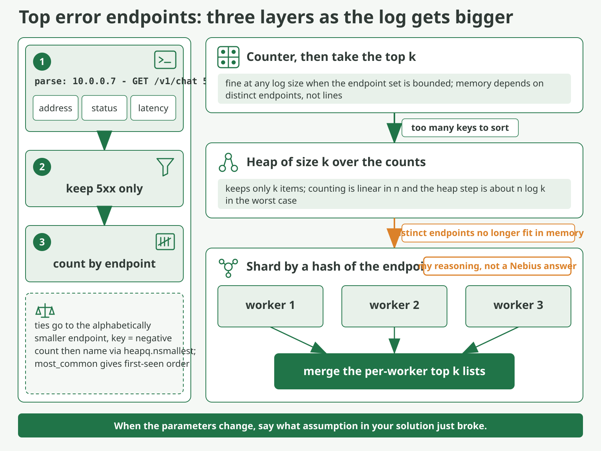

*Figure 20.8.11. Memory follows the number of distinct keys and not the number of lines, so the answer changes only when the distinct keys no longer fit.*

A log is full of lines from a busy gateway, and the on-call engineer wants the worst endpoints by name. Problem: given lines like `10.0.0.7 - GET /v1/chat 503 12ms`, return the three endpoints with the most 5xx responses.

This is the kind of question an on-call engineer asks at a bad moment. The answer has to be right, and it has to be explainable in a sentence to a manager who is waiting. A clean counter and a clear tie rule make both possible.

Clarify. Ask whether ties need a rule and what a malformed line should do. Assume ties go to the alphabetically smaller endpoint, and skip malformed lines. State both, because the interviewer may want a different tie rule and it is easier to change it now.

Approach. Parse with a regular expression that has named groups, as in the tour. Count 5xx by endpoint with a `Counter`. Take the top k with `heapq.nsmallest` and a key of negative count then name, which is how `top_k_frequent` gets a deterministic tie-break. Python's `most_common` gives equal counts in first-seen order, which is stable but is not the rule you stated. Name that difference out loud, since it shows you read the requirement and did not just reach for the convenient call.

Edge cases. An empty log. A line with no status code. All counts equal. `k` larger than the number of endpoints, which `top_k_frequent("ab", 5)` handles by returning both. Test these with the harness, and say which one you consider most likely to appear in production logs.

Follow-up: memory. If the endpoint set is bounded, a `Counter` is fine at any log size, because memory depends on distinct endpoints and not lines. Say that. If the distinct set is huge, shard by hash as described before. The point to make is that memory tracks the number of keys, not the number of lines, and that is the fact the interviewer is checking for.

### Scenario 3: you are stuck on merge intervals

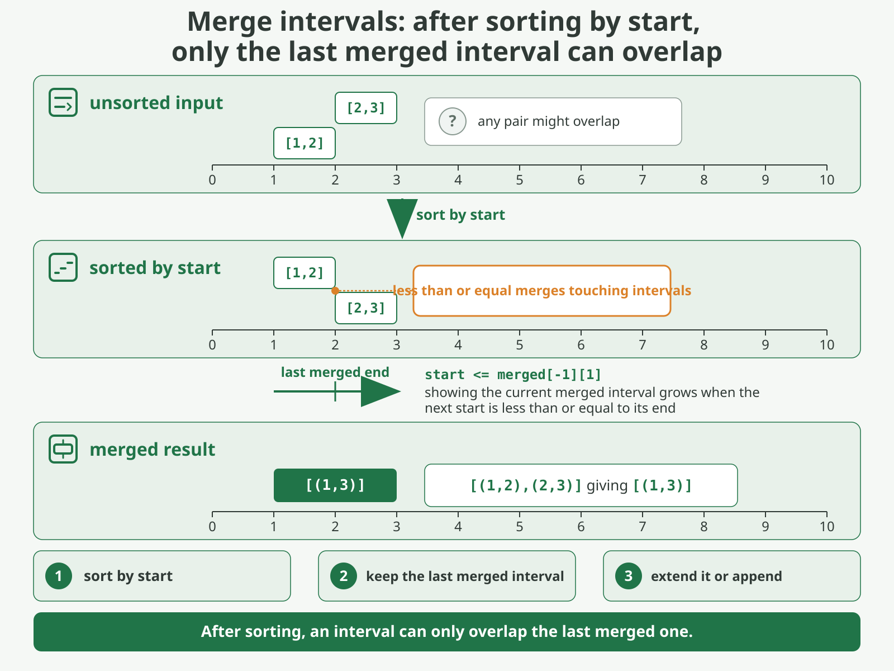

*Figure 20.8.12. Once intervals are sorted by start, each new interval can only overlap the most recent merged interval, so one sweep is enough.*

A scheduling tool has produced overlapping bookings, and you need to merge them before the report goes out. Problem: merge overlapping intervals. You have drawn two examples and cannot see the algorithm yet.

A useful first question is whether the intervals arrive in order. If they do, the problem is simpler. If they do not, the sort is the first move, and the interviewer will expect you to say so.

Step one: write the brute force aloud. "For each interval, compare with every other and merge if they overlap, repeat until nothing changes." That is at least quadratic, and saying it out loud gives you a baseline and a starting point for the next step.

Step two: ask what makes the comparison hard. Intervals are in any order, so any pair might overlap. What if they were sorted by start? Then an interval can only overlap the one right before it, since the previous merged interval has the largest end so far. This is the moment the problem clicks, so say the idea in one plain sentence before you write code.

A useful habit is to write the sorted example on the screen and trace the merge by hand before you write the loop. Seeing the previous interval shrink or grow in the trace is the fastest way to trust the logic.

Step three: write it. Sort, keep a merged list, and for each interval either extend the last merged interval or append. The key line is `start <= merged[-1][1]`, and the `<=` encodes the rule that touching intervals merge. Ask the interviewer if touching intervals should merge, because that is the common ambiguity.

Step four: test. `[(1,2),(2,3)]` gives `[(1,3)]`. `[(1,5),(2,3)]` gives `[(1,5)]`, which tests the `max`. `[(3,4),(1,2)]` tests the sort. The complexity is dominated by the sort, so it is n log n. The Go version in the toolkit passes the same cases, which shows the idea does not depend on the language.

A good closing sentence is "The example passes, the single interval passes, and the case where one interval sits inside another passes." Each claim names a case, so the interviewer can see what was actually checked.

## Hands-on lab

You will set up the harness and run everything. This takes about five minutes on a laptop. Steps 1 to 3 were run with Python 3.12.7, pytest 8.3.5 and Go 1.23.2. Work through the steps in order, because later steps assume the earlier ones passed.

Before you run a step, read its expected result. If the output does not match, stop and find out why before the next step. A mismatch in the first step is a clue about your environment, and it is far cheaper to find now than in the middle of a timed drill.

1. Change into the repository root and run the Python tests: `cd code/part20 && python3 -m pytest -q test_c08_*.py`. Expected result: 30 passed.
2. Run the Go tests: `cd code/part20/c08_go && go vet ./... && go test ./...`. Expected result: `ok  c08toolkit`.
3. Open a Python shell in `code/part20` and run `import c08_stdlib_tour as t; t.statistics_demo()`. Expected result: `(22, 3, 2.5, [1.5, 3.0, 52.0])`.
4. Break a function on purpose. In a scratch copy, change `<` to `<=` in `compress`, then run `python3 -m pytest -q test_c08_edge_cases.py`. Expected result: at least one failure on `"aa"`. This exact mutation was not run, so treat the result as the expected shape. The point is to see the harness catch a boundary bug, which is the skill the round is really testing.
5. Timed drill, which you do alone. Pick one problem from the practice set in c20-11, set a 25-minute timer, open a plain text editor with no autocomplete, and talk aloud while you work. Then run the harness. Count the bugs it finds that you did not find by hand. That count is your real score, because it shows where your checking is weakest.

## Drill questions

<details><summary>1. What does Nebius say it wants to see in the coding task?</summary>

Working, testable code in a language of your choice, with Python or Go named as examples. Also that you say your thinking aloud, ask for hints, review the code before submitting, offer alternatives and adapt if parameters change. The topic is classical algorithms and data structures.
</details>

<details><summary>2. What are the seven steps for a problem?</summary>

Clarify, examples, brute force, optimise, code, test by hand, and state the complexity. If testing finds a bug you go back to code, and if you are stuck you go back to the brute force.
</details>

<details><summary>3. Why say the brute force aloud?</summary>

It shows you can solve the problem, it gives a baseline cost, and it shows what repeats, which is where the improvement comes from. It is also a safe answer if time runs out.
</details>

<details><summary>4. You are stuck. What do you do, in order?</summary>

Trace the smallest example by hand. Say the brute force and what it recomputes. Ask whether a sort or a hash map removes that work. Solve a smaller version. Ask for a specific hint and say what you already tried.
</details>

<details><summary>5. What does `heapq.heapify` build, and how do you get a max-heap?</summary>

A min-heap in place, so `heappop` returns the smallest. For a max-heap, push negated values and negate again when you pop.
</details>

<details><summary>6. What do `bisect_left` and `bisect_right` return for 2 in `[1,2,2,2,5]`?</summary>

`1` and `4`. The left one is the first position where 2 could go, and the right one is after the last 2.
</details>

<details><summary>7. Why does `groupby("aabaa")` give three groups?</summary>

It groups only neighbouring equal keys. The two `a` runs are separated by `b`, so you get `a` twice. Sort first or use a `Counter`.
</details>

<details><summary>8. What is wrong with `def f(x, bucket=[])`?</summary>

The default list is created once when the function is defined and is shared by every call that omits it. Use `None` as the default and create the list inside the function.
</details>

<details><summary>9. Why is `s[1:]` inside a recursion a problem?</summary>

Slicing copies, so each step costs time proportional to the remaining length, and the total becomes quadratic. Pass indexes instead. One slice of a million-item list takes about 2.7 ms on a laptop.
</details>

<details><summary>10. The interviewer says the log no longer fits in memory. What do you say?</summary>

Process it as a stream. Keep counters for distinct keys, or a heap of size k if you want only the top k. If the distinct keys are too many, shard them by hash across workers and merge the top-k lists. Name the assumption that broke.
</details>

## Common mistakes and weak answers

- Silence for several minutes. Say what you are considering, even if it is only the brute force.
- Coding before examples. Write two examples first. They are your tests, and they settle ambiguity before it can cost you.
- A clever one-liner you cannot trace. Say "I will write the plain version first" and then write it.
- Forgetting empty input. Say "empty input returns X" before the loop, so the edge is handled in the first lines.
- Saying "I think it works" without a trace. Trace an example, an empty input and an end-of-input case aloud.
- Treating a hint as a failure. The official page tells you to ask for hints, so ask a specific one.
- Claiming a complexity you did not work out. Count the loops and the sort, then say time and space.
- Presenting a guessed API name as certain. Say what the function does and write it yourself.
- Over-optimising a problem the interviewer did not ask to optimise. Get a correct solution first, then ask whether to improve it.


## Connections to the rest of the handbook

The coding round rewards a short map of the material, so here is where each related chapter fits. The list below points you to the next step for each part of this chapter.

- c20-09 teaches the SRE-flavoured patterns: log parsing, sliding windows, heaps, intervals, rate limiters and retry with jitter.
- c20-10 covers complexity, latency numbers and how to test your own code aloud.
- c20-11 is the larger practice set with reference solutions.
- c20-07 is the Linux console lab set, the other practical round.
- c20-03 shows the same hypothesis and test method for a sick Linux box.
- The Part 3 chapters on [idiomatic Python](../part-03-python/03-idiomatic-python-the-data-model-comprehensions-generators.md), [functions and arguments](../part-03-python/14-functions-scopes-and-arguments-in-depth.md) and [objects and data structures](../part-03-python/12-objects-types-and-data-structures-in-depth.md) give the language depth.

## Sources and review notes

Sources and dates:

- Nebius SRE interview page, nebius.com/careers/interviews/sre, as recorded in `planning/VOLUME_20_NEBIUS_SRE_PLAN.md` section 1 on 2026-11-09. I did not refetch it. It is tagged official.
- Candidate reports as recorded in the plan, tagged report: two LeetCode easy or medium problems in one hour; a secondary source reporting medium to hard problems and plain editors; one Senior SRE software-engineer report with a string compression question. These are anecdotes.
- Fluent Python, 2nd edition, chapter 3 "Dictionaries and Sets" for insertion order, and chapter 6 "Object References, Mutability, and Recycling" for mutable parameter defaults.
- Learning Python, 6th edition, chapter 18 "Arguments" for mutable defaults.
- Systems Performance, 2nd edition, chapter 2 "Methodologies" for the streetlight anti-method and the time-scale table.
- Code run on 2026-11-09: Python 3.12.7, pytest 8.3.5, Go 1.23.2 on macOS. All behaviours in the tables and pitfalls come from running `c08_stdlib_tour.py` and `c08_pitfalls.py`.

Explicitly labelled inferences:

- The time allocations in the seven-step diagram, the practice routine and the answer outlines are my reasoning.
- The sharding answer to the log follow-up is my reasoning. Nebius has not published its coding problems.
- The advice that Python is safer than Go for a candidate who is stronger in Python is my judgement.

Not verified:

- The `<` to `<=` mutation in the lab was not run, and the in-place compression variant was not implemented.
- The timing figures for slicing and `pop(0)` are single runs on one laptop.
- I could not crash CPython 3.12.7 with a raised recursion limit. The crash claim rests on the documentation only.

### Verification log

Fetched 2026-11-09 from docs.python.org/3.12: the sys page, the programming FAQ and the collections page. Claims checked: 6. Confirmed: 4 (string concatenation cost and `str.join`, recursion limit crash warning, deque against `list.pop(0)` cost, default limit 1000 and `RecursionError` by running). Corrected: 2 (the `+=` claim is now sourced and measured, and the crash claim is now documented with the failed reproduction stated). Removed: 0. Still unverified: 0 factual claims. The sharding answer and the time allocations remain my labelled reasoning, and the laptop timings stay single runs.
- No `chain_gate`, lint or Mermaid gate result is claimed unless stated in the report to the supervisor.
