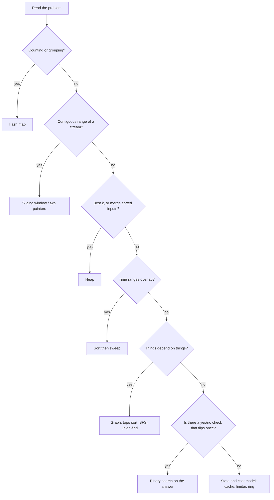

# 20.9 Algorithm patterns for SRE-flavoured problems

## What the interviewer is testing

The interviewer pastes a link to a shared editor and says: "Here is a log file with a few million lines. Tell me which endpoints are slowest, and which ones have been failing in the last five minutes." This chapter serves the coding round. Nebius states that the process includes at least one practical coding, algorithms or data-structures task. It also says you may use any language, should say your reasoning aloud, ask for hints and review your code before submitting.

One candidate reported two LeetCode easy-to-medium problems in a one-hour round. Nebius has not published its problems, so this chapter does not guess a list. It teaches the patterns behind most easy and medium problems, framed as SRE situations.

A realistic question in the interviewer's voice: "Implement a rate limiter that allows 100 requests per minute per API key. Then tell me what happens at the window boundary, and how you would change it to allow bursts."


## The core ideas

Every section below has the same parts. First the situation, then the idea in plain words, then a template you can type from memory. After the template come its cost, the SRE setting, the follow-up an interviewer adds, and the bug that most often sinks the answer. All code is in `code/part20/` with the prefix `c09_`, and the blocks here are exact copies of the files. The tests carry the prefix `test_c09_`.




| Pattern | Typical cost | SRE setting |
|---|---|---|
| Hash-map aggregation | O(n) time, O(distinct keys) memory | Log analysis, cardinality |
| Sliding window with deque | O(n) time, O(window) memory | Rolling error rate, peak in window |
| Two pointers | O(n) time, O(1) memory | Merging sorted logs, pairing values |
| Heap top-k | O(n log k) time, O(k) memory | Slowest endpoints, merging streams |
| Interval merge and sweep | O(n log n) time | Maintenance windows, GPU reservations |
| Rate limiters | O(1) per request for three of four | API quotas |
| LRU cache | O(1) per operation | Prefix and metadata caches |
| Consistent hashing | O(log N) lookup with N ring points | Sticky routing, sharding |
| Backoff with jitter | O(1) per retry | Client resilience |
| Topological sort | O(V + E) | Start order, Terraform-like plans |
| BFS and DFS | O(V + E) | Blast radius, network paths |
| Union-find | near O(1) per operation, amortised | Clusters of failing nodes |
| Binary search on the answer | O(log range) checks | Capacity and timeout tuning |
| Streaming percentiles | O(1) or O(buckets) memory | Latency SLIs |

### 1. Log parsing and aggregation with hash maps

A service writes one line per request. Your manager wants error rate and total time per endpoint from a file too large to load. The idea is a single pass. Read one line at a time, update a dictionary keyed by endpoint, and never keep the lines. Learning Python, chapter 14, explains why: iterating over a file object reads one line at a time and avoids the memory problem of loading everything with `readlines`.

Two details matter. Real logs contain garbage, so the parser returns `None` for a bad line and the caller counts it instead of crashing. And counts need a default, which `defaultdict` or `Counter` supplies, as Fluent Python, chapter 3, shows.

```python
"""Log parsing and aggregation with hash maps."""
from collections import Counter, defaultdict


def parse_line(line):
    """Parse 'ts method path status latency_ms'. Return a dict or None if malformed."""
    parts = line.split()
    if len(parts) != 5:
        return None
    ts, method, path, status, ms = parts
    try:
        return {"ts": int(ts), "method": method, "path": path,
                "status": int(status), "ms": float(ms)}
    except ValueError:
        return None


def aggregate(lines):
    """One pass. Return (stats per path, number of malformed lines)."""
    stats = defaultdict(lambda: {"n": 0, "errors": 0, "ms_total": 0.0})
    bad = 0
    for line in lines:
        rec = parse_line(line)
        if rec is None:
            bad += 1
            continue
        s = stats[rec["path"]]
        s["n"] += 1
        s["errors"] += rec["status"] >= 500
        s["ms_total"] += rec["ms"]
    return dict(stats), bad


def error_rate(stat):
    return stat["errors"] / stat["n"] if stat["n"] else 0.0


def top_paths(lines, k):
    """The k most frequent paths, ties broken by path name so output is stable."""
    counts = Counter(rec["path"] for rec in map(parse_line, lines) if rec)
    return sorted(counts.items(), key=lambda kv: (-kv[1], kv[0]))[:k]


def first_duplicate_request_id(ids):
    """Return the first id that was already seen, else None. O(n) with a set."""
    seen = set()
    for i in ids:
        if i in seen:
            return i
        seen.add(i)
    return None
```

The cost is O(n) time and memory proportional to the number of distinct paths, not lines. That second part is where the SRE angle lives. If you key by raw URL and the URL contains a user id, the dictionary grows without bound. Chapter 20.15 covers the same problem as metric cardinality. The helper `collapse_ids` in the strings section shows the usual fix.


Decide: if the question says "per" something, reach for a dictionary first and say what the key is.

### 2. Sliding windows: rolling error rate and the maximum in a window

An alert should fire when the error rate over the last five minutes exceeds one percent. Events arrive in time order. The naive approach recounts the window on every event. The better idea is to keep the events in a queue, add the new one on the right, and drop the old ones from the left, adjusting a running total as you go.

Use `collections.deque` for the queue. Fluent Python, chapter 2, says a deque is the more efficient first-in first-out structure than a list, because popping from the front of a list shifts every element.

```python
"""Sliding windows: rolling error rate and max in a window, both with a deque."""
from collections import deque


class RollingErrorRate:
    """Error rate over the last `window_s` seconds. Events must arrive in time order."""

    def __init__(self, window_s):
        self.window_s = window_s
        self.events = deque()   # (timestamp, is_error)
        self.errors = 0

    def _evict(self, now):
        # Keep events with now - window_s < ts, so the window is half-open.
        while self.events and self.events[0][0] <= now - self.window_s:
            _, was_error = self.events.popleft()
            self.errors -= was_error

    def add(self, ts, is_error):
        self.events.append((ts, bool(is_error)))
        self.errors += bool(is_error)
        self._evict(ts)

    def rate(self, now):
        self._evict(now)
        return self.errors / len(self.events) if self.events else 0.0


def sliding_max(values, k):
    """Maximum of every window of k values. The deque holds indexes of decreasing values."""
    if k <= 0:
        raise ValueError("k must be positive")
    dq, out = deque(), []
    for i, v in enumerate(values):
        while dq and values[dq[-1]] <= v:
            dq.pop()                    # smaller older values can never be a max again
        dq.append(i)
        if dq[0] <= i - k:
            dq.popleft()                # front index fell out of the window
        if i >= k - 1:
            out.append(values[dq[0]])
    return out


def sliding_max_naive(values, k):
    return [max(values[i:i + k]) for i in range(len(values) - k + 1)]


def longest_run_below(values, limit):
    """Longest stretch whose sum stays <= limit (all values >= 0). Variable window."""
    best = left = total = 0
    for right, v in enumerate(values):
        total += v
        while total > limit:
            total -= values[left]
            left += 1
        best = max(best, right - left + 1)
    return best
```

The second function is the classic follow-up: the maximum of every window of k values. The deque stores indexes of values in decreasing order. When a new value arrives, every smaller value at the back can never be the maximum again, so you pop them. Each index enters and leaves once, so the work is O(n) even though there is a loop inside a loop.

I measured the claim on this Mac with Python 3.12.7, window size 1,000. The deque version took 0.0012, 0.0028 and 0.0052 seconds for 10,000, 20,000 and 40,000 values. The naive version took 0.0567, 0.1184 and 0.2495 seconds. Doubling n doubles both, as it should for fixed k, but the naive one pays a factor of about k. That is a timing on one machine, not a guarantee.


The common bugs are off-by-one on the boundary and the empty window. In the test file the event exactly ten seconds old is out of a ten-second window, and the rate of an empty window is zero. Say your boundary choice aloud: "I treat the window as half-open, so an event exactly W seconds old is dropped."

Decide: if the question is about "the last N items" or "the last T seconds", it is a window, and your first sentence is whether it is half-open.

### 3. Two pointers

Two sorted lists of timestamps come from two servers, and you want one merged timeline. Or you want two values in a sorted list of latencies that sum to a budget. The idea is to put one pointer at each relevant position and move the one that the comparison tells you to move. Sortedness is what makes the move safe, because it tells you which pointer can never help again.

```python
"""Two pointers on sorted data."""


def two_sum_sorted(a, target):
    """Indexes (i, j), i < j, with a[i] + a[j] == target in sorted a, else None."""
    i, j = 0, len(a) - 1
    while i < j:
        s = a[i] + a[j]
        if s == target:
            return i, j
        if s < target:
            i += 1
        else:
            j -= 1
    return None


def merge_sorted(a, b):
    """Merge two sorted lists, stable: on ties the element from a goes first."""
    out, i, j = [], 0, 0
    while i < len(a) and j < len(b):
        if a[i] <= b[j]:
            out.append(a[i]); i += 1
        else:
            out.append(b[j]); j += 1
    out.extend(a[i:])
    out.extend(b[j:])
    return out


def dedupe_in_place(a):
    """Remove duplicates from sorted list a in place. Return the new length."""
    if not a:
        return 0
    write = 1
    for read in range(1, len(a)):
        if a[read] != a[write - 1]:
            a[write] = a[read]
            write += 1
    del a[write:]
    return write


def common_sorted(a, b):
    """Sorted list of values present in both sorted lists, each value once."""
    i = j = 0
    out = []
    while i < len(a) and j < len(b):
        if a[i] < b[j]:
            i += 1
        elif a[i] > b[j]:
            j += 1
        else:
            if not out or out[-1] != a[i]:
                out.append(a[i])
            i += 1
            j += 1
    return out
```

Every function is O(n) time and O(1) extra memory, apart from the output. The in-place dedupe uses a read pointer and a write pointer and finishes with a `del` of the tail.


Decide: if the input is sorted and you are about to write a nested loop, stop and ask whether two pointers remove the inner loop.

### 4. Heaps and top-k

The question is "which ten endpoints are slowest" over ten million samples. Sorting everything costs O(n log n) and holds everything in memory. The idea is a min-heap of size k. The root is the weakest member of the current top k. A new sample either beats the root and replaces it, or is ignored.

```python
"""Heaps: top-k and merging k sorted streams."""
import heapq


def top_k_slowest(samples, k):
    """samples: iterable of (endpoint, ms). Return the k slowest, slowest first.

    Keeps a min-heap of size k, so memory is O(k) and time is O(n log k).
    """
    if k <= 0:
        return []
    heap = []  # (ms, endpoint): the root is the fastest of the current top k
    for endpoint, ms in samples:
        item = (ms, endpoint)
        if len(heap) < k:
            heapq.heappush(heap, item)
        elif item > heap[0]:
            heapq.heapreplace(heap, item)
    return [(e, ms) for ms, e in sorted(heap, reverse=True)]


def merge_k_sorted(streams):
    """Merge k sorted iterables lazily. Heap entries carry the stream index as tiebreak."""
    heap = []
    iters = [iter(s) for s in streams]
    for idx, it in enumerate(iters):
        for first in it:
            heap.append((first, idx))
            break
    heapq.heapify(heap)
    while heap:
        value, idx = heap[0]
        yield value
        nxt = next(iters[idx], heap)     # sentinel: the heap itself
        if nxt is heap:
            heapq.heappop(heap)
        else:
            heapq.heapreplace(heap, (nxt, idx))


class RunningMedian:
    """Median of a stream with two heaps. O(log n) add, O(1) read."""

    def __init__(self):
        self.low = []    # max-heap by negation
        self.high = []   # min-heap

    def add(self, x):
        heapq.heappush(self.low, -x)
        heapq.heappush(self.high, -heapq.heappop(self.low))
        if len(self.high) > len(self.low):
            heapq.heappush(self.low, -heapq.heappop(self.high))

    def median(self):
        if not self.low:
            raise ValueError("empty")
        if len(self.low) > len(self.high):
            return float(-self.low[0])
        return (-self.low[0] + self.high[0]) / 2
```

Time is O(n log k) and memory O(k). I measured k equal to 10. The heap took 0.0045 seconds for 100,000 samples and 0.0185 for 400,000. Sorting and slicing took 0.0154 and 0.0735. So the heap was three to four times faster here, but both grew linearly with n. Do not claim a dramatic speedup. The honest claim is the memory: the heap never holds more than k items, which matters on a stream.

The second function merges k sorted streams, such as the logs from k servers, lazily. The heap holds one head per stream. Pop the smallest, refill from the same stream. The stream index in the tuple is the tiebreaker, because Python compares tuples element by element and would otherwise try to compare two payloads that may not be comparable. The test proves laziness with an endless generator, because an eager merge would never return.


Decide: "best k" or "merge sorted inputs" means a heap, and you must say which end of the heap holds what.

### 5. Interval merging and scheduling

Platform teams book maintenance windows and GPU reservations. Two questions follow. Which windows overlap, and how many nodes do we need if each reservation needs a whole node? The idea is to sort by start time and sweep once, keeping only what you must remember about the past.

```python
"""Interval merging and scheduling."""
import heapq


def merge_intervals(intervals):
    """Merge overlapping or touching [start, end] intervals."""
    out = []
    for s, e in sorted(intervals):
        if out and s <= out[-1][1]:
            out[-1][1] = max(out[-1][1], e)   # max: the new one may sit inside the old one
        else:
            out.append([s, e])
    return [tuple(x) for x in out]


def free_slots(busy, day_start, day_end):
    """Gaps inside [day_start, day_end] not covered by any busy interval."""
    gaps, cursor = [], day_start
    for s, e in merge_intervals(busy):
        if s > cursor:
            gaps.append((cursor, min(s, day_end)))
        cursor = max(cursor, e)
        if cursor >= day_end:
            break
    if cursor < day_end:
        gaps.append((cursor, day_end))
    return [g for g in gaps if g[0] < g[1]]


def min_gpu_nodes(reservations):
    """Fewest nodes so that no two overlapping reservations share one.

    Half-open [start, end): a job ending at 10 frees its node for one starting at 10.
    """
    ends = []  # min-heap of end times of reservations currently holding a node
    for s, e in sorted(reservations):
        if ends and ends[0] <= s:
            heapq.heapreplace(ends, e)
        else:
            heapq.heappush(ends, e)
    return len(ends)


def max_overlap_sweep(reservations):
    """Same answer with an event sweep. Ends sort before starts at the same time."""
    events = []
    for s, e in reservations:
        events.append((s, 1))
        events.append((e, -1))
    events.sort()                 # (t, -1) < (t, +1)
    cur = best = 0
    for _, d in events:
        cur += d
        best = max(best, cur)
    return best


def fits_window(existing, new):
    """True if the half-open interval `new` overlaps none of `existing`."""
    ns, ne = new
    return all(ne <= s or e <= ns for s, e in existing)
```

Merging is O(n log n) for the sort and O(n) for the sweep. The bug that fails most candidates is writing `out[-1][1] = e` instead of `max(out[-1][1], e)`. An interval fully inside the previous one would then shrink it. The test `merge_intervals([(1, 10), (2, 3)])` is there for that.

The node-count function uses a min-heap of end times. If the earliest end is at or before the next start, that node is free, so reuse it. Otherwise open a new node. The sweep version reaches the same answer by turning each interval into a plus event and a minus event, and sorting so that minus comes before plus at the same instant. The test cross-checks both against a brute-force count of overlaps at every integer time.

Say your boundary convention before you code. Are intervals closed or half-open? A reservation that ends at 10:00 and one that starts at 10:00 can share a node under the half-open reading. Under the closed reading they conflict. The code above merges touching intervals and treats reservations as half-open, and the docstrings say so. That is a decision you should state, not hide.


Decide: if time ranges appear, sort by start, then say whether the ends are inclusive.

### 6. Rate limiters: four algorithms and their trade-offs

An API key should get 100 requests a minute. An attacker or a buggy client sends 1,000. The limiter must say yes or no in microseconds, using little memory per key. There are four standard answers. Each one trades accuracy, memory and burst behaviour differently.

The fixed window counts requests per clock minute and resets at the boundary. The sliding log stores a timestamp for every accepted request. The token bucket holds tokens that refill at a steady rate up to a cap. The leaky bucket is a queue that drains at a fixed rate. A fifth, the sliding window counter, is the usual compromise.

```python
"""Four rate limiters. The clock is always passed in, so tests never sleep.

Each allow(now) returns True or False. Callers must pass non-decreasing times.
For a token bucket that counts LLM tokens and keeps per-tenant state, see
gw13_token_bucket.py in chapter 20.13.
"""
from collections import deque


class FixedWindow:
    """Count requests per window of `window_s`. Cheapest, but allows a 2x burst at the edge."""

    def __init__(self, limit, window_s):
        self.limit, self.window_s = limit, window_s
        self.window_id, self.count = None, 0

    def allow(self, now):
        wid = int(now // self.window_s)
        if wid != self.window_id:
            self.window_id, self.count = wid, 0
        if self.count < self.limit:
            self.count += 1
            return True
        return False


class SlidingLog:
    """Remember every accepted timestamp. Exact, but memory is O(limit) per key."""

    def __init__(self, limit, window_s):
        self.limit, self.window_s = limit, window_s
        self.log = deque()

    def allow(self, now):
        while self.log and self.log[0] <= now - self.window_s:
            self.log.popleft()
        if len(self.log) < self.limit:
            self.log.append(now)
            return True
        return False


class SlidingCounter:
    """Two fixed windows blended by overlap. O(1) memory, approximate."""

    def __init__(self, limit, window_s):
        self.limit, self.window_s = limit, window_s
        self.wid, self.cur, self.prev = None, 0, 0

    def allow(self, now):
        wid = int(now // self.window_s)
        if self.wid is None:
            self.wid = wid
        elif wid == self.wid + 1:
            self.prev, self.cur, self.wid = self.cur, 0, wid
        elif wid > self.wid + 1:
            self.prev, self.cur, self.wid = 0, 0, wid
        frac_prev = 1 - (now % self.window_s) / self.window_s
        if self.prev * frac_prev + self.cur + 1 <= self.limit:
            self.cur += 1
            return True
        return False


class TokenBucket:
    """Refill at `rate` per second up to `burst`. Allows bursts, enforces the long-run rate."""

    def __init__(self, rate, burst):
        self.rate, self.burst = rate, burst
        self.level, self.last = float(burst), None

    def allow(self, now, cost=1):
        if self.last is not None:
            self.level = min(self.burst, self.level + (now - self.last) * self.rate)
        self.last = now
        if self.level >= cost:
            self.level -= cost
            return True
        return False


class LeakyBucket:
    """Meter version: a queue that drains at `rate`; a request is refused if it would overflow.

    Output is smooth, so unlike the token bucket it does not let a burst through.
    """

    def __init__(self, rate, capacity):
        self.rate, self.capacity = rate, capacity
        self.water, self.last = 0.0, None

    def allow(self, now):
        if self.last is not None:
            self.water = max(0.0, self.water - (now - self.last) * self.rate)
        self.last = now
        if self.water + 1 <= self.capacity:
            self.water += 1
            return True
        return False
```

Chapter 20.13 already contains a production-flavoured token bucket in `gw13_token_bucket.py` that counts LLM tokens and tracks tenants. The versions here are the interview-sized ones. The clock is an argument, so tests never sleep.

| Algorithm | Memory per key | Burst behaviour | Weakness |
|---|---|---|---|
| Fixed window | One counter | Up to 2x the limit across a boundary | The boundary burst |
| Sliding log | One timestamp per accepted request | Exact | Memory grows with the limit |
| Sliding window counter | Two counters | Approximate, close to exact | Assumes even spread in the previous window |
| Token bucket | Level and last time | Allows a burst up to the bucket size | Burst may hurt a weak backend |
| Leaky bucket | Level and last time | None, output is smooth | Rejects short bursts a backend could take |

The tests demonstrate the numbers. With a limit of 10 per second, 10 requests at 0.99 and 10 at 1.0 all pass the fixed window, so 20 requests arrive within 10 milliseconds. The sliding log lets exactly 10 through. The sliding counter lets at most 11 through in the test.

The token bucket is the answer to say first for an API, because it enforces the long-run rate and permits a burst. The test offers 100 requests a second for 60 seconds to a bucket with rate 5 and burst 10 and checks that between 300 and 310 pass. Refill is computed lazily from the elapsed time on each call, so no background thread is needed.


Decide: say "token bucket" for APIs and name the boundary burst of the fixed window as the reason not to use it.

### 7. LRU cache

A router caches which replica holds a prompt prefix, and the table must not grow forever. When it is full, throw away the entry used longest ago. Systems Performance, chapter 2, defines LRU as an eviction policy that removes the least recently used object when space is needed.

The idea needs two things at once. Lookup by key in constant time needs a hash map. Finding and moving the oldest or newest entry in constant time needs an ordered list. The interview version asks you to write it, first with `OrderedDict`, which does both, and then from scratch with a doubly linked list.

```python
"""LRU cache two ways: OrderedDict, and a hash map plus a doubly linked list."""
from collections import OrderedDict


class LRUOrdered:
    def __init__(self, capacity):
        if capacity <= 0:
            raise ValueError("capacity must be positive")
        self.capacity = capacity
        self.d = OrderedDict()

    def get(self, key, default=None):
        if key not in self.d:
            return default
        self.d.move_to_end(key)          # most recent goes to the right end
        return self.d[key]

    def put(self, key, value):
        if key in self.d:
            self.d.move_to_end(key)
        self.d[key] = value
        if len(self.d) > self.capacity:
            self.d.popitem(last=False)   # evict from the left: least recently used

    def keys_oldest_first(self):
        return list(self.d)


class _Node:
    __slots__ = ("key", "value", "prev", "next")

    def __init__(self, key=None, value=None):
        self.key, self.value, self.prev, self.next = key, value, None, None


class LRUList:
    """Head side is most recent, tail side is least recent. Sentinels remove edge cases."""

    def __init__(self, capacity):
        if capacity <= 0:
            raise ValueError("capacity must be positive")
        self.capacity = capacity
        self.map = {}
        self.head, self.tail = _Node(), _Node()
        self.head.next, self.tail.prev = self.tail, self.head

    def _unlink(self, n):
        n.prev.next, n.next.prev = n.next, n.prev

    def _push_front(self, n):
        n.next, n.prev = self.head.next, self.head
        self.head.next.prev = n
        self.head.next = n

    def get(self, key, default=None):
        n = self.map.get(key)
        if n is None:
            return default
        self._unlink(n)
        self._push_front(n)
        return n.value

    def put(self, key, value):
        n = self.map.get(key)
        if n is not None:
            n.value = value
            self._unlink(n)
            self._push_front(n)
            return
        if len(self.map) >= self.capacity:
            lru = self.tail.prev
            self._unlink(lru)
            del self.map[lru.key]       # the node must remember its key for this line
        n = _Node(key, value)
        self.map[key] = n
        self._push_front(n)

    def keys_oldest_first(self):
        out, n = [], self.tail.prev
        while n is not self.head:
            out.append(n.key)
            n = n.prev
        return out
```

In `LRUOrdered`, `move_to_end` marks a key as most recent and `popitem(last=False)` drops the oldest. Fluent Python, chapter 3, lists both methods. In `LRUList`, the map goes from key to node. The sentinels at each end remove every special case for an empty list. Each node stores its key, and that is not decoration. When you evict the tail node, you must know which dictionary key to delete.

Every operation is O(1). I timed 200,000 get-or-put operations with capacity 1,000. The `OrderedDict` took 0.030 seconds and the hand-built list 0.053. Both are constant per operation. The built-in structure is simply written in C.

The test runs both caches against a reference model through 2,000 random operations, comparing the full recency order after every step. It also stores a value of 0, since the classic bug is treating a falsy value as a miss.


Decide: start with `OrderedDict`, say it is enough in production, and then offer to build the linked list if the interviewer wants the mechanism.

### 8. Consistent hashing with virtual nodes

You want requests with the same session to land on the same replica, so its cache is warm. Taking the hash modulo the number of replicas works until you add one replica, and then almost every key moves. Distributed AI Systems, chapter 9, applies consistent hashing of the user id to give the same user the same model variant. This is the generic mechanism. Nebius has not published its router algorithm.

The idea: put both nodes and keys on a circle by hashing them. A key belongs to the first node clockwise from it. Adding a node steals only the arc just before it, so roughly one in N keys moves. With few points the arcs have very uneven lengths, so each node gets many virtual points spread around the circle.

```python
"""Consistent hashing with virtual nodes, plus the balance and movement measurements."""
import bisect
import hashlib
from collections import Counter


def h(s):
    """Stable 64-bit hash. Python's built-in hash() changes between processes, so never use it."""
    return int.from_bytes(hashlib.sha256(s.encode()).digest()[:8], "big")


class Ring:
    def __init__(self, nodes=(), vnodes=100):
        self.vnodes = vnodes
        self.points = []     # sorted hashes
        self.owner = {}      # hash -> node
        for n in nodes:
            self.add(n)

    def add(self, node):
        for i in range(self.vnodes):
            p = h(f"{node}#{i}")
            if p not in self.owner:
                bisect.insort(self.points, p)
                self.owner[p] = node

    def remove(self, node):
        keep = [p for p in self.points if self.owner[p] != node]
        self.owner = {p: self.owner[p] for p in keep}
        self.points = keep

    def lookup(self, key):
        if not self.points:
            raise LookupError("empty ring")
        i = bisect.bisect_right(self.points, h(key))
        return self.owner[self.points[i % len(self.points)]]   # wrap around the circle


def balance(ring, keys):
    """Return (max load / mean load, counts per node)."""
    counts = Counter(ring.lookup(k) for k in keys)
    mean = len(keys) / len(counts)
    return max(counts.values()) / mean, counts


def moved_fraction(before, after, keys):
    return sum(before.lookup(k) != after.lookup(k) for k in keys) / len(keys)


def modulo_moved_fraction(n_before, n_after, keys):
    return sum(h(k) % n_before != h(k) % n_after for k in keys) / len(keys)
```

The built-in `hash` for strings changes between Python processes, so the ring uses a SHA-256 prefix. That is the first thing to say when asked why you did not just call `hash()`.

Lookup is a binary search on the sorted points, and the modulo wraps the circle. I measured balance as the highest node load divided by the mean, for 10 nodes and 100,000 keys. With 1 point per node the ratio was 1.935. With 10 points it was 1.573, with 100 it was 1.106 and with 1,000 it was 1.035. The lookup cost rose only from 0.054 to 0.074 seconds per 100,000 lookups when the number of ring points went from 200 to 20,000, which fits O(log N).

The tests check the movement claim. Adding an eleventh node to ten moved between 5 and 15 percent of 20,000 keys on the ring, against over 85 percent for modulo hashing. Removing a node moved only that node's keys.


Decide: always quote the balance number you measured as the reason for virtual nodes, not a remembered rule of thumb.

### 9. Retry with exponential backoff and jitter

A dependency returns 503 for ten seconds. Ten thousand clients retry immediately, again and again, and the dependency cannot recover. The idea is to wait longer after each failure, and to randomise the wait so that clients do not retry in lockstep.

Full jitter means the delay is a uniform random number between zero and the current ceiling. The ceiling doubles each attempt and is capped.

```python
"""Retry with exponential backoff and jitter. Sleep and randomness are injected.

The herd simulation and the retry-budget maths live in c21_backoff_math.py (chapter 20.21).
"""
import random


def backoff_delay(attempt, base=0.1, cap=5.0, rng=random.random):
    """Full jitter: uniform between 0 and min(cap, base * 2**attempt). attempt starts at 0."""
    ceiling = min(cap, base * (2 ** attempt))
    return rng() * ceiling


class RetryableError(Exception):
    pass


def call_with_retry(fn, max_attempts=5, base=0.1, cap=5.0, deadline_s=None,
                    sleep=None, rng=random.random, clock=None):
    """Call fn(); retry RetryableError with full jitter. Other exceptions propagate at once.

    deadline_s bounds the total time. We never sleep past it.
    """
    import time
    sleep = sleep or time.sleep
    clock = clock or time.monotonic
    start = clock()
    for attempt in range(max_attempts):
        try:
            return fn()
        except RetryableError:
            if attempt == max_attempts - 1:
                raise
            delay = backoff_delay(attempt, base, cap, rng)
            if deadline_s is not None and clock() - start + delay >= deadline_s:
                raise
            sleep(delay)
```

The herd simulation and the retry-budget arithmetic are in `c21_backoff_math.py` and chapter 20.21. Here you need only the template and the discipline around it. Randomness and sleep are injected, so the tests assert exact delays without waiting: with the random value fixed at 1, attempts 0 and 3 wait 0.1 and 0.8 seconds, and attempt 30 is capped at 5.

Three rules make the answer senior. Retry only errors that are safe to retry, which in the code is a dedicated exception type, and let everything else propagate at once. Bound the total time with a deadline and never sleep past it. And only retry operations that are idempotent, or carry an idempotency key.


Decide: say "capped exponential backoff with full jitter, a deadline and a retry budget" as one phrase.

### 10. Topological sort and cycle detection

You must start services in an order where each service's dependencies are up first. Or a Terraform-like tool must apply resources in dependency order. The graph has an edge from each service to the things it needs. A valid order exists exactly when there is no cycle.

Kahn's algorithm: count how many unmet dependencies each node has, start with those at zero, and each time you finish a node, reduce the count of the nodes that waited on it. If nodes remain at the end, they are on a cycle or blocked by one.

```python
"""Dependency graphs: topological order, cycle detection, BFS shortest path."""
from collections import deque


def topo_order(deps):
    """deps maps node -> list of nodes it depends on (they must come first).

    Kahn's algorithm. Returns (order, cycle_nodes). cycle_nodes is empty when the
    graph is acyclic. Otherwise it holds every node that is on a cycle or blocked by one.
    Ties are broken alphabetically so the order is deterministic.
    """
    nodes = set(deps)
    for ds in deps.values():
        nodes.update(ds)
    indeg = {n: 0 for n in nodes}
    dependents = {n: [] for n in nodes}
    for n, ds in deps.items():
        for d in set(ds):
            indeg[n] += 1
            dependents[d].append(n)
    ready = sorted(n for n in nodes if indeg[n] == 0)
    queue, order = deque(ready), []
    while queue:
        n = queue.popleft()
        order.append(n)
        newly = []
        for m in dependents[n]:
            indeg[m] -= 1
            if indeg[m] == 0:
                newly.append(m)
        queue.extend(sorted(newly))
    stuck = sorted(nodes - set(order))
    return order, stuck


def find_cycle(deps):
    """Return one cycle as a list [a, b, ..., a] following dependency edges, or None. DFS colours."""
    WHITE, GREY, BLACK = 0, 1, 2
    colour = {}
    stack_path = []

    def visit(n):
        colour[n] = GREY
        stack_path.append(n)
        for d in sorted(set(deps.get(n, ()))):
            c = colour.get(d, WHITE)
            if c == GREY:
                return stack_path[stack_path.index(d):] + [d]
            if c == WHITE:
                found = visit(d)
                if found:
                    return found
        stack_path.pop()
        colour[n] = BLACK
        return None

    for n in sorted(deps):
        if colour.get(n, WHITE) == WHITE:
            found = visit(n)
            if found:
                return found
    return None


def shortest_path(graph, src, dst):
    """BFS on an unweighted graph. Return the node list or None. Mark nodes when enqueued."""
    if src == dst:
        return [src]
    parent = {src: None}
    queue = deque([src])
    while queue:
        n = queue.popleft()
        for m in graph.get(n, ()):
            if m not in parent:
                parent[m] = n
                if m == dst:
                    path = [m]
                    while parent[path[-1]] is not None:
                        path.append(parent[path[-1]])
                    return path[::-1]
                queue.append(m)
    return None


def reachable(graph, src):
    """Iterative DFS. Recursion would hit Python's limit on a long chain of services."""
    seen, stack = {src}, [src]
    while stack:
        n = stack.pop()
        for m in graph.get(n, ()):
            if m not in seen:
                seen.add(m)
                stack.append(m)
    return seen


def blast_radius(deps, failed):
    """Services that transitively depend on `failed`."""
    rev = {}
    for n, ds in deps.items():
        for d in ds:
            rev.setdefault(d, []).append(n)
    return reachable(rev, failed) - {failed}
```

Cost is O(V + E). The function returns the order plus the stuck nodes, which gives cycle detection for free. For a precise report, `find_cycle` walks depth-first with three colours and returns the actual loop. A grey node found again means you came back to something on the current path. The test cross-checks the two methods against each other on 300 random graphs.

Chapter 20.24 shows a plan ordering resources. This is the general algorithm, not a description of Terraform internals.


Decide: ask "what should happen on a cycle", because the answer is an error naming the cycle, not an empty result.

### 11. BFS, DFS and shortest path on a service graph

A database fails. Which services are affected? Or: what is the fewest hops between two network devices? Breadth-first search explores in rings of increasing distance, so the first time it reaches the target is the shortest route when every edge costs the same. Depth-first search follows one path as far as it goes and is the natural tool for "what is reachable".

The code above has all three. `shortest_path` marks a node as seen when it is added to the queue, not when it is removed. Marking late lets the same node enter the queue many times and can make the search exponential on dense graphs. `reachable` is iterative with a stack, and the test builds a chain of 50,000 services to show that a recursive version would hit Python's recursion limit. `blast_radius` reverses the edges and reuses `reachable`.

The cost is O(V + E).


Decide: if edges are unweighted and you want the fewest hops, say BFS. If they have costs, say Dijkstra.

### 12. Union-find

Fifty nodes report errors. Some pairs are linked, for example by sharing a switch. How many separate failure clusters are there? Union-find answers "are these two in the same group" and "merge these two groups" in near-constant time. Each group has a root, `find` follows parents up to the root, and `union` points one root at the other.

```python
"""Union-find with path compression and union by size."""


class UnionFind:
    def __init__(self, items=()):
        self.parent, self.size = {}, {}
        self.components = 0
        for x in items:
            self.add(x)

    def add(self, x):
        if x not in self.parent:
            self.parent[x], self.size[x] = x, 1
            self.components += 1

    def find(self, x):
        self.add(x)
        root = x
        while self.parent[root] != root:
            root = self.parent[root]
        while self.parent[x] != root:       # path compression, iterative
            self.parent[x], x = root, self.parent[x]
        return root

    def union(self, a, b):
        ra, rb = self.find(a), self.find(b)
        if ra == rb:
            return False
        if self.size[ra] < self.size[rb]:
            ra, rb = rb, ra
        self.parent[rb] = ra
        self.size[ra] += self.size[rb]
        self.components -= 1
        return True

    def groups(self):
        out = {}
        for x in self.parent:
            out.setdefault(self.find(x), set()).add(x)
        return list(out.values())


def failing_clusters(failing_nodes, links):
    """Groups of failing nodes that are connected by links between failing nodes."""
    bad = set(failing_nodes)
    uf = UnionFind(bad)
    for a, b in links:
        if a in bad and b in bad:
            uf.union(a, b)
    return sorted(sorted(g) for g in uf.groups())
```

Two optimisations make it fast. Path compression flattens the tree during `find`. Union by size attaches the smaller tree under the larger. Together they give an amortised cost treated as constant.

The test compares the component count against a brute-force merge of sets on random edge lists. The `failing_clusters` function is the SRE form: only links between two failing nodes count, so a healthy switch does not join clusters. In the interview, ask whether a shared healthy switch should connect them.


Decide: for a stream of "these two are connected" facts, use union-find. For a one-time traversal of a graph you already hold, BFS is fine.

### 13. Binary search on the answer

You do not know the right timeout. You do have a yes-or-no test: with this timeout, do at least 99 percent of requests succeed? Because a larger timeout can only help, the answers go no, no, no, yes, yes, yes. Binary search finds the flip point in a handful of checks, even if each check is expensive.

```python
"""Binary search on the answer: find the smallest value for which a monotonic check passes."""
import math


def first_true(lo, hi, ok):
    """Smallest x in [lo, hi] with ok(x) True, assuming ok is False...False True...True.

    Returns hi + 1 if ok is never True. Integer search, so it always terminates.
    """
    while lo <= hi:
        mid = (lo + hi) // 2
        if ok(mid):
            hi = mid - 1
        else:
            lo = mid + 1
    return lo


def min_replicas(peak_rps, per_replica_rps_fn, max_replicas=10_000):
    """Fewest replicas whose total capacity covers peak_rps, when per-replica
    capacity falls as replicas are added (shared-state overhead). Monotonic in n.
    """
    def ok(n):
        return n * per_replica_rps_fn(n) >= peak_rps
    n = first_true(1, max_replicas, ok)
    return None if n > max_replicas else n


def min_timeout_ms(latencies_ms, target_success):
    """Smallest integer timeout that lets at least target_success of requests finish."""
    n = len(latencies_ms)
    ok = lambda t: sum(x <= t for x in latencies_ms) >= math.ceil(target_success * n)
    return first_true(0, int(max(latencies_ms)) + 1, ok)


def min_window_hours(job_hours, nodes):
    """Smallest maintenance window (hours per node) so that jobs, run in the given order
    and split into at most `nodes` contiguous groups, each fit in the window.
    This is the classic 'split array largest sum' form of the pattern.
    """
    def ok(cap):
        groups, load = 1, 0
        for j in job_hours:
            if load + j > cap:
                groups += 1
                load = 0
            load += j
        return groups <= nodes

    return first_true(max(job_hours), sum(job_hours), ok)


def float_search(lo, hi, ok, iterations=60):
    """Binary search on reals: fixed iteration count, never `while lo != hi`."""
    for _ in range(iterations):
        mid = (lo + hi) / 2
        if ok(mid):
            hi = mid
        else:
            lo = mid
    return hi
```

The template `first_true` is the one to memorise. It returns `hi + 1` when nothing passes, so the caller must test for that.

The examples are the SRE forms. `min_replicas` finds the fewest replicas that cover peak traffic when per-replica capacity falls as replicas are added, so you cannot just divide. The test compares it to a linear scan. `min_timeout_ms` returns the smallest integer timeout that lets a target fraction finish. `min_window_hours` is the classic split-array problem, framed as the shortest maintenance window that lets a fixed job order run on a given number of nodes. The test compares it to brute force on 100 random inputs. `float_search` uses a fixed number of iterations because a real-valued loop that tests equality may never end.

The cost is O(log range) calls to the check, so the total is that times the cost of one check. State both.


Decide: whenever a problem asks for "the minimum X such that something holds", and bigger X never makes it worse, search on X.

### 14. Streaming percentiles, and why you never average percentiles

The latency SLI is p99. Servers handle millions of requests, so you cannot store every latency. Systems Performance, chapter 2, lists latency as an average or a percentile, and the percentile is the one that reveals the tail users feel. Three ideas follow.

First, the exact definition. The nearest-rank percentile is the smallest value with at least p percent of the samples at or below it. That is what `percentile` computes, and the tests include a single-element list and an empty list.

Second, a reservoir sample keeps k values chosen uniformly from a stream of unknown length. After the first k, item number n replaces a random slot with probability k over n.

Third, a fixed-bucket histogram counts how many samples fall in each of a set of buckets with geometric spacing. This is the idea behind a Prometheus histogram. Its memory depends on the number of buckets, not on the traffic, and histograms from many servers add bucket by bucket. The error depends on the bucket ratio. I measured it on 200,000 lognormal samples. The exact p99 was 551.79. A ratio of 1.1 with 123 buckets gave 593.35, and a ratio of 1.02 with 584 buckets gave 553.93. Finer buckets, smaller error.

```python
"""Streaming percentiles: exact, reservoir sample, fixed-bucket histogram, and the averaging trap."""
import bisect
import math
import random


def percentile(sorted_vals, p):
    """Nearest-rank percentile, p in (0, 100]. The smallest value with at least p% at or below it."""
    if not sorted_vals:
        raise ValueError("empty")
    if not 0 < p <= 100:
        raise ValueError("p must be in (0, 100]")
    rank = math.ceil(p / 100 * len(sorted_vals))
    return sorted_vals[rank - 1]


class Reservoir:
    """Algorithm R: a uniform random sample of k items from a stream of unknown length."""

    def __init__(self, k, rng=None):
        self.k, self.n, self.items = k, 0, []
        self.rng = rng or random.Random()

    def add(self, x):
        self.n += 1
        if len(self.items) < self.k:
            self.items.append(x)
        else:
            j = self.rng.randrange(self.n)      # 0 .. n-1 inclusive
            if j < self.k:
                self.items[j] = x

    def percentile(self, p):
        return percentile(sorted(self.items), p)


class LogHistogram:
    """Fixed buckets with geometric boundaries, like a Prometheus histogram.

    Memory is the number of buckets. Error is bounded by the bucket ratio.
    Histograms from many servers can be added bucket by bucket.
    """

    def __init__(self, lo=1.0, hi=100_000.0, ratio=1.1):
        self.bounds = []
        b = lo
        while b < hi * ratio:
            self.bounds.append(b)
            b *= ratio
        self.counts = [0] * (len(self.bounds) + 1)   # last bucket: above every bound

    def add(self, x):
        self.counts[bisect.bisect_left(self.bounds, x)] += 1

    def merge(self, other):
        assert self.bounds == other.bounds
        for i, c in enumerate(other.counts):
            self.counts[i] += c

    def quantile(self, q):
        """Upper bound of the bucket holding the q-th quantile, q in (0, 1]."""
        total = sum(self.counts)
        target = math.ceil(q * total)
        seen = 0
        for i, c in enumerate(self.counts):
            seen += c
            if seen >= target:
                return self.bounds[min(i, len(self.bounds) - 1)]
        raise ValueError("empty")


def average_of_p99s(groups):
    """The wrong way to get a fleet p99: average each server's p99."""
    return sum(percentile(sorted(g), 99) for g in groups) / len(groups)


def true_p99(groups):
    return percentile(sorted(x for g in groups for x in g), 99)
```

A t-digest is a more advanced sketch. At a high level it keeps a small set of clusters, each with a mean and a count, with very small clusters at the tails so extreme percentiles stay accurate, and two digests can be merged. I did not implement it. If asked, describe that idea and say a library is the right choice in practice.

The trap in the last two functions is the one to remember. If a quiet server has 1,000 requests with p99 of 10 and a busy one has 10 requests with p99 of 100, the average of the two p99s is 55. The true p99 across all 1,010 requests is 12. The test asserts exactly those numbers. Averaging percentiles weights a server with ten requests as much as one with a thousand. **To combine servers, merge the histograms or the raw samples, then take the percentile.** The same rule explains why a Prometheus query for a fleet p99 uses `histogram_quantile` over summed bucket rates and not an average of per-instance quantiles.


Decide: say "I would never average percentiles, I would merge histograms" before the interviewer has to ask.

### 15. String compression and parsing

The last two small patterns are text. Run-length encoding replaces a run of the same character by its count and the character. A tokeniser turns a line like `level=info msg="hello world"` into fields while respecting quotes.

```python
"""String compression and parsing: run-length encoding and a quote-aware tokeniser."""
import re


def rle_encode(s):
    out, i = [], 0
    while i < len(s):
        j = i
        while j < len(s) and s[j] == s[i]:
            j += 1
        out.append(f"{j - i}{s[i]}")
        i = j
    return "".join(out)


def rle_decode(s):
    """Decode '3a2b' style text. The input must not contain digits as data characters."""
    out, num = [], ""
    for ch in s:
        if ch.isdigit():
            num += ch
        else:
            if not num:
                raise ValueError("missing count before %r" % ch)
            out.append(ch * int(num))
            num = ""
    if num:
        raise ValueError("trailing count")
    return "".join(out)


def tokenize(line):
    """Parse logfmt text (key=value pairs, values may be quoted with backslash escapes) into a dict."""
    out, i, n = {}, 0, len(line)
    while i < n:
        while i < n and line[i] == " ":
            i += 1
        if i >= n:
            break
        j = i
        while j < n and line[j] not in "= ":
            j += 1
        key = line[i:j]
        if j >= n or line[j] == " ":
            out[key] = ""
            i = j
            continue
        j += 1  # skip '='
        if j < n and line[j] == '"':
            j += 1
            buf = []
            while j < n and line[j] != '"':
                if line[j] == "\\" and j + 1 < n:
                    j += 1
                buf.append(line[j])
                j += 1
            if j >= n:
                raise ValueError("unterminated quote")
            out[key] = "".join(buf)
            i = j + 1
        else:
            k = j
            while k < n and line[k] != " ":
                k += 1
            out[key] = line[j:k]
            i = k
    return out


def collapse_ids(path):
    """Normalise URL paths for metrics labels: /users/123/jobs/9f2c... -> /users/:n/jobs/:hex"""
    path = re.sub(r"/\d+(?=/|$)", "/:n", path)
    return re.sub(r"/[0-9a-f]{8,}(?=/|$)", "/:hex", path)
```

Both are O(n). Run-length encoding has two classic traps. When the count has more than one digit, decoding must read all the digits, and the test uses a run of 25. And the format is ambiguous when the data itself contains digits, so the decoder documents that restriction and rejects a missing count. A round-trip test over random strings proves the pair is consistent.

The tokeniser reads one character at a time with a small state machine. Inside quotes a backslash escapes the next character, and an unterminated quote raises an error. Python's `str.split` would break `"hello world"` apart, and that is the point of the exercise. The `collapse_ids` helper turns `/users/123/jobs/9f2c4a1b88` into a stable label, tying back to cardinality.


Decide: for any parser, write the three bad inputs first: empty, truncated, and the character that has a special meaning.

### 16. Basic concurrency: queues, counters and asyncio

An ingest service has a fast reader and slow writers. A counter is updated from many threads. A fan-out call asks five backends and must not wait for the slowest forever. These are the three concurrency questions an SRE round asks.

```python
"""Basic concurrency: producer/consumer, a thread-safe counter, asyncio gather with timeouts."""
import asyncio
import queue
import threading

SENTINEL = object()


def run_pipeline(items, n_workers, work):
    """Producer puts items on a bounded queue. n_workers consumers apply work().

    Each worker gets one sentinel so it knows when to stop. Returns results in completion order.
    """
    q = queue.Queue(maxsize=10)          # bounded: a slow consumer slows the producer
    results, lock = [], threading.Lock()

    def worker():
        while True:
            item = q.get()
            if item is SENTINEL:
                return
            r = work(item)
            with lock:
                results.append(r)

    threads = [threading.Thread(target=worker) for _ in range(n_workers)]
    for t in threads:
        t.start()
    for it in items:
        q.put(it)
    for _ in threads:
        q.put(SENTINEL)
    for t in threads:
        t.join()
    return results


class Counter:
    """`self.n += 1` is read, add, write: three steps. Without the lock updates can be lost."""

    def __init__(self):
        self.n = 0
        self._lock = threading.Lock()

    def inc(self):
        with self._lock:
            self.n += 1


class UnsafeCounter:
    def __init__(self):
        self.n = 0

    def inc(self):
        self.n += 1


def hammer(counter, threads=8, per_thread=20_000):
    ts = [threading.Thread(target=lambda: [counter.inc() for _ in range(per_thread)])
          for _ in range(threads)]
    for t in ts:
        t.start()
    for t in ts:
        t.join()
    return counter.n


async def fetch_all(fns, per_call_timeout, overall_timeout):
    """Run coroutine functions concurrently. Return a list of ('ok', value) or ('err', name).

    A slow call times out alone. The overall budget cancels whatever is still running.
    """
    async def one(fn):
        try:
            return ("ok", await asyncio.wait_for(fn(), per_call_timeout))
        except asyncio.TimeoutError:
            return ("err", "timeout")
        except Exception as e:
            return ("err", type(e).__name__)

    try:
        return await asyncio.wait_for(asyncio.gather(*(one(f) for f in fns)), overall_timeout)
    except asyncio.TimeoutError:
        return [("err", "overall_timeout")] * len(fns)
```

Producer and consumer. A bounded `queue.Queue` connects them, so a slow consumer slows the producer instead of letting memory grow. This is the same idea as the bounded request queue that Distributed AI Systems, chapter 9, recommends, with 503 as the overflow response. The producer sends one sentinel per worker so each worker knows when to stop.

The thread-safe counter. The Python FAQ for 3.12 says that `i = i+1` is not atomic and that, when in doubt, you should use a mutex. So the locked `Counter` is correct and `UnsafeCounter` is wrong by specification. I ran the unsafe counter with 8 threads and 200,000 increments each on Python 3.12.7. It reported exactly 1,600,000, so I could not make the race appear. That does not make it safe. The scheduler may switch between the bytecodes of the read, the add and the write, and other interpreter versions or other operations can lose updates. Never offer "it worked when I ran it" as a proof. Systems Performance, chapter 5, describes mutexes as making other threads block and wait off the CPU.

Asyncio. Fluent Python, chapter 21, shows `asyncio.gather` waiting for all awaitables and returning results in the order they were submitted. The 3.12 documentation adds that if one raises and `return_exceptions` is false, the exception propagates immediately and the other awaitables keep running. Our `fetch_all` therefore wraps each call so it never raises, gives each call its own timeout with `wait_for`, and puts an overall timeout around the whole gather. The tests show three different outcomes for a fast, a slow and a failing call, and that the overall timeout cancels everything. Python 3.11 added `asyncio.timeout` and `asyncio.TaskGroup` as the modern alternatives.

For CPU-bound work, threads do not help in standard CPython because of the global interpreter lock, so use processes. For I/O-bound fan-out, threads or asyncio work.


Decide: name the bottleneck first, I/O or CPU, because the right tool follows from it.

## How to answer out loud

The rhythm for every coding question is the same. Restate the problem and ask two clarifying questions. Name the pattern. Say the plan and the complexity. Write the code, test it on a tiny example, then on edge cases. Finish with the follow-up you would expect.

**Question 1. "Implement a rate limiter for 100 requests a minute per key."** Ask per key or global, one process or many, bursts or not. Name the four options, then choose the token bucket. Write `allow(now)` with a lazy refill. Say the memory is two numbers per key. Name the boundary burst of the fixed window, which is up to twice the limit, as the reason you rejected the simpler option. Expect follow-ups on idle-key eviction and a shared store.

**Question 2. "Find the slowest ten endpoints in a huge log."** Say you will stream the file, not load it. Aggregate with a dictionary keyed by endpoint, then take the top ten with a size-ten heap. State O(n) for the pass and O(m log 10) for the heap over m endpoints. Ask whether slowest means the mean or p99. If p99, say you cannot keep every sample and would use a histogram per endpoint.

**Question 3. "Design an LRU cache."** Begin with the pair of needs: lookup by key and removal of the oldest. Offer `OrderedDict` in five lines. Then, if asked, draw the hash map pointing at nodes of a doubly linked list with sentinels, and walk through a get and an eviction. State O(1). Mention the zero-value trap.

**Question 4. "Given service dependencies, give a start order."** Say topological sort and Kahn's algorithm. Explain the in-degree counting in two sentences. Leftover nodes mean a cycle. State O(V + E).

**Question 5. "Retries: how would you write them?"** Say capped exponential backoff with full jitter, a total deadline, retries only for safe errors and idempotent calls, and a retry budget so a partial outage does not multiply load. Point to chapter 20.21 for the layered-amplification arithmetic. Expect the follow-up "why jitter", and answer that without it every client retries at the same instants.


## Worked scenarios

### Scenario 1. A rolling error-rate alert with a quiet-period guard

Problem. The on-call wants an alert when the five-minute error rate exceeds one percent. At 03:00 traffic is so low that one failed request out of two is a 50 percent rate. How do you build it?

Reasoning. The window pattern gives the rate. The empty or tiny window gives a noisy result. So the alert needs a minimum number of requests as well as a rate threshold.

Steps. Feed events into `RollingErrorRate`. Before alerting, read `len(r.events)` and require at least a stated minimum. Choose the minimum from the traffic: with 100 requests in the window, a single error is already one percent, so a minimum of a few hundred keeps one stray failure from paging anyone. That figure is an example, not a Nebius standard.

Answer. Window rate plus a volume floor. Memory is the number of events in the window, so at 10,000 requests a second and a 300-second window the deque would hold three million tuples. Say that this is too much and switch to per-second buckets of two counters, which is 300 entries. This bucket trick is the same window pattern with a coarser unit.

### Scenario 2. Fitting a maintenance job into GPU reservations

Problem. A node has reservations `(0, 4)` and `(2, 6)` hours, and a second node has `(8, 10)`. All are half-open. How many nodes do you need for all three, and where can a two-hour job run?

Reasoning. The first two overlap during hours 2 to 4, so they need separate nodes, and `(8, 10)` can reuse either. `min_gpu_nodes` returns 2. For the job, `free_slots` on the first node, after merging to `(0, 6)`, leaves `(6, 8)` and `(8, 10)` free.

Answer. Two nodes, and the job fits at hours 6 to 8 on the first. Your first reply to a real request should be whether reservations are per node or pooled.

### Scenario 3. Which services break, and what starts first

Problem. The dependency map is `api -> db, cache`, `cache -> net`, `db -> net`, and `web -> api`. The network layer goes down. What is the blast radius, and in what order do you bring things back?

Reasoning. Blast radius is every service that transitively depends on `net`. `blast_radius(deps, "net")` reverses the edges and walks. It returns `cache`, `db`, `api` and `web`. Recovery order is the topological order, with `net` first, then `cache` and `db`, then `api`, then `web`. The order is deterministic because ties are broken alphabetically.

Answer. Everything except `net` is affected, and the start order is `net, cache, db, api, web`. The tests assert the blast radius and a topological order for a graph of this shape. If someone later adds `net -> web`, the graph has a cycle, and `topo_order` returns the stuck nodes and `find_cycle` names the loop. The correct behaviour is to refuse to proceed and print the cycle.

## Hands-on lab

All of this lab ran on this Mac with Python 3.12.7 and pytest 8.3.5. Nothing needs a container.

1. Run the tests from the repository root.

```bash
python3 -m pytest code/part20/test_c09_logs_windows.py code/part20/test_c09_heaps_intervals.py code/part20/test_c09_ratelimit_lru_ring.py code/part20/test_c09_rest.py -q
```

Expected result: 65 passed. That is what I observed.

2. Measure the complexity claims.

```bash
python3 code/part20/c09_measure.py
```

Expected shape: the deque column grows about twice when n doubles, the naive column grows about twice as well but is roughly fifty times larger at k equal to 1,000, ring balance falls from about 1.9 to about 1.04 as virtual nodes rise from 1 to 1,000, and the unsafe counter probably prints 1,600,000. The numbers in this chapter came from that run. Yours will differ in the digits.

```text
sliding max, k=1000: deque vs naive (seconds)
  n= 10000 deque=0.0012 naive=0.0567
  n= 40000 deque=0.0052 naive=0.2495
ring balance (max load / mean) 10 nodes, 100k keys
  vnodes=    1 ratio=1.935
  vnodes= 1000 ratio=1.035
```

3. Break the code on purpose. In `c09_intervals.py`, replace `max(out[-1][1], e)` with `e`, and rerun the second test file. Expected result: `test_merge_intervals` fails. Restore the line. Then in `c09_lru.py`, delete the `move_to_end` call in `get` and watch the random cross-check fail. These mutations show what the tests guard.

I did not run these lab steps in a container, and I did not run the mutation steps. The test and measurement steps are the ones that ran.

## Drill questions

1. What does a deque buy you over a list in a sliding window?

<details><summary>Answer</summary>

Removing from the front of a deque is constant time. On a list it shifts every other element.

</details>

2. In the maximum-of-window algorithm, why is the work O(n) when there is a loop inside the loop?

<details><summary>Answer</summary>

Each index is appended once and removed once. The inner loop only removes, so the total number of removals across the whole run is at most n.

</details>

3. Why does a fixed-window limiter allow twice the limit, and which algorithms avoid it?

<details><summary>Answer</summary>

The counter resets at the boundary, so a client can send the full limit just before it and again just after. The sliding log avoids it exactly, the sliding counter approximately, and the buckets through continuous refill.

</details>

4. Token bucket or leaky bucket for protecting a GPU endpoint that tolerates short bursts?

<details><summary>Answer</summary>

Token bucket. It passes a burst up to the bucket size and enforces the long-run rate. The leaky bucket smooths output and rejects bursts the backend could take.

</details>

5. What goes wrong if an LRU node does not store its key?

<details><summary>Answer</summary>

When you evict the tail node, you must delete its entry from the hash map. Without the key in the node, you cannot find which map entry to delete, and the map keeps a stale pointer.

</details>

6. Why use virtual nodes, and what did the measurement show?

<details><summary>Answer</summary>

With one point per node the arcs are uneven. In my run the busiest of 10 nodes had 1.935 times the mean load with 1 point and 1.035 times with 1,000.

</details>

7. Why is modulo hashing a poor choice when replicas change?

<details><summary>Answer</summary>

Changing the divisor changes the owner of almost every key. In the test, going from 10 to 11 nodes moved over 85 percent of keys with modulo and between 5 and 15 percent with the ring, close to one in eleven.

</details>

8. What are the three parts of a senior retry answer beyond "backoff"?

<details><summary>Answer</summary>

Full jitter, a total deadline, and retrying only safe errors on idempotent operations. A retry budget is the fourth, in chapter 20.21.

</details>

9. How does Kahn's algorithm tell you there is a cycle?

<details><summary>Answer</summary>

It removes nodes whose dependencies are done. If nodes are left over, they are on a cycle or wait on one.

</details>

10. A quiet server has p99 of 10 ms over 1,000 requests and a busy one p99 of 100 ms over 10 requests. What is the fleet p99, and why is the average wrong?

<details><summary>Answer</summary>

In the test the true p99 over all 1,010 requests is 12 ms, while the average of the two p99s is 55 ms. The average gives a server with ten requests as much weight as one with a thousand. Merge histograms or samples first, then compute the percentile.

</details>

## Common mistakes and weak answers

| Weak answer | What loses points | Say instead |
|---|---|---|
| Starts typing at once | The interviewer cannot hear your reasoning | "I will restate, pick the pattern, give the cost, then code" |
| Loads the whole log into a list | Fails on large input | "I will iterate the file line by line and aggregate" |
| Fixed-window limiter with no comment | Misses the boundary burst | "This allows up to 2x at the edge, so I prefer a token bucket" |
| Uses `hash()` for a ring | Not stable between processes | "A stable hash such as SHA-256" |
| Averages p99 values | Statistically wrong | "I merge histograms, then take the quantile" |
| Retries with no jitter or deadline | Creates herds, outlives the caller | "Capped backoff, full jitter, a deadline, a budget" |
| Recursive DFS on a long chain | Hits the recursion limit | "Iterative with an explicit stack" |
| "It worked when I ran it" on a race | Proves nothing | "The docs say it is not atomic, so I use a lock" |
| A default of `[]` for a mutable argument | Learning Python, chapter 17, notes defaults keep state between calls | Use `None` and create the list inside |
| Claims a speedup without measuring | Unsupported | "O(n log k) versus O(n log n), and I would measure" |


## Connections to the rest of the handbook

- 20.8 What to expect (`c20-08`), 20.10 Complexity and latency numbers (`c20-10`) and 20.11 Practice set (`c20-11`) are the rest of the coding round.
- 20.13 Design: multi-tenant LLM API (`c20-13`) contains the production-style token bucket and a router simulation.
- 20.15 Observability pipeline (`c20-15`) covers metric cardinality. 20.18 How LLM serving fails (`c20-18`) covers retry amplification and bounded queues.
- 20.19 SLIs, SLOs and alerts (`c20-19`) builds on the percentile and rolling-window sections.
- 20.21 Routing, retries and overload control (`c20-21`) has the herd simulation and retry-budget arithmetic.
- 20.24 Terraform for resilient GPU clusters (`c20-24`) shows a plan graph where topological ordering applies.

## Sources and review notes

Sources, all read on 2026-11-09:

- Fluent Python, 2nd edition: chapter 2 "An Array of Sequences" for deque as the efficient first-in first-out structure and for `bisect`; chapter 3 "Dictionaries and Sets" for `defaultdict`, `OrderedDict` and `move_to_end`; chapter 21 "Asynchronous Programming" for `asyncio.gather` behaviour and `asyncio.run`.
- Learning Python, 6th edition: chapter 14 "Iterations and Comprehensions" for line-by-line file iteration and the memory problem of `readlines`; chapter 8 "Lists and Dictionaries" for mutability; chapter 17 "Scopes" for state retained in mutable default arguments.
- Distributed AI Systems, chapter 9 "Production LLM Serving Stack": bounded request queue with an immediate 503, consistent hashing of the user id for variant assignment, and rate limiting in the API gateway.
- Systems Performance, 2nd edition: chapter 2 "Methodologies" for LRU as an eviction policy and for latency as an average or percentile; chapter 5 "Applications" for the big-O table and the locking primitives.
- Python 3.12 documentation, FAQ "What kinds of global value mutation are thread-safe?", and the asyncio Tasks page for `gather`, `timeout` and `TaskGroup`, fetched from docs.python.org.
- Nebius interview process and candidate reports, from `planning/VOLUME_20_NEBIUS_SRE_PLAN.md` section 1.

Code and tests: `code/part20/c09_*.py` and `code/part20/test_c09_*.py`. All 65 tests passed on Python 3.12.7 with pytest 8.3.5. `python3 tools/check_code_files.py code/part20` reported 264 files and 0 problems. Code blocks were copied from the files by script, not with the sync tool.

Explicitly labelled inferences:

- The minimum request count in scenario 1 is an illustration, not a standard.
- The near-constant amortised cost of union-find is a textbook result I did not measure.
- The t-digest description is a high-level idea, and I did not implement or measure it.

Not verified:

- The thread race in `UnsafeCounter` did not reproduce on Python 3.12.7, so I have no observed lost update.
- Timings are one run on one Mac and will vary.
- The lab mutation steps were not run.
- The Prometheus `histogram_quantile` advice comes from general practice and I did not fetch the Prometheus documentation for this chapter.
