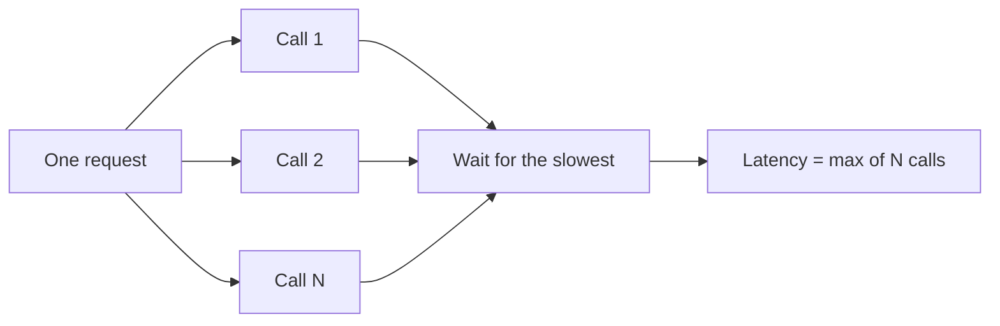

# 20.10 Complexity, latency numbers and measuring your own code

## What the interviewer is testing

You finish a coding answer and the interviewer asks, "What is the complexity, and would it survive ten million items?" This chapter serves the coding round and feeds the design round, where the plan lists "estimate performance and compute".

One secondary source says candidates should know "Numbers Every Programmer Should Know". I could not verify that Nebius asks. Treat the table as estimation training, not a certain quiz.

A realistic question in the interviewer's voice: "Your function checks each of 10 million log lines against a list of 5,000 blocked IPs. Is that fine? Then tell me how you would measure it."

## The core ideas

### 1. Say Big-O in a way that survives a follow-up

You write `if ip in blocked` inside a loop and say "that is O(n)". The interviewer asks, "n of what?"

Start every complexity answer by naming the variables. Here there are two: the number of log lines, call it n, and the number of blocked addresses, call it m. A list scan costs O(m) per line, so the loop costs O(n times m). Make the blocked list a set and the cost per line is O(1) on average, so the loop costs O(n). Say "on average" because a hash table can degrade when many keys collide.

Amortised cost is the other phrase that gets probed. Appending to a Python list is usually cheap, but sometimes the list must grow and copy its items. Averaged over many appends the cost per append is constant. I ran a check on this machine. Appending 64 items changed the list's allocated size only 8 times, so most appends did no copying. 

Name worst case against average case too. Fluent Python, chapter 3, explains that a dict or set derives an index from the key's hash. Chapter 2 says Python's sort is Timsort, which adapts to how ordered the data is, so sorted input sorts faster.

**Name the variables, name average or worst case, then give the cost.** Next time you write a loop, say its cost in terms of the sizes you can name.

### 2. The hidden costs of Python operations, measured

You review code that looks like O(n) and runs like O(n squared). Python hides the cost behind a short operator. The table below comes from `c10_complexity_bench.py`, which I ran on an Apple M3 laptop with 24 GB of memory, macOS, and CPython 3.12.7. Times are the best of several repeats. Your numbers will differ, and the ratios matter more than the digits.

| Operation | Small size | Large size | What it shows |
|---|---|---|---|
| `x in list`, last item | 3.2 us at 1,000 | 330 us at 100,000 | Cost grows with list length |
| `x in set` | 0.015 us at 1,000 | 0.015 us at 100,000 | Cost does not grow |
| `list.insert(0, x)` | 0.61 us at 1,000 | 30 us at 100,000 | Shifts every item |
| `deque.appendleft(x)` | 0.014 us at 1,000 | 0.16 us at 100,000 | Flat, within noise |
| `s += 'ab'`, one reference | 0.30 ms for 10,000 pieces | 6.6 ms for 200,000 | About linear |
| `s += 'ab'`, a second reference held | 1.5 ms for 10,000 pieces | 25 ms for 40,000 | Four times the data, about 17 times the time |
| `sorted`, 1 million floats | 127 ms random | 22 ms already sorted | Timsort uses existing order |

The official Python documentation page "Time complexity of built-in types" lists `list.pop(0)` and `list.insert(0, x)` as O(n), `x in list` as O(n), set and dict lookups as O(1) on average and O(n) in the worst case, and `list.append` as O(1) amortised. The collections page gives deque appends and pops at either end as O(1). Fluent Python, chapter 2, says inserting at the head of a list is costly because the whole list shifts in memory. It recommends `collections.deque` for both ends, and warns that removing from the middle of a deque is not fast.

The string result needs care. The textbook says `+=` on strings is quadratic, and my first run showed no such thing. CPython can resize a string in place when nothing else refers to it. That is an implementation detail, so do not rely on it. When I kept a second reference to the string, the optimisation was defeated, and four times the data cost about 17 times the time. Say "it is quadratic in general, CPython sometimes hides it, so I use join".

For the opening question the membership gap matters most. At 100,000 items a list scan took 330 microseconds and a set lookup 0.015, a factor of about 22,000.

**When a loop contains `in`, ask what the container is.** Check list, tuple and string containers first, because the same word hides different costs.

### 3. Space against time

The set is not free. A set of 100,000 integers reported 4.19 MB and a list of them 0.8 MB, both ignoring the integer objects. The set bought a lookup thousands of times faster for about five times the container memory.

That is the general trade: a hash index, a cache or a precomputed table spends memory to avoid repeating work. 
The KV cache in chapter 20.12 is the same trade in serving: GPU memory spent so attention is not recomputed. Chapter 20.18 shows the engine recomputing when that memory runs out. State the memory cost in your answer. "I would use a set" is half an answer, and "a set, which costs a few megabytes for 5,000 addresses" is a whole one.

### 4. The latency numbers, with sources and dates

An interviewer says "how long does a network call take compared with reading memory?" You need a ruler in your head. Here are three printed sources. Each has an age, and hardware has changed since all of them, so use the table for ratios and orders of magnitude.

The first is Jeff Dean's keynote slides "Designs, Lessons and Advice from Building Large Distributed Systems", given at LADIS 2009. The file's creation date is October 2009. Its slide "Numbers Everyone Should Know" is the table below. The second is an undated Dean slide set, "Software Engineering Advice from Building Large-Scale Distributed Systems", with older values for a few rows. The third is Peter Norvig's page "Teach Yourself Programming in Ten Years", which lists a similar table without the datacenter round trip. I fetched all three on 2026-11-09.

| Operation | Time in 2009 slide | Time as a ratio to a memory read |
|---|---|---|
| L1 cache reference | 0.5 ns | 0.005 |
| Branch mispredict | 5 ns | 0.05 |
| L2 cache reference | 7 ns | 0.07 |
| Mutex lock/unlock | 25 ns | 0.25 |
| Main memory reference | 100 ns | 1 |
| Compress 1K bytes with Zippy | 3,000 ns | 30 |
| Send 2K bytes over 1 Gbps network | 20,000 ns | 200 |
| Read 1 MB sequentially from memory | 250,000 ns | 2,500 |
| Round trip within same datacenter | 500,000 ns | 5,000 |
| Disk seek | 10,000,000 ns | 100,000 |
| Read 1 MB sequentially from disk | 20,000,000 ns | 200,000 |
| Send packet CA to Netherlands and back | 150,000,000 ns | 1,500,000 |

The older Stanford slides list mutex lock/unlock at 100 ns and reading 1 MB from disk at 30,000,000 ns. Norvig's table gives a disk seek of 8,000,000 ns. The digits move between versions and the orders of magnitude do not.

A newer, book-based ruler comes from Systems Performance, chapter 2, Table 2.2. It gives main memory access at 100 ns, a solid-state disk I/O at 10 to 100 microseconds, a rotational disk I/O at 1 to 10 ms, and an internet round trip from San Francisco to New York at 40 ms. The book scales this to human time: if one CPU cycle took one second, a memory access would take about 6 minutes.

For inference numbers, such as KV bytes per token or GPU memory bandwidth, use the table in chapter 20.12 and do not copy it from here. The 500 microsecond figure is from 2009. I did not measure a round trip on current cloud hardware, and Nebius has not published its network latencies. Say "half a millisecond is the 2009 figure, and today I would measure it".

**Remember the rungs: nanoseconds for cache and memory, microseconds for flash, milliseconds for a disk or datacenter hop, tens of milliseconds for a continent.** Say the year when you quote a figure.

### 5. Arithmetic that makes the numbers useful

A table of times does nothing until you divide one by another. The first division is the one to practise. A round trip in the same datacenter takes 500,000 ns and a memory read takes 100 ns. The ratio is 5,000, so one network round trip costs as much as 5,000 memory reads. A cache in the same process that avoids one network call pays for thousands of reads.

The same division shows why chatty designs fail. Twenty sequential calls cost 20 times 0.5 ms, which is 10 ms, before any work. Dean's slides make the point with an image page: 30 sequential reads cost about 560 ms, and issuing them in parallel cut it to about 18 ms. Parallel work has its own cost, as the next section shows.

The second piece of arithmetic is what a nine in an availability target means in requests. At 99.9 percent, one request in a thousand may fail. Out of one million requests that is 1,000 failures. Over a 24-hour day, the same target allows 86.4 seconds of total failure. Say both forms. Chapter 20.19 turns this into error budgets.

The third piece is queueing. Systems Performance, chapter 2, gives the M/D/1 formula for mean response time, r equals s times two minus u, divided by two times one minus u. Here s is service time and u is utilisation. I computed the results with `c10_latency_math.py`. At 50 percent busy the response time is 1.5 times the service time. At 80 percent it is 3 times, at 90 percent 5.5 times, and at 95 percent 10.5 times. The book summarises that beyond 60 percent utilisation the average response time doubles. The model is simplified, so treat it as a shape. AI Systems Performance Engineering, chapter 16, says p95 latency can rise steeply as load nears a limit.

```python
# code/part20/c10_latency_math.py
"""Latency numbers and the arithmetic that makes them useful.

The table is the one on the last slides of Jeff Dean's LADIS 2009 keynote,
"Numbers Everyone Should Know". Hardware has changed since 2009, so use the
table for orders of magnitude and ratios, never for a prediction.
"""
import math

# name -> nanoseconds, copied from the 2009 slide
DEAN_2009_NS = {
    "L1 cache reference": 0.5,
    "Branch mispredict": 5,
    "L2 cache reference": 7,
    "Mutex lock/unlock": 25,
    "Main memory reference": 100,
    "Compress 1K bytes with Zippy": 3_000,
    "Send 2K bytes over 1 Gbps network": 20_000,
    "Read 1 MB sequentially from memory": 250_000,
    "Round trip within same datacenter": 500_000,
    "Disk seek": 10_000_000,
    "Read 1 MB sequentially from disk": 20_000_000,
    "Send packet CA->Netherlands->CA": 150_000_000,
}


def ratio(slow: str, fast: str) -> float:
    """How many times slower one operation is than another."""
    return DEAN_2009_NS[slow] / DEAN_2009_NS[fast]


def reads_per_round_trip(trip: str = "Round trip within same datacenter",
                         read: str = "Main memory reference") -> float:
    return ratio(trip, read)


def failures_in(requests: int, availability: float) -> float:
    """Requests that fail at a given availability, for example 0.999."""
    if not 0 <= availability <= 1:
        raise ValueError("availability must be between 0 and 1")
    return requests * (1 - availability)


def downtime_seconds(period_seconds: float, availability: float) -> float:
    return period_seconds * (1 - availability)


def prob_all_fast(p_slow: float, fanout: int) -> float:
    """Chance that none of `fanout` independent calls hits the slow tail."""
    return (1 - p_slow) ** fanout


def prob_any_slow(p_slow: float, fanout: int) -> float:
    return 1 - prob_all_fast(p_slow, fanout)


def per_call_percentile_needed(target: float, fanout: int) -> float:
    """Per-call quantile q so that q**fanout equals the target quantile."""
    return target ** (1 / fanout)


def md1_response(service_time: float, utilisation: float) -> float:
    """Mean response time of an M/D/1 queue: s(2 - u) / (2(1 - u)).

    The formula is in Systems Performance, chapter 2, "M/D/1 and 60% Utilization".
    """
    if not 0 <= utilisation < 1:
        raise ValueError("utilisation must be at least 0 and below 1")
    return service_time * (2 - utilisation) / (2 * (1 - utilisation))


def loop_seconds(items: int, ns_per_item: float) -> float:
    """Back-of-envelope time for a loop: items times cost per item."""
    return items * ns_per_item / 1e9


def items_per_second_budget(ns_per_item: float) -> float:
    return 1e9 / ns_per_item


if __name__ == "__main__":
    print(f"memory reads per datacenter round trip: {reads_per_round_trip():,.0f}")
    print(f"1M requests at 99.9%: {failures_in(1_000_000, 0.999):,.0f} fail")
    day = 24 * 3600
    print(f"99.9% over a day: {downtime_seconds(day, 0.999):,.1f} s of failure")
    for n in (1, 10, 100, 1000):
        print(f"fan-out {n:>4}: P(any call in the slow 1%) = {prob_any_slow(0.01, n):.3f}")
    for u in (0.5, 0.6, 0.8, 0.9, 0.95):
        print(f"M/D/1 at {u:.0%} busy: {md1_response(1.0, u):.2f} x service time")
    print(f"per-call quantile for a 99th overall at fan-out 100: "
          f"{per_call_percentile_needed(0.99, 100):.5f}")
```

**Divide before you decide: two times in the same unit, then say what the ratio changes about the design.**

### 6. Why the p99 of a fan-out is worse than the p99 of one call

A search request fans out to 100 backends and waits for all of them. Each backend is fast 99 percent of the time and slow the other 1 percent. Your dashboard shows each backend with a healthy p99, yet users complain. The request is slow whenever any one of the calls is slow.

The formula is short. If each call lands in the slow tail with probability p, and the N calls are independent, the chance that every call is fast is the quantity one minus p, raised to the power N. The chance that at least one is slow is one minus that. With p equal to 0.01, the numbers are:

| Fan-out N | Chance at least one call is slow |
|---|---|
| 1 | 1.0 percent |
| 10 | 9.6 percent |
| 100 | 63.4 percent |
| 1,000 | about 99.996 percent |

So with 100 backends, nearly two requests in three include a call from the slow 1 percent. The 99th percentile of the whole request is no longer the 99th percentile of one call. You can run the formula backwards. To keep the overall p99 at 0.99 with 100 calls, each call must meet its target at the 0.9999 quantile, roughly the 99.99th percentile. Dean and Barroso make this argument in "The Tail at Scale". Their example is a server with a one-second p99, and with 100 such servers in parallel they report that 63 percent of user requests take more than one second, the same figure as the table above. Here the formula is just arithmetic.

The simulation uses a continuous distribution. Each call is lognormal with a median of 10 ms, so the single-call p99 is about 40 ms. The request waits for the maximum of the calls. The code is seeded.



```python
# code/part20/c10_fanout_sim.py
"""Why the p99 of a fan-out request is worse than the p99 of one call.

One request calls `fanout` backends in parallel and waits for all of them,
so its latency is the maximum of the calls. Each call is drawn from a
lognormal distribution. Seeded, standard library only.
"""
import math
import random


def percentile(sorted_values, q):
    """Nearest-rank percentile, q between 0 and 1."""
    if not sorted_values:
        raise ValueError("no values")
    k = max(0, min(len(sorted_values) - 1, math.ceil(q * len(sorted_values)) - 1))
    return sorted_values[k]


def simulate(fanout, requests=20_000, mu=math.log(10.0), sigma=0.6, seed=1):
    """Return (p50, p99) of the request latency, in the unit of mu (ms)."""
    rng = random.Random(seed)
    lat = sorted(
        max(rng.lognormvariate(mu, sigma) for _ in range(fanout))
        for _ in range(requests)
    )
    return percentile(lat, 0.50), percentile(lat, 0.99)


def single_call_p99(mu=math.log(10.0), sigma=0.6, z99=2.3263478740408408):
    """Closed form p99 of a lognormal: exp(mu + z * sigma)."""
    return math.exp(mu + z99 * sigma)


if __name__ == "__main__":
    print(f"closed-form single-call p99: {single_call_p99():.1f} ms")
    print("fanout   p50 ms   p99 ms")
    for n in (1, 10, 100):
        p50, p99 = simulate(n)
        print(f"{n:>6}  {p50:7.1f}  {p99:7.1f}")
```

I ran it. The output was:

```text
closed-form single-call p99: 40.4 ms
fanout   p50 ms   p99 ms
     1     10.0     40.0
    10     24.7     64.0
   100     43.7     92.7
```

With one call the median is 10 ms and the p99 is 40 ms. With 100 calls the median is 43.7 ms, which is above the single-call p99. The p99 is 92.7 ms. The model assumes independent calls with a lognormal shape. Real calls share queues and fail together, so this is an illustration, not a prediction.

The paper describes the defences. A hedged request sends the same request to a second replica after a short delay and cancels the loser. Waiting for the 95th percentile expected latency before sending it limits the extra load to about 5 percent. In the paper's BigTable benchmark of 1,000 keys over 100 servers, a hedge after 10 ms cut the 99.9th percentile from 1,800 ms to 74 ms for 2 percent more requests. Tied requests, micro-partitions, selective replication, latency-induced probation, good-enough responses and canary requests are the other techniques the paper lists. Reducing fan-out and setting deadlines are standard advice that the paper does not use as headings, so present them as your own options. Chapter 20.21 covers hedging.

**With fan-out N, a rare slow call becomes a common slow request, so budget the per-call tail at the quantile that gives the overall target.**

### 7. Caches and locality

A loop reads the same array twice, once in order and once in a random order. The work is identical and the second loop is slower. The reason is the memory hierarchy. Systems Performance, chapter 6, says a CPU cache line, the unit stored and transferred together, is typically 64 bytes on x86. Reading one value pulls in its neighbours. A sequential walk uses the neighbours and a random walk wastes them.

I measured this with `c10_locality.py`. It sums 5 million 8-byte values from an `array`, first in index order and then in a shuffled order. On this machine the ordered pass took 0.157 seconds and the shuffled pass took 0.622 seconds, a ratio of about 4. I did not isolate how much of the gap is CPU cache, so I claim only that scattered access costs time.

Systems Performance, chapter 2, gives the cache formula: runtime is hit rate times hit latency plus miss rate times miss latency. It notes that going from 98 to 99 percent hits matters far more than 10 to 11 percent, because a miss is so much slower. The same reasoning applies to a KV cache, a page cache and a CDN. In Python remember that a list of objects stores pointers, so even a sequential walk touches objects wherever they live.

**When the same data is read in two orders, expect the sequential one to win, and keep hot data small enough to stay in cache.**

### 8. Measuring your own code with timeit and cProfile

You think a function is slow, and an interviewer who hears "I would just optimise it" will push. The method is: measure the whole, find where the time goes, change one thing, measure again. Systems Performance, chapter 5, says to profile the CPU and start with the most common code path.

For small snippets use `timeit`. The Python 3.12 documentation says the lowest value from repeated runs is a lower bound on how fast your machine can run the snippet, because higher values mostly come from other processes. It advises using the `min()` of the results. Learning Python, chapter 21, builds the same best-of idea by hand. The numbers in section 2 are minimums of repeats.

```python
# code/part20/c10_complexity_bench.py
"""Measure the hidden costs of common Python operations with timeit.

Each function returns seconds (best of several repeats, as the timeit
documentation advises). Run this file to print a table for your machine.
"""
import sys
import timeit
from collections import deque


def best(stmt, setup="pass", number=1, repeat=5, globals_=None):
    """Smallest total time over `repeat` runs of `number` executions."""
    return min(timeit.repeat(stmt, setup=setup, number=number, repeat=repeat,
                             globals=globals_))


def membership(n, probes=200):
    """Time `probes` lookups of the worst-case item in a list and in a set."""
    data_list = list(range(n))
    data_set = set(data_list)
    g = {"L": data_list, "S": data_set, "x": n - 1}
    t_list = best("for _ in range(%d): x in L" % probes, number=1, globals_=g)
    t_set = best("for _ in range(%d): x in S" % probes, number=1, globals_=g)
    return t_list, t_set


def front_insert(n, ops=2000):
    """Insert `ops` items at the front of a list of size n versus a deque."""
    g = {"base": list(range(n)), "deque": deque}
    t_list = best("L = list(base)\nfor i in range(%d): L.insert(0, i)" % ops,
                  number=1, repeat=3, globals_=g)
    t_deque = best("D = deque(base)\nfor i in range(%d): D.appendleft(i)" % ops,
                   number=1, repeat=3, globals_=g)
    return t_list, t_deque


def concat(n):
    """Build a string from n pieces with += versus join."""
    g = {"n": n}
    t_plus = best("s = ''\nfor i in range(n): s += 'ab'", number=1, globals_=g)
    t_join = best("s = ''.join(['ab' for i in range(n)])", number=1, globals_=g)
    return t_plus, t_join


def concat_shared(n):
    """Same += loop, but a second reference to the string defeats CPython's
    in-place resize, so every step copies the whole string."""
    g = {"n": n}
    return best("s = ''\nfor i in range(n):\n    keep = s\n    s += 'ab'",
                number=1, repeat=3, globals_=g)


def sort_cost(n):
    """sorted() on random data versus on data that is already sorted."""
    import random
    rnd = random.Random(0)
    data = [rnd.random() for _ in range(n)]
    srt = sorted(data)
    g = {"R": data, "S": srt}
    return best("sorted(R)", globals_=g), best("sorted(S)", globals_=g)


def growth_points(limit=64):
    """Sizes at which a list's allocation changes while appending."""
    lst, last, points = [], sys.getsizeof([]), []
    for i in range(limit):
        lst.append(i)
        size = sys.getsizeof(lst)
        if size != last:
            points.append((len(lst), size))
            last = size
    return points


if __name__ == "__main__":
    print(sys.version.split()[0], sys.platform)
    for n in (1_000, 100_000):
        a, b = membership(n)
        print(f"membership n={n:>7}: list {a*1e6/200:9.2f} us, set {b*1e6/200:7.3f} us per lookup")
    for n in (1_000, 100_000):
        a, b = front_insert(n)
        print(f"front insert n={n:>7}: list {a*1e6/2000:8.2f} us, deque {b*1e6/2000:6.3f} us per op")
    for n in (10_000, 200_000):
        a, b = concat(n)
        print(f"concat n={n:>7}: += {a*1e3:8.2f} ms, join {b*1e3:8.2f} ms")
    for n in (10_000, 40_000):
        print(f"concat with a second reference n={n:>6}: += {concat_shared(n)*1e3:8.2f} ms")
    a, b = sort_cost(1_000_000)
    print(f"sorted 1M floats: random {a*1e3:7.1f} ms, already sorted {b*1e3:7.1f} ms")
    print("append growth (length, bytes):", growth_points())
```

For finding where time goes in a whole program, use `cProfile`. The documentation describes it as a deterministic profiler, a C extension with reasonable overhead. It reports for each function the call count, `tottime` for time inside the function itself, and `cumtime` including callees. I ran `c10_profile_demo.py` on 20,000 items. The slow version removes duplicates with a list scan:

```text
         4002 function calls in 0.133 seconds
   ncalls  tottime  percall  cumtime  percall filename:lineno(function)
        1    0.133    0.133    0.133    0.133 c10_profile_demo.py:7(dedupe_slow)
     4000    0.000    0.000    0.000    0.000 {method 'append' of 'list' objects}
```

The fast version, using a set, finished in 0.001 seconds. Notice what the slow report does not say. The `in` operator is not a function call, so the profiler attributes all 0.133 seconds to `dedupe_slow` itself. It tells you which function is hot, not which line. For the line you read the code, and the table from section 2 tells you what to suspect.

The profiler also changes the program. Calling a function a million times took 0.045 seconds without it and 0.110 seconds under `cProfile` on this machine, a factor of 2.4. Systems Performance, chapter 5, warns that user-mode profilers can skew time. AI Systems Performance Engineering, chapter 16, says heavy profilers are impractical to run continuously in production. So say: "timeit for snippets, cProfile in a test environment, metrics in production".

**Report the minimum for micro-benchmarks, use a profiler to find the function, and say what the profiler cannot see.**

### 9. Why measured numbers differ from the textbook

The table says a memory reference costs 100 ns, yet my plain loop did an addition per item in 18 ns. That does not break the table. The table is about a miss that goes to main memory, and a small loop stays in cache. Python's own interpreter cost also sits on top.

Four things separate a textbook figure from your measurement: newer hardware, whether the data fits in cache, interpreter overhead, and a busy machine, which is why you take the minimum. Systems Performance, chapter 12, warns that benchmarks often report averages and hide variance. Its example is a "latency" that was really the client timeout, because a firewall blocked every request.

**Use the textbook for the order of magnitude and your own measurement for the decision. A tenfold gap between the two means one of them is wrong.**

### 10. Will this loop of ten million items finish in a second?

The interviewer says, "Ten million items, one second, yes or no?" Do not answer from feeling. Compute a budget. One second divided by 10 million items leaves 100 ns per item. Then estimate the work per item and compare.

A pure Python loop that does one addition costs tens of nanoseconds per item on this machine. I measured it with `c10_loop_budget.py` on 10 million items:

| Loop body | Cost per item | Time for 10 million |
|---|---|---|
| `for` loop with `total += i` | 18 ns | 0.18 s |
| Same loop with one Python function call | 41 ns | 0.41 s |
| Built-in `sum(range(n))` | 8 ns | 0.08 s |

So a simple loop fits in a second here, and a loop with a function call fits with a margin of about two. One network call per item is out of the question: at 500 microseconds each, 10 million calls take 5,000 seconds, or about 83 minutes.

Now return to the opening question. Ten million lines against a list of 5,000 addresses cost, in the worst case, 50 billion comparisons. At about 3 ns each that is 150 seconds, on the order of minutes. I derived the 3 ns from my measured list scan, which was 3.2 us for 1,000 items, and it is a rough figure. With a set the work is 10 million lookups at 15 to 20 ns each, so under a second of lookups. State both, and then say you would measure with `timeit` on a sample before you commit.

```python
# code/part20/c10_loop_budget.py
"""Will a loop over N items finish in a second? Estimate, then measure."""
import time


def plain_loop(n):
    total = 0
    for i in range(n):
        total += i
    return total


def with_call(n):
    def f(x):
        return x + 1
    total = 0
    for i in range(n):
        total += f(i)
    return total


def builtin_sum(n):
    return sum(range(n))


def ns_per_item(fn, n):
    start = time.perf_counter()
    fn(n)
    return (time.perf_counter() - start) / n * 1e9


if __name__ == "__main__":
    n = 10_000_000
    for fn in (plain_loop, with_call, builtin_sum):
        ns = ns_per_item(fn, n)
        print(f"{fn.__name__:12} {ns:6.1f} ns per item, {ns*n/1e9:5.2f} s for 10M")
```

**Divide the time budget by the item count, estimate the cost per item from a measured rung, and say what you would measure to confirm.**

## How to answer out loud

**Question 1. "What is the complexity of this, and would it scale?"** Name the variables first. Give the cost per step, multiply, and say average or worst case. Give the memory cost. Then give a better version and its cost.

**Question 2. "Why is `x in list` slow and `x in set` fast, and what does the set cost?"** A list scan checks items one by one, O(n). A set hashes the key and goes to an index, O(1) on average. Quote your measured ratio, about 22,000 at 100,000 items on my machine, and the memory price.

**Question 3. "How long does a network call take compared with memory?"** Give the rungs: about 100 ns for memory and 500 microseconds for a datacenter hop, from a 2009 slide. State the ratio of 5,000. Say hardware has changed and you would measure.

**Question 4. "Each backend has p99 of 50 ms. What is the p99 of a request that calls 100 of them?"** Say it is worse and not 50 ms. Give the formula: the chance all are fast is the quantity one minus p, to the power N. At 1 percent slow and N of 100 that is 63 percent of requests touching the tail. Add that the exact p99 depends on the distribution and that you would simulate or measure. Name hedging, deadlines and reduced fan-out, and that independence is an assumption.

**Question 5. "How would you find out why this function is slow?"** Say the order: reproduce with a fixed input, time the whole thing, profile to find the hot function, form a hypothesis from complexity, change one thing, and measure again. Name `timeit` with the minimum of repeats and `cProfile` with `tottime`. Mention the profiler's overhead and that it cannot see inside an operator.

## Worked scenarios

### Scenario A. The blocklist check

A log processor reads 10 million lines. For each line it tests whether the source IP is in a list of 5,000 blocked addresses. The job takes several minutes and the owner wants it under 10 seconds.

Reasoning. The check is `ip in blocked` on a list, so each line costs up to 5,000 comparisons, O(n times m). Convert the list to a set once. Each line then costs one hash lookup, so the loop is O(n). Parsing each line will now dominate, so measure before promising a time.

Answer. Use a set. Expect the lookup part to fall from minutes to under a second, and profile what remains.

### Scenario B. The fan-out dashboard that looks healthy

A gateway fans out to 50 shards. Each shard's p99 is 40 ms and the dashboards are green. The gateway's p99 is 90 ms and users complain.

Reasoning. If each shard is slow 1 percent of the time, the chance that at least one of 50 is slow is one minus 0.99 to the power 50, about 39.5 percent. So two requests in five wait for a tail call. The simulation at 100 calls moved the p99 from 40 ms to 92.7 ms, close to the user report.

Answer. Per-shard dashboards hide the effect. Measure the gateway's own latency, set a deadline per call, consider a hedged request, and reduce fan-out if the design allows. Independence is an approximation.

## Hands-on lab

I ran every step on the Apple M3 machine named above. 

1. Print the latency arithmetic.

```bash
python3 code/part20/c10_latency_math.py
```

Expected result: 5,000 reads per round trip, 1,000 failures per million, 86.4 seconds a day, fan-out chances of 1.0, 9.6 and 63.4 percent, and M/D/1 ratios up to 10.50.

2. Run the fan-out simulation.

```bash
python3 code/part20/c10_fanout_sim.py
```

Expected result: p99 of 40.0, 64.0 and 92.7 ms for fan-out 1, 10 and 100, the same every time.

3. Run the complexity benchmark and compare your ratios with the table in section 2.

```bash
python3 code/part20/c10_complexity_bench.py
```

Expected result: the same orderings as the table in section 2, with different digits on your machine.

4. Run the locality and loop-budget scripts.

```bash
python3 code/part20/c10_locality.py
python3 code/part20/c10_loop_budget.py
```

Expected result: shuffled access slower than ordered, and a plain loop under one second for 10 million items.

5. Profile the slow function and read the report.

```bash
python3 code/part20/c10_profile_demo.py
```

Expected result: `dedupe_slow` takes nearly all the time, and `dedupe_fast` is far shorter.

6. Run the tests, which assert relationships and no absolute times.

```bash
python3 -m pytest code/part20/test_c10_latency_math.py code/part20/test_c10_fanout_sim.py code/part20/test_c10_complexity_bench.py -q
```

Expected result: 23 passed. I ran them several times with the same result. On a very noisy machine rerun before you suspect the code.

```python
# code/part20/test_c10_complexity_bench.py
"""Only relationships that must hold. No absolute times are asserted."""
import c10_complexity_bench as b
import c10_locality as loc
import c10_loop_budget as lb
import c10_profile_demo as pd


def test_set_lookup_beats_list_scan_for_large_n():
    t_list, t_set = b.membership(50_000, probes=50)
    assert t_set * 5 < t_list


def test_list_scan_cost_grows_with_n():
    small, _ = b.membership(2_000, probes=50)
    large, _ = b.membership(100_000, probes=50)
    assert large > 5 * small


def test_deque_front_insert_beats_list_for_large_n():
    t_list, t_deque = b.front_insert(100_000, ops=500)
    assert t_deque * 5 < t_list


def test_join_beats_concat_when_string_is_shared():
    shared = b.concat_shared(20_000)
    _, t_join = b.concat(20_000)
    assert t_join < shared


def test_shared_concat_is_superlinear():
    t1 = b.concat_shared(10_000)
    t4 = b.concat_shared(40_000)
    assert t4 > 5 * t1  # four times the data costs far more than four times


def test_sorted_input_sorts_faster_than_random():
    random_t, sorted_t = b.sort_cost(200_000)
    assert sorted_t < random_t


def test_list_capacity_grows_in_jumps_not_every_append():
    points = b.growth_points(200)
    assert 0 < len(points) < 60       # far fewer reallocations than appends
    assert [s for _, s in points] == sorted(s for _, s in points)


def test_builtin_sum_beats_python_loop():
    n = 300_000
    assert lb.ns_per_item(lb.builtin_sum, n) < lb.ns_per_item(lb.plain_loop, n)


def test_loop_functions_agree():
    assert lb.plain_loop(1000) == lb.builtin_sum(1000) == 499500
    assert lb.with_call(10) == 55


def test_locality_functions_agree():
    data, order = loc.make(1000)
    assert loc.sum_in_order(data, order) == loc.sum_shuffled(data, order)


def test_profile_slow_and_fast_agree_and_report_names_the_hot_function():
    data = [i % 300 for i in range(2000)]
    assert pd.dedupe_slow(data) == pd.dedupe_fast(data)
    assert "dedupe_slow" in pd.profile_text(pd.dedupe_slow, data)
```

## Drill questions

1. What do you say first when asked for the complexity of a loop?

<details><summary>Answer</summary>

Name the variables, such as the number of lines and the size of the list. Then say the cost per step, multiply, and say whether it is average or worst case.

</details>

2. What does amortised constant time mean for list append?

<details><summary>Answer</summary>

Most appends copy nothing. Occasionally the list grows and copies. Averaged over many appends, the cost is constant.

</details>

3. Why is `list.insert(0, x)` slow, and what is the alternative?

<details><summary>Answer</summary>

Every item must shift by one place in memory. Use `collections.deque` and `appendleft`. Removing from the middle of a deque is still not fast.

</details>

4. Is `s += piece` in a loop always quadratic in Python?

<details><summary>Answer</summary>

No. CPython can resize in place when nothing else refers to the string, so my test looked near-linear. With a second reference it was worse than linear. Use `join`.

</details>

5. How many main-memory reads fit in one datacenter round trip, using the 2009 figures?

<details><summary>Answer</summary>

500,000 ns divided by 100 ns gives 5,000. Say it is a 2009 ratio and that hardware has changed.

</details>

6. What does 99.9 percent availability mean in requests and in time?

<details><summary>Answer</summary>

One request in a thousand may fail, so 1,000 per million. Over a day it allows 86.4 seconds of failure.

</details>

7. Each call has a 1 percent chance of being slow. What is the chance a 100-way fan-out has a slow call?

<details><summary>Answer</summary>

One minus 0.99 to the power 100, which is about 63 percent. It assumes independent calls.

</details>

8. Why does the p99 of a fan-out exceed the p99 of one call?

<details><summary>Answer</summary>

The request waits for the slowest call. More calls make it more likely that one lands in the tail.

</details>

9. Which number from `timeit.repeat` do you report, and why?

<details><summary>Answer</summary>

The minimum. The Python documentation says higher values mostly come from other processes interfering, so the minimum is the best estimate of what the code can do.

</details>

10. `cProfile` says all the time is inside one function that contains `x in some_list`. What does it not show?

<details><summary>Answer</summary>

The line or the operator, because `in` is not a function call. You find it by reading the code. The profiler also slows the program, 2.4 times in my call-heavy test.

</details>

## Common mistakes and weak answers

Giving a formula without the variables. Say what n is, and say what m is when there are two inputs.

Saying "a set is O(1)" and stopping. Add "on average", name the memory cost, and say the keys must be hashable.

Quoting latency numbers as current facts. Say they come from a 2009 slide, that hardware has changed, and that you would measure.

Using the average for a fan-out. Averages hide the tail. Give the formula for the chance of hitting a slow call and mention the maximum.

## Connections to the rest of the handbook

- 20.8, 20.9 and 20.11 are the coding toolkit, patterns and practice set. State complexity for every problem.
- 20.12 (`c20-12`) has the inference numbers table, KV memory and GPU estimates. Use it with the latency ratios here.
- 20.18 (`c20-18`) shows what happens when the KV cache, a space-for-time trade, runs out.
- 20.19 turns availability percentages into SLOs, and 20.21 covers retries, hedging and tail control.
- 15.14 (`c15-14`) covers benchmarking and latency percentiles. 17.6 (`c17-06`) covers alerting and SLOs.

## Sources and review notes

Sources and dates fetched (2026-11-09):

- Jeff Dean, "Designs, Lessons and Advice from Building Large Distributed Systems", keynote slides, LADIS 2009, from cs.cornell.edu/projects/ladis2009/talks/dean-keynote-ladis2009.pdf. The slide "Numbers Everyone Should Know" is the source of the latency table. PDF creation date October 2009.
- Jeff Dean, "Software Engineering Advice from Building Large-Scale Distributed Systems", undated slides, from the Google-hosted file named stanford-295-talk.pdf. The file name suggests a Stanford CS295 talk, my inference. The PDF conversion date is March 2009. Used for the differing figures and the image-page example.
- Peter Norvig, "Teach Yourself Programming in Ten Years", norvig.com/21-days.html, answers section.
- Jeffrey Dean and Luiz Andre Barroso, "The Tail at Scale", Communications of the ACM, vol. 56, 2013, pp. 74 to 80. Read in full on 2026-11-09 from the author-hosted PDF (barroso.org), which is a scan, so I read it by OCR. The research.google page carries only the abstract.
- Systems Performance, 2nd edition: chapter 2 "Methodologies" for Table 2.2 time scales, the cache hit ratio and runtime formulas, and the M/D/1 formula. Chapter 5 "Applications" for profiling. Chapter 6 "CPUs" for the 64-byte cache line. Chapter 12 "Benchmarking" for averages hiding variance.
- Fluent Python, 2nd edition: chapter 2 "An Array of Sequences" for list head insertion, deque and Timsort. Chapter 3 "Dictionaries and Sets" for hash lookup.
- Learning Python, 6th edition: chapter 21 "The Benchmarking Interlude" for best-of timing and timeit.
- AI Systems Performance Engineering, chapter 16 "Profiling, Debugging, and Tuning Inference at Scale": latency rising near a limit, and heavy profilers in production.
- Python 3.12 documentation: `timeit` and "The Python Profilers", docs.python.org/3.12.
- Measured on an Apple M3 with 24 GB, macOS, CPython 3.12.7, with `code/part20/c10_*.py`.

Explicitly labelled inferences:

- That the Stanford-named slides predate the LADIS slides.
- The 3 ns per comparison in section 10, from one measurement.
- That cache explains the locality gap. I did not isolate it.
- The 0.9999 per-call quantile, which is arithmetic from the formula.
- The 83-minute and 150-second figures, which are arithmetic on assumed inputs.

Not verified:

- That Nebius asks for the "Numbers Every Programmer Should Know" figures. Only one secondary source says candidates should know them.
- The old Python wiki page redirects to docs.python.org/3/builtins/time-complexity.html, which I fetched on 2026-11-09. It does not list deque, so deque costs come from the 3.12 collections page.
- No measurement of a datacenter round trip on current cloud hardware.
- The chapter gates and `sync_code_blocks.py` were not run, by instruction.

### Verification log

Fetched 2026-11-09: docs.python.org time-complexity page, the Python 3.12 collections page, the Tail at Scale paper (OCR of the PDF). Claims checked: 9. Confirmed: 8 (list, set, dict and deque costs, the 63 percent fan-out figure, hedging after the 95th percentile adding about 5 percent load, the string `+=` quadratic note, the 0.9999 quantile arithmetic, the Dean latency table from earlier fetches). Corrected: 1 (the tail-latency defences were unsourced and now follow the paper's list). Removed: 0. Still unverified: 3. They are that Nebius asks for the latency numbers, that cache explains the locality gap, and datacenter round-trip time on current cloud hardware. The Stanford-named slide date is still my inference.
