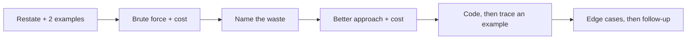

# 20.11 Coding practice set: 40 problems with tested solutions

## What the interviewer is testing

Picture yourself forty minutes into the coding round. The interviewer has just read you a problem about log lines. You have repeated it back, and the editor in front of you is still empty. This chapter is a practice set for exactly that moment, when the clock is running and the first sentence has not come yet.

The set sits alongside the rest of the coding material. Chapter 20.8 covers what to expect in the round and the toolkit you will use. Chapter 20.9 teaches the patterns behind the problems. Chapter 20.10 gives the complexity and latency numbers. Here you only practise, so the earlier chapters are where you go when a pattern is new to you.

Nebius states that the technical interviews include "at least one practical coding / algorithms / data-structures task", in any language. The same page says you should speak your reasoning aloud, ask for hints and review code before submitting. One candidate reported two LeetCode easy or medium problems in one hour. The brief for this chapter also mentions a Senior Software Engineer report about compressing strings, and sources suggesting medium to hard problems in some loops. I could not verify those two points, so treat them as anecdotes. The plan says to prepare for the hardest version.

A realistic question in the interviewer's voice: "Given a stream of access-log lines, tell me whether we are burning our error budget too fast. Use any language, and talk me through your choices."

All problems are original, written from scratch. Every solution is Python standard library plus pytest, in `code/part20/c11_solutions/`. Because you can read every solution, the value is in the reasoning you practise around each one, not in the code itself.

## The core ideas

### 1. Run every problem the same way

Picture the empty editor and the running clock. Most people feel the pull to start typing at once, and that is where the points leak away. The fix is a fixed routine that you rehearse until it runs on its own, without thought, on any problem in the set.

The routine has five steps. Restate the problem in one sentence, so you know what you are answering. Write two examples, one of them empty, so the edge cases are on the page. Say the brute-force idea and its cost out loud. Only then look for the pattern that removes the waste. After the code, trace one example by hand and walk through the edge cases again.



Brute force gives you a fallback and, later, an oracle. An oracle is a slow version you trust because it is obviously correct, and you use it to check the fast version. The tests in this chapter use the same idea: where it is cheap, each solution is checked against a slow, obviously correct version on thousands of random small inputs. **Write the slow version first, in your head or on paper.**

### 2. How to use the set

Think of this as a sparring partner, not a quiz. Do each problem under its budget, in a plain editor, without the hints. If you are stuck at half time, open hint one and note that you did. Asking for hints is allowed in the real loop too, so using one is practice, not failure. Afterwards compare your answer with the reference solution and read the common wrong answer for that problem.

Track two things. The first is the time to a correct solution. The second is the number of hints you used. A problem where you needed hint three goes back on the list for next week, because the pattern was not yet automatic. If you are over twice the budget, read the solution, close it, and write it again from memory the next day. Writing from memory shows you what you actually kept.

### 3. The index

Imagine a list of problems pinned above your desk, and you want to find one quickly by its code. The pattern names match chapter 20.9. A file is `c11_` plus the id and a short name, so E2 is `c11_e02_compress_string.py`. Tests are `test_c11_easy.py`, `test_c11_medium.py`, `test_c11_harder.py` and `test_c11_projects.py`.

The tables below group the set by tier. Each row names the problem, and the pattern column tells you what kind of structure to reach for first. Read the pattern column before you read the problem. That habit turns a vague prompt into a short list of candidate tools.

| Easy, 15 min each | Pattern |
|---|---|
| E1 First unique request id | Hash counting |
| E2 Compress a string | Run-length |
| E3 Count status classes in a log | Parsing, counting |
| E4 Balanced brackets | Stack |
| E5 Merge two sorted timestamp lists | Two pointers |
| E6 Top k error messages | Counter, heap |
| E7 Two latencies adding to a budget | Hash lookup |
| E8 Longest run of successes | Single pass |
| E9 Nearest-rank percentile | Sorting, exact arithmetic |
| E10 Moving average | Running sum |
| E11 Missing shard id | Arithmetic identity |
| E12 Duplicate id within k positions | Sliding set |

| Medium | Pattern | Budget |
|---|---|---|
| M1 Longest window, at most k failures | Sliding window | 25 |
| M2 Merge maintenance windows | Interval merge | 25 |
| M3 Peak concurrent jobs | Sweep line | 25 |
| M4 LRU cache | Hash plus order | 25 |
| M5 Kth largest in a stream | Bounded heap | 25 |
| M6 Group log lines by template | Normalise, group | 25 |
| M7 Canonical file path | Stack | 25 |
| M8 Count windows summing to k | Prefix sum, hash | 30 |
| M9 Dependency order, smallest first | Topological sort | 30 |
| M10 Slowest rate that finishes in time | Binary search on answer | 30 |
| M11 Token bucket | Rate limiter | 30 |
| M12 Consistent hash ring | Hashing, bisect | 30 |
| M13 Retry delays with full jitter | Backoff | 25 |
| M14 Shortest span holding all types | Two pointers | 30 |
| M15 Expand nested repeat notation | Stack | 30 |
| M16 Value of a key at time t | Binary search | 25 |

| Harder, 40 min each | Pattern |
|---|---|
| H1 LFU cache | Frequency buckets |
| H2 Sliding window maximum | Monotonic deque |
| H3 Sliding window median | Two heaps, lazy deletion |
| H4 Cheapest route, at most k hops | Layered shortest path |
| H5 Edit distance of two config lines | Dynamic programming |
| H6 Pack models onto one GPU | 0/1 knapsack |
| H7 Online clusters of failed hosts | Union-find |
| H8 Route table with wildcards | Trie, backtracking |

| Mini-project | Pattern | Budget |
|---|---|---|
| P1 SLO burn from a log stream | Parsing, windows | 75 |
| P2 Rate limiter with tests | Bucket, sliding log | 75 |
| P3 Time-series store | Sorted lists, downsampling | 90 |
| P4 Rollout planner | Topological waves | 90 |

Medium and project budgets are in minutes. Before you start a tier, say aloud which pattern you expect each problem to need. If your guess is wrong, that is useful information, because it shows which pattern you have not yet learned to recognise.

### 4. Easy tier: twelve problems, fifteen minutes each

Picture a short shift on a support desk, where every ticket is small but one careless answer can cost you the whole shift. The easy tier is like that. It is not about cleverness. A candidate who finds the optimal approach but misses the empty input still loses points, and the interviewer notices the miss quickly.

Each of these should be solved, tested by hand on two examples, and explained in under fifteen minutes. The solutions are all short, so keep your version short too. A long answer to a short problem usually means you have solved a harder problem by accident, or you have added code to handle a case that was never asked about.

#### E1. First unique request id

Imagine a batch job that has read a long list of request ids, and an on-call engineer wants the first id that came in only once. The first pass to think of is to look at each id and ask whether it came back again. That question is about counting, and the answer needs the whole list, so the cleverness here is in separating the two jobs.

Given a list of request ids, return the first id that occurs exactly once, or `None`. Example: `["a","b","a","c","b"]` gives `"c"`. Target: O(n) time.

<details><summary>Hints</summary>

1. Counting and finding are two different jobs.
2. Count everything in one pass first.
3. Walk the original list again and return the first id whose count is one.

</details>

**Insight.** A second pass in original order keeps the "first" meaning without a sort. **Common wrong answer.** Calling `list.count` inside a loop, which is O(n squared). **Follow-up.** "Now the ids arrive as a stream and you cannot store them all." File: `c11_e01_first_unique.py`.

#### E2. Compress a string

Picture a metrics agent that is about to ship a line of repeated letters, and it wants to pack the line into fewer characters before sending it. Packing helps only when the packed form is shorter. So the code has to measure its own output before it returns anything, and the rule about returning the original is part of the answer, not an extra.

Compress runs of equal characters: `"aaabcc"` becomes `"a3bc2"`. A run of one keeps no digit. Return the original if the result is not strictly shorter, so `"aabb"` stays `"aabb"`. Input is lowercase letters only. Target: O(n) time. Write the inverse too.

<details><summary>Hints</summary>

1. Track the current character and its run length.
2. Flush the run when the character changes and again after the loop.
3. Build a list of pieces and join once at the end.

</details>

**Insight.** The final run is the one people forget to flush. **Common wrong answer.** Appending `+=` to a string in a loop, and always emitting the count even for a run of one, which makes `"abc"` longer. **Follow-up.** "Decode it. What breaks if the input can contain digits?" The answer is that a digit becomes ambiguous, so you need an escape rule or a length prefix. File: `c11_e02_compress_string.py`. The full solution is in the worked scenarios.

#### E3. Count status classes in a log

Picture a nightly job that reads a web access log written by many services over several years. Some lines are cut short, some carry extra fields, and the job must still finish. The question is how to count the good lines, count the bad ones, and never let a single bad line stop the run.

Each line is `<timestamp> <method> <path> <status> <ms>ms`. Return counts for 1xx to 5xx, one bucket for other three-digit codes, and one for malformed lines. Target: O(n) time, O(1) space.

<details><summary>Hints</summary>

1. Split each line and check there are exactly five fields.
2. The class is the first digit of the status plus "xx".
3. Never let one bad line crash the loop.

</details>

**Insight.** In operations code the bad line is normal input, so count it. **Common wrong answer.** A regex that is wrong on one field and raises on a malformed line. **Follow-up.** "Make it work on a 50 GB file." Stream the lines, and keep nothing but the counters. File: `c11_e03_status_classes.py`.

#### E4. Balanced brackets

Picture a deploy script that reads a config file with nested blocks, and it must reject a broken file before the file reaches a server. Brackets nest, so the check is about order, not about how many of each kind appear. A plain count of each bracket type would pass a file that is badly formed.

Given a config string containing `()`, `[]` and `{}` among other characters, say whether every bracket closes in the right order. `"a(b[c])"` is true, `"(]"` is false. Target: O(n) time.

<details><summary>Hints</summary>

1. The most recent opener must close first.
2. Push openers, pop on closers.
3. Check for an empty stack on a closer and for a non-empty one at the end.

</details>

**Insight.** Nesting means last in, first out. **Common wrong answer.** Counting each bracket type, which accepts `")("`. **Follow-up.** "Report the index of the first error." Keep indexes on the stack. File: `c11_e04_balanced_brackets.py`.

#### E5. Merge two sorted timestamp lists

Picture two exporters that each write a sorted file of event times, and a reporting job that needs one combined timeline. Sorting everything again would throw away the order each file already has. The better move is to walk the two files together, one step at a time, and take the earlier item each time.

Two lists of sorted timestamps are given. Return one sorted list. Ties take the first list's value first. Target: O(n+m) time.

<details><summary>Hints</summary>

1. Do not sort the concatenation.
2. Keep one index per list.
3. After one list runs out, extend with the rest of the other.

</details>

**Insight.** Sorted input is information, and a sort throws it away. **Common wrong answer.** `sorted(a + b)`, which is O(n log n) and ignores the structure. **Follow-up.** "Now merge k lists." Use a heap of the current head of each list. File: `c11_e05_merge_sorted.py`.

#### E6. Top k error messages

Picture a dashboard that lists the error messages from the last hour, with the top few and their counts. The on-call engineer wants the most common ones first. The ties need a fixed rule, because otherwise the list can reorder itself every time the page refreshes, and that confuses the people reading it.

Return the k most frequent messages with their counts, ties in alphabetical order. `k` may be zero or larger than the number of distinct messages. Target: O(n + u log k) for u distinct messages.

<details><summary>Hints</summary>

1. Count first.
2. Sorting the counts costs O(u log u), which is fine but not best.
3. `heapq.nsmallest` with a key of negative count then message.

</details>

**Insight.** Put the tie-break inside the sort key, not after it. **Common wrong answer.** `Counter.most_common`, whose tie order follows insertion order, so results vary with input order. **Follow-up.** "The messages contain request ids. How do you group them?" That is problem M6. File: `c11_e06_top_k_errors.py`.

#### E7. Two latencies adding to a budget

Picture a user request that is split into two backend calls, and the total time must fit inside a fixed budget. You need the pair of calls whose times add up to the budget, and you need their positions in the original list, not their values. Sorting would lose those positions, which is the first thing to avoid.

Given a list of latencies and a budget, return indexes `(i, j)` with `i < j` whose values sum to the budget. Choose the smallest `j`, then the smallest `i`. Return `None` if there is none. Target: O(n) time.

<details><summary>Hints</summary>

1. For each value, the partner is a subtraction away.
2. Remember what you have seen, with its index.
3. Look up the partner before you insert the current value.

</details>

**Insight.** Looking up before inserting stops an element pairing with itself. **Common wrong answer.** Sorting and using two pointers, which loses the original indexes. **Follow-up.** "Count all pairs." Keep counts instead of one index. File: `c11_e07_pair_sum.py`.

#### E8. Longest run of successes

Picture a health check that records a status code for each probe. You want the longest streak of probes that stayed healthy. A streak can end on the very last probe, and that is an easy place to make a mistake, because the loop may finish before the streak is counted.

Given a list of status codes, return the longest run of consecutive codes below 500. Target: O(n) time, O(1) space.

<details><summary>Hints</summary>

1. Keep a current run and a best run.
2. Reset the run on a code of 500 or more.
3. Update the best on every step.

</details>

**Insight.** Updating the best inside the loop handles a run that ends at the last element. **Common wrong answer.** Updating the best only on a reset, which misses a final run. **Follow-up.** "Return where the run starts." File: `c11_e08_longest_ok_streak.py`.

#### E9. Nearest-rank percentile

Picture an SLO report that must say what the 99th percentile latency is, and the value decides whether the service passes or fails that week. A rounding slip can turn a pass into a fail, so the arithmetic has to be exact. This problem teaches you to notice where floating-point numbers can mislead you.

Return the p-th percentile of a list by the nearest-rank rule: the value at position `ceil(p/100 * n)` in sorted order, counting from one. `p` is above 0 and at most 100. Raise on empty input. Target: O(n log n) time.

<details><summary>Hints</summary>

1. Sort first.
2. Rank is a ceiling, not a rounding.
3. `99.9 * 1000 / 100` in floating point may not equal 999 exactly.

</details>

**Insight.** Exact arithmetic matters when a percentile is the pass or fail line of an SLO. The solution uses `Decimal`. **Common wrong answer.** `int(p/100*n)`, which is off by one for most inputs. **Follow-up.** "Do it in O(n) average." Use quickselect. File: `c11_e09_percentile.py`.

#### E10. Moving average

Picture a dashboard that draws a smoothed line over the last few samples of a metric. Recomputing the sum for every point repeats most of the work from the point before. The smoothing should cost about the same for each new sample, however large the window is.

Return the average of every full window of `k` samples. If `k` is larger than the list, return an empty list. Reject `k` of zero or less. Target: O(n) time.

<details><summary>Hints</summary>

1. Do not re-sum each window.
2. Add the new sample and subtract the one that left.
3. Integer input keeps the running sum exact.

</details>

**Insight.** An incremental update turns O(nk) into O(n). **Common wrong answer.** `sum(xs[i:i+k])` in a loop. **Follow-up.** "Floating-point samples drift over millions of points. What do you do?" Recompute the sum periodically, or use a compensated sum. File: `c11_e10_moving_average.py`.

#### E11. Missing shard id

Picture a cluster with a numbered set of shards, where one shard has dropped out of the inventory. You need the one id that is absent. The inventory is too large to copy into a new structure, so the answer should come from arithmetic on what you already have.

A cluster has shards `0..n`. You are given `n` distinct ids from that range. Return the missing one. Target: O(n) time, O(1) space.

<details><summary>Hints</summary>

1. The full set has a known total.
2. The sum of `0..n` is `n(n+1)/2`.
3. Subtract the observed sum.

</details>

**Insight.** A known total turns a search into one subtraction. **Common wrong answer.** Building a set and scanning, which is correct but uses O(n) extra space. **Follow-up.** "Two ids are missing." Use the sum and the sum of squares, or split by a pivot. File: `c11_e11_missing_shard.py`.

#### E12. Duplicate id within k positions

Picture a deduplication step that drops a request id if the same id shows up again within a short window. Only the recent ids matter, so the memory you need depends on the window size and not on the length of the whole stream. That is the key idea behind the solution.

Return true if any id appears twice with at most `k` positions between the two occurrences. `k` of zero or less gives false. Target: O(n) time, O(k) space.

<details><summary>Hints</summary>

1. Only the last k ids matter.
2. Keep them in a set.
3. When the window slides, remove the id that fell out.

</details>

**Insight.** A set that mirrors the window gives O(1) membership. **Common wrong answer.** A dict of last-seen index, which works but needs the careful distance check. **Follow-up.** "The window is in seconds, not positions." Evict by timestamp from a deque. File: `c11_e12_duplicate_within_k.py`.

That closes the easy tier. If any of the twelve took more than twenty minutes, repeat it before you open the medium tier.

### 5. Medium tier: sixteen problems, 25 to 30 minutes each

Picture a planning meeting where the story sounds simple, but the solution needs a specific tool hidden inside it. Medium problems work like that. The skill is to hear the structure in the story. "Last used" means ordering. "Overlapping" means sorting by start. "Smallest first among ready" means a heap. Say the structure aloud before you write a line, so the interviewer can hear your plan.

#### M1. Longest window with at most k failures

Picture a canary deployment that tolerates a few failed requests in a row, and you want the longest stretch of traffic that still stays within that allowance. The stretch can start and stop anywhere, so the search has to move forward without going back over old ground.

A list of 0 and 1 marks requests as success or failure. Return the length of the longest contiguous stretch with at most `k` ones. Target: O(n) time, O(1) space.

<details><summary>Hints</summary>

1. A window that is too bad can only be fixed by shrinking.
2. Keep two pointers and a failure count.
3. Move the left pointer while the count is above `k`.

</details>

**Insight.** Each pointer moves forward only, so the total work is linear. **Common wrong answer.** Trying every start and end, which is O(n squared). **Follow-up.** "Make `k` a fraction of the window." File: `c11_m01_longest_window.py`.

#### M2. Merge maintenance windows

Picture a scheduling board where maintenance windows can overlap or touch, and the calendar must show each stretch of time once. You want a clean, sorted list of the merged windows, with no double bookings left in it.

Windows are half-open `[start, end)`. Merge any that overlap or touch, so `[1,3)` and `[3,5)` become `[1,5)`. Return them sorted. Target: O(n log n) time.

<details><summary>Hints</summary>

1. Sort by start.
2. Compare each window with the last merged one.
3. Merge when the start is at or before the last end, and keep the larger end.

</details>

**Insight.** After sorting, only the last merged window can overlap the next. **Common wrong answer.** Replacing the end instead of taking the maximum, which shrinks a window that contains the next one. **Follow-up.** "Return the gaps instead." The full solution is in the worked scenarios. File: `c11_m02_merge_windows.py`.

#### M3. Peak concurrent jobs

Picture a capacity planner with a list of jobs, each with a start and an end time. The planner asks how many jobs run at once at the busiest moment. A job that ends at the same moment another one starts should not count as overlapping, and that rule shapes the sort order.

Jobs are half-open `[start, end)`. Return the largest number running at the same time. Two jobs that touch do not overlap. Target: O(n log n) time.

<details><summary>Hints</summary>

1. Only starts and ends change the count.
2. Make a list of events with plus one and minus one.
3. Sort so that an end sorts before a start at the same time.

</details>

**Insight.** Tuple sorting `(time, delta)` puts minus one before plus one for free. **Common wrong answer.** Comparing every pair, or letting a touching start count as overlap. **Follow-up.** "Return the time of the peak." File: `c11_m03_peak_concurrency.py`.

#### M4. LRU cache

Picture a service that caches its most recent lookups and must throw out the oldest unused entry when the cache is full. Both reads and writes count as use, so the order changes on every touch. A cache that is slow to reorder becomes the bottleneck it was meant to remove.

Build a cache with `get` and `put` in O(1). On overflow, evict the least recently used key. Both `get` and an overwrite count as use. Target: O(1) per operation.

<details><summary>Hints</summary>

1. You need lookup by key and order by recency.
2. A hash map holds the values. Something else holds the order.
3. `OrderedDict.move_to_end` does it, but be ready to explain a linked list.

</details>

**Insight.** A hash map plus a doubly linked list gives O(1) for both jobs. **Common wrong answer.** A plain list for recency, which makes every touch O(n). **Follow-up.** "Write it without OrderedDict." Fluent Python, chapter 2, explains why a list is a poor queue and where `collections.deque` helps. File: `c11_m04_lru_cache.py`.

#### M5. Kth largest in a stream

Picture a monitor that receives a stream of latency samples and must report the kth largest value at any time. Storing the whole stream in sorted order is wasteful, because the top k is all the monitor ever needs. Keeping only what could still matter is the core move here.

Create an object with `add(x)` that returns the kth largest value seen so far, or `None` before `k` values exist. Target: O(log k) per add, O(k) memory.

<details><summary>Hints</summary>

1. You never need the values below the top k.
2. Which heap puts the kth largest at the top?
3. Use a min-heap of size k and replace its root when a larger value arrives.

</details>

**Insight.** The smallest of the top k is the answer. **Common wrong answer.** Sorting after each add. **Follow-up.** "Support removal." Use lazy deletion as in H3. File: `c11_m05_kth_largest_stream.py`.

#### M6. Group log lines by template

Picture an on-call team that sees a long stream of log lines and wants a count per type of event. Two lines that differ only in their numbers describe the same event. Normalising the numbers first turns a fuzzy clustering question into a simple count.

Replace every run of digits in a line with `<N>`, count the lines per template, and return `(template, count)` sorted by count then template. Target: O(total characters).

<details><summary>Hints</summary>

1. Two lines are the same event if they differ only in numbers.
2. A regular expression finds digit runs.
3. Count the normalised lines.

</details>

**Insight.** Normalising before counting turns a clustering problem into a group-by. **Common wrong answer.** Replacing single digits, which gives `<N><N>` for `17`. **Follow-up.** "Hex ids and UUIDs are also noise." Add rules, and test that the rules do not merge different events. File: `c11_m06_log_templates.py`.

#### M7. Canonical file path

Picture a tool that receives a messy path with double slashes, dot segments and parent references, and must return the clean path. Think of walking a path in a file manager: a parent step goes back one level, and it never goes above the root. A stack is a natural way to model that walk.

Turn an absolute path like `/a//b/./c/../d/` into `/a/b/d`. Ignore empty parts and `.`. A `..` removes the previous part and does nothing at the root. Target: O(n) time.

<details><summary>Hints</summary>

1. Split on `/`.
2. A stack holds the real components.
3. Join with a leading slash, and return `/` for an empty stack.

</details>

**Insight.** `..` is just a pop that is allowed to fail quietly at the root. **Common wrong answer.** String replace calls for `//` and `/./`, which fail on `/....`. A part named `...` is a normal name. **Follow-up.** "What about symlinks?" Then the filesystem decides, and a string function cannot. File: `c11_m07_simplify_path.py`.

#### M8. Count windows summing to k

Picture a billing check that looks for stretches of a usage series that add up to an exact target. Values can dip below zero, and that breaks the simple sliding window that works only for positive values. The prefix sums trick repairs that, and the hash table makes it fast.

Count contiguous windows of an integer list whose sum is `k`. Values may be negative. Target: O(n) time.

<details><summary>Hints</summary>

1. A window sum is the difference of two prefix sums.
2. Negative values rule out a sliding window.
3. Keep a hash of how often each prefix sum has appeared.

</details>

**Insight.** At each position you need how many earlier prefixes equal `total - k`. **Common wrong answer.** Two pointers, which only work for non-negative values. **Follow-up.** "Longest window instead of count." Store the first index of each prefix. File: `c11_m08_subarray_sum.py`.

#### M9. Dependency order, smallest name first

Picture a deployment tool where services depend on each other, and it must start them in an order where each dependency comes first. When two services are ready at the same time, the smaller name goes first, so the plan is the same on every run. A cycle means nothing can start, and the tool should say which services are stuck.

A map says which services each service needs first. Return a start order where every dependency comes first and ties go to the smallest name. If there is a cycle, raise an error naming the stuck services. Services that only appear as a dependency still count. Target: O((V+E) log V).

<details><summary>Hints</summary>

1. Count unmet dependencies per service.
2. Services with zero unmet dependencies are ready.
3. Keep the ready set in a min-heap, and detect a cycle by a short result.

</details>

**Insight.** If the order is shorter than the node set, the leftover nodes contain a cycle. **Common wrong answer.** A plain queue, which gives a valid order but not the smallest one. **Follow-up.** "Report the cycle path, not the stuck set." That is in P4. File: `c11_m09_lexi_toposort.py`.

#### M10. Slowest rate that finishes in time

Picture a team with a backlog of jobs and a deadline in hours. It needs the slowest worker rate that still finishes everything on time, because the slowest rate is the cheapest one to run. The question is the smallest rate that works, and that question has a useful shape.

Jobs have sizes. A worker with rate `r` takes `ceil(size / r)` hours per job, one job at a time. Find the smallest integer `r` so all jobs finish within `hours`. Raise if `hours` is below the number of jobs. Target: O(n log max).

<details><summary>Hints</summary>

1. Bigger rates never make it slower.
2. A monotone yes or no question can be searched.
3. Binary search `r` between 1 and the largest size.

</details>

**Insight.** When checking an answer is easy and monotone, search over answers. **Common wrong answer.** Trying each rate in turn, which is O(max times n). **Follow-up.** "Rates are real numbers." Search to a tolerance. File: `c11_m10_min_rate.py`.

#### M11. Token bucket

Picture an API gateway that must allow short bursts from each client but cap the steady rate. A token bucket is the usual tool for that. The job is to write it so it can be tested without sleeping, which means the caller passes in the time.

Build a limiter with a rate in tokens per second and a capacity. It starts full. `allow(now, cost)` takes tokens if they exist. The caller passes the time. Handle a clock that moves backwards. Target: O(1) per call.

<details><summary>Hints</summary>

1. Do not run a refill timer. Refill when called.
2. Tokens grow by elapsed time times rate, capped at capacity.
3. Passing `now` in keeps tests free of sleeps.

</details>

**Insight.** Lazy refill needs no background thread. **Common wrong answer.** Reading the wall clock inside the class, which makes tests flaky, and forgetting the capacity cap after a long idle. **Follow-up.** "Return how long to wait." The full solution is in the worked scenarios. File: `c11_m11_token_bucket.py`.

#### M12. Consistent hash ring

Picture a cache layer that spreads keys across several servers. Adding or removing one server should move only a small share of the keys. A plain modulo rule moves almost everything when the server count changes, so the placement needs a ring instead.

Build a ring with virtual nodes. `get(key)` returns the owner. Removing a node must only move the keys it owned. Use a stable hash. Target: O(log N) per lookup.

<details><summary>Hints</summary>

1. Hash each node to many points on a circle.
2. A key belongs to the first point clockwise.
3. Keep the points sorted and use `bisect`, wrapping at the end.

</details>

**Insight.** Virtual nodes smooth the load, and sorted points make lookups logarithmic. **Common wrong answer.** `hash(key) % n`, which moves almost every key when `n` changes. Python's built-in string `hash` is also randomised per process, so use `hashlib`. **Follow-up.** "A node is twice as big." Give it twice the points. File: `c11_m12_hash_ring.py`.

#### M13. Retry delays with full jitter

Picture a client that retries a failed call, and many clients retrying on the same schedule can knock the server over again. Random delays spread the retries out. A total budget stops the retries from running past the caller's deadline.

Return a list of delays for `attempts` retries. The ceiling is `min(cap, base * 2**i)`. Each delay is uniform between zero and the ceiling. Accept a random generator for tests. Stop early if the total would exceed a budget. Target: O(attempts).

<details><summary>Hints</summary>

1. Compute the ceiling from the attempt number.
2. Pass a seeded `random.Random` for repeatability.
3. Guard the exponent so a large attempt number cannot overflow.

</details>

**Insight.** Jitter spreads retries so clients do not return in step. **Common wrong answer.** Exponential delay with no jitter, which keeps clients synchronised, or no budget, which keeps retrying past the caller's deadline. **Follow-up.** "Why not add jitter on top of the delay?" See chapter 20.9. File: `c11_m13_backoff.py`.

#### M14. Shortest span holding all event types

Picture a trace with events of several types arriving over time, and you want the shortest window that contains every required type. Moving the right edge forward and shrinking from the left is the search pattern that finds it. The trick is to track how many required types are still missing, rather than re-checking the window each time.

Events are `(timestamp, type)` sorted by time. Return the shortest time span `(start, end)` that contains every required type, or `None`. Target: O(n) time.

<details><summary>Hints</summary>

1. Grow to the right until all types are present.
2. Then shrink from the left while they still are.
3. Track how many required types are still missing.

</details>

**Insight.** Each element enters and leaves once. **Common wrong answer.** Checking every pair of positions, which is O(n squared) or worse. **Follow-up.** "A type must appear at least twice." Compare counts instead of presence. File: `c11_m14_shortest_span.py`.

#### M15. Expand nested repeat notation

Picture a config tool that receives nested repeat notation and must turn it into the full string before it deploys. Nested means the inner part has to be built before the outer repeat can be applied. A stack keeps the outer context safe while the inner part is being built.

Expand `3[a2[c]]` to `accaccacc`. Counts can have several digits. Input is valid. Target: O(output length).

<details><summary>Hints</summary>

1. Brackets nest.
2. On `[`, save the text so far and the count.
3. On `]`, repeat the current text and attach it to the saved text.

</details>

**Insight.** The stack saves the outer context while the inner one is built. **Common wrong answer.** Reading one digit for the count, which breaks on `10[x]`. **Follow-up.** "Reject invalid input with a useful message." File: `c11_m15_decode_string.py`.

#### M16. Value of a key at time t

Picture a config store that keeps a history of values for each key, and a reader asks what the value was at a given moment. The history is already in time order, so the reader can jump straight to the right spot instead of reading the whole history.

Build a store with `set(key, value, ts)` and `get(key, ts)`, where `get` returns the value with the largest timestamp not after `ts`. Timestamps rise per key. Target: O(1) set, O(log n) get.

<details><summary>Hints</summary>

1. Per key, timestamps are already sorted.
2. Keep parallel lists of times and values.
3. `bisect_right` minus one is the answer index.

</details>

**Insight.** Sorted arrivals make binary search free. **Common wrong answer.** Scanning the history on every `get`. **Follow-up.** "Timestamps arrive out of order." Use `insort`, which costs O(n) per insert. File: `c11_m16_time_kv.py`.

### 6. Harder tier: eight problems, 40 minutes each

Picture a harder problem as a medium idea with more bookkeeping. These are not exotic. The usual failure is a broken invariant, which is a rule the data structure must keep true after every step. Before you code, write the invariant in one sentence. Then write the test that would catch you breaking it, because that test is what protects you when you change the code under pressure.

#### H1. LFU cache

Picture a cache full of keys with uneven traffic, and the team wants to keep the keys that are used most often, not just the ones used most recently. Counting uses makes this harder than the LRU cache, because the counts must stay correct as keys move between groups.

Like M4, but evict the least frequently used key. Among keys with the same count, evict the least recently used. Both `get` and an overwrite raise the count. Target: O(1) per operation.

<details><summary>Hints</summary>

1. Group keys by use count.
2. Inside a group you need recency order.
3. Track the minimum count, and move it only when its group empties.

</details>

**Insight.** A new key always has count one, so after an insert the minimum resets to one. **Common wrong answer.** A heap, which makes updates O(log n). **Follow-up.** "Why would a cache hit rate drop under LFU after a traffic shift?" Old hot keys keep high counts, so aging is needed. File: `c11_h01_lfu_cache.py`.

#### H2. Sliding window maximum

Picture a latency panel that needs the highest value in every window of recent samples as the window slides along. Scanning each window works but repeats most of the work. The sliding structure should remember only the values that could still be the maximum later.

Return the maximum of every window of `k` samples. Target: O(n) time.

<details><summary>Hints</summary>

1. A value that is both older and smaller than a new one can never be a maximum again.
2. Keep indexes of decreasing values.
3. Pop the back while it is not larger than the new value, and pop the front when it leaves the window.

</details>

**Insight.** Each index is pushed and popped once. **Common wrong answer.** `max()` per window, which is O(nk). **Follow-up.** "How would this feed a peak-latency panel?" File: `c11_h02_sliding_max.py`.

#### H3. Sliding window median

Picture a panel that shows the median of the last few samples as they stream in. The median sits between two heaps, one holding the lower half and one holding the upper half. A heap cannot remove an item from its middle, so removals need a different handling, and that is what this problem teaches.

Return the median of every window of `k` samples. For even `k`, return the mean of the two middle values. Target: O(n log k) time.

<details><summary>Hints</summary>

1. Keep the lower half in a max-heap and the upper half in a min-heap.
2. Python's heap cannot remove from the middle.
3. Mark removed values in a counter, and discard them when they reach a heap top.

</details>

**Insight.** Track live sizes separately from heap sizes, because dead entries still sit in the heaps. **Common wrong answer.** Sorting each window, which is O(nk log k), or using the heap length as the size. **Follow-up.** "What if values are floats?" Lazy deletion by value still works, but equality needs care. The solution is in the worked scenarios. File: `c11_h03_sliding_median.py`.

#### H4. Cheapest route with at most k hops

Picture a network planner who needs the cheapest route between two nodes, with a limit on how many hops the route may use. The cheapest route may need too many hops, so the cost alone is not enough to decide. The hop limit has to shape how the search runs.

Nodes are `0..n-1`. Edges are `(u, v, cost)` with non-negative cost. Return the cheapest cost from `src` to `dst` using at most `k` intermediate nodes, or `-1`. Target: O(k times E).

<details><summary>Hints</summary>

1. A path with at most k+1 edges is a path with at most k+1 relaxation rounds.
2. Dijkstra alone ignores the hop limit.
3. Relax from a copy of the previous round's costs so one round adds only one edge.

</details>

**Insight.** The copy is the whole trick. Without it a round can chain several edges. **Common wrong answer.** Plain Dijkstra, which finds the cheapest path even when it uses too many hops. **Follow-up.** "Do it with Dijkstra." Put `(node, hops used)` in the state. File: `c11_h04_cheapest_route.py`.

#### H5. Edit distance of two config lines

Picture a diff tool that compares two config lines and reports how many edits turn one into the other. The table of answers for prefixes is the standard way to build it. The same pattern appears in spell checkers and in tools that compare files.

Return the least number of insertions, deletions and replacements that turn one string into another. Target: O(nm) time, O(min) space.

<details><summary>Hints</summary>

1. Compare prefixes. Let the table cell be the answer for two prefixes.
2. A cell depends on three neighbours.
3. Only the previous row is needed.

</details>

**Insight.** If the last characters match, the cost is the cost of the shorter prefixes. **Common wrong answer.** Plain recursion without memory, which is exponential. **Follow-up.** "Recover the edit script." Keep the whole table and walk back. File: `c11_h05_edit_distance.py`.

#### H6. Pack models onto one GPU

Picture a scheduler that must choose which models to load on one GPU. Each model uses a set amount of memory and gives a set value, and the total memory is limited. Taking the best value per unit of memory looks reasonable, but it can fail on small cases, so the table is the honest method here.

Each model has a memory size and a value. One GPU has a memory budget. Return the best total value and which models to load. Each model is loaded at most once. Target: O(n times capacity).

<details><summary>Hints</summary>

1. For each model you either load it or you do not.
2. Cell `(i, c)` is the best value from the first `i` models with memory `c`.
3. Walk the table backwards to recover the choice.

</details>

**Insight.** The state is small because memory is a bounded integer. **Common wrong answer.** Greedy by value per gigabyte, which fails on small cases. **Follow-up.** "The capacity is huge." Then the table is too large, and you discuss branch and bound or scaling the sizes. File: `c11_h06_gpu_pack.py`.

#### H7. Online clusters of failed hosts

Picture hosts that start failing, with some failed hosts linked to each other. An on-call engineer wants the number of failure clusters and the size of the largest one after each event. Redoing a full graph search after every event would waste time, so the answer should update as events arrive.

Hosts fail and links between failed hosts appear one at a time. After each event, report the number of clusters and the largest cluster size. Target: near-constant time per event.

<details><summary>Hints</summary>

1. Each failed host belongs to one group.
2. A link merges two groups.
3. Use union by size and path compression.

</details>

**Insight.** Only merges change cluster counts, so keep the largest size updated at merge time. **Common wrong answer.** A fresh graph search after every event, which is O(events times hosts). **Follow-up.** "Hosts recover." Union-find cannot split, so you discuss offline processing in reverse. File: `c11_h07_failure_clusters.py`.

#### H8. Route table with wildcards

Picture a gateway that matches request paths against a list of routes, some of which contain wildcards. When several routes match, the more specific one should win. A route that looks right can still dead-end, so the search has to be able to step back and try another path.

Routes are paths like `/v1/models/*/infer`. A star matches exactly one segment. When several routes match, prefer static segments over a star at the earliest differing position. Ignore empty segments. Target: O(path length) per match, plus backtracking.

<details><summary>Hints</summary>

1. Store routes in a trie keyed by segment.
2. At each level try the static child first.
3. If that branch dead-ends, go back and try the star child.

</details>

**Insight.** Preferring static at each level gives the same winner as comparing whole routes. **Common wrong answer.** Not backtracking, which makes `/a/b/d` fail when `/a/b/c` and `/a/*/d` both exist. **Follow-up.** "Add `**` for the rest of the path." File: `c11_h08_path_router.py`.

### 7. Mini-projects: four SRE tasks

Picture a take-home exercise, or the late part of a coding round, where you have an hour to an hour and a half and must hand in a small module. These are longer than the problems above and closer to that kind of work. The goal is a small, tested module with a clear interface, and an explanation of what the numbers mean for an operator.

Nebius has not published a coding task of this kind. These are my reasoning about the sort of work the posting describes: SLOs and alert design, routing and retry logic, telemetry at large volume and automation.

#### P1. SLO burn from a log stream

Picture an SRE team that wants to know, from a stream of request logs, whether the service is spending its error budget too fast. The tool must work on a long log without storing every line. It must alert only when the problem is both large and still happening.

Lines look like `<ISO time> <method> <path> <status> <latency_ms>`. A request is bad when the status is 500 or more, or latency is above a limit. Report the burn rate over several windows, where burn rate is the bad fraction divided by the error budget. Alert only when a long window and a short window both exceed a threshold. Memory must stay bounded. Count malformed lines. Target: O(1) per line.

<details><summary>Hints</summary>

1. An error budget of 0.1 percent means a target of 99.9 percent.
2. Bucket counts per minute instead of storing lines.
3. A long window shows size. A short window shows the burn is still happening.

</details>

**Insight.** A burn rate of one spends the budget exactly at the pace that would use it up by the end of the period. **Common wrong answer.** Storing every line, or alerting on the long window alone, which keeps paging long after recovery. **Follow-up.** "Which thresholds?" The thresholds are inputs. The Google SRE Workbook chapter on alerting on SLOs recommends, for a 99.9 percent SLO, three multiwindow alerts. A burn rate of 14.4 over 1 hour with a 5-minute short window consumes 2 percent of the budget and pages. A burn rate of 6 over 6 hours with a 30-minute window consumes 5 percent and pages. A burn rate of 1 over 3 days with a 6-hour window consumes 10 percent and opens a ticket. The workbook advises a short window of one twelfth of the long window. Multiply each burn rate by 0.001 to get the error ratio, so 14.4 means a 1.44 percent error rate. Chapter 20.19 covers the reasoning. Files: `c11_p1_slo_burn.py`. See also chapter 20.19.

#### P2. Rate limiter with tests

Picture a product team that needs a per-customer rate limiter for an API, and the code will run in several threads at once. The two common algorithms behave differently at the edges, so the design must choose one on purpose and say why.

Build a per-key limiter with two algorithms: a token bucket and an exact sliding-window log. Each call returns whether it is allowed and a retry-after in seconds. Bound memory by evicting idle keys. Make it safe for threads. Target: O(1) per call for the bucket, amortised O(1) for the log.

<details><summary>Hints</summary>

1. Share one interface between both algorithms.
2. The log removes timestamps that are a full window old before counting.
3. Retry-after for the log is the oldest timestamp plus the window, minus now.

</details>

**Insight.** An event at exactly one window ago has left the window, and a test should pin that boundary. **Common wrong answer.** A fixed-window counter, which allows twice the limit across a boundary. **Follow-up.** "Now run it on ten gateway replicas." Distributed questions begin here: a shared store, local approximations and the cost of a network hop on every request. Distributed AI Systems, chapter 9, names rate limiting as a gateway duty and a bounded queue with fast 503 as backpressure. Files: `c11_p2_rate_limiter.py`, reusing `c11_m11_token_bucket.py`.

#### P3. Time-series store

Picture a metrics system that stores a stream of points, where points can arrive late or arrive twice. Dashboards ask for ranges of time and for coarse steps, so the store has to answer both kinds of question quickly.

Store named series of `(timestamp, value)`. Support insert with out-of-order and duplicate timestamps, a range query over `[start, end)`, downsampling into fixed steps with `avg`, `sum`, `min`, `max`, `count` or `last`, and a retention call that drops old points. Skip empty buckets. Target: O(log n + k) per range query.

<details><summary>Hints</summary>

1. Keep sorted timestamp and value lists side by side.
2. `bisect` finds both ends of a range.
3. Align buckets to the query start, so the bucket of `t` is `start + (t - start) // step * step`.

</details>

**Insight.** Sorted storage makes ranges cheap and downsampling a single pass. **Common wrong answer.** A dict from timestamp to value, which makes every range query a full scan. **Follow-up.** "Multiple label sets, and ten million series." Chapter 20.15 covers high-volume telemetry and series cardinality. Files: `c11_p3_tsdb.py`.

#### P4. Rollout planner

Picture a release manager with a list of services that must go out in a certain order, who wants the rollout in waves where each wave can run in parallel. A loop in the dependencies would stop the whole plan, so the planner has to report the loop rather than hide it.

Given which services must be rolled out before which, produce waves where each wave can go out at the same time. Detect cycles and print one cycle path. Support a cap on parallel services. After a failure, list every service that is now blocked. Target: O(V+E) for planning without a cap.

<details><summary>Hints</summary>

1. The wave of a service is one more than the largest wave among its needs.
2. A depth-first search with a path set finds a cycle.
3. With a cap, start the services that unblock the longest chain.

</details>

**Insight.** The number of waves without a cap equals the longest dependency chain. **Common wrong answer.** Claiming the capped plan is optimal. Optimal scheduling with a cap is hard in general, so say it is a heuristic. **Follow-up.** "Canary first, and roll back dependants if a service fails." Chapter 20.14 covers safe model rollout. Files: `c11_p4_rollout_planner.py`.

### 8. A four-week schedule

Picture the run-up to the loop, with a calendar that has room for about five sessions a week. The schedule below assumes five sessions of about ninety minutes, with one rest day. It also assumes you have already read chapters 20.8 to 20.10. If the loop is sooner, drop week 3.

| Week | Work |
|---|---|
| 1 | E1 to E12 under the clock. Redo any that took over 20 minutes. Write the test list by hand before running the reference tests. |
| 2 | M1 to M16, four per session. Open hint one only after half the budget. Two mock rounds of two problems in an hour. |
| 3 | H1 to H8, two per session, with the invariant said aloud before coding. P2 on the weekend. |
| 4 | P1, P3 and P4, one every two days. Redo the six problems that cost you most hints. Finish with two timed mock rounds. |

In week 4, record yourself once. Most people go silent exactly when they are stuck, and that is the moment the interviewer most wants to hear you. Listen back and mark the silences. **Move up a tier when most problems in the current one go clean, not when the calendar says so.**

## How to answer out loud

Picture the interviewer reading you a prompt, and you have a few seconds before you must speak. The five prompts below are the ones you are most likely to meet. For each one, the list shows the order in which to speak, so your first words are a plan and not a guess.

**"Compress a string."** Restate: runs become letter plus count. Ask whether digits can appear and whether a run of one keeps its count. State that you keep the original if the result is not shorter. Say O(n) time and space, trace `"aaabcc"`, then test empty, one character and a run over nine. Expect "now decode it".

**"Design a rate limiter."** Name both classic algorithms first. A token bucket allows bursts and a steady rate and needs two numbers per key. A sliding log is exact but stores every event. Pick the bucket for an API that tolerates bursts and say why. Expect "now ten replicas", and name the trade-off between a shared store and local approximations.

**"Plan a rollout order."** Say it is a graph problem and name topological order at O(V+E). A cycle is an error to report, not to hide. Offer waves for parallelism. Expect "one service fails", and answer with the transitive set of dependants.

**"How do you know it is right?"** Say you would write a brute-force version, compare on random small inputs, and test empty, one element, equal values and window boundaries.

**"What is the complexity?"** Give time and space, say what n is, and name the dominant part. Chapter 20.10 has the numbers.

## Worked scenarios

These four cases and one outline show the full path from a prompt to a tested answer. Each case starts with what the interviewer says, then shows the reasoning you would speak, then the code, then the check that proves the code. Read the reasoning first and the code second, because the reasoning is what the interviewer hears.

### Scenario 1: compress a string, live

Picture the interviewer saying, "Compress runs of equal letters, but only if it helps." You restate the problem, ask about digits, and agree that the input is lowercase. A brute force is obvious, so you go straight to one pass over the string. The solution keeps the current character and its length, and flushes a run whenever the character changes.

```python
# code/part20/c11_solutions/c11_e02_compress_string.py
"""E2: run-length compress a lowercase string, only if that is shorter."""


def compress(s):
    """'aaabcc' -> 'a3bc2'. A run of 1 keeps no digit. Return s if not shorter.

    Input is lowercase letters only, so a digit always means a count.
    """
    if not s:
        return s
    out = []
    run_char, run_len = s[0], 1
    for ch in s[1:]:
        if ch == run_char:
            run_len += 1
        else:
            out.append(run_char + (str(run_len) if run_len > 1 else ""))
            run_char, run_len = ch, 1
    out.append(run_char + (str(run_len) if run_len > 1 else ""))
    packed = "".join(out)
    return packed if len(packed) < len(s) else s


def decompress(packed):
    """Inverse of compress for letters-only input."""
    out = []
    i = 0
    while i < len(packed):
        ch = packed[i]
        i += 1
        j = i
        while j < len(packed) and packed[j].isdigit():
            j += 1
        out.append(ch * (int(packed[i:j]) if j > i else 1))
        i = j
    return "".join(out)
```

Trace `"aaabcc"`. The runs are `a3`, `b`, `c2`, so the packed text is `a3bc2` with five characters, shorter than six, so it is returned. Trace `"aabb"`: the packed text `a2b2` is as long as the input, so the original returns. The test file also checks `decompress(compress(s)) == s` on random strings. The answer is O(n) time and O(n) space.

### Scenario 2: the token bucket and its clock

Picture the interviewer saying, "Write a limiter that allows 2 requests per second with bursts up to 4." The tempting design is a timer thread that adds tokens on a schedule. A missed tick loses tokens, though, and the timer adds a thread you must manage. A better design computes the refill when `allow` is called, and it survives a clock that moves backwards.

```python
# code/part20/c11_solutions/c11_m11_token_bucket.py
"""M11: token bucket with an injected clock."""


class TokenBucket:
    """Starts full. Refill is rate tokens per second, capped at capacity.

    The caller passes `now` so tests need no sleep. A clock that goes backwards
    is clamped: it never removes tokens and never adds them.
    """

    def __init__(self, rate, capacity, now=0.0):
        if rate <= 0 or capacity <= 0:
            raise ValueError("rate and capacity must be positive")
        self.rate = rate
        self.capacity = capacity
        self._tokens = float(capacity)
        self._last = now

    def _refill(self, now):
        if now > self._last:
            self._tokens = min(self.capacity, self._tokens + (now - self._last) * self.rate)
            self._last = now

    def allow(self, now, cost=1):
        """Take cost tokens if available. Costs above capacity can never succeed."""
        self._refill(now)
        if cost <= self._tokens:
            self._tokens -= cost
            return True
        return False

    def wait_time(self, now, cost=1):
        """Seconds until cost tokens are available. inf if cost > capacity."""
        if cost > self.capacity:
            return float("inf")
        self._refill(now)
        return max(0.0, (cost - self._tokens) / self.rate)
```

The test drives the clock by hand. At time zero, four calls pass and the fifth fails. At 0.5 seconds exactly one token has returned. A property test then runs random call sequences and checks that the number of tokens given out never exceeds `capacity + rate * elapsed`. That inequality is the bucket's contract, and it does not depend on the implementation. The follow-up is P2.

### Scenario 3: merge windows and the off-by-one

Picture the interviewer saying, "Merge overlapping maintenance windows." You must decide aloud whether `[1,3)` and `[3,5)` overlap. Say that they touch, and that touching windows are usually merged for planning. Then ask whether that is what they want, because a clear question at this point is worth more than a silent guess. The solution sorts the windows and merges them into a list.

```python
# code/part20/c11_solutions/c11_m02_merge_windows.py
"""M2: merge maintenance windows. Intervals are half-open [start, end)."""


def merge_windows(intervals):
    """Touching windows merge: [1,3) and [3,5) become [1,5). O(n log n)."""
    out = []
    for s, e in sorted(intervals):
        if out and s <= out[-1][1]:
            if e > out[-1][1]:
                out[-1][1] = e
        else:
            out.append([s, e])
    return [tuple(x) for x in out]
```

The test compares against a brute force that marks every covered integer cell and groups adjacent cells. For integer endpoints that rule is exactly "touching merges", so a mismatch would show a boundary bug. The trap is the line with the maximum. Without it, `[1,10)` followed by `[2,3)` would return `[1,3)`.

### Scenario 4: the sliding median that only passes small tests

Picture the two-heap solution passing the example you were given. Then the interviewer adds `[2,2,2,2]` with `k=2`, and the answer goes wrong. Using the heap length as the size gives wrong medians once dead entries remain in a heap. Track the live sizes separately, and prune dead entries only when they reach a heap top.

```python
# code/part20/c11_solutions/c11_h03_sliding_median.py
"""H3: median of every window of k samples, two heaps with lazy deletion."""
import heapq
from collections import defaultdict


def sliding_median(nums, k):
    """O(n log k). Even k returns the mean of the two middle values as a float."""
    if k <= 0:
        raise ValueError("k must be positive")
    small, large = [], []  # small: max-heap by negation. large: min-heap
    delayed = defaultdict(int)  # values removed from the window but still inside a heap
    sizes = [0, 0]  # live sizes of small and large

    def prune(heap, negated):
        while heap:
            v = -heap[0] if negated else heap[0]
            if delayed[v] > 0:
                delayed[v] -= 1
                heapq.heappop(heap)
            else:
                break

    def rebalance():
        if sizes[0] > sizes[1] + 1:
            heapq.heappush(large, -heapq.heappop(small))
            sizes[0] -= 1
            sizes[1] += 1
            prune(small, True)
        elif sizes[0] < sizes[1]:
            heapq.heappush(small, -heapq.heappop(large))
            sizes[0] += 1
            sizes[1] -= 1
            prune(large, False)

    def add(x):
        if not small or x <= -small[0]:
            heapq.heappush(small, -x)
            sizes[0] += 1
        else:
            heapq.heappush(large, x)
            sizes[1] += 1
        rebalance()

    def remove(x):
        delayed[x] += 1
        if x <= -small[0]:
            sizes[0] -= 1
            if x == -small[0]:
                prune(small, True)
        else:
            sizes[1] -= 1
            if large and x == large[0]:
                prune(large, False)
        rebalance()

    out = []
    for i, x in enumerate(nums):
        add(x)
        if i >= k:
            remove(nums[i - k])
        if i >= k - 1:
            out.append(-small[0] if k % 2 else (-small[0] + large[0]) / 2)
    return out
```

The test compares against sorting each window on 1,500 random inputs with a tiny value range. A tiny range matters here, because it forces many duplicates, and duplicates are where lazy deletion breaks. If you write your own, make small value ranges your first test.

### Scenario 5: the SLO burn tracker, in outline

Picture the interviewer asking, "Are we burning budget too fast?" The key calculation is short. The file holds the parsing and the bucket eviction around it, but the interview answer hangs on the burn and alert rules shown below.

```python
# excerpt: the burn and alert rules in code/part20/c11_solutions/c11_p1_slo_burn.py
    def burn_rate(self, now, window_s):
        """Return the burn rate, or 0.0 when the window saw no traffic."""
        bad, total = self.counts(now, window_s)
        return 0.0 if total == 0 else (bad / total) / self.budget

    def alerts(self, now, rules):
        """rules: [(name, long_window_s, short_window_s, threshold)].

        An alert fires only when BOTH windows are at or above the threshold. The long
        window proves the burn is large, the short one proves it is still happening.
        """
        fired = []
        for name, long_w, short_w, threshold in rules:
            if self.burn_rate(now, long_w) >= threshold and self.burn_rate(now, short_w) >= threshold:
                fired.append(name)
        return fired
```

Suppose a 99 percent target, so the budget is 0.01. Ten bad requests in 105 give a bad fraction of about 0.095, and a burn rate of about 9.5. The test file asserts that figure exactly with the formula, and then checks that an alert with both windows over the threshold fires while one with a recovered short window does not. The test also asserts that after 100,000 seconds of traffic at most eleven one-minute buckets remain with a ten-minute retention, which proves memory is bounded.

## Hands-on lab

Imagine a laptop with the repository open, a terminal, and a few minutes to spare. The steps below run the reference tests, check the files, and then break one solution on purpose to see what the tests catch.

Steps 1, 2, 3, 4 and 5 below were run on this Mac with Python 3.12.7 and pytest 8.3.5. You need a Python 3 and pytest.

1. From the repository root, run all tests: `python3 -m pytest -q code/part20/c11_solutions`. Expect `61 passed`.
2. Check the files with `python3 -I tools/check_code_files.py code/part20/c11_solutions`. Expect `0 problems`.
3. Run one problem alone with `python3 -m pytest -q code/part20/c11_solutions/test_c11_easy.py -k e02`. Expect `1 passed`. To test your own attempt, write your function in a file with the same module and function names in a scratch copy of the folder.
4. Break the reference on purpose. In `c11_m02_merge_windows.py`, replace the two lines under `if e > out[-1][1]:` with the unconditional `out[-1][1] = e` and run the medium tests. This was run, and the observed result was that `test_m02` fails with `[(1, 3)] == [(1, 10)]`. This shows what the brute-force oracle buys you.
5. In `c11_h03_sliding_median.py`, change `sizes[0] -= 1` in `remove` to `sizes[1] -= 1`. This was run too, and the observed result was that `test_h03` fails with an `IndexError`. Restore both files afterwards.

Not run: pytest on another Python version, and any timing benchmark.

## Drill questions

Imagine a friend with a whiteboard asking you these ten questions in a row. Answer each one out loud before you open the answer, and notice which ones you could only answer by looking.

1. Why does E9 use `Decimal`?

<details><summary>Answer</summary>

Floating point can give a rank slightly above the exact value, so the ceiling lands one place too high. `Decimal` built from the text of `p` is exact.

</details>

2. In M3, why must an end event sort before a start at the same time?

<details><summary>Answer</summary>

Windows are half-open, so touching jobs do not overlap. Sorting tuples of time and delta puts minus one before plus one.

</details>

3. A fixed-window counter allows 100 requests per minute. What is the worst case across a boundary?

<details><summary>Answer</summary>

One hundred in the last second of a window and one hundred in the first second of the next, so 200 in two seconds.

</details>

4. Why can two pointers not solve M8 with negative values?

<details><summary>Answer</summary>

Moving a pointer no longer moves the sum in a known direction. Prefix sums with a hash do not need that.

</details>

5. In H4, what breaks if you relax edges in the array you are updating?

<details><summary>Answer</summary>

One round can chain several edges, so a path over the hop limit is accepted. Reading a copy of the previous round limits each round to one edge.

</details>

6. In H3, why track live sizes apart from heap lengths?

<details><summary>Answer</summary>

Removed values stay in a heap until they reach the top, so heap length counts dead entries and the median position is wrong.

</details>

7. What costs more per key, a token bucket or a sliding log?

<details><summary>Answer</summary>

The log. The bucket stores two numbers. The log stores up to `limit` timestamps.

</details>

8. Why is `hash(key) % n` a poor placement rule?

<details><summary>Answer</summary>

Changing `n` moves most keys. A hash ring moves only the keys of the changed node.

</details>

9. Why does M13 cap the exponent before computing `2**i`?

<details><summary>Answer</summary>

With a float base a huge `i` overflows. The delay is limited by the cap anyway.

</details>

10. Why is the capped schedule in P4 not optimal?

<details><summary>Answer</summary>

Minimising waves under a parallelism cap is hard in general. Starting the longest chain first is a heuristic.

</details>

## Common mistakes and weak answers

Imagine the interviewer's notes at the end of the round. The same few weak habits appear on most candidates' pages, and each one has a short fix you can rehearse before the day.

Typing before restating the problem loses more points than a wrong line. Say the problem back and write two examples first, because the interviewer needs to see that you understood the question.

Ignoring empty input is the cheapest loss of all. Say "empty returns empty" as you write the loop, so the case is handled and the interviewer hears you handle it.

Giving only the clever solution leaves no fallback if you get stuck. Describe the brute force and its cost first, so the interviewer knows you have a correct answer in hand before you attempt the better one.

Going quiet is a failure, because the official page says to speak aloud and ask for hints. Say what you tried and what you suspect, even when the suspicion is weak.

Treating malformed input as impossible is an SRE-specific error. In E3 and P1 the bad line is counted and the loop goes on, and that habit is what an operations interviewer is listening for.

Calling a heuristic optimal, as with the capped plan in P4, looks worse than saying "greedy, and here is when it fails". Naming the limit of your method is a sign of experience, not of weakness.

## Connections to the rest of the handbook

Suppose the coding round is over and you want to find where each idea is taught in more depth. The pointers below send you to the right chapter for each topic.

The pattern catalogue for these problems is chapter 20.9. The Python toolkit and what to expect in the round are chapter 20.8. Complexity and latency numbers, and how to test aloud, are chapter 20.10. The SLO and burn-rate meaning behind P1 is chapter 20.19, and request retry behaviour behind M13 is chapter 20.21. Telemetry at high volume, and the series cardinality that P3 ignores at small scale, is chapter 20.15. Rollout safety behind P4 is chapter 20.14. The log-parsing flavour of E3 and M6 also appears in the Linux console round, chapters 20.3 and 20.7.


## Sources and review notes

Sources used:

- `planning/VOLUME_20_NEBIUS_SRE_PLAN.md`, section 1, summarising the Nebius SRE interview page (research date 2026-11-09). Not re-fetched for this chapter.
- Fluent Python, 2nd edition, chapter 2 "An Array of Sequences", deques section: a list is costly at the head, a deque is fast at both ends. Chapter 6 on mutable defaults and chapter 3 on dict insertion order informed the `None` defaults and ordered dictionaries.
- Distributed AI Systems, chapter 9 "Production LLM Serving Stack": the gateway handles rate limiting, and a bounded queue rejects with 503 as backpressure.
- Learning Python, 6th edition, lists, dictionaries and iteration: background only.
- Google SRE Workbook, "Alerting on SLOs", https://sre.google/workbook/alerting-on-slos/, fetched 2026-11-09, for the burn-rate table and the one-twelfth short window guideline.
- Code run on this Mac: Python 3.12.7, pytest 8.3.5, 61 tests passed, `tools/check_code_files.py` clean.

Explicitly labelled inferences: the problems, the mini-projects, the time budgets and the schedule are my own planning. Nebius has not published its coding problems.

Not verified: the string-compression report and the medium-to-hard claim, which come from the brief for this chapter. Python versions other than 3.12.7.

### Verification log

Fetched 2026-11-09: sre.google/workbook/alerting-on-slos. Claims checked: 4 (the three burn-rate pairs, the one-twelfth short window, the meaning of burn rate one, the 0.001 multiplication). Confirmed: 4. Corrected: 0. Removed: 1 (the "I believe" hedge, replaced by the citation). Still unverified: 2. They are the string-compression report and the medium-to-hard report, which come from the planning brief and the plan's candidate-report section. The code keeps thresholds as inputs, so no code changed.
