# 20.12 Estimation toolkit for inference capacity

## What the interviewer is testing

Picture the system design round, partway through, when the boxes are on the board and the interviewer turns to the numbers. The interviewer has let you draw the boxes, and now asks you to put numbers on them. This chapter serves that moment. The plan records Nebius's own wording for the round as a whole or partial distributed system, meeting load and availability targets, and "estimate performance and compute". It also lists data storage and processing trade-offs. Estimation is the part where you stop drawing boxes and start saying numbers out loud.

The interviewer does not want a perfect answer. They want to hear you choose your inputs, state them, multiply them out, and then check the result against common sense. A candidate who says "it depends" and stops loses points, because the interviewer is still waiting for a figure. A candidate who says "about nine H100s, and here is what would change that" gains them, even if the figure later turns out to be off. The skill being graded is the reasoning you show on the way to the number.

One realistic question, in the interviewer's voice: "A customer wants a dedicated endpoint for an 8-billion-parameter model on H100s. Peak is 40 requests per second, prompts of 2,000 tokens, answers of 500 tokens. How many GPUs do you ask for, and what does it cost per million tokens?"

Candidate reports are anecdotes, and none quotes an estimation question word for word. Treat the question above as practice. The arithmetic here is reused in chapters 20.13 to 20.17, so the habits you build now carry into the design chapters that follow.

## The core ideas

### 1. The estimation chain

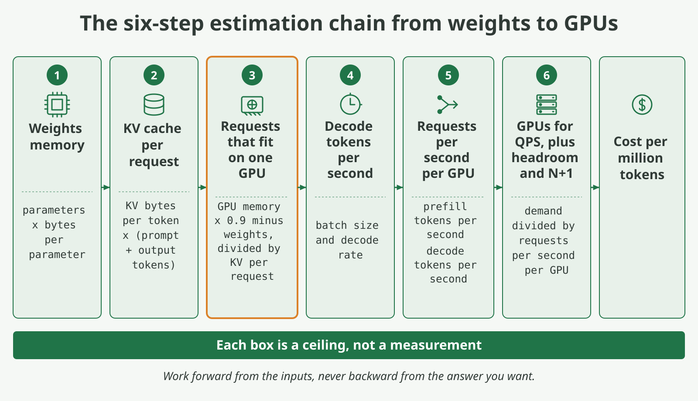

*Figure 20.12.1. The estimation chain works forward from weights memory through KV cache and requests per GPU to the number of GPUs needed for the target load.*

Picture yourself on a call when someone says, "we expect 40 requests per second, how many GPUs?" The temptation is to reach for one formula and produce a number at once. The honest answer is not one formula. It is a chain of six small steps, and each step feeds the next, so a mistake early in the chain shows up in every number after it.

First you find how much memory the weights take. Second you find how much memory one request's KV cache takes. Third you find how many requests fit on one GPU. Fourth you find how fast the GPU can generate tokens for that many requests. Fifth you turn that into requests per second per GPU. Sixth you divide the demand by that and add headroom and a spare. Each step has one question, and the chain is easy to follow once you have said the steps in order a few times.

The steps also depend on each other in a fixed direction. The weights decide how much room is left, the room decides how many requests fit, and the number of requests that fit limits how many tokens the GPU can produce in a second. Only at the end do you compare the result with the load you were given. If you start from the load and work backwards, it is tempting to adjust an input until the answer looks right, and that is the habit the chain is meant to prevent. Work forwards from the hardware and the model, and let the load be the last thing you compare against.

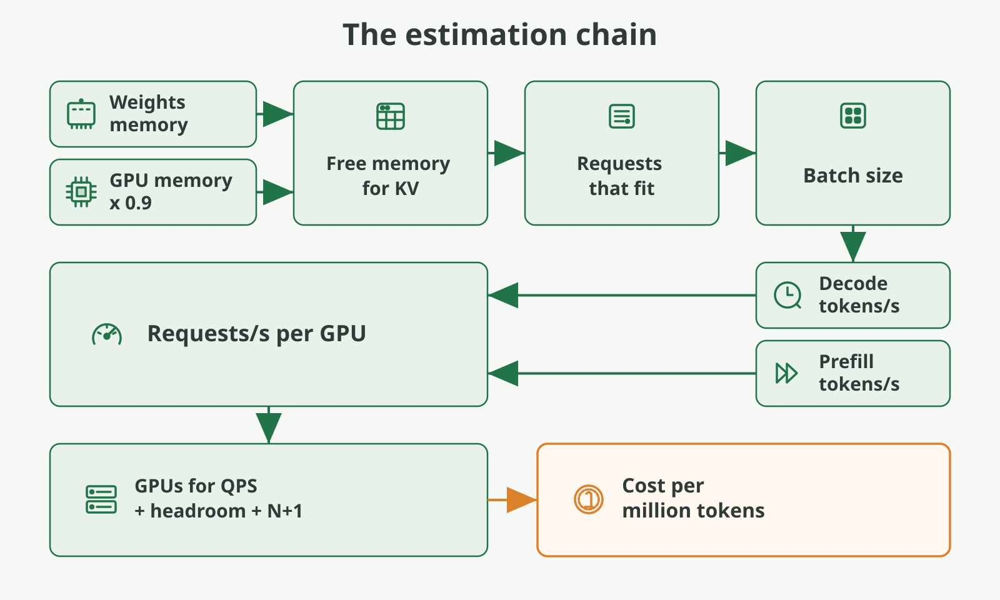

*Figure 20.12.2. The estimation chain, as a diagram.*

Every number in the chain is an input you can state. Every box is a ceiling, not a measurement, so the result is the most the hardware could do under your assumptions and not what it will do in production. **Say the inputs out loud, multiply them out, then say that a benchmark must replace the ceiling before you commit money.** Next time someone gives you a load figure, start by asking for prompt length and answer length, because every box in the chain depends on them.

### 2. Weights memory by precision

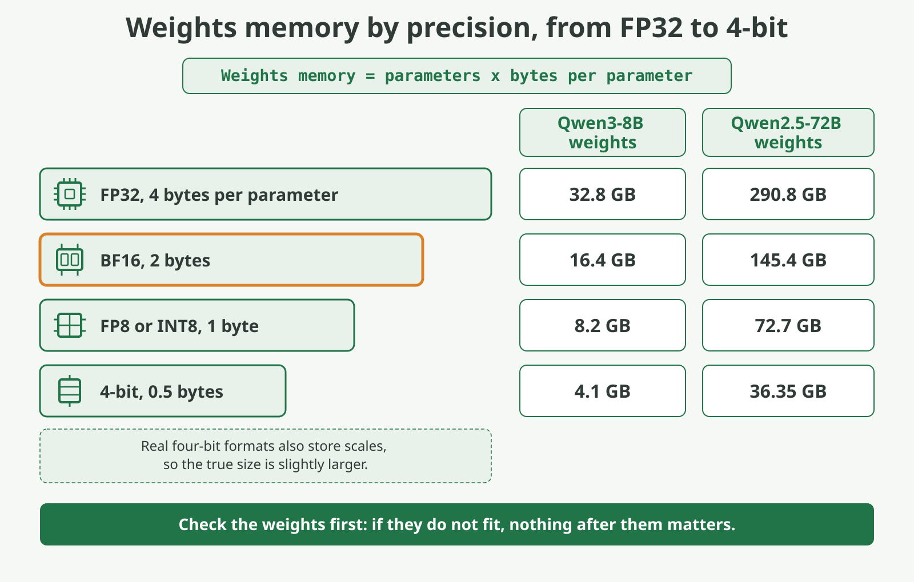

*Figure 20.12.3. Weights memory equals parameters times bytes per parameter, so Qwen3-8B takes 16.4 GB in BF16 and Qwen2.5-72B takes 145.4 GB.*

Picture a pod that goes into a crash loop with an out-of-memory error before it serves a single request. The weights alone did not fit on the card. This is the cheapest check you can make, and it takes a few seconds, so do it first. If the weights fail, nothing after them matters.

Weights memory is parameters multiplied by bytes per parameter. Hands-On LLM Serving and Optimization, in Chapter 5, gives the table: FP32 uses 4 bytes, FP16 and BF16 use 2 bytes, and INT8 and FP8 use 1 byte. It works the example of a 7-billion-parameter model at 2 bytes, which gives 14 GB. LLMs in Production, in Chapter 3, offers the same shortcut: multiply billions of parameters by two to get gigabytes at half precision. The shortcut is easy to remember in an interview, and it lands within the same range as the full table.

Four-bit weights use half a byte per parameter. That is plain arithmetic from 4 bits, not a figure the books give. Real four-bit formats also store scales, so the true size is a little larger. Mark that as unverified if you quote it.

The first worked example uses a model whose numbers you can read yourself. Qwen3-8B is published under the Apache 2.0 licence. Its model card states 8.2 billion parameters, 36 layers, and grouped-query attention with 32 query heads and 8 key-value heads. Its `config.json` states `head_dim` 128 and `torch_dtype` bfloat16. Reading those values yourself, from the card and the config file, is the habit that makes your estimate defensible.

| Precision | Bytes per parameter | Qwen3-8B weights | Qwen2.5-72B weights |
|---|---|---|---|
| FP32 | 4 | 32.8 GB | 290.8 GB |
| BF16 | 2 | 16.4 GB | 145.4 GB |
| FP8 or INT8 | 1 | 8.2 GB | 72.7 GB |
| 4-bit | 0.5 | 4.1 GB | 36.35 GB |

The second model is Qwen2.5-72B-Instruct. Its card states 72.7 billion parameters, 80 layers, and 64 query heads with 8 key-value heads. Its `config.json` has hidden size 8192, which gives a head dimension of 128. The values in the table are billions multiplied by bytes, in decimal gigabytes, the unit GPU datasheets use. Keep the units consistent from the first line of your estimate to the last, because a mix of decimal and binary units is one of the quiet traps in this chain.

Before you pick a GPU, multiply parameters by bytes and compare the result with the card's memory, leaving room for the cache that the next section sizes.

The weights are the one part of the memory budget that does not change with traffic. The same weights sit in memory whether one request or a hundred are running, so this is the first fixed cost you subtract. If the weights alone leave too little room, no amount of batching will rescue the design, and the honest move is a different precision, a different GPU or more GPUs per replica. Make that decision before you move on to the cache, because everything after it is measured in the room that the weights leave behind.

### 3. KV-cache memory per token and per request

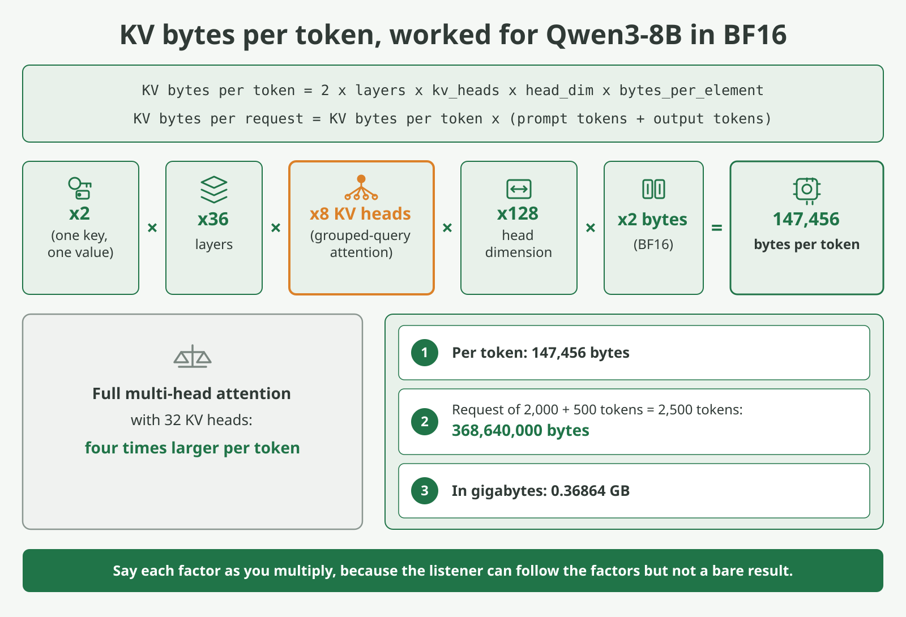

*Figure 20.12.4. The KV cache for Qwen3-8B in BF16 is 147,456 bytes per token, from two, 36 layers, 8 KV heads, a head dimension of 128 and 2 bytes.*

Picture a user who pastes a long document into a chat, and your endpoint starts rejecting requests. You check the weights and they fit with room to spare. The room was not spare. It was reserved for the KV cache, and the cache grows with every token of every live request, so one long document can use more memory than the model itself.

During generation, each layer keeps a key vector and a value vector for every token seen so far. Without that store, the model would recompute them at every step. Hands-On LLM Serving and Optimization, Chapter 5, gives the per-token formula in its multi-head form. Replace the head count with the number of key-value heads, because models with grouped-query attention store only those. The formula is short enough to say from memory, and it is worth doing so.

```text
KV bytes per token = 2 x layers x kv_heads x head_dim x bytes_per_element
KV bytes per request = KV bytes per token x (prompt tokens + output tokens)
```

The 2 is one key plus one value. The result is the memory one request needs at its longest point. Use the prompt plus the full answer length, because the cache is still full when the last token is produced. A common slip is to size the cache for the prompt alone, which understates the memory by the length of the answer.

First check the formula on a known model. Llama-2-7B has 32 layers, 32 heads and head dimension 128, with no grouped-query attention. At 2 bytes: 2 x 32 x 32 x 128 x 2 equals 524,288 bytes, or 0.5 MB per token. Multiplying that by 4,096 tokens and 16 requests gives 32 GB, which is more than the 14 GB of weights. LLMs in Production says one token is about 1 MB. That is a rougher rule, so trust the formula.

Now the worked example for Qwen3-8B in BF16. The arithmetic is 2 x 36 x 8 x 128 x 2. Work it line by line, and say each factor as you multiply it, because the interviewer can follow the factors but not a bare result.

| Step | Calculation | Result |
|---|---|---|
| Per token | 2 x 36 x 8 x 128 x 2 | 147,456 bytes |
| Request of 2,000 + 500 tokens | 2,500 x 147,456 | 368,640,000 bytes |
| In gigabytes | 368,640,000 / 1e9 | 0.36864 GB |

If Qwen3-8B had used full multi-head attention with 32 key-value heads, the per-token figure would be four times larger, 589,824 bytes. Grouped-query attention is why a modern 8-billion model serves four times as many requests per GPU as an older design of the same size. The same formula for Qwen2.5-72B gives 2 x 80 x 8 x 128 x 2 equals 327,680 bytes per token. A 2,500-token request therefore needs 0.8192 GB.

Storing the cache in FP8 halves these numbers. The vLLM source documents a `cache_dtype` option that accepts `fp8`, read from the main branch on 2026-11-09. Whether quality holds for your model is a separate test that this chapter did not run, and a cache that is smaller but gives worse answers is not a win.

The cache is the part of memory that grows with the work. Each live request adds its own keys and values, token by token, and it keeps them until the request finishes. That is why two services on the same GPU can behave very differently: one serves short questions and the other serves long documents, and the same card holds a very different number of each. When you size the cache, you are really sizing the longest conversation the business expects, multiplied by the number of conversations that may be live at once.

Every time a customer names a model, find the layers, key-value heads and head dimension in the model card or `config.json` and compute bytes per token before you say anything about concurrency. That single step turns a vague capacity question into a concrete one.

### 4. Concurrent requests per GPU

Picture one 80 GB GPU in a rack. Some of its memory holds the weights. Some is working space for activations and compiled graphs. The rest is the KV cache. Concurrency, the number of requests you can hold at once, is the rest divided by the cost of one request. That one sentence is the whole section, and the rest of it explains the inputs.

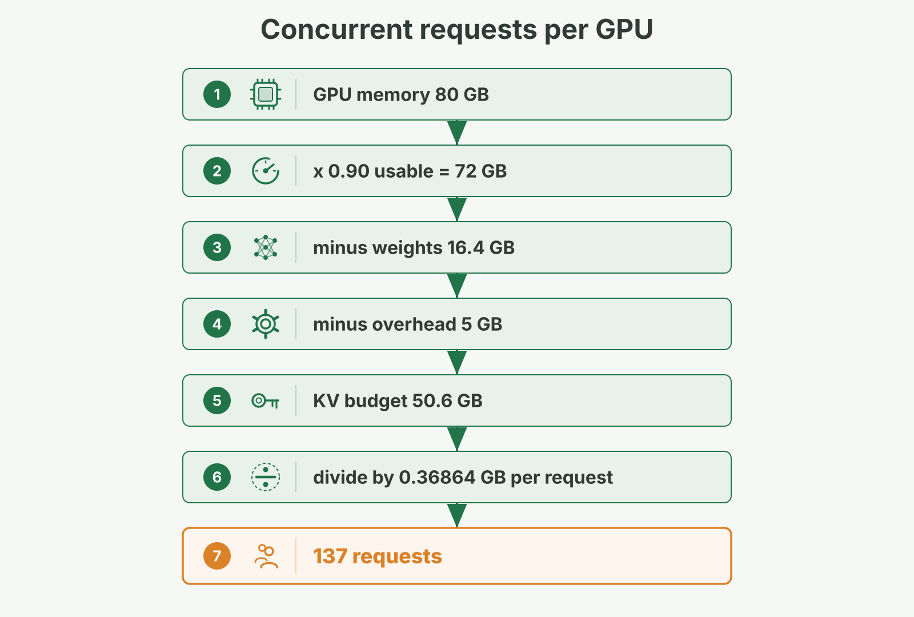

*Figure 20.12.5. Concurrent requests per GPU, as a diagram.*

Two inputs need care. The first is the usable fraction. vLLM exposes `gpu_memory_utilization`, a fraction of memory the engine may use. On the main branch the source, read on 2026-11-09, says the default is 0.92 when unspecified, or 1.0 with its extensible cache. The source for releases v0.10.0 and v0.11.0 sets the default to 0.9, so the value depends on your version. This chapter plans with 0.90, which is a cautious round number and my choice, not the engine's. Always check which value your running version uses.

The second input is overhead for activations, CUDA graphs and fragmentation. Hands-On LLM Serving and Optimization says you cannot reach the theoretical batch size because activations also need room. This chapter reserves 5 GB per GPU. That figure is a planning assumption, not a measurement. Replace it with the number your own engine logs at startup. A fragmented cache wastes memory even when the total looks free, which is another reason the overhead is a guess until you measure it.

Think of the GPU memory as a budget that you spend in a fixed order. The card's memory is the total, a safety fraction is taken off first, then the weights, then the overhead, and what is left buys cache. Each line of the budget is a subtraction, so a mistake in one line shows up in the final count. The reserve at the start is not waste. It is the margin that keeps a burst of long prompts from pushing the card into an out-of-memory error.

The worked example on an H100 SXM with 80 GB follows. The datasheet figure is on the NVIDIA H100 page. Read each row of the table as one step of the same subtraction, starting from the card and ending with the number of requests.

| Step | Calculation | Result |
|---|---|---|
| Usable memory | 80 x 0.90 | 72.0 GB |
| After weights | 72.0 - 16.4 | 55.6 GB |
| After overhead | 55.6 - 5 | 50.6 GB |
| Requests that fit | 50.6 / 0.36864 = 137.3 | 137 |

With FP8 weights the same GPU holds 159 requests, because the budget grows by 8.2 GB. Hands-On LLM Serving and Optimization does the same sum for two cards. Its table lists 4 requests on a 24 GB card and 16 on a 48 GB card for a 7B model, though its own formula in the same row gives 5 and 17, so treat the digits as approximate. Either way the pricier card is cheaper per request, and the lesson is that the extra memory matters more than the sticker price.

For a model that needs several GPUs, add the memory and the overhead per GPU. Four H100s serving Qwen2.5-72B in BF16 have 4 x 80 x 0.90 equals 288 GB usable. Subtract 145.4 GB of weights and 20 GB of overhead, and 122.6 GB remains. Divided by 0.8192 GB, that is 149 requests. The overhead is charged once per GPU, which is why four cards pay it four times.

The fit number is a ceiling on in-flight requests, not a target. **Running at the ceiling means the next burst preempts or rejects requests.** Use the fit number to set the engine's maximum sequences, and plan the working batch well below it.

### 5. Prefill is compute-bound, decode is bandwidth-bound

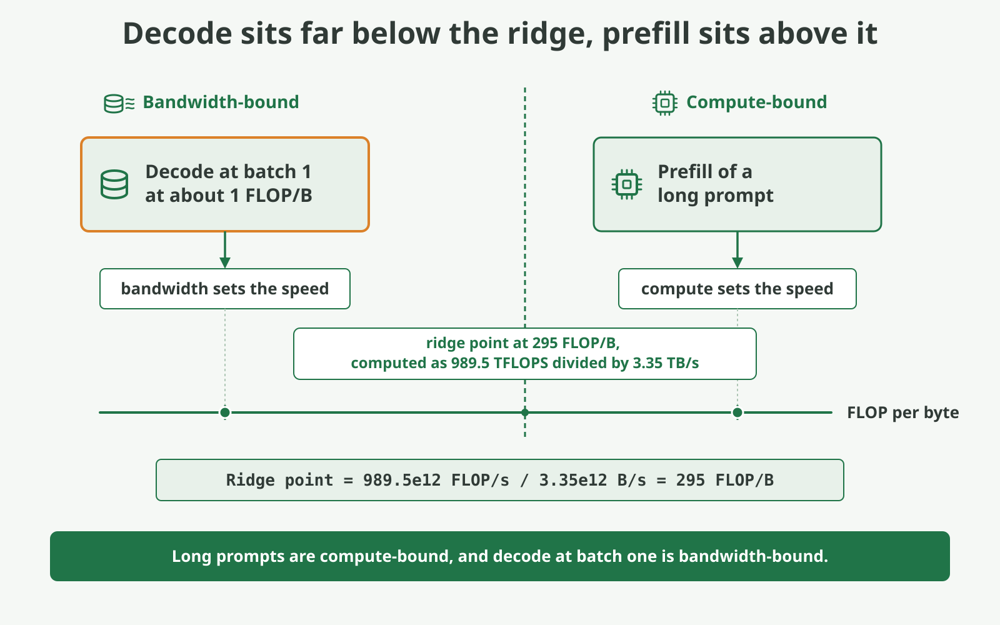

*Figure 20.12.6. Arithmetic intensity against the H100 ridge point decides whether a phase is limited by compute or by memory bandwidth.*

Picture an engineer who asks why a GPU showing 90 percent utilisation produces so few tokens per second. The dashboard looks busy, and the output looks slow, and both are true. The answer is that utilisation counts time with a kernel running, not useful arithmetic. During decode the GPU spends most of that time waiting for memory, so the arithmetic units sit idle while the dashboard still reads high.

Hands-On LLM Serving and Optimization, Chapter 5, explains this with arithmetic intensity, the number of operations per byte moved. For a matrix multiply of shapes M by K and K by N, the operations are 2 x M x N x K. The bytes moved are two bytes times the sum of the three matrix sizes. Compare the result with the chip's ridge point, which is peak compute divided by memory bandwidth. Below the ridge, the memory system limits you. Above it, the arithmetic units limit you. The ridge is the line that separates the two regimes, and every workload lands on one side of it.

Take the L40S: 362 TFLOPS divided by 864 GB/s gives a ridge near 419 operations per byte. Worked through, decode with one row per request has an intensity of about 1 whatever the sequence length. The same holds at every batch size of one: decode has an intensity of about 1 whatever the sequence length, which is why decode looks so different from prefill on the same chip. Prefill, which processes the whole prompt as many rows, climbs from 62 at 64 tokens to 1,365 at 4,096 tokens. The book's conclusion is that prefill can be compute-bound while decode is always bandwidth-bound at batch size one.

For an H100 the same step needs two datasheet numbers. The NVIDIA H100 page lists 1,979 TFLOPS for BF16 Tensor Core and 3.35 TB/s memory bandwidth for the SXM form factor. A footnote on that page marks the 1,979 as with sparsity. The NVIDIA L40S page shows its BF16 as 362.05 dense and 733 with sparsity, so the sparse figure is double the dense one. I apply the same halving to the H100, which gives 989.5 TFLOPS dense. NVIDIA's Hopper architecture in-depth blog, fetched 2026-11-09, lists H100 SXM5 BF16 at 1,000 TFLOPS dense and 2,000 with sparsity, so the halving holds, and 1,000 is the same figure rounded. Sparse and dense figures are easy to mix up, so check which one each datasheet number refers to before you divide.

```text
Ridge point = 989.5e12 FLOP/s / 3.35e12 B/s = 295 FLOP/B
```

At 295 operations per byte, a prompt of roughly 345 tokens already reaches the ridge in a simple matrix model with a hidden size of 4,096. That calculation sets the intensity formula s x h / (2s + h) equal to 295 and solves for s. So long prompts are compute-bound, and compute decides prefill time. Decode at batch size one sits near 1 operation per byte, far below 295, so bandwidth decides decode time. The two regimes are the reason the chapter treats prefill and decode as separate budgets.

The practical formulas follow. Both are ceilings.

```text
Prefill tokens/s  = peak FLOP/s x efficiency / (2 x parameters)
Decode step time  = (weight bytes + KV bytes of all live requests) / bandwidth
```

The factor of 2 per parameter per token comes from the matmul rule of 2 operations per multiply-add, applied to every weight. The efficiency term, often called MFU, is something you must assume or measure. MFU stands for model FLOPs utilisation, the share of the peak arithmetic the engine actually uses. This chapter assumes 0.40. That is an assumption of this chapter, not a published figure.

Decode reads every weight once per step no matter how many requests share the step. That is why batching is the main lever, which the next section quantifies. For a single replica spread over several GPUs, Distributed AI Systems, Chapter 6, notes that tensor parallelism multiplies effective memory bandwidth in decode, because each GPU loads its share of the weights.

Think of a delivery van that makes one stop per trip. The van costs the same to drive whether it carries one parcel or ten, so the fuel is spent on the drive and not on the cargo. Decode works the same way. The weights are the van's full load of road, the tokens are the parcels, and a batch of requests lets one drive deliver many parcels at once. That picture explains why adding requests to a decode step is cheap, and why a single request leaves the arithmetic units almost idle.

When someone asks why decode is slow, say that each step must stream the whole model through memory and the arithmetic units are mostly idle. That sentence answers the question without a formula, and then the formula can follow if the interviewer wants it.

### 6. How batching changes the numbers

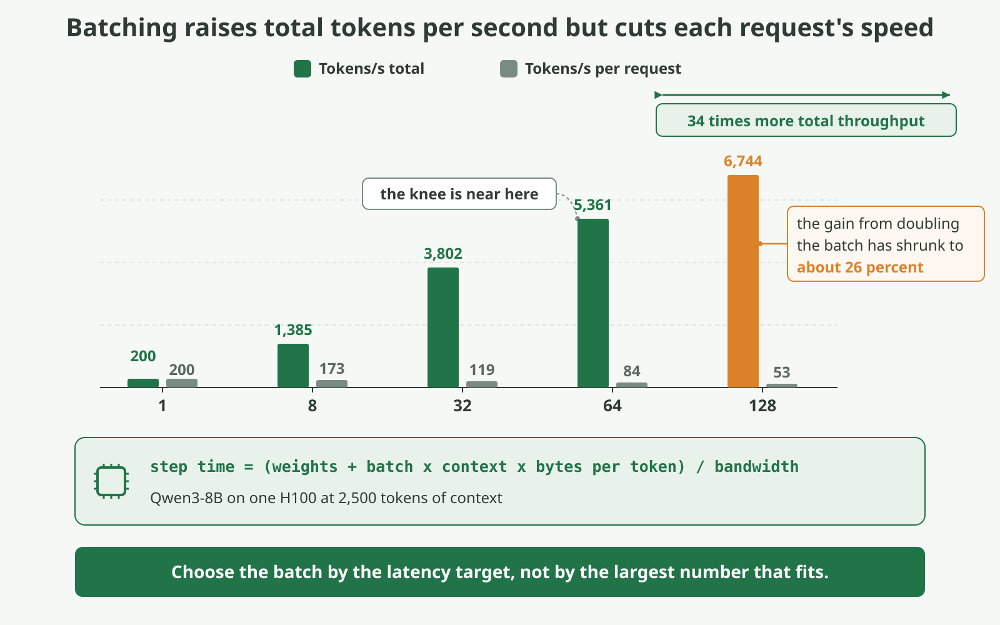

*Figure 20.12.7. Batching shares the weight read across requests, so total throughput rises while each request gets fewer tokens per second.*

Picture a service that is quiet at night, when one request at a time arrives. Each decode step streams 16.4 GB of weights to produce a single token. Now picture the same service at the morning peak, with 64 requests in flight. The same stream of weights now produces 64 tokens. The weights are shared, and only the KV cache is private. That is the whole reason batching pays.

Here is the decode ceiling for Qwen3-8B on one H100, with each request at 2,500 tokens of context. The step time is weights plus batch x 2,500 x 147,456 bytes of cache, divided by 3,350 GB/s. Read the table one row at a time, and check that the step time in each row follows from the formula before you trust the rest of the row.

| Batch | KV read per step | Step time | Tokens/s total | Tokens/s per request |
|---|---|---|---|---|
| 1 | 0.37 GB | 5.0 ms | 200 | 200 |
| 8 | 2.95 GB | 5.8 ms | 1,385 | 173 |
| 32 | 11.80 GB | 8.4 ms | 3,802 | 119 |
| 64 | 23.59 GB | 11.9 ms | 5,361 | 84 |
| 128 | 47.19 GB | 19.0 ms | 6,744 | 53 |

Read the table in two directions. The first direction is across the batch sizes, going down the rows. The second is within one row, comparing the total with the per-request figure. Both readings describe the same GPU, and the interviewer will ask about whichever one you skipped.

Read the table in two directions. Total throughput rises from 200 to 6,744 tokens per second, thirty-four times more. Per-request speed falls from 200 to 53 tokens per second. This is the throughput and latency trade-off in one table, and it is the trade-off the interviewer will ask you to name. More requests together make the GPU busier, and each request waits longer for its own next token.

The table also shows why returns diminish. Weights are a fixed cost, and the cache is a cost per request. At batch 128, the cache read is larger than the weight read. The gain from doubling the batch has shrunk to about 26 percent. The compute needed at batch 128 is 2 x 8.2e9 x 128 operations, which is about 2.1 ms at 989.5 TFLOPS. That is a small share of the 19 ms step, so decode is still bandwidth-bound. Seeing where the curve flattens is the point of the table, more than any single row.

AI Systems Performance Engineering, Chapter 16, gives the operating rule. Plot throughput against latency, find the knee, and cap the batch slightly below peak. Teams typically target about 90 percent of peak throughput, which is the headroom buffer. The knee is the place where extra batch buys little throughput and costs a lot of latency, so the cap sits just before it.

Continuous batching, covered in Hands-On LLM Serving and Optimization Chapter 6, is what makes the batch stay full in practice. A finished request leaves and a waiting one joins at the next step. The two limits that control it are the maximum number of sequences and the maximum batched tokens. Without continuous batching, a batch would wait for its slowest request to finish before the GPU started another one.

The ridge point also gives you a ceiling on how far batching helps. Ignoring the cache, decode intensity equals the batch size, so you need about 295 requests in flight before the arithmetic units become the limit. Most deployments run out of KV memory or latency budget long before that.

Choose the batch by the latency target, not by the largest number that fits, and confirm it sits below the memory fit from the previous section.

A useful way to say this in the room is that the batch is a dial with two ends. Turning it toward the right gives more tokens per second for the whole GPU, and turning it the same way makes each user wait longer. The latency target tells you where the dial should stop, and the memory fit tells you where it must stop regardless. Most of the time the latency target is the tighter of the two, so it is the number to say first.

### 7. Tokens per second and requests per second per GPU

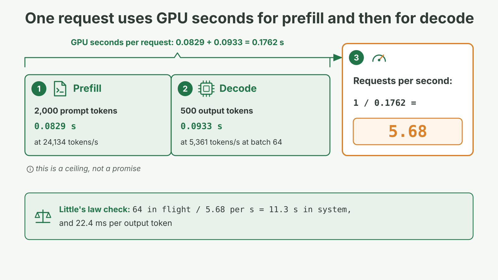

*Figure 20.12.8. Prefill and decode share one GPU, so their seconds add, and the reciprocal gives the per-GPU request rate.*

Picture a single GPU with two jobs in its day. It must read the prompt, which is prefill, and then write the answer one token at a time, which is decode. A request needs both. If prefill and decode share one GPU, their seconds add, and the request's total GPU time is the sum of the two shares.

The table below works this for Qwen3-8B on one H100, using a batch of 64. Each row is one step, and the result column feeds the next row, so you can follow the request from the prompt to the requests-per-second figure.

| Step | Calculation | Result |
|---|---|---|
| Prefill rate | 989.5e12 x 0.40 / (2 x 8.2e9) | 24,134 tokens/s |
| Prefill time, 2,000 tokens | 2,000 / 24,134 | 0.0829 s |
| Decode rate at batch 64 | from the table | 5,361 tokens/s |
| Decode share, 500 tokens | 500 / 5,361 | 0.0933 s |
| GPU seconds per request | 0.0829 + 0.0933 | 0.1762 s |
| Requests per second | 1 / 0.1762 | 5.68 |

That is the ceiling for one GPU: 5.68 requests per second, which is about 2,840 output tokens per second. It is not a promise. Real engines overlap prefill chunks with decode and lose some time to scheduling, so measure before you quote the rate as your capacity.

Seen from a single request, the same numbers tell a simple story. The request waits for its prompt to be read, then waits for each token in turn. The GPU is shared, so the request also waits while other requests take their turn. That waiting is why the time in the system is longer than the decode share alone.

Now run Little's law as a check. Concurrency equals arrival rate times time in system. Little's law is a plain identity from queueing theory that holds for any stable system. With 64 in flight at 5.68 per second, each request spends 64 / 5.68 equals 11.3 seconds in the system. That is twice the 6 seconds you would get from decode alone, because prefill work interrupts decode. The mean time per output token is then about 22.4 ms, not the 11.9 ms step time. Compare that with a latency target. AI Systems Performance Engineering, Chapter 17, quotes a DistServe-style target of 0.4 seconds at the 90th percentile for time to first token and 0.04 seconds for time per output token. At 22.4 ms you meet the second one on paper.

Notice what this teaches. A high-capacity ceiling and a good latency are different things. If your product needs a faster response, you lower the batch, and the requests per second per GPU fall with it. The per-GPU rate is never a free number to maximise.

Quote the per-GPU requests per second together with the batch size and the latency it implies, never the bare number.

### 8. GPUs for a target QPS, with headroom and N+1

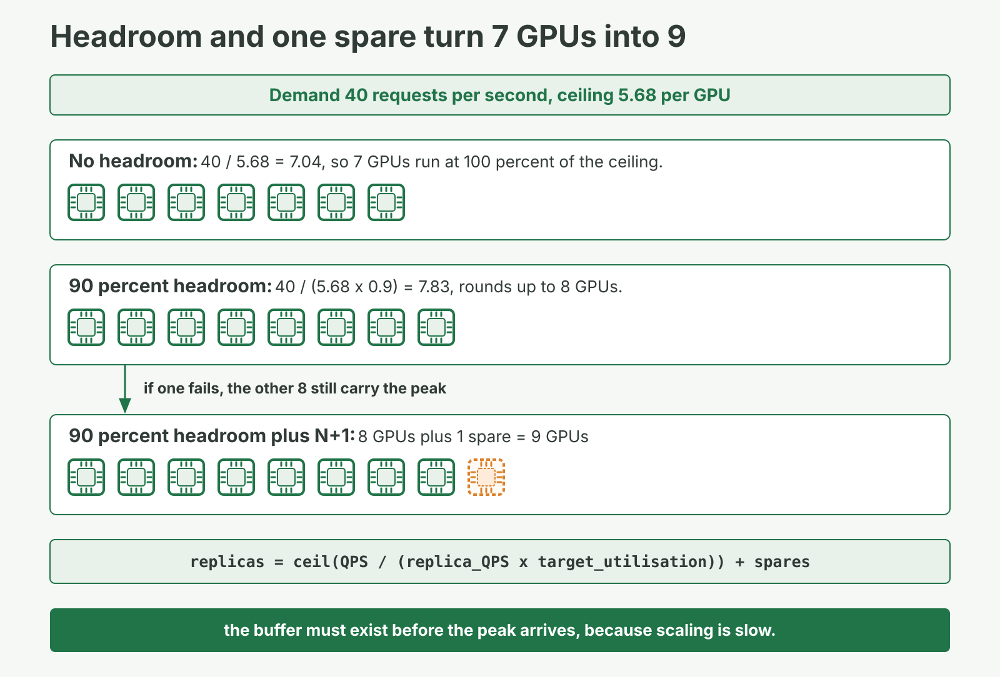

*Figure 20.12.9. Sizing to the bare peak leaves no room for a burst or a failure, so the plan adds headroom and one spare replica.*

Picture the planning meeting when the product manager says the peak is 40 requests per second. Demand is 40 requests per second at peak, and your ceiling is 5.68 per GPU. Dividing gives 7.04, so seven GPUs run at 100 percent of the ceiling, with no room for a burst, a slow batch or a failure. That first answer is not safe.

Headroom fixes the first problem. AI Systems Performance Engineering, Chapter 16, gives the rule of targeting about 90 percent of peak throughput. It also recommends extra replicas that sit mostly idle as a buffer, and warns that autoscaling takes time to provision new resources. Apply the 90 percent and the arithmetic changes: 5.68 x 0.9 equals 5.11, and 40 / 5.11 equals 7.83, which rounds up to 8. Scaling is slow, so the buffer has to exist before the peak arrives, not after.

A single failure is the case most designs forget. A replica can crash, a node can drain for maintenance, or a card can fall off the bus. If the plan has no spare, the first failure moves the whole peak onto the survivors, and the latency rises at the worst moment. A spare costs money every hour, and the trade is that you pay for it in order to avoid a page at peak.

N+1 fixes the second problem. The plan records that the public Nebius chat-app case study mentions X+1 redundancy, and that is a vendor source, not documentation of the exact policy. Adding one spare replica gives 9 GPUs. If one fails, the other eight still carry the peak. The spare is the price of surviving a single failure without a page at the worst moment.

```text
replicas = ceil(QPS / (replica_QPS x target_utilisation)) + spares
GPUs     = replicas x GPUs_per_replica
```

When a replica spans several GPUs, spares are whole replicas. For Qwen2.5-72B on four H100s per replica, the estimator gives a ceiling of 2.61 requests per second at batch 32. At 10 requests per second you need ceil(10 / (2.61 x 0.9)) equals 5 replicas plus 1 spare, which is 6 replicas and 24 GPUs. The spare alone is four GPUs. Whether a design with fewer, larger replicas is better depends on the failure domain you want, and 20.16 covers it.

AI Factory, in Chapter 9, makes the general cloud argument that capacity should follow load instead of being bought for the peak. That argument is why spare capacity is a deliberate, priced choice rather than an accident.

Nebius has not published its autoscaling signals, thresholds or spare policy. A reasonable design is to plan to the peak with this formula and let autoscaling handle the slow daily curve. That is my reasoning, not Nebius practice, and you should say so when you present it.

Before you quote a GPU count, state the utilisation target and the spare policy, because both change the answer by more than model details do.

### 9. Cost per million tokens

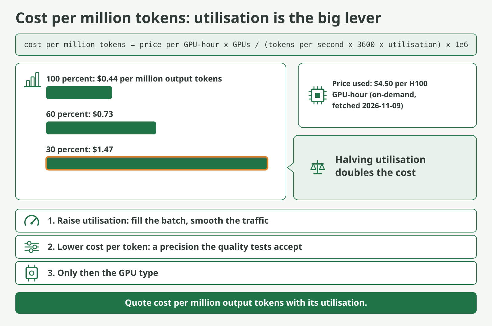

*Figure 20.12.10. Cost per million output tokens rises from $0.44 at full utilisation to $1.47 at 30 percent, so utilisation is the biggest lever.*

Picture the finance partner who asks what you charge per million tokens and whether the service makes money. The cost question is a division: what you pay for the GPUs per second, divided by the tokens they produce per second, scaled to a million. Once you can say that division aloud, the finance conversation becomes a discussion of its inputs.

```text
cost per million tokens = price per GPU-hour x GPUs / (tokens per second x 3600 x utilisation) x 1e6
```

Price comes from a source. The public Nebius pricing page, fetched on 2026-11-09, lists on-demand rates per GPU-hour: H100 at $4.50, H200 at $5.40, B200 at $8.50, and L40S with an Intel CPU from $1.55. Hands-On LLM Serving and Optimization, Chapter 5, prints a spring 2026 table with different figures for other clouds, including about $6.2 for an H100. Prices move, so state the date and the source with every figure you quote.

Using $4.50 and the 2,840 output tokens per second from before, at full utilisation:

| Utilisation | Cost per million output tokens |
|---|---|
| 100 percent | $0.44 |
| 60 percent | $0.73 |
| 30 percent | $1.47 |

The first row is the calculation 4.50 / (2,838.7 x 3,600) x 1e6. Utilisation here means the fraction of paid GPU time spent at the planned load. It is not the figure shown by `nvidia-smi`. Halving it doubles the cost, so idle capacity is the biggest lever you have after model choice. A GPU that sits idle half the time still bills for every hour, and the cost per token shows that waste directly.

Think of the division as a fraction with two moving parts. The top is the hourly bill for the GPU, and the bottom is the number of useful tokens it makes each second. Both parts change with the design. A cheaper GPU can still lose on the fraction if its bottom is much smaller, and a busier GPU can win on the fraction even at the same hourly price. Keeping the two parts in view stops you from comparing one of them alone.

Vendors price input and output tokens separately, since prefill and decode cost different amounts of GPU time. A blended figure hides that split, so avoid quoting it alone. When you do quote a figure, name which side of the split it covers.

Quote the cost per million output tokens with its utilisation, and say that low utilisation, not a higher GPU price, is usually the main reason a deployment is expensive.

When the finance partner pushes back, the useful reply is a short list of levers, in order. Raise utilisation by filling the batch and by smoothing the traffic. Lower the cost of each token by choosing a precision the quality tests accept. Only after those would you look at the GPU type, because a cheaper card with a smaller batch can end up dearer per token.

### 10. Utilisation and goodput

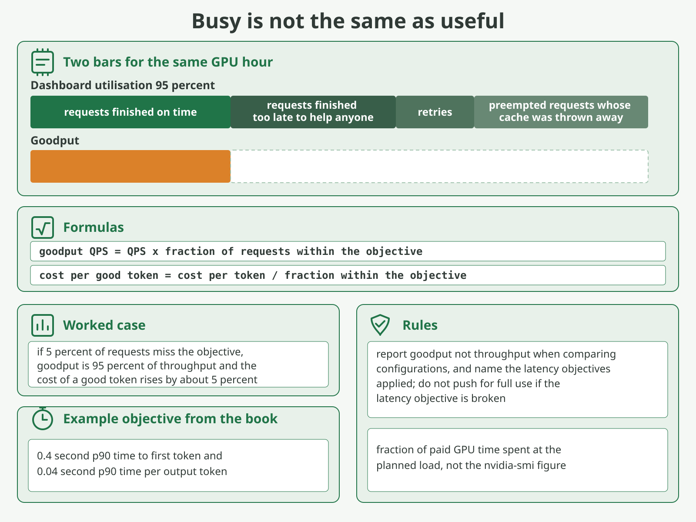

*Figure 20.12.11. Count only requests that meet the latency objective when you measure or price capacity.*

Picture a dashboard that shows every GPU at 95 percent, while customers complain that answers arrive too late. High utilisation can hide wasted work. The GPUs are busy, but some of that busy time goes to requests that finished too late to help anyone, to retries, and to preempted requests whose cache was thrown away.

Think of goodput as the work that counts for the customer. A request that finishes on time is useful work. A request that finishes late is work the GPU did that nobody can use, even though the dashboard recorded it as busy. The difference matters most in an interview, because a candidate who quotes utilisation alone is describing the dashboard and not the service.

AI Systems Performance Engineering, Chapter 16, defines goodput as useful utilisation, and cautions against pushing for full use if the latency objective is broken. Chapter 17 of the same book makes it concrete with a DistServe example. The objective is a 0.4 second 90th-percentile time to first token and a 0.04 second time per output token. A colocated GPU reaches about 3 requests per second within the first bound and 1.6 within the second. Goodput is the lower of the two, 1.6, because both bounds must hold. A split of two prefill GPUs and one decode GPU reaches 10 requests per second across three GPUs, or 3.3 per GPU. Read the example as a comparison of the same objective under two layouts, not as a general law.

The takeaway for your estimates: count only requests that meet the objective. If 5 percent of requests miss it, goodput is 95 percent of the throughput, and the cost of a good token rises by about 5 percent. The estimator has a one-line function for this.

```text
goodput QPS = QPS x fraction of requests within the objective
cost per good token = cost per token / fraction within the objective
```

Report goodput, not throughput, when you compare two configurations, and say which latency objectives you applied. A throughput figure without its objective is the same kind of bare number as a GPU count without its inputs.

### 11. The sanity checks

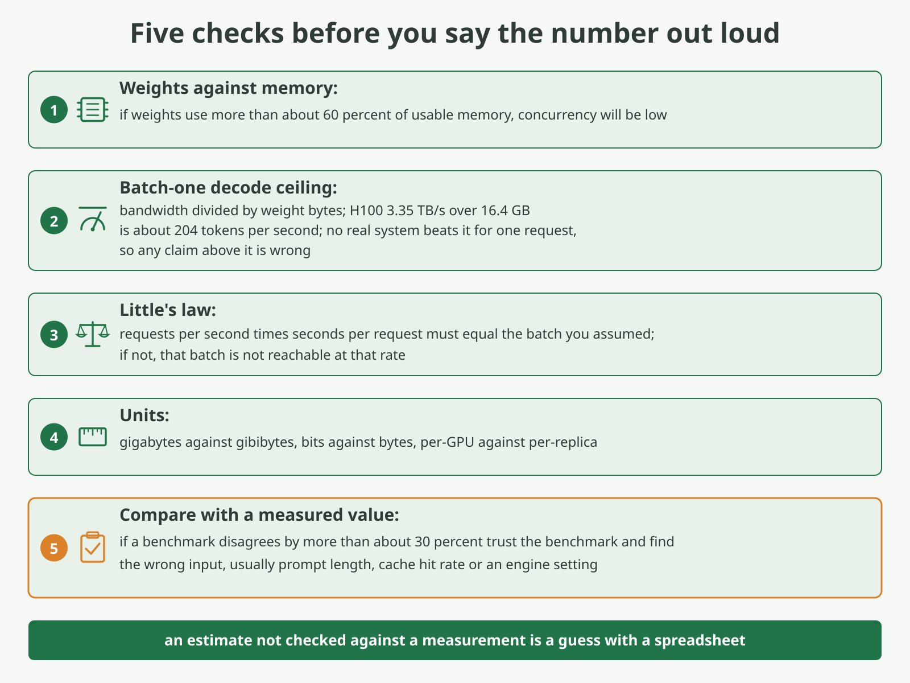

*Figure 20.12.12. Arithmetic checks can pass with wrong inputs, so the last check compares against a measurement.*

Picture the moment after you have a number and before you say it out loud. The number feels finished at this point, and that feeling is the reason to check it. A careful engineer treats a fresh estimate the way a pilot treats a new reading on a gauge, as a claim to test before acting on it. A few quick checks catch arithmetic mistakes and impossible results, and each one takes only seconds. Run them in order, because each check is cheap and the early ones catch the most common slips.

Before the checks, the fifth step is the one that catches wrong inputs. A check on the arithmetic can pass while the inputs are wrong, so the list ends with a comparison against a real measurement.

1. Compare the weights with GPU memory. If they use more than about 60 percent of usable memory, concurrency will be low.
2. Compute the decode ceiling at batch one, bandwidth divided by weight bytes. For the H100 and 16.4 GB it is about 204 tokens per second. No real system beats that for one request, so any claim above it is wrong.
3. Apply Little's law. Requests per second times seconds per request must equal the batch you assumed. If it does not, your assumed batch is not reachable at that rate.
4. Check units. Gigabytes against gibibytes, bits against bytes, and per-GPU against per-replica are the usual traps.

The fifth step is a comparison with a measured value. When the benchmark disagrees with your estimate by more than about 30 percent, trust the benchmark and find what you assumed wrong, usually prompt length, cache hit rate or an engine setting. Most surprises in capacity planning come from a wrong prompt length, not from a wrong formula, which is why the benchmark is the final word.

**An estimate that is not checked against a measurement is a guess with a spreadsheet.** Plan to replace each ceiling with a benchmark before you place an order.

### 12. Numbers every inference SRE should know

Picture a whiteboard session where the interviewer asks for a figure you do not remember. You cannot stop to search, so you need a short set of anchors you can rebuild from. The table below is that set. Each row names its source, so you know which figures are datasheet values and which you computed.

| Fact | Value | Source |
|---|---|---|
| H100 SXM memory and bandwidth | 80 GB, 3.35 TB/s | NVIDIA H100 page, fetched 2026-11-09 |
| H100 NVL memory and bandwidth | 94 GB, 3.9 TB/s | NVIDIA H100 page, same date |
| H200 memory and bandwidth | 141 GB, 4.8 TB/s | NVIDIA H200 page, same date |
| L40S memory and bandwidth | 48 GB GDDR6, 864 GB/s | NVIDIA L40S page, same date |
| DGX B200 total memory and bandwidth | 1,440 GB and 64 TB/s across 8 GPUs, so 180 GB and 8 TB/s each by division | NVIDIA DGX B200 page, same date, per-GPU by my division |
| H100 SXM BF16 Tensor Core | 1,979 TFLOPS with sparsity, so about 989.5 dense | NVIDIA H100 page, dense is my halving |
| NVLink and PCIe on H100 SXM | 900 GB/s and 128 GB/s | NVIDIA H100 page |
| Bytes per parameter | FP32 4, BF16 2, FP8 1 | Hands-On LLM Serving and Optimization, Chapter 5 |
| Weights shortcut | billions of parameters x 2 equals GB at half precision | LLMs in Production, Chapter 3 |
| KV per token, Llama-2-7B BF16 | 524,288 bytes | Hands-On LLM Serving and Optimization, Chapter 5 |
| KV per token, Qwen3-8B BF16 | 147,456 bytes | Computed from the Qwen3-8B model card and `config.json` |
| KV per token, Qwen2.5-72B BF16 | 327,680 bytes | Computed from the Qwen2.5-72B model card and `config.json` |
| L40S ridge point | about 419 FLOP/B | Hands-On LLM Serving and Optimization, Chapter 5 |
| H100 ridge point | about 295 FLOP/B | Computed from the two H100 page figures above |
| Decode arithmetic intensity at batch one | about 1 FLOP/B | Hands-On LLM Serving and Optimization, Chapter 5 |
| Headroom target | about 90 percent of peak throughput | AI Systems Performance Engineering, Chapter 16 |
| Example latency objective | 0.4 s time to first token, 0.04 s per output token, both at p90 | AI Systems Performance Engineering, Chapter 17 |
| Nebius on-demand H100, H200, B200 | $4.50, $5.40, $8.50 per GPU-hour | nebius.com/prices, fetched 2026-11-09 |
| vLLM memory fraction default | 0.92, or 1.0 with extensible cache on main. 0.9 in v0.10.0 and v0.11.0 | vLLM `vllm/config/cache.py` and `vllm/config.py`, read 2026-11-09 |

When an interviewer asks for a number you do not remember, derive it from the rows above and say how you derived it. Deriving a figure in front of the interviewer, with the inputs named, often earns more credit than recalling a figure that you cannot justify.

## How to answer out loud

Picture the interviewer finishing a question and waiting for your first sentence. Rehearse these five until the order comes without notes. Each outline is in the order to speak, so your opening words set up the rest of the answer. Each one also ends with a follow-up you should expect, because the interviewer will almost always push on the weakest input. Having the follow-up ready turns a pushback into the next step of the answer.

**1. "How many GPUs for this load?"** Ask for prompt length, answer length, peak requests per second and the latency target. State the model, precision and GPU. Compute weights, then KV per request, then how many fit. Pick a batch below that. Give the decode and prefill ceilings, then requests per second per GPU. Divide the load by 90 percent of that and add one spare. End by saying you would benchmark to replace the ceilings. Numbers to state: the 137 fit, the 5.68 ceiling, the 9 GPUs. The follow-up to expect is "what if the prompts are three times longer?", which cuts the fit and raises the prefill share. Say that the longer prompts shrink the number of requests that fit, and that they also take more prefill time per request, so both limits move at once.

**2. "How much memory does one request use?"** Write the formula with all four terms. Name the model's layers, key-value heads and head dimension and say you would read them from the model card. Give 147,456 bytes per token for the example, and then 0.37 GB for a 2,500-token request. Mention grouped-query attention as the reason the cache is a quarter of what a multi-head design needs. Expect a follow-up on FP8 cache, prefix caching or paged allocation.

**3. "Why is decode slow and prefill fast?"** Say that decode produces one token per request per step and must read all the weights for it. Give arithmetic intensity near 1 against a ridge of a few hundred. Say prefill processes many tokens at once and is compute-bound for long prompts. Name the consequence, that batching helps decode and does little for prefill. Expect a follow-up on disaggregating the two phases, which 20.13 covers.

**4. "What does a million tokens cost, and how do you lower it?"** Give the formula with price, tokens per second and utilisation. Quote the $0.44 at full utilisation and show it rising to $1.47 at 30 percent. Name the levers in order of impact: utilisation, batch size, quantisation, then a cheaper GPU. Say that price per hour is not price per token, and give the L40S example from the worked scenarios. Expect a follow-up on how you would measure real utilisation.

**5. "How do you know your estimate is right?"** Name the four checks: weights against memory, the batch-one decode ceiling, Little's law, and units. Say you would run a benchmark at the planned batch and compare. Say you would treat a gap over 30 percent as a wrong input, not a wrong formula. The follow-up is often "which input is most likely wrong?", and the honest answer is the mean prompt length and the cache hit rate.

## Worked scenarios

These four scenarios reuse the numbers from the sections above, so the reasoning you practised there shows up again with a concrete customer attached. Each one starts from what the interviewer or the customer says, then walks through the steps in order.

### Scenario 1: the opening question

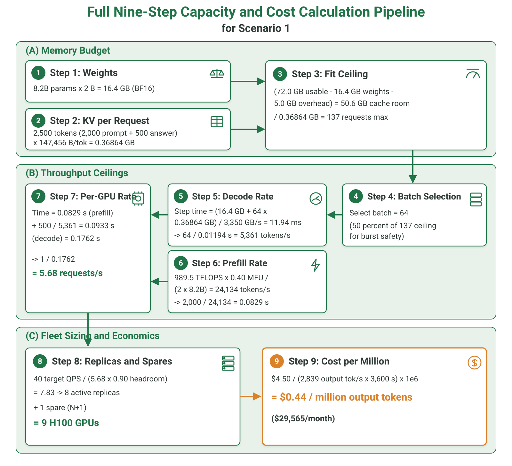

*Figure 20.0.0. The nine calculation steps for the opening scenario work from model parameters and KV cache to per-GPU throughput, replica count, and token cost.*

Picture the interviewer asking for the GPU count for an 8-billion-parameter model on H100s at 40 requests per second, 2,000 tokens in and 500 out. You take Qwen3-8B in BF16, as the question suggests, and you work the chain from the top. Say each step aloud as you finish it, so the interviewer can stop you at the first wrong input.

1. Weights: 8.2 x 2 equals 16.4 GB.
2. KV per request: 2,500 x 147,456 equals 0.36864 GB.
3. Fit: (72 - 16.4 - 5) / 0.36864 equals 137.
4. Pick a batch of 64, half the fit, to leave room for bursts.
5. Decode at batch 64: step (16.4 + 23.593) / 3,350 equals 11.94 ms, so 5,361 tokens per second.
6. Prefill: 24,134 tokens per second, so 0.0829 s per prompt.
7. Per GPU: 1 / (0.0829 + 0.0933) equals 5.68 requests per second.
8. Replicas: 40 / (5.68 x 0.9) equals 7.83, so 8, plus 1 spare is 9.
9. Cost, using the Nebius list price of $4.50 fetched 2026-11-09: $4.50 / (2,839 x 3,600) x 1e6 equals $0.44 per million output tokens at full utilisation.

The answer is nine H100s, about $29,565 per month, which is 9 GPUs times $4.50 times 730 hours. The $4.50 is the Nebius on-demand list price fetched on 2026-11-09, so replace it with your own contract rate. State that it assumes 40 percent prefill efficiency and 5 GB of overhead, and that a benchmark replaces both. You can reproduce it with the command in the lab.

### Scenario 2: the long-context customer

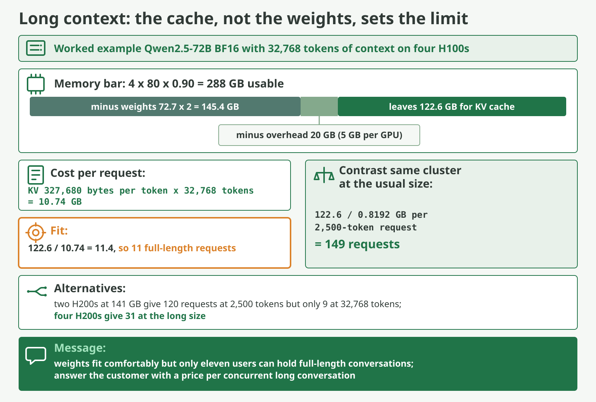

*Figure 20.12.13. At long context the KV cache per request is large, so concurrency collapses even though the weights fit.*

Picture a customer who wants Qwen2.5-72B with 32,768 tokens of context on four H100s. The question is whether it fits, and for how many users. This is the case where the cache, not the weights, becomes the limit, so it tests whether you can see that shift.

1. Weights: 72.7 x 2 equals 145.4 GB.
2. KV per token: 327,680 bytes, so a full 32,768-token request is 32,768 x 327,680 equals 10.74 GB.
3. Memory budget: 4 x 80 x 0.90 equals 288 GB. Subtract 145.4 and 20 GB overhead to get 122.6 GB.
4. Fit: 122.6 / 10.74 equals 11.4, so 11 full-length requests.

The weights fit comfortably, and only eleven users can hold full-length conversations. The cache, not the weights, sets the limit. Two H200s at 141 GB give 120 requests at the 2,500-token size but only 9 at 32,768 tokens. Four H200s give 31 at the long size. The right answer to the customer is a price per concurrent long session, plus a reminder that most requests are shorter. Say which you would verify first: their real length distribution.

### Scenario 3: the alert that disagrees with the estimate

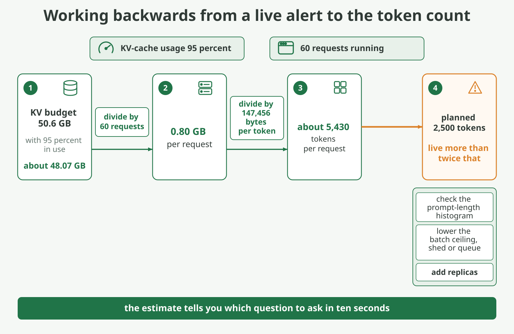

*Figure 20.12.14. Working backwards from live cache usage and request count shows that real prompts are longer than the estimate assumed.*

Picture an alert that fires while you are on call: KV-cache usage is 95 percent and p99 time to first token is rising. The dashboard shows 60 requests running on the H100 from Scenario 1, where you estimated 137 would fit. The estimate and the dashboard disagree, and the disagreement is the clue. Work backwards from the live numbers to find the input that changed.

1. KV budget is 50.6 GB. At 95 percent, about 48.07 GB is in use.
2. Divide by 60 requests: 0.80 GB per request.
3. Divide by 147,456 bytes per token: about 5,430 tokens per request.

The planned figure was 2,500 tokens. Live requests carry more than twice that, so the real mean context is longer than the one in your estimate. Either the customer's prompts grew, a retrieval step adds text, or a few very long requests dominate the mean. The estimate told you which question to ask in ten seconds. A useful habit is to write the estimate down before the incident, so that during the incident you compare live numbers against a written expectation and not against memory. The actions are to check the prompt-length histogram, then lower the batch ceiling, shed or queue long requests, and add replicas. This chapter did not run vLLM, so no metric was observed live. In the vLLM source the gauge is named `vllm:kv_cache_usage_perc` on the main branch and `vllm:gpu_cache_usage_perc` in v0.8.0, so check the name for your version.

### Scenario 4: is the cheaper GPU cheaper per token?

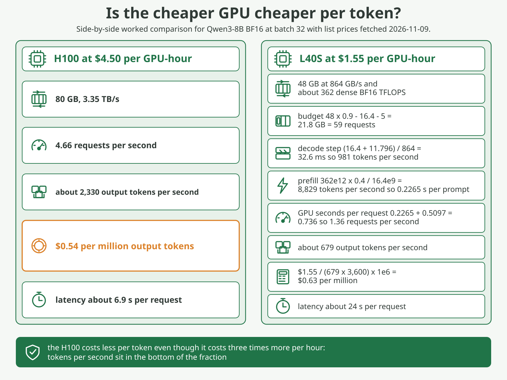

*Figure 20.12.15. Hourly price alone misleads because the cost per token also depends on tokens produced per second.*

Picture a colleague who says the L40S is a bargain because it costs far less per hour than the H100. The L40S from Nebius starts at $1.55 per GPU-hour, against $4.50 for the H100, both list prices from nebius.com/prices fetched on 2026-11-09. A colleague says it is three times cheaper. Test it with the same Qwen3-8B workload at a batch of 32 on both, because a per-hour price says nothing about tokens.

The L40S has 48 GB at 864 GB/s and about 362 dense BF16 TFLOPS, from the NVIDIA L40S page. Weights fit with a budget of 48 x 0.9 - 16.4 - 5 equals 21.8 GB, which is 59 requests.

1. Decode step: (16.4 + 11.796) / 864 equals 32.6 ms, so 981 tokens per second.
2. Prefill: 362e12 x 0.4 / 16.4e9 equals 8,829 tokens per second, so 0.2265 s per prompt.
3. GPU seconds per request: 0.2265 + 0.5097 equals 0.736, so 1.36 requests per second.
4. Output tokens: about 679 per second, so $1.55 / (679 x 3,600) x 1e6 equals $0.63 per million.

For the H100 at the same batch of 32, the estimator gives 4.66 requests per second, about 2,330 output tokens per second, and $0.54 per million. The H100 costs less per token even though it costs three times more per hour. The L40S latency is also worse, at about 24 s per request against 6.9 s. Both runs use the same assumed efficiency, so check by benchmark. **Price per hour is not price per token.**

## Hands-on lab

Imagine a laptop with Python 3 and pytest installed, and a copy of the chapter's code folder. The lab is quick, and it needs no GPU, because the estimator is arithmetic. Each step checks one idea from the chapter against the code.

All steps below were run on 2026-11-09 with Python 3.12.7 and pytest 8.3.5. First, the full estimator. It is under 120 lines and imports only the standard library.

```python
# code/part20/capacity_estimator.py
"""Back-of-envelope inference capacity maths. Standard library only.
Every function is one formula from chapter 20.12. Results are ceilings, not measurements."""
import argparse
import math

GB = 1e9  # decimal gigabytes, the unit GPU datasheets use
# name: (params in billions, layers, kv heads, head dim) from the model cards
MODELS = {"qwen3-8b": (8.2, 36, 8, 128), "qwen2.5-72b": (72.7, 80, 8, 128)}
# name: (memory GB, bandwidth GB/s, dense bf16 TFLOPS, USD per GPU-hour)
GPUS = {"h100": (80, 3350, 989.5, 4.50), "h200": (141, 4800, 989.5, 5.40)}


def weights_gb(params_b, bytes_per_param):
    return params_b * bytes_per_param


def kv_bytes_per_token(layers, kv_heads, head_dim, dtype_bytes=2):
    return 2 * layers * kv_heads * head_dim * dtype_bytes


def max_concurrent(gpu_gb, n_gpus, util, w_gb, overhead_gb, req_kv_gb):
    free = gpu_gb * n_gpus * util - w_gb - overhead_gb * n_gpus
    return max(0, int(free // req_kv_gb))


def decode_tps(batch, ctx_tokens, w_gb, bpt, bw_gbs):
    """Every decode step reads all weights once plus every request's KV cache."""
    step_s = (w_gb + batch * ctx_tokens * bpt / GB) / bw_gbs
    return batch / step_s


def prefill_tps(tflops, mfu, params_b):
    """About 2 FLOPs per parameter per prompt token, at an assumed utilisation."""
    return tflops * 1e12 * mfu / (2 * params_b * 1e9)


def per_gpu_capacity(in_tok, out_tok, batch, p_tps, d_tps):
    """Prefill and decode share the GPU, so their seconds add per request."""
    gpu_s = in_tok / p_tps + out_tok / d_tps
    rate = 1 / gpu_s
    latency = batch / rate  # Little's law: concurrency = rate x time in system
    return rate, latency, (latency - in_tok / p_tps) / out_tok


def replicas_needed(qps, replica_qps, target_util, spare=1):
    return math.ceil(qps / (replica_qps * target_util)) + spare


def cost_per_m_tokens(usd_per_gpu_hour, gpus, tokens_per_s, utilisation):
    return usd_per_gpu_hour * gpus / (tokens_per_s * 3600 * utilisation) * 1e6


def goodput_qps(qps, fraction_within_slo):
    return qps * fraction_within_slo


def main():
    a = argparse.ArgumentParser(description=__doc__)
    a.add_argument("--model", choices=MODELS, default="qwen3-8b")
    a.add_argument("--gpu", choices=GPUS, default="h100")
    a.add_argument("--tp", type=int, default=1, help="GPUs per replica")
    a.add_argument("--bytes-per-param", type=float, default=2)
    a.add_argument("--in-tokens", type=int, default=2000)
    a.add_argument("--out-tokens", type=int, default=500)
    a.add_argument("--batch", type=int, default=64)
    a.add_argument("--qps", type=float, default=40)
    a.add_argument("--mem-util", type=float, default=0.90)
    a.add_argument("--overhead-gb", type=float, default=5, help="per GPU, assumed")
    a.add_argument("--mfu", type=float, default=0.40, help="assumed")
    a.add_argument("--target-util", type=float, default=0.90)
    a.add_argument("--gpu-utilisation", type=float, default=1.0)
    a.add_argument("--kv-bytes", type=int, default=2)
    x = a.parse_args()
    params, layers, kvh, hd = MODELS[x.model]
    mem, bw, tflops, price = GPUS[x.gpu]
    w = weights_gb(params, x.bytes_per_param)
    bpt = kv_bytes_per_token(layers, kvh, hd, x.kv_bytes)
    req_gb = (x.in_tokens + x.out_tokens) * bpt / GB
    fit = max_concurrent(mem, x.tp, x.mem_util, w, x.overhead_gb, req_gb)
    ctx = x.in_tokens + x.out_tokens
    d_tps = decode_tps(x.batch, ctx, w, bpt, bw * x.tp)
    p_tps = prefill_tps(tflops * x.tp, x.mfu, params)
    rate, lat, tpot = per_gpu_capacity(x.in_tokens, x.out_tokens, x.batch, p_tps, d_tps)
    n = replicas_needed(x.qps, rate, x.target_util)
    cost = cost_per_m_tokens(price, x.tp, rate * x.out_tokens, x.gpu_utilisation)
    print(f"weights {w:.1f} GB, KV {bpt} B/token, {req_gb:.4f} GB/request, fits {fit} requests")
    print(f"decode ceiling {d_tps:.0f} tok/s at batch {x.batch}, prefill {p_tps:.0f} tok/s")
    print(f"replica ceiling {rate:.2f} req/s, latency {lat:.1f} s, TPOT {tpot * 1000:.1f} ms")
    print(f"{n} replicas, {n * x.tp} GPUs for {x.qps:g} QPS; ${cost:.2f} per million output tokens")


if __name__ == "__main__":
    main()
```

The tests encode the hand calculations from this chapter. If you change a formula, a test fails and tells you which number moved.

```python
# code/part20/test_capacity_estimator.py
"""Expected values are the hand calculations in chapter 20.12."""
import pytest
from capacity_estimator import (
    cost_per_m_tokens, decode_tps, goodput_qps, kv_bytes_per_token,
    max_concurrent, per_gpu_capacity, prefill_tps, replicas_needed, weights_gb,
)

QWEN3_BPT = 147_456  # 2 x 36 layers x 8 kv heads x 128 x 2 bytes


def test_weights_by_precision():
    assert weights_gb(8.2, 4) == pytest.approx(32.8)
    assert weights_gb(8.2, 2) == pytest.approx(16.4)
    assert weights_gb(8.2, 1) == pytest.approx(8.2)
    assert weights_gb(8.2, 0.5) == pytest.approx(4.1)


def test_kv_per_token_book_example_llama2_7b():
    assert kv_bytes_per_token(32, 32, 128, 2) == 524_288


def test_kv_per_token_qwen3_and_gqa_saving():
    assert kv_bytes_per_token(36, 8, 128, 2) == QWEN3_BPT
    assert kv_bytes_per_token(36, 32, 128, 2) == 4 * QWEN3_BPT


def test_kv_per_token_qwen25_72b():
    assert kv_bytes_per_token(80, 8, 128, 2) == 327_680


def test_concurrent_requests_h100_qwen3():
    req_gb = 2500 * QWEN3_BPT / 1e9
    assert req_gb == pytest.approx(0.36864)
    assert max_concurrent(80, 1, 0.90, 16.4, 5, req_gb) == 137


def test_concurrent_requests_fp8_weights_and_72b_tp4():
    assert max_concurrent(80, 1, 0.90, 8.2, 5, 0.36864) == 159
    assert max_concurrent(80, 4, 0.90, 145.4, 5, 0.8192) == 149


def test_decode_ceiling_batch_1_and_64():
    assert decode_tps(1, 2500, 16.4, QWEN3_BPT, 3350) == pytest.approx(200, abs=0.5)
    assert decode_tps(64, 2500, 16.4, QWEN3_BPT, 3350) == pytest.approx(5361, abs=1)


def test_decode_batching_helps_then_flattens():
    t = [decode_tps(b, 2500, 16.4, QWEN3_BPT, 3350) for b in (1, 8, 32, 64, 128)]
    assert t == sorted(t) and t[-1] / t[-2] < 1.3


def test_prefill_ceiling():
    assert prefill_tps(989.5, 0.4, 8.2) == pytest.approx(24134, abs=1)


def test_per_gpu_capacity_mixed_prefill_and_decode():
    rate, latency, tpot = per_gpu_capacity(2000, 500, 64, 24134, 5361)
    assert rate == pytest.approx(5.68, abs=0.01)
    assert latency == pytest.approx(11.27, abs=0.02)
    assert tpot * 1000 == pytest.approx(22.4, abs=0.1)


def test_replicas_with_headroom_and_spare():
    assert replicas_needed(40, 5.68, 0.9) == 9
    assert replicas_needed(40, 5.68, 0.9, spare=0) == 8


def test_cost_per_million_output_tokens():
    out_tps = 5.68 * 500
    assert cost_per_m_tokens(4.50, 1, out_tps, 1.0) == pytest.approx(0.44, abs=0.005)
    assert cost_per_m_tokens(4.50, 1, out_tps, 0.5) == pytest.approx(0.88, abs=0.01)


def test_goodput():
    assert goodput_qps(40, 0.95) == pytest.approx(38)
```

**Step 1. Run the tests.** From `code/part20`, run `python3 -m pytest -q test_capacity_estimator.py`. The result was observed as 13 passed, and a different count means a formula has changed.

**Step 2. Run the opening question.** The default arguments are the Scenario 1 inputs. Run the estimator with no arguments.

```bash
python3 code/part20/capacity_estimator.py
```

The observed output is this.

```text
weights 16.4 GB, KV 147456 B/token, 0.3686 GB/request, fits 137 requests
decode ceiling 5361 tok/s at batch 64, prefill 24134 tok/s
replica ceiling 5.68 req/s, latency 11.3 s, TPOT 22.4 ms
9 replicas, 9 GPUs for 40 QPS; $0.44 per million output tokens
```

Check each line against the tables above. All four match.

**Step 3. Change the precision.** Run `python3 code/part20/capacity_estimator.py --bytes-per-param 1`. The observed fit is 159 requests. The rate is 6.37 requests per second, and the run gives 8 GPUs at $0.39. The prefill figure still uses the BF16 rate, so this under-states the gain from FP8, and a benchmark with the real FP8 rate should replace it. Add `--kv-bytes 1` to also store the cache in FP8. That run shows 319 requests fit. The rate is 7.72 requests per second, and the cost is 7 GPUs at $0.32.

**Step 4. Size the 72B model.** Run `python3 code/part20/capacity_estimator.py --model qwen2.5-72b --tp 4 --qps 10 --batch 32`. The observed fit is 149 requests. The rate is 2.61 requests per second, which gives 6 replicas. That is 24 GPUs at $3.84 per million output tokens.

**Step 5. Compare with H200.** Run `python3 code/part20/capacity_estimator.py --model qwen2.5-72b --tp 2 --gpu h200 --qps 10 --batch 32`. The observed fit is 120 requests. The rate is 1.55 requests per second, which gives 9 replicas. That is 18 GPUs at $3.88 per million. The cost is close to the H100 design, but the time per output token rises from 24.2 to 40.7 ms. Fewer GPUs here do not mean a better service.

**Step 6. See idle capacity.** Run `python3 code/part20/capacity_estimator.py --gpu-utilisation 0.5`. The observed cost is $0.88 per million output tokens. That is double the default.

**Step 7. Break an assumption.** Run with `--mfu 0.2` and `--overhead-gb 10`. Not run for this chapter. The expected shape of the output is fewer requests that fit, a lower prefill rate, and a higher GPU count. Record by how much, and decide which assumption your answer is most sensitive to.

The estimator's model of prefill and decode sharing a GPU is deliberately simple. It has not been compared with a vLLM benchmark for this chapter. The lab in 15.17 runs a real serving benchmark, and you should compare its throughput with the ceiling computed here.

## Drill questions

Imagine a colleague quizzing you across a table, with a pen and no notes. Answer each question out loud before you open the answer, and mark the ones you had to think about longest.

1. What is the formula for KV bytes per token?

<details><summary>Answer</summary>

Two times layers times key-value heads times head dimension times bytes per element. The two is one key plus one value. For models with grouped-query attention, use the number of key-value heads, not the number of query heads.

</details>

2. Qwen3-8B has 36 layers, 8 key-value heads and head dimension 128. How much KV memory does a 2,500-token BF16 request use?

<details><summary>Answer</summary>

Per token it is 2 x 36 x 8 x 128 x 2 equals 147,456 bytes. Times 2,500 tokens is 368,640,000 bytes, or about 0.37 GB.

</details>

3. How much memory do the weights of a 72.7-billion-parameter model need at BF16 and at FP8?

<details><summary>Answer</summary>

At 2 bytes per parameter it is 145.4 GB, and at 1 byte it is 72.7 GB. This ignores activations and the cache.

</details>

4. Why does decode normally run below the compute limit of the GPU?

<details><summary>Answer</summary>

Each decode step reads all the weights from memory to produce one token per request. The arithmetic per byte moved is near 1, far below the ridge point of a few hundred. So memory bandwidth sets the speed and the arithmetic units wait.

</details>

5. Why does batching raise throughput in decode but barely help prefill?

<details><summary>Answer</summary>

In decode the weights are read once per step and shared by every request in the batch, so more requests means more tokens per byte moved. In prefill the many prompt tokens already make the matrix large and compute-bound, so there is little idle arithmetic left to fill.

</details>

6. What is the decode ceiling for a single request on an H100 SXM with 16.4 GB of weights?

<details><summary>Answer</summary>

Bandwidth divided by weight bytes, which is 3,350 divided by 16.4, about 204 tokens per second. With the request's own cache it is about 200. No real system beats this for one request.

</details>

7. You need 40 requests per second and one GPU delivers 5.68. How many GPUs with a 90 percent target and one spare?

<details><summary>Answer</summary>

5.68 times 0.9 is 5.11 per GPU. 40 divided by 5.11 is 7.83, which rounds up to 8. Adding one spare gives 9. Without headroom you would have said 7, which leaves no room for failure.

</details>

8. A GPU costs $4.50 an hour and produces 2,839 output tokens per second at full use. What is the cost per million output tokens, and what happens at 50 percent use?

<details><summary>Answer</summary>

4.50 divided by 2,839 times 3,600, times one million, is about $0.44. At 50 percent utilisation the same GPU-hour yields half the tokens, so the cost doubles to about $0.88.

</details>

9. What is goodput and why is it lower than throughput?

<details><summary>Answer</summary>

Goodput is the rate of requests that meet the latency objectives. It is lower than throughput because late requests still consume GPU time but do not count. In the DistServe example in AI Systems Performance Engineering, a colocated GPU reached 3 requests per second within the first-token bound but only 1.6 within the per-token bound, so goodput was 1.6.

</details>

10. KV-cache usage is 95 percent with 60 requests running, and your plan assumed 137 would fit. What does that tell you?

<details><summary>Answer</summary>

The average request holds much more cache than planned. With a 50.6 GB budget it is about 0.80 GB per request, which is about 5,400 tokens against the planned 2,500. The prompts are longer than assumed, so check the length distribution, lower the batch ceiling, and add replicas.

</details>

## Common mistakes and weak answers

Imagine the interviewer's notes at the end of the round. The same few habits show up on weak answers, and each one has a short fix you can rehearse before the day.

Imagine the interviewer's notes at the end of the design round. A few habits show up again and again on the weak answers, and each one has a short correction you can rehearse before the day. The corrections are about what you say, not about the arithmetic.

Giving a bare number without inputs is the most common loss. Say "about nine GPUs, assuming 2,000 tokens in, 500 out, BF16, a batch of 64, and a 90 percent target" instead. The inputs are what the interviewer grades, because they show that you know what the number depends on.

Using query heads in the KV formula is the second mistake. For grouped-query models the cache is sized by key-value heads, and using all heads gives a number four times too big for Qwen3-8B. Say that you read the key-value head count from the model card.

Forgetting that the cache grows with output length is the third. Size for prompt plus answer, not the prompt alone.

Quoting peak throughput as capacity is the fourth. Derate it for headroom, because autoscaling needs minutes to add a GPU.

Treating `nvidia-smi` utilisation as efficiency is the fifth. It counts time with a kernel resident, not useful arithmetic. Say goodput against a latency objective instead.

Judging a GPU by hourly price is the sixth. Say cost per token at a stated utilisation.

Claiming Nebius numbers is the last one, and it is the one that does the most damage in a loop, because the interviewer knows what is public.

Claiming Nebius numbers is the last one. Do not say what Nebius runs or what its batch size is. Say that Nebius has not published it and give your own design, labelled as reasoning.

## Connections to the rest of the handbook

Suppose the estimate is done and you want the deeper chapter behind each step. The pointers below send you to the right place for each topic.

- c15-02 covers batching, the KV cache and quantisation fundamentals. This chapter adds the interview-style arithmetic.
- c15-18 covers inference cost, capacity and cost per token in more depth, including a 3-year TCO. Use it when the interviewer pushes on economics.
- c15-14 covers benchmarking, latency percentiles and goodput. It is how you replace a ceiling with a measurement.
- c15-10 covers prefill and decode disaggregation, which changes the per-GPU numbers here.
- c10-05 covers the roofline model, the basis for the ridge-point argument.
- c17-12 covers capacity planning and cost optimisation as an operations process. This chapter is the estimation half.
- c20-13 uses these numbers in the multi-tenant API design.
- c20-16 uses the N+1 arithmetic for fleet capacity.
- c20-19 and c20-20 turn the latency and cache behaviour into SLOs and autoscaling signals.


## Sources and review notes

Books, read in the local library, chapter by chapter:

- Hands-On LLM Serving and Optimization, Chapter 5 "Challenges When Serving LLMs": weights memory, KV-cache formula, Tables 5-4 to 5-10, arithmetic intensity and the roofline argument. Chapter 6 "Essential LLM Optimization Techniques": dynamic and continuous batching, maximum sequences and batched tokens.
- LLMs in Production, Chapter 3 "Large language model operations": the shortcut of two bytes per parameter and the rough 1 MB per token remark. Chapter 6 "Large language model services": adaptive batching and the instability of utilisation as an autoscaling signal.
- AI Systems Performance Engineering, Chapter 16 "Profiling, Debugging, and Tuning Inference at Scale": goodput as useful utilisation, the 90 percent headroom target, idle spare replicas. Chapter 17 "Scaling Disaggregated Prefill and Decode for Inference": the DistServe goodput example and its latency objectives.
- Distributed AI Systems, Chapter 6 "Distributed Inference and vLLM": decode is memory-bound and tensor parallelism multiplies effective bandwidth.
- AI Factory, Chapter 9 "Distributed Computing": the cloud economics argument that capacity should follow load, not peak. It has no inference numbers, and I used it only for that general point.

Web sources, fetched 2026-11-09:

- NVIDIA H100 page, https://www.nvidia.com/en-us/data-center/h100/: memory, bandwidth, BF16 TFLOPS with a sparsity footnote, NVLink and PCIe bandwidth.
- NVIDIA H200 page, https://www.nvidia.com/en-us/data-center/h200/: 141 GB and 4.8 TB/s.
- NVIDIA L40S page, https://www.nvidia.com/en-us/data-center/l40s/: 48 GB, 864 GB/s, BF16 362.05 dense and 733 with sparsity.
- NVIDIA DGX B200 page, https://www.nvidia.com/en-us/data-center/dgx-b200/: 1,440 GB and 64 TB/s across eight GPUs.
- Qwen3-8B model card and `config.json`, https://huggingface.co/Qwen/Qwen3-8B: 8.2B parameters, 36 layers, 8 key-value heads, head dimension 128, bfloat16.
- Qwen2.5-72B-Instruct model card and `config.json`, https://huggingface.co/Qwen/Qwen2.5-72B-Instruct: 72.7B parameters, 80 layers, 8 key-value heads, hidden size 8192 with 64 heads.
- Nebius AI Cloud pricing, https://nebius.com/prices: on-demand GPU-hour prices.
- vLLM source, `vllm/config/cache.py` on the main branch, via raw.githubusercontent.com: `gpu_memory_utilization` default text and the `fp8` cache dtype option. No release number was checked.
- The vLLM documentation site returned HTTP 429 and was not used. Defaults and metric names come from the source files on GitHub for the tags named in the text.
- NVIDIA Hopper architecture in-depth blog, https://developer.nvidia.com/blog/nvidia-hopper-architecture-in-depth/, fetched 2026-11-09, for dense H100 BF16.

Explicitly labelled inferences:

- Dense H100 BF16 of 989.5 TFLOPS is the page's 1,979 halved, which agrees with the 1,000 dense figure in NVIDIA's Hopper in-depth blog.
- Per-GPU B200 memory and bandwidth are the DGX B200 totals divided by eight. The DGX B200 page does not list BF16 figures, so the chapter uses none for B200.
- 0.90 usable memory, 5 GB per GPU of overhead and 40 percent prefill efficiency are my planning assumptions, not measured or published values.
- The additive model of prefill and decode seconds per request is a simplification of mine. Real engines overlap work.
- The prompt length at which prefill reaches the H100 ridge, near 345 tokens, comes from the book's matmul formula with hidden size 4,096, solved by me. It describes one matrix multiply, not a whole model.
- The design advice about planning to the peak and using autoscaling for the daily curve, and the statement that Nebius has not published its autoscaling signals, spares or routing, are my reasoning. The plan lists them as not public.

Not verified:

- No GPU was available. Nothing here was benchmarked, and the decode and prefill figures are ceilings from arithmetic.
- Four-bit scale overhead and FP8 cache quality impact were not measured. I found no source for either.
- The Nebius prices are list prices on one date and may exclude commitment discounts.

### Verification log

Re-fetched 2026-11-09: the NVIDIA H100, H200, L40S and DGX B200 pages, the NVIDIA Hopper blog, `config.json` and the model cards for both Qwen models, nebius.com/prices, the vLLM source at three tags, and the gem book chapters cited. I re-derived every worked figure with an independent script, and `capacity_estimator.py` output and its 13 tests agree. Claims checked: 41. Confirmed: 37 (all datasheet figures, model architecture numbers, prices, ridge points, all worked tables and scenarios, the 90 percent headroom rule, the DistServe numbers, Table 5-6 and 5-10 figures). Corrected: 3 (older vLLM default, the book's Table 5-7 digits, the KV-usage metric name). Removed: 0. Still unverified: 3. They are the four-bit scale overhead, the FP8 KV-cache quality effect, and the 40 percent prefill efficiency and 5 GB overhead, which remain labelled assumptions. No code changed. Nothing was benchmarked on a GPU.

corrected 2026-11-11: every $4.50 H100 figure is the Nebius on-demand list price from nebius.com/prices fetched 2026-11-09 and is labelled as such where it is used; replace it with your contract rate; source the Nebius price page, with the date.
