# 20.13 Design: a multi-tenant LLM inference API

## What the interviewer is testing

Picture the system design round starting with one flat sentence from the interviewer and a blank whiteboard. The sentence is short, but everything after it depends on the questions you ask next. This chapter serves that round. Nebius states that this round asks you to design a whole or partial distributed system, meet load and availability targets, estimate performance and compute, and discuss data storage and processing trade-offs. A trade-off is a choice that helps one goal and costs you another, such as speed against money. Nebius also says you may use any language or technology, and that you should speak your reasoning aloud, ask for hints and offer alternatives.

The job posting adds three lines that this design touches directly. It asks for request routing and retry logic so transient failures do not reach users. A transient failure is an error that goes away on its own when you try again, such as a connection that dropped for a moment. The posting also asks for Kubernetes autoscaling tuned for GPU efficiency, and for alert design and SLOs for high-throughput APIs. An SLO, or service level objective, is a stated target for how well a service must behave, such as how many requests must finish within a set time. So the interviewer wants a design where reliability is a feature of the architecture, not an afterthought.

One realistic question, in the interviewer's voice: "Design the API behind a service like Token Factory. Many customers call it with an OpenAI-style request. Some want shared capacity, some want a dedicated endpoint. You have 45 minutes. Where do you start?"

Your answer starts with requirements and numbers, not boxes. That one habit separates a senior answer from a diagram recital. A diagram recital is an answer that draws boxes and arrows without saying why any box exists, and the interviewer can tell within a minute whether the boxes have reasons behind them.

### What is public about Nebius, and what is my reasoning

Picture a candidate who says "Nebius routes requests this way" about a router whose design nobody outside Nebius has seen. The interviewer will ask where that claim came from, and the answer decides the rest of the round. You must keep two lists apart out loud. Everything in the first table comes from the research in `planning/VOLUME_20_NEBIUS_SRE_PLAN.md`, section 1, with the evidence tag given there. Everything else in this chapter is a reasonable design that I reasoned out. Nebius has not published it.

| Public fact | Evidence tag |
|---|---|
| Serverless and dedicated endpoints, OpenAI-compatible API, full vLLM parameter set | vendor and docs |
| Control plane (create, update, enable, disable, delete) is separate from the region-specific data plane | vendor and docs |
| Dedicated endpoints choose GPU type (L40, H100, H200, B200), GPUs per replica, min and max replicas, region (EU or US, data residency) | vendor and docs |
| Flavors named base and fast (smaller batches and speculative decoding) | vendor and docs |
| Customers see latency p50, p90, p99, TTFT, token throughput, active replicas, errors by status code, traffic by prompt size and region, KV-cache reuse versus tail latency | vendor and docs |
| Chat-app case study: separate prefill and decode pools, cache-aware routing with hit rate rising from about 5% to 30% to 50-60%, backpressure to stop decode queues overrunning | vendor |
| Same case study: retry logic changed to stop amplification in partial outages, aggressive liveness probes restarted healthy workers, restarted workers sometimes did not rejoin the pool so capacity shrank silently | vendor |
| Same case study: X+1 redundancy, alerts on tail TTFT, cache drops, finish_reason drift and decode error bursts, 99.9% SLA on dedicated endpoints, "latency must be stable, not just fast" | vendor |
| Not public: autoscaling signals and thresholds, router algorithm, TPOT targets, probe settings | gap |

The right sentence in the room is: "Nebius has not published its router, so here is the design I would build, and here is why." The sentence is long on purpose, because it does two jobs at once. It admits what you do not know, and it still gives the interviewer a design to judge. Never say "Nebius uses" for anything outside this table.

## The core ideas

### 1. Requirements and numbers first (minutes 0 to 5)

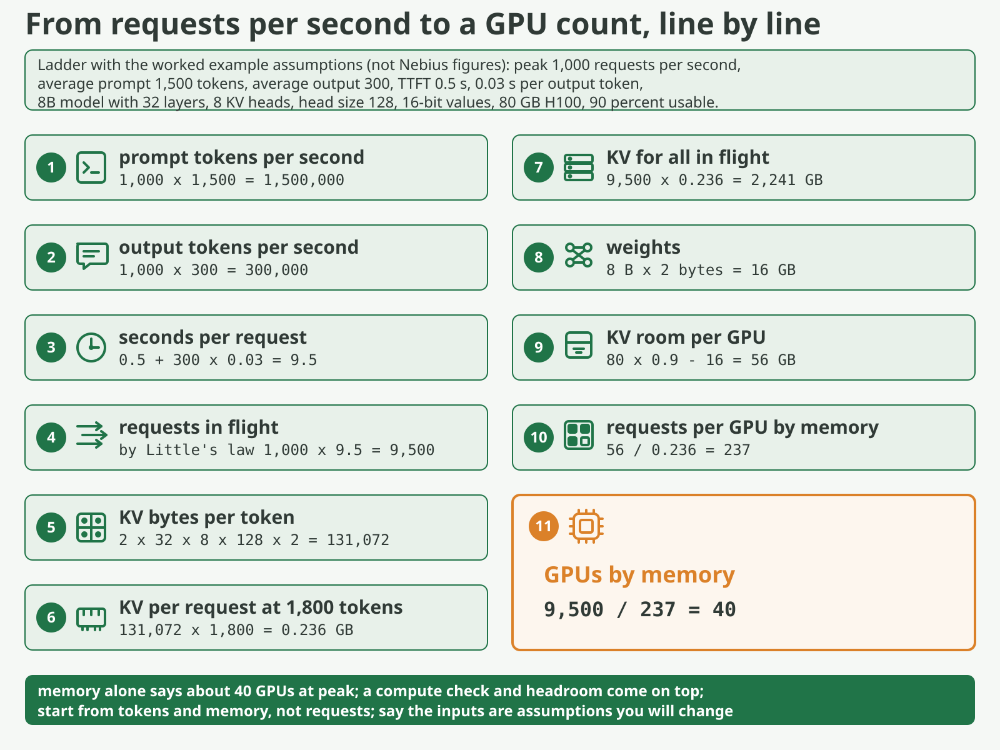

*Figure 20.13.1. Each line reuses the one above, so a wrong input shows up in every result below it.*

An interviewer says "design an inference API" and goes quiet. If you draw a load balancer now, you have lost the first five minutes. Ask questions that change the design instead. Is it chat, batch or both? Which models and context lengths? What availability target? Must data stay in a region? Are tenants trusted?

Each answer moves a box. Batch work can wait in a queue, so chat needs a faster path. A context length sets how much memory one request holds, because the context is everything the model reads and writes for that request, measured in tokens. A token is a small piece of text, often a word or part of one. A residency rule decides where a box is allowed to sit. Tenant trust decides how hard you must separate one customer from another. A question that changes nothing in the design is a question you can skip.

Then write the numbers down. The numbers below are my assumptions for a worked example. They are not Nebius figures and not measurements. Say so out loud, and say that you will change them if the interviewer gives different ones.

| Input | Assumed value |
|---|---|
| Peak requests per second | 1,000 |
| Average prompt tokens | 1,500 |
| Average output tokens | 300 |
| Time to first token | 0.5 s |
| Time per output token | 0.03 s |
| Model | 8B parameters, 32 layers, 8 KV heads, head size 128, 16-bit values |
| GPU | 80 GB H100 SXM |
| Usable GPU memory | 90% (assumed) |

Now the arithmetic. Each step is one line. Read it from top to bottom, because most lines reuse the numbers from the line above them, and a single wrong input shows up in every result below it.

```text
Prompt tokens per second   = 1,000 * 1,500 = 1,500,000
Output tokens per second   = 1,000 * 300   =   300,000
Seconds per request        = 0.5 + 300 * 0.03 = 9.5
Requests in flight (Little's law) = 1,000 * 9.5 = 9,500
KV bytes per token         = 2 * 32 * 8 * 128 * 2 = 131,072
KV per request (1,800 tok) = 131,072 * 1,800 = 235,929,600 B = 0.236 GB
KV for all in flight       = 9,500 * 0.236 = 2,241 GB
Weights                    = 8 B * 2 bytes = 16 GB
KV room per GPU            = 80 * 0.9 - 16 = 56 GB
Requests per GPU by memory = 56 / 0.236 = 237
GPUs by memory             = 9,500 / 237 = 40
```

The KV formula and the 131,072 bytes per token figure for this model shape come from Hands-On LLM Serving and Optimization, Chapter 7, as quoted in the handbook's chapter 15.10. The book gives about 0.1 to 0.15 GB for 1,024 tokens, which matches. Little's law is the standard queueing result that requests in flight equal arrival rate times time in system.

The KV cache is the memory where an engine keeps the keys and values it has already computed for each token, so it does not recompute them for every new token. Its size grows with every request that is in flight at the same moment. That is why the arithmetic multiplies a per-request figure by the number of requests, and why a busy system needs memory more than it needs raw compute at first.

The result says memory alone needs about 40 GPUs at peak. A compute check and headroom come on top, and chapter 20.12 teaches that estimation toolkit. Here you only need to show that you start from tokens and memory, not from requests. Treat the result as a claim you can test. If the interviewer changes the prompt length, you change one input and the GPU count moves with it. **State the number of requests in flight and the KV memory it implies, because that is what decides the GPU count.**

### 2. The API contract (minutes 5 to 8)

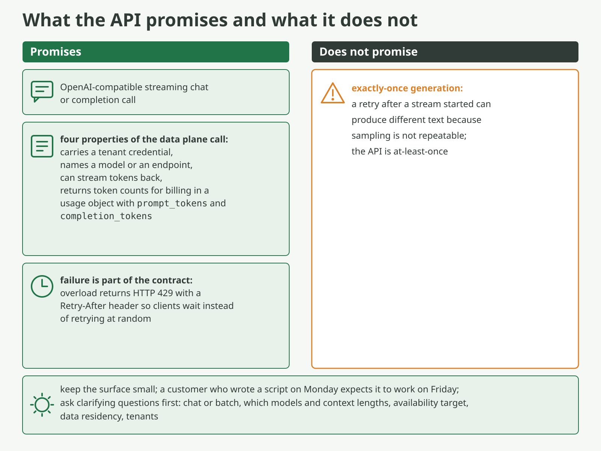

*Figure 20.13.2. Say what you will not promise, such as exactly-once generation, before the interviewer asks.*

A customer writes a short script against the API on Monday and expects it to still work on Friday. That promise is the API contract, and it is the first thing the interviewer will check. Keep the surface small. Nebius says the API is OpenAI-compatible, so the data path is a streaming chat or completion call. A data path is the route the actual requests take. Add a separate control API for managing endpoints, which the public facts say lifecycle operations belong to. Say the split now, because everything later hangs on it.

The data plane call needs four properties. It carries a tenant credential. It names a model or an endpoint. It can stream tokens back. It returns token counts for billing. The Token Factory chat completion reference, fetched 2026-11-09, defines a `usage` object with `prompt_tokens`, `completion_tokens` and `total_tokens`, plus optional `prompt_tokens_details` and `completion_tokens_details`. A usage object is the small block of counts that comes back with a response, and billing is built on it. For streams, the same page says usage statistics arrive only when the request sets `stream_options` to `{"include_usage": true}`, in a final chunk. A gateway that bills streamed calls must therefore set that option itself, or it will have no counts to bill from.

Failure must be part of the contract. Picture a busy afternoon when every replica is full. A client that gets no clear answer will retry at random, and that makes the afternoon worse. Overload returns HTTP 429 with a Retry-After header. The Token Factory rate limits page, fetched 2026-11-09, documents both. It defines `Retry-After` as the seconds to wait. It also lists `x-ratelimit-remaining-requests`, `x-ratelimit-remaining-tokens` and reset headers, so a client can see its headroom before it hits 429. The same page describes an `x-ratelimit-over-limit: yes` header on requests that exceed the limit but are still served at lower priority when spare capacity exists. Its index has no page on error codes or retry behaviour, so the 503 for capacity loss is my design, not a Nebius fact. Capacity loss returns 503. A stream that dies half-way must say so, because the client has already received tokens. The public case study lists finish_reason drift as an alert, which tells you that finish_reason is a field the platform watches. The finish_reason field says why generation stopped, such as reaching a length limit.

Decide what you will not promise. Imagine a client that retries a call after the connection drops in the middle of an answer. Exactly-once generation is out. A retry after a stream started can produce different text, because generation with sampling is not repeatable. Say that the API is at-least-once for the call and the client must treat partial output carefully. "At-least-once" means a request may run more than one time, so the client has to be ready to see a second copy.

### 3. The control plane and the data plane (minutes 8 to 10)

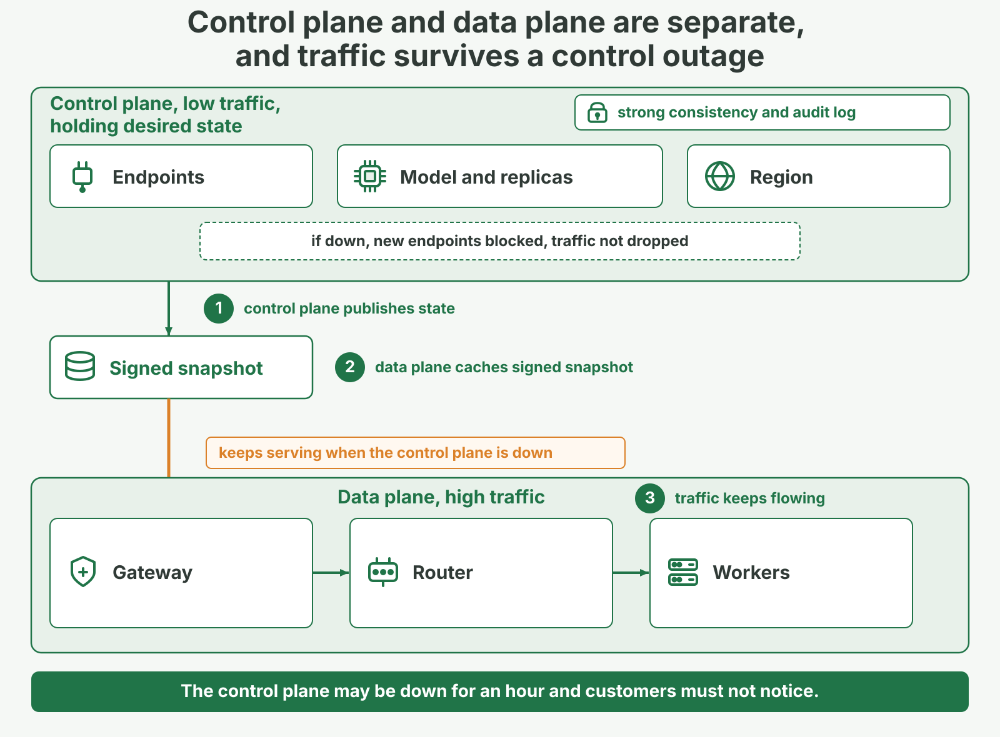

*Figure 20.13.3. Separating control from data keeps a control plane outage from dropping live requests.*

Picture a customer clicking "disable endpoint" while a million requests per minute are flowing. If both actions went through the same service, a control bug could stop traffic. So they are separate.

The control plane holds desired state: which endpoints exist, which model, how many replicas, which region. It is low traffic and needs strong consistency and an audit log. Strong consistency means every reader sees the same latest value, so two operators cannot disagree about whether an endpoint is on. An audit log is a record of who changed what and when. The data plane holds the request path: gateway, router, workers. It is high traffic and must keep serving when the control plane is down. Nebius publishes this split. How it is built inside is not published, so this is my design.

My design rule: the data plane caches a signed snapshot of the control plane state and keeps using it when the control plane is unreachable. A signed snapshot is a copy of the desired state with a cryptographic signature on it, so a data plane can check that the copy came from the control plane and was not altered on the way. Changes arrive by push or short polling. A control plane outage then blocks new endpoints but does not drop traffic. Kubernetes follows the same pattern, where running pods keep running if the API server is briefly down. Production Kubernetes explains that the API server is the control plane and that workloads continue on nodes.

**Say the failure sentence: the control plane may be down for an hour and customers must not notice.**

### 4. The gateway: auth, quotas and rate limits by tokens (minutes 10 to 17)

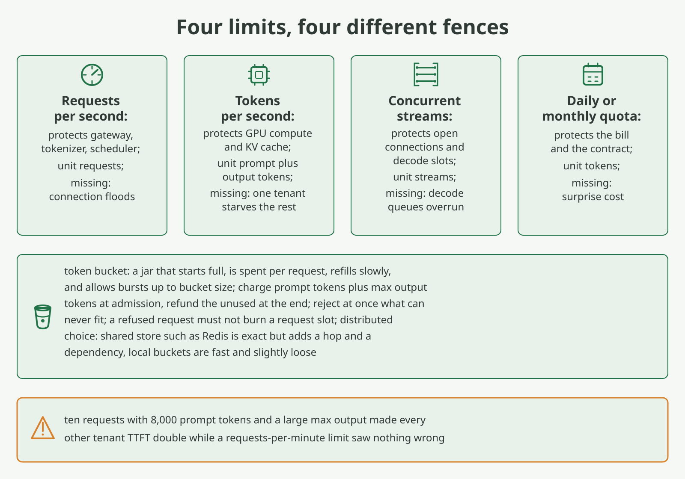

*Figure 20.13.4. A single limit does not stop the other kinds of trouble.*

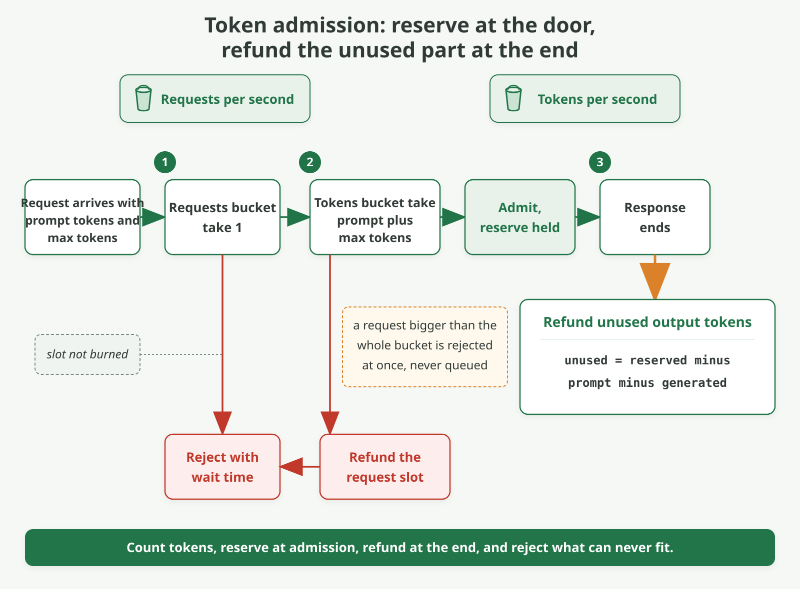

*Figure 20.13.5. Admission reserves tokens up front, and the limiter refunds both the rejected request slot and the output tokens that were never generated.*

An alert fires: one tenant sent ten requests with 8,000 prompt tokens and a large max output, and every other tenant's TTFT doubled. TTFT, or time to first token, is how long a user waits before the first word of the answer appears. A limit of 60 requests a minute would not have stopped it. Requests are not equal work, so the limit must count tokens.

The gateway is the front door that every request passes through first. It does four jobs in order. It authenticates the key and finds the tenant. It checks the tenant is allowed to call the model. It checks quotas and rate limits. It then forwards the call and meters what happened. Distributed AI Systems, Chapter 9, puts authentication, rate limiting and routing in the API gateway. Hands-On LLM Serving and Optimization, Chapter 4, lists fair usage, accurate billing, tenant isolation and low-latency access as the public API layer's challenges.

Rate limiting uses a token bucket. LLMs in Production, Chapter 6, describes it as a bucket that starts full, is spent on each request, refills slowly, and allows bursts up to the bucket size. Think of a jar of coins that refills one coin at a time. A burst can spend the whole jar at once, and a steady caller only spends what the refill allows. For an LLM API the unit spent is the token. Use two buckets per tenant. One counts requests and protects the gateway. One counts tokens and protects the GPUs.

The hard part is that you do not know the output length at admission. Admission means the moment the gateway decides to let a request in. The handbook's chapter 15.16 describes the standard answer: charge the prompt tokens plus the requested max output tokens up front, then refund the unused part when the response ends. If the request omits max tokens, apply a default cap. Otherwise a tenant can reserve nothing and consume everything.

A refused request must not burn a request slot. Imagine a tenant that is over its token limit and keeps retrying. If each refused try also drained the request bucket, that tenant would stay blocked even after its tokens refilled. The simulation below handles that case and tests it. There is a second rule that is easy to miss. A request bigger than the whole bucket can never succeed, so reject it at once with a clear error and do not tell the client to wait.

Rate limits are distributed. With many gateway replicas you have two options. A shared store such as Redis gives exact counts and adds a network hop and a dependency. Local buckets with each replica holding a share are fast and slightly loose. My choice would be local buckets that sync usage to the store every second or so, because a limiter that fails should fail open for small tenants and closed for abusive ones. Fail open means let traffic through when the limiter breaks, and fail closed means block traffic when it breaks. That is a judgment, so state it as one.

| Limit type | Protects | Unit | Failure if missing |
|---|---|---|---|
| Requests per second | gateway, tokenizer, scheduler | requests | connection floods |
| Tokens per second | GPU compute and KV cache | prompt plus output tokens | one tenant starves the rest |
| Concurrent streams | open connections, decode slots | streams | decode queues overrun |
| Daily or monthly quota | the bill and the contract | tokens | surprise cost |

Read the table as separate fences. Each one stops a different kind of trouble, and a single fence does not stop the others. **Count tokens, reserve at admission, refund at the end, and reject what can never fit.**

### 5. Usage metering for billing (minutes 17 to 19)

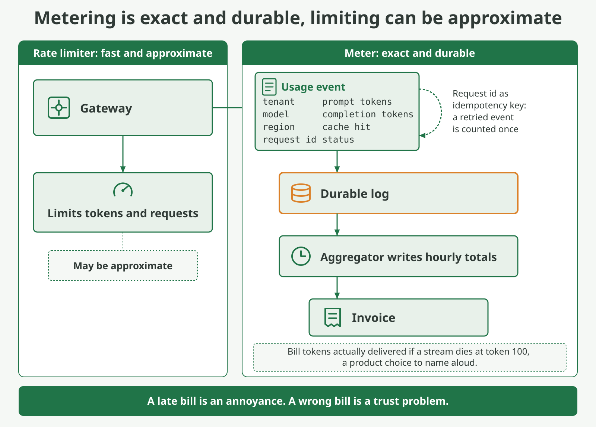

*Figure 20.13.6. Metering emits one usage event per finished request to a durable log, using the request id so a retried event is counted once.*

A customer disputes an invoice by 3%. You need to prove the number. Billing must come from a durable record, not from a Prometheus counter that can lose scrapes. Durable means the record survives a crash, a restart or a network hiccup.

The gateway emits one usage event per finished request with the tenant, the model, the region, prompt tokens, completion tokens, whether the prompt hit the cache, status and a request id. A usage event is one small record that describes one finished call. Events go to a durable log, then to an aggregator that writes hourly totals. Use the request id as an idempotency key, so a retried event is counted once. An idempotency key is an identifier that tells the system "I have already seen this," so the same event applied twice has the same effect as applying it once. Reconcile the billing total against engine-side token counters daily, and alert on drift above a small threshold. Drift is the gap that grows between two numbers that should agree.

Metering and rate limiting are different systems with different correctness needs. The limiter may be approximate and fast. The meter must be exact and can be late. Say that sentence in the interview. A late bill is a small annoyance, while a wrong bill is a trust problem with a customer.

What counts when a stream dies at token 100? I would bill the tokens actually delivered and not the reserved ones. That is a product choice. Name it as a choice and move on.

### 6. The router: cache-aware and load-aware (minutes 19 to 26)

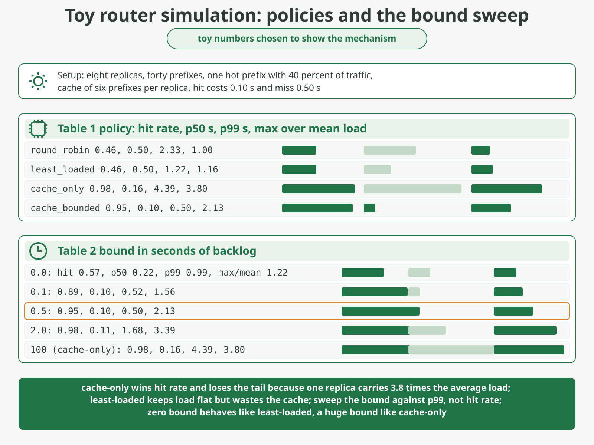

*Figure 20.13.7. Tune the cache bound against p99 latency and not against hit rate.*

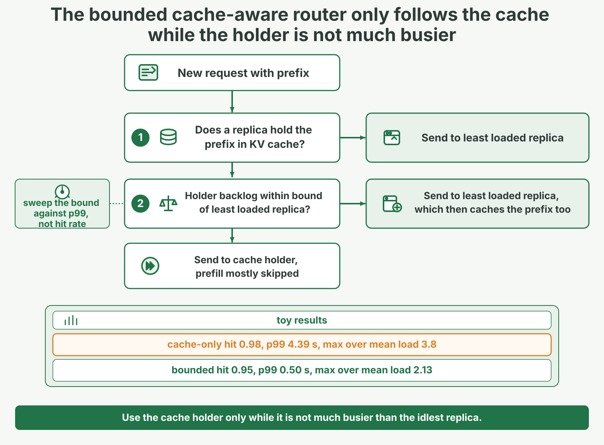

*Figure 20.13.8. A bounded cache-aware router keeps most prefix hits without creating a hotspot on one replica.*

Consider eight replicas and a chat product where every request starts with the same long system prompt. A system prompt is the standing instruction that frames every conversation. With round robin, which means sending each request to the next replica in turn, each replica recomputes that prefix about as often as every other. If the request goes to the replica that already holds the prefix in its KV cache, the prefill is mostly skipped. Prefill is the step where the engine reads the whole prompt before it can write the first token. Skipping it makes TTFT drop and frees GPU time.

Hands-On LLM Serving and Optimization, Chapter 7, says the key to a high prefix-cache hit rate across instances is to route requests with the same prefix to the instance that holds that cache. The public case study reports hit rate rising from about 5% to 30% to 50-60% with cache-aware routing. That is a vendor-reported result for one customer, not a promise. A hit rate is the share of requests whose prefix was already cached.

The trap is the hot prefix. Picture one large tenant that owns 40% of the traffic, all sharing one prefix. If the router always follows the cache, one replica gets 40% of the load and the others sit half idle. The handbook's chapter 15.09 describes this as the unbounded prefix hotspot and gives a bounded-load rule. The rule I would build: send the request to the replica holding the most of its prefix, but only if its backlog is within a bound of the least loaded replica. A backlog is the queue of work waiting on a replica. Otherwise send it to the least loaded one, which then caches the prefix too. Hot prefixes therefore spread over several replicas on their own.

The router needs a cheap picture of each replica's cache. Options are a router-side radix tree of recent prefixes, which is approximate and cheap, or asking replicas for their cache contents, which is exact and costs a call. A radix tree is a tree that stores strings by their shared starting pieces, so a router can quickly find the longest known prefix of a new request. I would start approximate. A wrong guess only costs a cache miss, never correctness. The load signal should be the waiting queue and the KV usage reported by the engine, not CPU. vLLM exposes these as `vllm:num_requests_waiting` and `vllm:kv_cache_usage_perc`, and the prefix cache counters as `vllm:prefix_cache_queries` and `vllm:prefix_cache_hits`. I confirmed all four names in `vllm/v1/metrics/loggers.py` at tag v0.33.0, fetched 2026-11-09. The same file also defines `vllm:num_requests_waiting_by_reason`, whose help text says its reasons sum to the waiting total. Metric names move between releases, so check `/metrics` on the version you run.

The simulation in the lab runs this. Eight replicas, forty prefixes, one hot prefix with 40% of traffic, a cache of six prefixes per replica. A hit costs 0.10 seconds of service and a miss 0.50 seconds. These are made-up numbers chosen to show the mechanism, not measurements of any engine.

```text
policy            hit    p50 s    p99 s  max/mean
round_robin      0.46     0.50     2.33      1.00
least_loaded     0.46     0.50     1.22      1.16
cache_only       0.98     0.16     4.39      3.80
cache_bounded    0.95     0.10     0.50      2.13
```

Read it as a story. Cache-only wins the hit rate and loses the tail, because one replica carries 3.8 times the average load. The tail means the slowest few percent of requests, and it is where users notice trouble first. Least-loaded keeps the load flat and wastes the cache. The bounded policy keeps 95% hits and has the lowest p99. This matches the case study's line that latency must be stable, not just fast.

The bound is a knob, and the simulation sweeps it. A zero bound behaves close to least-loaded. A very large bound becomes cache-only.

| Bound (seconds of backlog) | Hit rate | p50 s | p99 s | Max over mean load |
|---|---|---|---|---|
| 0.0 | 0.57 | 0.22 | 0.99 | 1.22 |
| 0.1 | 0.89 | 0.10 | 0.52 | 1.56 |
| 0.5 | 0.95 | 0.10 | 0.50 | 2.13 |
| 2.0 | 0.98 | 0.11 | 1.68 | 3.39 |
| 100 (cache-only) | 0.98 | 0.16 | 4.39 | 3.80 |

**Use the cache holder only while it is not much busier than the idlest replica, and sweep the bound against p99, not against hit rate.** The real bound must be tuned on real traffic. The sweet spot here has no meaning outside this toy.

### 7. Prefill and decode pools (minutes 26 to 29)

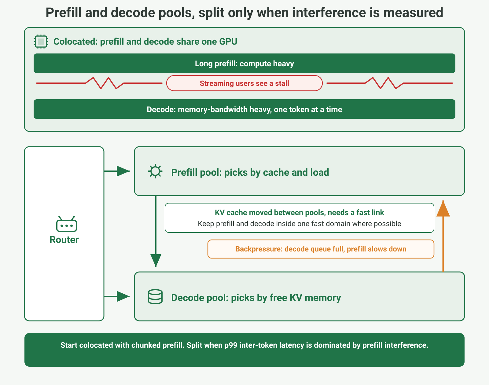

*Figure 20.13.9. Colocated prefill stalls streaming users, so prefill and decode can be split into pools with KV transfer and backpressure, but only when interference is measured.*

A long prompt arrives while many users are streaming. Its prefill takes the GPU for a stretch, and every streaming user sees a stall in token delivery. Prefill is compute heavy and decode is memory-bandwidth heavy. Decode is the step that writes one output token at a time, and it is limited by how fast memory can feed the GPU. Mixing them on one GPU makes them fight over the same hardware.

The public case study says Nebius separated prefill and decode pools for that customer. The handbook's chapter 15.10 teaches the mechanism and the sizing in depth. For this interview you need the trade-off. Separation protects inter-token latency, which is the pause between one output token and the next, and it lets you scale each pool on its own signal. The price is moving the KV cache from the prefill worker to the decode worker, which needs a fast link, and more moving parts to fail.

Hands-On LLM Serving and Optimization, Chapter 7, gives a worked example of a roughly 25 GB transfer that fits NVLink inside a node and inter-node InfiniBand, but not PCIe without RDMA. NVLink, InfiniBand, PCIe and RDMA are the names of different ways machines and GPUs connect, and the faster ones move data much more quickly. So keep a request's prefill and decode inside one fast domain when the fabric is weak.

My design: start colocated with chunked prefill for small models and short prompts. Chunked prefill splits a long prompt into pieces, so decode steps can run in between. Split the pools when the p99 inter-token latency is dominated by prefill interference, and when prompts are long enough that the transfer is cheap against the saved stalls. Say when you would not split. That shows judgment.

The router sees two stages. It picks a prefill worker, mainly by cache and load, and a decode worker, mainly by free KV memory. Backpressure matters between them. Backpressure is the signal that flows backwards when a downstream stage is full. If decode queues fill, prefill must slow down, or finished prefills pile up and waste memory. The case study lists backpressure to stop decode queues overrunning for this reason.

**Split pools only when interference is measured, and give each pool its own scaling signal.**

### 8. Model placement and warm pools (minutes 29 to 31)

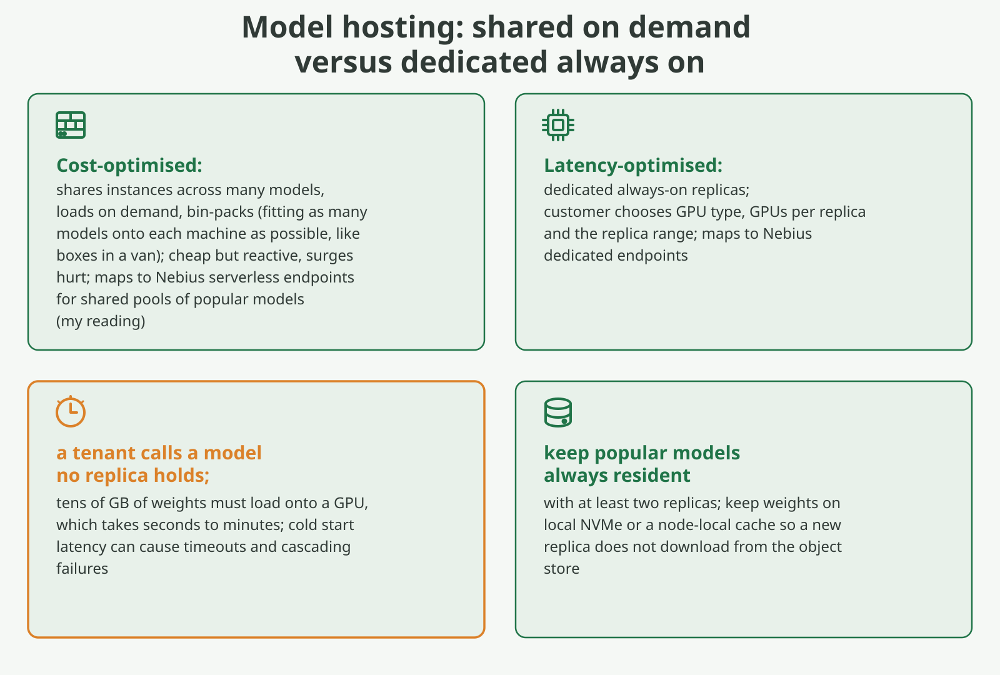

*Figure 20.13.10. Warm pools and local weight caches keep requests from paying the cold start.*

A tenant calls a model that no replica holds. The first request has to wait while tens of GB of weights are loaded onto a GPU, and that takes seconds to minutes. Hands-On LLM Serving and Optimization, Chapter 3, calls this cold start latency and notes it can cause timeouts and cascading failures under load. A cascading failure is one where a problem in one part spreads to the others, usually because retries and timeouts pile on.

The book offers two shapes. The cost-optimised design shares instances across many models, loads on demand and bin-packs. Bin-packing means fitting as many models as possible onto each machine, like packing boxes into a van. It is cheap but reactive, so surges hurt. The latency-optimised design gives each model its own always-on group. It has no cold start and is simpler to operate, but it wastes GPUs on quiet models.

Nebius offers both products. Serverless endpoints suit shared pools of popular models. Dedicated endpoints suit the latency-optimised shape, with the customer choosing GPU type, GPUs per replica and the replica range. So map the book's two designs onto those two products. That mapping is my reading, not a Nebius statement.

For warm pools, keep popular models always resident with at least two replicas. A warm pool is capacity that is already loaded and waiting, so a request does not pay the cold start. Keep weights on local NVMe or a node-local cache so a new replica does not download from the object store. NVMe is fast solid-state storage inside the machine itself. LLMs in Production, Chapter 6, describes a hybrid where weights are downloaded once and kept on a mounted volume so new instances skip the download. Warm up a new replica with a few real requests before it receives traffic, so CUDA graphs and caches are ready. A CUDA graph is a recorded sequence of GPU work that can be replayed quickly, and it takes a few runs to set up.

### 9. Autoscaling signals (minutes 31 to 34)

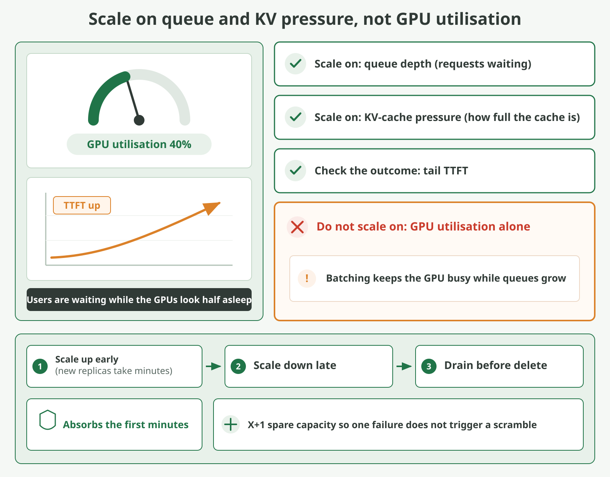

*Figure 20.13.11. GPU utilisation can look half idle while users wait, so the design scales on queue depth and KV-cache pressure and checks tail TTFT as the outcome.*

The alert says TTFT is up and GPU utilisation is 40%. Picture the dashboard: the GPUs look half asleep, yet users are waiting. CPU-based or GPU-utilisation autoscaling would do nothing, yet users are suffering. For LLM serving, utilisation is a poor signal because batching keeps a GPU busy while queues grow. Batching means the engine groups many requests into one GPU step, so the GPU looks busy even while new work piles up behind it.

Nebius has not published its autoscaling signals. A reasonable design scales on queue depth and KV-cache pressure, and checks tail TTFT as the outcome. Queue depth is how many requests are waiting, and KV-cache pressure is how full the cache memory is. Production Kubernetes, Chapter 13, warns against scaling on a metric that does not change in proportion to load and describes custom metrics through the Prometheus Adapter. LLMs in Production, Chapter 6, recommends KEDA, says it can scale to and from zero, and gives the HPA formula `desiredReplicas = ceil[currentReplicas × (currentMetricValue / desiredMetricValue)]`. HPA is the Kubernetes Horizontal Pod Autoscaler, and KEDA is an event-driven autoscaler that builds on it.

Cold start is the catch. A GPU replica may need minutes before it serves, so a scale-up decision arrives late. So scale on a leading signal, scale up fast, and scale down slowly. A leading signal is one that moves before users feel the damage, such as a growing queue. LLMs in Production also warns that scaling down too aggressively can kill instances mid-request, and that flapping, the replica count oscillating, comes from badly tuned settings. Use a stabilisation window on scale-down and drain streams before terminating a pod. A stabilisation window is a short period the autoscaler waits before it trusts a lower number. Draining means letting open streams finish before the pod is removed.

Two things sit above autoscaling. Rate limits dampen bursts while new capacity boots, which LLMs in Production states directly. A warm pool absorbs the first minutes. Keep X+1 spare capacity so one failure does not trigger a scramble. The case study names X+1 redundancy as the approach it used. X+1 means you run one more unit than the load strictly needs, so losing one unit does not push the rest into overload.

**Scale on queue and KV pressure, scale up early, scale down late, and drain before you delete.**

### 10. Regions and data residency (minutes 34 to 36)

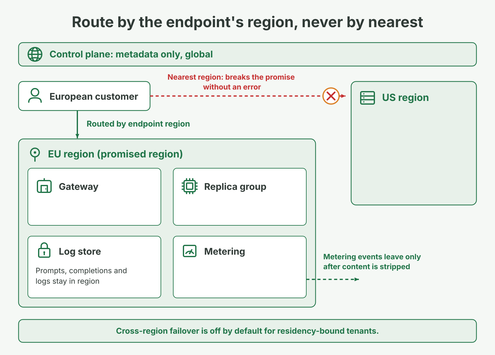

*Figure 20.13.12. Requests route by the endpoint's region so prompts and logs stay in-region, because routing to the nearest region can break a residency promise silently.*

A European customer asks that prompts never leave the EU. Data residency is the rule that data must stay in a named place, and it is a promise you make to the customer in writing. Nebius lists EU and US as region choices with data residency for dedicated endpoints. So residency is a property of the endpoint, fixed at creation.

My design: the control plane may be global for metadata, but prompts, completions and logs containing them stay in the endpoint's region. Route by the endpoint's region, never by "nearest". The nearest data center can sit outside the promised region, and that breaks the promise without any error. Metering events can leave the region only after they are stripped of content. Telemetry needs the same care, because a trace with a prompt inside is customer data.

Failover across regions is a trap for residency customers. Failover means sending traffic to a backup when the main place fails. A fallback region that breaks the promise is worse than an outage in the customer's eyes. So cross-region failover is off by default for residency-bound tenants and must be opted into per tenant. Spare capacity is then needed in each region, which costs money. Say it. The interviewer is often waiting to see whether you noticed that cost.

### 11. Tenant isolation and noisy neighbours (minutes 36 to 38)

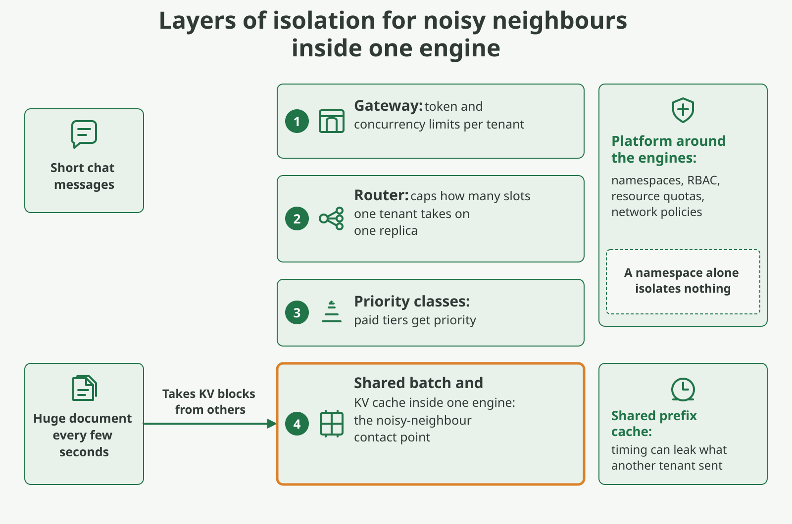

*Figure 20.13.13. Noisy neighbours act on the shared batch and KV cache inside one engine, so isolation adds gateway limits, router slot caps and priority classes above it.*

Picture two customers sharing one engine. One sends short chat messages, and the other sends a huge document every few seconds. The first customer's answers slow down, and nothing in the logs says why. That is the noisy neighbour problem. Production Kubernetes, Chapter 12, describes isolation as a spectrum and separates soft multitenancy, where tenants trust each other, from hard multitenancy, where they do not. An API serving the public is closer to hard. The book also says requests and limits give weaker isolation than a hypervisor and that noisy neighbour symptoms are hard to remove completely. A hypervisor is the layer that runs separate virtual machines, and it isolates them more strongly than container limits do.

For an inference API, the noisy neighbour is rarely CPU. It is the shared batch and KV cache inside one engine. A tenant with huge contexts takes KV blocks from others, so the others wait for memory they expected to have. So isolation has layers. The gateway enforces token and concurrency limits. The router can cap how many slots one tenant takes on one replica. Priority classes let paid tiers preempt free ones when the system sheds load. Preempt means pause or evict work that is already running, and shedding load means refusing some work on purpose to protect the rest. Dedicated endpoints are the strongest isolation, a separate replica set per customer.

Multi-tenant Kubernetes features still apply to the platform around the engines. Namespaces, RBAC, resource quotas and network policies isolate the control plane workloads. RBAC is role-based access control, which decides who may do what in the cluster. The book notes that a namespace is only metadata until policies are attached. In other words, creating a namespace by itself isolates nothing.

Cache sharing is a security question too. A shared prefix cache across tenants can leak information through timing, because a fast response reveals that another tenant sent the same prefix. Picture an attacker timing responses to guess what someone else asked. The vLLM security page at tag v0.33.0, fetched 2026-11-09, says prefix cache reuse is a timing side channel in multi-tenant deployments (it cites CVE-2025-46570). A side channel is a leak through how a system behaves, such as its speed, rather than through its data. The page offers a per-request `cache_salt` as a mitigation and says vLLM does not isolate tenants sharing a server process. A safe default is to scope the cache key by tenant, and to allow cross-tenant sharing only for public system prompts.

### 12. Streaming and backpressure (minutes 38 to 40)

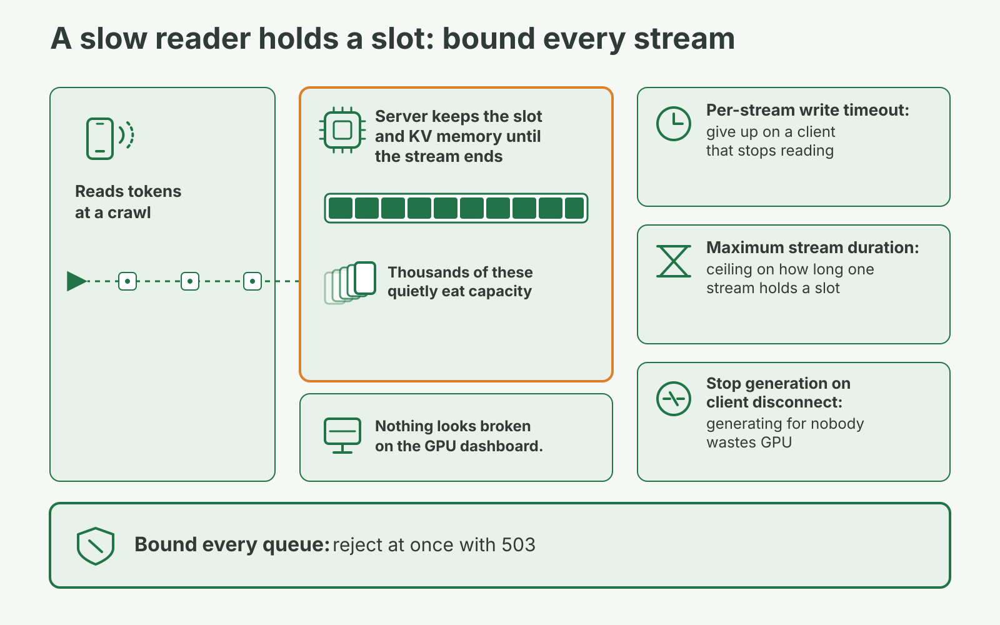

*Figure 20.13.14. A slow streaming client holds a decode slot and KV memory, so the design bounds each stream with a write timeout, a maximum duration and disconnect handling.*

A client on a slow mobile link reads tokens at a crawl. The server keeps its decode slot and its KV memory until the stream ends. Thousands of such clients quietly eat capacity, and nothing looks broken on the GPU dashboard.

LLMs in Production, Chapter 6, says streaming is a must-have because output length is unpredictable and tokens per second becomes the steady metric. Streaming also means the request is long-lived, so deploys, scale-down and failures all interact with open connections. A deploy that restarts a pod will cut every stream that pod is holding.

Set a per-stream write timeout and a maximum duration. A write timeout gives up on a client that stops reading, and a maximum duration puts a ceiling on how long any one stream can hold a slot. Stop generation when the client disconnects, because generating for nobody wastes GPU. Bound every queue. Distributed AI Systems, Chapter 9, describes a bounded request queue that rejects at once with a 503 rather than letting requests time out after a long wait. Fast rejection gives the client a clear signal to retry or go elsewhere. A queue that can grow without limit only hides the overload until users give up.

### 13. Failure handling and retries with budgets (minutes 40 to 42)

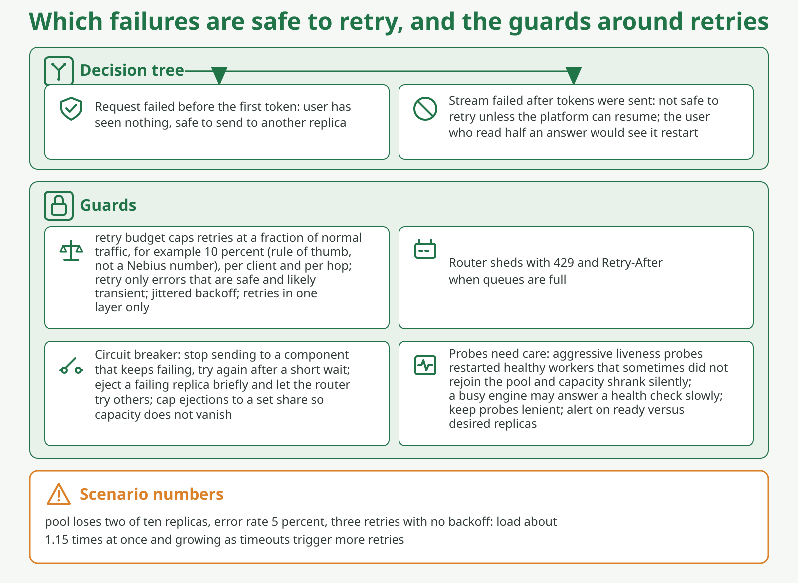

*Figure 20.13.15. Retry only before the first token, under a budget, in one layer.*

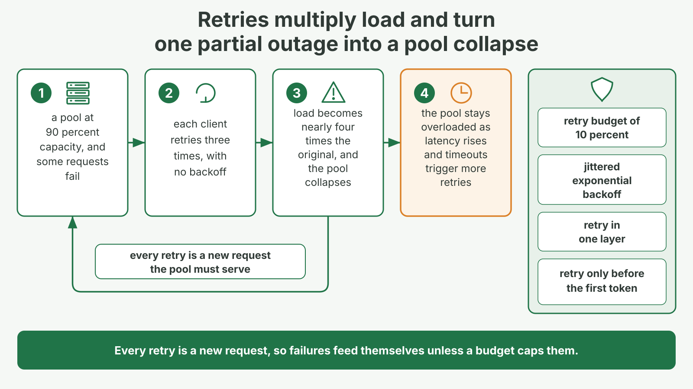

*Figure 20.13.16. Unbudgeted retries add load exactly when the pool has the least capacity, so a partial outage becomes a full one.*

The case study says retry logic was changed to stop amplification in partial outages. Here is the mechanism. A pool is at 90% capacity and some requests fail. Each client retries three times. Load becomes nearly four times the original, and the pool collapses. Every retry is a new request that the pool must serve, so failures feed themselves.

A retry budget caps retries at a fraction of normal traffic, for example 10%, per client and per hop. A hop is one trip through a service, such as gateway to router. The 10% figure is a common rule of thumb and my example, not a Nebius number. Retry only errors that are safe and likely to be transient. Use exponential backoff with jitter. Backoff means waiting longer after each failed try, and jitter adds a random amount to the wait so many clients do not retry at the same instant. Never retry in two layers at once, because a gateway retry and an SDK retry multiply.

Know what is safe to retry. A request that failed before the first token is safe to send to another replica, because the user has seen nothing yet. A stream that failed after tokens were sent is not, unless the platform can resume. Picture the user who has read half an answer and then sees it restart with different words. Generation with sampling is not deterministic, so the replay may differ. Say that plainly.

Probes need care. A probe is a periodic health check that the platform runs against each pod. The case study says aggressive liveness probes restarted healthy workers, and restarted workers sometimes did not rejoin the pool, so capacity shrank silently. A busy engine may answer a health check slowly while it is serving. So the liveness probe should be cheap and lenient, and a separate readiness check should decide traffic. Alert on the count of ready replicas against the desired count, since this is the silent shrink.

Circuit breakers help. A circuit breaker stops sending traffic to a component that keeps failing, and it tries again after a short wait. When a replica returns errors, eject it for a short time and let the router try others. Add outlier ejection limits, for example never eject more than a set share of the pool at once, or a bad signal can empty the pool. An outlier is a replica that behaves very differently from the rest, and ejecting every outlier at once can remove everything.

### 14. Observability (minutes 42 to 43)

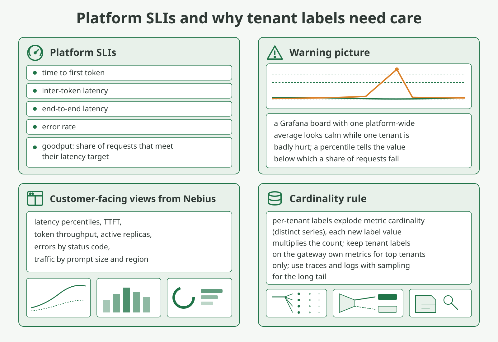

*Figure 20.13.17. Use percentiles and limit tenant labels to top tenants to keep metrics useful and affordable.*

Picture a Grafana board that shows a single average for the whole platform. It looks calm while one tenant is badly hurt. Nebius shows customers latency percentiles, TTFT, token throughput, active replicas, errors by status code and traffic by prompt size and region. A percentile tells you the value that a given share of requests stayed under, so the p99 is the value that nearly every request beats. Build the internal view on the same dimensions, plus per-tenant slices.

The SLIs I would define are time to first token, inter-token latency, end-to-end latency, error rate and goodput, which is the share of requests that meet their latency target. An SLI, or service level indicator, is a measured number that describes how well the service is doing. Hands-On LLM Serving and Optimization, Chapter 4, defines E2E latency as `TTFT + ITL × (N – 1)` when ITL is steady. ITL is inter-token latency, and N is the number of output tokens. The case study's alert list gives you concrete alerts: tail TTFT, cache hit drops, finish_reason drift and decode error bursts.

Per-tenant labels explode metric cardinality. Cardinality is the number of distinct series a metric produces, and each new label value multiplies that count. Keep tenant labels on the gateway's own metrics for top tenants only, and use traces and logs with sampling for the long tail. Chapter 20.15 covers that pipeline.

### 15. Rollout (minutes 43 to 45)

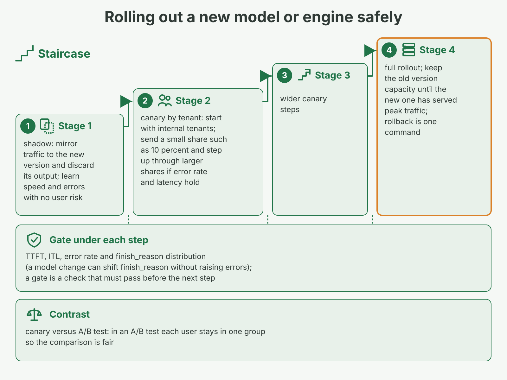

*Figure 20.13.18. Gate each step on latency, errors and finish_reason and keep rollback one command away.*

Picture the last five minutes of the round, when the interviewer asks what happens the day you change the model. Rollout is the way a new version reaches users. Distributed AI Systems, Chapter 9, describes a canary that sends a small share, for example 10%, to the new version and steps up through larger shares if error rate and latency hold. A canary is a small test group that runs the new version first. It also separates canary from A/B testing, where consistent assignment per user matters. In an A/B test each user is kept in one group, so the comparison stays fair.

For model or engine changes I would add a shadow stage that mirrors traffic and discards the output, then a canary by tenant. In a shadow stage the new version does the work, but its answers are thrown away, so you learn about speed and errors with no user risk. Pick internal tenants first. Gate each step on TTFT, ITL, error rate and finish_reason distribution, since a model change can shift finish_reason without raising errors. A gate is a check that must pass before the next step runs. Keep the old version's capacity until the new one has served peak traffic, and keep rollback one command. Chapter 20.14 goes deeper on dedicated endpoint rollout.

### 16. The whole picture in one diagram

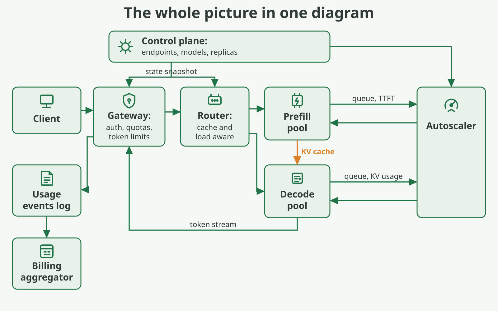

*Figure 20.13.19. The whole picture in one diagram, as a diagram.*

Draw the data path left to right first, then add the control plane above it with dotted ownership. Call out the two feedback loops: engine metrics into the router, and engine metrics into the autoscaler. A feedback loop is a path where the output of the system comes back in as an input, so you should always say where the loop closes.

### 17. Trade-off tables for lookup

| Decision | Option A | Option B | Pick when |
|---|---|---|---|
| Limiter state | Shared store, exact | Local buckets, approximate | A for paid hard quotas, B for burst protection |
| Router | Round robin | Cache-aware bounded | B once shared prefixes exist |
| Pools | Colocated with chunked prefill | Split prefill and decode | Split when prefill interference dominates p99 ITL |
| Model hosting | Shared, load on demand | Dedicated, always on | Dedicated for steady hot models and strict latency |
| Autoscale signal | GPU utilisation | Queue and KV pressure | B almost always |
| Retries | Client retries freely | Budgeted, one layer | B always |
| Cross-region failover | Automatic | Opt-in per tenant | Opt-in when residency is promised |
| Billing source | Metrics counter | Durable usage events | Durable events always |

Use this table when an interviewer asks you to compare two options in one sentence. Each row names the choice, the two sides and the condition that decides it. If you cannot say the condition, you do not yet have a decision.

## How to answer out loud

Picture yourself at the whiteboard with a clock on the wall and about 45 minutes left. This section gives the plan you can rehearse until it feels ordinary.

### The 45-minute speaking plan

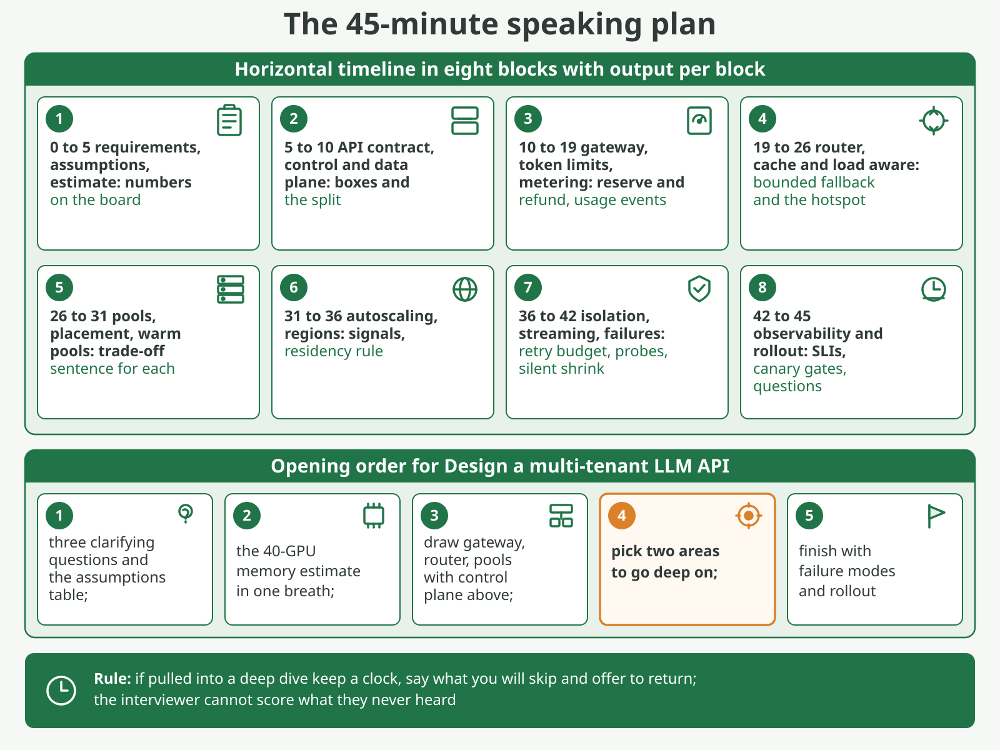

*Figure 20.13.20. Keep a clock so every part of the design is spoken before the time runs out.*

| Minutes | Topic | Output |
|---|---|---|
| 0 to 5 | Requirements, assumptions, estimate | Numbers on the board |
| 5 to 10 | API contract, control and data plane | Boxes and the split |
| 10 to 19 | Gateway, token limits, metering | Reserve and refund, usage events |
| 19 to 26 | Router, cache and load aware | Bounded fallback and the hotspot |
| 26 to 31 | Pools, placement, warm pools | Trade-off sentence for each |
| 31 to 36 | Autoscaling, regions | Signals, residency rule |
| 36 to 42 | Isolation, streaming, failures | Retry budget, probes, silent shrink |
| 42 to 45 | Observability and rollout | SLIs, canary gates, questions |

If the interviewer pulls you into a deep dive, keep a clock. Tell them what you will skip, and offer to return. A deep dive that eats the whole slot leaves the rest of the design unspoken, and the interviewer cannot score what they never heard.

### Question 1: "Design a multi-tenant LLM API."

An interviewer has just asked that question and is waiting for your first sentence. Speak in this order. First ask three clarifying questions and state the assumptions table. Then give the 40-GPU memory estimate in one breath. Then draw the path: gateway, router, pools, with control plane above. Then pick two areas to go deep on and say which. Finish with failure modes and rollout.

Numbers to state: requests in flight, KV per request, GPUs by memory. Trade-offs to name: colocated or split pools, shared or dedicated hosting. Expected follow-ups: "how do you rate limit," "what happens when a replica dies."

### Question 2: "How do you rate limit an LLM API?"

Picture a tenant whose one large request just took the GPUs that everyone else needed. The interviewer wants to hear why counting requests fails here. Say that requests are unequal, so count tokens. Describe two token buckets. Describe reserve then refund. Mention the oversized request rule and the Retry-After header. Mention the distributed trade-off between a shared store and local buckets. Follow-ups: "what if max tokens is missing" and "what about concurrent streams."

### Question 3: "How does your router work?"

Start with a situation: a chat product where every request repeats the same long prefix, so some replicas are cheaper for a request than others. State cache-aware routing, then the hotspot trap, then the bounded fallback. Quote the simulation: hit rate 0.98 with load 3.8 times the mean for cache-only, against 0.95 and a p99 of 0.50 for the bounded version. Say these are toy numbers. Follow-up: "how does the router know the cache contents." Answer: an approximate radix tree and engine metrics, where a wrong guess costs only a miss.

### Question 4: "A replica is slow but not failing. What happens?"

Picture one replica answering a little later than the others, with no error in any log. Say the router sees growing backlog and routes away. The circuit breaker ejects it if errors or latency pass a threshold, with a cap on ejections. The probe stays lenient so a busy worker is not killed. Alert on ready versus desired replicas. Follow-up: "how do you stop a retry storm," which leads to retry budgets.

### Question 5: "How do you handle a tenant spike?"

Picture a tenant that multiplies its traffic in one minute. Rate limits absorb the burst. The warm pool and X+1 headroom absorb the first minutes. The autoscaler adds replicas on queue depth. Low-priority traffic is shed with 429 before paid traffic. The noisy tenant cannot take more than its slot cap. Follow-up: "how long until new capacity serves," and the honest answer depends on weight load time, which you measure.

## Worked scenarios

### Scenario 1: size a quota for a tenant

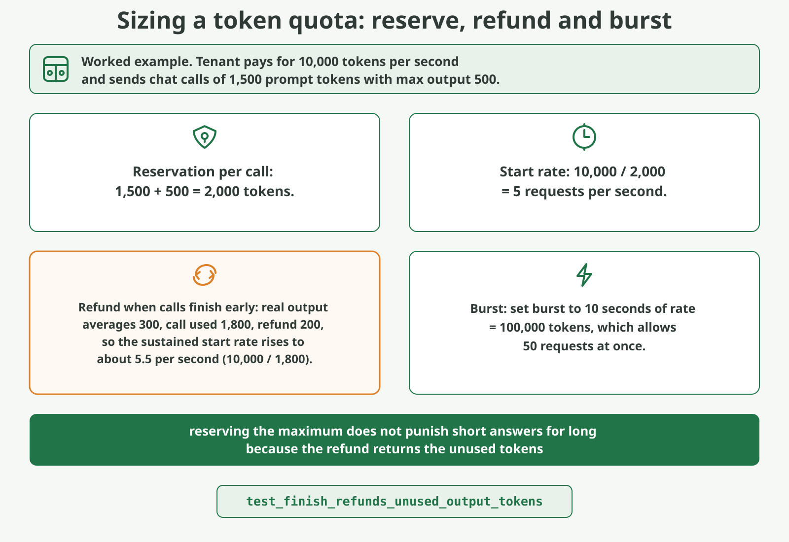

*Figure 20.13.21. Reserve the maximum and refund the unused part so short answers do not pay for long ones.*

A tenant pays for 10,000 tokens per second and sends chat calls of 1,500 prompt tokens with max output 500. How many requests per second can it start, and what happens when its calls finish early?

Each reservation is 2,000 tokens. At 10,000 tokens per second the tenant can start 5 requests per second. If the real output averages 300, each call used 1,800 and the refund is 200, so the sustained start rate rises to about 5.5 per second. The refund is why reserving the maximum does not punish short answers for long. Set burst to 10 seconds of rate, 100,000 tokens, which allows 50 requests at once. The simulation tests this refund path in `test_finish_refunds_unused_output_tokens`.

### Scenario 2: TTFT doubled, GPU utilisation 40%

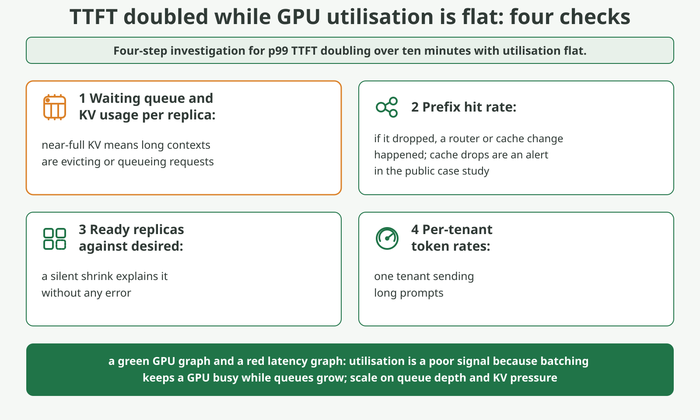

*Figure 20.13.22. Check queue, cache, replica count and tenant mix before trusting a flat utilisation graph.*

The alert shows p99 TTFT doubled over ten minutes. Utilisation is flat. Picture the on-call engineer staring at a green GPU graph and a red latency graph, and asking which one to believe. Steps. Check the waiting queue and KV usage per replica. If KV usage is near full, long contexts are evicting or queueing requests. Check the prefix hit rate. If it dropped, a router or cache change happened, since the case study lists cache drops as an alert. Check ready replicas against desired. A silent shrink explains it without any error. Check per-tenant token rates for one tenant sending long prompts. The mitigation order is to shed or limit the heavy tenant, then add replicas, then investigate the cause. Mitigate before root cause.

### Scenario 3: the retry storm

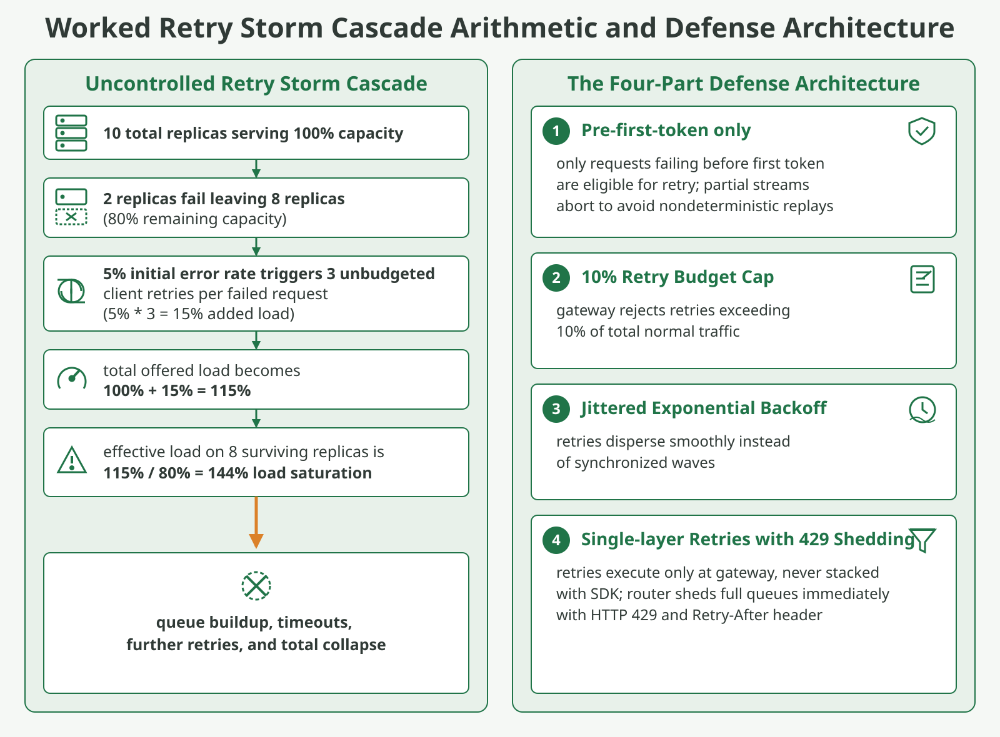

*Figure 20.0.0. Losing two replicas while retrying three times amplifies load to 144 percent of capacity, which is prevented by a 10 percent retry budget, pre-token retries, and 429 shedding.*

A pool loses two of ten replicas. Error rate rises to 5%. Clients retry three times with no backoff. Offered load becomes about 1.15 times the original at once and keeps growing as latency rises and timeouts trigger more retries. Fix: retries only for pre-first-token errors, a budget of 10% of traffic, jittered backoff, and retries in one layer. The router sheds with 429 and Retry-After when queues are full, which tells well-behaved clients to wait.

## Hands-on lab

Picture a laptop with Python and an afternoon to spare, and no GPU anywhere in the room. All steps below were run on this Mac with Python and pytest, using only the standard library plus pytest.

1. Run the tests from the repository root with `python3 -m pytest -q code/part20/test_gw13_sim.py`. Expected result: 8 passed. This was run.
2. Run the simulation with `python3 code/part20/gw13_router_sim.py`. Expected result: the table shown in idea 6. This was run, and the output above is the real output.
3. Sweep the bound by calling `simulate("cache_bounded", bound_s=0.1)` and other values from a Python shell. Expected result: the sweep table above. This was run.
4. Change `hot_share` to 0.1 and rerun. Expect the gap between cache-only and bounded to shrink, since less traffic concentrates on one prefix. This step is for you to try, and I did not record its output.
5. Change `cache_slots` to 2. Expect hit rates to fall for every policy. Also for you to try.

The token bucket and the tenant limiter are below. Read the reserve and refund logic, because interviewers ask about it. Start with the bucket class, then the limiter that uses two of them, so each piece makes sense before the next one arrives.

```python
# code/part20/gw13_token_bucket.py
"""Token-bucket rate limiter that counts LLM tokens, not requests.

The clock is passed in, so tests and simulations never sleep.
"""
from dataclasses import dataclass


@dataclass
class TokenBucket:
    rate: float          # tokens added per second
    burst: float         # bucket size in tokens
    level: float = None  # current tokens, starts full
    last: float = 0.0    # time of last refill

    def __post_init__(self):
        if self.level is None:
            self.level = self.burst

    def _refill(self, now):
        elapsed = max(0.0, now - self.last)
        self.level = min(self.burst, self.level + elapsed * self.rate)
        self.last = now

    def try_take(self, cost, now):
        """Take cost tokens if available. Return (allowed, retry_after_s)."""
        self._refill(now)
        if cost > self.burst:
            return False, float("inf")   # can never fit: reject, do not queue
        if self.level >= cost:
            self.level -= cost
            return True, 0.0
        return False, (cost - self.level) / self.rate

    def refund(self, tokens, now):
        """Give back tokens that were reserved but not used."""
        self._refill(now)
        self.level = min(self.burst, self.level + tokens)


class TenantLimiter:
    """Two buckets per tenant: requests per second and tokens per second.

    Admission charges prompt tokens plus the requested max_tokens up front.
    When the response ends, finish() refunds the output tokens not generated.
    """

    def __init__(self, rpm, tpm):
        self.rps_bucket = TokenBucket(rate=rpm / 60.0, burst=max(1.0, rpm / 6.0))
        self.tok_bucket = TokenBucket(rate=tpm / 60.0, burst=tpm / 6.0)

    def admit(self, prompt_tokens, max_tokens, now):
        reserve = prompt_tokens + max_tokens
        ok_r, wait_r = self.rps_bucket.try_take(1, now)
        if not ok_r:
            return False, wait_r, 0
        ok_t, wait_t = self.tok_bucket.try_take(reserve, now)
        if not ok_t:
            self.rps_bucket.refund(1, now)   # a rejected call must not cost a request slot
            return False, wait_t, 0
        return True, 0.0, reserve

    def finish(self, reserved, prompt_tokens, generated, now):
        unused = reserved - (prompt_tokens + generated)
        if unused > 0:
            self.tok_bucket.refund(unused, now)
```

The router simulation follows. It is a small model of replicas, each with a queue and a cache, and it shows why the bound matters more than the raw hit rate.

```python
# code/part20/gw13_router_sim.py
"""Cache-aware router simulation: effect of the load-aware fallback.

Replicas keep an LRU set of cached prompt prefixes. A request whose prefix is
cached skips most of its prefill. Each replica is a single FIFO server, so
latency = queueing delay + service time. Standard library only.
"""
import random
from collections import OrderedDict


class Replica:
    def __init__(self, cache_slots):
        self.cache = OrderedDict()
        self.slots = cache_slots
        self.free_at = 0.0      # time when the queue drains
        self.served = 0

    def backlog(self, now):
        return max(0.0, self.free_at - now)

    def has(self, prefix):
        return prefix in self.cache

    def touch(self, prefix):
        self.cache[prefix] = True
        self.cache.move_to_end(prefix)
        while len(self.cache) > self.slots:
            self.cache.popitem(last=False)


def pick(policy, replicas, prefix, now, rr, bound_s):
    least = min(range(len(replicas)), key=lambda i: replicas[i].backlog(now))
    if policy == "round_robin":
        return rr % len(replicas)
    if policy == "least_loaded":
        return least
    holders = [i for i, r in enumerate(replicas) if r.has(prefix)]
    if not holders:
        return least
    best = min(holders, key=lambda i: replicas[i].backlog(now))
    if policy == "cache_only":
        return best
    # cache_bounded: use the cache holder only if it is not much busier than the idlest replica
    if replicas[best].backlog(now) <= replicas[least].backlog(now) + bound_s:
        return best
    return least


def percentile(values, q):
    s = sorted(values)
    return s[min(len(s) - 1, int(q * len(s)))]


def simulate(policy, n_req=6000, n_rep=8, n_prefix=40, hot_share=0.4,
             arrival_gap=0.05, miss_s=0.50, hit_s=0.10, bound_s=0.5,
             cache_slots=6, seed=7):
    rng = random.Random(seed)
    reps = [Replica(cache_slots) for _ in range(n_rep)]
    now, lat, hits = 0.0, [], 0
    for k in range(n_req):
        now += rng.expovariate(1.0 / arrival_gap)
        prefix = 0 if rng.random() < hot_share else rng.randrange(1, n_prefix)
        i = pick(policy, reps, prefix, now, k, bound_s)
        r = reps[i]
        hit = r.has(prefix)
        hits += hit
        start = max(now, r.free_at)
        r.free_at = start + (hit_s if hit else miss_s)
        r.touch(prefix)
        r.served += 1
        lat.append(r.free_at - now)
    loads = [r.served for r in reps]
    return {"policy": policy, "hit_rate": hits / n_req,
            "p50_s": percentile(lat, 0.5), "p99_s": percentile(lat, 0.99),
            "max_over_mean_load": max(loads) / (sum(loads) / len(loads))}


if __name__ == "__main__":
    print(f"{'policy':14} {'hit':>6} {'p50 s':>8} {'p99 s':>8} {'max/mean':>9}")
    for name in ("round_robin", "least_loaded", "cache_only", "cache_bounded"):
        r = simulate(name)
        print(f"{r['policy']:14} {r['hit_rate']:6.2f} {r['p50_s']:8.2f} "
              f"{r['p99_s']:8.2f} {r['max_over_mean_load']:9.2f}")
```

The tests pin the behaviour. They assert the hotspot and its fix, so a change that breaks the effect fails the build. Read them as a list of promises the simulation makes.

```python
# code/part20/test_gw13_sim.py
import math
from gw13_token_bucket import TokenBucket, TenantLimiter
from gw13_router_sim import simulate


def test_bucket_burst_then_refill():
    b = TokenBucket(rate=100, burst=1000)
    assert b.try_take(1000, now=0)[0]
    ok, wait = b.try_take(500, now=0)
    assert not ok and math.isclose(wait, 5.0)
    assert b.try_take(500, now=5.0)[0]


def test_bucket_rejects_request_larger_than_burst():
    ok, wait = TokenBucket(rate=100, burst=1000).try_take(1001, now=0)
    assert not ok and wait == float("inf")


def test_refill_never_exceeds_burst():
    b = TokenBucket(rate=100, burst=1000)
    b.try_take(10, now=0)
    b.try_take(0, now=1000)
    assert b.level == 1000


def test_tokens_not_requests_decide_admission():
    lim = TenantLimiter(rpm=600, tpm=6000)   # 10 req/s, 100 tok/s, burst 1000 tok
    assert lim.admit(100, 100, now=0)[0]     # 200 tokens, many request slots left
    big = lim.admit(500, 500, now=0)         # 1000 tokens, only 800 left
    assert not big[0] and big[1] > 0


def test_rejected_call_does_not_burn_request_slot():
    lim = TenantLimiter(rpm=60, tpm=600)     # request burst 10, token burst 100
    before = lim.rps_bucket.level
    assert not lim.admit(90, 90, now=0)[0]   # 180 > 100 burst
    assert lim.rps_bucket.level == before


def test_finish_refunds_unused_output_tokens():
    lim = TenantLimiter(rpm=600, tpm=6000)
    ok, _, reserved = lim.admit(100, 400, now=0)
    assert ok and reserved == 500
    lim.finish(reserved, prompt_tokens=100, generated=50, now=0)
    assert math.isclose(lim.tok_bucket.level, 1000 - 150)


def test_simulation_is_deterministic():
    assert simulate("cache_bounded") == simulate("cache_bounded")


def test_cache_only_creates_hotspot_and_bounded_fixes_it():
    rr, co, cb = (simulate(p) for p in ("round_robin", "cache_only", "cache_bounded"))
    assert co["hit_rate"] > rr["hit_rate"] + 0.3
    assert co["max_over_mean_load"] > 3.0
    assert cb["max_over_mean_load"] < co["max_over_mean_load"]
    assert cb["p99_s"] < co["p99_s"] / 3
    assert cb["hit_rate"] > rr["hit_rate"] + 0.3
```

## Drill questions

Picture yourself at the whiteboard with no notes. Answer each question first, then open the answer.

<details><summary>1. Why count tokens instead of requests when rate limiting?</summary>

Requests do unequal work. A call with a long prompt and long output uses far more GPU time and KV memory than a short one. A request limit lets one tenant take the GPUs with few calls.
</details>

<details><summary>2. What do you charge at admission when output length is unknown?</summary>

Prompt tokens plus the requested max output tokens. When the response ends, refund the unused part. If max tokens is missing, apply a default cap.
</details>

<details><summary>3. Why must a rejected request not consume a request slot?</summary>

Otherwise a tenant that is over its token limit also drains its request bucket, and it stays blocked after tokens refill. The simulation refunds the slot and a test checks it.
</details>

<details><summary>4. Why is metering separate from rate limiting?</summary>

The limiter may be approximate and must be fast. The meter must be exact, durable and idempotent, but may be late.
</details>

<details><summary>5. What is the failure of pure cache-aware routing?</summary>

A hot prefix sends most traffic to one replica. In the simulation that replica carried 3.8 times the average load and p99 was 4.39 seconds.
</details>

<details><summary>6. What does the bounded fallback do?</summary>

It uses the cache-holding replica only if its backlog is within a bound of the least loaded replica. Otherwise it picks the least loaded, which then caches the prefix.
</details>

<details><summary>7. Why is GPU utilisation a weak autoscaling signal?</summary>

Batching keeps a GPU busy while queues grow, so users suffer at moderate utilisation. Queue depth and KV pressure lead the damage. Nebius has not published its own signals.
</details>

<details><summary>8. How does a retry storm start and how do you stop it?</summary>

Clients retry failed calls, adding load to a pool already short of capacity. Stop it with a retry budget, backoff with jitter, retries at one layer, and fast shedding with 429.
</details>

<details><summary>9. What did the Nebius case study say about liveness probes?</summary>

Aggressive liveness probes restarted healthy workers, and restarted workers sometimes did not rejoin the pool, so capacity shrank silently. This is a vendor-reported case study.
</details>

<details><summary>10. Why should cross-region failover be opt-in for residency customers?</summary>

Failing over to another region breaks the data residency promise. An outage is better than a broken promise, so the customer must choose it.
</details>

## Common mistakes and weak answers

Picture the interviewer's notes at the end of the round. The same few weak answers show up in almost every round, and each one has a fix you can say in one sentence.

| Weak answer | Say instead |
|---|---|
| Starting with boxes before numbers | State requests, tokens, in-flight requests and KV memory first |
| "Rate limit per request" | Count tokens, reserve then refund |
| "Round robin is fine" | Name prefix reuse and the bounded cache-aware router |
| "Scale on GPU utilisation" | Scale on queue and KV pressure, check TTFT as outcome |
| "Retry three times" | Budgeted, jittered, one layer, only pre-token errors |
| "Nebius uses X" for unpublished internals | "Nebius has not published this. A reasonable design is X" |
| Ignoring the control plane | Say it can be down without customers noticing |
| Billing from Prometheus | Durable idempotent usage events |

Also avoid spending 40 minutes on one box. Time-box with the plan below.

## Connections to the rest of the handbook

Picture finishing this chapter and wanting the layer underneath it. The links below point to where each idea is taught in more depth.

- Estimation toolkit: chapter 20.12. Dedicated endpoints and rollout: chapter 20.14. Observability pipeline: chapter 20.15. GPU fleet health: chapter 20.16.
- How serving fails: chapter 20.18. SLIs and SLOs: chapter 20.19. Autoscaling: chapter 20.20. Routing and retries in depth: chapter 20.21.
- Handbook Part 15, chapters on [prefill and decode disaggregation](../part-15-inference/10-prefill-and-decode-disaggregation.md), [multi-node routing](../part-15-inference/09-multinode-inference-parallelism-decoding-and-routing.md), [autoscaling](../part-15-inference/15-autoscaling-inference-hpa-keda-and-scale-to-zero.md) and [production serving and reliability](../part-15-inference/16-production-serving-stack-and-reliability.md).
- [System design: inference serving](../part-19-capstone/12-system-design-inference-serving.md) and [multi-tenant AI factory, quotas and chargeback](../part-16-mlops-llmops/14-platform-design-multi-tenant-ai-factory-quotas-and-chargeback.md).

## Sources and review notes

Sources read for this chapter:

- Hands-On LLM Serving and Optimization: Chapter 3 "Model Serving System Design: A Deep Dive" (single-model design, multi-model cost and latency designs), Chapter 4 "Model Serving Best Practices" (layered architecture, latency metrics), Chapter 7 "Advanced LLM Optimization Techniques" (prefix-aware routing, KV transfer example), Chapter 6 for GQA and prefix caching background.
- LLMs in Production: Chapter 6 "Large language model services" (rate limiter types, streaming, KEDA and HPA, flapping, weights on volumes).
- Distributed AI Systems: Chapter 9 "Production LLM Serving Stack" (gateway, load balancing, canary, backpressure, cold start).
- Production Kubernetes: Chapter 12 "Multitenancy" and Chapter 13 "Autoscaling".
- Machine Learning Platform Engineering: Chapter 13 was searched. It covers prompt management and evaluation, not API serving design, so it contributed no claim here.
- Scalable Kubernetes Infrastructure for AI Platforms: Chapter 4 "Model Deployment and Monitoring" (serving platform requirements, gateway and load balancer role, KServe). Used only for the general platform component list.
- vLLM source at tag v0.33.0, `vllm/v1/metrics/loggers.py`, `docs/usage/security.md`, `docs/design/prefix_caching.md`, raw.githubusercontent.com, fetched 2026-11-09. The docs site returned HTTP 429 that day, so I read the pinned source instead.
- Nebius Token Factory docs, fetched 2026-11-09: `docs.tokenfactory.nebius.com/api-reference/inference/create-chat-completion.md`, `/ai-models-inference/rate-limits.md` and the `llms.txt` index.
- `planning/VOLUME_20_NEBIUS_SRE_PLAN.md` section 1, for every public Nebius fact.
- Handbook chapters 15.09, 15.10, 15.16 and 19.12, for the KV formula, the bounded-load rule and the dual-bucket rate limiter, which this chapter adds interview framing to.

Explicitly labelled inferences:

- All assumed numbers in idea 1, the 40-GPU result, and the quota example are mine. They are not measurements.
- The mapping of the book's two multi-model designs to serverless and dedicated endpoints.
- The control plane snapshot rule, the local-bucket limiter choice, the billing of delivered tokens, opt-in failover, the tenant-scoped cache key, and the 10% retry budget are my reasoning.
- The router simulation uses invented costs and traffic. It shows a mechanism, not engine performance.

### Verification log

Checked 5, confirmed 4 (usage fields, Retry-After, waiting-requests metric name, cache timing channel), corrected 0, removed 0, still unverified 1 (the 503 status). Added one detail found on the way: streamed usage needs `include_usage`.

Not verified:

- The 503 status for capacity loss. The Token Factory docs index lists no error-code page.
- How Token Factory itself isolates prefix caches between tenants. Nebius has not published this.
- No Nebius endpoint or live GPU was used. Nothing here ran against a real inference engine.
