# 20.14 Design: dedicated endpoints and safe model rollout

## What the interviewer is testing

Picture the round. The interviewer leans back and says: "A customer wants their own endpoint for a fine-tuned model, and next week they want to ship a new checkpoint to it without any downtime. Design it." This chapter serves the system design round. The official wording asks you to design "a whole or partial distributed system" that meets load and availability targets, and to estimate performance and compute. The job posting adds request routing, self-healing systems and Kubernetes autoscaling tuned for GPU efficiency.

Two skills are checked at once. First, can you split an endpoint into a control plane that owns lifecycle and a data plane that serves traffic. Lifecycle means the create, enable, disable, update and delete steps that an endpoint goes through over its life. Second, can you ship a new model version when you cannot simply double your GPUs. Nebius has not published its rollout design, so the interviewer wants your reasoning and your trade-offs, not recall.

### What is public, and what is my reasoning

Public facts, from the plan's research section, tagged vendor and docs. Token Factory offers serverless and dedicated endpoints with an OpenAI-compatible API and the full vLLM parameter set. The control plane, which handles create, update, enable, disable and delete, is separate from the region-specific data plane. On a dedicated endpoint you pick the GPU type from L40, H100, H200 or B200, the GPUs per replica, the minimum and maximum replicas, and the region in the EU or US. The chat-app case study reports a 99.9 percent SLA on dedicated endpoints and a need for X+1 redundancy.

The Token Factory dedicated endpoint pages, fetched 2026-11-09, add more. Lifecycle and readiness are two separate statuses, and the page says to use readiness to decide whether to send traffic. `min_replicas` and `max_replicas` are required fields. Minimum replicas are reserved and non-preemptible only while the endpoint is active. When an endpoint stops, for any reason including an incident or maintenance, its GPUs return to a shared pool and a restart asks for capacity again. The region cannot be changed after creation. The page on capacity says self-service dedicated endpoints carry no formal SLA unless covered by a contract, so the 99.9 percent figure in the case study should be quoted as a contract-level number. Custom model weights are in beta and available on request.

Nothing else here is public. The pages show no detail on a weights hub, on rollout strategy, on probe settings or on scale-to-zero. They do not say whether `min_replicas` may be zero. Wherever this chapter describes those, the text says "a reasonable design is" and it is my reasoning. Say the same in the room. A useful habit is to point at the sentence on the screen and say which of the two lists it belongs to, public or mine, before you continue.

## The core ideas

### 1. The endpoint as a spec, owned by a control plane

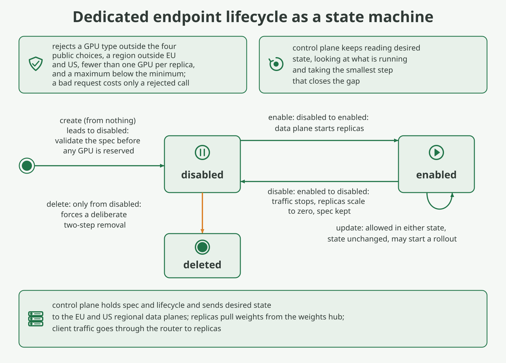

*Figure 20.14.1. Delete is allowed only from disabled, which forces a deliberate two-step removal.*

An engineer opens a ticket: "disable the endpoint, the customer is over budget". If that action had to touch the machines serving traffic directly, a bug in billing could stop an API. So the endpoint is stored as a small desired-state record, and something else makes reality match it. Desired state is what you want the system to look like, as opposed to what it looks like right now. A controller compares the two and closes the gap.

The record carries the model reference, the GPU type, GPUs per replica, minimum and maximum replicas, and the region. The control plane validates it, stores it with an audit trail and exposes the five lifecycle actions. Chapter 20.13 already argued that the data plane must keep serving when the control plane is down, using a cached signed snapshot of desired state. Here we add the lifecycle rules.

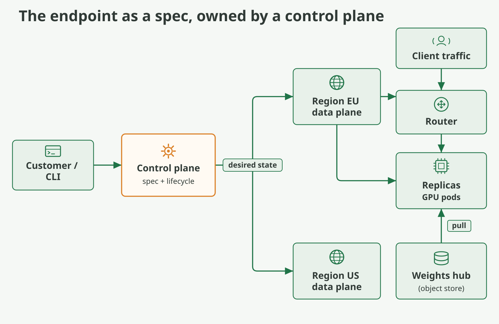

*Figure 20.14.2. The endpoint as a spec, owned by a control plane, as a diagram.*

The file `c14_endpoint_lifecycle.py` encodes the rules as a tiny state machine. A state machine is a small set of states and the moves allowed between them. Create makes the endpoint disabled. Enable and disable flip it. Update is allowed in either state. Delete is allowed only from disabled. That last rule is my design choice, and the reason is that deleting a live endpoint is a one-click outage. Forcing a disable first gives a second, deliberate step before anything is removed.

| Action | Allowed from | Result | Why |
|---|---|---|---|
| create | nothing | disabled | validate the spec before any GPU is reserved |
| enable | disabled | enabled | data plane starts replicas |
| disable | enabled | disabled | traffic stops, replicas scale to zero, spec kept |
| update | either | same | spec change, may start a rollout |
| delete | disabled | deleted | forces a deliberate two-step removal |

The validator rejects a GPU type outside the four public choices, a region outside EU and US, fewer than one GPU per replica, and a maximum below the minimum. Read the list as the checks that run before any GPU is reserved, so a bad request costs nothing but a rejected call.

Think about what the control plane does with that record once it is stored. It is a reconcile loop, which means it keeps reading the desired state, looking at what is actually running, and taking the smallest step that closes the gap. If the spec asks for more replicas than are running, it starts the missing ones. If the spec says disabled, it stops the replicas and leaves the record alone. So enabling the endpoint again later is one action and not a rebuild. Because the loop only ever compares two pictures, a mistake in one step does not erase the other picture. **Keep desired state in the control plane and let the data plane reconcile toward it, so that a control outage never becomes a traffic outage.**

### 2. Sizing the endpoint: GPU type, GPUs per replica, min and max

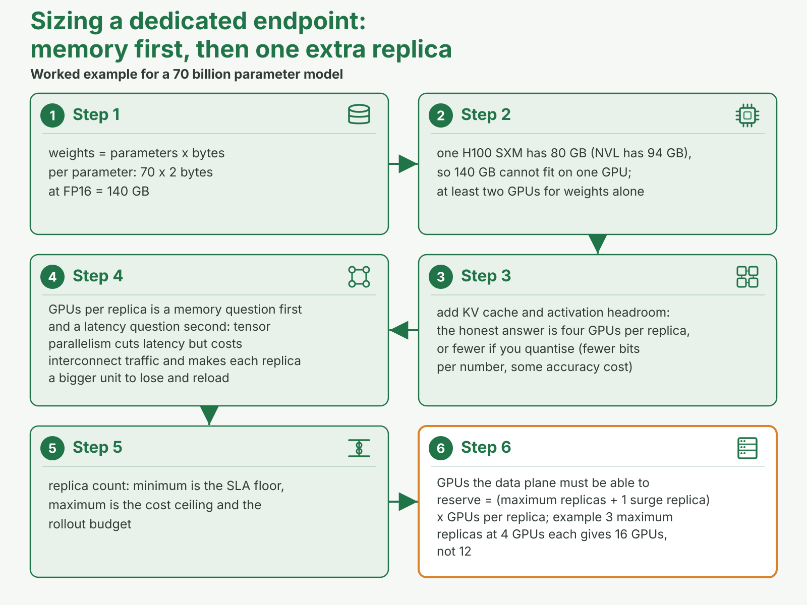

*Figure 20.14.3. Always budget one extra replica of GPUs so a rolling update has somewhere to start the new pod.*

A customer asks for a 70 billion parameter model. You need the numbers before you pick hardware, or the hardware choice becomes a guess. Chapter 20.12 gives the full toolkit, so here is only the shape. The shape is simple to hold in your head. Memory for the weights comes first, then headroom for the cache, then the number of GPUs, and only after that do you worry about speed.

Weights take parameters times bytes per parameter. At FP16 that is 70 x 2 = 140 GB. FP16 is a half-precision number format, so each parameter takes two bytes. Hands-On LLM Serving and Optimization, chapter 5, gives this rule. One H100 SXM has 80 GB, according to the NVIDIA H100 page fetched on 2026-11-09, so 140 GB cannot fit on one GPU, and you need at least two for the weights alone. Add KV cache and activation headroom and the honest answer is four, or fewer if you quantise. Quantising means storing each number in fewer bits, which shrinks the weights at some cost in accuracy. Activations are the temporary values the model holds while it computes, and they need memory too. The NVIDIA H100 page, fetched again on 2026-11-09, lists 80 GB for the SXM card and 94 GB for the NVL card.

GPUs per replica is therefore a memory question first and a latency question second. More GPUs per replica via tensor parallelism cuts latency but costs interconnect traffic and makes each replica a bigger unit to lose and to reload. Tensor parallelism splits one model across several GPUs, so each GPU does part of every step. Replicas count is the capacity and availability question. The minimum is your floor for the SLA. The maximum is your cost ceiling and, as section 6 shows, also your rollout budget.

One more figure matters for rollout. The GPUs the data plane must be able to reserve is not maximum replicas times GPUs per replica. It is that figure plus one extra replica worth of GPUs, because a rolling update needs a surge slot. A surge slot is room for one extra pod while an old pod is still running. The function `max_gpus` computes it. With 3 maximum replicas at 4 GPUs each, the ceiling is 16 GPUs, not 12.

**Choose GPUs per replica from memory first, and always budget one extra replica for rollout.**

### 3. Cold start has three costs

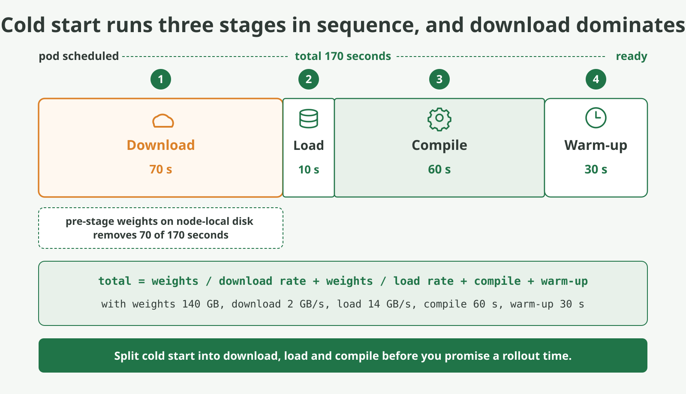

*Figure 20.14.4. A new replica is ready only after download, load, compile and warm-up have run one after another, so the largest stage sets the rollout time.*

A pod is scheduled at 10:00. When can it take traffic? Many people answer "when the process starts", and that is wrong for an LLM engine, because most of the time goes to three stages that run one after another.

The first stage is download, which means moving the weights from the weights hub or object store to the node. The second is load, which means reading them from local disk into GPU memory. The third is compile and warm-up, in which the engine profiles memory, builds optimised kernels or graphs and runs a few real requests so the first user does not pay for them. Chapter 20.18 section 7 covers the load arithmetic and the vLLM settings that cut repeat boots, which are the compile cache under `VLLM_CACHE_ROOT` and reuse of a stored KV-cache memory value.

The script computes the sum. For 140 GB, a 2 GB per second download, a 14 GB per second load, 60 seconds of compile and 30 seconds of warm-up, I ran it and got 70, 10, 60 and 30 seconds, a total of 170. The bandwidth range of 0.5 to 14 GB per second for SSD is from the book's table in chapter 5. The download rate, the compile time and the warm-up time are my illustrative inputs. Measure your own from the startup log. If the log does not show the three stages separately, time each one yourself with a stopwatch around the step, or with a simple timestamp printed at the start and end of it. Write the numbers down for each new engine image, because they change when the image, the weights or the node changes. A calculation is only a guess until a measured line confirms it.

```python
def cold_start(weights_gb: float, download_gb_s: float, load_gb_s: float,
               compile_s: float, warmup_s: float) -> dict:
    """Seconds from pod scheduled to ready. Stages run one after another."""
    if download_gb_s <= 0 or load_gb_s <= 0:
        raise ValueError("bandwidths must be positive")
    parts = {"download_s": weights_gb / download_gb_s, "load_s": weights_gb / load_gb_s,
             "compile_s": compile_s, "warmup_s": warmup_s}
    parts["total_s"] = sum(parts.values())
    return parts
```

The lesson is which stage to attack. Name the stage out loud before you name the fix, because the interviewer can then follow your reasoning instead of guessing at it. In this example the download dominates, so a node-local weights cache removes 70 of 170 seconds. If the load dominated you would look at disk. If compile dominated you would persist the compile cache. LLMs in Production, chapter 6, describes a design where weights are downloaded once and kept on a mounted volume so new instances skip the download. A mounted volume is storage attached to the pod's filesystem, so the weights survive the pod.

**Before you promise a rollout time, split cold start into download, load and compile, and say which one you will remove first.**

### 4. Weights distribution and the custom-weights flow

The customer has trained a checkpoint. A checkpoint is a saved set of trained weights, and they are the only thing that makes the model behave the way the customer wants. They upload it. How does it get to an endpoint safely? Nebius has not published its flow, so here is a reasonable design that follows the usual model-registry pattern. A model registry is a catalogue that records each model version and where its files live. Machine Learning Platform Engineering, chapter 10, lists model versioning with rollback as a basic requirement.

Stage one is the upload into a weights hub, which I treat as a versioned object store with a registry record per model. The record holds an immutable version id, a content hash, the file list, the model architecture, the tokenizer files and the quantisation format. A content hash is a fingerprint of the file bytes, so any change to the files changes the fingerprint. Immutable matters because "the same version" must always mean the same bytes. Think of the version id as a label on a sealed box. If someone could open the box and swap a file, the label would still look the same, and nobody reading it would know. The hash is how you check that the box has not been opened.

Stage two is validation before any GPU is used. Check the hash. Check that the architecture is one the engine supports. Check the config values that bite at runtime, such as maximum sequence length. Load it once on a small canary node and run a fixed prompt set. A checkpoint that fails here never reaches an endpoint. Picture the cost of skipping this stage. A broken file that reaches a live endpoint wastes GPUs, time and the customer's trust, and a check that costs a few minutes avoids all three.

Stage three is the deploy to an existing endpoint, which is an update action in the control plane. The endpoint spec gains a new model version. The data plane does not edit running pods. It starts a rollout, which sections 6 to 8 describe. The old version stays addressable, so that rollback is the same update with the old id.

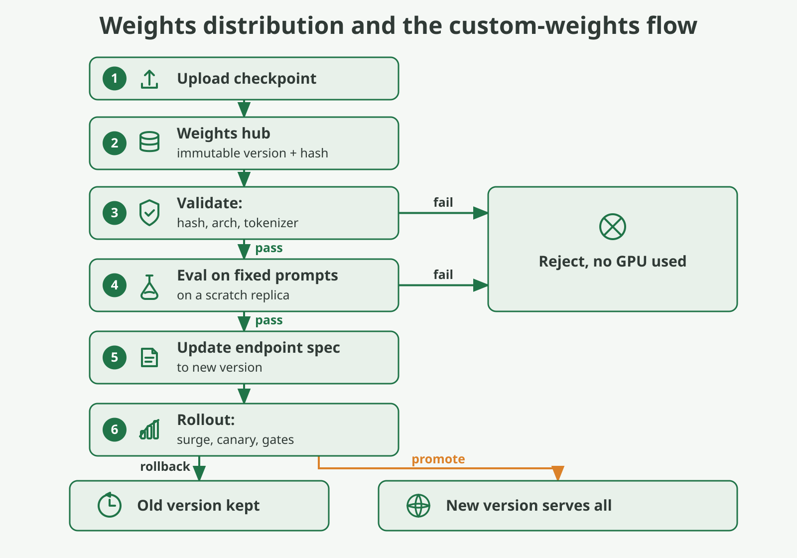

*Figure 20.14.5. Weights distribution and the custom-weights flow, as a diagram.*

A design detail that interviewers like is the distribution path. If 8 replicas all download from one bucket at once, they share its bandwidth. Chapter 20.18 section 7 showed the herd arithmetic. Herd arithmetic is the calculation of how much each replica gets when many of them pull the same file at the same moment. A reasonable fix is to stage the new version onto node-local disk before the rollout begins, then start pods that read locally. That moves the long step out of the critical window, which is the stretch of time when the rollout is most fragile. Staging is also reversible. If the staged copy turns out to be wrong, you delete it from the nodes and nothing has changed for users yet.

**Treat a checkpoint as an immutable, hashed, validated artifact, and make deploy an ordinary spec update that can be reversed.**

### 5. Readiness versus liveness for an engine

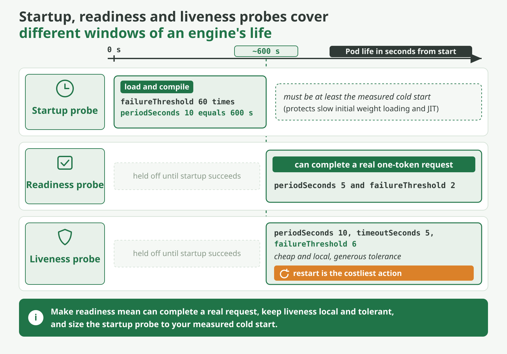

*Figure 20.14.6. Each probe answers a different question, and mixing them up can restart a healthy engine or send traffic to a broken one.*

Picture a rollout where the new pod says it is ready before it can answer a single request. The controller then removes a good old pod in favour of a broken new one, and users feel it within a minute. A rollout is only as safe as the signal that says a new pod can take traffic. If readiness lies, the controller makes the wrong trade. So you must be exact about the probe roles. A probe is a check that the platform runs against a pod on a timer, and each kind of probe answers a different question.

Production Kubernetes, chapter 14, says liveness failures cause restarts, so a liveness probe should be local and should not check external dependencies. Readiness decides whether a pod gets traffic, and it is the place for conditions such as a cold cache or overload. The Kubernetes documentation adds the startup probe, which protects slow-starting containers. It holds off the other probes until it succeeds, with a window of the failure threshold times the period. If the startup probe never succeeds the container is killed.

For an LLM engine that gives a clean split. The startup probe covers the load and compile window, and its length must be at least your measured cold start. Liveness is a cheap local check with generous failure tolerance, because a busy engine answers slowly and a restart throws away both the in-flight requests and a long weight load. A restart is the most expensive thing a probe can cause, so a probe that restarts a healthy engine does more harm than one that waits too long. Readiness should mean "has loaded, has warmed up and can complete a real one-token request", not "the port is open". A port that is open tells you the process exists, and it says nothing about whether the model can answer.

Chapter 20.18 section 6 notes that the vLLM health route reports a crash and not a stall. I rechecked this at tag v0.33.0 on 2026-11-09. The `/health` handler in `vllm/entrypoints/serve/instrumentator/health.py` returns 503 only when `check_health` raises the engine-dead error, and `check_health` in `async_llm.py` raises only if the engine has errored. A hung engine that has not errored still answers 200. So a green health route is weak evidence for readiness. A reasonable design is a readiness check that runs a real one-token request after warm-up and then keeps passing as long as token rate is sane. The file `c14_engine_deploy.yaml` shows the shape with a startup window of 600 seconds, which comes from a failure threshold of 60 times a period of 10. The probe path `/ready` is a hypothetical one that a sidecar or wrapper would have to provide. That phrase matters in the room. If you say the path exists in the engine, the interviewer can ask you to point at the code, and you cannot. Say it is a path your team would add, and then say what it would check.

```yaml
# Sketch of a GPU engine Deployment. Probe numbers are starting values, not Nebius settings.
apiVersion: apps/v1
kind: Deployment
metadata:
  name: demo-engine
spec:
  replicas: 8
  minReadySeconds: 30
  progressDeadlineSeconds: 900
  strategy:
    type: RollingUpdate
    rollingUpdate:
      maxSurge: 1
      maxUnavailable: 0
  selector:
    matchLabels: {app: demo-engine}
  template:
    metadata:
      labels: {app: demo-engine}
    spec:
      terminationGracePeriodSeconds: 120
      containers:
        - name: engine
          image: example.invalid/engine:v2
          resources:
            limits: {nvidia.com/gpu: 1}
          startupProbe:
            httpGet: {path: /health, port: 8000}
            periodSeconds: 10
            failureThreshold: 60
          readinessProbe:
            httpGet: {path: /ready, port: 8000}
            periodSeconds: 5
            failureThreshold: 2
          livenessProbe:
            httpGet: {path: /health, port: 8000}
            periodSeconds: 10
            timeoutSeconds: 5
            failureThreshold: 6
```

The grace period matters for the old pods. On shutdown Kubernetes sends SIGTERM and waits for the grace period, 30 seconds by default, before SIGKILL, as Production Kubernetes chapter 14 explains. SIGTERM is the polite stop signal, and SIGKILL is the signal that cannot be ignored. A long generation needs time to finish, so raise it and have the engine stop accepting new requests while it drains. The Kubernetes pod lifecycle page, fetched 2026-11-09, says the preStop hook runs first and then the runtime sends TERM, and that the control plane starts removing the pod from EndpointSlices at the same time, not before. So requests can still arrive after TERM. In vLLM at tag v0.33.0 the `--shutdown-timeout` option defaults to 0, which means abort in-flight requests at once. Its help text says a value above 0 waits for requests to finish. Set it below your grace period, so the engine finishes or gives up before Kubernetes forces the stop.

**Make readiness mean "can complete a real request", keep liveness local and tolerant, and size the startup probe to your measured cold start.**

### 6. Rolling, blue/green and canary when you cannot double your GPUs

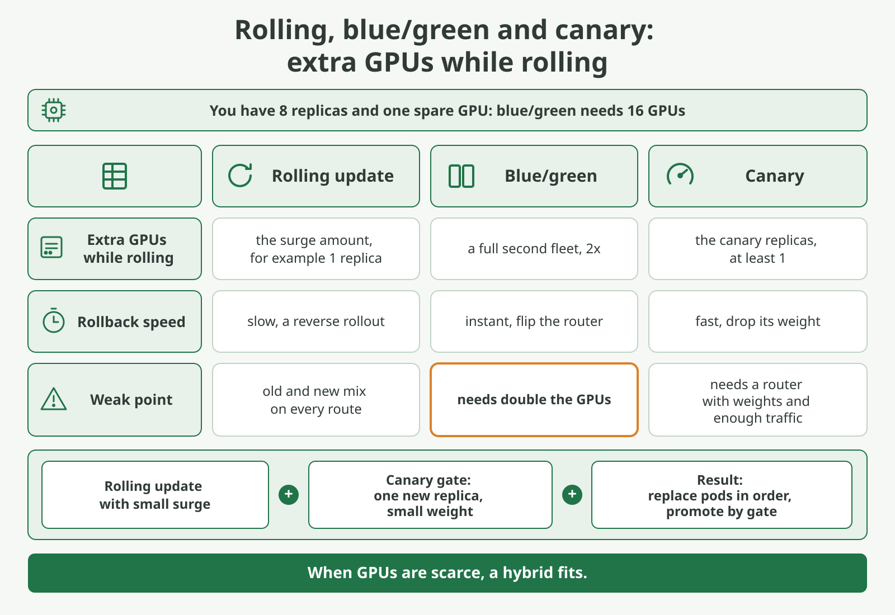

*Figure 20.14.7. Rolling update, blue/green and canary compare on extra GPUs needed, rollback speed and weak point, and a hybrid suits scarce GPUs.*

You have 8 replicas on H100s and the cluster has one spare GPU. The classic advice is blue/green: stand up a full copy, switch traffic, delete the old. For this workload that needs 16 GPUs. The function `blue_green_gpus` returns exactly twice the replicas. If the endpoint is large or the region is short of GPUs, that is simply not available, and the advice does not apply.

Practical MLOps, chapter 4, describes the two patterns. Blue/green gets the new version running in an environment identical to production and routes traffic separately. A canary routes traffic progressively to the new model while the old one still serves, in different ratios, so that checks can catch problems in real time. The book warns that blue/green is hard when the environment is expensive to replicate, and that a canary at 100 percent can still miss a subtle break, which it shows with a boolean that became a string. A boolean that became a string is a small type change that passes every health check and still breaks the code that reads it.

| Strategy | Extra GPUs while rolling | Rollback speed | Weak point |
|---|---|---|---|
| Rolling update | the surge amount, for example 1 replica | slow, a reverse rollout | old and new mix on every route |
| Blue/green | a full second fleet, 2x | instant, flip the router | needs double the GPUs |
| Canary | the canary replicas, at least 1 | fast, drop its weight | needs a router with weights and enough traffic |

For scarce GPUs the answer is a hybrid. Use a rolling update with a small surge for the mechanics of replacing pods. Put a canary gate in front by starting with one replica of the new version and a small router weight. The rolling part replaces pods in order, and the canary part decides whether the next pod should carry real traffic. Two mechanisms each do the job they are good at. Promote only after the gates pass. Chapter 20.13 section 15 described the same order, with an earlier shadow stage.

The Kubernetes documentation defines the rolling update controls. By default both `maxSurge` and `maxUnavailable` are 25 percent. Surge rounds up and unavailable rounds down. The two cannot both be zero. With 8 replicas and 25 percent surge you may run 10 pods, which is two GPUs you may not have. So set the numbers in absolute terms and tie them to your spare GPUs. Absolute numbers are easier to reason about under pressure. Saying one replica of surge is clearer than saying a percentage of the fleet, because the percentage moves when the fleet grows while the spare GPU count does not. An answer in absolute terms stays true as the endpoint changes.

The simulator makes the trade-off visible. It models one replica as one GPU slot, a new pod that holds its slot while loading, and the controller loop of scaling down old pods while availability stays above the floor and scaling up new ones within the pod cap. I ran four settings for 8 replicas and a load time of 4 ticks. A tick is one step of the simulated clock, not a real unit of time, so read the results as relative speed.

| Setting | Spare GPUs | Result |
|---|---|---|
| surge 1, unavailable 0 | 1 | done in 33 ticks, never below 8 available, peak 9 GPUs |
| surge 1, unavailable 0 | 0 | stalls, never finishes, no capacity to start the new pod |
| surge 0, unavailable 1 | 0 | done in 33 ticks, but capacity drops to 7 of 8 |
| surge 2, unavailable 0 | 2 | done in 17 ticks, never below 8, peak 10 GPUs |

The second row is the trap. The Kubernetes documentation says the Deployment controller reports `ProgressDeadlineExceeded` when a rollout makes no progress for the deadline. The pods that cannot be scheduled stay pending and the rollout hangs while the old fleet keeps serving. That is safe for availability and bad for velocity, so alert on it. The third row is the other honest option: accept one replica less during the update, which is fine only if your headroom covers it.

**When GPUs are scarce, trade time against capacity: more surge is faster and needs spare GPUs, and zero surge needs you to accept lower capacity.**

### 7. Surge budgets when GPUs are scarce

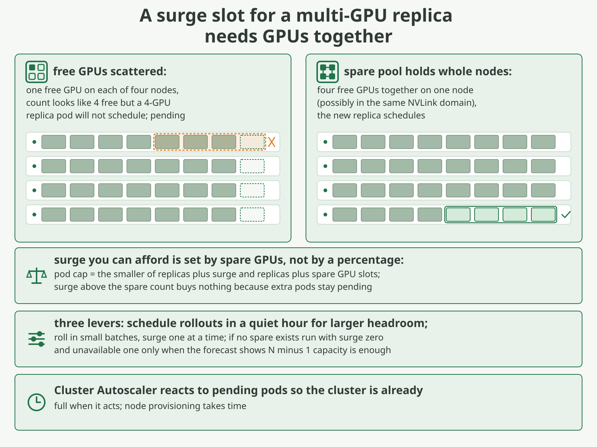

*Figure 20.14.8. State surge in GPUs, not percent, and keep spare capacity in whole nodes.*

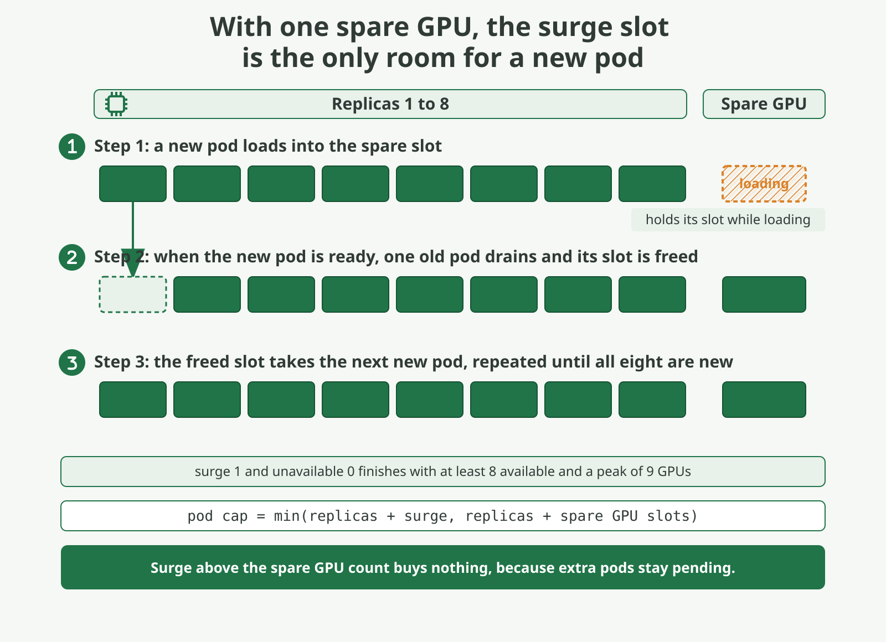

*Figure 20.14.9. The spare GPU is the only room for a new pod, so the surge you can afford is set by the spare GPU count, not by a percentage.*

An engineer proposes surge of 25 percent, and the capacity planner says "we have one spare GPU in that region". Who wins? The planner, and you should explain why using one formula. Surge is the extra room that lets new pods start before old ones stop. A budget is how much of it you can actually pay for.

The pod cap in the simulator is the smaller of replicas plus surge and replicas plus spare GPU slots. Surge above the spare count buys nothing, because the extra pods stay pending. Production Kubernetes, chapter 13, describes the same pressure from the cluster side. The Cluster Autoscaler reacts to pending pods, so the cluster is already full when it acts, and node provisioning takes time. Overprovisioning with low-priority placeholder pods keeps standby capacity that real pods can evict. For GPU nodes that standby is costly, so decide on purpose how many spare GPUs you hold for rollouts.

There are three practical levers. First, schedule rollouts to a quiet hour so that headroom is larger. Second, roll in small batches so the surge is one replica at a time, which is the first table row and needs one spare GPU. Third, if no spare exists, run the rollout as surge zero and unavailable one, and only when the traffic forecast shows capacity of N minus 1 is enough. Chapter 20.12 explains how to compute that headroom.

There is also the multi-GPU twist. A replica that uses 4 GPUs needs 4 free GPUs on a node, possibly on the same NVLink domain. A surge slot of one replica therefore means four contiguous GPUs, not one. If the free GPUs are spread across nodes the pod will not schedule even though the count looks fine. That is a placement problem, and it is why a spare pool should hold whole nodes. Picture a cluster where the free GPUs sit in small scattered groups across several nodes. The total looks large enough, yet no single node has a whole group big enough for the pod, so the rollout still stalls. The fix is to hold spare capacity as whole nodes, so the scheduler always has a place that fits.

**State the surge you can afford in GPUs, not in percent, and remember that a multi-GPU replica needs its GPUs together.**

### 8. Traffic shifting with a router, and the gates

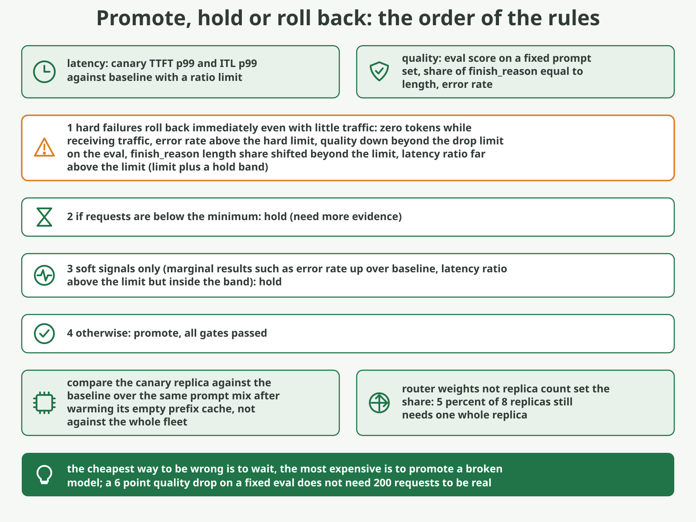

*Figure 20.14.10. Only a clean pass with enough traffic promotes, and hard signals roll back without waiting.*

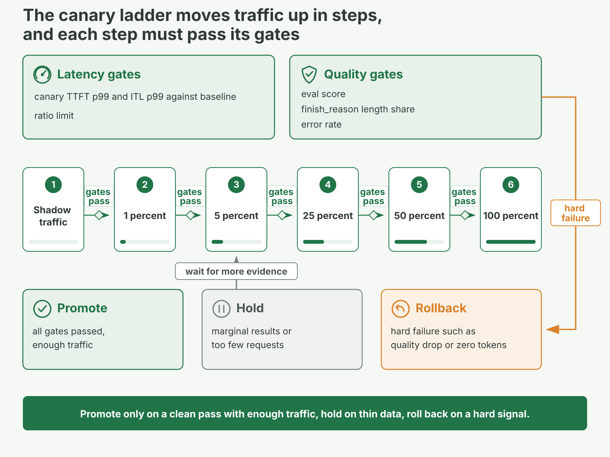

*Figure 20.14.11. A staged traffic ladder with gates keeps a broken model from reaching all users, and a latency-only gate is not enough.*

The new version is up on one replica and ready. Now what decides how much traffic it gets? A router with weights, not the replica count. If the router balanced evenly across 8 pods, one new pod would take about 12.5 percent. The function `canary_replicas` shows the point: 5 percent of 8 replicas still needs one whole replica, since a replica cannot be split. So use router weights to send 1 or 5 percent to that one pod, and let its capacity be a ceiling, not a target. A ceiling is the most traffic the pod can safely take, and the weight decides how much it actually gets.

Chapter 20.13 section 6 designed the router and its cache-aware routing. Here note one interaction. A fresh replica has an empty prefix cache, so its early latency looks worse for reasons unrelated to the model. Warm it with a few real requests before giving it weight, and compare it against the baseline over the same prompt mix, not against the whole fleet. Otherwise you will blame the new model for a cold cache. The same rule protects the gate itself. If the baseline and the canary see different prompts, a latency gap may only reflect the prompts, and the gate will hold or roll back for the wrong reason. Compare on the same prompt mix every time.

The ladder is a sequence of steps, each held until the gates pass. A reasonable ladder is shadow traffic, then 1 percent, then 5, then 25, then 50, then 100. At every step the question is the same: promote, hold or roll back. The function `decide` returns one of these three from baseline and canary metrics. Hold means wait for more evidence, and roll back means return to the old version now.

The gates fall in two groups. Latency gates compare canary TTFT p99 and inter-token latency p99 against the baseline, with a ratio limit. Quality gates compare an eval score on a fixed prompt set, the share of finish_reason equal to length, and error rate. An eval score is a number from a fixed test set of prompts with expected answers, so you can compare versions on the same questions. Chapter 20.18 section 11 explains why finish_reason drift is the early signal for silent quality loss, and Practical MLOps chapter 4 warns that a canary can reach 100 percent without errors and still be broken. That is why the gate must include output quality and not only health.

```python
def decide(base: Metrics, canary: Metrics, g: Gates = Gates()) -> Decision:
    hard, soft = [], []
    if canary.tokens_per_s <= 0 and canary.requests > 0:
        hard.append("canary produced zero tokens while receiving traffic")
    if canary.error_rate > g.error_abs_max:
        hard.append(f"error rate {canary.error_rate:.3f} above hard limit {g.error_abs_max}")
    elif canary.error_rate - base.error_rate > g.error_delta_max:
        soft.append(f"error rate up {canary.error_rate - base.error_rate:.3f} over baseline")
    if base.quality - canary.quality > g.quality_drop_max:
        hard.append(f"quality down {base.quality - canary.quality:.3f} on eval set")
    shift = abs(canary.length_share - base.length_share)
    if shift > g.length_shift_max:
        hard.append(f"finish_reason=length share moved {shift:.2f}")
    for name, c, b, lim in (("ttft_p99", canary.ttft_p99_s, base.ttft_p99_s, g.ttft_ratio_max),
                            ("itl_p99", canary.itl_p99_s, base.itl_p99_s, g.itl_ratio_max)):
        ratio = c / b if b > 0 else float("inf")
        if ratio > lim * (1 + g.hold_band):
            hard.append(f"{name} {ratio:.2f}x baseline, far above {lim}x")
        elif ratio > lim:
            soft.append(f"{name} {ratio:.2f}x baseline, above {lim}x")
    if hard:
        return Decision("rollback", hard + soft)
    if canary.requests < g.min_requests:
        return Decision("hold", [f"only {canary.requests} requests, need {g.min_requests}"] + soft)
    if soft:
        return Decision("hold", soft)
    return Decision("promote", ["all gates passed"])
```

The rule order is the design. Hard failures roll back even with too little traffic, because a quality drop of 6 points on a fixed eval does not need 200 requests to be real. Insufficient traffic holds, it does not promote. Marginal results hold, they do not roll back. Only a clean pass promotes. Read the order as a safety rule: the cheapest way to be wrong is to wait, and the most expensive way is to promote a broken model. The thresholds, such as 1.25 times baseline latency, a 2 point quality drop and a 10 point finish_reason shift, are my starting values and not Nebius values.

**Promote only on a clean pass with enough traffic, hold on marginal or thin data, and roll back at once on a hard signal such as quality or zero tokens.**

### 9. Automatic rollback signals

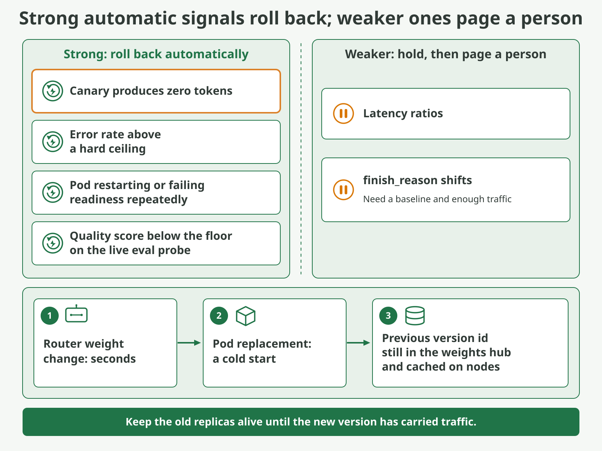

*Figure 20.14.12. Strong signals such as zero tokens or a hard error ceiling roll back automatically, while weaker latency and finish reason signals hold and page a person.*

At 03:00 nobody is watching the canary. Which signals should flip it back by themselves? Pick the ones that are cheap, fast and unambiguous, and keep a human in the loop for the rest. A signal is unambiguous when a bad value almost never happens by chance, so an automatic reaction is safe.

Strong automatic signals are the canary producing zero tokens, the error rate above a hard ceiling, a pod restarting or failing readiness repeatedly, and a quality score below the floor on the live eval probe. Weaker signals are latency ratios and finish_reason shifts, which need a baseline and enough traffic, so they should hold first and page a person if they persist. Chapter 20.19 covers SLO burn alerts that can serve as a fleet-wide backstop. A burn alert fires when a service spends its error budget too fast, which is a way to catch slow damage that no single gate sees.

Rollback itself must be boring. It is the same update action pointing at the previous version id, which still exists in the weights hub and is still cached on nodes if you keep it. Time to rollback is the sum of a router weight change, which is seconds, and a pod replacement, which is a cold start. So keep the old replicas alive until the new version has carried peak traffic, as chapter 20.13 recommends. That makes rollback a weight change and not a reload. The practical point is that a rollback you have rehearsed is a routine action, while a rollback you have never run is a second incident waiting to happen. Picture the difference at 03:00: a weight change is a single command, while a reload means waiting several minutes with customers still on the bad version.

Be careful about the automation itself. A rollback loop that fights an autoscaler or a second rollout can flap. A reasonable rule is that a rollout holds a lock on the endpoint, scaling decisions respect it, and a rollback releases it only after the old version is serving. A lock here is simply a marker that says one change is in progress, so two automations do not push the endpoint in opposite directions. Some teams also keep a human approval step for the first rollback of a new model, so the person on call sees the reason before the machine acts twice. That choice trades a little speed for a clearer audit trail, and it is worth naming as a choice.

**Let machines roll back on cheap, unambiguous signals, and keep the previous version warm so rollback is a weight change.**

### 10. Version skew

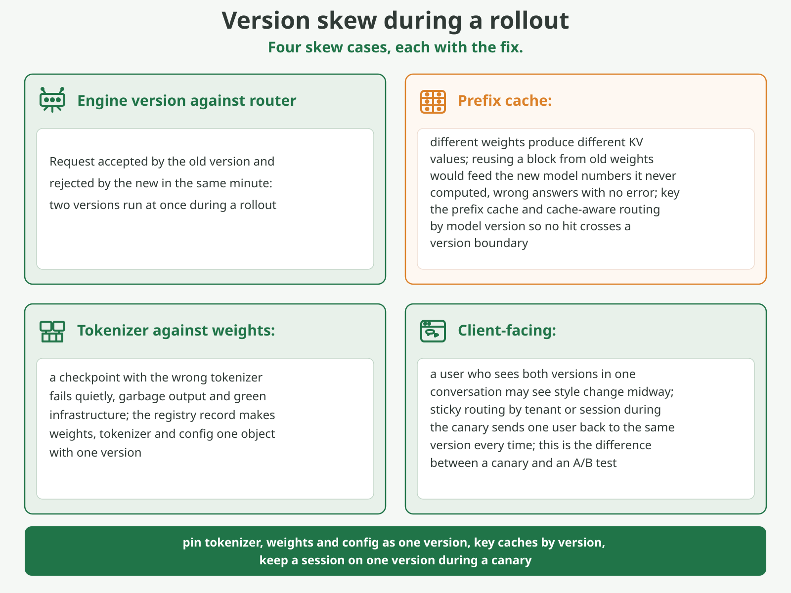

*Figure 20.14.13. Pin weights, tokenizer and config as one version and key the cache by version.*

Picture a client whose request is accepted by the old version and rejected by the new one, in the same minute. During a rollout two versions run at once, and that is where skew comes from. Version skew is any case where two components disagree because they run different versions. It can hurt anywhere two components assume the same thing. A client sends a request the old version accepts and the new version rejects. A router parses a metric that was renamed. A prefix cache holds blocks computed by the old model, and the new model must never reuse them, because the keys and values differ.

The cache point is worth saying out loud. A reasonable design keys the prefix cache and cache-aware routing by model version, so no hit crosses a version boundary. That is my reasoning, and it follows from the fact that different weights produce different KV values. Reusing a block from the old weights would feed the new model numbers it never computed, and the answers would be wrong without any error being raised.

Other skews are the engine version against the router and the tokenizer against the weights. Each of these looks like a bug in a different team's code, which is why the registry record matters. It makes the pieces one object with one version, so nobody has to guess which tokenizer belonged with which checkpoint. A checkpoint paired with the wrong tokenizer fails quietly, with garbage output and green infrastructure. So the registry record from section 4 binds weights, tokenizer and config into one version. Chapter 20.18 section 12 covers metric-name skew and the rule that missing series should be treated as a fault. A missing series is a metric that stops appearing, and a silent gap should look like a failure.

Finally, a client-facing skew: if the same user sees both versions in one conversation, answers may change style midway. Sticky routing by tenant or session during the canary solves it, and it is the difference between a canary and an A/B test that Distributed AI Systems, chapter 9, draws. Sticky routing sends one user back to the same version every time, so the conversation stays consistent. Picture the user who gets a formal answer on one turn and a casual one on the next. Nothing is broken in either version, yet the conversation feels wrong, and only sticky routing removes that effect. The cost is that a canary cannot reach every user at once in an even spread, so the ladder has to account for it.

**Pin tokenizer, weights and config as one version, key caches by version, and keep a session on one version during a canary.**

### 11. Scale-to-zero and the minimum replica decision

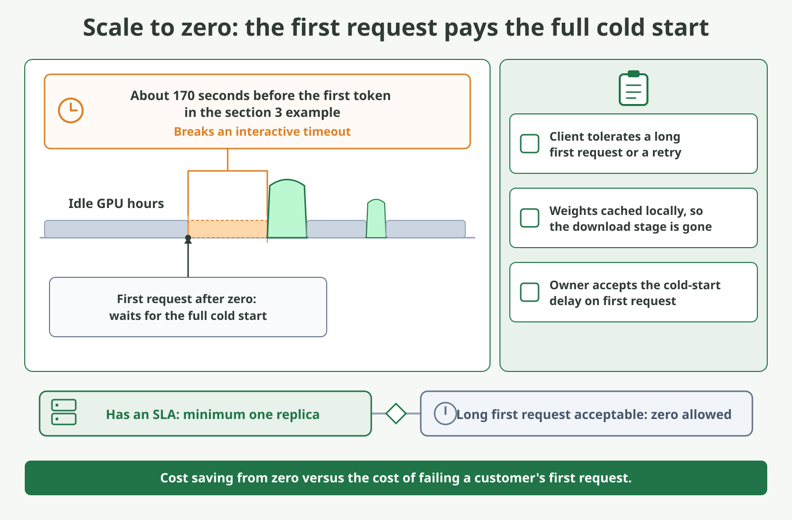

*Figure 20.14.14. Scale to zero saves idle GPU hours, but the first request waits for the full cold start, so endpoints with an SLA keep at least one replica.*

A customer has a quiet endpoint used twice a day. Their finance contact asks why they pay for an idle GPU. Scale-to-zero saves that cost and adds one risk, the cold request. A cold request is the first request that arrives when no replica is running, so it must wait for the full cold start.

The first request after zero waits for a full cold start. With the section 3 example that is 170 seconds before the first token, which breaks any interactive timeout. So scale-to-zero needs three honest conditions. The client tolerates a long first request or a retry. The weights are cached locally so the download stage is gone. And the owner accepts that the first request may fail on a timeout. Each condition removes one reason to be surprised later.

Kubernetes for Generative AI Solutions, chapter 6, notes that KEDA can scale to zero when there are no events, which fits event-driven work. Handbook chapter 15.15 covers autoscaling and scale-to-zero mechanics, so do not repeat them here. The dedicated endpoint has a public 99.9 percent SLA in the case study. A minimum of zero replicas and a 99.9 percent availability target pull in opposite directions, since a cold request counts as slow or failed. My reasoning is that dedicated endpoints serving production traffic should use a minimum of at least one, and scale-to-zero suits development or batch endpoints. Nebius has not said how it handles this.

The cost side is easy to state. One replica kept warm costs its GPUs for every hour. The saving from zero is the idle hours times those GPUs. The price per GPU hour is not given here because it is a commercial figure, so ask for it. Then compare the saving against the cost of failing a customer's first request. A cheap idle endpoint that loses one customer's first call every morning is often the more expensive choice. A useful way to frame the decision is to write both costs in the same unit, such as money per month, before you pick. If the customer is paying for a service with a promise attached, the failure cost usually wins.

**Set the minimum replicas to one for anything with an SLA, and allow zero only where a long first request is acceptable.**

## How to answer out loud

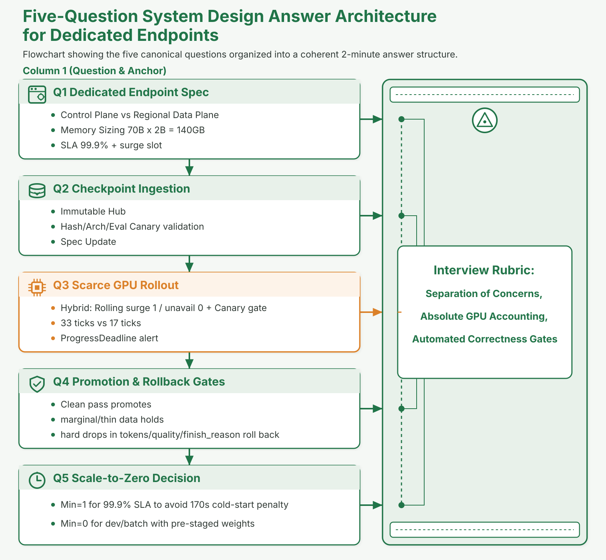

*Figure 20.0.0. Figure 20.14.17. Structuring the dedicated endpoint answer across lifecycle, scarce GPU rollout, multi-dimensional gates, and scale-to-zero trade-offs.*

Picture an interviewer who has just said "design a dedicated endpoint" and is waiting for your first move. Each answer below is a short spoken outline. Say it in your own words, in under two minutes, and listen for the place where you hesitate.

**Question 1. "Design a dedicated endpoint."** Say the order. State the spec: model, GPU type, GPUs per replica, minimum and maximum replicas, region. Separate the control plane, which stores desired state and lifecycle, from the regional data plane, which serves and keeps serving if the control plane is down. Size from memory first: weights are parameters times bytes. Name the SLA and the redundancy, one extra replica. Mention that Nebius publishes the split and the spec fields, and that the rest is your design. If the interviewer pushes on any field, answer from the public list first, then from your design, and say which is which.

**Question 2. "How does a customer's checkpoint get onto an endpoint?"** Picture a customer who has just uploaded a file and wants it live by Friday. Say upload to a versioned store, hash, validate architecture and tokenizer, eval on a scratch replica, then an update to the endpoint spec that starts a rollout. Say immutable version ids and that rollback is the same action pointing back. Say Nebius has not published this flow and you are describing a reasonable design.

**Question 3. "We have one spare GPU. How do you roll out?"** Picture the planner pointing at the one free GPU on the dashboard. Say blue/green needs double, so no. Use a rolling update with a surge of one and an unavailable value of zero, with a canary gate in front. Give the cost: it is slow, one replica at a time, so 8 replicas at a 4-tick load take 33 ticks in the simulator against 17 with a surge of two. Name the stall when there is no spare slot and the progress deadline alert.

**Question 4. "What decides promote or rollback?"** Say fixed gates compared against a baseline over the same traffic. Latency ratios, error rate, finish_reason shares and an eval score. Hard failures roll back immediately, thin data holds, marginal results hold. Give your thresholds as starting values you would tune against the SLO. Expect "what if the canary has no traffic" and answer: hold, and use synthetic eval prompts. Synthetic prompts are a fixed set that you send yourself, so the canary is judged even before real users arrive.

**Question 5. "Why not scale to zero for every endpoint?"** Picture a customer whose first morning request times out while the GPUs wake up. Say a cold request waits for download, load and compile, which was 170 seconds in my example, so the first request fails or times out. For a 99.9 percent SLA I would keep at least one replica. Offer zero for dev and batch endpoints with local weights caching.

## Worked scenarios

### Scenario A. Eight replicas, one spare GPU

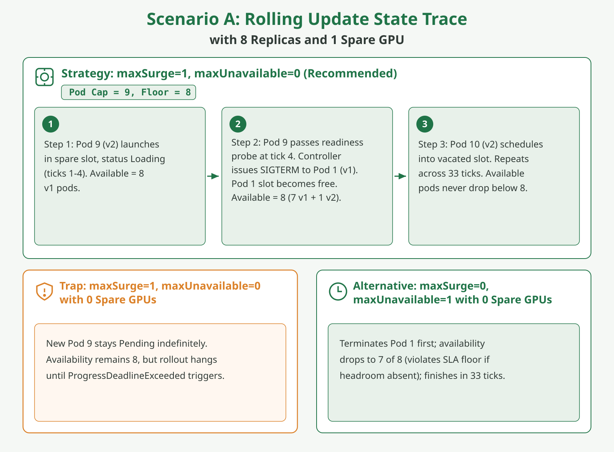

*Figure 20.0.0. Figure 20.14.18. Rolling update mechanics under strict single-GPU surge constraints compared with zero-spare hang and down-scaling trade-offs.*

An endpoint runs 8 replicas, one GPU each, in a region that has exactly one spare GPU. A new engine image must roll out. Engineering proposes the Kubernetes defaults.

Reasoning. The defaults are 25 percent surge and 25 percent unavailable. For 8 replicas that allows 2 extra pods and 2 down. Capacity could fall to 6 of 8 and the second surge pod stays pending. Instead set surge 1 and unavailable 0, so the pod cap is 9 and availability never dips. I ran the simulator and it finished in 33 ticks with a minimum of 8 available and a peak of 9 GPUs. With no spare GPU the same settings stalled for 60 ticks and never finished.

Answer. Use surge 1 and unavailable 0, a `minReadySeconds` so a new pod proves itself before the next, and a progress deadline that alerts. If the spare GPU is later taken by another team, the rollout stalls without hurting users, so alert on the deadline. Tell the interviewer who owns the spare GPU, because that person is the one who can release it, and a stalled rollout is a question for them as much as for you.

```bash
python3 code/part20/c14_rollout_sim.py rolling
```

### Scenario B. Latency is green, quality is not

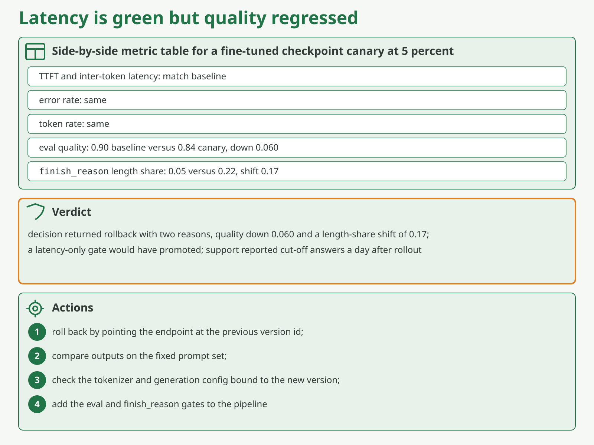

*Figure 20.14.15. A latency-only gate would have promoted a model that cut answers short.*

A canary of a fine-tuned checkpoint reaches 5 percent. TTFT and inter-token latency match the baseline. Error rate is the same. The next day support reports cut-off answers.

Reasoning. The sample file holds baseline and canary metrics. Latency, errors and token rate match. Quality on the fixed eval falls from 0.90 to 0.84 and the share of finish_reason length rises from 0.05 to 0.22. I ran the decision and it returned rollback with two reasons, quality down 0.060 and a length-share shift of 0.17. A latency-only gate would have promoted. Support's report arrived a day after the rollout started, which is exactly why the early length-share signal is worth more than the complaint itself. By the time users write in, the damage has already been running for a while. The cut-off answers were the symptom support saw, and the length share was the number that showed it early.

Answer. Roll back by pointing the endpoint at the previous version id. Then compare outputs on the fixed prompt set, check the tokenizer and generation config bound to the new version, and add the eval and finish_reason gates to the pipeline so this is automatic next time.

```bash
python3 code/part20/c14_rollout_sim.py decide code/part20/samples/c14_canary_quality_regress.json
```

### Scenario C. Shipping a custom checkpoint to a live endpoint

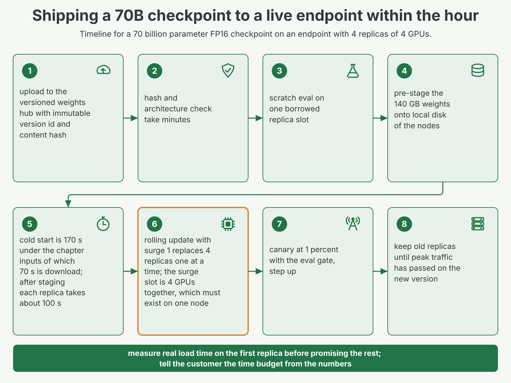

*Figure 20.14.16. Pre-stage weights so each replica skips the download and the surge slot has four GPUs together.*

A customer uploads a 70 billion parameter checkpoint in FP16 and wants it live on their existing endpoint within the hour. The endpoint runs 4 replicas of 4 GPUs.

Reasoning. Weights are 140 GB. The hash and architecture check take minutes. The scratch eval needs one replica, so you borrow one slot. Cold start is 170 seconds under the section 3 inputs, of which 70 is download. Pre-stage the weights onto the nodes first. A rolling update with surge 1 replaces 4 replicas, each taking about 100 seconds once staged. The surge slot is 4 GPUs together, which must exist on one node. If it does not, the rollout stalls, as in Scenario A. The customer's hour is a real constraint, so the honest reply is a time budget built from these numbers, not a promise.

Answer. Validate, stage to local disk, run the canary at 1 percent with the eval gate, step up, keep the old replicas until peak traffic has passed on the new version. Tell the customer the time budget from the numbers, and measure real load time on the first replica before promising the rest.

## Hands-on lab

Picture a laptop with Python, pytest and no GPU in the room. Everything below runs on a laptop with Python and pytest. I ran steps 1 to 4. Step 5 was not run, because it needs a GPU cluster. If a step fails, read its first error line before you change anything, since the first line usually names the missing piece.

1. Run the tests.

```bash
python3 -m pytest code/part20/test_c14_rollout_sim.py -q
```

Expected result: 19 passed.

2. Run the rolling-update table and compare it with section 6.

```bash
python3 code/part20/c14_rollout_sim.py rolling
```

Expected result: four lines, matching the table in section 6.

3. Validate the Deployment sketch with a client-side dry run.

```bash
kubectl apply --dry-run=client -f code/part20/c14_engine_deploy.yaml
```

Expected result: `deployment.apps/demo-engine created (dry run)`. This checks the shape only. The image is a placeholder and no cluster state changed.

4. Compute a cold start for your own numbers and see which stage dominates.

```bash
python3 -c "import sys; sys.path.insert(0,'code/part20'); from c14_rollout_sim import cold_start; print(cold_start(140, 2, 14, 60, 30))"
```

Expected result: total 170.0 seconds with download 70.0.

5. On a GKE or Nebius cluster, apply the Deployment with a real engine image, change the image tag, and watch `kubectl rollout status` while a script samples ready pods. Expected shape of the output: ready pods never below replicas minus the unavailable value. This step was not run.

## Drill questions

Picture a teammate asking you these across a table. Answer each one before you open it.

1. Which actions does the control plane own for a dedicated endpoint, and what stays in the data plane?

<details><summary>Answer</summary>

The control plane owns create, update, enable, disable and delete, plus the stored spec. The data plane is regional and serves traffic. It should keep serving from a cached copy of desired state if the control plane is down.

</details>

2. What fields does a dedicated endpoint expose, as public information says?

<details><summary>Answer</summary>

GPU type from L40, H100, H200 or B200, GPUs per replica, minimum and maximum replicas, and region in the EU or US.

</details>

3. Why is the GPU budget for an endpoint maximum replicas plus one, not just maximum replicas?

<details><summary>Answer</summary>

A rolling update needs a surge slot to start a new pod before an old one is removed. Without a spare replica's worth of GPUs, the rollout stalls or you lose capacity.

</details>

4. Name the three stages of cold start and one way to shorten each.

<details><summary>Answer</summary>

Download, load and compile with warm-up. Pre-stage weights on local disk for download, use faster local storage for load, and persist the compile cache for compile.

</details>

5. What should liveness, readiness and startup probes each do for an LLM engine?

<details><summary>Answer</summary>

The startup probe covers the load window and must outlast the measured cold start. Liveness is a local check with generous tolerance, so a busy engine is not killed. Readiness means the engine can complete a real request.

</details>

6. Why is blue/green a poor default for GPU endpoints?

<details><summary>Answer</summary>

It needs a full second fleet, twice the GPUs, which may not exist. Rollback is instant, but the cost in scarce GPUs is the problem.

</details>

7. What are the Kubernetes defaults for maxSurge and maxUnavailable, and how do they round?

<details><summary>Answer</summary>

Both default to 25 percent. Surge rounds up and unavailable rounds down. They cannot both be zero.

</details>

8. A rollout has surge 1, unavailable 0, and no spare GPU. What happens?

<details><summary>Answer</summary>

The new pod cannot be scheduled and stays pending, so the rollout makes no progress. The old fleet keeps serving, and the Deployment reports `ProgressDeadlineExceeded` after the deadline. So alert on it.

</details>

9. Latency gates pass but users complain. Which gates did you miss?

<details><summary>Answer</summary>

Quality gates. Run an eval on a fixed prompt set and watch the share of finish_reason length against a baseline, as well as error rate.

</details>

10. When is scale-to-zero acceptable on a dedicated endpoint, and when not?

<details><summary>Answer</summary>

Acceptable for dev or batch endpoints where a long first request is fine and weights are cached locally. Not acceptable for a production endpoint with a 99.9 percent SLA, because the cold request waits for the whole cold start.

</details>

## Common mistakes and weak answers

Picture the design review where someone says "blue/green" and nobody asks what it costs. The mistakes below are the ones that make that review go badly, and each one has a short fix.

Saying "blue/green" without costing it. Say it needs twice the GPUs and name what you do when you do not have them. The interviewer hears the word and waits to see whether you know the price.

Treating the rollout as only a Kubernetes setting. A rollout has weights, caches, a router, gates and rollback. Walk through all of them, because a candidate who stops at the Deployment has shown only the easiest part.

Promoting on latency alone. Add quality, finish_reason and error gates, and say why health is not correctness. A pod can be healthy, fast and wrong at the same time.

Quoting percentages for surge. Quote GPUs, and remember a multi-GPU replica needs its GPUs together. A percentage hides whether the spare capacity can actually host the pod.

Claiming Nebius details. Say "Nebius publishes the split between control plane and data plane and the endpoint fields. The rest is my design." Keep that sentence ready, because it is the honest answer to most follow-ups.

Ignoring cache and version skew. Mention version-keyed caches and one version per session during a canary. Those two details show that you have thought about what runs during the rollout, not only what replaces what.

## Connections to the rest of the handbook

Picture finishing this chapter with a question about one of its parts. The links below lead to the chapter that goes deeper on each.

- 20.12 Estimation toolkit for inference capacity (`c20-12`) gives the sizing arithmetic used in section 2.
- 20.13 Design: a multi-tenant LLM inference API (`c20-13`) designs the router, the control plane split and the first rollout sketch.
- 20.18 How LLM serving fails (`c20-18`) covers cold start, probe mistakes, quality drift and version skew from the failure side.
- 20.19 SLIs, SLOs and alerts for token APIs (`c20-19`) covers the burn alerts behind automatic rollback.
- 20.26 The stress interview (`c20-26`) practises a bad rollout as an incident.
- 15.15 Autoscaling inference (`c15-15`) covers scale-to-zero and autoscaler signals. 15.16 Production serving stack and reliability (`c15-16`) covers probes.
- 16.6 Model registry, CI/CD and GitOps for models (`c16-06`) and 16.9 LLM evaluation and guardrails (`c16-09`) cover the registry and the eval gates.

## Sources and review notes

Sources and dates fetched or read (2026-11-09):

- Kubernetes documentation, Deployments page, from the kubernetes/website repository main branch: rolling update, `maxSurge`, `maxUnavailable`, defaults, rounding and progress deadline. Kubernetes documentation, "Configure Liveness, Readiness and Startup Probes": startup probe window. The local `kubectl` client is version 1.35.0.
- Production Kubernetes, chapter 14 "Application Considerations": SIGTERM, grace period, probe types. Chapter 13 "Autoscaling": cluster overprovisioning and pending pods.
- Practical MLOps, chapter 4 "Continuous Delivery for Machine Learning Models": blue/green and canary, the boolean example.
- Machine Learning Platform Engineering, chapter 10 "Model inference and serving": model versioning and rollback.
- Kubernetes for Generative AI Solutions, chapter 6 "Scaling GenAI Applications on Kubernetes": KEDA scale to zero. Chapter 13 "High Availability and Disaster Recovery": blue/green and canary for safer rollouts.
- Hands-On LLM Serving and Optimization, chapter 5: weights size rule and the SSD bandwidth range. Token Factory dedicated endpoint pages (capacity and scaling, lifecycle and status, operating, control and data plane, best practice, custom weights), docs.tokenfactory.nebius.com, fetched 2026-11-09. vLLM source at tag v0.33.0 (`health.py`, `async_llm.py`, `arg_utils.py`, `config/vllm.py`), fetched 2026-11-09. Kubernetes pod lifecycle page, kubernetes/website main, fetched 2026-11-09. LLMs in Production, chapter 6, as summarised in chapter 20.13: weights on a mounted volume.
- Chapters 20.12, 20.13, 20.18 and 20.19 of this volume for the facts they source.
- `planning/VOLUME_20_NEBIUS_SRE_PLAN.md` section 1: public Nebius facts, tagged vendor or docs.

Explicitly labelled inferences:

- The weights-hub flow, the immutable version record, validation steps and staging to node-local disk.
- The lifecycle rule that delete is allowed only from disabled.
- Version-keyed prefix caching, session pinning during a canary and the rollout lock.
- All gate thresholds and the traffic ladder.
- The readiness design that runs a real one-token request, and the hypothetical `/ready` path.
- That dedicated endpoints with an SLA should keep a minimum of one replica.
- Illustrative inputs for download rate, compile time and warm-up time.
- The simulator frees a terminating pod's slot at once, which real pods do not, since they drain first.

### Verification log

Checked 6, confirmed 4 (H100 80 GB, health route behaviour at v0.33.0, grace period and TERM order, SIGTERM and shutdown timeout in vLLM), corrected 1 (the SLA wording, now tied to the capacity page), removed 0, still unverified 1 (whether `min_replicas` may be zero, and the rollout behaviour).

Not verified:

- No real cluster or GPU was used. The rolling update is a simulation of the controller's rules and not a real controller trace. The Deployment was checked by client-side dry run only.
- The Token Factory pages give no rollout behaviour, no probe settings and no statement on zero minimum replicas, so those stay my reasoning.
- No Linux command was run. The Deployment now also passes `kubeconform -strict` on its own schema, which checks syntax and not behaviour.
