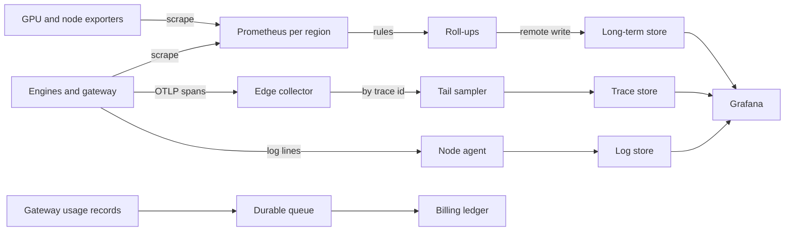

# 20.15 Design: an observability pipeline for very high volume

## What the interviewer is testing

Picture the interviewer sliding a sheet of paper across the table with one line on it. The line says: "You run telemetry for an inference platform with hundreds of GPU replicas and thousands of tenants. Design the pipeline." This chapter serves the system design round. It also feeds the project deep dive, because every operator has a story about a metric that grew out of control, and the interviewer may ask for yours.

The job posting asks you to "design and refine telemetry pipelines (metrics, logs, traces) that turn very large volumes of data into actionable insight". Telemetry is the general word for the measurements a system sends out about itself, and the three usual kinds are metrics, logs and traces. Nebius says its system design round asks for a whole or partial distributed system, load and availability targets, performance estimates and storage trade-offs. The posting also asks for Prometheus, Grafana and alert design for high-throughput APIs. Nebius has not published how its own pipeline works. Everything here about design choices is my reasoning, labelled as such.

A realistic question: "A tenant's dashboard shows tokens per second, but the invoice says something different. Prometheus is also at 90 percent memory. Where do you start, and how do you stop it happening again?"

The skill being tested is judgment about volume: which data to throw away, which must never be lost, and how to tell when the pipeline is lying. A pipeline that lies quietly is worse than one that is visibly full, because people trust the graphs and make decisions from them.

## The core ideas

### 1. Start from the questions, then count the cost

An alert fires and a new engineer opens Grafana. The pipeline has succeeded if that engineer gets from "TTFT is high" to "model X on pool Y is queueing" in two minutes. It has failed if the answer sits in data that was sampled away, or the query times out because the store is overloaded.

So start with the questions the pipeline must answer, and rank them. First, is the user-facing SLO burning, and for which model? Second, what is the cause class: queue, cache, GPU, network or deploy? Third, which tenant is affected or responsible? Fourth, what did one slow request do? Fifth, what do we bill? Each question points to a different signal and a different accuracy level. An accuracy level here means how exact the answer must be, because a rough answer is fine for a graph and wrong for an invoice.

The three signals have different costs. A metric costs by series count, a log by bytes and a trace by spans retained. A series is one stored line of values for one unique label set, and a span is one timed step inside a trace. Systems Performance, Chapter 4, makes the same split. Counters are always on and nearly free. Profiling and tracing cost CPU and storage, so you sample them. That is the shape of the whole design. Sampling means keeping only some of the data, chosen by a rule.

**Use metrics for always-on questions, traces for per-request questions, logs for the details that neither can hold, and count each by its own cost.**

### 2. What to collect for an inference platform

Picture one slow customer request. It passed the gateway, a router, an engine, a GPU, a node and Kubernetes, and each of those layers can tell you something. One request meets the gateway, a router, an engine, a GPU, a node and Kubernetes. Each layer has a few signals that matter. Chapters 20.18 and 20.19 cover the engine signals and SLIs, so this table ties them to the pipeline.

| Layer | Signals worth keeping | Source | Labels you can afford |
|---|---|---|---|
| Gateway | Request counter by code, latency histogram, token counters, rejects by reason | Gateway code | model, code, route, reason |
| Engine | Waiting and running requests, KV cache usage, preemptions, TTFT and inter-token histograms, finish reasons | vLLM `/metrics` | model_name, engine, finished_reason |
| GPU | Memory used, temperature, power, ECC and Xid errors | DCGM exporter, see chapter 17.4 | `gpu`, `hostname` |
| Node | CPU, memory, disk, network, pressure | Node exporter | instance |
| Kubernetes | Pod phase, restarts, requests and limits, events | kube-state-metrics, see chapter 17.2 | namespace, pod |
| Tenant | Tokens in and out, requests, rejects, p99 for large tenants | Gateway | tenant, model, direction |

The vLLM metric names in the engine row are the ones verified in chapter 20.18 against the v0.32.0 source. GPU utilisation is on the list for completeness, but chapter 20.19 explains why it does not page anyone. Keep it for context, and do not let it drive an alert on its own.

Measure SLIs at the gateway, which is closest to the customer. Explain them at the engine, which splits time into queue, prefill and decode. The gateway sees what the customer sees, so the number it reports is the one that matters for the promise. A useful test for any signal on the table is to ask which question it answers and which customer complaint it would explain. If you cannot name either, the signal is probably not worth its cost in the pipeline. The engine can tell you why that number moved, because it knows whether the time went into waiting, reading the prompt or writing the answer.

**Collect few signals per layer, measure SLIs at the edge, and keep the engine and GPU signals for explanation.**

### 3. Cardinality is a budget, and labels are how you spend it

A developer adds a request id label to a gateway counter. By morning Prometheus has run out of memory. The traffic was normal. The metric grew a new series for every request. Cardinality is the count of distinct series, and this is the failure that the word exists to describe.

Prometheus stores one series for every unique combination of label values. The Prometheus naming page says so directly: every unique combination of key-value pairs "represents a new time series, which can dramatically increase the amount of data stored". It adds: "Do not use labels to store dimensions with high cardinality (many different label values), such as user IDs, email addresses, or other unbounded sets of values." The instrumentation page gives a rule of thumb. Keep a metric's cardinality below 10 where you can, and investigate alternatives if it reaches 100 or could grow that large. A platform with thousands of tenants will break those guidelines on purpose, which is why you need a budget.

The budget is a multiplication. Take the labels of a metric, multiply the number of values each can have, then multiply by the number of scrape targets and by the series each combination produces. A scrape target is one endpoint Prometheus pulls from, such as one pod. A histogram makes this worse. One label combination of a histogram produces one series per bucket, one for the infinity bucket, and the sum and count series. Multiplication is why small choices grow large. One extra label with a few hundred values can multiply the total by a few hundred.

```text
series = product(label value counts) * share that actually occurs * targets * series per combination
series per combination: counter 1, gauge 1, histogram buckets + 1 + 2, summary quantiles + 2
```

The result is an upper bound, because not every combination occurs. The estimator takes the share you assume as a `fill` field. Fill is the fraction of possible combinations that really appear in production, and it is almost always below one. Write your assumed fill next to the result so the reviewer can challenge it.

The labels you must never use are the ones that name one request or one person. The table is the policy that the linter enforces.

| Label | Why it breaks | Where the data belongs |
|---|---|---|
| request id, trace id, span id | One new series per request | A trace, or an exemplar |
| user id, email, session id, api key | Unbounded and personal data | A log with access control |
| prompt hash, prompt text | Unbounded, and the prompt may be private | Nowhere by default |
| client ip, url with ids | Unbounded | A log |
| timestamp | Unbounded by definition | The sample timestamp |
| tenant, on every metric | Bounded but multiplies everything | Only on a few aggregated metrics |

Loki has the same rule for logs. Its label page says to use stable, bounded labels that describe the log source, such as namespace or region, and not labels for things like user id. It says Loki indexes labels and not log content, and "performs very poorly when your labels have high cardinality". Its default limit is 15 index labels. High-cardinality fields that you search often belong in structured metadata instead. Structured metadata is extra key and value data attached to a log line that is not part of the index, so it is searchable without inflating the index.

**Write the budget down as series per metric family and per Prometheus shard, and reject any change that breaks it before it ships.**

### 4. Enforce the budget in three places

Picture a rule that says no new labels without review, written in a wiki page that nobody reads. Weeks later a new label arrives in a pull request, and nobody checked it against the wiki. A rule that lives only in a wiki does not hold. You need a check at review time, a limit at scrape time and an alarm at run time.

At review time, a linter reads the declared metric design in a pull request and fails on forbidden labels, unbounded labels and budget overruns. The Python tool in this chapter does that. It runs on a laptop in seconds, so an engineer gets the answer before the pull request is even reviewed. It is cheap to run and catches the mistake before anything is deployed, which is the cheapest place to catch it.

At scrape time, Prometheus has per-job limits. The configuration reference lists `sample_limit`, `label_limit`, `label_name_length_limit` and `label_value_length_limit`, all defaulting to 0, meaning no limit. There is a catch worth saying aloud. When a scrape exceeds one of these limits, the whole scrape fails. You protect the server, but you lose every metric from that target until someone fixes it. So you also need an alert on scrape health. Picture the on-call engineer who finds a healthy engine with no data at all, because one label grew past the limit and the whole target went dark.

At run time, the Prometheus TSDB status endpoint reports series count by metric name and distinct values by label name. TSDB is the time series database inside Prometheus that stores the samples. Chapter 17.1 explains the same budget for a generic cluster.

The automatic series `scrape_series_added` is the approximate number of new series in a scrape. A sudden rise is the signature of a new unbounded label, and the alert file in this chapter watches for it. A sudden jump in this series is often the first sign of a bad deploy, so it is also a useful clue during an incident.

**Lint at review, limit at scrape, and alert on series churn, and know that a scrape limit trades cardinality for a blind spot.**

### 5. Pull for metrics, push for traces and logs, and know the exceptions

A GPU replica dies at night. With pull, Prometheus notices at the next scrape because the automatic `up` series goes to 0. With push, silence just looks like no traffic. That is the strongest argument for pull. A quiet push system and a dead one look the same from the dashboard, and only pull makes the difference visible. In Production Kubernetes, Chapter 9, applications expose an endpoint and know nothing about the metrics system.

Push has two legitimate uses. Short-lived batch jobs may finish before a scrape, so the book recommends the Pushgateway for them. The Pushgateway is a small holding point where a finished job can leave its last numbers for Prometheus to read later. Traces and logs have no scrape model at all. Spans and log lines are events, and they must be sent. OpenTelemetry uses a push protocol for them, and a node agent such as Fluent Bit forwards logs. The book recommends one node agent per node over application forwarding or sidecars, because filtering and metadata are centralised. A sidecar is a second container that runs beside the application in the same pod.

Remote write is also push, between Prometheus and a store. Each destination has a queue read from the write-ahead log and sent by shards. The write-ahead log is the file where Prometheus records samples before it does anything else with them, so a crash does not lose what has already been written. A shard is one of several parallel senders that drain the queue. Remote write is the one push path in this design that can quietly fall behind, which is why a later section tells you to watch it.

**Pull your metrics so silence is visible, push your events, and say that remote write is the one push path you must monitor.**

### 6. One Prometheus does not scale forever, so split it on purpose

Picture a Prometheus server that has grown until its memory is nearly full and its queries time out during an incident. One Prometheus server holds all its active series in memory and answers all its queries. When one server is not enough, you have three moves. Production Kubernetes calls them organization and federation. Organization here means deciding how to split the work across servers in a sensible way.

The first move is functional sharding. One server scrapes the platform, another tenant workloads and a third the GPU and node exporters. The cost, as the book notes, is fragmented data. A question that spans two shards now needs two queries and a join in your head. The second move is federation. A global Prometheus scrapes the `/federate` endpoint of the others, and the Prometheus federation page says the standard pattern is hierarchical. Per-cluster servers keep the detail and the global server keeps aggregates such as job-level series. The `/federate` endpoint requires at least one `match[]` selector, and the receiving side sets `honor_labels: true`. A selector is a filter that picks which series to return, and that honor labels setting tells the receiver to keep the labels the source attached.

The third move is a long-term store behind remote write, or a layer like Thanos on top. I cover that next.

My design choice, labelled as reasoning: one Prometheus per cluster or region for engine and gateway metrics, sized to the series budget, with recording rules that produce a small set of aggregates. Federate or remote-write only those aggregates and the SLI series upward. Never federate raw per-pod series. The reason is simple. A raw per-pod series is the largest and most volatile thing you store, and sending it upward multiplies the cost in every place it lands. Regions add one more reason. A cluster in one region can fail on its own, and a per-region Prometheus keeps the blast radius small, so an outage in one place does not blind the whole platform.

**Shard by function or region first, aggregate with recording rules, and send only the aggregates upward.**

### 7. Long-term storage: choose by what breaks first

Picture a manager asking for a year of latency history for a model launch review. The local Prometheus has only the last 15 days, so the question is how to keep the rest. Prometheus local storage keeps 15 days by default. The storage page says it stores 1 to 2 bytes per sample on average, and gives the formula you use for disk: retention seconds times samples per second times bytes per sample. It groups samples into two-hour blocks and compacts them. Compaction merges small blocks into larger ones so reads stay fast. The WAL is kept in 128 MB segments.

For longer retention you have two families of designs. In the first, Thanos runs a sidecar beside each Prometheus. The sidecar uploads blocks to object storage. A querier fans out over live sidecars and a store gateway for old blocks, and a compactor consolidates blocks, downsamples and applies retention. Downsampling keeps fewer points for old data, so a year of history is cheap to store and still fast to draw. Object storage is cheap, so the cost moves into query fan-out. Fan-out means one query has to ask many components and combine their answers, and each extra component adds waiting.

In the second, Prometheus pushes samples by remote write to a store that ingests them, such as Cortex, Mimir or VictoriaMetrics. Production Kubernetes names Thanos and Cortex. VictoriaMetrics documents a 31-day default retention and claims up to 7 times less RAM than Prometheus, Thanos or Cortex at high cardinality. That is a vendor claim, so test it with your own data before you rely on it. The Mimir distributor page, fetched 2026-11-09, says its per-tenant rate limiters drop a request and return HTTP 429 when exceeded. HTTP 429 means "too many requests, try later", so the sender must back off and retry.

| Option | What it buys you | What can break | Note |
|---|---|---|---|
| Local only, 15 days | Simple, no extra parts | No history, one server limit | Fine for a lab |
| Thanos sidecar | Object storage, downsampling, global query | Query fan-out latency, many components | Sidecar uploads finished blocks |
| Remote write to a store | Central ingest, multi-tenant limits | Backlog if the store is slow | Data loss after a long outage |
| Aggregates only upward | Small and cheap | You cannot drill into raw series | Pairs well with recording rules |

The failure to know is in the remote write page. If the remote endpoint is down, failed sends retry without loss as long as the outage lasts no more than 2 hours. After that, the WAL is compacted and unsent data is lost. Remote write also raises Prometheus memory by about 25 percent on average. If one shard's queue fills, Prometheus stops reading the WAL for all shards, so a slow store stalls the whole stream. Think of one slow lane blocking every other lane on the same road. For the design, that means remote write needs its own alert, its own dashboard panel and a runbook line, because it is the one place where a slow store can quietly stop every other part of the send path.

**Pick long-term storage by what you can afford to lose and what you need to query, and alert on the remote write backlog before the two-hour line.**

### 8. Recording rules turn many series into few

Picture a dashboard that refreshes every few seconds and asks for the 99th percentile TTFT per model across 400 engine pods. Every refresh, Prometheus must read 400 times 25 histogram series. A recording rule computes the aggregate once per interval and stores a small series, so the dashboard reads the small one instead.

The Prometheus rules page gives the naming convention: `level:metric:operations`. The level is the aggregation level and the labels that remain. The operations list what you applied. For counters used with `rate`, drop `_total`. For ratios, join the names with `_per_` and use `ratio` as the operation. Always write a `without` clause that lists the labels you aggregate away, so other labels such as `job` survive. A without clause names what to remove, and everything else stays, which is safer than naming what to keep and missing one label by accident. When you read a rule name later, the three parts tell you the story. The level says which labels survive, the metric says what was measured, and the operation says what was done to it. So a name like model_name:vllm_kv_cache_usage_perc:max reads as the maximum KV cache usage, kept per model name.

Aggregate the numerator and denominator separately and then divide. Never average a ratio. Averaging per-pod ratios gives each pod equal weight, even when one pod served most of the traffic, so the result can be far from the true ratio. For histograms, keep the `le` label so `histogram_quantile` still works on the rolled-up series. The le label is the bucket boundary, and histogram quantiles need it to estimate a percentile. That is why the rollup in the file below sums the bucket rates without instance, pod and engine and nothing else.

Recording rules also control cost, because you can keep only the rolled-up series in long-term storage. This chapter's rule file is tested with `promtool` and reproduced in full. Promtool is the command line tool that ships with Prometheus, and it can check and test rule files before they are deployed.

```yaml
# code/part20/c15_obs_recording_rules.yaml
# Roll-ups for an inference platform. Names follow level:metric:operations.
# Each rule drops the per-pod labels so dashboards, alerts and any remote
# write or federation read a few series instead of thousands.
# Label names model_name and engine come from vLLM v0.32.0 (see chapter 20.19).
groups:
  - name: c15_engine_rollups
    interval: 30s
    rules:
      - record: model_name:vllm_num_requests_waiting:sum
        expr: sum without (instance, pod, engine) (vllm:num_requests_waiting)
      - record: model_name:vllm_kv_cache_usage_perc:max
        expr: max without (instance, pod, engine) (vllm:kv_cache_usage_perc)
      # Keep le so histogram_quantile still works on the rolled-up series.
      - record: model_name:vllm_time_to_first_token_seconds_bucket:rate5m
        expr: |
          sum without (instance, pod, engine)
            (rate(vllm:time_to_first_token_seconds_bucket[5m]))

  - name: c15_gateway_and_tenant_rollups
    interval: 30s
    rules:
      - record: model_code:gateway_requests:rate5m
        expr: sum without (instance, pod, route) (rate(gateway_requests_total[5m]))
      # Numerator and denominator are aggregated first, then divided.
      # The "or 0 *" term keeps the ratio at zero when no 5xx series exists yet.
      - record: model:gateway_requests_5xx_per_requests:ratio_rate5m
        expr: |
          (sum without (instance, pod, route, code)
             (rate(gateway_requests_total{code=~"5.."}[5m]))
            or 0 * sum without (instance, pod, route, code)
                     (rate(gateway_requests_total[5m])))
          / sum without (instance, pod, route, code)
              (rate(gateway_requests_total[5m]))
      # Operational view of tenant usage. Billing does not read this series.
      - record: tenant_model:tenant_tokens:rate5m
        expr: sum without (instance, pod) (rate(tenant_tokens_total[5m]))
      - record: tenant:tenant_tokens:increase1h
        expr: |
          sum without (instance, pod, model, direction)
            (increase(tenant_tokens_total[1h]))

  - name: c15_pipeline_self_rollups
    interval: 30s
    rules:
      - record: job:scrape_samples_post_metric_relabeling:sum
        expr: sum without (instance) (scrape_samples_post_metric_relabeling)
      # Series churn: new series created by each scrape, summed over 5 minutes.
      - record: job:scrape_series_added:sum_over_time5m
        expr: sum without (instance) (sum_over_time(scrape_series_added[5m]))
      - record: job:up:avg
        expr: avg without (instance) (up)
```

**Record the aggregates that dashboards and alerts read, name them by level, metric and operation, and keep `le` on histograms.**

### 9. Logs: volume is the enemy, and metrics are the alert source

Picture an on-call engineer scrolling through logs in the middle of the night, finding a wall of identical lines and no clue in any of them. An engine logs one line per request at 500 bytes. At 2,000 requests per second that is 1 MB per second, or 86.4 GB per day before replication. Replication means keeping extra copies so a disk failure does not lose the data, and it multiplies the storage again. The arithmetic is mine, using assumed inputs. Few of those lines will ever be read.

Production Kubernetes gives a rule that saves money and pages: if you want an alert from a log message, first expose a metric instead. Log text changes, and a reworded message silently breaks the alert. So logs are for investigation, and metrics are for detection. Detection is the question "is something wrong," and investigation is the question "what exactly happened." Each job is done better by a different signal.

To cut volume, keep every error and warning, and sample the successful request lines. Sample by a hash of the trace id, so the same requests stay sampled across services. A hash is a fixed scramble of an id, so the same id always gets the same answer. Drop debug lines by default. Sampling successes is a cost decision, and it still needs an answer for a rare bug, so keep a switch that raises the sample rate for one service for an hour during an incident. Apply the filter at the node agent. The book's audit policy example shows the same idea at the source, with metadata only for secrets and nothing for noisy watches. A watch is a long-running query that the API server streams updates from, and it can produce a huge number of events.

Choose Loki-style storage when cost matters. Only labels are indexed and compressed chunks sit in object storage, which keeps it cheap to run. Keep labels to namespace, cluster and app. Put request id and trace id into the line or structured metadata. That way the request id is searchable when you need it, and it never becomes a label.

Prompts and completions can contain customer secrets. Scalable Kubernetes Infrastructure for AI Platforms, Chapter 4, describes prediction logging, where input, output and token counts are logged together. My design for a shared platform is to log token counts and finish reasons by default, and capture prompt text only for opted-in tenants with separate access control. Nebius has not published its policy. Think of the prompt as customer data first and operational data second. A log line that includes it needs the same care as the customer's own records.

**Log errors in full, sample the successes, keep identifiers out of labels, and alert from metrics rather than from log text.**

### 10. Traces: head sampling is cheap, tail sampling keeps what matters

An engineer asks to see one slow request. With random 1 percent sampling, 99 percent of slow requests have no trace. If you keep all traces, the span bill is enormous. Sampling decides which traces survive, and the choice of when to decide is the important part.

The OpenTelemetry sampling page defines both approaches. Head sampling decides as early as possible, without looking at the whole trace. A common form hashes the trace id and keeps a set percentage. It is simple and efficient. It cannot guarantee that traces with errors are kept. Tail sampling decides after it sees all or most of the spans, so it can keep errors, slow traces and chosen attributes. The page says larger systems almost always need it. It also says high-volume services may combine both, with head sampling first to cut load.

Tail sampling needs buffering. A decision about a trace requires every span of that trace. Spans arrive from different services at different times. The collector must therefore hold spans in memory until it decides. A collector is the middle service that receives telemetry, processes it and forwards it. The tail sampling processor has a `decision_wait` that defaults to 30 seconds and a `num_traces` that defaults to 50,000, which is how many traces it keeps in memory at once. The README says increasing `num_traces` or decreasing `decision_wait` can reduce dropped traces, but both raise memory use. That is a trade you should say out loud, because it is the whole cost of tail sampling in one sentence.

Buffering creates a routing problem. All spans of one trace must reach the same collector instance. Otherwise each instance sees a fragment and decides badly. A fragment might look like an error-free trace with no slow span, when the slow span simply went to another instance. The README suggests two layers. A load balancing exporter routes by trace id to a pool of tail sampling collectors. An exporter is the part of the collector that sends data onward. The exporter's routing key defaults to trace id for traces. The tier-two pool is stateful and must be monitored and resized, because losing one of its members loses the traces it was holding. Resizing is not free either. When you add a sampler, the routing changes, so some traces move to a new instance partway through their decision window. Scale in quiet hours and watch the refusal and queue alerts while it settles.

| | Head sampling | Tail sampling |
|---|---|---|
| Decision point | At the start, no view of the whole trace | After spans arrive, whole trace visible |
| Can keep all errors | No | Yes |
| Memory | Almost none | Holds traces until the decision wait ends |
| Routing | Any collector | All spans of a trace to one collector |
| Operation | Simple | Stateful, needs sizing and monitoring |

Here is the sizing arithmetic. Say 5,000 new traces start per second, and you wait 30 seconds. The sampler holds up to 150,000 traces at once, so a `num_traces` of 200,000 gives headroom. If a trace has 20 spans of 1 KB each, which are assumptions and not measurements, that is 3 GB of buffered span data, before overhead. The tier-two collectors need memory for that. This is what the interviewer wants: a number you worked out and the inputs you assumed. Say the inputs out loud, so the interviewer can change them and watch the answer move.

For an inference platform, my policy set keeps all error traces, all traces slower than the TTFT SLO threshold, and a small share of healthy ones. The configuration below shows both tiers. I did not run it against a collector binary, because none was available here, so the field names come from the READMEs and need checking against your collector version.

```yaml
# code/part20/c15_otelcol_config.yaml
# Two collector tiers in one file for reading. Field names come from the
# OpenTelemetry Collector contrib READMEs for load balancing exporter,
# tail sampling processor, memory limiter and batch processor.
# Validated with otel/opentelemetry-collector-contrib:0.164.0 (validate, each tier alone), 2026-11-09.

# Tier 1: edge agents. Receive OTLP, protect memory, batch, then route by trace ID.
---
receivers:
  otlp:
    protocols:
      grpc:
        endpoint: 0.0.0.0:4317
processors:
  memory_limiter:            # first in every pipeline so backpressure reaches senders
    check_interval: 1s
    limit_mib: 1500
    spike_limit_mib: 300
  batch:
    send_batch_size: 8192
    timeout: 200ms
exporters:
  load_balancing:
    routing_key: traceID     # every span of a trace goes to the same tier-2 pod
    protocol:
      otlp:
        timeout: 5s
    resolver:
      dns:
        hostname: otelcol-sampler-headless.observability.svc.cluster.local
service:
  pipelines:
    traces:
      receivers: [otlp]
      processors: [memory_limiter, batch]
      exporters: [load_balancing]

# Tier 2: samplers. Hold whole traces in memory until a decision is made.
---
receivers:
  otlp:
    protocols:
      grpc:
        endpoint: 0.0.0.0:4317
processors:
  memory_limiter:
    check_interval: 1s
    limit_mib: 6000
    spike_limit_mib: 1200
  tail_sampling:
    decision_wait: 30s
    num_traces: 200000
    expected_new_traces_per_sec: 5000
    policies:
      - name: keep-errors
        type: status_code
        status_code: {status_codes: [ERROR]}
      - name: keep-slow
        type: latency
        latency: {threshold_ms: 5000}
      - name: keep-some-healthy
        type: probabilistic
        probabilistic: {sampling_percentage: 1}
  batch:
    send_batch_size: 8192
    timeout: 200ms
exporters:
  otlp:
    endpoint: tempo-distributor.observability.svc.cluster.local:4317
    sending_queue:
      enabled: true
service:
  pipelines:
    traces:
      receivers: [otlp]
      processors: [memory_limiter, tail_sampling, batch]
      exporters: [otlp]
```

**Keep every error and slow trace with tail sampling, route by trace id to a stateful tier, and size memory from decision wait times trace rate.**

### 11. Exemplars link a metric spike to one trace

Picture a latency panel with a spike in the top bucket, and an engineer who wants one real request from that spike to read end to end. A latency histogram shows the spike, but it cannot name a request. An exemplar is a reference attached to a metric sample that points outside the metric set, and the OpenMetrics specification says a common use is the id of a trace. Counter totals and histogram buckets may carry exemplars. The labels on one exemplar must stay within 128 UTF-8 code points in total. A code point is one character in the Unicode scheme, so the limit is about the length of the text the exemplar can carry.

Prometheus stores exemplars only if started with `--enable-feature=exemplar-storage`. They live in a fixed-size circular buffer in memory, which means the oldest exemplars are overwritten as new ones arrive. An exemplar with just a trace id costs roughly 100 bytes. They arrive only through the OpenMetrics format, so your client library must emit them. A client library is the code inside your application that records the metric values and exposes them to Prometheus.

The trap is the interaction with sampling. The exemplar points at a trace id. If a tail sampler later drops that trace, the link leads nowhere. This is my reasoning, not a quoted fact. The fix is to make the sampler's slow-trace threshold match the SLO threshold, so traces in the high buckets are the ones kept. Another fix is to attach exemplars only when the trace was kept. Both fixes keep the click from the graph to the trace working, which is the whole reason the exemplar exists.

**Put the trace id in an exemplar, never in a label, and keep the traces that the exemplars point to.**

### 12. Metering for billing is a different system from operational metrics

A tenant asks why their dashboard says 10 million tokens and the invoice says 10.2 million. Both can be honest, because they have different accuracy. The dashboard is built to show trends, and the invoice is built to be exact. Confusing the two is how a billing dispute starts.

Operational metrics are sampled. Prometheus reads a counter every 30 seconds. If a pod dies, the increments since its last scrape vanish. Functions such as `increase` also extrapolate over the window, which means they estimate the missing part of a window from the part they can see. Both are fine for a graph and wrong for an invoice. Recording rules drop labels. Series limits can fail scrapes. Chapter 20.13 puts metering inside the gateway, where the response carries the token counts in a usage object.

So build metering as its own path. The gateway writes one usage record per finished request, with the request id, tenant, model, input tokens, output tokens and a timestamp. Records go through a durable queue into a ledger, with the request id as an idempotency key so retries do not double count. A ledger is an append-only record of charges, where each entry is written once and never changed. Billing reads the ledger. The ledger is the one place where exactness is worth a slower write path, so it is the one store that should never be sampled. The request id is allowed here because a ledger row is not a metric series. Reconcile the ledger against the operational counters daily and treat a small gap as normal and a large gap as a bug.

| | Operational metric | Billing ledger |
|---|---|---|
| Purpose | Detect, explain, scale | Charge money |
| Accuracy | Approximate, sampled every interval | Exactly once per request |
| Loss tolerated | A little | None |
| Tenant label | On a few aggregates | A column, no limit |
| Storage | Prometheus or a metrics store | A database with durability |
| Reconcile | Compare to the ledger | Source of truth |

My design, labelled as such: show customers a dashboard fed by the operational path, say plainly that it is approximate, and let the invoice come from the ledger. Production Kubernetes, Chapter 9, computes internal showback and chargeback from metrics with a standard team label. Showback means showing teams what they used, and chargeback means billing them for it. That suits internal cost allocation, and it is not a billing system for external customers.

**Charge from an exactly-once ledger and explain with approximate metrics, and tell customers which is which.**

### 13. The pipeline loses data too, so decide where and in what order

Picture a traffic spike at noon, when the collector's memory climbs toward its limit and begins refusing spans. Under load, something in the pipeline will drop data. The design question is whether you chose what to drop. Four places can drop it. A scrape can fail because of a limit. The remote write queue can fall behind and lose data after two hours. A collector can refuse spans when memory is high. A log agent can overflow its buffer.

The memory limiter processor is the control point for the collector. It checks memory at an interval, with a recommended 1 second. When memory crosses the soft limit, which is the limit minus a spike allowance of 20 percent by default, it refuses data by returning errors upstream. Those errors are retryable, so senders can retry or slow down. When it crosses the hard limit it also forces garbage collection. Garbage collection is the runtime's cleanup of memory that is no longer used. The README says to place it first in the pipeline so backpressure reaches the receivers. The batch processor then groups data. Its `send_batch_size` defaults to 8192 and its `timeout` to 200 ms. Batching trades a short wait for fewer, larger sends, which is cheaper for both sides.

Production Kubernetes warns about two related traps. One noisy workload can bog down a node agent and hurt log collection for every workload on that node. A cluster-wide aggregator with an ephemeral buffer loses logs if it is killed before flushing, so run it as a StatefulSet. A StatefulSet keeps stable identities and storage for its pods, so a restarted aggregator can pick up where it left off.

Choose the drop order in advance. The order also helps during a review, because each drop has a stated reason and a stated owner. My policy, as reasoning: drop debug logs first, then healthy traces, then low-value per-pod metrics, and never drop the SLI series or the ledger. The order matters because an incident is the wrong time to decide what is expendable. Make each drop visible. The collector exposes `otelcol_receiver_refused_spans` and `otelcol_exporter_enqueue_failed_spans` for exactly that.

| Where data is lost | Why | Signal that shows it |
|---|---|---|
| Scrape | A sample or label limit fails the whole scrape | `up`, `scrape_samples_scraped` |
| Remote write | Store slow for more than 2 hours | `prometheus_remote_storage_samples_pending` |
| Collector receive | Memory limiter refuses data | `otelcol_receiver_refused_spans` |
| Collector export | Sending queue full | `otelcol_exporter_enqueue_failed_spans` |
| Log agent | Buffer overflow, noisy neighbour | Agent drop counters, check your agent |
| Log store | Rate limit or stream limit hit | `loki_discarded_samples_total` by `reason`, HTTP 429 for `rate_limited` |

**Put the memory limiter first, choose the drop order in advance, and alert on every place data can disappear.**

### 14. Monitor the monitoring

Picture the worst moment for a monitoring system: your own Prometheus falls over during an incident, and nobody pages, because the thing that pages is the thing that fell over. Production Kubernetes calls the answer a dead man's switch. It is an alert that always fires, and an external service pages you when it stops arriving. Silence is the signal, and it is only trustworthy if the path that carries it is independent.

Go beyond that. Alert on the pipeline's own queues and refusals. Keep a small second Prometheus that scrapes only the first and the collectors, ideally in another failure domain. A failure domain is a group of machines that can fail together, such as one data center or one power supply. Run a synthetic probe request through the real path on a schedule, and check that its metric, log line and trace all appear within a set time. A probe tests the whole chain, which no self-metric can, because a self-metric only proves that one part is alive. That idea is my design.

The alert file below is tested with `promtool`. The Collector metric names come from its internal telemetry page. The thresholds are starting points, since the pages give none. A starting point is a value you expect to tune after a few weeks of real data, not a rule to defend in an interview.

```yaml
# code/part20/c15_obs_pipeline_alerts.yaml
# Alerts on the monitoring pipeline itself. Metric names come from the
# OpenTelemetry Collector internal telemetry page and the Prometheus
# remote write page. Thresholds are starting points, not measured values.
groups:
  - name: c15_pipeline_health
    rules:
      # Dead man's switch: always firing. If it stops arriving, the alerting path is broken.
      - alert: Watchdog
        expr: vector(1)
        labels:
          severity: none
        annotations:
          summary: Always firing. Page when this alert stops reaching the receiver.
      - alert: OtelReceiverRefusingData
        expr: sum by (job) (rate(otelcol_receiver_refused_spans[5m])) > 0
        for: 5m
        labels:
          severity: page
        annotations:
          summary: Collector is refusing spans. Senders may be dropping data.
      - alert: OtelExporterQueueNearlyFull
        expr: |
          max by (job, exporter)
            (otelcol_exporter_queue_size / otelcol_exporter_queue_capacity) > 0.8
        for: 5m
        labels:
          severity: page
        annotations:
          summary: Exporter queue above 80 percent. Next step is dropped data.
      - alert: OtelExporterEnqueueFailing
        expr: sum by (job) (rate(otelcol_exporter_enqueue_failed_spans[5m])) > 0
        for: 2m
        labels:
          severity: page
        annotations:
          summary: Spans are being dropped because the sending queue is full.
      - alert: RemoteWriteFallingBehind
        expr: deriv(prometheus_remote_storage_samples_pending[15m]) > 0
        for: 15m
        labels:
          severity: page
        annotations:
          summary: Remote write backlog keeps growing. Data older than 2 hours is lost after WAL compaction.
      - alert: SeriesChurnHigh
        expr: job:scrape_series_added:sum_over_time5m > 20000
        for: 10m
        labels:
          severity: ticket
        annotations:
          summary: A job is creating many new series. Look for a new unbounded label.
      - alert: ScrapeTargetDown
        expr: job:up:avg < 0.9
        for: 10m
        labels:
          severity: ticket
        annotations:
          summary: More than 10 percent of a job's targets are not being scraped.
```

**Alert on the pipeline itself, keep a watchdog alert, and run a synthetic probe through the whole path.**

### 15. Cost: know which knob moves which bill

Picture the monthly cloud bill arriving with a line item nobody can explain. The three signals have three different cost drivers, so the levers differ, and the first job is to find the driver behind the line. Knowing the driver tells you which knob to turn.

| Signal | Cost driver | Cheapest levers |
|---|---|---|
| Metrics | Active series times retention | Fewer labels, fewer buckets, recording rules, drop raw series upstream |
| Logs | Bytes ingested and retained | Sample successes, shorter retention, drop debug |
| Traces | Spans retained | Tail sampling policy, shorter retention |
| Query | Fan-out and high-cardinality selects | Rollups, query limits, downsampling |

Metrics are the cost you can compute. Using the storage page formula, the 49,200 series in this chapter's example at a 30-second interval need about 2.1 to 4.3 GB for 15 days at 1 to 2 bytes per sample. With a tenant label on every gateway metric the design has about 3 million series and needs about 130 to 261 GB. Those numbers come from the tool and assumed label counts, so they are a model and not a measurement. The useful part is the ratio. Adding one label to a large family can cost more than the rest of the platform combined, which is why the cardinality budget comes first.

Logs and traces are harder to predict, because their cost depends on traffic, which moves. A quiet week and a launch week can differ by a large factor. So for those two, set a budget in bytes and spans per day and alert when the trend passes it, rather than waiting for the invoice.

**Spend where questions get answered, and cut the series, bytes and spans nobody queries.**

## The pipeline at a glance

Picture the whole path on one page, from an engine's first metric to the moment a dashboard draws it. Read the diagram left to right, and notice that the billing ledger sits on its own branch.



## How to answer out loud

Picture a 40-minute slot with a clock on the wall and an interviewer who will interrupt you. Use this plan, and shrink it proportionally if the slot is shorter. Ask early how long you have.

| Minutes | What you say |
|---|---|
| 0 to 4 | Clarify: scale, tenants, what must never be lost, who reads the data, budget |
| 4 to 9 | The questions to answer and the signals per layer. Draw the diagram |
| 9 to 16 | Metrics: cardinality budget, forbidden labels, pull, sharding, rules |
| 16 to 21 | Long-term storage trade-offs and the remote write failure |
| 21 to 26 | Logs: volume arithmetic, sampling, label policy |
| 26 to 32 | Traces: head versus tail, buffering, routing, exemplars |
| 32 to 36 | Tenants: operational versus billing |
| 36 to 40 | Pipeline failure, monitoring the monitoring, cost, what you would build first |

### Question 1: "How do you control cardinality?"

The interviewer has just pointed at a label on a whiteboard and asked whether it is safe. Say the multiplication first, with a number. Name the banned labels and where that data goes. Give the three controls: linter, scrape limits, churn alert. Name the trade-off that scrape limits fail the whole scrape. Expect the follow-up "but I want per-tenant latency". Answer: per-tenant on aggregated rules, or for large tenants only, and the ledger for billing.

### Question 2: "Head or tail sampling?"

Picture a trace the interviewer wants and cannot find. Define both in a sentence each. Say that head is cheap and blind, and tail keeps errors and slow traces but needs buffering. Give the memory arithmetic with the inputs you assumed. Say that all spans must reach one collector, so you add a trace-id routing tier. Expect "what if a sampler pod dies?" Answer: you lose the traces it held, so run enough replicas, accept a bounded loss, and alert on it.

### Question 3: "Prometheus is out of memory. What now?"

Picture the page in the middle of the night and a Prometheus that has stopped answering. Ask the TSDB status endpoint which metric names and labels have the most series. Look at `scrape_series_added` for a recent jump and find the matching deploy. Mitigate by dropping the label with relabeling at the scrape, then fix the code. Prevent it with the linter. Do not say "add more memory" first, because more memory only delays the same failure.

### Question 4: "How would you keep metrics for a year?"

Picture the product owner asking for a year of data for a quarterly review. State the choice: sidecar and object storage, or remote write to a store, or aggregates only. Say what breaks with each. Name the two-hour remote write rule. Say you would keep the SLI roll-ups for a year and raw series for days.

### Question 5: "How do you know your monitoring works?"

Picture the interviewer asking how you would notice that your own alerts have gone silent. Give the dead man's switch, alerts on queues and refusals, a second Prometheus watching the first, and a synthetic probe. Say what you would build first, which is the watchdog and the refusal alerts.

## Worked scenarios

### Scenario 1: A tenant label breaks Prometheus

A product manager asks for per-tenant request and latency metrics, and an engineer adds a `tenant` label to both gateway families.

Start with the good design. The gateway counter has model 20, code 8 and route 5, which gives 800 combinations, times 12 gateway pods, giving 9,600 series. Now add tenant with 1,000 values and assume 10 percent of combinations occur. That is 800 times 1,000 times 0.1, which is 80,000 combinations, times 12 pods, giving 960,000. The histogram has 14 buckets plus three series, so 17 per combination. With model 20 and route 5, tenant 1,000 and fill 0.1, that is 10,000 combinations, times 17, times 12 pods, giving 2,040,000. Total about 3 million. The reader should notice that the histogram family, not the counter, does most of the damage, because each combination carries so many series.

The tool confirms it. I ran this variant and it printed `3,019,200  TOTAL (budget 2,000,000)` and three errors for the two family budgets and the total budget.

The fix has three parts. Aggregate the pod away from series that carry tenant. Compute per-tenant latency only for large tenants. Move billing counts to the ledger. Then the tenant dimension costs thousands of series and not millions.

### Scenario 2: The tail sampler drops half of the slow traces

After a traffic increase, engineers say the slow traces they expect are missing, and some traces have only a few spans. Picture the trace viewer showing fragments where complete journeys used to be. Check the collector metrics. If `otelcol_receiver_refused_spans` is non-zero, the memory limiter is shedding load. If the load balancing tier was scaled up, spans for one trace may now be split across samplers during the change, because the routing pool changed.

The reasoning: the sampler holds traces for `decision_wait`. At 5,000 traces per second and 30 seconds it needs room for 150,000. At 8,000 per second it needs 240,000, so the old `num_traces` of 200,000 now drops traces. The answer: raise `num_traces` and memory together, or reduce `decision_wait`, add sampler replicas, and apply a head sample in tier one to cut the rate. Add an alert on refusals, which the alert file does.

### Scenario 3: Remote write is down for three hours

The long-term store is down. Prometheus keeps running, and local queries work. After 3 hours the store returns. Dashboards that read the store show a hole. Picture the on-call engineer who sees the gap and asks whether the data is gone for good.

From the remote write page, retries lose nothing only for outages up to 2 hours, and after that the WAL is compacted and unsent data is lost. So you lost the first hour of the gap in the long-term store. Local Prometheus still has it, since local retention is 15 days by default, per the Prometheus v3.16.0 storage page. The recovery is to query it locally and, if you need it in the store, backfill from local blocks with a store-specific tool. The backfill tool differs per store, so read your store's procedure. The prevention is the `RemoteWriteFallingBehind` alert, which fires well before the two-hour line.

### Scenario 4: Dashboard and invoice disagree by 2 percent

A tenant sees 10,000,000 tokens on their dashboard and 10,200,000 on the invoice. Which is right? The invoice, if the ledger is built correctly. Picture the account manager who has to answer the customer on a call within the hour. Check the cheap explanations first. A gateway pod that was killed lost the increments since its last scrape. The dashboard rule uses `increase`, which extrapolates. Some scrapes failed, and `up` shows gaps.

Then check the ledger against the gateway's own counters. Duplicates mean the idempotency key is missing. Fewer rows than requests means the queue dropped records, which is a severity-one bug. Tell the customer the dashboard is an approximation and the invoice is the record. Keep the reconciliation report on file, because the next dispute will look much the same, and a stored report answers it in minutes instead of days. A normal variance is not something I measured, so take it from your own reconciliation history.

## Hands-on lab

Picture a laptop with Python and the Prometheus checking tool, and no cluster, and a short afternoon to work through the checks. I ran steps 1 to 5 on a macOS laptop with Python 3.12 and `promtool`. Steps 6 and 7 need a Collector binary and Docker, which were not available, so they are not run.

1. Go to the code directory and run the tests.

```bash
cd code/part20
python3 -m pytest -q test_c15_cardinality.py
```

Result, as run: `13 passed`.

2. Estimate the example inference design.

```bash
python3 c15_cardinality.py estimate c15_inference_metrics.json
```

Result, as run: a total of 49,200 series against a budget of 2,000,000, and a disk estimate of 2.1 GB to 4.3 GB for 15 days. The largest family is `gateway_request_duration_seconds` at 20,400 series.

3. Lint the deliberately bad design.

```bash
python3 c15_cardinality.py lint c15_bad_metrics.json
```

Result, as run: eight errors and two warnings, including `forbidden-label` for `request_id` and `prompt_hash` and `total-budget`. The exit code is 1. A non-zero exit code is what lets a build step fail, so the check can stop a change before it merges.

4. Scan real exposition text. Save two lines like these and scan them.

```bash
printf '# TYPE gateway_requests_total counter\ngateway_requests_total{model="m1",request_id="a1"} 1\ngateway_requests_total{model="m1",request_id="a2"} 1\n' > leaky.txt
python3 c15_cardinality.py scan leaky.txt
```

Result, as run: `ERROR gateway_requests_total: [forbidden-label] label 'request_id' present with 2 values`.

5. Check and test the rules.

```bash
promtool check rules c15_obs_recording_rules.yaml c15_obs_pipeline_alerts.yaml
promtool test rules c15_obs_rules_test.yaml
```

Result, as run: 10 recording rules and 7 alerting rules found, and the test file reports `SUCCESS`.

6. On a GPU host, run `scan` on the output of `curl` against a vLLM `/metrics` endpoint. Expected shape of the output: no errors if only model_name, engine and finished_reason labels exist. Not run.

7. Start a Collector with the tier-two config, send traces and watch `otelcol_receiver_refused_spans`. Expected shape of the output: zero refusals until the memory limit is reached. Not run.

## Drill questions

Picture a teammate asking these across a table during a review. Answer each one before you open it.

1. Why is a request id a bad label, and where should it go?

<details><summary>Answer</summary>
Every request creates a new label value, so every request creates a new series. Memory grows without bound. Put the id in a trace, an exemplar, or a log line.
</details>

2. How many series does a histogram produce for one label combination with 22 finite buckets?

<details><summary>Answer</summary>
Twenty-five. That is 22 finite buckets, one infinity bucket, a sum and a count.
</details>

3. What happens when a scrape exceeds `sample_limit`?

<details><summary>Answer</summary>
The whole scrape fails. You protect Prometheus but lose all metrics from that target, so you alert on scrape health.
</details>

4. Why does tail sampling need buffering and trace-id routing?

<details><summary>Answer</summary>
The decision needs every span of the trace, and spans arrive at different times. The collector holds them until the decision wait ends. All spans must reach the same instance, so a load balancing tier routes by trace id.
</details>

5. Sampler gets 5,000 traces per second, waits 30 seconds. How many traces does it hold?

<details><summary>Answer</summary>
About 150,000 at once. Set the trace limit above that. The memory then depends on your assumed spans per trace and bytes per span.
</details>

6. How long can the remote write endpoint be down before data is lost?

<details><summary>Answer</summary>
Up to 2 hours with no loss. After that the WAL is compacted and unsent data is lost, per the Prometheus remote write page.
</details>

7. Why should the memory limiter be the first processor?

<details><summary>Answer</summary>
When it refuses data it returns retryable errors upstream. Placed first, that backpressure reaches the receivers and senders before work is wasted, so data loss is less likely.
</details>

8. Why can a dashboard and an invoice disagree, and which is right?

<details><summary>Answer</summary>
The dashboard comes from sampled counters that lose increments when pods die and extrapolate over windows. The invoice comes from an exactly-once ledger. The invoice is the record.
</details>

9. What is an exemplar and what is its trap with tail sampling?

<details><summary>Answer</summary>
It is a reference attached to a metric sample, often a trace id. If the sampler drops that trace, the link is dead. Match the slow-trace threshold to the SLO so the traces in the high buckets are kept.
</details>

10. Name two ways to prove your monitoring is alive.

<details><summary>Answer</summary>
A dead man's switch alert that always fires and pages when it stops. A synthetic probe that must appear as a metric, a log and a trace within a set time. Alerts on collector queues and refusals also count.
</details>

## Common mistakes and weak answers

Picture the interviewer's notes at the end of the round. The same few weak answers show up in almost every pipeline design, and each one has a short fix you can say in one breath.

- Proposing a tenant label everywhere. Show the multiplication and offer aggregated rules and a ledger. The interviewer is listening for the arithmetic, not the label name.
- Alerting from log text. Expose a metric instead, as Production Kubernetes advises. A reworded log line should not be able to silence a page.
- Treating tail sampling as free. Say buffering, routing and memory. Each of the three has a cost you will pay in production.
- Forgetting that the pipeline can lose data. Name the four places and your drop order. A pipeline that cannot say where it drops data is hiding the answer.
- Using one number for billing and operations. Explain the accuracy difference. The dashboard and the invoice answer different questions.
- Quoting numbers you did not source. Say "assumed" and show the arithmetic. An assumed number with its working is a strong answer, and an unexplained number is a weak one.
- Saying "I would use Prometheus and Grafana" and stopping. Name the cardinality budget, the drop order and the alert that tells you the pipeline is broken.

## Connections to the rest of the handbook

Picture finishing this chapter with a question about one of its parts. The links below lead to the chapter that goes deeper on each.

- Chapters c17-01 to c17-03: [observability foundations](../part-17-operations/01-observability-foundations-metrics-logs-and-traces.md), [Prometheus and Grafana](../part-17-operations/02-prometheus-and-grafana.md), and [logging with Loki and tracing with OpenTelemetry](../part-17-operations/03-logging-with-loki-and-tracing-with-opentelemetry.md). This chapter adds the interview framing, the budgets and the tested tools.
- Chapter c20-19, [SLIs, SLOs and alerts for token APIs](19-slis-slos-and-alerts-for-token-apis.md), is where the SLI and burn-rate rules live. This chapter does not repeat them.
- Chapter c20-18, [How LLM serving fails](18-how-llm-serving-fails.md), explains the engine signals you collect.
- Chapter c20-13, [Design a multi-tenant LLM inference API](13-design-a-multi-tenant-llm-inference-api.md), is where metering enters the gateway. Chapter c20-12, [the estimation toolkit](12-estimation-toolkit-for-inference-capacity.md), supplies the habit of showing arithmetic.
- Chapters c20-03, c20-05, c20-06 and c20-26 cover the Linux triage, resource and network skills that a pipeline failure needs. Chapter [c20-26](26-the-stress-interview-production-incident-role-play.md) is where a blind monitoring system turns into an incident.

## Sources and review notes

All online pages were fetched on 2026-11-09.

Books, read in the study index:

- Production Kubernetes, Chapter 9, Observability: logging mechanics, node agent forwarding, audit policy, alerting on logs, Prometheus scraping, long-term storage, the Pushgateway, organization and federation, alerts and the dead man's switch, showback and chargeback, tracing components.
- Systems Performance, 2nd edition, Chapter 4, Observability Tools: counters, profiling and tracing and their overhead. Chapter 2 for latency and cumulative counters.
- Scalable Kubernetes Infrastructure for AI Platforms, Chapter 4, Model Deployment and Monitoring: LLM metrics and prediction logging.
- LLMs in Production, Chapter 3: general monitoring challenges for LLMs only. I found no pipeline design material there.

Upstream documentation:

- Prometheus, Instrumentation practices, Metric and label naming, Recording rules practices, Storage, Remote write tuning, Federation, Pushing metrics, Jobs and instances, HTTP API TSDB status, Feature flags, https://prometheus.io/docs/. The storage page references Prometheus 3.16.
- Prometheus configuration reference, scrape limits only. I read the first part of a long page.
- OpenMetrics specification, exemplars, https://prometheus.io/docs/specs/om/open_metrics_spec/.
- OpenTelemetry, Sampling concepts, Collector configuration and internal telemetry, https://opentelemetry.io/docs/.
- OpenTelemetry Collector README files for the memory limiter, batch processor, tail sampling processor and load balancing exporter, and the receiver and exporter helper metric docs, at release tag v0.164.0 (published 2026-10-26), raw.githubusercontent.com, fetched 2026-11-09. Internal telemetry page from opentelemetry.io main, same date, for the `without_type_suffix` default.
- Prometheus remote write practices page, prometheus/docs main, fetched 2026-11-09. Prometheus v3.16.0 `docs/configuration/configuration.md` and `storage/remote/queue_manager.go`, fetched 2026-11-09.
- Grafana Loki, request validation and rate limits page, grafana/loki main, fetched 2026-11-09. Grafana Mimir distributor page, grafana/mimir main, fetched 2026-11-09. VictoriaMetrics README, master, fetched 2026-11-09.
- NVIDIA dcgm-exporter at tag 4.9.0, `llms.txt` and `internal/pkg/rendermetrics/render_metrics.go`, fetched 2026-11-09.
- Grafana Loki, Labels and Overview, https://grafana.com/docs/loki/latest/.
- Thanos design page, https://thanos.io/tip/thanos/design.md/. VictoriaMetrics single-server documentation, https://docs.victoriametrics.com/.
- Plan for this volume, section 1, for the job posting and interview description.

### Verification log

Checked 11, confirmed 10, corrected 1, removed 0, still unverified 2 (log agent counters, backfill). Confirmed: both Collector tiers pass `validate` at 0.164.0 (a deliberately bad key in the tail sampling block failed, so the check is real), memory limiter and batch and tail sampling defaults, load balancing routing key default, collector metric names without `_total`, remote write 2 hour rule, `hashmod` relabel action exists in Prometheus 3.16.0, `sample_limit` exists, Loki `loki_discarded_samples_total` with 429 on `rate_limited`, Mimir distributor 429, VictoriaMetrics 1 month default retention and the 7x RAM claim (vendor). Corrected: the DCGM label names, now `gpu` and `hostname`, with `UUID`, `pci_bus_id`, `device` and `modelName` also present at 4.9.0, and the default port 9400.

Explicitly labelled inferences:

- Every Nebius design choice in this chapter is my reasoning. Nebius has not published its observability pipeline.
- The label budgets, `fill` shares, tenant counts, the 20 spans of 1 KB per trace, the 500-byte log line and the 2,000 requests per second are assumptions used only for arithmetic.
- The exemplar and tail sampling interaction, the ledger design, the drop order, the synthetic probe and the claim that increments are lost when a pod dies before a scrape are reasoning, not quotations.
- The alert thresholds and the series churn limit are starting points.

Not verified:

- The log agent drop counters. They depend on the agent, and I checked only Loki's server side.
- Store backfill procedures were not fetched.
- The VictoriaMetrics memory claim is the vendor's, confirmed as written in its README but not tested.
- The validate command checks configuration shape only. No traffic ran through either tier.
