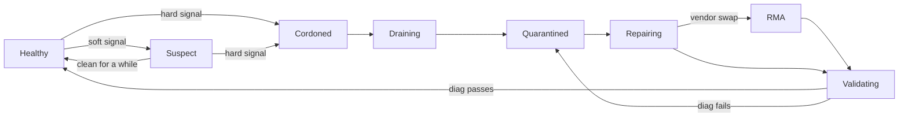
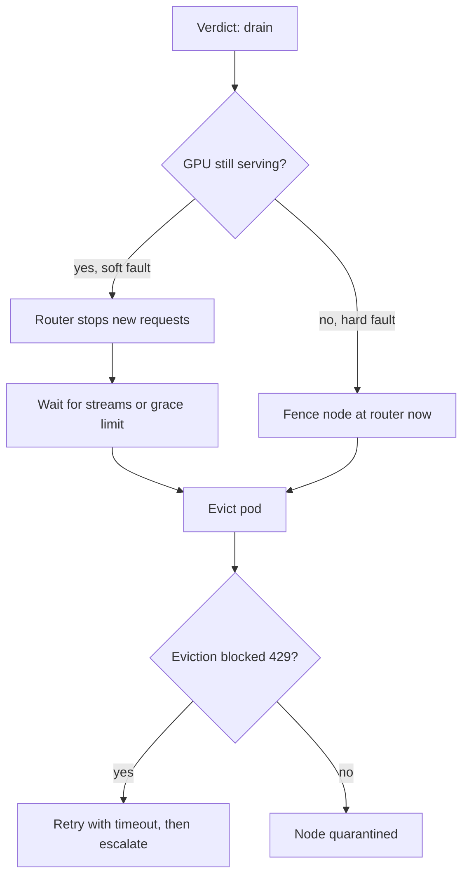

# 20.16 Design: GPU fleet health and capacity

## What the interviewer is testing

The interviewer says: "Design a system that detects a failing GPU before the customer does, using health checks, telemetry and automatic hardware replacement." This is the system design round. One public source reports this as a Nebius prompt, but it is a secondary source and I could not verify it as an actual question. The posting lists "incident detect/isolate/remediate with automation and runbooks" and "self-healing systems". It also asks for knowledge of "how distributed back-ends fail".

The design is not about one clever alert. It is about a loop: notice, decide, remove from service, repair, prove, return. Then you must show that the loop cannot hurt you. An automation that drains the fleet because one bad driver fired a false alarm is worse than no automation.

Nebius has not published its health system. Everything below about its design is my reasoning, labelled as such. What is public is the failure that motivates the question. The Nebius chat-app case study says restarted workers sometimes did not rejoin the pool and capacity shrank silently, and that the team used X+1 redundancy. Both ideas run through this chapter.

A realistic follow-up: "Your automation just cordoned four nodes in ten minutes. Should it cordon a fifth?" The strong answer is a number, a reason and a human.

## The core ideas

### 1. A failing GPU shows up in three places before the customer notices

Picture a replica serving a model on eight GPUs. One GPU starts to overheat and slows down. Every token step waits for the slowest GPU, so the whole replica gets slower. The customer sees a worse time to first token long before anything crashes. The failure is real, but no error appears anywhere.

You can catch that failure in three places. The hardware reports its own errors, which are Xid messages, ECC counters, PCIe replays and NVLink errors. The physical state shows stress, which means temperature, power and clock throttling. The workload shows the effect, which means tokens per second per GPU compared with its peers. A good design watches all three, because each one misses failures that the others catch.

The third place is the one most designs skip. A throttled GPU raises no Xid. Compare each replica to the fleet median for the same model and GPU type. A replica that is 30 percent slower for an hour is suspect even when every hardware counter is quiet. That comparison is my own suggestion and the 30 percent is a placeholder, not a vendor figure.

**Watch the hardware, the physical state and the workload, because each one hides failures from the others.**

### 2. The signals, with their real names

An alert fires and you must say what it means. NVIDIA's DCGM exporter publishes GPU counters as Prometheus metrics on port 9400. The version I checked is 4.9.0, released 2026-11-06. An important detail: in that release's default counter file, the ECC, throttle and NVLink error counters are present but commented out. You must enable them in your own counters file before they appear. Metric names have also changed between releases, so check `/metrics` on your version before you copy a name. The exporter listens on `:9400` by default. In the 4.9.0 source, GPU series carry the labels `gpu`, `UUID`, `pci_bus_id`, `device` and `modelName`, and host-level series carry `hostname`. The `UUID` label name is selectable in the source, so confirm it on your build. In Kubernetes, `pod`, `namespace` and `container` labels appear only when the exporter's pod mapping is enabled. The rules in this chapter select on `instance` and `gpu`.

The Xid number is the main signal. DCGM gives it as `DCGM_FI_DEV_XID_ERROR`, a gauge holding the value of the last Xid seen. That has a trap. The value stays at 79 until another Xid replaces it or the exporter restarts. An alert on "equals 79" therefore keeps firing after the node is repaired unless you also check recency. Counters such as `DCGM_EXP_XID_ERRORS_TOTAL` exist in the file but are commented out too.

| Signal | DCGM exporter 4.9.0 metric | Enabled by default | What it tells you |
|---|---|---|---|
| Last Xid | `DCGM_FI_DEV_XID_ERROR` | yes | Which fault, by catalog number |
| GPU temperature | `DCGM_FI_DEV_GPU_TEMP_CELSIUS` | yes | Cooling problem, or a sick sensor |
| Power draw | `DCGM_FI_DEV_BOARD_POWER_WATTS` | yes | Load and power cap behaviour |
| PCIe retries | `DCGM_FI_DEV_PCIE_REPLAY_TOTAL` | yes | A flaky link between host and GPU |
| Row remap failed | `DCGM_FI_DEV_ROW_REMAP_FAILED` | yes | Memory repair has run out of spare rows |
| Rows remapped | `DCGM_FI_DEV_ROW_REMAP_UNCORRECTABLE_TOTAL` | yes | Memory wearing out |
| Double-bit ECC | `DCGM_FI_DEV_ECC_DBE_VOL_TOTAL` | no, enable it | Uncorrectable memory error |
| Thermal throttle | `DCGM_FI_DEV_GPU_THERMAL_THROTTLE_SECONDS_TOTAL` | no, enable it | Time spent below application clocks from heat |
| Power throttle | `DCGM_FI_DEV_GPU_POWER_THROTTLE_SECONDS_TOTAL` | no, enable it | Same, from the power policy |
| NVLink CRC errors | `DCGM_FI_DEV_NVLINK_CRC_ERROR_TOTAL` | no, enable it | Link errors, Hopper counter |

The book AI Systems Performance Engineering, chapter 16, says DCGM tracks Xid counters and exposes throttling reasons through a field it names `DCGM_FI_DEV_CLOCK_THROTTLE_REASONS`. That older field name is not in the 4.9.0 default file, which is a reminder to verify names against your own exporter. The same chapter says the exporter does not expose per-link NVLink bandwidth on all platforms by default.

**Verify each metric name against `/metrics` on your exporter version before you write an alert on it.**

### 3. What each Xid means for the fleet

An engineer on call sees "Xid 79" in the kernel log. What now? NVIDIA's Xid catalog gives each code an immediate action. I fetched it on 2026-11-09. The page shows no version number.

| Xid | Catalog meaning | Immediate action in the catalog |
|---|---|---|
| 13 | Graphics engine exception, usually an application fault | Restart the application |
| 31 | GPU memory page fault, an illegal address access | Restart the application |
| 43 | Application hit a software fault, GPU stays healthy | Ignore |
| 45 | Preemptive cleanup after other errors | Depends on whether it is alone |
| 48 | Double-bit ECC error | Reset the GPU |
| 63 | Row or page remapping event | Ignore |
| 64 | Row or page remapping failure | Reset the GPU |
| 74 | NVLink error to another GPU or NVSwitch | Decode the registers, then contact support |
| 79 | GPU inaccessible over PCIe, "fallen off the bus" | Restart the bare metal node |
| 94 | Contained memory error, one application | Restart the application |
| 95 | Uncontained memory error | Reset the GPU |
| 119, 120 | GSP timeout or error | Reset the GPU |

The catalog describes what to do for one GPU. A fleet design must translate it into a policy. My policy, which Nebius has not published, has three outcomes. Ignore codes that the catalog says to ignore. Mark the node suspect for application-level codes such as 13 and 31 on first sight, because a customer's bad prompt or kernel can cause them. Drain the node at once for codes that need a reset or a reboot.

One rule turns suspects into drains: the same application-level Xid three times within an hour on one node looks like hardware, not a user bug. The three and the hour are my starting values. An unknown Xid is never ignored. It becomes a suspect, so that a new failure type cannot slip past silently.

**Translate the catalog into three outcomes, ignore, suspect and drain, and never ignore a code you do not recognise.**

### 4. Passive and active checks

A passive check reads what the hardware already reports. It costs nothing and runs all the time. Its weakness is that it only sees faults that already produced an error. An active check does work on the GPU and compares the result with what a healthy GPU does. It finds weak hardware that has not failed yet, but it uses the GPU, so the node usually has to be out of service.

DCGM ships an active check, `dcgmi diag`, with four run levels. The documentation gives the durations below. The Diagnostic plugin multiplies large matrices while watching for Xids, temperature violations and memory errors, so it cannot share the GPU with customer work.

| Level | Command | Purpose | Duration limit in the docs |
|---|---|---|---|
| 1 | `dcgmi diag -r 1` | Quick check of software, driver and permissions | under 2.5 seconds |
| 2 | `dcgmi diag -r 2` | Extended validation | under 2.5 min on 4 GPUs, under 10.5 min on 8 |
| 3 | `dcgmi diag -r 3` | Hardware diagnostics including stress, power, bandwidth and NCCL tests | under 10 min on 4 GPUs, under 35 min on 8 |
| 4 | `dcgmi diag -r 4` | Adds memory test and power pulse test | under 45 min on 4 GPUs, under 2.25 h on 8 |

Exit code 0 means success and 226 means the diagnostic ran and reported an error. Add `-j` for JSON output that automation can parse. None of this ran on my Mac, since it needs an NVIDIA GPU and DCGM. Treat the commands as documented, not tested.

The book Supercomputers for Linux Sysadmins, chapter 3, lists the checks to plan for. A full cluster check after maintenance. A node performance check after a fix or replacement. A node readiness check before and after a job. A periodic node health check. The same chapter says not to run checks from cron jobs that ssh into every node. Use local timers on each node, save results to shared storage or a queue, and process them on a service node. That advice maps cleanly onto the design here.

My mapping, which is reasoning and not Nebius practice, is simple. Passive signals run continuously on every node. A quick level 1 check runs when a node is about to take traffic. A level 3 run is the gate when a node leaves repair. A multi-node NCCL test is the gate for a node that will join a training or large tensor-parallel group. For Slurm clusters, Part 6 chapter 14 shows the same idea as a health check program that drains a node on failure.

**Use passive checks to find faults, and use active checks to prove a repaired node before it returns.**

### 5. Kubernetes node problem detector: where it fits

The signals above live in GPU land. Kubernetes needs to hear about them. The Kubernetes documentation describes node problem detector as a daemon that collects node problems from various daemons and reports them to the API server as node conditions or as events. A condition marks a lasting state of the node. An event reports something that happened once.

I read the whole node problem detector page on 2026-11-09. It says the daemon reports problems as node conditions for permanent faults and as events for temporary ones, and it says nothing about repair. My reading is that detection and remediation are separate jobs. A controller of your own watches the conditions, applies the policy from section 3, and calls the cordon and drain APIs. The capstone in Part 19, chapter 6, builds such a controller and the Go code lives in `code/gpuhealth`. The GPU Operator, described in Part 11 chapter 4, deploys the driver, the DCGM exporter and the validator as node daemons. The operator docs I fetched list them as components but say little about what the validator checks, so read chapter 11.4 for the mechanism.

**Keep detection, decision and action as three separate components, so a bug in one cannot silently do the job of another.**

### 6. The node lifecycle

A node does not go from broken to fixed in one step. It passes through states, and each state has an owner and a time limit. Make this explicit. Most silent capacity loss comes from a node that entered a state nobody was watching.



Cordon means "send no new work". Drain means "move the existing work off". Quarantine means "this node is out until a human or a repair process clears it". Validation means "run the active checks". The state machine in the code below enforces these moves. It refuses an illegal jump, such as repairing a node that was never drained, by raising an error.

One detail matters for safety. In the code a node holds its slot in the limiter from the moment it is cordoned until it returns to healthy. A node stuck in repair for nine days still counts against the budget. That is intended. If the budget silently refilled while nodes were missing, the automation would keep draining healthy capacity.

**Give every state an owner and a maximum time, and keep the node counted as lost until it is proven healthy.**

### 7. Blast radius: how automation avoids draining the fleet

Think about a bad driver rollout, a wrong exporter configuration or a power event. Many nodes can look sick at the same moment for a reason that is not hardware. An automation that obeys every signal will cordon them all. Capacity falls to zero while the dashboard says you are healthy. This is the most important failure mode of the whole design, and it is what the interviewer is waiting for you to raise.

The limiter in the code has four defences. A fleet budget caps how many nodes may be out at once, set here at 5 percent. A failure domain cap limits how many may be out of one rack, set to one. An hourly rate limits how many new drains may start, set to four. A circuit breaker freezes everything when six different nodes ask for a drain within ten minutes, because that pattern points to a shared cause. All the numbers are my starting values for a 200-node example.

When the limiter says no, the node is not forgotten. It stays suspect and appears in a held list for a human. The design principle is that automation may act freely on small, rare, well-understood events. It must hand over to a person when the scale of the event surprises it.

The simulation below sends seven Xid 79 reports into a 200-node fleet, one per minute. It is real output from `c16_sim_storm.py`.

```text
t=  0s n000 -> cordoned  held=-
t= 60s n017 -> cordoned  held=-
t=120s n034 -> cordoned  held=-
t=180s n051 -> cordoned  held=-
t=240s n068 -> suspect   held=hourly rate exhausted
t=300s n085 -> suspect   held=frozen: many nodes flagged, suspect a fleet-wide cause
t=360s n102 -> suspect   held=frozen: many nodes flagged, suspect a fleet-wide cause
frozen: True | serving: 196 of 200
```

Four nodes were cordoned before the rate limit stopped the fifth. The sixth flag tripped the breaker. Two percent of the fleet is out and a human is paged. The rule file adds a matching alert, `FleetWideXid79`, that pages when three or more GPUs report Xid 79 together. Here are the fleet health state machine and limiter.

```python
# code/part20/c16_fleet_health.py
"""Node health state machine with a blast-radius limiter (chapter 20.16).

Xid actions come from the NVIDIA Xid catalog. The thresholds, dwell times and
limits are starting values chosen for this chapter, not vendor figures.
"""
from collections import deque
from dataclasses import dataclass, field
from enum import Enum


class State(str, Enum):
    HEALTHY = "healthy"
    SUSPECT = "suspect"
    CORDONED = "cordoned"
    DRAINING = "draining"
    QUARANTINED = "quarantined"
    REPAIRING = "repairing"
    RMA = "rma"
    VALIDATING = "validating"


S = State
LEGAL = {
    S.HEALTHY: {S.SUSPECT, S.CORDONED},
    S.SUSPECT: {S.HEALTHY, S.CORDONED},
    S.CORDONED: {S.DRAINING},
    S.DRAINING: {S.QUARANTINED},
    S.QUARANTINED: {S.REPAIRING},
    S.REPAIRING: {S.VALIDATING, S.RMA},
    S.RMA: {S.VALIDATING},
    S.VALIDATING: {S.HEALTHY, S.QUARANTINED},
}

# Xid -> catalog "immediate action" (NVIDIA Xid catalog, fetched 2026-11-09).
XID_ACTION = {
    13: "RESTART_APP", 31: "RESTART_APP", 43: "IGNORE", 45: "RESTART_FM",
    48: "RESET_GPU", 63: "IGNORE", 64: "RESET_GPU", 74: "NVLINK",
    79: "RESTART_BM", 94: "RESTART_APP", 95: "RESET_GPU",
    119: "RESET_GPU", 120: "RESET_GPU", 121: "IGNORE",
}
REPEAT_LIMIT = 3  # app-level Xids repeating this often on one node look like hardware


def classify_xid(xid, recent_count=0):
    """Return 'ignore', 'suspect' or 'drain'. Unknown codes are never ignored."""
    action = XID_ACTION.get(xid)
    if action == "IGNORE":
        return "ignore"
    if action in ("RESET_GPU", "RESTART_BM", "NVLINK"):
        return "drain"
    if action == "RESTART_APP":
        return "drain" if recent_count + 1 >= REPEAT_LIMIT else "suspect"
    return "suspect"


@dataclass
class Decision:
    allowed: bool
    reason: str


class DrainLimiter:
    """Caps how much of the fleet automation may take out of service.

    A node holds its slot from the moment it is granted until release(), so a
    node that never returns keeps counting against the budget.
    """

    def __init__(self, fleet_size, max_fraction=0.05, max_per_hour=4,
                 max_per_domain=1, trip_flags=6, window_s=600):
        self.budget = max(1, int(fleet_size * max_fraction))
        self.max_per_hour = max_per_hour
        self.max_per_domain = max_per_domain
        self.trip_flags = trip_flags
        self.window_s = window_s
        self.out = {}          # node -> failure domain
        self.grants = deque()  # grant timestamps
        self.flags = deque()   # (time, node) of verdicts that wanted a drain
        self.frozen = False

    def _trim(self, now):
        while self.grants and now - self.grants[0] >= 3600:
            self.grants.popleft()
        while self.flags and now - self.flags[0][0] >= self.window_s:
            self.flags.popleft()

    def request(self, now, node, domain):
        self._trim(now)
        if node in self.out:
            return Decision(True, "already out")
        self.flags.append((now, node))
        if len({n for _, n in self.flags}) >= self.trip_flags:
            self.frozen = True
        if self.frozen:
            return Decision(False, "frozen: many nodes flagged, suspect a fleet-wide cause")
        if len(self.out) >= self.budget:
            return Decision(False, "fleet budget exhausted")
        if sum(1 for d in self.out.values() if d == domain) >= self.max_per_domain:
            return Decision(False, "failure domain budget exhausted")
        if len(self.grants) >= self.max_per_hour:
            return Decision(False, "hourly rate exhausted")
        self.out[node] = domain
        self.grants.append(now)
        return Decision(True, "granted")

    def release(self, node):
        self.out.pop(node, None)

    def unfreeze(self):
        self.frozen = False
        self.flags.clear()


@dataclass
class Node:
    name: str
    domain: str
    state: State = State.HEALTHY
    since: float = 0.0
    reason: str = ""
    recent_xids: deque = field(default_factory=deque)


DEFAULT_MAX_DWELL_S = {
    State.SUSPECT: 3600, State.CORDONED: 600, State.DRAINING: 1800,
    State.QUARANTINED: 4 * 3600, State.REPAIRING: 24 * 3600,
    State.RMA: 14 * 24 * 3600, State.VALIDATING: 4 * 3600,
}


class Fleet:
    def __init__(self, nodes, limiter, xid_window_s=3600):
        self.nodes = {n.name: n for n in nodes}
        self.limiter = limiter
        self.xid_window_s = xid_window_s
        self.held = {}  # node -> reason, for a human to look at

    def _move(self, node, to, now, reason=""):
        if to not in LEGAL[node.state]:
            raise ValueError(f"illegal move {node.state.value} -> {to.value}")
        node.state, node.since, node.reason = to, now, reason
        if to is S.HEALTHY:
            self.limiter.release(node.name)
            self.held.pop(node.name, None)

    def report_xid(self, name, now, xid):
        node = self.nodes[name]
        while node.recent_xids and now - node.recent_xids[0] >= self.xid_window_s:
            node.recent_xids.popleft()
        verdict = classify_xid(xid, len(node.recent_xids))
        node.recent_xids.append(now)
        if verdict == "ignore" or node.state not in (S.HEALTHY, S.SUSPECT):
            return node.state
        if verdict == "suspect":
            if node.state is S.HEALTHY:
                self._move(node, S.SUSPECT, now, f"xid {xid}")
            return node.state
        decision = self.limiter.request(now, name, node.domain)
        if decision.allowed:
            self._move(node, S.CORDONED, now, f"xid {xid}")
            self.held.pop(name, None)
        else:
            if node.state is S.HEALTHY:
                self._move(node, S.SUSPECT, now, f"xid {xid}")
            self.held[name] = decision.reason
        return node.state

    def advance(self, name, now, to, reason=""):
        self._move(self.nodes[name], to, now, reason)

    def stuck(self, now, max_dwell=None):
        """Nodes that sit in a state longer than allowed: silent capacity loss."""
        limits = max_dwell or DEFAULT_MAX_DWELL_S
        return sorted(n.name for n in self.nodes.values()
                      if n.state in limits and now - n.since > limits[n.state])

    def serving(self):
        return sum(1 for n in self.nodes.values() if n.state in (S.HEALTHY, S.SUSPECT))
```

A cordon on its own is cheap, but it still removes capacity, so the limiter counts it. If you want a softer design, allow cordon-only for held nodes. I did not do that here, because it hides the budget.

**Cap how much automation may remove at once, and make it stop and call a human when many nodes fail together.**

### 8. Spare pool and X+1 sizing

Suppose a customer buys 30 replicas on a dedicated endpoint and the platform promises 99.9 percent availability. If one node fails and the only copy of that capacity is the node, the promise is broken until repair finishes. A spare pool is a set of healthy nodes kept ready to take the place of failed ones. The question is how many.

X+1 means you need X units to serve the load and you keep one more. It is the right idea but the wrong size for a large fleet. The right size depends on two numbers: how often nodes need repair and how long repair takes. Little's law gives the average number of nodes in repair at any moment, which is the arrival rate multiplied by the time each node stays. Repair arrivals are rare and independent, so a Poisson model gives the chance that more than the average are out together.

Here is the worked example. All inputs are assumptions, not measurements. A fleet of 512 nodes. A 10 percent chance per year that a node needs repair. A repair time of 72 hours.

```text
arrival rate  = 512 x 0.10 / 8760 hours = 0.00584 nodes per hour
in repair     = 0.00584 x 72 hours       = 0.42 nodes on average
P(out <= 2)   = 0.9909     P(out <= 3) = 0.9991
spares for 99.9 percent coverage = 3
```

Now change one input. If the repair goes through a vendor and takes 14 days, which is 336 hours, the average in repair is 1.96 nodes and 7 spares are needed for the same coverage. The fleet did not get less reliable. The repair loop got slower. For 24 hours the answer is 2. The table is real output from `c16_spare_pool.py`.

| Repair time | Average nodes in repair | Spares for 99.9 percent |
|---|---|---|
| 24 hours | 0.14 | 2 |
| 72 hours | 0.42 | 3 |
| 336 hours | 1.96 | 7 |

Two lessons come out of this. First, repair time is as important as failure rate, so shortening the loop is a way to buy capacity. Second, pooled spares beat per-customer spares. If 16 dedicated endpoints of 32 nodes each keep their own X+1, that is 16 spare nodes for 512 nodes. A shared pool needs 3 to 7. The catch is that a spare must match the GPU type and region, and it must load the customer's model weights before it can serve. A cold spare takes minutes to be useful, so keep a warm tier for the most demanding customers.

The unit of failure also matters. If one bad GPU takes down an eight-GPU replica, then the replica is the unit. For a rack-scale system with 72 GPUs in one NVLink domain, one fault can affect a much larger unit and the spare must be larger as well. I did not verify how failures are contained in such a rack, so say that out loud rather than guess.

```python
# code/part20/c16_spare_pool.py
"""Spare pool sizing from a failure rate and a repair time (chapter 20.16).

Inputs are assumptions you pass in. Nothing here is a measured fleet figure.
"""
import math


def expected_in_repair(fleet_nodes, annual_failure_rate, mttr_hours):
    """Little's law: arrivals per hour times hours each node stays out."""
    return fleet_nodes * annual_failure_rate / 8760.0 * mttr_hours


def poisson_cdf(k, mean):
    term = total = math.exp(-mean)
    for i in range(1, k + 1):
        term *= mean / i
        total += term
    return total


def spares_needed(fleet_nodes, annual_failure_rate, mttr_hours, coverage=0.999):
    """Smallest s with P(nodes in repair <= s) >= coverage, Poisson model."""
    mean = expected_in_repair(fleet_nodes, annual_failure_rate, mttr_hours)
    s = 0
    while poisson_cdf(s, mean) < coverage:
        s += 1
    return s


def x_plus_k(required_replicas, nodes_per_replica, spares):
    """Node count to buy for a customer promise of required_replicas."""
    return required_replicas * nodes_per_replica + spares


def effective_capacity(total_nodes, in_repair, stuck, in_maintenance=0):
    """Serving nodes. Stuck nodes are in repair on paper and lost in practice."""
    return total_nodes - in_repair - stuck - in_maintenance


if __name__ == "__main__":
    for mttr in (24, 72, 336):
        mean = expected_in_repair(512, 0.10, mttr)
        print(f"MTTR {mttr:>3} h  mean in repair {mean:5.2f}  "
              f"spares for 99.9%: {spares_needed(512, 0.10, mttr)}")
```

**Size the spare pool from failure rate times repair time, then pool it across customers, and shorten the repair loop before you buy more spares.**

### 9. Silent capacity loss: nodes that never rejoin

The Nebius case study describes workers that restarted and sometimes did not rejoin the pool. Capacity shrank without any alert, because every alert was about a failure and nothing had failed. The pool was simply smaller. This is the hardest class of problem to see, since the evidence is an absence.

A node can go missing in many ways. It was cordoned and the uncordon step never ran. It passed repair but the validation job crashed and nobody read the result. It came back but its readiness probe never passed. The device plugin did not re-register its GPUs. The node is up and the dashboard is green, but it advertises zero GPUs.

Defend in three layers. First, give every non-healthy state a time limit and alert when it is exceeded. The method `stuck()` in the code does that, and `NodeCordonedTooLong` in the rule file does the same in Prometheus. Second, track the supply directly. Compare the number of GPUs the cluster advertises with the number your inventory says exist. A gap is lost capacity, whatever the cause. Third, count a missing node against the budget in the limiter, as the code does.

The lesson from chapter 20.18 about aggressive liveness probes applies here as well. A probe that kills healthy workers creates the rejoin problem in the first place. Link the two failures in your answer.

**Alert on the distance between the GPUs you own and the GPUs that are actually serving, not only on errors.**

### 10. Draining a node that is serving inference

Inference is different from batch work. A request is a stream that may last a minute or more, and a customer is watching it. If you kill the pod, the stream breaks. So draining has an order. Stop new requests first. Let current streams finish. Then stop the process.

In Kubernetes the sequence for a planned drain goes like this. The cordon marks the node unschedulable. The eviction API then removes pods one by one, and it respects PodDisruptionBudgets and the termination grace period. The Kubernetes documentation says an eviction blocked by a budget returns HTTP 429 and may be retried. The same documentation says the control plane removes the pod from endpoint slices during deletion. Production Kubernetes, chapter 14, adds that a pre-stop hook runs first, then the container gets SIGTERM, and the grace period clock starts at 30 seconds by default. The pod lifecycle page, fetched 2026-11-09, confirms that order. It also says endpoint removal runs at the same time as shutdown, not before it, and that terminating endpoints keep `serving` true while `ready` is false. A load balancer that reads only `ready` stops sending new requests, but ones already in flight continue. For vLLM at tag v0.33.0, `--shutdown-timeout` defaults to 0, which aborts in-flight requests. A value above 0 waits for them. Set it from your longest stream and keep it below the grace period. The pre-stop hook does not run when a node fails outright.

The grace period must be longer than your longest stream. Worked example with assumed inputs: a maximum output of 4,096 tokens at 40 tokens per second is 102 seconds. A grace period of 120 seconds covers it. The default of 30 seconds would cut every long answer in the middle. Set the value from your maximum output length and your slowest realistic token rate.

There are two paths, and the design must choose between them. In a graceful drain the GPU is healthy, for instance a thermal warning, so you stop routing, wait for streams and then evict. In a hard drain the GPU has already failed, for instance Xid 79, and the streams on it are already dead. Waiting for them is pointless. Fence the node at the router at once so retries go elsewhere, then evict immediately. Chapter 20.21, planned for this volume, covers retry budgets.



A PodDisruptionBudget protects availability during voluntary disruption. On a node with a dead GPU, the budget may protect a replica that is not serving anyway and block the drain. The kubectl drain page says its timeout of zero means wait forever. The eviction page says a stuck eviction can return 429 or 500 until someone intervenes, and suggests pausing the automation or deleting the pod directly. For a hardware drain I would set a timeout and then escalate to a deletion of the pod, accepting the budget violation because the replica is already broken. That is my judgment, and you should state the trade-off.

**Set the grace period from your longest stream, fence a hard-failed node at the router first, and put a timeout on every drain.**

### 11. A fleet-level capacity SLO

Your availability SLO is about requests. A capacity SLO is about supply, and it leads the request SLO by hours or days. Define it so that an interviewer can see you measure what matters. Chapter 20.19 covers the request SLIs, so this section adds the supply side only.

Three SLIs are enough. The first is the share of time that each dedicated endpoint has at least its minimum number of ready replicas. This ties straight to the 99.9 percent availability that Nebius states for dedicated endpoints. The second is the share of time the spare pool is at or above its target size. The third is the repair time, measured from quarantine to healthy, at the 90th percentile.

An example objective, with numbers I chose: spare pool at or above target 99 percent of the time, and 90th percentile repair time under 5 days. The rule file has a ratio of cordoned nodes and an alert at 5 percent, which matches the limiter's budget. If that alert ever fires, the automation has failed to stop, which is itself a finding. Burn-rate alerting from chapter 20.19 applies to the spare pool SLI too.

**Alert on spare pool shrinkage and slow repair, because they warn you before any customer-facing SLO moves.**

### 12. The vendor RMA flow, at a conceptual level

When a node's GPU is truly broken, a swap is needed. RMA means return merchandise authorisation, the vendor process for replacing faulty hardware. I did not find Nebius's process published, and it also depends on contract terms. The outline below is a reasonable design, not a description of Nebius.

Quarantine the node and keep its evidence. The Xid history, the diagnostic output, the temperature and ECC counters for the days before the fault, the serial numbers of the GPU and the board. Open a case with the vendor or the hardware integrator and attach that evidence, because it shortens the argument about whether the part is faulty. A technician swaps the part. After the swap the node goes into validation, not straight into service, and runs the level 3 diagnostic and a multi-node bandwidth test. Only a passing result returns it to the pool.

The part that most designs miss is the clock. A case that sits waiting for a technician is a node counted as lost. Section 8 showed that a 14-day wait asks for seven spares where a 72-hour wait asks for three. Track the age of every open case. Chase the oldest.

**Treat the RMA as a queue with an age limit, and always run validation before the node returns.**

## How to answer out loud

You have 45 minutes and a whiteboard. Say the structure first, then fill it in. Here are the questions most likely to come, with the order to speak.

**Question 1. Design the system that catches a failing GPU before the customer notices.** Start with the loop in one sentence: detect, decide, isolate, repair, validate, return. Then list the three signal sources: hardware counters such as Xid and ECC, physical state such as temperature and throttling, and workload effect such as per-replica tokens per second against peers. Say that the third catches throttled GPUs that raise no error. Name the real components: DCGM exporter into Prometheus, node problem detector for node conditions, a controller for decisions. Expect the follow-up "what is your false positive rate". Answer that suspect states and active diagnostics exist to bring it down, and that you would measure it by checking how many drained nodes pass level 3.

**Question 2. How do you stop the automation from draining the fleet.** This is the question the interview is built around. Give the four defences: fleet budget, failure-domain cap, hourly rate, circuit breaker. Give the example numbers, 5 percent, one per rack, four per hour, six flags in ten minutes, and say they are starting values to tune. Say that a held node goes to a human and stays counted. Expect "what if the cause is a real fleet-wide hardware issue". Answer that the freeze costs you minutes of human attention, while a wrong mass drain costs you the fleet, so you accept the first.

**Question 3. How many spares do you keep.** Say: failure rate times repair time gives the average number in repair, then size to a coverage target with a Poisson tail. Give the worked case: 512 nodes, assumed 10 percent per year, 72 hours, average 0.42, three spares for 99.9 percent. Then change the repair to 14 days and get seven. State that those inputs are assumptions you would replace with fleet data. Expect "per customer or shared". Answer shared, with the constraint of GPU type, region and warm weights.

**Question 4. A node is being drained and customers are streaming from it.** Say stop new requests first, then let streams finish up to a grace period set from your longest stream, then evict. Give the 4,096 tokens at 40 per second example, 102 seconds, grace of 120. Name the hard-failure exception, where you fence and evict at once. Expect "what if the budget blocks the eviction". Answer with the 429, the timeout, and the escalation to deletion for a node that is already broken.

**Question 5. How do you know capacity is shrinking silently.** Compare owned GPUs to serving GPUs, time-limit every non-healthy state, and alert on cordons older than a day. Tie it to the case study about workers that did not rejoin.

## Worked scenarios

### Scenario A. Three GPUs report Xid 79 within five minutes

The pager shows Xid 79 on three nodes in different racks. A new engineer might drain all three. Reason step by step.

Xid 79 means a GPU fell off the PCIe bus. That is serious on one node. Three nodes at once is a pattern, and a shared cause is likelier than three coincident hardware faults. Candidates are a driver or firmware rollout, a bad exporter restart that re-emitted a stuck gauge, or a power or cooling event. First check what changed in the last hour. Next, check `dmesg` on one node to confirm the Xid is real, not only a gauge value that stayed high. If the limiter allowed it, the first drains went ahead, which is acceptable because the rate was small. The `FleetWideXid79` alert tells you to freeze.

Answer: confirm on one node, check recent changes, keep the freeze, and drain only the nodes whose logs show a new Xid. The simulation in section 7 shows the system doing the freeze by itself.

### Scenario B. The spare pool for a growing fleet

A planner asks: "We have 512 nodes and we are adding 256. How many more spares?" Use the calculator. The inputs remain assumptions. For 768 nodes at 10 percent per year and 72 hours, the average in repair is 0.63. The calculator gives 4 spares, so the 256 new nodes need one more spare, not eight.

```text
python3 -c "from c16_spare_pool import spares_needed; print(spares_needed(768, 0.10, 72))"
```

Do not just quote the output. Explain that spares do not scale linearly with fleet size. At 512 nodes the answer is 3, about 0.6 percent of the fleet. At 2,048 nodes it is 7, about 0.3 percent. A bigger pool is cheaper per node. Then ask what the repair time really is, because tripling it triples the mean. The decision is usually to invest in repair speed before buying nodes.

### Scenario C. A node has been cordoned for nine days

Prometheus fires `NodeCordonedTooLong`. Reason like this. Look at the lifecycle state. If the node is in `repairing` and a vendor case is open, the age is a vendor issue and you chase the case. If the node is in `cordoned` with no ticket, nothing owns it. This is the silent loss. Run the stuck-state check, find the ticketless nodes, and give each an owner. Then ask why it happened. A common cause is a validation step that failed and was only logged. The fix is a rule that a failed validation sends the node back to quarantine and raises a ticket, which is the `VALIDATING` to `QUARANTINED` edge in the state machine.

## Hands-on lab

I ran these steps on a Mac with Python 3 and `promtool`. The `dcgmi` and `kubectl drain` steps need NVIDIA hardware or a cluster, so they are marked not run.

1. From the repo root run `python3 -m pytest -q code/part20/test_c16_fleet_health.py code/part20/test_c16_spare_pool.py`. Expected and observed: 19 passed.
2. Run `cd code/part20 && python3 c16_spare_pool.py`. Observed: spares of 2, 3 and 7 for the three repair times in the table above.
3. Run `python3 c16_sim_storm.py` in the same directory. Observed: the eight lines shown in section 7. Change `trip_flags` to 10 and see whether the hourly rate alone still protects you.
4. Run `promtool check rules c16_gpu_health_rules.yml` and then `promtool test rules c16_gpu_health_rules_test.yml`. Observed: 15 rules found and the test passes.
5. On a GPU node with DCGM, run `dcgmi diag -r 1 -j`. Not run. Expected shape: JSON with a result per test and exit code 0 when all pass.
6. On a cluster, run `kubectl drain <node> --ignore-daemonsets --timeout=300s`. Not run. Expected shape: pods evicted one by one, and a message about a disruption budget if one blocks.

The rule file below uses the metric names from section 2.

```yaml
# code/part20/c16_gpu_health_rules.yml
# Metric names: dcgm-exporter 4.9.0 etc/default-counters.csv and kube-state-metrics
# node-metrics docs. In that file the ECC, throttle and NVLink counters are
# commented out. Enable them in your counters CSV before the matching alert can fire.
# Thresholds are starting values for this chapter, not vendor figures.
groups:
  - name: gpu-node-health
    rules:
      - alert: GpuFallenOffBus
        expr: max_over_time(DCGM_FI_DEV_XID_ERROR[5m]) == 79
        labels: {severity: page, action: drain}
        annotations:
          summary: "Xid 79: a GPU is inaccessible over PCIe on {{ $labels.instance }}"
          note: "DCGM_FI_DEV_XID_ERROR holds the last Xid seen, so it stays at 79 until another Xid or an exporter restart."

      - alert: GpuXidDrainClass
        expr: |
          (max_over_time(DCGM_FI_DEV_XID_ERROR[5m]) == 48)
          or (max_over_time(DCGM_FI_DEV_XID_ERROR[5m]) == 64)
          or (max_over_time(DCGM_FI_DEV_XID_ERROR[5m]) == 74)
          or (max_over_time(DCGM_FI_DEV_XID_ERROR[5m]) == 95)
          or (max_over_time(DCGM_FI_DEV_XID_ERROR[5m]) == 119)
          or (max_over_time(DCGM_FI_DEV_XID_ERROR[5m]) == 120)
        labels: {severity: ticket, action: drain}
        annotations:
          summary: "Xid needing a GPU reset or reboot on {{ $labels.instance }}"

      - alert: GpuMissingFromExporter
        expr: count by (instance) (DCGM_FI_DEV_GPU_TEMP_CELSIUS) < 8
        for: 5m
        labels: {severity: page, action: drain}
        annotations:
          summary: "{{ $labels.instance }} reports fewer than 8 GPUs"
          note: "The 8 is the GPU count of the assumed node type. Change it per pool."

      - alert: GpuExporterDown
        expr: up{job="dcgm-exporter"} == 0
        for: 5m
        labels: {severity: ticket}
        annotations:
          summary: "No GPU telemetry from {{ $labels.instance }}"

      - alert: GpuPcieReplays
        expr: increase(DCGM_FI_DEV_PCIE_REPLAY_TOTAL[1h]) > 10
        labels: {severity: ticket, action: suspect}
        annotations:
          summary: "PCIe replays climbing on {{ $labels.instance }}"

      - alert: GpuRowRemapFailed
        expr: DCGM_FI_DEV_ROW_REMAP_FAILED == 1
        labels: {severity: page, action: drain}
        annotations:
          summary: "GPU row remapping failed on {{ $labels.instance }}"

      - alert: GpuEccDoubleBit
        expr: increase(DCGM_FI_DEV_ECC_DBE_VOL_TOTAL[1h]) > 0
        labels: {severity: page, action: drain}
        annotations:
          summary: "Double-bit ECC error on {{ $labels.instance }}"

      - alert: GpuThermalThrottle
        expr: rate(DCGM_FI_DEV_GPU_THERMAL_THROTTLE_SECONDS_TOTAL[10m]) > 0.1
        for: 10m
        labels: {severity: ticket, action: suspect}
        annotations:
          summary: "GPU below application clocks for thermal reasons on {{ $labels.instance }}"

      - alert: GpuTemperatureHigh
        expr: DCGM_FI_DEV_GPU_TEMP_CELSIUS > 85
        for: 10m
        labels: {severity: ticket, action: suspect}
        annotations:
          summary: "GPU above 85 C for 10 minutes on {{ $labels.instance }}"

      - alert: GpuNvlinkCrcErrors
        expr: increase(DCGM_FI_DEV_NVLINK_CRC_ERROR_TOTAL[1h]) > 0
        labels: {severity: ticket, action: suspect}
        annotations:
          summary: "NVLink CRC errors on {{ $labels.instance }} (Hopper counter)"

      - alert: FleetWideXid79
        expr: count(max_over_time(DCGM_FI_DEV_XID_ERROR[10m]) == 79) >= 3
        labels: {severity: page, action: freeze-automation}
        annotations:
          summary: "Three or more GPUs report Xid 79 at once. Suspect a shared cause, not three bad GPUs."

  - name: gpu-fleet-capacity
    rules:
      - record: fleet:nodes_cordoned:ratio
        expr: sum(kube_node_spec_unschedulable) / count(kube_node_spec_unschedulable)

      - alert: FleetCordonedBudgetExceeded
        expr: fleet:nodes_cordoned:ratio > 0.05
        for: 15m
        labels: {severity: page}
        annotations:
          summary: "More than 5 percent of nodes are cordoned. Automation should have stopped before this."

      - alert: NodeCordonedTooLong
        expr: kube_node_spec_unschedulable == 1
        for: 24h
        labels: {severity: ticket}
        annotations:
          summary: "{{ $labels.node }} cordoned for 24 hours: silent capacity loss"

      - alert: NodeNotReadyTooLong
        expr: kube_node_status_condition{condition="Ready",status="true"} == 0
        for: 30m
        labels: {severity: ticket}
        annotations:
          summary: "{{ $labels.node }} not Ready for 30 minutes"
```

The test file feeds in fake series and checks that the right alerts fire. It is `code/part20/c16_gpu_health_rules_test.yml`. The `kube_node_spec_unschedulable` and `kube_node_status_condition` names come from the kube-state-metrics node metrics documentation. I did not rely on DCGM label names such as host or GPU index, because I could not verify them from the pages I fetched. The rules keep whatever labels the exporter gives.

## Drill questions

<details><summary>1. Name the three places a failing GPU shows up before the customer sees it.</summary>

Hardware counters such as Xid, ECC, PCIe replays and NVLink errors. Physical state such as temperature, power and throttling. Workload effect, which is per-replica token rate compared with peers. The third catches throttled GPUs that raise no error.
</details>

<details><summary>2. What does Xid 79 mean and what does the catalog say to do?</summary>

The GPU is inaccessible over PCIe, which people call fallen off the bus. The catalog's immediate action is to restart the bare metal node. Contact support is the follow-up action.
</details>

<details><summary>3. Why does an alert on DCGM_FI_DEV_XID_ERROR equal to 79 need care?</summary>

The metric is a gauge holding the last Xid seen. It stays at 79 until another Xid replaces it or the exporter restarts. A repaired node can keep alerting unless you check recency.
</details>

<details><summary>4. Which DCGM exporter counters are off in the 4.9.0 default file?</summary>

The ECC counters, the throttle counters and the NVLink error counters are commented out. You must enable them in your counters file. Metric names also change across releases, so check `/metrics`.
</details>

<details><summary>5. What are the four dcgmi diag levels and why not run level 3 on a serving node?</summary>

Level 1 is quick, level 2 is extended, level 3 is hardware diagnostics, level 4 adds memory and power pulse tests. Level 3 runs stress, power and bandwidth tests on the GPUs, so it competes with customer work and belongs in quarantine.
</details>

<details><summary>6. List the four defences that keep automation from draining the fleet.</summary>

A fleet budget, a per-failure-domain cap, an hourly drain rate, and a circuit breaker that freezes automation when many nodes are flagged together. A blocked node stays suspect and goes to a human.
</details>

<details><summary>7. A node sits in repair for a week. Does it count against the drain budget?</summary>

Yes. It keeps its slot until it returns healthy. Otherwise the budget would refill while capacity is missing and automation would keep draining healthy nodes.
</details>

<details><summary>8. How do repair time and spare count relate?</summary>

Average nodes in repair equal the arrival rate times the repair time. In the example the average goes from 0.42 at 72 hours to 1.96 at 14 days, and the spares for 99.9 percent go from 3 to 7.
</details>

<details><summary>9. Why is a pooled spare pool cheaper than X+1 per customer, and what limits pooling?</summary>

One shared pool needs a few nodes for the whole fleet, while per-customer spares add one each. The limits are GPU type, region and the time to load a customer's model weights onto the spare.
</details>

<details><summary>10. How do you pick terminationGracePeriodSeconds for an inference pod?</summary>

From your longest stream. With 4,096 maximum output tokens at 40 tokens per second the stream is about 102 seconds, so a grace period of 120 seconds covers it. The default of 30 seconds would cut long answers.
</details>

## Common mistakes and weak answers

- **Draining on every alert.** Interviewers wait for you to notice that one bug can look like a fleet-wide failure. Say the budget and the freeze before you are asked.
- **Only passive checks.** Counters miss weak hardware. Say that an active diagnostic gates the return from repair.
- **One spare, "N+1".** It ignores repair time. Show the arithmetic and say the inputs are assumptions.
- **Forgetting the nodes that never come back.** Say that the budget keeps counting a missing node and that every state has a time limit.
- **Draining with a pod kill.** Streams die. Say stop new requests, wait up to a grace period set from stream length, then evict.
- **Claiming how Nebius does it.** Nebius has not published its design. Say "a reasonable design is".
- **Quoting a metric name from memory.** Say you would check `/metrics` on the exporter version.

## Connections to the rest of the handbook

- Chapter 17.4, DCGM exporter and interpreting GPU metrics, for the full metric families.
- Chapter 17.6, alerting, SLOs and health checks for GPU clusters, and 17.7, failure modes and detection.
- Chapter 11.4, GPU Operator architecture and operands, for the driver, exporter and validator daemons.
- Chapter 6.14, Slurm operations, for health checks and drain reason codes on the HPC side.
- Chapter 19.6, the node-health automation capstone, and `code/gpuhealth` for the Go controller.
- Chapter 20.12 for capacity estimation and 20.13 for the multi-tenant API this fleet serves.
- Chapter 20.18, how LLM serving fails, for Xid errors in the serving context and the silent pool shrink.
- Chapter 20.19, SLIs, SLOs and alerts for token APIs, for burn-rate alerting.
- Chapter 20.26, the stress interview, where this design appears as a role-play incident.

## Sources and review notes

Sources and dates fetched, all 2026-11-09:

- NVIDIA DCGM exporter `etc/default-counters.csv` at tag 4.9.0 and the installation page for port 9400 and the counters file format.
- NVIDIA Xid error catalog, `docs.nvidia.com/deploy/xid-errors`, no version shown.
- NVIDIA DCGM diagnostics page, run levels, durations, exit codes.
- NVIDIA GPU Operator overview, for the list of components.
- Kubernetes documentation: node problem detector page (read in full), safely drain a node, kubectl drain reference, API-initiated eviction, pod lifecycle (termination flow section read in full), all from kubernetes/website main.
- NVIDIA dcgm-exporter tag 4.9.0: `llms.txt`, `etc/default-counters.csv` and `internal/pkg/rendermetrics/render_metrics.go` for labels and the default port. vLLM tag v0.33.0 `config/vllm.py` and `arg_utils.py` for `shutdown_timeout`. All fetched 2026-11-09.
- kube-state-metrics node metrics documentation.
- Book chapters: AI Systems Performance Engineering chapter 16. Supercomputers for Linux Sysadmins chapter 3. Production Kubernetes chapter 14. The AI Factory book and Systems Performance, second edition, were searched and had no GPU health or drain material for this topic, so I did not cite them.
- Nebius sources are the plan's section 1: the chat-app case study on silent pool shrink and X+1, and the 99.9 percent dedicated endpoint SLA.

### Verification log

Checked 5, confirmed 3 (SIGTERM order and endpoint removal timing, node problem detector scope, default port 9400), corrected 1 (the pod lifecycle claim now cites the page and adds the concurrent endpoint removal), added 1 (label names), removed 0, still unverified 2 (vLLM HTTP server drain path, `dcgmi diag` behaviour on hardware).

Explicitly labelled inferences: the three-outcome Xid policy and its thresholds, the limiter numbers, the repair-state dwell times, the peer-comparison check, the 10 percent annual repair rate, the 72 hour and 14 day repair times, the SLO numbers, the RMA outline, and the choice to escalate a blocked hardware drain to pod deletion.

Not verified: `dcgmi diag` and `kubectl drain` were not run, there is no GPU or cluster here. What vLLM's HTTP server does between SIGTERM and exit was not traced. I confirmed only the `shutdown_timeout` setting and its help text. Whether Nebius uses any of this is unknown. The prompt "detect a failing GPU before the customer does" comes from a secondary source and is unverified as a real question.
