# 20.17 System design drill sheet: twelve prompts

## What the interviewer is testing

The interviewer says "design a system for me" and starts a clock. This chapter serves the system design round. Nebius states that the round covers designing "a whole or partial distributed system" to meet load and availability targets, preferably with specific technologies, estimating performance and compute, and discussing storage and processing trade-offs [official, careers/interviews/sre]. It also says any language and any technology is allowed, and that you should think aloud and ask for hints.

Reports disagree on whether you will get this round. One candidate reported a one-hour design exercise. Another, for a Senior SRE loop in London, reported no proper system design round [report]. Prepare for the hard version.

A secondary source lists five prompts: GPU job scheduling, model inference serving, training data storage for thousands of GPUs, detecting a failing GPU before the customer does, and an SRE variant [report]. Prompts 1 to 5 below are those five. Prompts 6 to 12 are my own additions, chosen because they fit the Token Factory SRE posting. Nebius has not published its internal designs. Everything under "Graders look for" is my reasoning about what a strong answer contains.

This sheet is a timer and a checklist. The full designs live in chapters 20.12 to 20.16, 20.20, 20.21, 20.22 and 20.24. Each prompt links to them.

A realistic question: "You have 40 minutes. Design the system that decides where a customer's training job runs. Start wherever you like."

## The core ideas

### 0. How to use the twelve prompts

Pick one prompt. Set a 40-minute timer. Speak aloud to a wall or a recorder. Use only the "Ask first" list, the timings and the checklist. Afterwards open the estimate table and compare your arithmetic.

Every estimate below is computed by `c17_estimates.py` at the end of this chapter, and a test checks each figure. **Every input is an assumption I chose, not a measurement and not a Nebius figure.** In the interview say "I will assume X, and here is what changes if it is 2X."

The 40-minute outline always has the same spine: 5 minutes of requirements and questions, 5 of estimates, 5 of API and data, 15 of architecture and scaling, 7 of failure and security, 3 of operations and wrap-up. Each prompt tweaks the weights.

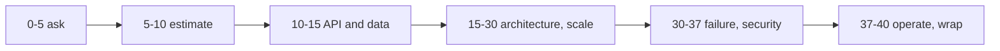

### 1. GPU job scheduling [report]

> **Interviewer:** "Design a scheduler that places GPU jobs for several teams on a cluster of thousands of GPUs. Machines fail. Teams complain about fairness."

**Ask first, with assumed answers.** Training or inference jobs? Assume training, gang-scheduled, 8 to 512 GPUs. How many GPUs? Assume 4,096 in 8-GPU nodes. Who shares it? Assume three teams with a 50, 30, 20 split. Slurm or Kubernetes? Assume either is allowed. Nebius open-sourced Soperator, which runs Slurm on Kubernetes [plan section 1], so say you know both worlds. Is checkpointing available? Assume yes.

| Quantity | Arithmetic | Result |
|---|---|---|
| Nodes | 4,096 / 8 | 512 |
| GPU failures per day (assume 50,000 h MTBF per GPU) | 4,096 x 24 / 50,000 | 1.97 |
| One 512-GPU job interrupted every | 50,000 / 512 | 97.7 h |
| Checkpoint interval (assume 120 s to write) | Young's rule: square root of 2 x 120 x 351,563 s | 153 min |
| Lost work per failure (assume 10 min restart) | 153 / 2 + 10 | 86.5 min |
| Overhead from checkpointing plus lost work | 120 / 9,186 + 5,193 / 351,563 | 2.8 percent |
| Fair share of 4,096 GPUs | 50, 30, 20 percent | 2,048 / 1,229 / 819 |
| 8-node jobs in a 32-node block, clean or with 3 busy nodes | 32 / 8, then 29 / 8 | 4 versus 3 |

Young's rule is a standard approximation I am quoting from memory of the checkpointing literature. Unverified: check before relying on it. The sound part is the shape, which says checkpoint more often when failures are frequent.

**40 minutes.** 0-5 ask and numbers. 5-10 job model: gang size, priority, preemptible or not. 10-25 scheduler: queue, fair-share by usage decay, topology-aware placement, backfill. 25-33 failures: node health, requeue from checkpoint. 33-40 observability and what you would measure.

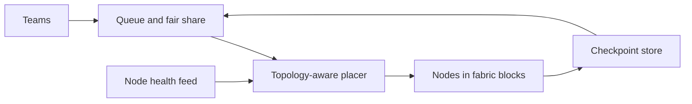

**Graders look for.** (1) Gang scheduling with topology, since a job needs all its nodes in one fabric block, and the cost is fragmentation. (2) Fair share against utilisation: strict quotas leave GPUs idle, borrowing with preemption fills them but kills someone's work. (3) Checkpoint frequency against write cost.

**Failure story.** A node dies at hour 90 of a 97-hour mean interval. The job loses half an interval. The scheduler must drain the node, requeue, and place the job on a spare block, not on the same bad node.

**Curveballs.** A team submits 4,000 one-GPU jobs. Two jobs each wait for the other's nodes. A node is slow, not dead, and drags the whole job.

**Depth.** [20.31](./31-nebius-ai-cloud-foundation-gpu-fabric-and-platform-choices.md) for fabric and orchestration choices, [20.16](./16-design-gpu-fleet-health-and-capacity.md) for node health, [20.23](./23-kubernetes-failure-drills-for-gpu-platforms.md) for scheduler failures.

Decide: lead with topology and fairness, then show failure cost with numbers.

### 2. Model inference serving [report]

> **Interviewer:** "Design a service that serves one LLM to many customers. Traffic is bursty. One customer must not hurt another."

**Ask first.** Streaming? Assume yes. Peak? Assume 300 requests per second, 300 output tokens each. Latency target? Assume TTFT p99 under 1 s. Model? Assume an 8-billion model on H100 80 GB, the worked case from [20.12](./12-estimation-toolkit-for-inference-capacity.md). Burst size? Assume 3x for 5 minutes.

| Quantity | Arithmetic | Result |
|---|---|---|
| Output demand | 300 x 300 | 90,000 tokens/s |
| Decode ceiling per GPU at batch 64 | 20.12 model | 5,361 tokens/s |
| Planning rate (assume 60 percent of ceiling) | 0.6 x 5,361 | 3,217 |
| GPUs for peak | 90,000 / 3,217, rounded up | 28 |
| With one spare (N+1) | 28 + 1 | 29 |
| GPUs for a 3x burst | 270,000 / 3,217 | 84 |

The burst figure is the point. You cannot buy 55 more GPUs in five minutes, so the design must queue, shed and prioritise. See [20.20](./20-autoscaling-gpu-inference.md) for cold-start cost.

**40 minutes.** 0-5 questions. 5-10 the table above. 10-15 API: OpenAI-compatible streaming. 15-30 gateway, router, engine pool, batching, per-tenant limits. 30-37 overload and failure. 37-40 metrics.

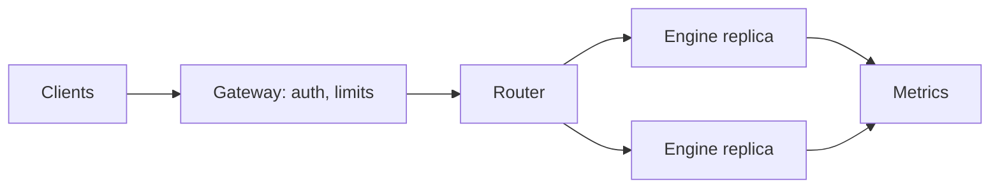

**Graders look for.** (1) Continuous batching raises throughput and raises tail latency, so choose a batch cap from the TTFT target. (2) Headroom against cost: 30 percent idle GPUs is the price of surviving bursts. (3) Isolation by token limits and fair queues, not by request counts.

**Failure story.** Half the replicas restart, clients retry, and the survivors collapse. This is the retry loop in [20.18](./18-how-llm-serving-fails.md) and [20.21](./21-request-routing-retries-and-overload-control.md).

**Curveballs.** Prompt lengths double. A new model must roll out without downtime. One tenant sends 100,000-token prompts.

**Depth.** [20.13](./13-design-a-multi-tenant-llm-inference-api.md) is the full design.

Decide: say the 3x burst number aloud and choose shed or buy.

### 3. Training data storage for thousands of GPUs [report]

> **Interviewer:** "Design storage for a training cluster of thousands of GPUs. Think about throughput, checkpoints and cost."

**Ask first.** Dataset size? Assume 2 PB. Model? Assume 70 billion parameters. Checkpoint contents? Assume weights plus optimiser state at 14 bytes per parameter. That figure is my assumption for mixed-precision training with Adam. Checkpoint cadence? Assume every 30 minutes, kept five deep.

| Quantity | Arithmetic | Result |
|---|---|---|
| Aggregate read (assume 50 MB/s per GPU) | 4,096 x 50 MB/s | 204.8 GB/s |
| Checkpoint size | 70 x 14 | 980 GB |
| Write rate if it must finish in 60 s | 980 / 60 | 16.3 GB/s |
| Average write rate over the interval | 980 / 1,800 | 0.54 GB/s |
| Retained checkpoints | 980 x 5 | 4.9 TB |
| Dataset, all hot (assume $0.10 per GB-month) | 2,000,000 x 0.10 | $200,000 |
| Tiered, 10 percent hot, rest at assumed $0.02 | 200,000 x 0.1 + 1,800,000 x 0.02 | $56,000 |

The lesson is the burst. Average write is tiny but the write must finish fast, or the GPUs stall. Prices are placeholders, so substitute real ones.

**40 minutes.** 0-5 questions. 5-12 numbers. 12-20 tiers: object store, parallel file system, node-local NVMe. 20-30 data loading: sharding, prefetch, caching. 30-37 checkpoint path and restore. 37-40 cost.

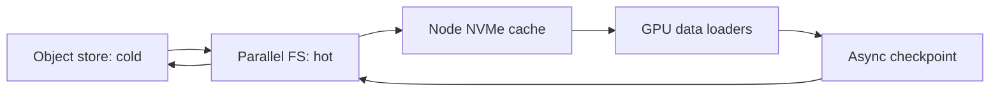

**Graders look for.** (1) Throughput and capacity are separate axes, and a tier per axis is the answer. (2) Asynchronous checkpoints: copy to host memory, then write in the background, trading stall time for a window of exposure. (3) Cost per tier, and what you delete.

**Failure story.** The parallel file system slows during a restore, every job restarts at once, and the herd drags it down further. Compare the herd in [20.18](./18-how-llm-serving-fails.md).

**Curveballs.** A corrupted checkpoint. Restoring onto a different GPU count. Data residency for a customer's dataset.

**Depth.** [20.31](./31-nebius-ai-cloud-foundation-gpu-fabric-and-platform-choices.md) matches storage to data temperature.

Decide: separate bandwidth from capacity, and size the checkpoint burst.

### 4. Detecting a failing GPU before the customer does [report]

> **Interviewer:** "How would you find a failing GPU before a customer notices?"

**Ask first.** Fleet size? Assume 2,000 nodes of 8 GPUs. Failure rate? Assume 5 percent of GPUs per year. Is the GPU idle or serving? Both. What does the customer notice? Assume errors or slow tokens after about 15 minutes.

| Quantity | Arithmetic | Result |
|---|---|---|
| GPUs | 2,000 x 8 | 16,000 |
| Failures per day | 16,000 x 0.05 / 365 | 2.19 |
| Series (assume 40 fields per GPU) | 16,000 x 40 | 640,000 |
| Samples per second at a 15 s scrape | 640,000 / 15 | 42,667 |
| Requests spared per event (assume 2 req/s per replica, detect at 2 min against 15) | 2 x 60 x 13 | 1,560 |

**40 minutes.** 0-5 questions. 5-10 numbers. 10-20 signals: Xid events, ECC counters, temperature, throttle reasons, plus serving signals like token rate per replica. 20-28 active checks on idle nodes. 28-36 automation: cordon, drain, replace, with a blast-radius limit. 36-40 false-positive cost.

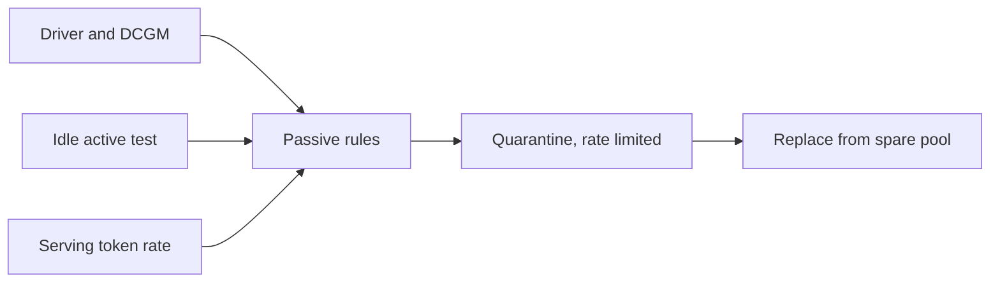

**Graders look for.** (1) Passive against active checks: passive is free but late, active costs GPU time. (2) A blast-radius cap, so a bad rule cannot drain the fleet. (3) Detecting gray failure through the serving path, not only hardware counters.

**Failure story.** A bad driver update emits a false Xid on every node, and automation starts draining the fleet. A cap of a few percent drained at once stops it.

**Curveballs.** An error that appears only under load. A GPU that is slow but reports healthy. The spare pool is empty.

**Depth.** [20.16](./16-design-gpu-fleet-health-and-capacity.md) has the signals and the node lifecycle.

Decide: name the three signal sources, then the blast-radius cap.

### 5. The SRE variant: incidents, capacity and rollout safety [report]

> **Interviewer:** "You run reliability for an inference platform. Walk me through how you handle incidents, plan capacity and make rollouts safe."

**Ask first.** SLO? Assume 99.9 percent over 30 days. Fleet? Assume 400 GPUs, 320 in use, demand growing 8 percent a month. GPU lead time? Assume 3 months. Headroom policy? Assume 20 percent.

| Quantity | Arithmetic | Result |
|---|---|---|
| Error budget | 0.001 x 30 x 24 x 60 | 43.2 min |
| Budget burned by a 14.4x burn for 1 h | 14.4 x 1 / 720 | 2 percent |
| 6x for 6 h | 6 x 6 / 720 | 5 percent |
| 1x for 72 h | 72 / 720 | 10 percent |
| Demand after the lead time | 320 x 1.08 cubed | 403.1 |
| GPUs needed with headroom | 403.1 x 1.2, rounded up | 484 |
| Order today | 484 - 400 | 84 |

The burn-rate pairs are explained and sourced in [20.19](./19-slis-slos-and-alerts-for-token-apis.md). Here only the arithmetic matters.

**40 minutes.** 0-4 SLOs. 4-14 incidents: detect, page, mitigate before root cause, post-mortem. 14-24 capacity: forecast, lead time, headroom. 24-34 rollout: canary, gates, auto-rollback. 34-40 toil and automation.

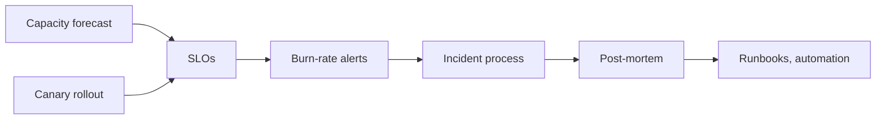

**Graders look for.** (1) Error budget as the control knob for rollout speed. (2) Capacity planned against lead time, not today's load. (3) Mitigation first, cause second.

**Failure story.** A canary passes latency checks but output quality drops. See quality signals in [20.18](./18-how-llm-serving-fails.md) and [20.14](./14-design-dedicated-endpoints-and-safe-model-rollout.md).

**Curveballs.** The budget is already spent. The vendor delays 200 GPUs. Two incidents at once.

**Depth.** [20.14](./14-design-dedicated-endpoints-and-safe-model-rollout.md), [20.19](./19-slis-slos-and-alerts-for-token-apis.md), [20.26](./26-the-stress-interview-production-incident-role-play.md).

Decide: tie rollout speed to remaining budget, and order GPUs against the lead time.

### 6. Multi-region failover for dedicated endpoints [my addition]

> **Interviewer:** "A customer's dedicated endpoint lives in one region. That region has a capacity problem. Design for failover."

**The public constraint.** A dedicated endpoint is created in a chosen region, EU or US, which carries data-residency meaning [plan section 1]. Chapter [20.30](./30-nebius-ai-factory-to-token-factory-architecture.md) cites the legal guide as saying there is no automatic multi-region routing or overflow. So failover is the customer's design, not a platform feature. Do not claim Nebius does it for them.

**Ask first.** May data cross regions? Assume yes, within one residency zone, and say you would check the contract. RTO and RPO? Assume 10 minutes. Inference is stateless, so RPO is about config only. Size? Assume 8 replicas of 2 GPUs. Price? Assume $3 per GPU-hour, a placeholder.

| Quantity | Arithmetic | Result |
|---|---|---|
| GPUs | 8 x 2 | 16 |
| Active-active second region, per month | 16 x 730 x 3 | $35,040 |
| Warm standby at 25 percent | 4 x 730 x 3 | $8,760 |
| Cold plan outage (5 detect + 5 decide + 15 create) | 25 min | 57.9 percent of a 43.2 min budget |
| Warm plan outage (detect and decide only) | 10 min | 23.1 percent |

**40 minutes.** 0-6 residency and RTO questions. 6-12 numbers. 12-25 three options: cold, warm, active-active, with the client-side or gateway switch. 25-34 health detection and the decision to fail over. 34-40 failback and testing.

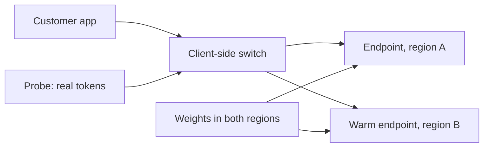

**Graders look for.** (1) Cost against RTO, shown as the table. (2) Who decides to fail over: a human with a runbook is safer than a flapping automatic switch. (3) Residency limits who the standby may be.

**Failure story.** Region A is half-sick, the probe flaps, and traffic ping-pongs. Add hysteresis and a manual lock.

**Curveballs.** Standby region has no GPU capacity. Failback while requests stream. A rate limit is per region.

**Depth.** [20.30](./30-nebius-ai-factory-to-token-factory-architecture.md), [20.33](./33-ai-factory-solution-architecture-ha-and-recovery.md), [20.21](./21-request-routing-retries-and-overload-control.md) section 12.

Decide: state that failover is customer-built, then price warm against cold.

### 7. Usage metering and billing correctness [my addition]

> **Interviewer:** "Design the system that counts tokens and produces the invoice. Customers will check it."

**Ask first.** Scale? Assume 1,000 requests per second average. Tokens? Assume 800 in, 300 out. Price? Assume $0.10 and $0.40 per million, placeholders. Tolerance? Assume under 0.1 percent error. Streaming cancels count the tokens already sent.

| Quantity | Arithmetic | Result |
|---|---|---|
| Events per day | 1,000 x 86,400 | 86.4 million |
| Storage per day (assume 200 B per event) | 86.4M x 200 | 17.3 GB |
| Dedupe keys (assume 16 B, one day) | 86.4M x 16 | 1.38 GB |
| Revenue per day | 86.4M x (800 x 0.10 + 300 x 0.40) / 1M | $17,280 |
| Loss at 0.1 percent | 17,280 x 0.001 | $17.28 per day |
| Overbilling if 2 percent of events duplicate | 17,280 x 0.02 | $345.60 per day |

Duplicates are 20 times worse than the tolerated loss, so dedupe is the key design point.

**40 minutes.** 0-5 questions. 5-10 numbers. 10-18 event: written by the engine side at request end with a unique request id. 18-28 pipeline: durable log, idempotent consumer, aggregation. 28-35 reconciliation against gateway counts. 35-40 invoice and disputes.

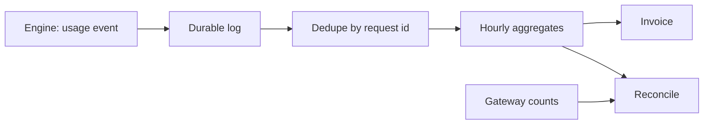

**Graders look for.** (1) At-least-once delivery plus idempotent consumption equals effectively once. (2) Metering is separate from monitoring, as [20.15](./15-design-an-observability-pipeline-for-very-high-volume.md) argues: monitoring may drop samples, billing may not. (3) Reconciliation and an audit trail.

**Failure story.** The consumer replays a day after a bug fix. Without dedupe, customers are billed twice.

**Curveballs.** Late events after the invoice closes. A cancelled stream. A price change mid-month.

**Depth.** [20.13](./13-design-a-multi-tenant-llm-inference-api.md) section 5, [20.15](./15-design-an-observability-pipeline-for-very-high-volume.md) section 12.

Decide: pick idempotency keys first, then say what you reconcile against.

### 8. A prompt-cache or KV-cache tier [my addition]

> **Interviewer:** "Many requests share long system prompts. Design a cache that saves GPU time."

Nebius reports cache-aware routing lifted hit rate from about 5 percent to 30 percent to 50-60 percent in one case study [vendor]. Nebius has not published the cache design, so this is a reasonable design and nothing more.

**Ask first.** Prefix reuse? Assume 5,000 distinct prefixes of 2,000 tokens. Isolation? Assume per tenant, never shared across tenants. Model? The 8-billion model with 147,456 bytes of KV per token.

| Quantity | Arithmetic | Result |
|---|---|---|
| One prefix | 2,000 x 147,456 B | 0.295 GB |
| Whole hot set | 5,000 x 0.295 | 1.475 TB |
| Fit in 50.6 GB of GPU KV budget | 50.6 / 0.295 | 171 |
| Fit in 512 GB host RAM | 512 / 0.295 | 1,736 |
| Fit in 8 TB NVMe | 8,000 / 0.295 | 27,126 |
| Recompute (assume 400 TFLOPS effective) | 2 x 8.2e9 x 2,000 / 400e12 | 82 ms |
| Load from RAM (128 GB/s at 50 percent) | 0.295 / 64 | 4.6 ms |
| Load from NVMe (assume 7 GB/s) | 0.295 / 7 | 42 ms |

NVMe is only about twice as fast as recomputing, so the slow tier barely pays. RAM clearly pays.

**40 minutes.** 0-5 questions. 5-10 numbers. 10-22 tiers, eviction, and keys by prefix hash. 22-30 routing: send a request to the replica that holds its prefix. 30-37 failure and privacy. 37-40 metrics.

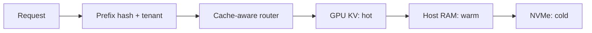

**Graders look for.** (1) Compare load time with recompute time, and show the crossover. (2) Cache-aware routing against load balance: sticky routing makes hot replicas. (3) Tenant isolation, since a shared cache can leak timing information.

**Failure story.** A cache node restarts, every hit becomes a miss, prefill load jumps, and TTFT breaks. Cold-cache load must be a tested capacity case.

**Curveballs.** A model version change invalidates all entries. Memory pressure evicts hot prefixes. A customer asks whether their prompts are stored.

**Depth.** [20.32](./32-token-factory-model-lifecycle-serving-and-economics.md) section 8 on caching as a privacy question, [20.12](./12-estimation-toolkit-for-inference-capacity.md) for KV size.

Decide: justify each tier with a load-versus-recompute number.

### 9. A model weights distribution system for cold start [my addition]

> **Interviewer:** "A new model version must reach a hundred nodes fast. Design how weights get there."

**Ask first.** Size? Assume 70 GB. Layout? Assume 100 nodes in 10 racks. Origin bandwidth? Assume 10 GB/s from an object store. Node network? Assume 3 GB/s effective. Integrity? Required.

| Quantity | Arithmetic | Result |
|---|---|---|
| Naive, all nodes pull from origin | 100 x 70 / 10 | 700 s |
| Seed one node per rack | 10 x 70 / 10 | 70 s |
| Rack doubling rounds | log2(10), rounded up | 4 |
| Rack copy, 4 rounds at 70 / 3 s each | 4 x 23.3 | 93 s |
| Tree total | 70 + 93 | 163 s |
| Local disk to GPU at an assumed 7 GB/s | 70 / 7 | 10 s |

The rack stage is a conservative sum. In practice it overlaps with seeding.

**40 minutes.** 0-5 questions. 5-10 numbers. 10-22 design: content-addressed chunks, per-rack seeders, checksums. 22-30 node cache and pre-staging before the rollout. 30-37 failure. 37-40 observability.

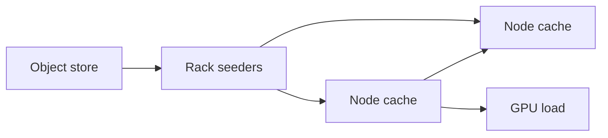

**Graders look for.** (1) Origin bandwidth is the bottleneck, so fan out inside the fabric. (2) Pre-stage weights before traffic shifts, so cold start is only GPU load. (3) Verify checksums and keep versions immutable.

**Failure story.** A corrupt chunk spreads from a seeder to a whole rack. Verify each chunk before serving it onward.

**Curveballs.** Origin is down mid-rollout. A node joins late. Weights are 10 times larger.

**Depth.** [20.14](./14-design-dedicated-endpoints-and-safe-model-rollout.md) sections 3 and 4, and the herd arithmetic in [20.18](./18-how-llm-serving-fails.md) section 7.

Decide: pre-stage, fan out inside the fabric, and verify.

### 10. An inference gateway rate limiter [my addition]

> **Interviewer:** "Design the rate limiter in front of an LLM API. Limits are in tokens per minute."

**Ask first.** Limit? Assume 100,000 tokens per minute per tenant per model. The output length is unknown at admission, so what is charged up front? Assume the prompt plus `max_tokens`, with a refund after. Scale? Assume 2,000 requests per second, 20 gateway instances, 5,000 tenants, 50 models.

| Quantity | Arithmetic | Result |
|---|---|---|
| Refill rate | 100,000 / 60 | 1,667 tokens/s |
| Reservation (800 prompt + 1,024 max) | 800 + 1,024 | 1,824 |
| Requests per full bucket, reserved | 100,000 / 1,824 | 54 |
| Requests per full bucket, actual use 1,100 | 100,000 / 1,100 | 90 |
| Refund per request | 1,824 - 1,100 | 724 |
| State (assume 64 B per bucket) | 5,000 x 50 x 64 B | 16 MB |
| Store operations (reserve plus refund) | 2 x 2,000 | 4,000/s |

Without the refund, the tenant gets 54 requests where the limit should allow 90.

**40 minutes.** 0-5 questions. 5-10 numbers. 10-22 token bucket with reserve and refund. 22-32 where state lives: central store against local buckets with leases of 5,000 tokens each per gateway. 32-38 failure: store down. 38-40 headers.

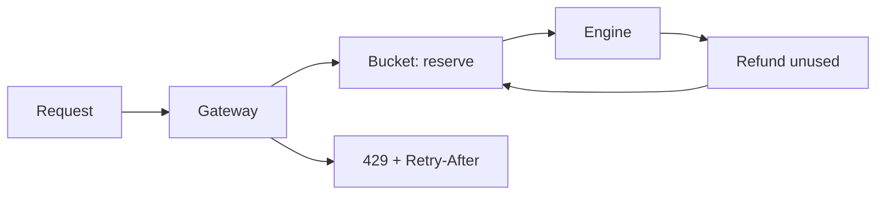

**Graders look for.** (1) Limit tokens, not requests. (2) Central accuracy against local speed: leases bound the error to the lease size times the gateway count. (3) Fail open or closed when the store dies, with a reason.

**Failure story.** The store has a partition and the limiter fails closed. All tenants get 429. Fail open with a local safety limit is usually right for a paid API, but state it as a choice.

**Curveballs.** A burst allowance. Per-key and per-organisation limits together. Limit changes taking effect.

**Depth.** [20.13](./13-design-a-multi-tenant-llm-inference-api.md) section 4, [20.21](./21-request-routing-retries-and-overload-control.md) section 8, and coding patterns in chapter 20.9.

Decide: reserve then refund, and state the fail-open choice.

### 11. Multi-tenant noisy-neighbour control [my addition]

> **Interviewer:** "One customer's requests slow everyone down. Design the control."

**Ask first.** What is shared? Assume replicas of one model. What is the damage? Assume KV memory and prefill time. Sizes? Assume 30,000-token requests from one tenant, 2,500-token requests from the others.

| Quantity | Arithmetic | Result |
|---|---|---|
| One long request | 30,000 x 147,456 B | 4.42 GB |
| One normal request | 2,500 x 147,456 B | 0.37 GB |
| Normal requests alone | 50.6 / 0.369 | 137 |
| Long requests that fill the GPU | 50.6 / 4.42 | 11 |
| Left for others when 11 are running | 50.6 - 48.7 | 1.94 GB, so 5 requests |
| Long requests allowed at a 25 percent cap | 12.65 / 4.42 | 2 |

Eleven long requests take capacity from 137 down to 5 for everyone else.

**40 minutes.** 0-5 questions. 5-10 numbers. 10-20 admission by cost, which is tokens times context. 20-30 fair queueing and a per-tenant KV cap. 30-36 isolation tiers: shared pool, long-context pool, dedicated endpoint. 36-40 detection.

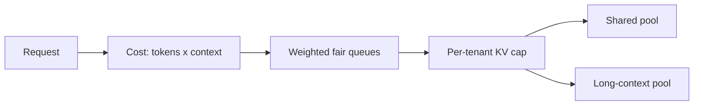

**Graders look for.** (1) Charge by resource cost, not request count. (2) Hard caps against borrowing: caps protect, borrowing raises utilisation. (3) Isolation tiers priced to match, ending at a dedicated endpoint.

**Failure story.** The cap is per replica, but the router sends all of the tenant's long requests to one replica. The cap must hold across the pool.

**Curveballs.** A tenant splits traffic across ten API keys. A premium tenant needs priority. Detecting the noisy tenant without a high-cardinality label, per the warning in [20.18](./18-how-llm-serving-fails.md) section 10.

**Depth.** [20.13](./13-design-a-multi-tenant-llm-inference-api.md) section 11.

Decide: charge by cost, cap the share, offer a pool.

### 12. An SLO and alerting platform for 1,000 endpoints [my addition]

> **Interviewer:** "Design the platform that gives every endpoint SLOs and alerts. There are a thousand endpoints."

**Ask first.** Self-service? Assume teams declare SLOs in a file. SLIs? Assume four per endpoint: availability, TTFT, inter-token latency, quality. Replicas? Assume 6 per endpoint. Alert policy? Assume three burn-rate pairs.

| Quantity | Arithmetic | Result |
|---|---|---|
| Series per replica (assume 30 plain plus 4 histograms of 12 buckets) | 30 + 48 | 78 |
| Raw series | 1,000 x 6 x 78 | 468,000 |
| SLOs | 1,000 x 4 | 4,000 |
| Recorded series (5 windows) | 4,000 x 5 | 20,000 |
| Alert rules (3 pairs) | 4,000 x 3 | 12,000 |
| Evaluations per second at 60 s | 12,000 / 60 | 200 |

**40 minutes.** 0-5 questions. 5-10 numbers. 10-20 SLO as code: one file generates recording and alert rules. 20-30 routing: page against ticket, ownership, silence rules. 30-36 reliability of the platform itself. 36-40 rollout of the rules.

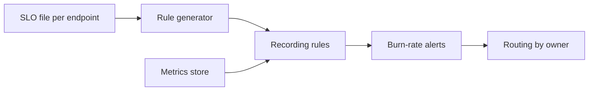

**Graders look for.** (1) Rules are generated from a spec, never hand-written 12,000 times. (2) Page on symptoms and burn rate, ticket on slow burn. (3) Watch the watcher: if the metrics store dies, alerts on missing data must fire.

**Failure story.** A generator bug ships a wrong threshold to every endpoint at once. Roll out rule changes in stages, with a diff against current alert volume.

**Curveballs.** A new endpoint with no history. Per-tenant SLOs. The metrics store loses an hour.

**Depth.** [20.19](./19-slis-slos-and-alerts-for-token-apis.md), [20.15](./15-design-an-observability-pipeline-for-very-high-volume.md).

Decide: generate from a spec, page on burn, and monitor the monitor.

## Scoring rubric

Score yourself 0 to 4 on each row. This is my rubric, not a Nebius one.

| Dimension | A 4 looks like |
|---|---|
| Requirements | Asked 4 to 6 questions, stated assumptions, confirmed the SLO |
| Estimation | Arithmetic written, units correct, a sanity check, and a result that changed the design |
| Architecture | One diagram, clear data path, control plane apart from data plane |
| Trade-offs | Named three, each with a cost and a condition |
| Failure | One concrete story with detection, mitigation and fix |
| Operations | Metrics, alerts, rollout, rollback |
| Communication | Thought aloud, checked in at each section, took hints |

Under 20 of 28 means redo the prompt tomorrow.

## The first five minutes script

Say these, in order, and write the answers on the board.

1. "Let me restate the problem in one sentence. Is that right?"
2. "Who are the users, and what does one request or job look like?"
3. "What is the scale: peak load, data size, number of tenants?"
4. "What is the target: latency, availability, durability?"
5. "What is out of scope, and may I assume it?"
6. "Here are my assumptions. Please correct any that look wrong."
7. "I will estimate first, then draw the data path, then talk about failure. I will watch the clock."

Pause for the answer after each line. Silence from the interviewer usually means "assume it."

## How to answer out loud

**1. "Design X" with no detail.** Use the script above. Then run the spine in section 0. Name the checklist row you are on.

**2. "What would you change if the load were ten times bigger?"** Redo the one number that scales, say which component breaks first, and say what you would change. For example in prompt 2, ten times the burst is 840 GPUs, so you shed or prioritise instead.

**3. "Why this and not that?"** Give the condition under which the other choice wins. "Warm standby unless the RTO is under five minutes, then active-active."

**4. "What fails first?"** Pick the component with the least headroom in your table. Give detection, mitigation, fix.

**5. "How do you know it works?"** Metrics at the gateway for what users see, metrics at the engine for why, and a game day for what you have not seen.

## Worked scenarios

### Scenario 1: A prompt you have not drilled

The interviewer asks for a system to run batch embedding jobs for customers. Use the checklist. Requirements: assume 1 billion documents a day, 500 tokens each. Estimate: 500 billion tokens a day, which is 5.8 million tokens per second. State a per-GPU rate as an assumption and divide. API: submit job, poll, fetch results. Data: object store in, object store out. Scaling: partition by document ranges. Failure: retry per partition, idempotent writes. Security: per-tenant buckets. Operations: queue age and completion rate. You designed it without recall because the checklist supplied the order.

### Scenario 2: The interviewer changes a number

In prompt 2 the interviewer says "the model is now 70 billion parameters." Do not restart. Recompute weights at 2 bytes: 140 GB, which no longer fits one 80 GB GPU. Say tensor parallelism across at least 2 GPUs, with less KV room per GPU. Then re-derive requests per GPU with the formulas of [20.12](./12-estimation-toolkit-for-inference-capacity.md). Show that only the inputs changed and the method did not.

## Hands-on lab

I ran steps 1 and 3. Step 2 is your own work.

1. Print every table above.

```bash
python3 code/part20/c17_estimates.py
```

Expected result: twelve blocks. Block `p02_serving` shows `gpus: 28` and `burst_gpus: 84`.

2. Pick a prompt, change one assumption in its `A*` dictionary, rerun, and write the sentence "if X doubles, Y changes to Z" aloud.

3. Run the tests.

```bash
python3 -m pytest code/part20/test_c17_estimates.py -q
```

Expected result: 14 passed.

The calculator in full:

```python
# code/part20/c17_estimates.py
"""Sizing arithmetic for the twelve drill prompts in chapter 20.17.
Every input is an ASSUMPTION written in the A_* dictionaries. None is a
measurement and none is a Nebius figure. Standard library only."""
import math

# Model facts reused from chapter 20.12 (Qwen3-8B BF16 on one H100 SXM 80 GB).
KV_BYTES_PER_TOKEN = 2 * 36 * 8 * 128 * 2          # 147,456
WEIGHTS_GB, HBM_BW_GBS = 16.4, 3350.0
KV_BUDGET_GB = 50.6                                # 20.12: 72 - 16.4 - 5


def decode_ceiling(batch, ctx=2500):
    """Tokens per second at one decode step, from memory traffic alone."""
    step_s = (WEIGHTS_GB + batch * ctx * KV_BYTES_PER_TOKEN / 1e9) / HBM_BW_GBS
    return batch / step_s


A1 = dict(gpus=4096, per_node=8, gpu_mtbf_h=50_000, job_gpus=512, ckpt_s=120,
          restart_s=600, shares=(50, 30, 20), block_nodes=32, job_nodes=8, busy=3)


def p01_scheduler(a=A1):
    nodes = a["gpus"] // a["per_node"]
    mtbi_h = a["gpu_mtbf_h"] / a["job_gpus"]
    interval = math.sqrt(2 * a["ckpt_s"] * mtbi_h * 3600)       # Young's rule
    lost = interval / 2 + a["restart_s"]
    free = a["block_nodes"] - a["busy"]
    return dict(nodes=nodes, fail_per_day=a["gpus"] * 24 / a["gpu_mtbf_h"],
                job_mtbi_h=mtbi_h, ckpt_interval_min=interval / 60,
                lost_min_per_failure=lost / 60,
                overhead_pct=100 * (a["ckpt_s"] / interval + lost / (mtbi_h * 3600)),
                fair_gpus=[a["gpus"] * s / sum(a["shares"]) for s in a["shares"]],
                jobs_fit_fragmented=free // a["job_nodes"],
                jobs_fit_clean=a["block_nodes"] // a["job_nodes"])


A2 = dict(req_s=300, out_tokens=300, derate=0.6, burst=3, batch=64)


def p02_serving(a=A2):
    per_gpu = a["derate"] * decode_ceiling(a["batch"])
    need = a["req_s"] * a["out_tokens"]
    gpus = math.ceil(need / per_gpu)
    return dict(ceiling_tok_s=decode_ceiling(a["batch"]), per_gpu_tok_s=per_gpu,
                demand_tok_s=need, gpus=gpus, gpus_n_plus_1=gpus + 1,
                burst_gpus=math.ceil(need * a["burst"] / per_gpu))


A3 = dict(gpus=4096, mb_s_per_gpu=50, params_b=70, bytes_per_param=14,
          write_s=60, interval_min=30, keep=5, dataset_tb=2000, hot_frac=0.10,
          hot_usd_gb=0.10, cold_usd_gb=0.02)


def p03_training_storage(a=A3):
    ckpt_gb = a["params_b"] * a["bytes_per_param"]
    gb = a["dataset_tb"] * 1000
    return dict(read_gb_s=a["gpus"] * a["mb_s_per_gpu"] / 1000, ckpt_gb=ckpt_gb,
                write_gb_s=ckpt_gb / a["write_s"],
                avg_write_gb_s=ckpt_gb / (a["interval_min"] * 60),
                kept_tb=ckpt_gb * a["keep"] / 1000,
                all_hot_usd=gb * a["hot_usd_gb"],
                tiered_usd=gb * (a["hot_frac"] * a["hot_usd_gb"]
                                 + (1 - a["hot_frac"]) * a["cold_usd_gb"]))


A4 = dict(nodes=2000, per_node=8, afr=0.05, fields=40, scrape_s=15,
          req_s_replica=2, customer_min=15, detect_min=2)


def p04_gpu_detection(a=A4):
    gpus = a["nodes"] * a["per_node"]
    per_event = a["req_s_replica"] * 60 * (a["customer_min"] - a["detect_min"])
    per_day = gpus * a["afr"] / 365
    return dict(gpus=gpus, failures_per_day=per_day,
                series=gpus * a["fields"], samples_s=gpus * a["fields"] / a["scrape_s"],
                requests_saved_per_event=per_event,
                requests_saved_per_day=per_day * per_event)


A5 = dict(slo=0.999, days=30, fleet=400, in_use=320, growth=0.08, lead_months=3, headroom=0.20)


def p05_sre(a=A5):
    hours = a["days"] * 24
    demand = a["in_use"] * (1 + a["growth"]) ** a["lead_months"]
    need = math.ceil(demand * (1 + a["headroom"]))
    return dict(budget_min=(1 - a["slo"]) * hours * 60,
                budget_pct_14_4_for_1h=100 * 14.4 * 1 / hours,
                budget_pct_6_for_6h=100 * 6 * 6 / hours,
                budget_pct_1_for_72h=100 * 1 * 72 / hours,
                demand_in_lead=demand, gpus_needed=need, gpus_to_order=need - a["fleet"])


A6 = dict(gpus_per_replica=2, replicas=8, usd_gpu_h=3.0, hours=730, warm_frac=0.25,
          detect_min=5, decide_min=5, create_min=15, slo_budget_min=43.2)


def p06_failover(a=A6):
    gpus = a["gpus_per_replica"] * a["replicas"]
    cold = a["detect_min"] + a["decide_min"] + a["create_min"]
    warm = a["detect_min"] + a["decide_min"]
    return dict(gpus=gpus, active_usd=gpus * a["hours"] * a["usd_gpu_h"],
                warm_usd=gpus * a["warm_frac"] * a["hours"] * a["usd_gpu_h"],
                cold_outage_min=cold, cold_budget_pct=100 * cold / a["slo_budget_min"],
                warm_outage_min=warm, warm_budget_pct=100 * warm / a["slo_budget_min"])


A7 = dict(req_s=1000, in_tok=800, out_tok=300, usd_m_in=0.10, usd_m_out=0.40,
          retry_dup=0.02, loss=0.001, event_bytes=200, key_bytes=16)


def p07_metering(a=A7):
    day = a["req_s"] * 86_400
    rev = day * (a["in_tok"] * a["usd_m_in"] + a["out_tok"] * a["usd_m_out"]) / 1e6
    return dict(events_day=day, gb_day=day * a["event_bytes"] / 1e9,
                dedupe_gb=day * a["key_bytes"] / 1e9, revenue_day=rev,
                loss_usd_day=rev * a["loss"], overbill_usd_day=rev * a["retry_dup"])


A8 = dict(prefixes=5000, prefix_tok=2000, dram_gb=512, nvme_gb=8000, pcie_gbs=128,
          nvme_gbs=7, eff=0.5, prefill_flops=400e12, params=8.2e9)


def p08_cache_tier(a=A8):
    one_gb = a["prefix_tok"] * KV_BYTES_PER_TOKEN / 1e9
    return dict(prefix_gb=one_gb, hot_set_tb=a["prefixes"] * one_gb / 1000,
                hbm_fit=int(KV_BUDGET_GB // one_gb), dram_fit=int(a["dram_gb"] // one_gb),
                nvme_fit=int(a["nvme_gb"] // one_gb),
                recompute_ms=1000 * 2 * a["params"] * a["prefix_tok"] / a["prefill_flops"],
                dram_load_ms=1000 * one_gb / (a["pcie_gbs"] * a["eff"]),
                nvme_load_ms=1000 * one_gb / a["nvme_gbs"])


A9 = dict(nodes=100, racks=10, weights_gb=70, origin_gbs=10, node_gbs=3, nvme_gbs=7)


def p09_weights(a=A9):
    naive = a["nodes"] * a["weights_gb"] / a["origin_gbs"]
    seed = a["racks"] * a["weights_gb"] / a["origin_gbs"]
    rounds = math.ceil(math.log2(a["nodes"] / a["racks"]))
    per_round = a["weights_gb"] / a["node_gbs"]
    return dict(naive_s=naive, seed_s=seed, rack_rounds=rounds,
                rack_s=rounds * per_round, tree_s=seed + rounds * per_round,
                gpu_load_s=a["weights_gb"] / a["nvme_gbs"])


A10 = dict(tpm=100_000, prompt=800, max_tokens=1024, actual_out=300,
           tenants=5000, models=50, bucket_bytes=64, gateways=20, req_s=2000)


def p10_rate_limiter(a=A10):
    reserve = a["prompt"] + a["max_tokens"]
    actual = a["prompt"] + a["actual_out"]
    return dict(refill_tok_s=a["tpm"] / 60, reserve=reserve,
                burst_reqs_reserve=a["tpm"] // reserve,
                burst_reqs_actual=a["tpm"] // actual,
                refund_per_req=reserve - actual,
                state_mb=a["tenants"] * a["models"] * a["bucket_bytes"] / 1e6,
                store_ops_s=2 * a["req_s"], lease_tok_per_gw=a["tpm"] / a["gateways"])


A11 = dict(long_ctx=30_000, normal_ctx=2500, tenant_cap=0.25)


def p11_noisy_neighbour(a=A11):
    long_gb = a["long_ctx"] * KV_BYTES_PER_TOKEN / 1e9
    norm_gb = a["normal_ctx"] * KV_BYTES_PER_TOKEN / 1e9
    n_long = int(KV_BUDGET_GB // long_gb)
    left = KV_BUDGET_GB - n_long * long_gb
    return dict(long_gb=long_gb, normal_gb=norm_gb, normal_alone=int(KV_BUDGET_GB // norm_gb),
                long_fill=n_long, left_gb=left, normal_while_long=int(left // norm_gb),
                capped_long=int(a["tenant_cap"] * KV_BUDGET_GB // long_gb))


A12 = dict(endpoints=1000, replicas=6, engine_series=30, hist=4, buckets=12, slis=4,
           windows=5, pairs=3, eval_s=60)


def p12_slo_platform(a=A12):
    per_replica = a["engine_series"] + a["hist"] * a["buckets"]
    return dict(raw_series=a["endpoints"] * a["replicas"] * per_replica,
                slos=a["endpoints"] * a["slis"],
                recorded=a["endpoints"] * a["slis"] * a["windows"],
                alert_rules=a["endpoints"] * a["slis"] * a["pairs"],
                evals_s=a["endpoints"] * a["slis"] * a["pairs"] / a["eval_s"])


ALL = [p01_scheduler, p02_serving, p03_training_storage, p04_gpu_detection, p05_sre,
       p06_failover, p07_metering, p08_cache_tier, p09_weights, p10_rate_limiter,
       p11_noisy_neighbour, p12_slo_platform]

if __name__ == "__main__":
    for fn in ALL:
        print(f"== {fn.__name__}")
        for k, v in fn().items():
            print(f"  {k}: {[round(x, 2) for x in v] if isinstance(v, list) else round(v, 3)}")
```

## The one-page decision checklist

| Step | Ask yourself | Say |
|---|---|---|
| Requirements | Who, what load, what target? | "Here is what I will build and what I will leave out." |
| Estimate | Which number decides the design? | "The number that matters is X because..." |
| API | What does the client call? | "Three calls: submit, status, result." |
| Data | What is stored, where, for how long? | "State lives here, and it is rebuilt from there." |
| Scaling | What breaks at 10x? | "The first bottleneck is..." |
| Failure | What fails, how do we know, what do we do? | "Detect by..., mitigate by..., fix by..." |
| Security | Who may do what to whose data? | "Tenant isolation is enforced at..." |
| Operations | How is it deployed, watched and rolled back? | "SLO, alert, canary, rollback trigger." |

## Drill questions

<details><summary>1. Why is the 3x burst answer not "buy 84 GPUs"?</summary>
Peak is 28 GPUs and a 3x burst needs 84. You cannot add 55 GPUs in minutes, since cold start and provisioning take minutes. So you queue within a bound, shed by priority, and keep spare capacity sized for the burst you can afford.
</details>

<details><summary>2. What does the checkpoint interval trade?</summary>
Write cost against lost work. Frequent checkpoints cost GPU stall time. Rare ones lose more work per failure. At the assumed numbers the balance is about 153 minutes.
</details>

<details><summary>3. Why size for 16.3 GB/s?</summary>
The write must finish in about 60 seconds, or GPUs stall. Sizing for the average would make every checkpoint a long pause. Asynchronous checkpointing softens this, but the burst still sets the requirement.
</details>

<details><summary>4. Why does a passive check alone fail prompt 4?</summary>
It sees only what the hardware reports, and gray failures report healthy. Add serving signals such as token rate per replica, and active tests on idle nodes.
</details>

<details><summary>5. What does a 14.4x burn rate for one hour consume?</summary>
Two percent of a 30-day budget, because 14.4 times 1 hour divided by 720 hours is 0.02.
</details>

<details><summary>6. What public fact shapes prompt 6?</summary>
They are created in a chosen region, EU or US, with data residency meaning. Chapter 20.30 cites the legal guide as saying there is no automatic multi-region routing or overflow. So cross-region failover is the customer's design.
</details>

<details><summary>7. Why is duplicate billing more dangerous?</summary>
Customers verify invoices and a 2 percent duplicate rate means $345.60 a day overbilled against $17.28 of tolerated loss. Idempotent consumption by request id fixes it.
</details>

<details><summary>8. When is a slower cache tier not worth it?</summary>
When loading is not much faster than recomputing. NVMe at 42 ms against 82 ms recompute gains little. Host RAM at 4.6 ms gains a lot.
</details>

<details><summary>9. Why seed one node per rack?</summary>
Origin bandwidth is the bottleneck. Seeding costs 70 seconds against 700 for everyone pulling, and the rack fabric does the rest.
</details>

<details><summary>10. What goes wrong if you charge only the prompt?</summary>
Output tokens are uncharged, so a tenant can exceed the limit. Reserve the prompt plus max tokens, then refund the unused part after the response.
</details>

## Common mistakes and weak answers

- Drawing boxes for 25 minutes before any number. Estimate by minute 10.
- Giving a figure with no label. Say "assumption" every time.
- Claiming Nebius does something. Say "a reasonable design is" unless the plan or a fetched page says so.
- Listing trade-offs without a condition. Say when each side wins.
- Describing the happy path only. Give one failure story per design.
- Restarting when a number changes. Re-run the formula.
- Forgetting operations: metrics, alerts, rollback.

## Connections to the rest of the handbook

- [20.12](./12-estimation-toolkit-for-inference-capacity.md) estimation, [20.13](./13-design-a-multi-tenant-llm-inference-api.md) multi-tenant API, [20.14](./14-design-dedicated-endpoints-and-safe-model-rollout.md) rollout, [20.15](./15-design-an-observability-pipeline-for-very-high-volume.md) observability, [20.16](./16-design-gpu-fleet-health-and-capacity.md) fleet health.
- [20.18](./18-how-llm-serving-fails.md) failures, [20.19](./19-slis-slos-and-alerts-for-token-apis.md) SLOs, [20.20](./20-autoscaling-gpu-inference.md) autoscaling, [20.21](./21-request-routing-retries-and-overload-control.md) routing, [20.22](./22-operating-vllm-triton-ray-and-tensorrt-llm.md) engines, [20.24](./24-terraform-for-resilient-gpu-clusters.md) Terraform.
- Nebius public architecture: [20.30](./30-nebius-ai-factory-to-token-factory-architecture.md), [20.31](./31-nebius-ai-cloud-foundation-gpu-fabric-and-platform-choices.md), [20.32](./32-token-factory-model-lifecycle-serving-and-economics.md), [20.33](./33-ai-factory-solution-architecture-ha-and-recovery.md).
- Next: [20.26](./26-the-stress-interview-production-incident-role-play.md) for the incident round.

## Sources and review notes

Sources:

- Nebius SRE interview page, nebius.com/careers/interviews/sre, as recorded in `planning/VOLUME_20_NEBIUS_SRE_PLAN.md` section 1, research date 2026-11-09. This chapter fetched no web pages itself.
- The secondary source with five prompts and the two candidate reports, as supplied in the task brief. The brief does not name the secondary source or its URL.
- Chapters 20.12 and 20.30 of this handbook for the KV formula, the 5,361 tokens per second figure, the 50.6 GB KV budget and the region-fixed dedicated endpoint facts. Those chapters hold the underlying book and documentation sources.
- Nebius Token Factory case study figures (cache hit rates, X+1) as in plan section 1, tagged vendor.

Explicitly labelled inferences:

- Every input in the estimate tables, including MTBF, prices, throughput derating, bandwidths and checkpoint bytes per parameter. All are my assumptions.
- Prompts 6 to 12 and every "Graders look for" list.
- The scoring rubric and the first-five-minutes script.
- Cache tier design in prompt 8 and the claim that failover is customer-built, which rests on 20.30.

Not verified:

- Young's checkpoint rule and the 14 bytes per parameter were not checked against a book or paper this session.
- The 400 TFLOPS effective figure and the NVMe 7 GB/s rate are placeholders.
- No Mermaid, lint or chain-density gate was run beyond what is noted in the report.
- I did not confirm the Senior SRE posting is still open.
