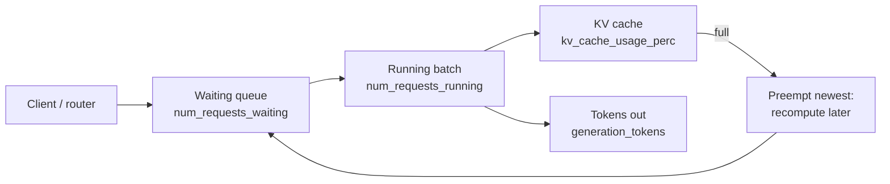
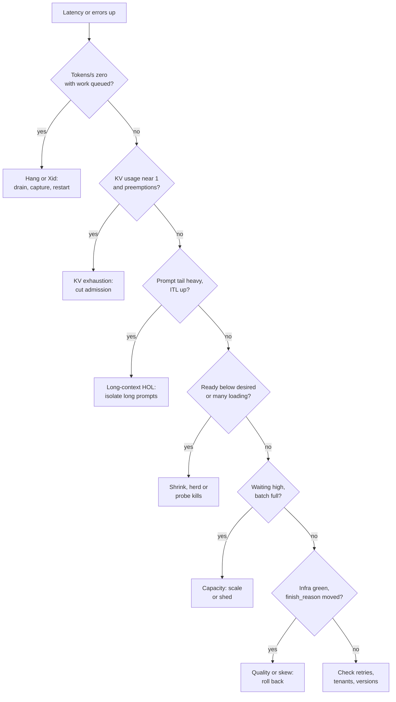

# 20.18 How LLM serving fails

## What the interviewer is testing

An alert fires at 02:10. Time to first token is five times its normal value and the pager says nothing else. This chapter serves the 30-minute production-incident round, and it also feeds the system design round, where you must say how your design fails. The job posting asks for knowledge of "how distributed back-ends fail" and for debugging "from kernel to application layer". It also lists incident detection, isolation and remediation with automation and runbooks.

One candidate reported that this round asks you to solve a production incident in 30 minutes. Nebius has not published the incidents it uses. So the skill being tested is a method: name the failure from a few signals, protect users first, and only then dig for root cause.

A realistic question in the interviewer's voice: "Your vLLM endpoint's p99 time to first token tripled in ten minutes. GPU utilisation looks fine. Walk me through what you check and what you do before you know the cause."

## The core ideas

### 1. Every failure is a story about three places where a request can wait

A request enters the engine and sits in the waiting queue. The scheduler moves it into the running batch when there is room. While it runs, its keys and values occupy the KV cache, which is GPU memory reserved for per-token attention state. Nearly every serving failure is one of these three places filling up, stalling or lying about itself.

vLLM exports all three as Prometheus metrics on `/metrics`. The waiting queue is `vllm:num_requests_waiting`. The running batch is `vllm:num_requests_running`. The cache is `vllm:kv_cache_usage_perc`, where 1 means 100 percent. Counters such as `vllm:num_preemptions` appear with a `_total` suffix on the wire, so in PromQL you write `vllm:num_preemptions_total`. That detail comes from the metrics design page and it catches people who copy a name from the source code.

The latency metrics split the request's life the same way. `vllm:request_queue_time_seconds` is time spent waiting. `vllm:time_to_first_token_seconds` is TTFT, and `vllm:inter_token_latency_seconds` is the gap between streamed outputs. If you know which of the three places is full, you already know which family of failure you have.



Before you touch anything in an incident, read these three numbers and the token rate. **Name the place that is full before you name a cause.**

### 2. Queue growth and TTFT spikes

Symptom. TTFT and end-to-end latency climb together, error rate stays low at first, and users say "it hangs before it starts answering". The engine is working at full speed but new requests wait for a slot.

Confirm. `vllm:num_requests_waiting` rises, `vllm:num_requests_running` sits at the batch limit, and `vllm:kv_cache_usage_perc` is below about 90 percent. The p99 of `vllm:request_queue_time_seconds` explains most of the TTFT increase. Token throughput is flat or high, which separates this from a hang.

Mitigate now. Add replicas if you have spare GPUs, or shed load at the router. vLLM can do the shedding itself. The setting `max_num_queued_reqs` rejects new requests with HTTP 503 once the in-flight limit is reached, so the client can retry on another instance. The setting `max_num_queued_tokens` bounds the prefill backlog, and the source comment gives the sizing rule as target TTFT times prefill throughput. Rejections show up as `vllm:admission_rejections_total` with a reason label.

Fix later. Autoscale on queue depth and queue time instead of GPU utilisation. A saturated batch can show high utilisation both when it is healthy and when it is drowning. The book Distributed AI Systems, chapter 9, recommends a bounded queue that returns 503 immediately rather than letting requests time out after a long wait. Keep 10 to 15 percent spare capacity in steady state, as AI Systems Performance Engineering, chapter 16, recommends, because autoscaling takes minutes to provision a GPU.

Decide: if waiting is high and KV usage is low, you are short of replicas, not memory.

### 3. KV-cache exhaustion and preemption

Symptom. Latency becomes uneven. Some requests stall mid-answer, then continue. Throughput drops even though demand is unchanged, because the engine redoes work.

The mechanism. Every running request needs KV space that grows with each token. When space runs out, vLLM preempts a request, frees its cache and recomputes it later. The vLLM optimisation page says V1 defaults to recompute mode, since recomputation is cheaper than swapping in that architecture. Recomputation burns GPU time and puts the victim back at the front of the queue, which hurts both its latency and everyone else's.

A worked example uses the book numbers. Hands-On LLM Serving and Optimization, chapter 5, gives KV size per token as two times layers times heads times head dimension times bytes. For Llama-2-7B in FP16 that is 2 x 32 x 32 x 128 x 2 bytes, which is 0.5 MB per token. A 24 GB GPU holding 14 GB of weights leaves 10 GB. That is 10 x 1024 / 0.5 = 20,480 tokens of cache, or about five requests that each reach 4,096 tokens. A burst of 16 such requests cannot all run.

Confirm. `vllm:kv_cache_usage_perc` is near 1 and `rate(vllm:num_preemptions_total[5m])` is above zero. The per-request histogram `vllm:request_num_preemptions` shows how many requests are hit. The vLLM docs show a warning line saying a sequence group was preempted by recompute mode because there is not enough KV cache space. That sample comes from an older scheduler file name, so grep your own logs for the word preempted instead of the exact text.

Mitigate now. The vLLM docs list four levers. Raise `gpu_memory_utilization`, lower `max_num_seqs` or `max_num_batched_tokens`, raise tensor parallel size, or raise pipeline parallel size. Lowering batch limits is the fastest, because it needs only a restart and trades throughput for stability.

Fix later. Size the cache from expected context length, not from the model size. The source for v0.32.0 shows a default `gpu_memory_utilization` of 0.92, while the book still says about 0.85, so check the version you run. Consider KV-cache quantisation, covered in section 11.

Decide: preemptions above zero mean you are over-admitting, so reduce admission before you add anything else.

### 4. Long-context head-of-line blocking

Symptom. Short prompts suddenly see slow streaming. Inter-token latency p99 rises although the queue is short and KV usage is moderate. One tenant has started sending very long documents.

The mechanism. Prefill of a long prompt is a large compute job. In vLLM V1, chunked prefill is on by default, and the scheduler batches all pending decodes first and then fills the remaining token budget with prefill chunks. This protects decodes, but a very large `max_num_batched_tokens` lets one prefill take most of each step. The docs say smaller values give better inter-token latency and larger values give better TTFT.

Confirm. Compare `vllm:request_prompt_tokens` p99 against p50. A tail that is eight or more times the median is a warning sign. In the classifier this ratio is a starting value I chose, not a vendor number. Also check that preemption is flat, which rules out section 3.

Mitigate now. Lower `max_num_batched_tokens`, or route long prompts to a separate pool. The scheduler also has `long_prefill_token_threshold`, which the source describes as the length above which a prompt counts as long for chunked prefill, so that long prompts cannot starve others. Its default is 0, which disables the cap.

Fix later. Separate prefill and decode pools, as the Nebius case study did [vendor], and add per-tenant context-length limits. AI Systems Performance Engineering, chapter 16, lists "decode-node hotspot or head-of-line blocking" and recommends inspecting router logs and enabling speculative decoding paths. Treat the speculative-decoding suggestion with care, for reasons in section 11.

Decide: if tail latency rises with the prompt-length tail, isolate long prompts rather than adding replicas to the shared pool.

### 5. GPU OOM at startup versus at load

Symptom, startup form. The container exits before it ever listens, and Kubernetes restarts it in a loop. Symptom, runtime form. The process dies hours later, under peak traffic, and a pod that was serving disappears.

The two have different causes, so the first question is when it died. At startup vLLM loads weights, runs a profiling pass and may capture CUDA graphs. The worker code in v0.32.0 prints a message that lists free memory, weights, peak activation and CUDA graph memory, and suggests a `--kv-cache-memory` value. Startup OOM means the sum of those parts does not fit in the requested fraction of the GPU. A co-tenant holding GPU memory is a common reason. The vLLM docs also warn that a stored `--kv-cache-memory` value is valid only on the same GPU with the same initial free memory.

Runtime OOM is different. The cache was sized correctly at startup, but a spike in activations, longer prompts or memory fragmentation consumed the headroom. AI Systems Performance Engineering, chapter 16, warns that repeated OOM crashes under peak load take GPUs out of the pool and cause cascading latency.

Confirm. Read the log around the exit, and read `kubectl describe pod` for the last state. Check `nvidia-smi` for other processes on the GPU. Compare `vllm:prompt_tokens` rate before the crash.

Mitigate now. For startup, lower `gpu_memory_utilization` or `max_model_len`, or free the GPU. For runtime, lower `max_num_batched_tokens` and cap prompt length at the gateway. Fix later by reserving activation headroom, one replica per GPU, and a startup test in CI that loads the exact config.

Decide: ask "startup or runtime" first, because the first points to sizing and the second to traffic.

### 6. CUDA and NCCL hangs and Xid errors

Symptom. Requests queue up, nothing finishes, and `rate(vllm:generation_tokens_total[1m])` is zero while waiting plus running is above zero. The process is alive. CPU is idle, and a GPU may sit at 100 percent.

A hang in tensor-parallel serving is often one rank waiting for another in a collective. The book Distributed AI Systems, chapter 9, notes that Docker's default shared memory is only 64 MB. Tensor-parallel workers route NCCL and IPC buffers through it. Too little space makes collectives hang with little diagnostic output. The vLLM troubleshooting page gives the debug switches: `NCCL_DEBUG=TRACE`, `CUDA_LAUNCH_BLOCKING=1` and `VLLM_TRACE_FUNCTION=1`. It warns that the last one slows generation by more than 100 times. It also offers `NCCL_P2P_DISABLE=1` as a temporary workaround only.

Here is a trap you must know. In v0.32.0 the `/health` route returns 200 unless the engine is marked dead, and the code behind it checks only an error flag. A hung but not crashed engine keeps answering 200. That is my reading of the source, so say it as "the health route reports a crash, not a stall". A deep check must send a real one-token request, or watch the token counter.

Xid errors are kernel-driver messages about GPU faults, visible in `dmesg`. The NVIDIA Xid catalog, last updated 2026-11-04 on the page I fetched, gives these examples.

| Xid | Name in catalog | What it means | Catalog action |
|---|---|---|---|
| 13 | Graphics Engine Exception | Usually an application fault | Restart the app |
| 31 | GPU memory page fault | Mostly application bugs, sometimes driver or hardware | Restart app, debug with Compute Sanitizer |
| 48 | Double Bit ECC Error | Uncorrectable memory error | Reset GPU or reboot node |
| 74 | NVLink Error | Link problem, may be reported by the healthy peer | Reset, then contact vendor |
| 79 | GPU has fallen off the bus | PCIe link lost or failing hardware | Restart the bare metal node, then contact support (NVIDIA Xid catalog, fetched 2026-11-09) |
| 94 and 95 | Contained and uncontained memory error | 94 hits one application, 95 needs a GPU reset | Restart app, or reset GPU |

Mitigate now. Capture logs and a stack dump, drain the replica from the pool and restart it. Cordon the node for hardware Xid codes. Fix later with NCCL timeouts, a watchdog on token rate, and automated cordon on fatal Xid codes. The handbook chapter 15.13 covers the profiling side of NCCL tail latency.

Decide: zero tokens with work present is a hang, and a green `/health` does not change that.

### 7. Slow weight load, cold start and thundering herd on restart

Symptom. After a deploy, node failure or autoscale event, replicas stay not-ready for minutes. Latency on the survivors worsens while the new ones load.

The mechanism comes from model size and storage speed. The book gives the size rule as parameters times bytes per parameter. A 70-billion-parameter model in FP16 is 70 x 2 = 140 GB. The book's table puts SSD bandwidth between 0.5 and 14 GB/s. One replica loading at 14 GB/s needs 10 seconds, and at 0.5 GB/s it needs 280 seconds. Distributed AI Systems says typical cold start, with warmup, is 30 to 60 seconds for the models it uses. Large models take longer.

The herd appears when many replicas load at once from one shared source. They split the bandwidth, so every one is slow. The script `herd_load_calc.py` shows the arithmetic for a 14 GB/s source.

```python
# code/part20/herd_load_calc.py
"""Weight-load time when many replicas pull from one shared source.
Model size = parameters x bytes per parameter (Hands-On LLM Serving, chapter 5).
Source bandwidth range 0.5 to 14 GB/s is the book's SSD row of Table 5-5."""


def weights_gb(params_billion: float, bytes_per_param: float) -> float:
    return params_billion * bytes_per_param


def load_seconds(params_billion, bytes_per_param, replicas, source_gb_per_s):
    """All replicas start together and share the source bandwidth equally."""
    if replicas < 1 or source_gb_per_s <= 0:
        raise ValueError("replicas and bandwidth must be positive")
    return weights_gb(params_billion, bytes_per_param) * replicas / source_gb_per_s


if __name__ == "__main__":
    for n in (1, 2, 8, 32):
        t = load_seconds(70, 2, n, 14)
        print(f"{n:>2} replicas of a 70B FP16 model from a 14 GB/s source: {t:7.0f} s")
```

I ran it. One replica takes 10 s, eight take 80 s each, and 32 take 320 s each. The equal-share model is a simplification, so treat the numbers as the shape of the problem.

Confirm. Read the model load time in the startup log. The vLLM troubleshooting page says to check whether weights sit on a slow network filesystem and recommends local disk. Use `--load-format dummy` to separate download and load from everything else. Also check CPU memory, since a large model can cause swapping while it loads.

Mitigate now. Stagger restarts and keep serving replicas in the pool. Pre-pull the weights to node-local disk. Fix later. vLLM can cut repeat boots in two ways. Reuse the `torch.compile` cache under `VLLM_CACHE_ROOT`. Pass back the `--kv-cache-memory` value from the previous start to skip memory profiling. Setting `VLLM_FORCE_AOT_LOAD=1` makes a cache miss fail loudly. Add a startup probe so Kubernetes waits for the load. Keep warm spares, which the performance book calls "no substitute" for pre-warmed idle nodes.

Decide: if many replicas load together, fix the rollout order and the weight source, not the engine.

### 8. Probes that hurt: liveness kills and silent pool shrink [vendor]

Two failures from the Nebius chat-app case study belong together. The case study says aggressive liveness probes were restarting healthy workers. It also says restarted workers sometimes did not rejoin the pool, so capacity shrank silently. Nebius has not published probe settings, so what follows is general method plus my own reasoning.

Liveness kill. A busy engine is slow to answer anything that goes through its queue. If the liveness probe has a short timeout, or calls a path that waits behind generation work, Kubernetes sees failures and restarts a healthy pod. The restart drops every in-flight request and starts a new weight load. The book Production Kubernetes, chapter 14, says a liveness probe should fail only when a restart is needed, such as a deadlock. Many apps use an endpoint that unconditionally returns 200. It says not to check external dependencies in liveness. It describes readiness as the place for temporary conditions such as warm caches and overload. It also explains the startup probe, which covers slow initialisation and then steps aside.

Silent shrink. A restarted worker has to pass readiness and be re-registered with whatever the router uses for discovery. If registration fails, the pod looks fine to Kubernetes but receives no traffic. Capacity drops from, say, eight replicas to five, and every alert that watches latency stays quiet until load rises. A reasonable design, which is my reasoning, alerts on ready versus desired replicas and on per-replica request rate being zero for a ready pod.

Confirm liveness kills with the pod's last state and events. The restart reason names the failed probe. Check generation rate just before the restart. If tokens were flowing, the worker was healthy and busy. Confirm shrink with ready replicas, the router's backend list and a per-backend request rate.

Mitigate now. Relax the liveness timeout and raise `failureThreshold`, which the Distributed AI Systems book suggests setting to 3 or higher. Move load checks to readiness. Restart workers that are ready but unregistered. Fix later with a startup probe, X+1 spare capacity [vendor], and an alert on ready less than desired. Handbook chapter 15.16 has worked probe numbers, and I did not re-verify them here.

Decide: liveness answers "should this process be killed", readiness answers "should it get traffic", and mixing them causes both of these failures.

### 9. Retry amplification during a partial outage

Symptom. A small outage becomes a large one. Half the replicas fail, and traffic arriving at the survivors doubles, then doubles again. Request rate at the gateway exceeds the user request rate.

The mechanism is arithmetic. If each attempt fails with probability p and a client allows k attempts, the expected attempts per request are the sum 1 + p + p squared, continuing up to p to the power k minus 1. I computed this for k = 4. At p = 0.1 it is 1.11 attempts. At p = 0.5 it is 1.875. At p = 0.8 it is 2.95. As load rises, p rises, so the load rises again. That loop is why the Nebius case study changed retry logic to stop amplification in partial outages [vendor].

Confirm. Compare gateway request rate against unique user requests. If you do not track unique requests, compare against the rate of successful responses. Look for `vllm:admission_rejections_total` rising together with retries from clients.

Mitigate now. Cut client retries, return 503 with a back-off hint, and shed at the edge. Fix later with a retry budget, jittered exponential back-off, a circuit breaker and idempotency keys. Chapter 20.21 covers these in depth. The book AI Systems Performance Engineering, chapter 16, adds that failing fast and applying backpressure give a stressed system room to recover.

Decide: during a partial outage, reduce the number of attempts first, because more capacity will not catch up with a growing retry loop.

### 10. Noisy tenants

Symptom. One customer's p99 is fine, another's is awful, and aggregate dashboards look normal. A single tenant is sending large batches or long prompts.

Confirm. Break prompt tokens and request rate down by tenant at the gateway. A tenant holding half or more of the prompt tokens while others queue is the signature. Be careful about putting tenant ID on engine histograms. The vLLM metrics page warns that every histogram bucket adds one series per label combination, so a tenant label multiplies series quickly.

Mitigate now. Apply that tenant's rate limit, or move them to a dedicated endpoint. Fix later with per-tenant token quotas and fair-share queueing at the router, which chapter 20.13 designs.

Decide: if the damage is uneven across tenants, look at who sent the tokens before you look at the GPUs.

### 11. Quality failures: finish_reason drift, corruption, speculative decoding and quantisation

Symptom. Nothing errors, latency is fine, and users complain that answers are cut off, repetitive or odd. This is the hardest failure to see, because every infrastructure signal is green. The Nebius case study lists alerts on finish_reason drift for this reason [vendor].

The signal. The counter `vllm:request_success_total` has a `finished_reason` label. In v0.32.0 the reasons are stop, length, abort, error and repetition. The source says error is a retryable request-level error returned as HTTP 500, and repetition means a repetitive token pattern was detected. A rise in the share of length, which means the model ran to its token limit, or any repetition finishes, is a drift signal. The classifier computes shares from rates.

KV-cache corruption. vLLM has a counter `vllm:corrupted_requests`, counting requests with NaNs in logits. In v0.32.0 the source registers it only when the environment variable `VLLM_COMPUTE_NANS_IN_LOGITS` is set. If you never set it, the metric is simply absent. Absence does not mean zero corruption.

Speculative decoding. The vLLM docs say speculative decoding is theoretically lossless up to hardware numerics, and that greedy output matches in their tests. They also say batch size changes can cause small variations. So a quality regression after enabling speculation is less likely to come from the algorithm than from a configuration change. The real trap is speed. If the draft rarely matches, you pay for drafts and save little. The design page gives the acceptance rate as accepted tokens over draft tokens, using `vllm:spec_decode_num_accepted_tokens_total` and `vllm:spec_decode_num_draft_tokens_total`. A rate below about 50 percent is my starting threshold, not a vLLM number.

Quantisation. Chapter 5 of Hands-On LLM Serving says lowering precision reduces model size and improves serving performance at the cost of some accuracy. Nebius markets about 99 percent quality for its quantised models [vendor]. Do not take any such claim on trust for your task. Gate each precision or KV-cache dtype change behind an evaluation set and a canary, and watch finish_reason shares during the canary.

A fourth cause is the sampling defaults. The vLLM troubleshooting page says that since v0.8.0 the default sampling parameters come from the model's `generation_config.json`, and `--generation-config vllm` restores the old defaults. An engine upgrade can change output length and style with no code change at all.

Mitigate now. Stop the rollout and roll back the change on the affected pool. Compare outputs on a fixed prompt set. Fix later with canaries that include output-quality checks.

Decide: when infrastructure is green and users are unhappy, check finish_reason shares and the last config change.

### 12. Version skew between router and engine

Symptom. Errors or odd outputs begin right after a rollout, and only on some routes. One side was upgraded, the other was not.

The mechanism. A router and an engine share assumptions: API fields, token accounting, metric names and defaults. vLLM's own docs show the risk. Its metrics deprecation policy says a metric deprecated in version X.Y is hidden in X.Y+1 and removed in X.Y+2. A dashboard or autoscaler that reads a removed metric goes blind, and the drop shows as "no data", which many alert rules treat as healthy. The Grafana text in the v0.32.0 metrics design page still mentions a swapped-requests metric, while the v0.32.0 source defines none, which shows how docs and code drift.

Confirm. Put the engine version and router version in labels or a startup log line, and compare across hops. Check which metric names exist with a query against `/metrics`.

Mitigate now. Pin both sides to a known pair and roll back the newer one. Fix later with a compatibility matrix in CI, a rollout order for the control plane and data plane, and alerts that treat missing series as a fault.

Decide: after any rollout, check versions at every hop before you debug behaviour.

### 13. A decision tree, an alert-to-cause table and a classifier

During the incident you have three minutes to choose a direction. The tree uses only the signals above.



The table maps the alert you are most likely to receive to the causes to rank first and the one check that separates them.

| Alert | Likely causes, in order | First check |
|---|---|---|
| TTFT p99 high | Queue growth, cache hit collapse, head-of-line blocking, KV exhaustion | `vllm:request_queue_time_seconds` p99 versus `vllm:num_requests_waiting` |
| Inter-token latency high | KV exhaustion, head-of-line blocking, low speculative acceptance | `vllm:num_preemptions_total` rate and prompt-token tail |
| Waiting queue growing | Capacity, noisy tenant, retry amplification | `vllm:num_requests_running` at limit, per-tenant tokens |
| 503s rising | Admission limit, pool shrink, overload | `vllm:admission_rejections_total` and ready replicas |
| Tokens per second is zero | Hang, Xid fault, crash loop | `dmesg` Xid lines and NCCL log |
| Pods restarting | Liveness kill, startup OOM, runtime OOM | Pod last state and restart reason |
| Ready below desired | Shrink, herd, slow load | Router backend list, load time in startup log |
| Output complaints, infra green | Finish_reason drift, quantisation, version skew, sampling defaults | `vllm:request_success_total` shares by finished_reason |

Writing the table by hand teaches it, and encoding it makes it testable. The classifier in `code/part20/` takes a set of readings, optionally with a calm baseline, and returns ranked causes with evidence, a confirmation step, an action now and a fix later. Readings use real vLLM metric names with a derivation after an at sign, such as `vllm:time_to_first_token_seconds@p99`. Signals that vLLM does not export, such as Xid codes or restart reason, carry a `sig:` prefix so nobody mistakes them for metrics. The scoring engine is short.

```python
# code/part20/failure_model.py
"""Scoring engine for the LLM serving failure-signature classifier.

Reading keys are either a vLLM metric name with a derivation after "@",
for example "vllm:time_to_first_token_seconds@p99", or a "sig:" signal that
does not come from vLLM (probe restarts, Xid codes, replica counts).
"@rate" means rate() over the exported "_total" counter series.
"""
from dataclasses import dataclass, field
from typing import Any, Callable, Optional

FINISH_REASONS = ("stop", "length", "abort", "error", "repetition")


class Readings:
    """Current readings plus an optional baseline taken from a calm period."""

    def __init__(self, current: dict, baseline: Optional[dict] = None):
        self.current = dict(current)
        self.baseline = dict(baseline or {})
        self.missing: set = set()

    def get(self, key: str) -> Any:
        if key not in self.current:
            self.missing.add(key)
            return None
        return self.current[key]

    def up(self, key: str, factor: float) -> Optional[bool]:
        """True when current >= factor * baseline. None if either is unknown."""
        now, base = self.get(key), self.baseline.get(key)
        if now is None or not base:
            return None
        return now >= factor * base

    def finish_share(self, reason: str, baseline: bool = False) -> Optional[float]:
        src = self.baseline if baseline else self.current
        rates = {r: src.get(f"vllm:request_success@rate:{r}") for r in FINISH_REASONS}
        if all(v is None for v in rates.values()):
            return None
        total = sum(v or 0.0 for v in rates.values())
        return (rates[reason] or 0.0) / total if total else None


Check = tuple  # (weight, description, fn(Readings) -> Optional[bool])


@dataclass(frozen=True)
class Rule:
    cause: str
    confirm: str
    mitigate_now: str
    fix_later: str
    checks: tuple = field(default_factory=tuple)  # first check is the anchor


@dataclass
class Hypothesis:
    cause: str
    score: float
    evidence: list
    unknown: list
    confirm: str
    mitigate_now: str
    fix_later: str


def evaluate(rule: Rule, r: Readings) -> Optional[Hypothesis]:
    total = sum(w for w, _, _ in rule.checks)
    hit, evidence, unknown = 0.0, [], []
    for i, (weight, text, fn) in enumerate(rule.checks):
        ok = fn(r)
        if i == 0 and not ok:
            return None  # the anchor symptom must be present
        if ok is None:
            unknown.append(text)
        elif ok:
            hit += weight
            evidence.append(text)
    if not evidence:
        return None
    return Hypothesis(rule.cause, round(hit / total, 3), evidence, unknown,
                      rule.confirm, rule.mitigate_now, rule.fix_later)


def rank(rules: list, current: dict, baseline: Optional[dict] = None) -> list:
    """Return hypotheses sorted by score, best first. Ties break on cause name."""
    r = Readings(current, baseline)
    found = [h for h in (evaluate(rule, r) for rule in rules) if h]
    return sorted(found, key=lambda h: (-h.score, h.cause))
```

Each rule lists weighted checks. The first check is the anchor symptom. If it is false or unknown the cause is dropped, so a rule can never match on side evidence alone. Unknown checks are listed as "not measured", so the output tells you what to collect next. Here is one rule from `failure_rules.py`, which has 19 rules in total.

```python
# excerpt: the KV-exhaustion rule in failure_rules.py
Rule("kv_cache_exhaustion_preemption",
     "kv_cache_usage_perc near 1 and rate(vllm:num_preemptions_total) above 0",
     "lower max_num_seqs or max_num_batched_tokens, or add replicas",
     "raise gpu_memory_utilization, add tensor parallel, quantise KV cache, resize for context length",
     ((3, "KV usage at or above 95 percent", gt(KV, T["kv_full"])),
      (3, "preemptions are happening", gt(PRE, 1e-9)),
      (1, "inter-token latency p99 at least 2x baseline", up(ITL, 2)),
      (1, "requests waiting", gt(W, 1)),
      (1, "end-to-end p99 at least 2x baseline", up(E2E, 2)))),
```

Decide: in the room, use the tree first and the table second, and say the classifier's logic aloud as "anchor symptom, then supporting evidence".

## How to answer out loud

**Question 1. "TTFT tripled. What do you do?"** Say the order. First, check whether users are being hurt and whether it is one tenant, one route or everything. Then read waiting, running, KV usage and token rate. State your hypothesis from those four numbers. Mitigate before root cause: shed or scale. Name two follow-ups, the queue-time histogram and the preemption rate. Expect the interviewer to say "KV usage is 98 percent", which moves you to section 3.

**Question 2. "Pods keep restarting and nobody changed anything."** Ask for the restart reason and the last state. Split three ways: liveness, OOM at startup, OOM at runtime. For liveness, ask whether tokens were flowing. Say that liveness should be local and unconditional, readiness should carry load state, and a startup probe covers the weight load. Name the cost of a restart: lost in-flight requests and a fresh weight load.

**Question 3. "Capacity seems lower than it should be, but nothing is alerting."** Say "silent shrink". Compare ready with desired, then compare the router's backend list with ready pods. Mitigate by re-registering or replacing workers. The fix is an alert on ready versus desired and X+1 spare capacity. Mention that this symptom comes from the vendor case study, and say that Nebius has not published its detection design.

**Question 4. "Users say answers are worse. Metrics are green."** Say that infrastructure health and output quality are different signals. Check the last change: engine version, quantisation, speculation, sampling defaults. Show finish_reason shares against a baseline. Roll back the change on a canary pool, then compare outputs on a fixed prompt set.

**Question 5. "Half your replicas die. Why does the rest of the system collapse?"** Explain retry amplification with the arithmetic. At a failure rate of 0.5 and four attempts the load is 1.875 times. It rises as the failure rate rises. Name the defences: retry budget, jitter, circuit breaker, edge shedding, and the 503 admission limit. Expect "what is a retry budget", and answer with a cap on retries as a fraction of requests.

## Worked scenarios

### Scenario A. The 16-request burst

A 24 GB GPU serves Llama-2-7B in FP16. A batch job sends 16 requests, each with a 3,000-token prompt and 1,000 output tokens. Users report slow, uneven streaming.

Reasoning. Weights take 14 GB, leaving 10 GB. At 0.5 MB per token that is 20,480 tokens. Each request grows to 4,000 tokens. By prompt size six are admitted, and the rest wait, and as admitted requests grow, the cache fills and the newest is preempted. The script models that behaviour. It is a toy and not vLLM, and it assumes the newest request is the victim. I did not verify vLLM's actual victim policy.

```python
# code/part20/kv_pressure_sim.py
"""Toy model of KV-cache pressure with preemption by recompute. NOT vLLM.
Capacity comes from the Hands-On LLM Serving book example: Llama-2-7B in FP16
on a 24 GB GPU leaves 10 GB, and each token needs 0.5 MB of KV cache."""
import json
import sys
from collections import deque


def simulate(n_req=16, prompt=3000, out=1000, free_gb=10.0, mb_per_token=0.5):
    cap = int(free_gb * 1024 / mb_per_token)
    waiting = deque({"p": prompt, "left": out, "gen": 0} for _ in range(n_req))
    running, steps, preempts, peak, max_wait, recompute = [], 0, 0, 0.0, 0, 0
    done = 0
    while waiting or running:
        steps += 1
        used = sum(r["p"] + r["gen"] for r in running)
        while waiting and used + waiting[0]["p"] + waiting[0]["gen"] <= cap:
            r = waiting.popleft()
            used += r["p"] + r["gen"]
            running.append(r)
        max_wait = max(max_wait, len(waiting))
        for r in running:
            r["gen"] += 1
            r["left"] -= 1
        used = sum(r["p"] + r["gen"] for r in running)
        while used > cap and len(running) > 1:  # newest request is evicted
            v = running.pop()
            used -= v["p"] + v["gen"]
            recompute += v["p"] + v["gen"]
            v["p"], v["gen"] = v["p"] + v["gen"], 0  # redo prompt plus generated text
            waiting.appendleft(v)
            preempts += 1
        peak = max(peak, used / cap)
        finished = [r for r in running if r["left"] <= 0]
        done += len(finished)
        running = [r for r in running if r["left"] > 0]
    return {"capacity_tokens": cap, "steps": steps, "preemptions": preempts,
            "peak_kv_usage": round(peak, 3), "max_waiting": max_wait,
            "recomputed_tokens": recompute, "finished": done}


if __name__ == "__main__":
    kw = json.loads(sys.argv[1]) if len(sys.argv) > 1 else {}
    print(json.dumps(simulate(**kw), indent=2))
```

I ran it. With 10 GB free the toy reports capacity 20,480 tokens, peak usage 1.0, 2 preemptions, 11 requests waiting at the worst moment, 6,759 recomputed tokens and 3,000 steps. With 34 GB free, the L40S case from the book, it reports no preemptions and 1,000 steps. The same 16 requests take three times as many steps on the small GPU, because admission is limited.

Answer. This is KV exhaustion with queueing, section 3 and section 2 together. Now: lower the batch size limits or send the job to a bigger pool. Later: size the endpoint for the longest realistic request, or add replicas.

### Scenario B. Pods restart under load

Traffic doubles. Six pods of eight restart within ten minutes. Latency rises, and nothing in the logs shows a crash.

Reasoning. Ask for the restart reason first. Suppose it says liveness probe failed. Then check tokens per second before the restarts. If tokens flowed, the workers were busy, not dead, and the probe was the problem. Now check the pool. Restarted pods need a fresh load, and meanwhile the two survivors take all traffic. That raises queue time, which makes more probes fail, which is a loop. Also check ready versus desired, because restarted workers may not have rejoined.

The sample file `samples/liveness_kill.json` encodes these readings. The classifier output, which I ran, ranks the liveness kill and the silent shrink first, both at score 1.0, and queue growth third at 0.4. The two are linked, so seeing both is correct.

Answer. Relax the liveness timeout, raise the failure threshold, add a startup probe and make liveness local. Re-register or replace unregistered workers. Add the ready-versus-desired alert.

### Scenario C. A rolling restart of eight replicas

A new image is rolled out and all eight replicas restart together. The model is 70 billion parameters in FP16, loaded from a shared source that delivers 14 GB/s.

Reasoning. Weights are 140 GB. One replica alone needs 10 seconds. Eight in parallel need 80 seconds each under the equal-share model, during which the endpoint has no capacity. If clients retry during that gap, the retry arithmetic in section 9 makes the first minute after recovery worse.

Answer. Restart in small groups, keep at least X+1 replicas serving, and stage the weights on local disk so the source stops being the shared bottleneck. A real run on your own storage may differ, so measure the load time in the startup log and use that number in your answer.

## Hands-on lab

Everything here runs on a laptop. I ran steps 1 to 5. Step 6 needs a GPU host and was not run.

1. From the repo root, run the toy KV simulation and read the output.

```bash
python3 code/part20/kv_pressure_sim.py
python3 code/part20/kv_pressure_sim.py '{"free_gb": 34}'
```

Expected result: 2 preemptions and 3,000 steps for the first command, and 0 preemptions and 1,000 steps for the second.

2. Run the herd calculation and confirm the 10, 20, 80 and 320 second lines.

```bash
python3 code/part20/herd_load_calc.py
```

3. Classify the two sample incidents.

```bash
python3 code/part20/classify_failures.py code/part20/samples/kv_exhaustion.json
python3 code/part20/classify_failures.py code/part20/samples/liveness_kill.json
```

Expected result: the first prints `kv_cache_exhaustion_preemption` at 0.889 on top. The second prints the liveness kill and the silent shrink at 1.0.

4. Write your own readings file from a real incident you remember, using the keys from `failure_rules.py`. Run the classifier and read the "not measured" line. Decide whether the missing signals were things you would really have checked.

5. Run the tests.

```bash
python3 -m pytest code/part20/test_failure_classifier.py code/part20/test_sim_and_calc.py -q
```

Expected result: 23 passed.

6. On a GPU host, start `vllm serve` with a small model, send load, and `curl` the `/metrics` endpoint. Confirm that the metric names in section 1 are present and note the `_total` suffix on counters. Expected shape of the output: lines starting with `vllm:` and a `model_name` label. This step was not run.

## Drill questions

1. Name the three places a request can wait in an LLM engine and the metric for each.

<details><summary>Answer</summary>

The waiting queue is `vllm:num_requests_waiting`. The running batch is `vllm:num_requests_running`. The KV cache is `vllm:kv_cache_usage_perc`, where 1 means full.

</details>

2. Why do you write `vllm:num_preemptions_total` in PromQL when the source defines `vllm:num_preemptions`?

<details><summary>Answer</summary>

Prometheus counters are exposed with a `_total` suffix. The vLLM metrics design page says the suffix is stripped in the definition and added when the series is exposed.

</details>

3. What does vLLM do when the KV cache is full, and what is the default mode in V1?

<details><summary>Answer</summary>

It preempts a request, frees its cache and recomputes it later. The default mode in V1 is recompute, because the docs say recomputation has lower overhead than swap there.

</details>

4. Name three levers that reduce preemptions.

<details><summary>Answer</summary>

Raise `gpu_memory_utilization`, lower `max_num_seqs` or `max_num_batched_tokens`, and raise tensor parallel size. Pipeline parallel size is a fourth.

</details>

5. Compute the KV cache per token for Llama-2-7B in FP16, and how many 4,096-token requests fit in 10 GB.

<details><summary>Answer</summary>

Two times 32 layers times 32 heads times head dimension 128 times 2 bytes gives 524,288 bytes, which is 0.5 MB. Ten GB is 10,240 MB, divided by 0.5 MB times 4,096 tokens gives 5 requests.

</details>

6. Your engine has work queued and zero token rate, but `/health` returns 200. Why?

<details><summary>Answer</summary>

In v0.32.0 the health route fails only when the engine is marked dead. A hang does not set that flag. So the route reports a crash, not a stall. Use the token rate or a real one-token probe.

</details>

7. How do you tell startup OOM from runtime OOM, and what differs in the fix?

<details><summary>Answer</summary>

Startup OOM happens during load or memory profiling, before serving, so sizing is wrong or a co-tenant holds memory. Fix by lowering `gpu_memory_utilization` or `max_model_len`. Runtime OOM happens under traffic, so headroom is too small. Fix by lowering batch limits and capping prompt length.

</details>

8. Why does a short liveness timeout hurt a busy LLM worker, and what should liveness check instead?

<details><summary>Answer</summary>

A busy engine answers slowly, so the probe fails and Kubernetes restarts a healthy pod, dropping requests and forcing a weight load. Liveness should fail only when a restart is needed, and it should not check external dependencies. Readiness carries load state.

</details>

9. Give the formula for expected attempts per request with failure probability p and k attempts, and its value at p = 0.5, k = 4.

<details><summary>Answer</summary>

The sum of p to the power i, for i from 0 to k minus 1. At 0.5 and 4 attempts it is 1 + 0.5 + 0.25 + 0.125, which is 1.875.

</details>

10. Infrastructure is green and users say answers are cut off. What do you check?

<details><summary>Answer</summary>

The share of `finished_reason` equal to length in `vllm:request_success_total`, compared with a baseline, plus repetition finishes. Then the last change: engine version, quantisation, speculation, or sampling defaults from `generation_config.json`.

</details>

## Common mistakes and weak answers

Saying "I would check GPU utilisation" as your first move. Utilisation is high both when the system is healthy and when it is saturated. Say you would read the waiting queue, the batch, KV usage and the token rate.

Jumping to root cause before mitigation. The interviewer scores whether users are protected in the first minutes. Shed, scale or roll back first, then investigate.

Trusting `/health`. In the version I read it reports a crash, not a stall. Say you would watch token rate or send a real one-token request.

Putting load checks into liveness. This restarts healthy workers and causes a herd. Say that readiness carries load state and a startup probe covers the load.

Presenting numbers as facts. Say "my starting threshold is" for tails, ratios and acceptance rates, and say that Nebius has not published its own thresholds.

Claiming Nebius internals. Say "the case study says" and tag it as vendor material. Say "a reasonable design is" for everything else.

Forgetting quality failures. Many candidates treat only latency and errors as incidents. Mention finish_reason drift, and say it needs a baseline.

## Connections to the rest of the handbook

- 15.3 vLLM in depth (`c15-03`) explains the scheduler and cache that this chapter's failures come from.
- 15.13 Profiling, debugging and tuning inference at scale (`c15-13`) covers TTFT versus inter-token stalls, preemption debugging and NCCL tail latency.
- 15.15 Autoscaling inference (`c15-15`) covers the fix for queue growth.
- 15.16 Production serving stack and reliability (`c15-16`) covers probes, XID remediation and circuit breakers.
- 17.6 Alerting, SLOs and health checks (`c17-06`), 17.7 Failure modes and detection (`c17-07`), 17.11 Incident response (`c17-11`) and 17.15 On-call runbooks (`c17-15`) cover the generic side.
- 20.13 Design: multi-tenant LLM API (`c20-13`) designs the tenant isolation that section 10 depends on.
- Later in this volume: 20.19 SLIs and SLOs, 20.20 autoscaling, 20.21 routing and retries, 20.26 incident role-play.

## Sources and review notes

Sources and dates fetched (2026-11-09):

- vLLM release v0.32.0, published 2026-10-18, the latest stable release at fetch time. A v0.33.0rc3 tag was also listed. Files read at tag v0.32.0 from the vllm-project/vllm repository: `docs/usage/metrics.md`, `docs/design/metrics.md`, `docs/configuration/optimization.md`, `docs/usage/troubleshooting.md`, `docs/features/speculative_decoding/README.md`, `vllm/v1/metrics/loggers.py`, `vllm/config/scheduler.py`, `vllm/config/cache.py`, `vllm/v1/engine/__init__.py`, `vllm/v1/engine/async_llm.py`, `vllm/entrypoints/serve/instrumentator/health.py`, `vllm/v1/worker/gpu_worker.py`. The metrics table in the docs is generated at build time, so metric names were taken from `loggers.py`.
- NVIDIA Xid catalog, docs.nvidia.com/deploy/xid-errors, page showing "Last updated on Nov 04, 2026".
- Hands-On LLM Serving and Optimization, chapter 5 "Challenges When Serving LLMs": model loading, KV cache size, memory table.
- AI Systems Performance Engineering, chapter 16 "Profiling, Debugging, and Tuning Inference at Scale": troubleshooting table, error handling, headroom, memory.
- Distributed AI Systems, chapter 9 "Production LLM Serving Stack": cold start, backpressure, probe settings, shared memory.
- Production Kubernetes, chapter 14 "Application Considerations": liveness, readiness and startup probes.
- LLMs in Production, chapter 6 "Large language model services": read for batching, rate limiting and autoscaling. No claim in this chapter depends on it beyond general background.
- Nebius chat-app case study, as summarised in `planning/VOLUME_20_NEBIUS_SRE_PLAN.md` section 1, tagged vendor. The plan does not record a URL.

Explicitly labelled inferences:

- That a hung engine keeps returning 200 on `/health`. This is my reading of the v0.32.0 source, not a documented statement.
- All thresholds in the classifier, including the 50 percent acceptance rate, the 8x prompt-length tail, 95 percent KV usage and the 15-point finish_reason shift.
- The explanation of why Nebius liveness probes killed healthy workers, and the design that alerts on ready versus desired replicas.
- That a busy engine answers probes slowly. The book states the general rule for liveness probes but not this vLLM-specific mechanism.
- The equal-share model in the herd calculation.
- That vLLM's preemption victim is the newest request. The toy assumes it.

Not verified:

- No real vLLM server was started, so no metric output, log line or `/metrics` text was observed. The preemption log line is quoted from the docs and may differ in your version.
- The Kubernetes probe fields come from the book and were not checked against the current Kubernetes docs.
- I did not check Nebius Token Factory documentation for the engine version it runs.
- The book's default of about 0.85 for `gpu_memory_utilization` conflicts with 0.92 in the v0.32.0 config class. Real defaults can also be set when the engine config is created, so read the startup log.
- Nebius has not published its alert thresholds, probe settings or router design.
