# 20.19 SLIs, SLOs and alerts for token APIs

## What the interviewer is testing

You are halfway through the system design round. You have drawn the gateway, the router and the GPU pools on the whiteboard, and the boxes look tidy. The interviewer taps the marker against the gateway box and asks: "How will you know this is healthy, and what wakes you up at night?" This chapter is your answer to that question. It is also the part of a design that is easiest to rush, because the boxes feel like the real work.

The job posting asks for "alert design and SLOs for high-throughput APIs". Those words tell you what the team cares about. They want someone who can say, in numbers, when a service is good enough, and who can design an alert that wakes a person only when it matters. The plan for this volume records that wording from the posting. The same section of the plan lists what Nebius shows its own customers: end-to-end latency at p50, p90 and p99, time to first token, token throughput, and errors by status code. It also records a vendor case study that mentions alerts on tail time to first token, cache drops, finish reason drift and decode error bursts, and a 99.9% SLA on dedicated endpoints. All of this is marketing or posting text. Nebius has not published its SLO definitions or alert thresholds, so the interviewer wants to see your reasoning, not recall.

This chapter serves the system design round and the 30-minute incident round. In design you state the SLIs and the alert policy. SLI stands for service level indicator, which is the measurement itself, and SLO stands for service level objective, which is the target you hold that measurement against. In the incident you read a burn-rate page and decide what to check first.

A realistic question: "You own the SLOs for a streaming chat completions endpoint on shared GPUs. Which indicators do you choose, what targets, and exactly when does it page you? Give me numbers."

## The core ideas

### 1. A token API breaks the usual SLI recipe

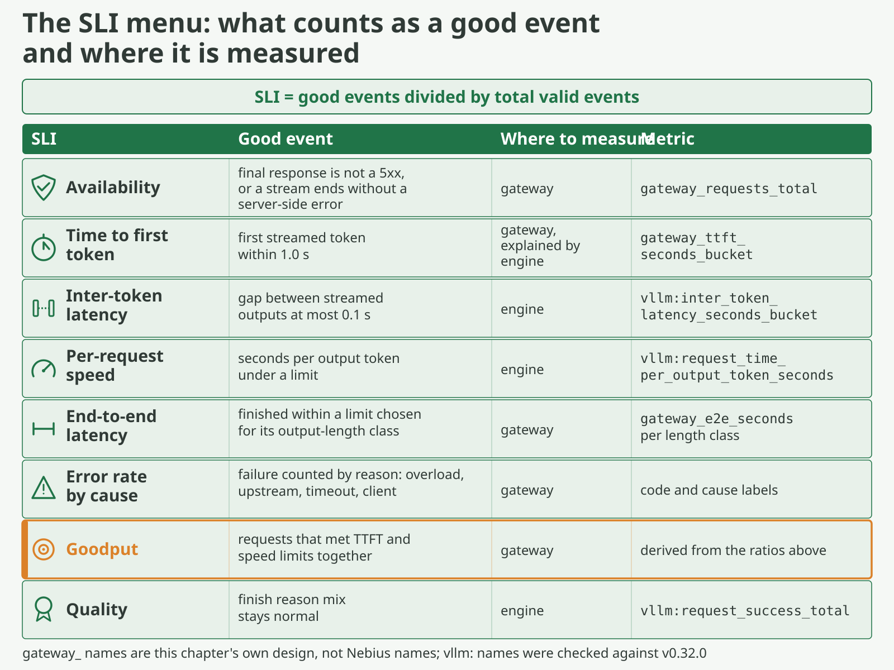

*Figure 20.19.1. For each SLI say where the number comes from and what counts as bad.*

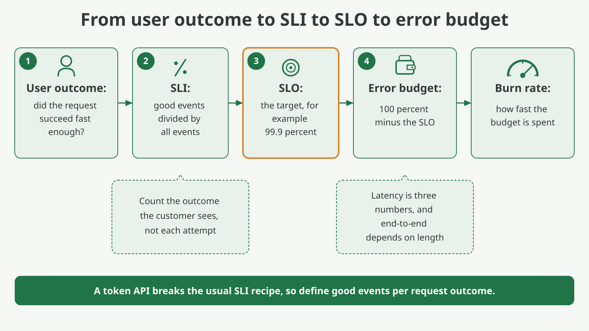

*Figure 20.19.2. The SLI recipe runs from user outcome to an SLI ratio, an SLO target and an error budget, with the burn rate showing how fast the budget is spent.*

Suppose your team's dashboard for a normal web API shows a green line for availability and a single latency number per request. That picture made sense for years, and it is the reason many people reach for the same two charts on a token API. A request arrives, the server works, and one response comes back with a status code. Availability is the share of non-error status codes, and latency is one number per request. A token API does not behave like that.

A streaming completion sends its HTTP status line when the first token is ready. Everything after that is a long stream whose length the client chose. The request can fail halfway with a status of 200 already sent. The latency of a request with 20 output tokens and one with 2,000 output tokens differ by a factor of about 100 even when the system is perfectly healthy. One latency number per request mixes two different things, and the mix hides the one that matters to the user.

The Google SRE Workbook chapter "Implementing SLOs" gives the recipe that still holds. An SLI is a ratio: good events divided by total events. For a request-driven service it lists availability, latency and quality as the main kinds. Your work is to define "good" for each kind in a way that matches streaming, and that definition is the part the interviewer will test.

Here is what a careless definition looks like in practice. Suppose you count every request that returned a status code as "good" when the code is below 500. A stream that sends its 200 header, streams half a reply and then dies on the server still counts as good. The dashboard stays green while the customer sees a sentence stop in the middle. The fix is not a new tool. It is a sharper answer to the question "what is a good event for this kind of request?", and that answer changes once the response is a stream.

**Decide first what a good event is, then count good events over all valid events.**

| SLI | Good event | Where to measure | Metric used in this chapter |
|---|---|---|---|
| Availability | Final response is not a 5xx, or a stream ends without a server-side error | Gateway | `gateway_requests_total` |
| Time to first token | First streamed token arrives within 1.0 s | Gateway, explained by engine | `gateway_ttft_seconds_bucket` |
| Inter-token latency | Gap between streamed outputs at most 0.1 s | Engine | `vllm:inter_token_latency_seconds_bucket` |
| Per-request speed | Seconds per output token under a limit | Engine | `vllm:request_time_per_output_token_seconds` |
| End-to-end latency | Finished within a limit chosen for its output-length class | Gateway | `gateway_e2e_seconds` per length class |
| Error rate by cause | Failure counted by reason: overload, upstream, timeout, client | Gateway | `code` and `cause` labels |
| Goodput | Requests that met TTFT and speed limits together | Gateway | derived from the ratios above |
| Quality | Finish reason mix stays normal | Engine | `vllm:request_success_total` |

Read the table as a menu rather than a checklist. You do not need all eight rows on day one. You do need to say, for each row, where the number comes from and what counts as bad. The first row is the familiar one, and the others each fix a blind spot in the familiar one. Time to first token, usually shortened to TTFT, is the wait before the first word appears. Inter-token latency, usually shortened to ITL, is the gap between one streamed token and the next. Goodput is a word you will hear more often in this volume, and section 9 explains it in full.

The metrics starting with `gateway_` are this chapter's own design. They are not Nebius names. The `vllm:` names are real and were checked against the vLLM v0.32.0 source, as the sources section explains.

### 2. Latency is three numbers, and end-to-end depends on length

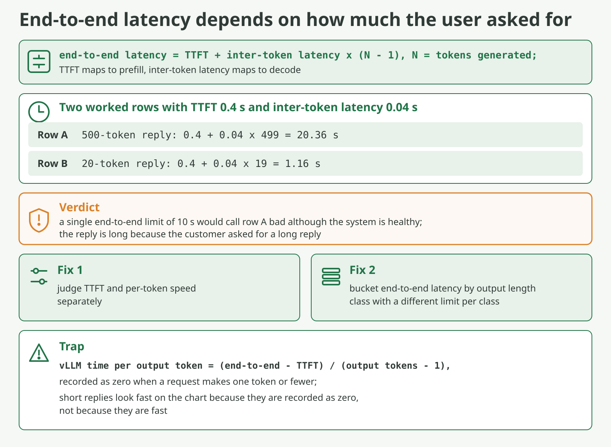

*Figure 20.19.3. Judge first-token wait and per-token speed instead of one end-to-end limit.*

Your customer reads the first words of a reply, then watches the rest appear. The wait before the first word and the speed afterwards are two separate experiences, and a single number cannot describe both. Picture two customers. One asked a yes-or-no question and got a short answer. The other asked for an essay. Both are happy with a healthy system, yet their end-to-end times differ by a wide margin. The book Hands-On LLM Serving and Optimization, in Chapter 4 under "Latency Metrics", names three measures: end-to-end latency, time to first token and time per output token.

The same section gives the relation. Writing N for the number of tokens generated, the end-to-end latency equals TTFT plus inter-token latency times N minus 1. The book also says time to first token maps to the prefill phase and inter-token latency maps to the decode phase. Prefill is the step where the engine reads the whole prompt once. Decode is the step that produces one new token at a time. So when TTFT is bad you look at prefill and queueing. When inter-token latency is bad you look at decode, batch size and memory.

Here is the length problem as arithmetic. Take a reply of 500 tokens with TTFT of 0.4 s and inter-token latency of 0.04 s. The end-to-end latency is 0.4 plus 0.04 times 499, which is 20.36 s. A reply of 20 tokens at the same speeds takes 0.4 plus 0.04 times 19, which is 1.16 s. A single end-to-end limit of 10 s would call the first request bad even though the system is healthy. The first reply is long because the customer asked for a long reply, not because the service failed.

There are two honest ways out. The first is to judge time to first token and per-token speed separately, since neither depends on how much the user asked for. The second is to bucket end-to-end latency by output length class and set a different limit per class. vLLM computes per-request time per output token as end-to-end latency minus TTFT, divided by output tokens minus one. Its design page says that value is recorded as zero when a request makes one token or fewer. Remember that when you read the histogram, because those zeros pull the low buckets up. A histogram that looks better than it should is often a histogram full of these zeros.

Consider how this plays out on a dashboard. A team plots the per-token time for all requests, and the line looks healthy and low. Someone asks why the short replies look so fast, and the answer is that the short replies were recorded as zero, not as fast. Nothing was broken in the engine. The reading was flattered by how the number is defined. Before you trust a per-token chart, find out how it treats the shortest replies, and say so when you present it.

The book LLMs in Production adds a user view in Chapter 6. It says keeping tokens per second above the reading speed of an average user keeps the experience good, and that streaming lets you worry about a steadier metric than whole-response time. In other words, the user does not wait for the whole answer, so your metric should not make them wait for it either.

**Never put one end-to-end limit on all outputs, judge first-token wait and per-token speed instead.**

### 3. Why averages lie

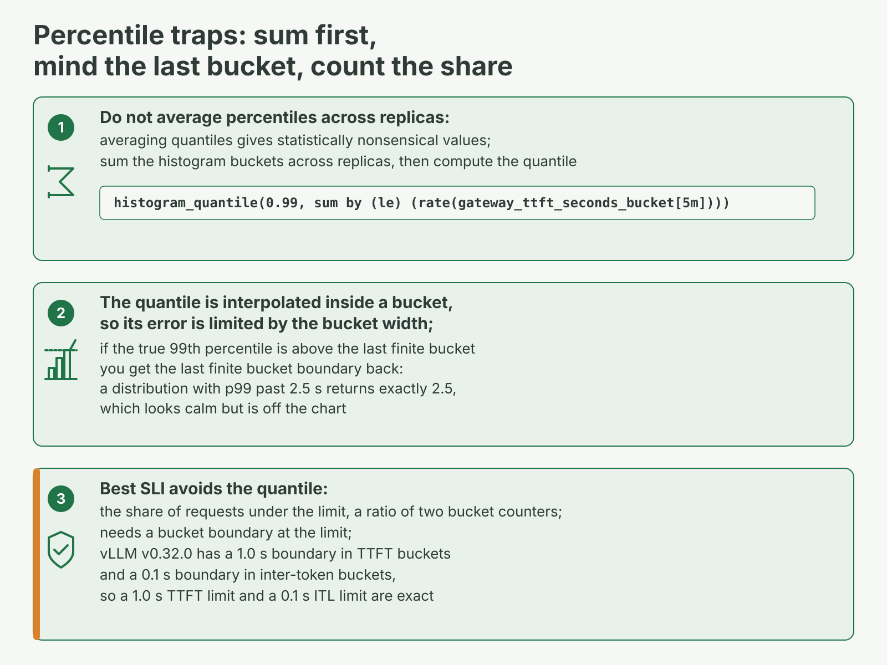

*Figure 20.19.4. Define latency SLIs as the share of requests under a limit, with a bucket boundary at that limit.*


*Figure 20.19.5. The mean hides the slow tail. Nine hundred and fifty fast requests pull the average under the limit while fifty users wait eight seconds.*

An alert fires on "average TTFT above 1 s". Nothing fires, and customers are angry. Here is how that happens, step by step, so you can explain it in the room.

Take 1,000 requests. Nine hundred and fifty start streaming after 0.4 s. Fifty wait 8 s because they queued behind a long prompt. The mean is 950 times 0.4 plus 50 times 8, divided by 1,000. That is 380 plus 400, which is 780, so 0.78 s. The mean sits below a 1 s limit while five percent of your users waited eight times too long. The average did its job of summarising, and it also hid the people who were hurt.

Systems Performance by Brendan Gregg makes the same point in Chapter 2, section 2.8. It says averages are a summary statistic that hides details. It describes disk latency with occasional outliers above 100 ms while the average was close to 1 ms. It also warns that performance is often bimodal, with one fast path and one slow path such as cache hits and misses. Prefix-cache hits against misses on a token API are exactly that shape. A request that finds its prefix in cache starts quickly, and one that misses waits for the whole prompt to be processed again. The same chapter adds a time lesson: a monitoring tool reporting five-minute averages hid CPU spikes that reached 100% for seconds.

Percentiles fix part of this. The SRE book, in "Service Level Objectives", says a high percentile such as the 99th shows a plausible worst case and that the median shows the typical case. Percentiles bring their own trap. You cannot average percentiles across replicas. The Prometheus histogram guide says averaging quantiles gives statistically nonsensical values. You sum the histogram buckets across replicas and compute the quantile after that. The rule is simple once you see it: sum first, then take the quantile.

```text
histogram_quantile(0.99, sum by (le) (rate(gateway_ttft_seconds_bucket[5m])))
```

The Prometheus guide also says the quantile is interpolated inside a bucket, and the error is limited by that bucket's width. So the answer is only as sharp as your bucket edges. There is a harder edge. If the true 99th percentile is above the last finite bucket, you get the last finite bucket boundary back. The unit test file in this chapter proves it. A distribution with the 99th percentile past 2.5 s returns exactly 2.5. The quantile looks calm when it is in fact off the chart.

The best SLI avoids the quantile altogether. Count the share of requests under the limit, which is a ratio of two bucket counters. That needs a bucket boundary at your limit. The Prometheus guide says the calculated fraction is accurate if a boundary sits exactly at the threshold. vLLM v0.32.0 has a 1.0 s boundary in its TTFT buckets and a 0.1 s boundary in its inter-token buckets, so a 1.0 s TTFT limit and a 0.1 s ITL limit are exact.

**Define latency SLIs as the share of requests under a limit and keep a bucket boundary at that limit.**

### 4. Per model and per tenant, and what it costs

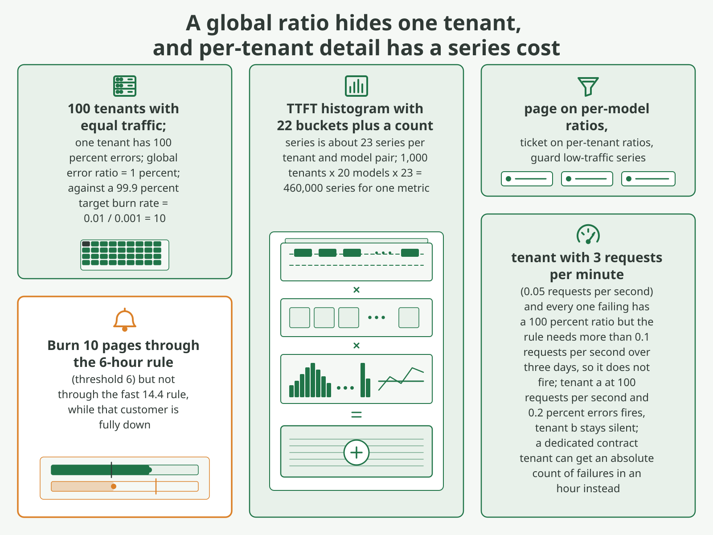

*Figure 20.19.6. Page on model ratios, ticket on tenant ratios and guard low-traffic series.*

Your fleet serves ten models. One of them has a bad release. Across all traffic the error ratio is a fraction of a percent, so a global alert stays quiet. The model with the bad release is failing for everyone who uses it, and the global number is too diluted to show it. Latency and errors must be sliced by model at least, because each model has different hardware, batch limits and prompts.

Tenants are the next slice. A tenant is a customer or a team that shares your platform. A dedicated endpoint customer has a contract, and that customer's own numbers matter. Here is an example of why a global ratio hides them. Take 100 tenants with equal traffic. One tenant gets 100% errors. The global error ratio is 1%. Against a 99.9% target that is a burn rate of 10. It pages through the 6-hour rule but not through the fast 14.4 rule, and the customer is fully down. The burn rate is explained in section 6, so for now treat it as a speed-of-spending number.

The cost of per-tenant detail is series count. A series is one stored line of data in Prometheus, one for each unique combination of a metric name and its labels. Prometheus stores one series per label combination. A TTFT histogram with 22 buckets plus a count series gives about 23 series per tenant and model pair in the vLLM-style layout. With 1,000 tenants and 20 models that is 1,000 times 20 times 23, which is 460,000 series for one metric. The book Production Kubernetes warns about this in Chapter 9: overusing labels makes Prometheus resource use untenable. Every label you add multiplies the work, so a new label should earn its place.

A practical way to decide is to ask who will look at the number and what they will do with it. A model owner looking at a bad release needs a per-model ratio on a dashboard that loads in seconds. A support engineer answering a single angry customer needs that customer's own ratio, and can accept a slower query for it. The first question picks the label for the paging rules, and the second picks the label for the tickets. Keeping the two apart stops the paging rules from carrying detail that only a support query needs.

A reasonable design, which is my reasoning and not a Nebius fact, keeps per-model ratios for paging and records per-tenant ratios for tickets or only for large and dedicated tenants. The rules in this chapter follow that split. The tenant rule also needs a traffic guard. A tenant sending three requests a minute with every one failing has a 100% error ratio and tells you nothing, so the ticket rule requires more than 0.1 requests per second over three days. A ratio over almost no traffic is noise, and the guard keeps that noise out of your inbox.

**Page on model-level ratios, ticket on tenant-level ratios, and always guard low-traffic series.**

### 5. Error budgets: do the arithmetic

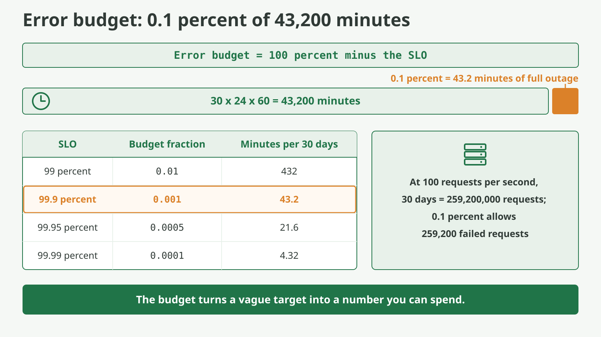

*Figure 20.19.7. The error budget is 100 percent minus the SLO, so 99.9 percent over 30 days allows 43.2 minutes of full outage.*

Your manager reads a target of 99.9% and asks what that actually lets the team break. The Workbook says the error budget is 100% minus the SLO. For 99.9% that is 0.1%. The budget is the amount of failure the target allows, and it is the number that turns a vague promise into a spending plan. Think of it as a monthly allowance. You are free to spend it, and the question is what you spend it on.

Over a 30-day window there are 30 times 24 times 60, which is 43,200 minutes. A tenth of a percent of that is 43.2 minutes of full outage. The table is plain arithmetic, and the calculator below reproduces it. Read each row with the same method: take the budget fraction, multiply by the minutes in the period, and you have the answer. The 28-day column is there because some teams define their window in weeks, and the same method gives the answer for that too.

| SLO | Budget fraction | Minutes per 30 days | Minutes per 28 days |
|---|---|---|---|
| 99% | 0.01 | 432 | 403.2 |
| 99.9% | 0.001 | 43.2 | 40.32 |
| 99.95% | 0.0005 | 21.6 | 20.16 |
| 99.99% | 0.0001 | 4.32 | 4.032 |

Time is only one way to count. A token API is better counted by requests. At 100 requests per second a 30-day month has 259,200,000 requests. A budget of 0.1% allows 259,200 failed requests. The Workbook example is the same idea at smaller scale: 3 million requests in four weeks allows about 3,000 failures. Counting events matters because a total outage at 4 a.m. burns far fewer events than the same outage at noon. Time-based budgets treat those two outages as equal, and request-based budgets do not. Pick the unit that matches how your customers feel the pain.

To see why the choice matters, imagine a pair of outages of the same length. The first hits a quiet hour when almost nobody is sending requests. The second hits the lunchtime peak. A time-based budget charges both outages the same minutes, but the customers hit by the second outage are many more. A request-based budget charges the second outage far more heavily, which is the fairer picture of the harm. Many teams state both, and use time for the calendar and requests for the customer story.

An SLO needs a policy that says what happens when the budget runs out. The Workbook lists what that policy contains. It names authors and approvers, a review date, the actions to take when the budget is exhausted and an escalation path for disagreements. In an interview, say the budget is the lever that trades release speed against reliability. When it is gone, you slow releases and fix reliability. When it is full, you can ship faster and take a measured risk.

The SRE book also says not to choose a target from current performance, because that can lock in heroic effort, and that it is better to start loose and tighten later. For Token Factory the plan notes a 99.9% SLA on dedicated endpoints. That is a vendor claim in a case study. Treat it as a reasonable example target and not as Nebius's internal SLO.

**State the budget in minutes and in requests, and say what you do when it is spent.**

### 6. Burn rate and the multiwindow alert

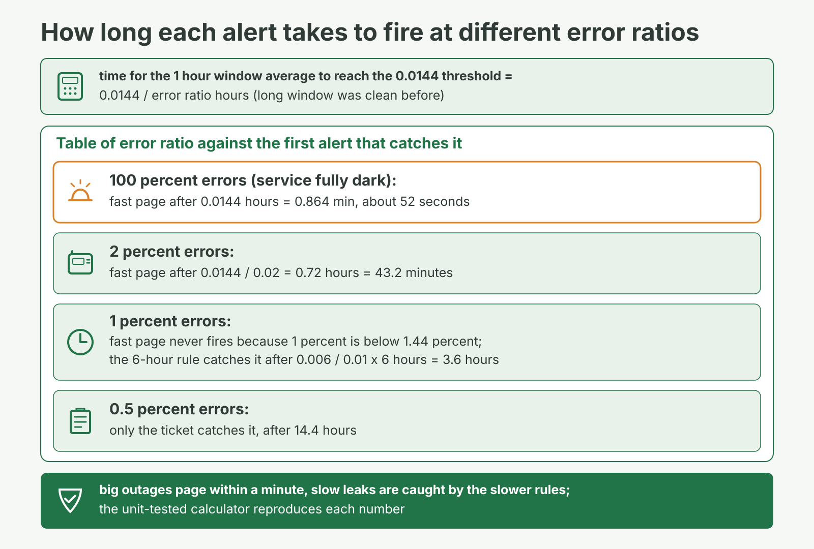

*Figure 20.19.8. The smaller the error ratio, the slower and less urgent the alert that catches it.*

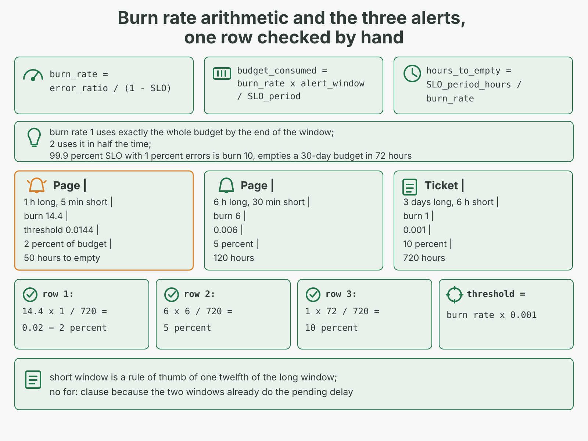

*Figure 20.19.9. Doing one row of the table aloud shows you understand it rather than recite it.*

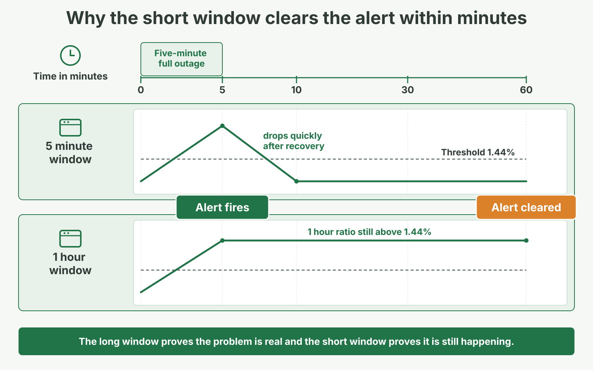

*Figure 20.19.10. The short window makes the alert clear fast. The long window alone would keep the page firing for most of an hour after the errors stopped.*

Picture a pager that goes off during a spike in errors that lasts only seconds. A threshold alert such as "error ratio above 1%" has two defects. It can fire on a ten-second blip that costs almost nothing, which wakes someone for no reason. It can also stay silent during a slow leak that eats the whole month, which lets the damage build without a warning. Burn-rate alerts fix both problems, and the idea behind them is worth understanding well because it is the heart of the chapter.

The Workbook defines burn rate as how fast, relative to the SLO, the service consumes the error budget. A burn rate of 1 uses exactly the whole budget by the end of the window. A burn rate of 2 uses it in half the time. Writing the budget as 1 minus the SLO, the burn rate is the error ratio divided by the budget. The error ratio is the share of requests that failed in the window you are looking at.

```text
burn_rate        = error_ratio / (1 - SLO)
budget_consumed  = burn_rate * alert_window / SLO_period
hours_to_empty   = SLO_period_hours / burn_rate
```

The result tells you how urgent a given error ratio is. At a 99.9% SLO, an error ratio of 1% is a burn rate of 10, which empties a 30-day budget in 72 hours. You do not need to memorise the formula. You need to know that a burn rate tells you how many days or hours of budget are left at the current pace, and that is a question a manager can act on.

The Workbook then recommends three alerts for a 99.9% SLO in Table 5-8. Each one needs a long window and a short window to both be above the threshold. The short window is a rule of thumb of one twelfth of the long window. The long window proves that the problem is real and sustained, and the short window proves it is still happening.

| Severity | Long window | Short window | Burn rate | Error ratio threshold | Budget used in long window | Time to empty at this burn |
|---|---|---|---|---|---|---|
| Page | 1 hour | 5 minutes | 14.4 | 0.0144 | 2% | 50 hours |
| Page | 6 hours | 30 minutes | 6 | 0.006 | 5% | 120 hours |
| Ticket | 3 days | 6 hours | 1 | 0.001 | 10% | 720 hours |

Check one row by hand. A burn rate of 14.4 for 1 hour consumes 14.4 times 1 divided by 720 hours, which is 0.02, so 2% of the budget. The 6 hour row gives 6 times 6 over 720, which is 5%. The ticket row gives 1 times 72 over 720, which is 10%. The threshold column is burn rate times 0.001, so 14.4 gives 0.0144. Doing one row aloud in the interview shows you understand the table and do not just recite it.

How fast does it fire? Assume the service goes fully dark and the long window was clean. The 1 hour window average reaches 0.0144 when 0.0144 hours have passed, which is 0.864 minutes, about 52 seconds. A smaller problem takes longer. At a 2% error ratio the same page needs 0.0144 divided by 0.02 hours, which is 43.2 minutes. At 1% errors the fast page never fires, since 1% is below 1.44%. The 6 hour rule catches it after 0.006 over 0.01 times 6 hours, which is 3.6 hours. At 0.5% errors only the ticket catches it, after 14.4 hours. The calculator in the code section computes each of these, so you can check the arithmetic against it.

Why the short window? A long window alone keeps firing long after the outage ended. If errors stop, the one-hour average stays above the threshold for most of an hour. Requiring the five-minute window to be above threshold too makes the alert clear within minutes of recovery. The unit tests include a five-minute full outage. The alert fires while it happens. At the 60-minute mark the 1-hour ratio is still above 1.44% but the alert has cleared.

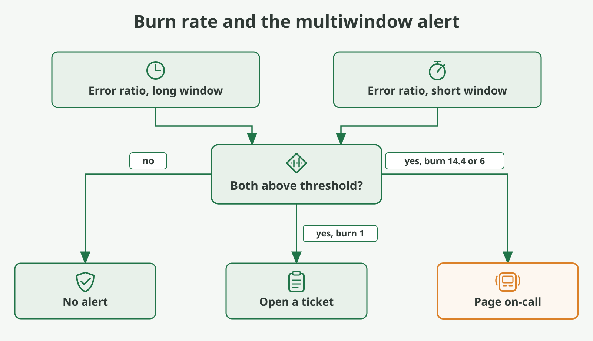

*Figure 20.19.11. Burn rate and the multiwindow alert, as a diagram.*

The flowchart is the decision in one picture. Both windows must agree before anyone is paged, and the burn rate decides whether the page is urgent or a ticket is enough.

One more detail. These rules use no `for:` clause. The two windows already do the job of a pending delay. Adding one only delays the page. A `for:` clause tells the alerting engine to wait a set time before it fires, and here the short window already plays that role, so the extra wait would only postpone a page you need now.

**Alert on how fast the budget burns, with a long window to prove it matters and a short window to prove it is still happening.**

### 7. Symptoms, not causes, and what pages

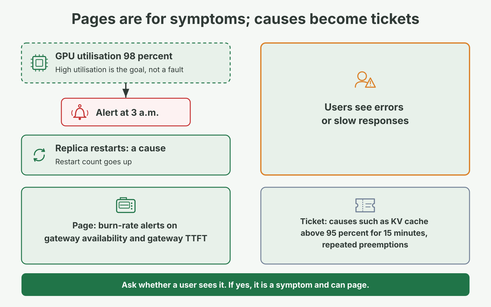

*Figure 20.19.12. Pages come from user-visible symptoms such as burn-rate alerts on gateway availability and TTFT, while causes such as high KV cache usage become tickets.*

An alert fires at 3 a.m.: "GPU utilisation 98%". You wake up, look, and everything is fine. High utilisation on an inference GPU is the goal, not a fault. This is the standard trap, and almost every on-call engineer has fallen into it at least once. The alert described a cause that is healthy, and it cost you sleep for nothing.

Try the same test on another example. A replica restarts because its memory limit is set too low. The restart is a cause, and the restart count goes up. Users may see a few failed streams while the replica is gone, and that is a symptom. The useful page is the one that fires on the failed streams, since that is the thing the customer feels. The restart count still belongs on a dashboard, where the on-call engineer can look at it while the page is open. Asking "would a user notice this, and would they need someone to act now?" sorts most alerts into the right bin.

The SRE book chapter "Monitoring Distributed Systems" separates what is broken from why. The symptom is the user-visible effect, such as errors or slow responses. The cause is an intermediate reason such as full memory or a dead replica. The chapter recommends paging on symptoms and keeping cause signals for debugging. Its rule for a page is that it must be urgent, actionable and user-visible, and that a page needing only a robotic response should not be a page. It also warns that when pages occur too often people second-guess, skim or ignore them. Production Kubernetes says the same in plainer words in Chapter 9: excessive critical alerts burn out on-call engineers and drown out the real ones, and alerts should carry annotations and runbook links.

Here is how this chapter's rule set is split. Pages come only from burn-rate alerts on gateway availability and gateway TTFT. Everything that describes a cause is a ticket. The causes are a KV cache above 95% for 15 minutes, preemptions that keep happening, requests waiting in the queue for 10 minutes, missing engine metrics, and a rising share of requests that end by reaching the length limit. KV cache is the memory the engine uses to remember the attention state of each running request, and it fills up as requests grow. A preemption is when the engine pauses or evicts a running request to free that memory.

| Alert | Level | Why |
|---|---|---|
| Availability burn, 1 h and 5 min | Page | Users see errors now and the budget is draining fast |
| Availability burn, 6 h and 30 min | Page | Slower drain, still a few hours from real damage |
| TTFT burn, same windows | Page | Users wait too long for the first word |
| Tenant error budget drain | Ticket | One customer is spending budget at 1x |
| KV cache near full | Ticket | A cause. It may or may not hurt users yet |
| Preemptions sustained | Ticket | A cause that points at capacity |
| Watchdog | Heartbeat | Proves the alerting path works |

Production Kubernetes, again in Chapter 9, describes a dead man's switch. You create an alert that always fires. If it stops arriving at the receiver, the receiver pages that your metrics or alerting pipeline is down. The `Watchdog` rule in the cause file is that heartbeat. It looks odd to have an alert that always fires, but the odd part is the point. Silence is the failure you cannot otherwise see, because a broken alerting path looks exactly like a quiet night.

Cause signals still deserve a dashboard, since they speed up the first minutes of an incident. The vendor case study in the plan lists restarts from aggressive liveness probes and a worker pool that shrank silently. Both hurt users only after capacity is gone, so the symptom page catches them. A ticket on replica count against expected is a reasonable early warning for the second.

**Page only on symptoms the user can feel, and send every cause alert to a ticket or a dashboard.**

### 8. Quality signals: the finish reason mix

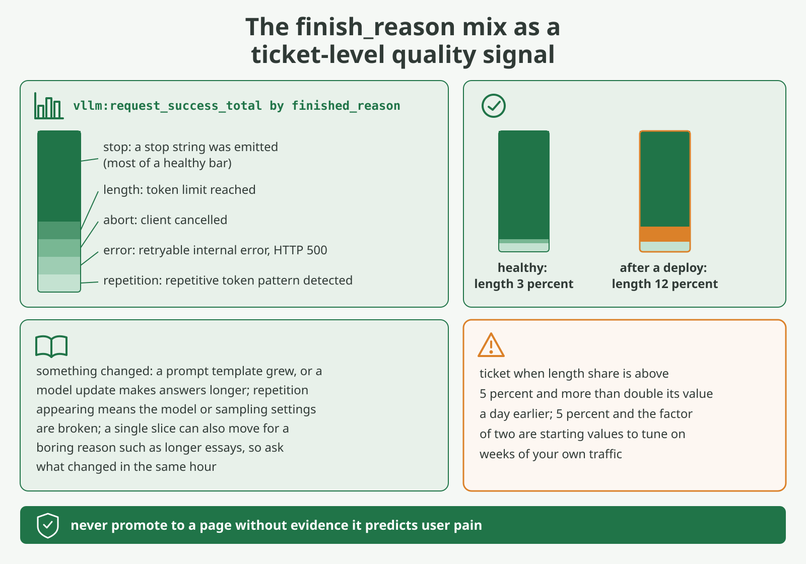

*Figure 20.19.13. Watch whether the mix of outcomes moves, and file a ticket rather than a page.*

Picture a dashboard where every panel is green, and the customers still say the answers are getting worse. Some failures return 200 and fast latency. The model starts producing repeated text, or cuts every answer short. Latency and error SLIs stay green, and nothing on the wall looks wrong. The book LLMs in Production, Chapter 6 section 6.2.5, calls these silent failures. The model keeps functioning but starts performing poorly. It says you need both system monitoring and ML monitoring. System monitoring tells you the service is up and fast. ML monitoring tells you the answers are still good.

You can get a cheap signal from the engine. vLLM counts finished requests in `vllm:request_success_total` with a label `finished_reason`. In v0.32.0 the code lists five values: stop, length, abort, error and repetition. The code comments say stop means a stop string was emitted, length means the token limit was reached, abort means the client cancelled, error is a retryable internal error and repetition is a repeated token pattern. Each value is a different story about how a request ended, and the mix of stories is the signal.

On a dashboard this looks like a stacked bar of the five values over time. Most of the bar is stop, which is what a healthy service looks like. An engineer reading the chart after a deploy does not need to know every value by heart. The engineer needs to notice that one slice grew and then ask what changed in the same hour. A single slice can move for a boring reason, such as a customer who started asking for longer essays, so the question you ask is "did the mix change, and did something in our system change with it?"

A healthy mix is stable. If length jumps from 3% to 12% after a deploy, something changed. Maybe a prompt template grew, maybe a model update makes answers longer. If repetition appears, the model or sampling settings are broken. The alert in this chapter is a ticket that fires when the length share is above 5% and more than double its value from a day earlier. The numbers 5% and the factor of two are my starting values, not tuned ones. You would tune them on a few weeks of your own traffic before you trust them.

**Watch the finish reason mix as a ticket-level quality signal, and never promote it to a page without evidence it predicts user pain.**

### 9. Goodput: speed that counts

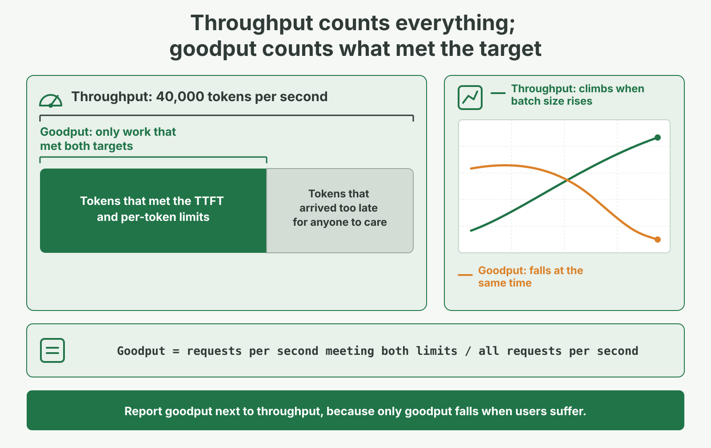

*Figure 20.19.14. Throughput of 40,000 tokens per second includes tokens that arrived too late, while goodput counts only the requests that met both limits.*

A team celebrates 40,000 tokens per second. Half of those tokens arrive too late for anyone to care. Throughput counts everything. Goodput counts only the work that met its target. The celebration is real for the dashboard and misleading for the customer, and the gap between the two is the reason goodput exists.

The DistServe paper, whose abstract I fetched, defines the quantity it improves as the maximum rate that can be served within both TTFT and TPOT constraints on each GPU. TPOT is the same per-token speed idea as the time per output token measure in section 2. The abstract does not use a formal definition of goodput, so treat that phrase as the paper's own words and mine as an operational version. Hands-On LLM Serving and Optimization warns in Chapter 4 that tokens per second can be inflated by cutting input length or by uniform batches. A goodput SLI resists that, because a request that misses its limits stops counting.

As an SLI, goodput is the number of requests per second that met both the TTFT limit and the per-token speed limit, divided by all requests per second. It is the ratio of the two good-event ratios when they are independent, and a joint measurement when they are not. A rough way to build it is a gateway counter that increments only when both limits hold. The chapter does not ship that counter, so treat it as a design suggestion. Build it, check it against the two separate ratios, and see whether they agree.

The reason to bother is a story you will recognise. A team tunes its batch size to push tokens per second up. The throughput chart climbs, and the team is pleased. Goodput, which only counts requests that met both limits, falls at the same time, because the larger batch makes each request wait longer for its first token. A throughput-only SLI would have hidden the trade. A goodput SLI shows the cost in the same chart, and the team can decide with both numbers in front of them.

**Report goodput next to throughput, because only goodput falls when users start to suffer.**

### 10. Dedicated versus serverless endpoints

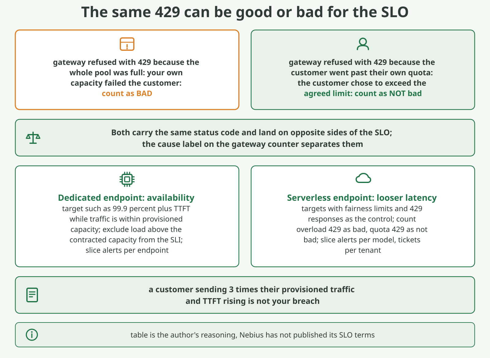

*Figure 20.19.15. Write down what counts against the SLO before writing the first rule.*

Your product manager asks which SLO goes on the serverless page and which goes on the dedicated page. The plan says Token Factory sells serverless and dedicated endpoints. A serverless endpoint is shared by many tenants, and you pay per use. A dedicated endpoint is reserved for one customer, with chosen GPUs. The two have different failure and ownership models, and the SLO should reflect that. The table below is my reasoning, since Nebius has not published its SLO terms for either.

| Question | Dedicated endpoint | Serverless endpoint |
|---|---|---|
| Who owns the capacity | One customer with chosen GPUs and replica range | Many tenants share a pool |
| What can hurt latency | The customer's own burst over capacity, replica loss, a rollout | Neighbours, queueing, cache evictions |
| Natural SLO shape | Availability with an explicit target such as 99.9%, plus TTFT while traffic is within provisioned capacity | Looser latency targets, with fairness limits and 429 responses as the control |
| Counting rule | Exclude load above the contracted capacity from the SLI | Count overload 429 as bad, quota 429 as not bad |
| Alert slicing | Per endpoint, since each has its own customer | Per model, tickets per tenant |

The counting rule matters. If a customer sends 3 times their provisioned traffic and TTFT rises, that is not your breach. If your own pool is overloaded and you return 429, it is. A 429 is the HTTP status for "too many requests", and the same code can mean two very different things. The `cause` label on the gateway counter exists to separate those two. Define it carefully and write it in the SLO document, because the rule you write is the rule the auditor and the customer will read later.

A small exercise makes the point. Take a request that the gateway refused with 429 because the whole pool was full. Count it as bad, since your own capacity failed the customer. Now take a request refused with 429 because the customer went past their own quota. Count it as not bad, since the customer chose to exceed the limit they had agreed to. Requests with the same status code can land on opposite sides of the SLO. The `cause` label is what lets the dashboard tell them apart, and the written rule is what lets another engineer make the same call.

**Write down what counts against the SLO before you write the first rule.**

### 11. Measure at the gateway, explain at the engine

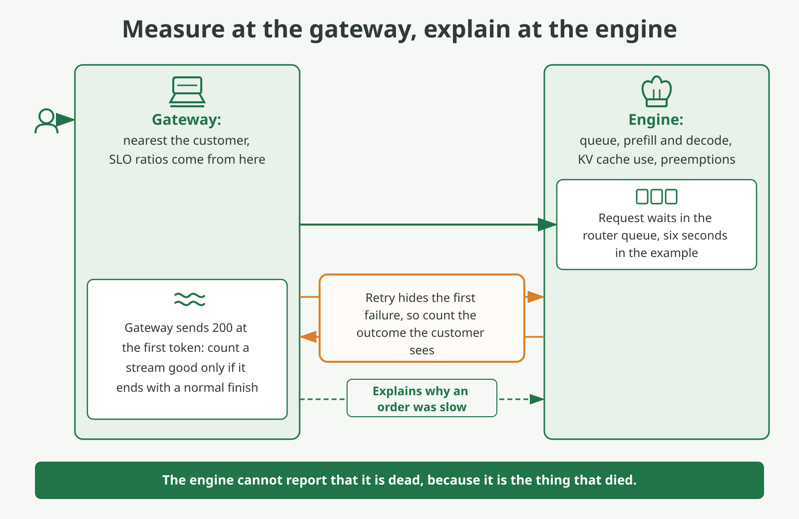

*Figure 20.19.16. The gateway measures what the customer sees, and the engine explains why, counting retries and streams by their final outcome.*

A replica dies. The engine on that replica cannot report that it is dead, because it is the thing that died. A request sits in the router queue for six seconds before any engine sees it. A retry hides the first failure, and the customer only sees a slow reply. All three are invisible to engine metrics. They are visible at the gateway, which is the component that sits between the customer and your engines.

The gateway is the place nearest the customer that you control, so the SLO ratios come from it. The engine shows why. It splits the time into queue, prefill and decode, and it reports KV cache use and preemptions. vLLM v0.32.0 exposes these as `vllm:request_queue_time_seconds`, `vllm:request_prefill_time_seconds`, `vllm:request_decode_time_seconds`, `vllm:kv_cache_usage_perc`, `vllm:num_requests_waiting` and `vllm:num_preemptions_total`. The metrics carry the labels `model_name` and `engine`. There is no tenant label, which is a second reason tenant detail belongs at the gateway.

Count the outcome the customer sees, not each attempt. If the gateway retries a failed attempt and the second attempt succeeds, the customer saw success. Track retries as their own metric, so you can see capacity wasted on retry amplification. Retry amplification is when retries add load to a service that is already struggling, which makes the struggle worse. The case study in the plan mentions changing retry logic to stop amplification in partial outages. Chapter 20.21 covers retries in depth.

Streaming adds a trap. The gateway sends 200 at the first token. If the stream dies later, a status-code SLI says success. Count a stream as good only if it ends with a normal finish, and count a mid-stream abort by the server as bad. How the Nebius gateway reports this is not public, so say that in the interview and describe your own approach. Naming the assumption out loud is what a good answer looks like here.

Think of the gateway as the cashier at a shop and the engine as the kitchen behind it. The customer judges the shop by how long the cashier takes and whether the order arrives right. The kitchen manager can explain why an order was slow, such as a full grill or a missing ingredient, but the kitchen does not see the queue at the door. A shop owner who only watches the kitchen will miss the customers who left before ordering. The SLO belongs to the cashier's view, and the kitchen's numbers belong in the explanation.

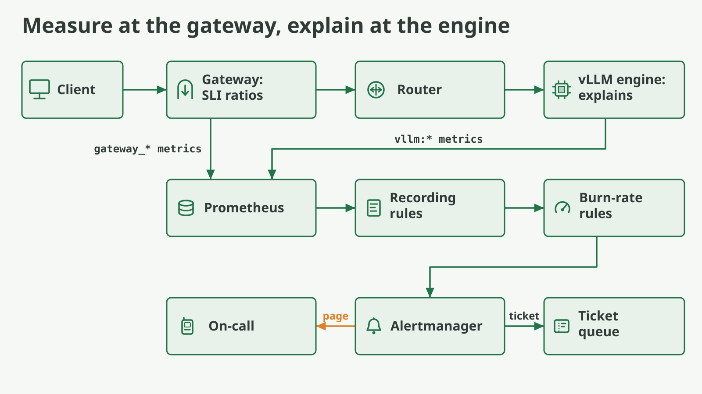

*Figure 20.19.17. Measure at the gateway, explain at the engine, as a diagram.*

The path shows which component owns each signal. The gateway produces the ratios that the SLO is written against, and the engine feeds the explanation that the on-call person reads during a burn.

**Take SLO ratios from the gateway and use engine metrics only to explain a burn.**

### The rules and the calculator

Here is the engine-side recording file. It records the 99th percentile for TTFT and inter-token latency, the share of slow decode steps and two finish reason ratios. A recording rule is a stored calculation that Prometheus runs on a schedule, so the dashboard and the alerts read a precomputed number rather than redoing the sum each time. The `or 0 * ...` pattern keeps a ratio at zero when no failing series exists yet. Without it, the division returns an empty result and your alert can never fire, which the tests prove.

```yaml
# code/part20/slo_engine_rules.yaml
# Engine-side signals from vLLM v0.32.0 (labels model_name and engine).
# Histogram le labels are floats, so the 0.1 s ITL bucket is le="0.1".
# These explain a gateway burn alert. They are not what pages.
groups:
  - name: slo_engine
    interval: 30s
    rules:
      - record: model_name:vllm_ttft_seconds:p99_5m
        expr: |
          histogram_quantile(0.99, sum by (model_name, le)
            (rate(vllm:time_to_first_token_seconds_bucket[5m])))
      - record: model_name:vllm_itl_seconds:p99_5m
        expr: |
          histogram_quantile(0.99, sum by (model_name, le)
            (rate(vllm:inter_token_latency_seconds_bucket[5m])))
      - record: model_name:vllm_itl_slow_ratio:rate5m
        expr: |
          1 - sum by (model_name)
                (rate(vllm:inter_token_latency_seconds_bucket{le="0.1"}[5m]))
          / sum by (model_name)
                (rate(vllm:inter_token_latency_seconds_count[5m]))
      - record: model_name:vllm_finish_error_ratio:rate5m
        expr: |
          (sum by (model_name)
             (rate(vllm:request_success_total{finished_reason="error"}[5m]))
            or 0 * sum by (model_name) (rate(vllm:request_success_total[5m])))
          / sum by (model_name) (rate(vllm:request_success_total[5m]))
      - record: model_name:vllm_finish_length_ratio:rate1h
        expr: |
          sum by (model_name)
            (rate(vllm:request_success_total{finished_reason="length"}[1h]))
          / sum by (model_name) (rate(vllm:request_success_total[1h]))
```

The gateway recording file has the same pattern for each window, and the tests need five windows, so it is long. Read it as a repeated shape rather than as a wall of text. Each rule takes a counter, keeps only the series with the error code you care about, divides by the total, and falls back to zero when the error series does not exist yet. This is the first rule only. The full file is `code/part20/slo_recording_rules.yaml`. The first rule shows the shape you copy for the others. It counts 5xx responses over the total, and it uses the same `or 0 * ...` guard.

```yaml
- record: model:gateway_error_ratio:rate5m
  expr: |
    (sum by (model) (rate(gateway_requests_total{code=~"5.."}[5m]))
      or 0 * sum by (model) (rate(gateway_requests_total[5m])))
    / sum by (model) (rate(gateway_requests_total[5m]))
```

The availability burn rules follow Table 5-8 exactly. The thresholds are written as numbers, 14.4 times 0.001 and so on, so a reader can check them. Each alert pairs a long window with a short window, and both must be above the threshold for the alert to fire.

```yaml
# code/part20/slo_burn_alerts_availability.yaml
# Multiwindow multi-burn-rate alerts, SRE Workbook Table 5-8.
# SLO 99.9 percent, budget 0.001, so thresholds are 14.4 x 0.001 = 0.0144,
# 6 x 0.001 = 0.006 and 1 x 0.001 = 0.001.
groups:
  - name: slo_availability_burn
    rules:
      - alert: GatewayAvailabilityBurnFast
        expr: |
          model:gateway_error_ratio:rate1h > 0.0144
          and model:gateway_error_ratio:rate5m > 0.0144
        labels: {severity: page, slo: availability}
        annotations:
          summary: "{{ $labels.model }} burns 2% of the 30 day budget per hour"
          runbook: "runbooks/gateway-availability.md"
      - alert: GatewayAvailabilityBurnSlow
        expr: |
          model:gateway_error_ratio:rate6h > 0.006
          and model:gateway_error_ratio:rate30m > 0.006
        labels: {severity: page, slo: availability}
        annotations:
          summary: "{{ $labels.model }} burns 5% of the budget in 6 hours"
          runbook: "runbooks/gateway-availability.md"
      - alert: TenantAvailabilityBudgetDrain
        expr: |
          tenant_model:gateway_error_ratio:rate3d > 0.001
          and tenant_model:gateway_error_ratio:rate6h > 0.001
          and on (tenant, model)
            sum by (tenant, model) (rate(gateway_requests_total[3d])) > 0.1
        labels: {severity: ticket, slo: availability}
        annotations:
          summary: "{{ $labels.tenant }} on {{ $labels.model }} spends budget at 1x"
          runbook: "runbooks/tenant-error-budget.md"
```

The TTFT rules use a 99% target and so a budget of 0.01. The thresholds become 0.144, 0.06 and 0.01. The structure is the same as the availability file, but the input is the slow share of TTFT, not the error ratio. Notice how the thresholds scale with the budget. A looser target gives a bigger budget, so the same burn rate needs a bigger error ratio to trigger.

```yaml
# code/part20/slo_burn_alerts_ttft.yaml
# TTFT SLO: 99 percent of requests start streaming within 1.0 s.
# Budget 0.01, so thresholds are 14.4 x 0.01 = 0.144, 6 x 0.01 = 0.06, 0.01.
groups:
  - name: slo_ttft_burn
    rules:
      - alert: GatewayTTFTBurnFast
        expr: |
          model:gateway_ttft_slow_ratio:rate1h > 0.144
          and model:gateway_ttft_slow_ratio:rate5m > 0.144
        labels: {severity: page, slo: ttft}
        annotations:
          summary: "{{ $labels.model }} TTFT burns 2% of budget per hour"
          runbook: "runbooks/ttft.md"
      - alert: GatewayTTFTBurnSlow
        expr: |
          model:gateway_ttft_slow_ratio:rate6h > 0.06
          and model:gateway_ttft_slow_ratio:rate30m > 0.06
        labels: {severity: page, slo: ttft}
        annotations:
          summary: "{{ $labels.model }} TTFT burns 5% of budget in 6 hours"
          runbook: "runbooks/ttft.md"
      - alert: GatewayTTFTBudgetDrain
        expr: |
          model:gateway_ttft_slow_ratio:rate3d > 0.01
          and model:gateway_ttft_slow_ratio:rate6h > 0.01
        labels: {severity: ticket, slo: ttft}
        annotations:
          summary: "{{ $labels.model }} TTFT spends budget at 1x"
          runbook: "runbooks/ttft.md"
```

The cause rules are all tickets, and one is the watchdog. None of these wakes anyone. Each one tells the reader where to look once a burn alert has fired, or warns about a slow problem that is not yet hurting users.

```yaml
# code/part20/slo_cause_alerts.yaml
# Cause signals from vLLM v0.32.0. All are tickets, none page.
# The page is the burn alert. These tell you where to look.
groups:
  - name: slo_causes
    rules:
      - alert: Watchdog
        expr: vector(1)
        labels: {severity: none}
        annotations: {summary: "Always firing. Route to a dead man's switch."}
      - alert: EngineMetricsMissing
        expr: absent(vllm:num_requests_running)
        for: 10m
        labels: {severity: ticket}
        annotations: {summary: "No vLLM metrics scraped for 10 minutes"}
      - alert: KVCacheNearFull
        expr: max by (model_name) (vllm:kv_cache_usage_perc) > 0.95
        for: 15m
        labels: {severity: ticket}
        annotations: {summary: "KV cache above 95% on {{ $labels.model_name }}"}
      - alert: PreemptionsSustained
        expr: sum by (model_name) (rate(vllm:num_preemptions_total[10m])) > 0
        for: 15m
        labels: {severity: ticket}
        annotations: {summary: "Requests are being preempted on {{ $labels.model_name }}"}
      - alert: RequestQueueBacklog
        expr: sum by (model_name) (vllm:num_requests_waiting) > 0
        for: 10m
        labels: {severity: ticket}
        annotations: {summary: "Requests waiting for 10 minutes on {{ $labels.model_name }}"}
      - alert: FinishReasonLengthDrift
        expr: |
          model_name:vllm_finish_length_ratio:rate1h > 0.05
          and model_name:vllm_finish_length_ratio:rate1h
            > 2 * (model_name:vllm_finish_length_ratio:rate1h offset 1d)
        for: 30m
        labels: {severity: ticket}
        annotations: {summary: "More outputs hit max_tokens than yesterday"}
```

The calculator turns the formulas into functions, and the tests pin them to the Workbook table. Read it top to bottom once. Each function is one formula from this chapter, and the alert table at the bottom reproduces the three Workbook rows.

```python
# code/part20/slo_burn_rate.py
"""Burn-rate calculator for SLO alert design. Standard library only.

Run `python3 slo_burn_rate.py` to print the budget table and the alert table.
Numbers follow the Google SRE Workbook chapter "Alerting on SLOs".
"""
import argparse

# (severity, long window h, short window h, burn rate), SRE Workbook Table 5-8
PAGE_TICKET_POLICY = [
    ("page", 1.0, 5 / 60, 14.4),
    ("page", 6.0, 0.5, 6.0),
    ("ticket", 72.0, 6.0, 1.0),
]


def error_budget(slo):
    """Allowed bad fraction, for example 0.001 for a 99.9 percent SLO."""
    if not 0 < slo < 1:
        raise ValueError("slo must be between 0 and 1, exclusive")
    return 1 - slo


def budget_minutes(slo, period_days=30):
    """Minutes of full outage the SLO allows in the period."""
    return error_budget(slo) * period_days * 24 * 60


def burn_rate(error_ratio, slo):
    """How many times faster than allowed the budget is being spent."""
    return error_ratio / error_budget(slo)


def budget_consumed(burn, window_h, period_days=30):
    """Fraction of the period budget spent by running at `burn` for `window_h`."""
    return burn * window_h / (period_days * 24)


def hours_to_exhaustion(burn, period_days=30):
    """Hours until a full budget is gone at a constant burn rate."""
    if burn <= 0:
        return float("inf")
    return period_days * 24 / burn


def error_ratio_threshold(burn, slo):
    """Error ratio an alert rule compares against for a given burn rate."""
    return burn * error_budget(slo)


def minutes_to_detect(true_error_ratio, slo, burn, long_window_h):
    """Minutes after a step change until the long window average crosses the
    threshold, assuming the window was clean before and the error ratio is
    constant. Returns None when the error ratio can never reach it."""
    thr = error_ratio_threshold(burn, slo)
    if true_error_ratio < thr:
        return None
    return thr / true_error_ratio * long_window_h * 60


def should_alert(long_ratio, short_ratio, slo, burn):
    """Multiwindow rule: both windows must be above the threshold."""
    thr = error_ratio_threshold(burn, slo)
    return long_ratio > thr and short_ratio > thr


def alert_table(slo, period_days=30):
    rows = []
    for sev, long_h, short_h, burn in PAGE_TICKET_POLICY:
        rows.append({
            "severity": sev,
            "long_h": long_h,
            "short_h": short_h,
            "burn": burn,
            "threshold": error_ratio_threshold(burn, slo),
            "consumed": budget_consumed(burn, long_h, period_days),
            "exhaust_h": hours_to_exhaustion(burn, period_days),
        })
    return rows


def main():
    ap = argparse.ArgumentParser(description=__doc__)
    ap.add_argument("--slo", type=float, default=0.999)
    ap.add_argument("--days", type=int, default=30)
    a = ap.parse_args()
    print(f"SLO {a.slo:.4%} over {a.days} days: "
          f"{budget_minutes(a.slo, a.days):.2f} minutes of budget")
    for r in alert_table(a.slo, a.days):
        print(f"{r['severity']:6} long {r['long_h']:5.1f}h short {r['short_h']*60:5.0f}m "
              f"burn {r['burn']:4.1f} ratio>{r['threshold']:.4f} "
              f"budget {r['consumed']:.1%} gone in {r['exhaust_h']:.0f}h")
    m = minutes_to_detect(1.0, a.slo, 14.4, 1.0)
    print(f"Total outage trips the 14.4 page after {m*60:.0f} seconds")


if __name__ == "__main__":
    main()
```

The availability tests are the ones that show the behaviour you must be able to explain. Each test feeds synthetic traffic into the rules and checks which alert fires. The first case is a two percent error stream, which should page on both the fast and the slow rule. The second is a one percent stream, which should page only on the slow rule. The third is a five-minute blip, which should fire while it lasts and clear afterwards.

```yaml
# code/part20/slo_rules_test_availability.yaml
# Run: promtool test rules slo_rules_test_availability.yaml
rule_files:
  - slo_recording_rules.yaml
  - slo_engine_rules.yaml
  - slo_burn_alerts_availability.yaml
  - slo_burn_alerts_ttft.yaml
  - slo_cause_alerts.yaml
evaluation_interval: 1m
tests:
  - name: two percent errors pages fast and medium
    interval: 1m
    input_series:
      - series: 'gateway_requests_total{tenant="a",model="m1",code="200"}'
        values: '0+5880x70'
      - series: 'gateway_requests_total{tenant="a",model="m1",code="500"}'
        values: '0+120x70'
    alert_rule_test:
      - eval_time: 65m
        alertname: GatewayAvailabilityBurnFast
        exp_alerts:
          - exp_labels: {model: m1, severity: page, slo: availability}
            exp_annotations:
              summary: "m1 burns 2% of the 30 day budget per hour"
              runbook: "runbooks/gateway-availability.md"
      - eval_time: 65m
        alertname: GatewayAvailabilityBurnSlow
        exp_alerts:
          - exp_labels: {model: m1, severity: page, slo: availability}
            exp_annotations:
              summary: "m1 burns 5% of the budget in 6 hours"
              runbook: "runbooks/gateway-availability.md"
  - name: one percent errors does not page fast but does page slow
    interval: 1m
    input_series:
      - series: 'gateway_requests_total{tenant="a",model="m1",code="200"}'
        values: '0+5940x70'
      - series: 'gateway_requests_total{tenant="a",model="m1",code="500"}'
        values: '0+60x70'
    alert_rule_test:
      - eval_time: 65m
        alertname: GatewayAvailabilityBurnFast
        exp_alerts: []
      - eval_time: 65m
        alertname: GatewayAvailabilityBurnSlow
        exp_alerts:
          - exp_labels: {model: m1, severity: page, slo: availability}
            exp_annotations:
              summary: "m1 burns 5% of the budget in 6 hours"
              runbook: "runbooks/gateway-availability.md"
  - name: five minute blip fires while it lasts and stops when it ends
    interval: 1m
    input_series:
      - series: 'gateway_requests_total{tenant="a",model="m1",code="200"}'
        values: '0x5 6000+6000x55'
      - series: 'gateway_requests_total{tenant="a",model="m1",code="500"}'
        values: '0+6000x5 30000+0x55'
    alert_rule_test:
      - eval_time: 5m
        alertname: GatewayAvailabilityBurnFast
        exp_alerts:
          - exp_labels: {model: m1, severity: page, slo: availability}
            exp_annotations:
              summary: "m1 burns 2% of the 30 day budget per hour"
              runbook: "runbooks/gateway-availability.md"
      - eval_time: 60m
        alertname: GatewayAvailabilityBurnFast
        exp_alerts: []
    promql_expr_test:
      - expr: model:gateway_error_ratio:rate1h{model="m1"} > bool 0.0144
        eval_time: 60m
        exp_samples:
          - labels: '{model="m1"}'
            value: 1
  - name: no 5xx series yet gives ratio zero not an empty result
    interval: 1m
    input_series:
      - series: 'gateway_requests_total{tenant="a",model="m1",code="200"}'
        values: '0+6000x20'
    promql_expr_test:
      - expr: model:gateway_error_ratio:rate5m{model="m1"}
        eval_time: 10m
        exp_samples:
          - labels: 'model:gateway_error_ratio:rate5m{model="m1"}'
            value: 0
  - name: tenant ticket needs traffic and ignores a tiny noisy tenant
    interval: 1m
    input_series:
      - series: 'gateway_requests_total{tenant="a",model="m1",code="200"}'
        values: '0+5988x4400'
      - series: 'gateway_requests_total{tenant="a",model="m1",code="500"}'
        values: '0+12x4400'
      - series: 'gateway_requests_total{tenant="b",model="m1",code="500"}'
        values: '0+3x4400'
    alert_rule_test:
      - eval_time: 4400m
        alertname: TenantAvailabilityBudgetDrain
        exp_alerts:
          - exp_labels: {tenant: a, model: m1, severity: ticket, slo: availability}
            exp_annotations:
              summary: "a on m1 spends budget at 1x"
              runbook: "runbooks/tenant-error-budget.md"
      - eval_time: 4400m
        alertname: GatewayAvailabilityBurnFast
        exp_alerts: []
```

The TTFT and engine tests are in `code/part20/slo_rules_test_ttft_engine.yaml`. The Python tests are in `code/part20/test_slo_burn_rate.py`.

## How to answer out loud

### Question 1: "Which SLIs and SLOs for a streaming chat endpoint?"

Speak in this order. First say the SLI is always good events over valid events. Second give the set: availability, time to first token, per-token speed, error rate by cause, and a quality signal. Third give example targets and say they are examples. A reasonable set is 99.9% availability, 99% of requests with TTFT under 1 s, and 99% of decode gaps under 0.1 s. Fourth say where each is measured: ratios at the gateway, explanation at the engine.

State the trade-offs. You do not put one end-to-end latency limit on all outputs because the output length varies by about two orders of magnitude. You count 429 from quotas as not bad and 429 from overload as bad. Expect the follow-up "why not p99 latency as the SLO", and answer that a ratio against a limit aggregates across replicas and a quantile does not.

### Question 2: "Explain burn-rate alerts. Give the numbers."

Start with the definition: burn rate is the error ratio divided by the budget, so a burn rate of 1 spends the budget exactly over the period. Then say the 99.9% budget is 43.2 minutes in 30 days. Give the three rows from the Workbook: 14.4 over 1 hour and 5 minutes pages and uses 2% of budget, 6 over 6 hours and 30 minutes pages and uses 5%, and 1 over 3 days and 6 hours opens a ticket and uses 10%. Do one check aloud: 14.4 times 1 over 720 is 2%.

Name why there are two windows: the long window proves the problem matters and the short one makes the alert clear fast. Expect the follow-up "how fast does it fire in a total outage". Answer: about 52 seconds, since the threshold is 1.44% and the outage is 100%.

### Question 3: "Why not alert on GPU utilisation or average latency?"

For utilisation, say a busy GPU is the goal, so it is a cause signal and not a symptom. For average latency, give the 0.78 s example: 950 requests at 0.4 s and 50 at 8 s average to under a second while one in twenty users waits eight seconds. Mention that percentiles cannot be averaged across replicas, so you sum histograms first. The Systems Performance chapter on methodologies and the SRE book both back this up, so name them.

### Question 4: "Would the SLO differ for dedicated and serverless?"

Say yes. On a dedicated endpoint the customer chose the capacity, so you set an explicit availability target and a TTFT target that holds while traffic is within provisioned capacity. You exclude load above that capacity from the SLI. On serverless the pool is shared, so latency targets are looser and fairness is controlled by limits and 429 responses. Say plainly that this is your design reasoning and that Nebius has not published its terms.

### Question 5: "Your pager is too noisy. What do you do?"

First, classify the last two weeks of pages: actionable and user-visible, or not. Move every cause alert to a ticket. Check for low-traffic series that page on three requests. Check the windows: a long-only threshold alert flaps. Replace it with the multiwindow form. Then count pages per shift. The SRE book gives the reason: noisy pages train people to skim. Expect "how do you know you did not hide a real problem", and answer that the burn-rate alert still covers every user-visible loss through the ticket tier.

## Worked scenarios

### Scenario 1: A deploy takes a dedicated endpoint down


*Figure 20.19.18. Walk the rollout in order to see why the page fires only when both windows agree and why the short window clears first after the rollback.*

A rollout breaks a model for 12 minutes. All requests fail. The endpoint has a 99.9% target over 30 days. How much budget is gone and what fired?

The budget is 43.2 minutes. Twelve minutes is 12 divided by 43.2, which is 0.278, so 27.8% of the month. If instead 25% of requests fail for 20 minutes, the equivalent outage is 0.25 times 20, which is 5 minutes, or 11.6%. The first alert to fire is the fast availability burn. The error ratio is 100% and the threshold is 1.44%, so it fires in about 52 seconds and clears a few minutes after the rollback.

Decision: with 27.8% gone in one event, you freeze risky changes only if the policy says so. Your answer in the interview is that you tie that decision to the written error budget policy and do not improvise it.

Walk the story forward so the interviewer can follow it. The rollout starts, the first failing requests reach the gateway, and within moments the fast burn rule has enough data in its short window to be above the threshold. The long window is still catching up, so the page only fires once both windows agree. The on-call engineer rolls back, the error ratio drops, and the short window clears first. Name each of those moments in order, because the order is what shows you understand the windows.

### Scenario 2: The TTFT page fires

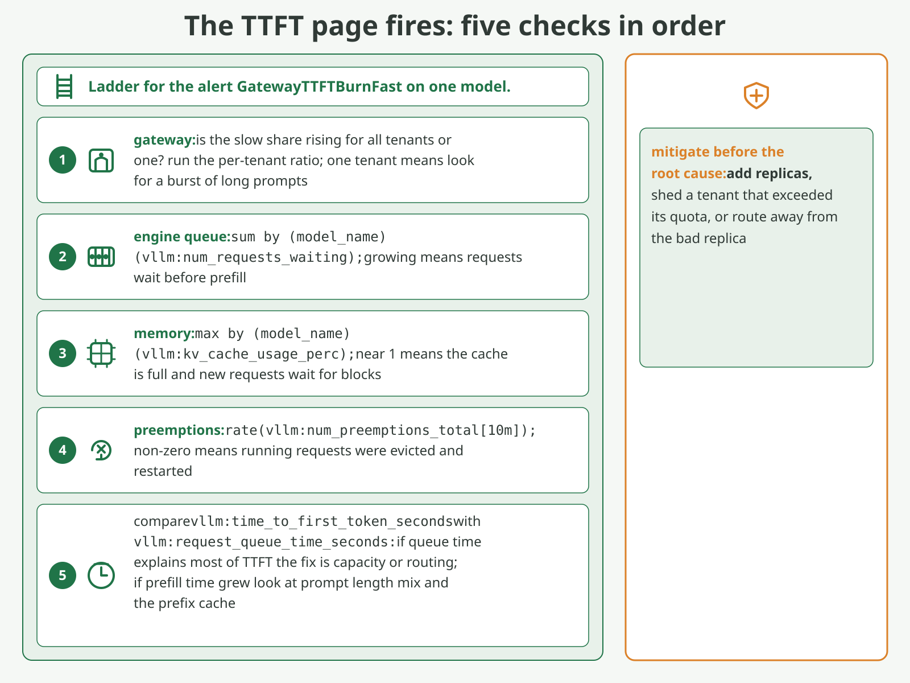

*Figure 20.19.19. Each step narrows the question until one cause explains the slow first words.*

`GatewayTTFTBurnFast` fires for one model. TTFT is the symptom. Where do you look?

Work down this list in order. Each step narrows the question, and you stop when you find the one that explains the slow first words.

1. Check the gateway first. Is the slow share rising for all tenants or one tenant? Run the per-tenant ratio. If one tenant, look for a burst of long prompts.
2. Look at the engine queue: `sum by (model_name) (vllm:num_requests_waiting)`. A growing queue means requests wait before prefill.
3. Look at memory: `max by (model_name) (vllm:kv_cache_usage_perc)`. A value near 1 means the cache is full and new requests wait for blocks.
4. Look at preemptions: `rate(vllm:num_preemptions_total[10m])`. Non-zero means running requests were evicted and restarted.
5. Compare `vllm:time_to_first_token_seconds` to `vllm:request_queue_time_seconds`. If queue time explains most of TTFT, the fix is capacity or routing. If prefill time grew, look at prompt length mix and the prefix cache.

Mitigate before you find the root cause. Add replicas, shed load of a tenant that exceeded its quota, or route away from the bad replica. Chapters 20.18 and 20.20 cover the failure modes and scaling. The point of mitigation is to stop the user pain first, and the investigation can continue once the page has quieted.

### Scenario 3: The tenant ticket is noisy

The tenant ticket fires for a tenant with 3 requests per minute, and every request failed. Is that real? The error ratio is 100%, but the rate is 0.05 requests per second. The rule requires 0.1 requests per second over three days, so it does not fire. The test named "tenant ticket needs traffic and ignores a tiny noisy tenant" shows this: tenant a at 100 requests per second and 0.2% errors fires and tenant b stays silent.

The reasoning is that a ratio over almost no traffic is noise. If tenant b is a dedicated customer with a contract, give it a different rule, such as an absolute count of failures in an hour. The trade-off is another rule to maintain.

Picture the on-call engineer receiving this ticket on a Monday. A tenant with almost no traffic appears in the list with a red percentage, and the engineer spends a good part of the morning chasing it. Multiply that by a few tenants a week and the ticket queue becomes a place people stop reading. The traffic guard prevents that outcome. It is cheap, it is easy to explain, and it keeps the tickets that remain worth opening.

### Scenario 4: Everything is green and users complain

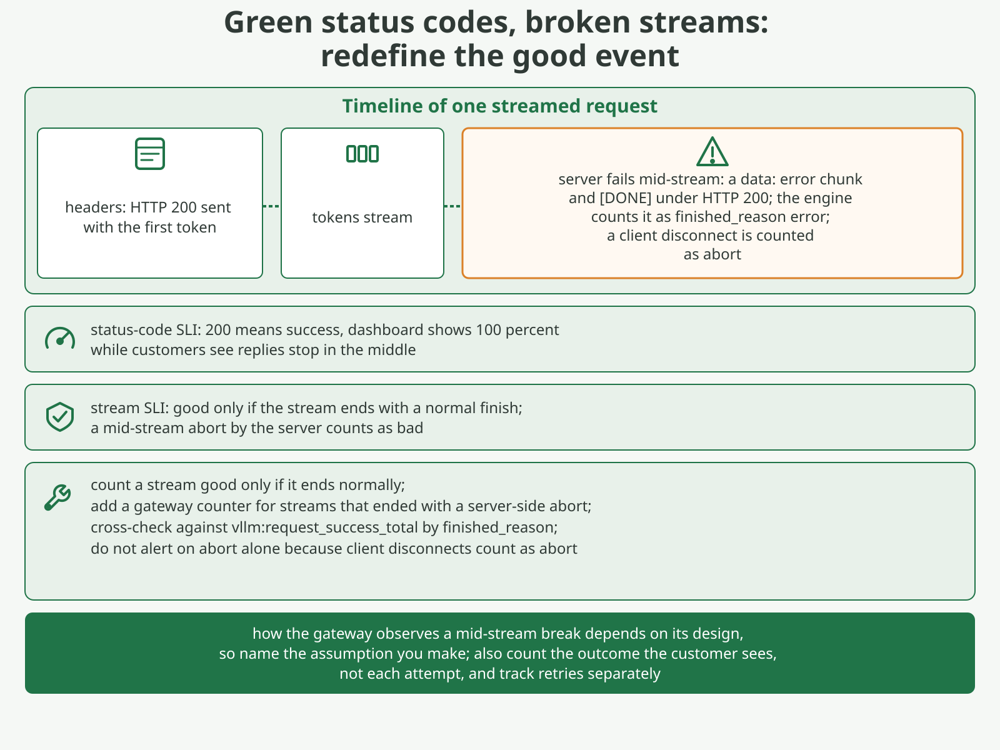

*Figure 20.19.20. Once the stream is the unit of work, did it finish normally becomes the SLI.*

The gateway shows 100% success by status code. Customers say replies stop in the middle. The status code is 200 because the headers went out with the first token. Streams that break later are invisible to a status-code SLI.

The fix has three parts. Count a stream good only if it ends normally. Add a gateway counter for streams that ended with a server-side abort. Cross-check against the engine: `vllm:request_success_total` by `finished_reason`. In v0.32.0 a server-side failure after the first token ends the stream with a `data:` error chunk and `[DONE]` under HTTP 200, and the engine counts it as `error`. A client that disconnects is counted as `abort`, so do not alert on abort alone. How your gateway can observe a mid-stream break depends on its design, so name the assumption you make.

The lesson of this scenario is that a green dashboard is only as honest as its definition of success. The customers were right and the dashboard was reporting something true but narrow. Once the stream is the unit of work, the question "did this stream finish normally?" becomes the SLI, and the status code becomes one input among several. Walk the interviewer through that change and you show that you can fix the measurement, not only the system.

## Hands-on lab

The lab runs on a laptop with Python 3, pytest and `promtool`. I ran every step below on this Mac with Prometheus `promtool` built from Prometheus module v0.316.0. The version string printed by `promtool --version` was empty on this build, so the module version came from the binary's build info. Treat the steps as a record of what I saw on that one machine, and expect your own output to differ in small ways.

The lab follows the same order as the chapter. First you check that the rule files parse, then you run the synthetic tests that prove the alerts behave as the text claims. After that you break a threshold on purpose, so you can see a test fail and understand what it protects. The last steps run the calculator and the detection times, which connect the rules back to the arithmetic in sections 5 and 6. Do the steps in order, because each one assumes the earlier files are in place.

1. Put `promtool` on your path and move to the code folder.

```bash
export PATH=$PATH:~/go/bin
cd code/part20
```

2. Validate the rule files. Expected result: each file prints `SUCCESS` and a rule count. I ran it and got 12 recording rules in `slo_recording_rules.yaml`. The same run found 5 in `slo_engine_rules.yaml`. Each of the two burn files had 3, and the cause file had 6.

```bash
promtool check rules slo_recording_rules.yaml slo_engine_rules.yaml \
  slo_burn_alerts_availability.yaml slo_burn_alerts_ttft.yaml slo_cause_alerts.yaml
```

3. Run the rule unit tests. Expected result: `SUCCESS` for each file. I ran both and both passed.

```bash
promtool test rules slo_rules_test_availability.yaml
promtool test rules slo_rules_test_ttft_engine.yaml
```

4. Break a threshold on purpose. Change `rate1h > 0.0144` to `rate1h > 0.0200` in `slo_burn_alerts_availability.yaml` and rerun the availability test. I did this. The test named "two percent errors pages fast and medium" failed with `got:[]`, because 2% is not strictly above 2%. Restore the file afterwards.

5. Run the Python tests and the calculator. I got 15 passed.

```bash
python3 -m pytest -q test_slo_burn_rate.py
python3 slo_burn_rate.py
```

The calculator printed a budget of 43.20 minutes for 99.9% over 30 days. It printed the three alert rows with budgets of 2.0%, 5.0% and 10.0%, and it reported that a total outage trips the 14.4 page after 52 seconds. Run it with `--slo 0.99` and the same outage takes 518 seconds, because the threshold is 14.4%.

6. Try the detection times yourself in a Python shell.

```python
import slo_burn_rate as b
b.minutes_to_detect(0.01, 0.999, 6, 6)       # 216.0 minutes, 3.6 hours
b.minutes_to_detect(0.005, 0.999, 1, 72) / 60  # 14.4 hours
```

I ran both. They match the hand calculation in section 6.

## Drill questions

<details>
<summary>1. What is an SLI in the form the SRE Workbook recommends?</summary>

A ratio of good events to total valid events. It runs from 0% to 100%, which makes the error budget calculation consistent.
</details>

<details>
<summary>2. How many minutes of full outage does a 99.9% SLO allow in 30 days?</summary>

43.2 minutes. The month has 43,200 minutes and the budget is 0.1% of that.
</details>

<details>
<summary>3. A 10M-request day. How many failures does 99.9% allow?</summary>

10,000 requests, since 0.1% of 10 million is 10,000. Over 30 days of 10M each it is 300,000 out of 300 million.
</details>

<details>
<summary>4. Define burn rate and compute it for a 1% error ratio at a 99.9% SLO.</summary>

Burn rate is how fast the service consumes error budget relative to the SLO. It equals error ratio divided by budget. One percent over 0.1% is 10. At that rate a 30-day budget lasts 72 hours.
</details>

<details>
<summary>5. Give the three Workbook alerts for 99.9%.</summary>

Page at burn 14.4 with 1 hour and 5 minute windows, using 2% of budget. Page at burn 6 with 6 hour and 30 minute windows, using 5%. Ticket at burn 1 with 3 day and 6 hour windows, using 10%.
</details>

<details>
<summary>6. Why does the alert need a short window?</summary>

The long window alone stays above the threshold for a long time after errors stop. The short window drops quickly after recovery, so the alert clears within minutes.
</details>

<details>
<summary>7. 950 requests at 0.4 s and 50 at 8 s. What is the mean and why is it a poor SLI?</summary>

The mean is 0.78 s. It sits under a 1 s limit while 5% of requests are eight times slower than the limit. The share of requests under the limit would show 95%.
</details>

<details>
<summary>8. Why can you not average p99 across replicas?</summary>

Quantiles do not combine. Sum the histogram buckets across replicas first and compute the quantile from the sum.
</details>

<details>
<summary>9. A reply has 500 tokens, TTFT 0.4 s and inter-token latency 0.04 s. What is the end-to-end latency?</summary>

0.4 plus 0.04 times 499, which is 20.36 s. The formula is TTFT plus ITL times N minus 1.
</details>

<details>
<summary>10. Name the finish reasons in vLLM v0.32.0 and which one you would watch for drift.</summary>

Stop, length, abort, error and repetition. Watch the share of length as a quality signal, and any growth of repetition or error.
</details>

<details>
<summary>11. Why measure SLO ratios at the gateway and not at the engine?</summary>

The engine cannot see requests queued before it, dead replicas, retries or routing failures. The gateway sees what the customer sees. The engine explains why.
</details>

<details>
<summary>12. What does the Watchdog alert do?</summary>

It always fires. A receiver pages you when it stops arriving, which proves that the metrics and alerting pipeline is down.
</details>

## Common mistakes and weak answers

Interviewers hear the same few weak answers again and again, and each one is a small signal about how you think. The table names the answer, what it costs you, and what to say instead.

| Weak answer | What loses points | Say instead |
|---|---|---|
| "I would alert when p99 latency is above X" | No budget, flaps, cannot aggregate | "I would count the share of requests under X and alert on burn rate" |
| "Average latency under one second" | Averages hide the tail | Give the 0.78 s example and ask for a percentile or a ratio |
| One end-to-end limit for every request | Output length changes latency about 100 times | Judge TTFT and per-token speed separately, or bucket by length |
| Paging on GPU utilisation, KV usage or queue depth | Causes, not symptoms | Make them tickets and page on the burn |
| "99.9% is almost no downtime" | Shows no arithmetic | 43.2 minutes per 30 days, and 259,200 failed requests at 100 per second |
| Using status code 200 as success for streams | Misses mid-stream failures | Count stream completion |
| Claiming Nebius's SLO values | You cannot know them | Say they are unpublished and give your own reasoning |
| No tenant guard on low traffic | Noise pages | Require a minimum request rate |

## Connections to the rest of the handbook

- Chapter c17-06, [Alerting, SLOs and health checks for GPU clusters](../part-17-operations/06-alerting-slos-and-health-checks-for-gpu-clusters.md), covers the Alertmanager routing and inhibition basics that this chapter assumes. Chapters c17-01 and c17-02 cover [metrics, logs and traces](../part-17-operations/01-observability-foundations-metrics-logs-and-traces.md) and [Prometheus and Grafana](../part-17-operations/02-prometheus-and-grafana.md).
- Chapters c17-03 to c17-05 cover [logging and tracing](../part-17-operations/03-logging-with-loki-and-tracing-with-opentelemetry.md), [GPU metrics](../part-17-operations/04-dcgm-exporter-and-interpreting-gpu-metrics.md) and [distributed profiling](../part-17-operations/05-distributed-observability-and-profiling.md), which supply the cause signals.
- Chapter c20-13, [Design: a multi-tenant LLM inference API](13-design-a-multi-tenant-llm-inference-api.md), is where these SLIs attach to the design.
- Chapters c20-18 and c20-20 and c20-21 cover how serving fails, autoscaling, and routing and retries. Chapter c20-25 covers PromQL traps and cardinality in depth.

## Sources and review notes

Sources and the date fetched or read, 2026-11-09 for all online pages:

- Google SRE Workbook, "Alerting on SLOs", https://sre.google/workbook/alerting-on-slos/. The source of Table 5-8, the burn rate definition and the one-twelfth short window guidance. The page's formulas are MathML that does not survive text extraction, so the budget and detection formulas in this chapter are derived by me and confirmed by the calculator tests and by hand against Tables 5-4 and 5-8.
- Google SRE Workbook, "Implementing SLOs", https://sre.google/workbook/implementing-slos/. Error budget definition, the 3 million request example, SLI as a ratio and the error budget policy contents.
- Google SRE book, "Service Level Objectives", https://sre.google/sre-book/service-level-objectives/. Definitions, percentiles over averages, target guidance.
- Google SRE book, "Monitoring Distributed Systems", https://sre.google/sre-book/monitoring-distributed-systems/. Golden signals, symptoms versus causes, actionable pages, alert fatigue.
- Prometheus, "Histograms and summaries", https://prometheus.io/docs/practices/histograms/. Bucket alignment, interpolation error, aggregation of histograms.
- vLLM source, `vllm/v1/metrics/loggers.py`, `vllm/v1/metrics/buckets.py` and `vllm/v1/engine/__init__.py` at tag v0.32.0, and `docs/design/metrics.md` at the same tag, from raw.githubusercontent.com. Metric names, labels, bucket boundaries and finish reasons. The docs site returned HTTP 429 so I used the source at the tag. The latest release listed on GitHub when I checked was v0.33.0rc3 and the main branch loggers file showed the same metric names. The `_total` suffix on counters comes from the v0.32.0 metrics design page.
- DistServe paper abstract, https://arxiv.org/abs/2401.09670.
- Systems Performance, 2nd edition, Chapter 2 "Methodologies", sections 2.8.2 to 2.8.6 on averages, percentiles, multimodal distributions and outliers.
- Production Kubernetes, Chapter 9 "Observability", the parts on labels and cardinality, alerting and the dead man's switch.
- LLMs in Production, Chapter 6 "Large language model services", the streaming discussion and section 6.2.5 on monitoring.
- Hands-On LLM Serving and Optimization, Chapter 4 "Model Serving Best Practices", sections on latency metrics, throughput metrics and best practices for performance measurement.
- AI Factory: I searched Chapters 5, 8 and 9 for service levels and monitoring. They discuss industrial AI and only mention service-level agreements in passing, in the cloud storage replication discussion of Chapter 9. I did not use it for any claim here.
- Plan for this volume, section 1, for the job posting wording and the Token Factory observability and case study details, all tagged vendor or official there.

Explicitly labelled inferences:

- The gateway metric names and labels, all SLO targets such as 99% under 1.0 s, the traffic guard of 0.1 requests per second, the finish reason drift rule and the split between page and ticket are my design choices.
- The dedicated versus serverless counting rule and the table in section 10 are my reasoning. Nebius has not published its SLO terms.
- The claim that streaming failures are invisible to status-code SLIs is now confirmed for vLLM v0.32.0 source (see the verification log). For the Nebius gateway it remains my reasoning.
- The cardinality figure of 460,000 series is arithmetic from an assumed 22 buckets plus a count series and an assumed 1,000 tenants and 20 models.

Not verified:

- The rules were tested only against synthetic input in `promtool test rules`. I did not run them against a live vLLM server or Prometheus instance, so the real shape of scraped labels such as `engine` is taken from the source and not observed.
- The `le="1.0"` label format was confirmed with the Python `prometheus_client`. I did not confirm that every Prometheus client version formats it the same way.
- The statement that the vLLM docs site metric list matches v0.32.0 exactly was not checked against the live docs page, which returned HTTP 429. The metric names in this chapter come from source at the tag.

### Verification log (fact-check pass, 2026-11-09)

Resolved 5 flagged claims: 4 confirmed, 1 still unverified.

- CONFIRMED against sre.google/workbook/alerting-on-slos (re-fetched 2026-11-09): Table 5-8 rows (1 h and 5 min at 14.4 for 2%, 6 h and 30 min at 6 for 5%, 3 days and 6 h at 1 for 10%), Table 5-6 (same percentages with a 3 day ticket window), Table 5-4 (burn 1000 is 100% errors and 43 minutes), and the "1/12 of the long window" guidance.
- RECOMPUTED: 14.4 x 1 / 720 = 2%, 6 x 6 / 720 = 5%, 1 x 72 / 720 = 10%. Thresholds 0.0144, 0.006, 0.001 at budget 0.001. Time to empty 50, 120, 720 hours. Detection at 100% errors is 0.0144 h, about 52 s. All match the chapter, so no text or test change was needed. `pytest test_slo_burn_rate.py` 15 passed. `promtool test rules` passed for both rule test files.
- CONFIRMED: the Workbook itself warns that Table 5-8 cannot fire for low-availability SLOs, since a total outage of a 90 percent target consumes only 1.4 percent in an hour. It is a useful follow-up answer.
- CONFIRMED (vLLM v0.32.0 source): streamed failures after the first token arrive as an SSE error chunk under HTTP 200 and count as `finished_reason="error"`. Client disconnects count as `abort`.
- STILL UNVERIFIED: the `le="1.0"` label format across every Prometheus client version, the gateway metric names, and Nebius SLO terms.
